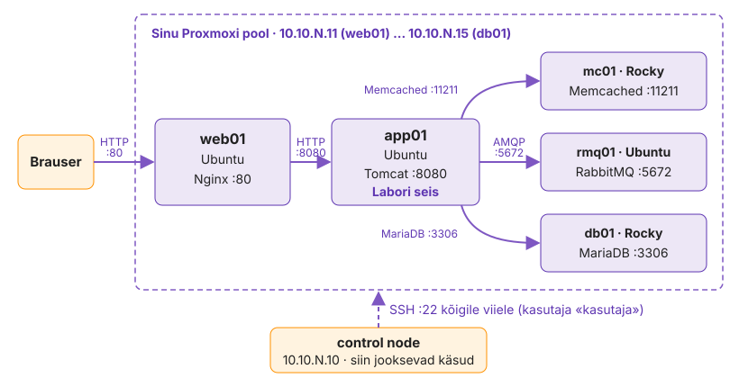

---
tags:
  - Kursuse ülevaade
hide:
  - navigation
---

# IT-infrastruktuuri automatiseerimine I

- **Aeg:** 7 kohtumist, kord nädalas, 10:00–15:00
- **Maht:** 40 A-t
- **Koht:** HKHK klass ja VPN-iga koolitaja Proxmoxi keskkond
- **Koolitajad:** Maria Talvik, Rain Koor

Seitsmel kohtumisel paned ühe rakenduse, **Labori seisu**, üles seitse korda: Bashi skriptidega, Ansible'iga, konteinerites,
OpenTofuga (Terraformi avatud haru), GitHub Actionsi pipeline'iga, Jenkinsis ja Kubernetesis. Iga kord on sama töö eelmisest
automaatsem ja näed, mida uus tööriist sinu eest teeb ja mida mitte.

Kursuse lõpus oskad viia käsitsi hallatava teenuse koodi: paigaldus ja konfiguratsioon Ansible'iga, masinad OpenTofuga, rakendus konteineris,
tarne pipeline'iga ja käitus Kubernetesis, nii et iga muudatus on Gitis, kontrollitav ja tagasivõetav.

-   **[Kohtumised](k01/loeng.md)**

    Iga päeva loeng, labor ja lisaülesanded. Klassis Proxmoxis.

-   **[Pilv (AWS)](kodutood/kodutood.md)**

    Sama päeva oskus AWS-is. Kodus, oma kontol. Enne esimest kodutööd loe [reeglid, kulud ja koristus](kodutood/aws-reeglid.md).

-   **[Monitooring](kodutood/monitooring.md)**

    Üks väike ülesanne iga päeva tööriistaga. Proxmoxis.

-   **[Teemad](teemad/it-automatiseerimine.md)**

    Automatiseerimise valdkonnad: mehhanismid, tööriistad ja intsidendid.

## Enne esimest kohtumist

Tee läbi **[Töökeskkonna ettevalmistus](00-ulevaade/keskkond.md)**: VPN ja VS Code (Windows, macOS, Linux).

- Loo GitHubi konto, kui sul seda pole.
- Juhendajalt saad VPN-i andmed, oma VM-ide IP-d ja parooli.
- Võta vastu Classroom 50 kutse.

Paroole, tokeneid, `.env`, `secrets.env`, `terraform.tfvars` ega `*.tfstate` faile ei panda Giti.

## Kohtumised

| Kohtumine | Teema | Kohtumise lõpus |
|---|---|---|
| 1 | **Bash**, Git ja Ansible'i algus | Labori seis viiel VM-il `deploy-all.sh`-iga, veebimall Ansible'iga |
| 2 | **Ansible'i** rollid | kogu stack rollidega, TLS, rolling deploy ja rollback |
| 3 | **Docker** ja Podman | stack Docker Compose'iga, image registry's, Trivy skänn, sama teenus Podmaniga |
| 4 | **OpenTofu (Terraform)** ja Packer | golden image, viis VM-i koodist ja Ansible ühe käsuga |
| 5 | **GitHub Actions** ja Maven | pipeline build → test → Trivy → image → deploy |
| 6 | **Jenkins**, SonarQube ja Nexus | sama tarne Jenkinsis quality gate'iga |
| 7 | **Kubernetes** (k3s) ja GitOps | Labori seis klastris Argo CD kaudu, lõputest |

*Tabel 0.1. Kohtumised, teemad ja tulemus.*

## Mida iga tööriist kirjeldab

Ülesanne jääb samaks, muutub see, mida sa kirjeldad ja kus on risk.

| Lähenemine | Mida kirjeldad | Tüüpiline risk |
|---|---|---|
| Käsitsi | üksikuid samme | tulemus sõltub inimesest |
| Bash | käskude järjekorda | idempotentsus tuleb ise ehitada |
| Ansible | soovitud lõppseisu | vale inventory või moodul |
| Docker | rakendust koos keskkonnaga | image paisub, saladused kihtides |
| OpenTofu (Terraform) | taristuressursse | state'i haldus |
| CI/CD | tarneahelat | katkine pipeline peatab kõik |
| Kubernetes ja GitOps | soovitud seisu klastris | keerukus, Git peab olema tõe allikas |

*Tabel 0.2. Lähenemised: mida kirjeldad ja kus on risk.*

## Labori keskkond

<figure markdown="span">
  
  <figcaption>Joonis 0.1. Labori seisu topoloogia: päringu tee ja haldus control node'ist.</figcaption>
</figure>

Sinu töökoht on control node (`10.10.N.10`, N on sinu number), selle kõrval on viis VM-i `.11`–`.15`. Kasutaja kõigis masinates on `kasutaja`.
4. kohtumisel kustutad viis VM-i ja lood need OpenTofuga uuesti. 7. kohtumisel töötad koolitaja k3s klastris oma namespace'is ja
ehitad lisaks oma ühe node'iga klastri.

## Töö repos

Kogu kursuse töö on ühes GitHubi repos. Iga kohtumise töö teed oma harus, kohtumise lõpus ühendad selle `main`-i ja paned tag'i
`k01`…`k07`. Tag on seis, mille esitad hindamiseks. Käsud, kaustad, päeva kava ja hindamine on lehel
[Töö repos ja hindamine](00-ulevaade/too-ja-hindamine.md).
