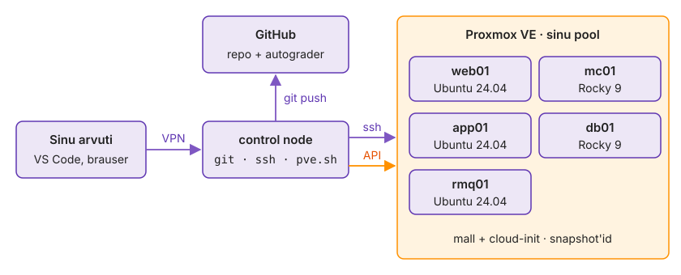

---
tags:
  - Proxmox
  - Git
  - SSH
---

# 1. Keskkond

Kui üks host jääb valesse võrku, võti on puudu või nimi lahendub seal teisiti kui mujal, näed seda tunde hiljem segase veana teenuse paigalduses ja otsid põhjust valest kohast. Lõpuks töötavad viis VM-i, control node logib neisse nimepidi sisse ja kursuse repo on harul `k01-bash`.

**Kui teed seda tööl iga päev:** `for h in web01 app01 rmq01 mc01 db01; do ssh -n "$h" hostname; done` annab viis nime ilma küsimuseta, `k01-bash/hosts` on olemas, igal VM-il on snapshot `algus` ja `git status` näitab haru `k01-bash`. Kui see on sul juba korras, mine otse etappi [„Proovi rollback'i enne, kui seda vajad“](#proovi-rollbacki-enne-kui-seda-vajad).

Sinu arvuti on ainult aken: kõik käsud käivitad control node'il, kust SSH läheb VM-idesse ja `git push` GitHubi.

<figure markdown="span">
  
  <figcaption>Joonis L1.1. Labikeskkond: control node'ist lähevad SSH VM-idesse ja <code>git push</code> GitHubi.</figcaption>
</figure>

## Seadista VM-id Cloud-Init'iga

Pilvepildis on parooliga SSH keelatud, nii et control node'i võti jõuab VM-i ainult Cloud-Init'i kaudu. Kui koolitaja on võtme mallidesse pannud, jäta sammud 1–3 vahele.

Sama mehhanism töötab AWS-is, Azure'is ja igas OpenStackis: VM-il pole esimesel boodil ühtki parooli, ainult võti, mille platvorm annab kaasa. Kui võti on vale, ei aita konsool ega uuesti proovimine, VM tuleb seadistada uuesti.

1. Tee control node'il võti ja kuva avalik osa.

    ```bash
    ssh-keygen -t ed25519 -C "control-$(whoami)"
    cat ~/.ssh/id_ed25519.pub
    ```

2. Proxmoxis iga VM-i **Cloud-Init** vahekaardil: kasutaja `kasutaja`, IP koolitaja tabelist, **SSH public key** = `cat` väljund.
3. Vajuta **Regenerate Image**.
4. Pane **Hardware** all ressursid tabeli järgi ja käivita kõik viis VM-i.

Kõige rohkem mälu saab app01, sest seal töötab Tomcat ja Java; mc01 on väikseim, sest Memcached vajab laboris vaid mõnikümmend megabaiti. Kooli Proxmoxis jagavad kõik õppijad sama mälu, seepärast ära pane rohkem, kui tabelis on.

| VM | OS | RAM | CPU |
|---|---|---|---|
| web01 | Ubuntu 24.04 | 512 MB | 1 |
| app01 | Ubuntu 24.04 | 1 GB | 1 |
| rmq01 | Ubuntu 24.04 | 768 MB | 1 |
| mc01 | Rocky 9 | 512 MB | 1 |
| db01 | Rocky 9 | 768 MB | 1 |

*Tabel L1.1. Labori VM-ide ressursid.*

<!-- EKRAANIPILT: Proxmoxi veebiliides, VM web01 → Cloud-Init vahekaart. Näha peavad olema User = kasutaja, IP Config (net0) staatilise IP-ga, SSH public key (control-… rida) ja nupp Regenerate Image. Tee pärast Cloud-Init'i salvestamist.
<figure markdown="span">
  
  <figcaption>Joonis L1.2. VM-i Cloud-Init vahekaart pärast seadistamist.</figcaption>
</figure>
-->

✅ **Edasi saad minna, kui** kõik viis VM-i on olekus *running* ja konsoolis on login-prompt.

## Oota cloud-init'i lõppu

Kuni cloud-init töötab, hoiab see apt-i lukus ja iga paigaldus ebaõnnestub veaga `Could not get lock`. Seepärast küsid igalt hostilt kõigepealt, kas esimene boot on lõppenud, ja alles siis midagi muud.

Kasutad siin veel IP-aadresse, sest nimesid control node veel ei tunne. Tsükkel võtab iga hosti vastu esimest korda (`accept-new`) ja küsib kolm asja: kas cloud-init lõpetas, mis on hosti nimi ja mis distro seal töötab.

```bash
for ip in <web01 IP> <app01 IP> <rmq01 IP> <mc01 IP> <db01 IP>; do
    ssh -o StrictHostKeyChecking=accept-new kasutaja@"$ip" \
        'cloud-init status --wait; hostname; . /etc/os-release; echo "$ID $VERSION_ID"'
done
```

Iga host peab vastama `status: done`, õige nime ja distroga: web01, app01, rmq01 `ubuntu 24.04`, mc01 ja db01 `rocky 9.x`.

Kui nimi ja IP ei klapi, on Cloud-Init vahekaardil kaks VM-i omavahel vahetusse läinud. Parem leida see nüüd, mitte stacki paigaldades, kui andmebaasi skript läheks veebiserverisse.

> `status: error` korral vaata `sudo cloud-init status --long`; tavaliselt on Cloud-Init vahekaardil vale IP või gateway.

✅ **Edasi saad minna, kui** kõik viis hosti on `status: done` ja distrod klapivad.

## Tee snapshot `algus`

Rollback võtab laboris alla minuti. Snapshot `algus` on seis pärast cloud-init'i ja võtme lisamist, enne ühtki sinu muudatust.

1. Proxmoxis iga VM-i juures **Snapshots → Take Snapshot**.
2. Nimi `algus`, **Include RAM** maha.

<!-- EKRAANIPILT: Proxmoxi veebiliides, VM db01 → Snapshots. Nimekirjas on snapshot "algus" (RAM: No) ja "NOW"; ülal nupud Take Snapshot, Rollback, Remove. Tee pärast snapshot'i loomist.
<figure markdown="span">
  
  <figcaption>Joonis L1.3. Snapshot <code>algus</code> VM-i snapshot'ide nimekirjas.</figcaption>
</figure>
-->

✅ **Edasi saad minna, kui** igal viiel VM-il on snapshot `algus`.

## Seadista Git ja klooni repo

Repo on sinu töö ainus koht, mida automaatne hindaja ja koolitaja näevad. VM-id võid iga hetk tagasi kerida, repo jääb. Seepärast läheb siia kõik, mida tahad alles hoida: skriptid, märkmed ja hostifail.

1. Seadista Git ja proovi GitHubi ühendust.

    ```bash
    git config --global user.name "Ees Perekonnanimi"
    git config --global user.email "sinu@email"
    ssh -T git@github.com
    ```

2. `Permission denied (publickey)` korral lisa avalik võti GitHubi: `gh ssh-key add ~/.ssh/id_ed25519.pub -t control-node`.
3. Klooni repo ja loo haru.

    ```bash
    git clone git@github.com:hkhk-tk/<klassiruum>-labori-seis-<github>.git ~/labori-seis
    cd ~/labori-seis
    git switch -c k01-bash
    ```

Töötad harul, mitte `main`-il, sest esitamine käib PR-iga. `main` jääb puhtaks kuni esitamise merge'ini ja automaatse hindaja tag läheb sinna.

✅ **Edasi saad minna, kui** `ssh -T git@github.com` tervitab sind nimepidi ja `git status` näitab haru `k01-bash`.

## Pane nimed `/etc/hosts`-i

`curl`, Tomcat ja Nginx küsivad nime süsteemilt, `~/.ssh/config` aitaks ainult `ssh`-d. Kõik järgmised moodulid kasutavad nimesid.

Laboris pole DNS-serverit, seega kirjutab `etc-hosts.sh` nimed `/etc/hosts`-i. Sama skript käivitub stacki paigaldades ka igas VM-is, et app01 leiaks db01 ja Nginx leiaks app01. Hostifail repos on seepärast üks tõe allikas kogu stacki jaoks.

1. Tee näidisest oma fail ja pane sinna viie hosti IP-d: `cp k01-bash/hosts.example k01-bash/hosts`
2. Loe `k01-bash/etc-hosts.sh` läbi: mis juhtub teisel käivitusel ja miks kirjutab see ploki ka cloud-init'i malli.
3. Kirjuta nimed control node'i `/etc/hosts`-i.

    ```bash
    sudo bash k01-bash/etc-hosts.sh < k01-bash/hosts
    getent hosts db01
    ```

4. Võrdle sama nime kahe tööriistaga.

    ```bash
    getent hosts db01; dig +short db01
    getent hosts github.com; dig +short github.com
    ```

Skriptis kontrollid nime `getent`-iga, sest see läbib sama NSS-i ahelat (`files dns`) mis Tomcat ja Nginx; `dig` näitab ainult DNS-i vastust.

✅ **Edasi saad minna, kui** `getent hosts db01` annab db01 IP ja `dig +short db01` on tühi.

## Kirjuta `~/.ssh/config`

`~/.ssh/config` annab nimele kasutaja ja hiljem võtme; ilma selleta logiks iga skript, mis `kasutaja@` unustab, sisse sinu kohaliku kasutajanimega.

1. Lisa igale hostile kirje: `Host <nimi>`, `HostName <IP>`, `User kasutaja`. Olemasolevaid ridu ära kustuta.
2. Proovi kõiki viit.

    ```bash
    for h in web01 app01 rmq01 mc01 db01; do ssh "$h" hostname; done
    ```

Kui mõni host küsib midagi, on see kas uus hostivõti või puuduv `User`. Mitme hosti skriptid ei tohi midagi küsida, seepärast peab see tsükkel juba nüüd olema vaikne.

✅ **Edasi saad minna, kui** tsükkel annab viis hostinime ja ei küsi midagi.

## Proovi rollback'i enne, kui seda vajad

Hiljem teed rollback'iga hosti tühjaks nii enne stacki paigaldust kui ka taastamise harjutuses. Proovi seda nüüd, kui midagi kaotada pole: nii tead, kui kaua see võtab ja mis seis pärast on.

1. Jäta mc01-sse jälg ja vaata, et see on olemas.

    ```bash
    ssh mc01 'touch ~/rollback-proov && ls ~/rollback-proov'
    ```

2. Proxmoxis **mc01 → Snapshots → `algus` → Rollback**. Vaata VM-i olekut ja vajuta siis **Start**.
3. Oota, kuni host vastab, ja vaata, mis jäi alles.

    ```bash
    until ssh mc01 true; do sleep 3; done
    ssh mc01 'ls ~/rollback-proov; hostname; cloud-init status'
    ```

Fail on kadunud, hostinimi ja võti on alles ning ssh ei hoiata muutunud hostivõtmest. See tõestab, et rollback viib ketta tagasi, aga ei loo uut VM-i: identiteet jääb samaks. Kui ssh oleks hoiatanud `REMOTE HOST IDENTIFICATION HAS CHANGED`, oleks VM loodud uuesti, mitte tagasi keritud.

✅ **Edasi saad minna, kui** `ls` ütleb `No such file or directory`, `cloud-init status` on `done` ja `NOTES.md`-s on kirjas, mis olekus VM pärast rollback'i oli ja mitu sekundit läks Start'ist SSH-ni.

## Commit

Commit'id ainult hostifaili: IP-d ei ole saladus ja järgmised skriptid loevad neid sealt. Võtmed ja Proxmoxi andmed jäävad repost välja.

```bash
git add k01-bash/hosts
git commit -m "hosts: viis labori hosti"
git push -u origin k01-bash
```

✅ **Edasi saad minna, kui** haru `k01-bash` on GitHubis.

📎 **Selle mooduli tõend:** commit `hosts: viis labori hosti`; `NOTES.md`-s `cloud-init status` väljund, rollback'i proovi tulemus ja Cloud-Init'i ning snapshot'i ekraanipilt.

## Miks see nii töötab

**Cloud-init.** Proxmox kirjutab Cloud-Init vahekaardi väärtused eraldi kettale (NoCloud-andmeallikas, silt `cidata`): `user-data`, `meta-data` ja `network-config`. [Cloud-init](https://cloudinit.readthedocs.io/) loeb need local-etapis, seab võrgu enne võrguteenuste käivitumist ja teeb paketitöö config- ja final-etapis. Proxmox arvutab `instance-id` nende seadete põhjal. Pärast **Regenerate Image**'it peab cloud-init järgmisel boodil VM-i uueks instance'iks ja käivitab per-instance moodulid (kasutaja, võtmed) uuesti; töötav VM muudatust ei näe.

**Apt-i lukk esimesel käivitusel.** Ilma `cloud-init status --wait`-ita sõltub skripti tulemus sellest, kui kiiresti pärast VM-i käivitumist skripti alustasid. Sama probleem esineb ka AWS-is ja teistel platvormidel, kus VM luuakse mallist.

**`/etc/hosts` ja cloud-init'i mall.** Kui user-data's on `manage_etc_hosts: true`, kirjutab cloud-init faili `/etc/hosts` igal käivitusel mallist üle. Kursuse Proxmoxi genereeritud user-data's on see väärtus seatud. Seepärast kirjutab `etc-hosts.sh` ploki ka faili `/etc/cloud/templates/hosts.*.tmpl`. Kui kirjutaksid ainult `/etc/hosts`-i, töötaks kõik kuni esimese taaskäivituseni. Pärast seda ei leiaks app01 enam nime db01, kuigi repos pole midagi muutunud.

**Snapshot ilma RAM-ita.** Snapshot võib sisaldada ka mälu sisu. Ilma RAM-ita snapshot salvestab ainult ketta seisu, seepärast on see kiire ja väike. Rollback'i järel on VM peatatud ja käivitub nagu pärast voolukatkestust. See on parem test kui mälust jätkamine, sest nii käivitub server ka pärast voolukatkestust või krahhi.

**Snapshot ja backup.** Proxmoxi snapshot on storage'i enda mehhanism (LVM-thin, ZFS, qcow2) ja kaob koos storage'iga; `vzdump` teeb eraldi arhiivi. Laboris piisab snapshot'idest, sest masinad on ühekordsed ja kõik vajalik on repos. Rollback viib tagasi kogu ketta, ka selle, mida tahtsid alles hoida: kui lisad automatiseerimise võtme pärast snapshot'i, on see pärast rollback'i kadunud.

Kui jõudsid kiiremini: [Lisaülesanded → 4. Taaskäivituse test](lisa.md#4-taaskaivituse-test), teed app01-le ja web01-le reboot'i ja kontrollid, kas nimed ja `/etc/hosts` plokk jäävad alles.
