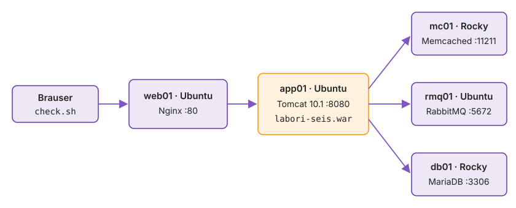

---
tags:
  - Bash
  - Labori seis
---

# 4. Viis teenust ühe käsuga

Deploy, mis ei oota alumise kihi vastamist, lõpeb koodiga 0 ja jätab rakenduse katki: Tomcat käivitus enne andmebaasi, Nginx annab 502 ja monitooring vaatab ainult porte, mis kõik vastavad. Labori seis on viiekihiline Java veebirakendus. `deploy-all.sh` paigaldab selle alt üles ja sinu health check ootab iga kihi järel, kuni teenus vastab, ning peatab deploy, kui vastust ei tule. `check.sh` ütleb iga kihi seisu ja annab väljumiskoodi nagu monitooringu kontroll.

Topoloogia joonist loe paremalt vasakule, nagu päring liigub: brauser küsib web01-lt, Nginx annab päringu app01 Tomcatile ja Tomcat räägib kolme taustateenusega. Paigaldus käib vastupidi, alt üles.

**Kui teed seda tööl iga päev:** igal VM-il on snapshot `enne-stack`, `bash ../autograde/check.sh k01 secrets` annab `OK` ja sinu `deploy-all.sh` täidab etappide „Vigane hostifail…“ ja „Lisa health check“ nõuded (`GATE_TIMEOUT=10` vale pordiga lõpeb koodiga 1). Kui see on sul juba korras, mine otse etappi [„check.sh: iga kiht eraldi“](#checksh-iga-kiht-eraldi).

<figure markdown="span">
  
  <figcaption>Joonis L1.5. Labori seisu topoloogia: web01 Nginx, app01 Tomcat, taga RabbitMQ, MariaDB ja Memcached.</figcaption>
</figure>

| Host | Teenus | Port | Skript |
|---|---|---|---|
| db01 | MariaDB, andmebaas `labseis` | 3306 | `services/mariadb.sh` |
| mc01 | Memcached | 11211 | `services/memcache.sh` |
| rmq01 | RabbitMQ, kasutaja `labseis` | 5672 | `services/rabbitmq.sh` |
| app01 | Tomcat 10.1 + `labori-seis.war` | 8080 | `services/tomcat.sh` |
| web01 | Nginx reverse proxy | 80 | `services/nginx.sh` |

*Tabel L1.2. Hostid, teenused, pordid ja skriptid. Siit edasi töötad kaustas `~/labori-seis/k01-bash`.*

## Puhas algseis ja snapshot

mc01-s on veebimalli katsetest `httpd`. Vii mc01 tagasi puhtaks ja tee kõigist viiest snapshot enne stacki.

Kui mc01-s jääks katsetest töötav Apache, ei tea sa hiljem, kas mõni käitumine tuleb sinu skriptist või vanast jäägist. Snapshot `enne-stack` on punkt, kuhu saad veaotsingul ja operatsiooni harjutustes tagasi minna, kui tahad stacki nullist uuesti paigaldada.

> ⚠️ Rollback kustutab mc01-st kõik, mis tehti pärast snapshot'i `algus`.

1. Proxmoxis **mc01 → Snapshots → `algus` → Rollback**, siis **Start**.
2. Rollback viis ära ka automatiseerimise võtme. Pane see tagasi ja kontrolli.

    ```bash
    until ssh mc01 true; do sleep 3; done
    ssh-copy-id -i ~/.ssh/id_ed25519_labseis.pub mc01
    ssh mc01 'rpm -q httpd'
    ```

3. Tee igal viiel VM-il snapshot `enne-stack`, **Include RAM** maha.

Automatiseerimise võti kadus, sest snapshot `algus` tehti enne automatiseerimise võtme loomist. `until ssh mc01 true` õnnestus sinu isikliku võtmega, sest `~/.ssh/config` pakub mõlemat.

Samal põhjusel kadus mc01-st sshd poliitika. See on drift, mille kood parandab: `k01-bash/sshd-policy.sh` paneb selle tagasi ja teistes hostides ütleb "muudatusi pole".

✅ **Edasi saad minna, kui** `rpm -q httpd` ütleb "not installed" ja igal VM-il on snapshot `enne-stack`.

## Saladused

Paroolid on failis `secrets.env`, mis ei lähe Giti ega ühegi käsu käsureale.

Käsurida on loetav `/proc/<pid>/cmdline`-ist ja sudo kirjutab selle journal'isse (`journalctl -t sudo`). `deploy-all.sh` saadab saladused ssh stdin'i.

1. Tee fail ja muuda kõik `muuda-mind` väärtused, `LABSEIS_TOKEN` (koolitajalt) ja `TOMCAT_URL` (tahvlilt).

    ```bash
    cd ~/labori-seis/k01-bash
    cp secrets.env.example secrets.env && chmod 600 secrets.env
    git check-ignore -v secrets.env
    bash ../autograde/check.sh k01 secrets
    ```

2. Loe `deploy-all.sh`-is funktsioon `remote_run` läbi: kuidas jõuab parool sihtmasinasse ja miks ei ole seda `ps`-is ega sudo logis.

> ⚠️ Kui parool jõudis kord GitHubi, vaheta see: faili kustutamine ajalugu ei puhasta.

`git check-ignore -v` ütleb, milline `.gitignore` rida faili välja jätab. See on usaldusväärsem kui `git status`, sest näitab reeglit, mitte ainult tulemust. `secrets` test kontrollib lisaks, et ükski Gitis olev fail ei sisalda sinu paroole.

✅ **Edasi saad minna, kui** `git check-ignore` leiab reegli ja `secrets` annab `OK`.

## Vigane hostifail ei jõua hostideni

`deploy-all.sh` loeb IP-d failist `hosts`. Kui failis on viga, peab skript keelduma enne, kui ta ühtki hosti puudutab, sest muidu läheb andmebaasi skript veebiserverisse.

Kõige levinum viga on kopeeritud rida, mille nimi muudeti, aga IP jäi samaks. Kontrolli, et `validate_hosts` selle kinni püüab.

1. Tee hostifailist varukoopia ja lisa rida, millel on viimase hosti IP.

    ```bash
    cp hosts hosts.bak
    tail -1 hosts | awk '{print "web02", $2}' >> hosts
    ./deploy-all.sh db01; echo "kood $?"
    ```

2. Taasta fail ja kontrolli, et see on sama mis enne.

    ```bash
    mv hosts.bak hosts
    git diff --stat hosts
    ```

Skript lõpetas teatega `hosts: sama IP mitmel real` enne esimest `===` rida, kuigi palusid ainult db01-t. See tõestab, et valideerimine käib kogu faili kohta, mitte ainult sihtmärgi kohta: vigane fail on vigane ka siis, kui sinu host juhtub olema korras. Tühi `git diff` näitab, et oled tagasi samas seisus.

✅ **Edasi saad minna, kui** skript lõpeb koodiga 1 ilma ühtki hosti puudutamata ja `git diff --stat hosts` on tühi.

## Lisa health check

Starteri `deploy-all.sh` läheb järgmise hosti juurde kohe, kui skript lõpeb, ka siis, kui teenus alles käivitub või ebaõnnestus. Tulemus on rike, mis näeb välja nagu järgmise kihi viga: Tomcat ei saa andmebaasiga ühendust, sest MariaDB alles käivitub.

Health check muudab küsimuse "kas skript lõppes" küsimuseks "kas teenus vastab". Lisa iga hosti järele health check:

- `wait_healthy <host>`: kordab kontrolli `until`-tsüklis iga 3 s, kuni see õnnestub või `GATE_TIMEOUT` (vaikimisi 120 s) täis saab
- kontroll käivitub sihthostis: db01, mc01, rmq01 TCP `127.0.0.1:<port>`; app01 ja web01 `curl -fsS …/health/live`
- timeout täis: teade stderr-i (host ja kontroll), skript lõpeb, järgmisi hoste ei puudutata
- `ssh -n` health check'i sees

```bash
declare -A PROBE=([db01]='timeout 2 bash -c "</dev/tcp/127.0.0.1/3306"' …)
until ssh -n "$SSH_USER@$ip" "${PROBE[$host]}"; do …; done
```

Proovi, kas health check ebaõnnestub: muuda `PROBE`-is ajutiselt mc01 port `11212`-ks.

```bash
GATE_TIMEOUT=10 ./deploy-all.sh mc01; echo "kood $?"
```

Health check ebaõnnestus timeout'i tõttu, mitte esimese ebaõnnestunud katse peale. Just nii peab see käituma, sest teenusel on õigus käivituda mõni sekund. Teade ütleb, milline host ja milline kontroll, nii et öösel ebaõnnestunud deploy logist näed kohe, kas oodati vale porti või teenus ei tulnud üles.

✅ **Edasi saad minna, kui** skript lõpeb umbes 10 s pärast teatega mc01 kohta ja koodiga 1, ja pärast pordi tagasipanekut ütleb "mc01 terve".

## Esimene käivitus

Käivita kogu stack ja salvesta väljund. Starteris on kolm viga, seega see ei jõua lõpuni. Nii peabki olema, need parandad lehel [Kolm viga](lab-5-kolm-viga.md).

```bash
./deploy-all.sh 2>&1 | tee logs/deploy-1.log
ssh db01 sudo journalctl -t sudo -n 20 --no-pager | grep COMMAND
```

Vaata sudo logist, mis käsud seal on. Parooli seal olla ei tohi.

> Juba db01 juures `Could not get lock`: cloud-init või `apt-daily` töötab, skript ootab 120 s.

Sudo logis on ainult `bash -s` ja `etc-hosts.sh`, sest parool läks standardsisendi kaudu. See on tõend, et `remote_run` töötab nii, nagu sa selle läbi lugesid. Kui logis oleks `mysql … -p<parool>` või sarnane, peaksid selle parooli kohe vahetama.

✅ **Edasi saad minna, kui** db01, mc01 ja rmq01 on "terve", app01 lõpetas teatega "Rakendus ei vasta" ja sudo logis on ainult `bash -s` ja `etc-hosts.sh`.

## check.sh: iga kiht eraldi

Starteri `check.sh` kontrollib ainult porte. Port vastab ka siis, kui teenus taga on katki: Nginx annab 502 ka kustunud Tomcatiga.

Kontroll peab vastama küsimusele, mida kasutaja tunneb, mitte ainult küsimusele, kas protsess kuulab. Seepärast küsib `check.sh` rakenduselt endalt, kas see saab oma sõltuvustega tööd teha, ja annab tulemuse kujul, mida monitooring mõistab. Täienda skripti:

- `/health` web01 kaudu `curl -sS -o <fail> -w '%{http_code}'` abil: 503 korral on keha ikka JSON, `-f` kaotaks selle
- `jq`-ga iga võti eraldi tulemuseks (`health-db`, `health-queue`, `health-cache`); vastus pole JSON (502) → kriitiline
- vahemälu kasutus: koondvaade `/?token=$TEACHER_TOKEN` kaks korda, teisel peab päis `X-Cache` olema `HIT`
- tase: memcached ja vahemälu WARN, kõik muu CRIT; väljumiskood 0 OK, 1 WARNING, 2 CRITICAL, 3 UNKNOWN (`hosts` või `jq` puudub)
- iga tulemus `result`-funktsiooniga Labori seisu (`labseis-report.sh`, OK või FAIL)

```bash
jq -r --arg k db '.[$k] // "puudub"' /tmp/health.json
```

Käivita ja vaata, kas iga kiht on oma real ja kood vastab kõige halvemale tulemusele.

```bash
./check.sh; echo "kood $?"
bash ../autograde/check.sh k01 report
```

Kood 2 on praegu õige, sest Tomcat ei vasta ja Nginx annab 502. Loe väljundit ülevalt alla: pordid on enamasti OK, aga `/health` ei ole JSON. See on kihtidega kontrolli väärtus: üks rida ütleb, et võrk ja protsessid on korras, teine, et rakendus mitte, ja veaotsingul alustad sealt, kus on esimene punane rida.

✅ **Edasi saad minna, kui** iga kiht on oma real, kood on praegu 2 ja `report` annab `OK`.

## Kas tulemus jõuab Labori seisu

`check.sh` saadab iga tulemuse HTTPS-iga aadressile `LABSEIS_URL`. Kui väljundi lõpus on rida "NB: tulemuste saatmine … ebaõnnestus", pead teadma, millises kihis ühendus katkes. `curl -v` näitab neid järjest: nimi, TCP, TLS-i kätlus, sertifikaat ja HTTP.

Saatmise viga ei katkesta kontrolli, seega võib timer nädal aega rohelist näidata ainult sinu ekraanil, samal ajal kui Labori seis ei saa midagi. Aegunud sertifikaat või ettevõtte proksi, mis vahetab sertifikaadi oma omaga, on tootmisvõrgus kaks kõige sagedasemat põhjust.

1. Vaata, mida ühendus teeb.

    ```bash
    url=$(grep '^LABSEIS_URL=' secrets.env | cut -d= -f2)
    curl -sv -o /dev/null "$url/" 2>&1 | grep -E 'Trying|Connected|SSL connection|subject:|expire date|issuer:|verify|^< HTTP'
    ```

2. Kirjuta `NOTES.md`-sse TLS-i versioon, sertifikaadi väljaandja, aegumise kuupäev ja HTTP kood.
3. Tekita kaks eri riket ja vaata, kus väljund katkeb: sama nimi vale IP-ga ja õige IP ilma nimeta.

    ```bash
    host=${url#https://}; ip=$(getent hosts "$host" | awk '{print $1; exit}')
    curl -sv -o /dev/null --resolve "$host:443:$(getent hosts web01 | awk '{print $1}')" "$url/" 2>&1 | grep -E 'Trying|Connected|refused|SSL'
    curl -sv -o /dev/null "https://$ip/" 2>&1 | grep -iE 'Connected|subject|match|SSL'
    ```

Ridade järjekord on kihtide järjekord ja koht, kus väljund katkeb, ütleb kihi. Kui `Connected` puudub, on viga võrgus, tulemüüris või pordis: web01 443 ei kuula ja ühendus lükatakse tagasi enne TLS-i. Kui ühendus on olemas, aga sertifikaadi kontroll ebaõnnestub, on viga nimes, aegumises või CA-s: IP-aadressiga küsides ei vasta sertifikaadi nimi sihtmärgile. Ainult `< HTTP` rida näitab, et TLS on korras ja vastab rakendus ise. `curl -k` peidaks sertifikaadi vea, seepärast ei ole seda üheski skriptis.

✅ **Edasi saad minna, kui** `NOTES.md`-s on TLS-i versioon, väljaandja, aegumise kuupäev ja kahe rikke kohta üks rida: millises kihis ühendus katkes.

## Commit

Commit'id kaks skripti, mida muutsid. `secrets.env` ja `logs/` jäävad välja ja `git status` kinnitab seda enne push'i.

```bash
shellcheck -S warning ./*.sh
git add deploy-all.sh check.sh
git commit -m "deploy-all.sh: health check; check.sh: /health, jq, väljumiskoodid" && git push
```

Kolme vea parandamisel teed kolm eraldi commit'i, igaühe sõnumis põhjus.

✅ **Edasi saad minna, kui** ShellCheck on vaikne ja `git status` ei näita `secrets.env`-i.

📎 **Selle mooduli tõend:** commit `deploy-all.sh: health check …`; `NOTES.md`-s hostifaili valideerimise väljund, health check'i ebaõnnestumise väljund, sudo logi rida, `check.sh` esimene väljund koodiga ning `curl -v` TLS-i read ja kahe rikke kiht.

## Miks see nii töötab

**Health check ja `check.sh`.** Health check (laboris `wait_healthy` pärast iga hosti deploy'd) kontrollib hosti seest, kas teenus töötab. See vastab küsimusele, kas võib järgmise kihiga jätkata. `check.sh` kontrollib teenuse kättesaadavust võrgust ja vastab küsimusele, kas kasutaja saab teenust kasutada. Kolme vea lehel näed, et esimene vastus võib olla „jah" ja teine „ei".

**Monitooringu väljumiskoodid.** Koodid 0 OK, 1 WARNING, 2 CRITICAL ja 3 UNKNOWN on Nagiose pluginate kokkulepe. Icinga ja Checkmk kasutavad sama kokkulepet, nii et `check.sh`-i saab neis kasutada pluginana ilma muudatusteta. Zabbix loeb vaikimisi kontrolli väärtust, mitte väljumiskoodi. Seal on vaja näiteks `UserParameter`-it, mis väljastab koodi arvuna.

**Järjekord mitme masina vahel.** systemd `After=` ja `Requires=` kehtivad ainult ühe masina teenuste vahel. Viie VM-i vahel hoiab järjekorda (db01 → mc01 → rmq01 → app01 → web01) `deploy-all.sh`. `systemctl start` ootab ainult nii kaua, kui unit'i `Type=` ütleb. `tomcat.sh` kirjutab `Type=simple`, nii et `start` lõpeb JVM-i käivitumisel, aga WAR-i lahtipakkimine ja rakenduse käivitus võtavad veel kümneid sekundeid. `Type=notify` teenus ootaks `READY=1` teadet, kuid Tomcat seda ei saada. Seepärast ootab health check iga hosti järel, kuni teenus vastab, ja peatab deploy, kui `GATE_TIMEOUT` saab täis.

**Tomcati unit-fail.** Tomcat ei tule paketina, nii et `tomcat.sh` kirjutab unit-faili ise. `User=tomcat` käivitab JVM-i eraldi kasutajana, seega peavad kataloogid, kuhu Tomcat kirjutab, kuuluma sellele kasutajale. `EnvironmentFile=` loeb ühenduse andmed failist `/etc/labori-seis/env` (õigused 640, `root:tomcat`), nii et parool pole WAR-is ega Gitis. `systemctl cat tomcat` näitab unit-faili, mis tegelikult kehtib, koos kõigi drop-in failidega.

Kui jõudsid kiiremini: [Lisaülesanded → 17. deploy-all.sh lainetena](lisa.md#17-deploy-allsh-lainetena), paigaldad taustateenused paralleelselt ja otsustad, mis juhtub, kui üks host ebaõnnestub keset lainet.
