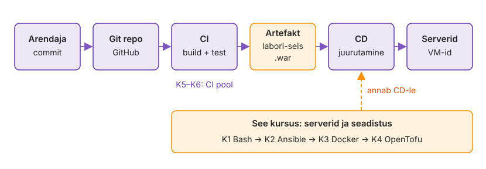
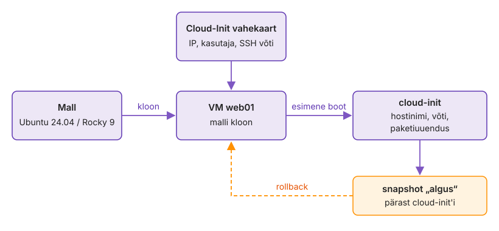
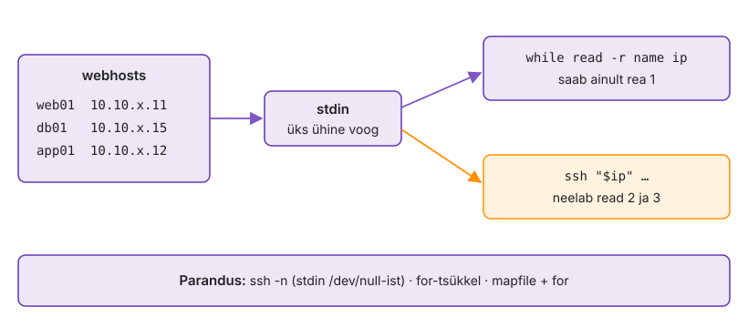
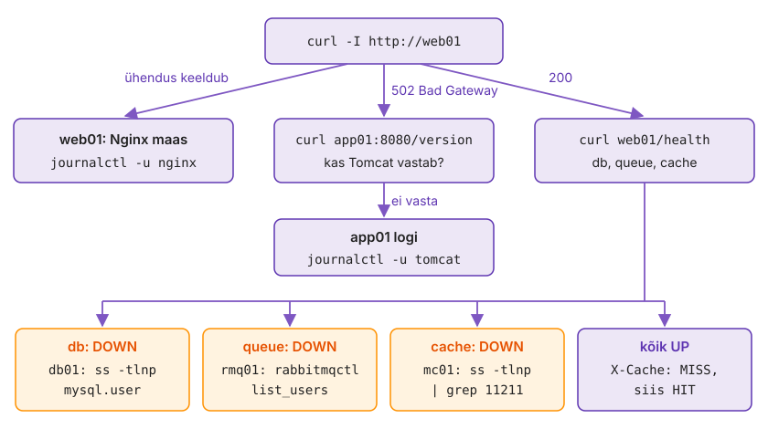
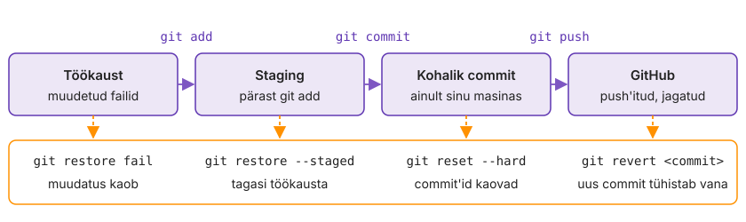

---
tags:
  - Bash
  - Ansible
  - Git
  - Proxmox
---

# 1. kohtumine · Skriptist soovitud seisuni: loeng

**Eeldus:** igapäevane Linuxi haldus (systemd, paketihaldus, SSH, võrk); see on kursuse esimene kohtumine.

Server peab olema koodi tulemus, mida saab ohutult uuesti käivitada. Runbook, skript, Git ja konfihaldus vastavad sellele nõudele igaüks omal moel. Erinevus on selles, kui palju pead ise läbi mõtlema, kui palju teeb tööriist sinu eest ja kes otsustab, millal tegevus käivitub.

??? abstract "Õpiväljundid"

    Pärast seda loengut oskad:

    - järjestada automatiseerimise kandidaate sageduse, vea hinna ja ajakulu järgi ning hinnata tasuvust koos hoolduskuluga;
    - eristada runbook'i, skripti, konfihaldust ja IaC-d selle järgi, mida igaüks kirjeldab ja millist riski kannab;
    - selgitada SOE, provisioning'u ja drift'i seost ning põhjendada, miks käsitsi tehtud parandus peab minema koodi;
    - kirjeldada omadusi, mis teevad skriptist tootmiskõlbliku ka mitme hosti peal: peatub vea juures, näitab enne plaani, on idempotentne ja annab iga hosti kohta eraldi tulemuse;
    - valida Gitis tagasivõtmise viis selle järgi, kas muudatus on juba teistega jagatud;
    - selgitada Ansible'i soovitud seisu mudelit ning tõlgendada `changed`-i ja check-režiimi tulemust;
    - võrrelda ülesandepõhist, sündmuspõhist ja AI-toega automatiseerimist otsustusõiguse, riski ja vajalike kontrollide järgi.

??? info "Loe pärast kohtumist"

    - [IT-automatiseerimine ja automatiseerimisstrateegia](../teemad/it-automatiseerimine.md)
    - [Standard Operating Environment ja IT-süsteemi elutsükkel](../teemad/soe-ja-elutsukkel.md)
    - [Provisioning](../teemad/provisioning.md)
    - [Jälgitavusest AIOps'ini](../teemad/jalgitavus-ja-aiops.md)
    - [AI ja automatiseerimine: juhtimine enne](../teemad/ai-ja-automatiseerimine.md)

## 1. Mida automatiseerida ja millises järjekorras

Meeskonna wiki's on nelikümmend runbook'i ja automatiseerimiseks jagub aega ühele-kahele kuus. Kui valik sõltub sellest, mis on kirjutajale huvitav, saab koodiks enne see, mida keegi niikuinii harva teeb.

**IT-automatiseerimine** tähendab, et korduv operatsioonitöö (paigaldus, seadistus, patch'imine, kasutajad, varundus, rikke esmane käsitlus) on kirjas koodina, mida saab üle vaadata, testida ja uuesti käivitada. **Automatiseerimisstrateegia** ütleb, mis saab koodiks esimesena. Kandidaate järjestatakse kolme teguri järgi: kui sageli tööd tehakse, kui suur on käsitsi vea hind ja kui palju aega üks kord võtab.

??? note "Kolm näidet: patch'imine, sertifikaat, migratsioon"

    Kuine patch'imine 40 serveris 15 minutiga serveri kohta on aastas 120 töötundi ja iga kord võib mõni host vahele jääda. Kord aastas tehtav sertifikaadi vahetus on lühike, aga harva tehtud töö sammud ununevad ja viga tähendab katkestust, nii et ka see on hea kandidaat. Ühekordne migratsioon vajab runbook'i, mitte koodi.

**Tasuvus** (ROI) arvutatakse kahelt poolt: kokkuhoitud aeg miinus kirjutamise ja hoolduse aeg. Hoolduskulu jääb arvutusest kõige sagedamini välja.

??? note "Tasuvus ja hoolduskulu"

    Kolm päeva kirjutatud patch-playbook tasub kuise patch'imise peal end ära mõne kuuga, aga ainult siis, kui keegi parandab selle ka pärast OS-i uuendust. Teine kulu tekib siis, kui automatiseeritakse protsessi, millest keegi aru ei saa: käsitsi tehtud viga kordub siis kiiremini ja kõigis hostides korraga.

??? note "Toil: Google'i SRE mõõdupuu"

    Google'i SRE raamat nimetab automatiseerimise kandidaati *toil*'iks. Selline töö on käsitsi tehtav, korduv, masinaga tehtav ja reaktiivne, see ei jäta teenusesse püsivat paranemist ning kasvab lineaarselt koos teenusega. Viimane tunnus otsustab kõige rohkem. Kui iga uus server lisab patch'imisse 15 minutit, kasvab töö koos taristuga ja meeskond ei saa seda juurde palkamisega kinni hoida.

    Google'i eesmärk on, et vähemalt pool SRE ajast läheb insenertööle, mis vähendab tulevast toil'i. Raamatu järgi oli toil'i keskmine osakaal umbes kolmandik, üksikinimestel 0–80%. Oma meeskonna arvu saad ticket'isüsteemist: kategooriad, mis korduvad iga kuu, ja nende lahendusaeg. Nii saab tasuvusarvutus sisendi, mis ei sõltu kellegi mälust.

    Automatiseerimine ei kaota toil'i täielikult, see muudab selle kuju. Playbook'i parandamine pärast OS-i uuendust ja inventory korrastamine on samuti korduv töö, aga see ei kasva hostide arvuga lineaarselt.

??? note "Center of Excellence: kui automaatikat kirjutab mitu meeskonda"

    Kui automaatikat kirjutab mitu meeskonda, tekib igaühel oma inventory, oma saladuste hoidmise viis ja oma nimetamise kord. **Center of Excellence** (CoE) on väike rühm, kes hoiab ühiseid kokkuleppeid: repo struktuuri, koodi ülevaatuse reegleid, ühist inventory allikat ja tegevuste kogu, mida teised taaskasutavad. Risk on, et CoE-st saab pudelikael, mille taga kõik muudatused ootavad. Toimivas mudelis kirjutavad meeskonnad ise ja CoE vaatab üle ning hoiab standardit.

Automatiseerimisel on astmed ja iga aste kirjeldab tööd erinevalt. **Runbook** teeb töö korratavaks, aga mitte kiireks: inimene loeb ja otsustab iga sammu juures. **Skript** teeb sammud kiireks, kuid kirjeldab ainult käskude järjekorda. **Konfihaldus** (Ansible, Puppet, Salt) kirjeldab soovitud lõppseisu ja tööriista moodul kontrollib ise, kas muudatust on vaja. **IaC** teeb sama VM-ide, võrkude ja DNS-kirjetega.

| Aste | Mida kirjeldab | Kes otsustab, kas muuta on vaja | Tüüpiline risk |
|---|---|---|---|
| Runbook | samme inimesele | inimene igal sammul | samm jääb vahele, kaks inimest teevad erinevalt |
| Skript | käskude järjekorda | skripti autor, kui ta selle kontrolli kirjutas | teine käivitus teeb sama muudatuse uuesti |
| Konfihaldus | soovitud seisu hostis | moodul | `command` ilma kontrollita viib tagasi skripti tasemele |
| IaC | soovitud taristut | tööriist state'i ja tegeliku seisu põhjal | state ja tegelikkus lähevad lahku |

*Tabel 1.1. Automatiseerimise astmed.*

Astmed ei välista üksteist. Järjekord on alati sama: **tee kõigepealt käsitsi, siis kirjuta üles, siis automatiseeri.**

??? example "X-tee: runbook ja playbook kõrvuti"

    [X-tee](https://github.com/nordic-institute/X-Road) tarkvara arendab NIIS, mille asutasid Eesti ja Soome. Selle avalikus repos on turvaserveri paigaldusjuhend inimesele, kes paigaldab ühe serveri, ja eraldi kaustas Ansible'i playbook'id meeskonnale, kes ehitab sama testkeskkonda kümneid kordi.

<figure markdown="span">
  
  <figcaption>Joonis 1.1. CI/CD ahel ja koht, kuhu see kursus paigutub. Neli esimest kohtumist käsitlevad servereid ja seadistust, viies ja kuues CI poolt.</figcaption>
</figure>

??? question "Mõtle: vastutus ja töökohad"

    Kui sinu playbook teeb kolleegi iganädalase töö, mis temast saab? Kes vastutab, kui automaatika teeb vea, mida inimene poleks teinud? World Economic Forumi [Future of Jobs Report 2025](https://www.weforum.org/publications/the-future-of-jobs-report-2025/) järgi kasvab nõudlus inimeste järele, kes automaatikat kirjutavad, üle vaatavad ja hooldavad, mitte nende järele, kes sama tööd käsitsi kordavad.

??? info "Loe juurde"

    - [Google SRE raamat: Eliminating Toil](https://sre.google/sre-book/eliminating-toil/)
    - [IT-automatiseerimine ja automatiseerimisstrateegia](../teemad/it-automatiseerimine.md)
    - [WEF: Future of Jobs Report 2025](https://www.weforum.org/publications/the-future-of-jobs-report-2025/)

## 2. Server kui koodi tulemus: SOE, provisioning ja drift

Kolm aastat töötanud serveris on keegi kunagi lisanud `/etc/hosts`-i rea, muutnud sysctl väärtust ja paigaldanud paketi, mida keegi enam ei mäleta. Kui see masin tuleb uuesti ehitada, ei tea keegi, mis seal oli. Martin Fowler nimetab sellist masinat *snowflake server*'iks: see on ainulaadne ja seda ei saa korrata.

Selle põhjus on **drift**. Iga käsitsi muudatus parandab ühe masina täna, aga järgmine samast koodist loodud masin on jälle vigane. Põhjuse otsid masinas, paranduse teed koodis ja käivitad koodi uuesti ainult sellel hostil.

Snowflake'i vastand on **SOE** (standard operating environment): kokkulepitud ja versioneeritud baas, millest iga server algab. Küsimusele „mis on sellel serveril teisiti“ annab vastuse võrdlus SOE-ga, mitte kellegi mälu.

??? note "Mis kuulub SOE-sse ja mis see maksab"

    Sinna kuuluvad OS-i versioon ja partitsioonid, paketirepod, aja- ja nimeteenuse seaded, sshd ja sudo reeglid, logi- ja monitooringuagent ning hardening'u tase. SOE-l on versioon, näiteks `soe-2026.10`: Ubuntu 24.04, CIS Level 1 ja journald kesklogisse. See ehitatakse koodist VM-i malliks ja konfihaldus hoiab sama baasi masinas edasi.

    Iga lisavariant maksab: Ubuntu ja Rocky kõrvuti tähendab, et iga skript kontrollib OS-i perekonda. Liiga range SOE paneb teised meeskonnad erandeid küsima ja kui erandite korda pole, tekivad serverid, mida keegi ametlikult ei halda. Tavaline lahendus on väike arv toetatud baase ja kirjalik erandite kord.

**Provisioning** viib masina olematusest seisu, kus konfihaldus saab üle võtta: VM luuakse mallist ning saab IP, hostinime, kasutaja ja SSH võtme. Kloonitud VM saab oma identiteedi esimesel boodil cloud-init'ilt. „Valmis“ peab olema kontrollitud, mitte eeldatud: `cloud-init status --wait` ootab kõigi etappide lõppu.

??? note "Miks SSH vastab enne, kui masin on valmis"

    Proxmox annab user-data NoCloud-andmeallikana eraldi kettal. Cloud-init töötab viies etapis (detect, local, network, config, final) ja paketiuuendus on viimases etapis, mis algab alles siis, kui sshd juba töötab. SSH vastab seega enne, kui esimese boodi töö on lõppenud. Kui automaatika alustab kohe, hoiab cloud-init dpkg lukku ja `apt-get install` ebaõnnestub.

    User-data käivitub üks kord. Mis seal on, seda ei kontrolli ega paranda keegi hiljem. Seepärast hoitakse user-data lühike (identiteet, võti, bootstrap) ja rolli seadistus jääb konfihaldusele.

??? note "Kloon: machine-id ja SSH hostivõtmed"

    Mallist kloonimisel kopeeritakse ka see, mis peab igal masinal olema erinev. `/etc/machine-id` on masina püsiv ID ja systemd-networkd tuletab sellest vaikimisi DHCP kliendi identifikaatori. Kui malli tegemisel jäi see fail tühjendamata, võivad kaks klooni saada DHCP serverilt sama aadressi ja viga paistab juhuslik.

    SSH hostivõtmetega on sama lugu: kui kõik kloonid jagavad üht võtit, ei erista `known_hosts` neid ja ühe masina võtme leke on kõigi masinate leke. Cloud-init otsustab `instance-id` järgi. Kui see erineb eelmise käivituse omast, peab cloud-init masinat uueks ja käivitab per-instance moodulid uuesti, sealhulgas hostivõtmete genereerimise. Malli ettevalmistus on seega samuti kood (`cloud-init clean`, tühi `machine-id`, kustutatud hostivõtmed), sest käsitsi tehes ununeb mõni samm.

Drift'i vastu on kaks strateegiat. **Muudetav taristu** hoiab serveri elus ja konfihaldus viib selle regulaarselt soovitud seisu tagasi. **Muutumatu taristu** töötavat masinat ei paranda: uus versioon ehitatakse uueks malliks ja vana masin asendatakse (Fowleri *phoenix server*).

??? note "Kumb strateegia kuhu sobib"

    Muutumatu mudel välistab drift'i, aga nõuab, et andmed asuksid väljaspool masinat ja asendamine oleks rutiin, mitte projekt. Andmebaasi- ja kataloogiserverid jäävad enamasti muudetavaks, rakendusserverid ja konteinerid liiguvad muutumatu mudeli poole.

    Taastamine on sama mõtte teine pool. Proxmoxi snapshot on storage'i enda mehhanism ja vzdump teeb eraldi arhiivi teise storage'isse. Kui server on mallist, repost ja skriptist taasloodav, on masin ühekordne ja snapshot on lihtsalt mugavus. Kui ei ole, on backup ainus viis teada saada, mis seal oli.

<figure markdown="span">
  
  <figcaption>Joonis 1.2. Mallist töötava VM-ini. Snapshot tehakse pärast seda, kui cloud-init on lõpetanud.</figcaption>
</figure>

??? question "Mõtle"

    Mõtle oma tööl ühele serverile, mida keegi ei julge taaskäivitada. Mis peaks olemas olema, et selle saaks homme nullist uuesti ehitada?

??? info "Loe juurde"

    - [Martin Fowler: SnowflakeServer](https://martinfowler.com/bliki/SnowflakeServer.html) ja [PhoenixServer](https://martinfowler.com/bliki/PhoenixServer.html)
    - [cloud-init dokumentatsioon](https://docs.cloud-init.io/en/latest/) ja [käivituse etapid](https://docs.cloud-init.io/en/latest/explanation/boot.html)
    - [systemd: machine-id](https://www.freedesktop.org/software/systemd/man/latest/machine-id.html)
    - [Proxmox: snapshot'id](https://pve.proxmox.com/pve-docs/chapter-qm.html#qm_snapshots) ja [vzdump](https://pve.proxmox.com/pve-docs/chapter-vzdump.html)

## 3. Töökindel skript

Öösel cron'ist käivitunud deploy jättis pooled failid uue seadistusega ja pooled vanaga. Hommikul pole väljundit, sest SSH-sessioon on ammu suletud, ja skripti väljumiskood oli 0.

Skript, mida julged käivitada võõras tootmisserveris, vastab neljale küsimusele:

1. **Kas ta peatub vea juures?** `set -eEuo pipefail`, aga see ei ole veel veakäsitlus.
2. **Kas ta ütleb, kus viga tekkis?** ERR-trap rea numbri ja käsuga, vea info `logger`-iga journald-isse.
3. **Kas ta näitab enne, mida teeks?** Dry-run.
4. **Kas teine käivitus on ohutu?** Idempotentsus.

??? note "Kus `set -e` ei peatu"

    `if`-i, `&&`-i ja `||`-i tingimuses, tingimusest kutsutud funktsiooni kehas ja `local x=$(käsk)` puhul skript ei peatu. EXIT-trap koristab ajutised failid ka siis, kui skript katkeb poole pealt, ja ERR-trap saab rea numbri ning ebaõnnestunud käsu. Öösel käivitunud skripti väljund on kadunud, seega peab vea info minema journald-isse (`logger` sildi ja prioriteediga).

??? note "Dry-run, mis ei valeta"

    Dry-run on usaldusväärne ainult siis, kui iga muutev käsk käib läbi ühe funktsiooni, mis dry-run'is ainult kirjutab, mida ta teeks. Üks otse kirjutatud `cp` teeb plaani valeks.

**Idempotentsus** tähendab, et iga muudatuse ees on kontroll, kas muudatust on vaja:

```bash
changed=0
if ! cmp -s uus.conf /etc/nginx/nginx.conf; then
    install -m 644 uus.conf /etc/nginx/nginx.conf
    changed=1
fi
if (( changed )); then systemctl reload nginx; fi
```

Sama muster kehtib pakettide kohta (`dpkg-query -W` või `rpm -q` enne paigaldust) ja teenuste kohta: restart ainult siis, kui midagi muutus. Skript, mis ütleb igal käivitusel „3 muudatust“ ja käivitub iga 15 minuti järel, katkestab iga 15 minuti järel kasutajate ühendused.

??? note "Pooleli jäänud muudatus: aatomiline asendus"

    Loo alguse deploy jättis pooled failid uue ja pooled vana seadistusega, sest mitme faili kopeerimine on mitu eraldi sammu ja `cp` kirjutab olemasoleva faili sisu üle kohapeal. Ühe faili puhul on lahendus aatomiline asendus: uus sisu kirjutatakse ajutisse faili samas failisüsteemis ja tõstetakse `rename(2)`-iga paika. Sama failisüsteemi piires on rename aatomiline ja lugeja näeb kas vana või uut faili, mitte poolikut. `mv` teisest failisüsteemist, näiteks eraldi `/tmp`-st, seda ei taga, sest siis on see kopeerimine ja kustutamine.

    Mitme faili puhul läheb uus versioon kõrvalkataloogi ja symlink keeratakse ühe sammuga ümber. Enne reload'i kontrollib teenus konfi ise (`nginx -t`, `sshd -t`, `visudo -c`). Kui kontroll ebaõnnestub, jääb kehtima vana konf.

??? example "Steam for Linux 2015: tühi muutuja ja `rm -rf /*`"

    Skriptis oli rida `rm -rf "$STEAMROOT/"*`. Kui muutuja jäi tühjaks, sai sellest `rm -rf /*` ja kasutaja failid kustusid ([PCWorld](https://www.pcworld.com/article/431317/scary-steam-for-linux-bug-erases-all-the-personal-files-on-your-pc.html)). `set -u` või `${STEAMROOT:?}` oleks skripti enne kustutamist peatanud.

??? question "Mõtle"

    Võta oma kõige sagedamini käivitatud skript. Kumb neljast küsimusest jääb sellel vastuseta?

??? info "Loe juurde"

    - [Bash: The Set Builtin](https://www.gnu.org/software/bash/manual/html_node/The-Set-Builtin.html) ja [`trap`](https://www.gnu.org/software/bash/manual/html_node/Bourne-Shell-Builtins.html#index-trap)
    - [`logger(1)`](https://man7.org/linux/man-pages/man1/logger.1.html), [`rename(2)`](https://man7.org/linux/man-pages/man2/rename.2.html)
    - [ShellCheck](https://www.shellcheck.net/): leiab vigu, mida sa oma koodis enam ei näe

## 4. Mitu hosti ja vaikivad vead

Tsükkel käis üle viie hosti ja lõpus oli kiri „valmis“. Järgmisel päeval selgub, et seadistatud on ainult üks host.

??? example "Knight Capital 2012: üks server kaheksast"

    Uus kood pidi käsitsi jõudma kaheksasse serverisse, ühte jäi see kopeerimata ja taaskasutatud lipp aktiveeris seal ammu kasutamata funktsiooni. USA väärtpaberikomisjoni [otsuse](https://www.sec.gov/litigation/admin/2013/34-70694.pdf) järgi kaotas firma 45 minutiga üle 460 miljoni dollari.

Bashis kirjutad hostide nimekirja, ülesande ja käivitaja ise ning vaiksete vigade allikaid on kolm.

**1. Jagatud standardsisend.** `ssh` loeb stdin'i ja võtab tsükli eest ära ülejäänud read:

```bash
while read -r host; do
    ssh "$host" uptime     # ssh loeb ka ülejäänud read
done < hostid.txt
```

Tsükkel lõpeb pärast esimest hosti koodiga 0. Parandus on `ssh -n` või hostide lugemine enne tsüklit massiivi.

<figure markdown="span">
  
  <figcaption>Joonis 1.3. <code>while read</code> ja <code>ssh</code> loevad sama standardsisendit.</figcaption>
</figure>

**2. Paralleelsus.** Argumentideta `wait` tagastab 0 ka siis, kui pooled taustatööd ebaõnnestusid. Iga hosti kood tuleb eraldi kinni püüda.

**3. Kaks samaaegset jooksu**, mis kirjutavad teineteise töö üle. `flock` lõpetab teise jooksu kohe ja lukk vabaneb koos protsessiga ka pärast `kill -9`-t.

??? note "Saladus käsureal on samuti vaikne viga"

    `ssh host "DB_PASSWORD=… skript"` on nähtav `ps`-is ja sudo logis.

**Health check** peab käima sealt, kust teenust kasutatakse, ja peatama deploy, kui vastust ei tule. `systemctl start` ootab ainult nii kaua, kui unit'i `Type=` ütleb.

??? note "Miks `systemctl start` kood 0 ei tähenda „valmis“"

    `Type=simple` puhul on JVM käivitunud, aga WAR-i deploy võtab veel kümneid sekundeid. Kui memcached kuulab ainult `127.0.0.1` peal, on see mc01 seest korras ja app01-st kättesaamatu.

<figure markdown="span">
  
  <figcaption>Joonis 1.4. Rikke otsimine kihtide kaupa, väljast sisse.</figcaption>
</figure>

Rike otsitakse väljast sisse, aga parandus läheb koodi: 502 Nginxilt ütleb kihi, Tomcati journal põhjuse ja commit teenuse skripti tagab, et järgmine host ei saa sama viga.

??? example "Facebook 2021: kaitse ise oli vigane"

    Facebooki 4. oktoobri 2021 katkestuses võttis hoolduskäsk maha kogu backbone-võrgu ühendused ja auditivahend, mis pidi sellise käsu peatama, ei peatanud seda enda vea tõttu ([Meta inseneriblogi](https://engineering.fb.com/2021/10/05/networking-traffic/outage-details/)). Kuna sisevahendid sõltusid samast võrgust, tuli taastamiseks minna andmekeskustesse kohapeale.

    Adminitööl tähendab see kahte asja. Kaitset testitakse nagu muudatust ja taastetee (konsool, IPMI, Proxmoxi veebiliides) ei tohi sõltuda sellest, mida parasjagu muudad.

??? question "Mõtle"

    Kui sinu deploy-skript ütleb „valmis“, mida see tegelikult kontrollis? Kas see vastus tuli igast hostist eraldi?

??? info "Loe juurde"

    - [`ssh -n`](https://man.openbsd.org/ssh#n), [`flock(1)`](https://man7.org/linux/man-pages/man1/flock.1.html)
    - [systemd.service: `Type=`](https://www.freedesktop.org/software/systemd/man/latest/systemd.service.html)

## 5. Git kui muudatuste logi

„Kes muutis selle konfi ja miks?“ Git vastab sellele ainult siis, kui commit'i sõnum ütleb põhjuse, mitte ainult seda, mis muutus. Sõnum `fix(mariadb): kasutaja tohib tulla app01-st` on aasta pärast väärtuslikum kui `fix`.

<figure markdown="span">
  
  <figcaption>Joonis 1.5. Muudatus liigub vasakult paremale. Mida kaugemal see on, seda ettevaatlikum peab tagasivõtmine olema.</figcaption>
</figure>

Tagasivõtmise reegel sõltub sellest, kas muudatus on jagatud. Kohaliku commit'i võid ümber teha. Kui muudatus on GitHubis, võtad selle tagasi `git revert`-iga, mis lisab uue commit'i. `reset` ja `rebase` kirjutavad ajaloo ümber, seda tehakse ainult harul, mis on ainult sinu oma.

??? note "Tag'id ja `git bisect`"

    Tag märgib seisu, mis oli tootmises. Lightweight tag on ainult nimi commit'ile. Annotated tag (`git tag -a`) on eraldi objekt autori, aja ja sõnumiga, seda saab allkirjastada ja ainult selliseid lükkab `git push --follow-tags` üles.

    Kui kontroll on mingil hetkel katki läinud ja keegi ei tea, millal, poolitab `git bisect` commit'ide vahemikku. Testiks sobib iga käsk, mille väljumiskood ütleb „hea“ või „halb“, nii et õige väljumiskoodiga skript on ka Giti tööriist.

??? warning "Saladus jõudis GitHubi"

    `.gitignore` mõjub ainult jälgimata failidele. GitHubi push protection tunneb ära teenusepakkujate tokenite mustrid, aga mitte rida `DB_PASSWORD=…` sinu konfis. Esimene samm on saladus kehtetuks tunnistada, sest ajaloo ümberkirjutamine ei jõua fork'ide ja olemasolevate kloonideni.

??? note "Git ja muudatuste haldus (E-ITS, ISO 27001)"

    Pull request'is on muudatuse põhjus, diff, ülevaataja ja kinnitamise aeg ühes kohas, see tähendab nelja silma põhimõtet, mida muudatuste haldus tavaliselt nõuab. Kaitstud haru nõuab enne merge'i ülevaatust ja edukat kontrolli. Kui audiitor küsib E-ITS-i või ISO 27001 järgi, kes tootmiskonfi muutis, on `git log` koos PR-iga parem tõend kui change ticket'i vabatekst, sest diff näitab täpselt, mis muutus. See kehtib ainult siis, kui tootmisse jõuab ainult see, mis läks läbi repo. Käsitsi parandus serveris jätab auditisse augu.

??? question "Mõtle"

    Kolleeg lükkas vigase commit'i `main`-ile ja teised on selle juba alla tõmmanud. Kas kasutad `reset`-i või `revert`-i? Miks?

??? info "Loe juurde"

    - [`git revert`](https://git-scm.com/docs/git-revert), [`git rebase`](https://git-scm.com/docs/git-rebase), [`git bisect`](https://git-scm.com/docs/git-bisect)
    - [`.gitignore`](https://git-scm.com/docs/gitignore)
    - [GitHub: push protection](https://docs.github.com/en/code-security/secret-scanning/introduction/about-push-protection) ja [tundliku info eemaldamine](https://docs.github.com/en/authentication/keeping-your-account-and-data-secure/removing-sensitive-data-from-a-repository)

## 6. Soovitud seis: konfihalduse mudel

Hostide nimekiri, paralleelsus, kontroll enne muudatust ja kokkuvõte on konfihalduse tööriistas valmis, aga mitte kõik.

Ansible töötab ainult **control node**'il. Hallatavas masinas pole agenti ega deemonit, vaja on SSH-d ja Pythonit. **Inventory** on INI- või YAML-fail või plugin, mis annab hostid, grupid ja nende muutujad.

??? note "Kuidas Ansible ülesande käivitab"

    Iga ülesande kohta saadab Ansible mooduli SSH-ga sihtmasinasse, käivitab selle vajadusel `sudo` all ja saab vastuseks JSON-i. Moodul pakitakse koos abiteekidega üheks Pythoni failiks (AnsiballZ), kopeeritakse sihtmasina ajutisse kataloogi (vaikimisi `~/.ansible/tmp`), käivitatakse ja kustutatakse.

    Iga ülesanne iga hosti peal tähendab seega mitut SSH operatsiooni. `forks` on vaikimisi 5: 50 hosti puhul töötab üks ülesanne kümnes laines. `pipelining` saadab mooduli SSH-ühenduse stdin'i kaudu ilma faili kopeerimata, aga vajab, et sudoers'is poleks `requiretty`. SSH ControlPersist hoiab ühenduse ülesannete vahel avatuna. Need on esimesed seaded, mida 200 hosti juures vaadatakse, kui play on aeglane.

??? note "Puppet: sama mudel teistpidi"

    Puppeti agent tõmbab kataloogi serverist vaikimisi iga 30 minuti järel (`runinterval`) ja parandab drift'i ise. Ansible parandab ainult siis, kui keegi playbook'i käivitab, seepärast pannakse see tööl timeri, pipeline'i või AWX-i ajakava taha.

Põhierinevus skriptiga on moodul. **Playbook** koosneb play'dest ja iga play seob hostimustri ülesannete järjekorraga. Ülesanne kirjeldab seisu „peab olema paigaldatud“:

```yaml
- name: Nginx on paigaldatud
  ansible.builtin.package:
    name: nginx
    state: present
```

Moodul võrdleb soovitud seisu tegelikuga ja muudab ainult erinevuse. Erand on `ansible.builtin.command`: see ei tea, mida käsk teeb, ja teatab alati `changed`.

<figure markdown="span">
  
  <figcaption>Joonis 1.6. Moodul võrdleb soovitud ja tegelikku seisu ning teatab <code>changed</code>.</figcaption>
</figure>

`changed` on mõõdupuu: **teine käivitus peab andma `changed=0`.** Faktid (`ansible_facts`) asendavad `/etc/os-release`-i käsitsi lugemist: `os_family` on Ubuntul `Debian` ja Rockyl `RedHat`, ja selle järgi valib `when:` õige ülesande.

??? note "Handler, mis jäi käivitamata"

    Handler on ülesanne, mis käivitub ainult `notify` peale ja alles play lõpus, üks kord, ükskõik mitu ülesannet teda teavitas. Kui host langeb play'st välja pärast konfi muutmist, aga enne play lõppu, jääb seal handler käivitamata. Järgmisel jooksul on konf juba õige, ülesanne pole `changed` ja teenus töötab vana konfiga, kuni keegi selle käsitsi taaskäivitab. Selle vastu on `--force-handlers` või `meta: flush_handlers`.

**Check-režiim** (`--check --diff`) on Ansible'i dry-run, aga see ainult ennustab. Check'i tulemus on usaldusväärne masinas, mis on juba korra seadistatud.

??? note "Kus check-režiim eksib"

    Kui ülesanne sõltub eelmise ülesande tulemusest, näiteks failist, mille eelmine alles looks, ebaõnnestub see check-režiimis või näitab vale plaani. `command`-i jätab check-režiim vahele.

Mitme hosti peal töötab Ansible vaikimisi strateegiaga `linear`: iga ülesanne lõpeb kõigis hostides enne järgmist. Host, kus ülesanne ebaõnnestus, jääb ülejäänud play'st välja ja teised jätkavad. `serial` jagab hostid partiideks ja `max_fail_percentage` peatab play, kui vigu on liiga palju.

??? example "CrowdStrike 2024: uuendus kõigile korraga"

    19. juulil 2024 ootas Falconi sensor sisuuuendusest 20 sisendvälja, uuendus andis 21 ja mälust väljapoole lugemine viis Windowsi masinad krahhi. Uuendus jõudis kõigi klientideni korraga. Firma [juurpõhjuse analüüsi](https://crowdstrike.com/wp-content/uploads/2024/08/Executive-Summary_Root-Cause-Analysis_Channel-File-291.pdf) järgi läbivad sellised uuendused nüüd järjestikused deployment ring'id ja kliendid saavad ise valida, millal uuendus nendeni jõuab.

    Ansible'is on sama mõte `serial: [1, 5, "25%"]`: esimene host on canary ja vead peatavad play enne, kui muudatus jõuab kõigini. Ansible ei pane lukku kahe samaaegse jooksu vastu, ei kontrolli teenuse vastamist enne, kui sa selle kontrolli kirjutad, ega oota cloud-init'i lõppu.

??? question "Mõtle"

    Su playbook paigaldab nginx-i Ubuntule ja Rockyle. Kas kirjutad kaks playbook'i või ühe? Mis otsustab, kumb ülesanne käivitub?

??? info "Loe juurde (Ansible'i ametlik dokumentatsioon)"

    - [Getting started](https://docs.ansible.com/projects/ansible/latest/getting_started/index.html)
    - [Inventory](https://docs.ansible.com/projects/ansible/latest/inventory_guide/intro_inventory.html)
    - [Conditionals (`when`)](https://docs.ansible.com/projects/ansible/latest/playbook_guide/playbooks_conditionals.html)
    - [Tags](https://docs.ansible.com/projects/ansible/latest/playbook_guide/playbooks_tags.html)
    - [Handlers](https://docs.ansible.com/projects/ansible/latest/playbook_guide/playbooks_handlers.html)
    - [Check mode ja diff](https://docs.ansible.com/projects/ansible/latest/playbook_guide/playbooks_checkmode.html)
    - [Strategies ja `serial`](https://docs.ansible.com/projects/ansible/latest/playbook_guide/playbooks_strategies.html)
    - [`forks`](https://docs.ansible.com/projects/ansible/latest/reference_appendices/config.html#default-forks) ja [`pipelining`](https://docs.ansible.com/projects/ansible/latest/reference_appendices/config.html#ansible-pipelining)
    - [Puppet: `runinterval`](https://help.puppet.com/core/current/Content/PuppetCore/Markdown/configuration.htm)

## 7. Kolm automatiseerimise režiimi ja heakskiidetud tegevused

Kell 02:10 täitub db01 logiketas. Esimesel juhul ärkab valvur, logib sisse ja koristab käsitsi. Teisel juhul käivitab monitooringu alarm sama koristuse, mida valvur oleks teinud. Kolmandal juhul leiab AI-agent logidest, et debug-logil puudub rotatsioon, ja pakub parandust. Otsustaja on igal juhul erinev.

Red Hati e-raamat „Governance first: Automation for the agentic AI era“ jagab automatiseerimise kolmeks režiimiks (tabel 1.2).

| Režiim | Kes otsustab, mida tehakse | Tüüpiline töö | Risk ja kontrollid |
|---|---|---|---|
| Ülesandepõhine | autor kirjutas sammud ette, käivitaja valib aja ja hostid | 50 serveri patch'imine pühapäeva öösel, varundus, võrgukonfi levitamine | väike; RBAC määrab, kes tohib käivitada, audit näitab, mis juhtus |
| Sündmuspõhine | reegel valib sündmuse peale ühe ette heaks kiidetud vastuse | teenus seiskus → ticket ja restart; ketas täis → laienda ja teavita inimest | madal, kuni vastused on ette määratud; inimese kinnitus piirab, kui paljusid hoste vale otsus puudutab |
| AI-toega | agent valib tegevuse olukorra põhjal, lubatud piirides | uue rikke põhjuse otsimine, kulu- või jõudlusanalüüs | hallatav ainult siis, kui agent saab käivitada üksnes heakskiidetud tegevusi; agendil on oma identiteet ja RBAC, muutev tegevus vajab inimese kinnitust |

*Tabel 1.2. Automatiseerimise kolm režiimi.*

**Governance first** on raamatu põhimõte: enne kui sündmus või agent tohib midagi käivitada, peab olemas olema testitud ja heakskiidetud tegevuste kogu. Sündmuse reegel ja AI-agent valivad ainult nende hulgast.

??? note "Sündmuspõhine automaatika: ansible-rulebook"

    Avatud lähtekoodiga tööriist on ansible-rulebook (Red Hati toodetes Event-Driven Ansible). Rulebook'is on sündmuste allikad (webhook, Kafka, Alertmanager), reeglid tingimustega ja tegevus, mis käivitab playbook'i või AWX-i job template'i. Otsus, mida 02:10 teha, tehti seega päeval, kui reegel üle vaadati.

    Kompromiss on see, et reegel tunneb ainult neid olukordi, mis on ette kirjas. Kui koristus ketast ei vabasta ja reegel käivitab selle iga minut uuesti, on automaatika ise intsidendi osa. Seepärast on reeglil korduste piir ja selle järel teavitatakse inimest.

??? note "Heakskiidetud tegevuste kogu: AWX ja Semaphore"

    Iga playbook, mis on koodiülevaatuse läbinud, versioonihalduses ja testitud, on üks lubatud tegevus. AWX või Semaphore seob playbook'i, inventory ja credential'i job template'iks ning RBAC määrab, kes või mis tohib seda käivitada. Iga käivitus jääb ajalukku koos käivitaja, commit'i ja väljundiga. Kui inimene, alarm ja agent käivitavad sama template'i, on auditis üks formaat.

    Hind on kiiruses: öine käsitsi parandus väljaspool kogu jätab jälje ainult shelli ajalukku. Selle jaoks on kirjalik hädaolukorra kord, mille järel parandus jõuab koodi.

??? note "ITIL-i standardmuudatus"

    Senises adminitöös vastab sellele ITIL-i standardmuudatus: muudatus, mille risk on ette hinnatud ja mis on eelnevalt heaks kiidetud, nii et seda ei viida iga kord CAB-i. Heakskiidetud tegevuste kogu on standardmuudatuste nimekiri koodina. Üle vaadatud ja testitud playbook'i saab muudatuste haldus kinnitada üks kord ning reegel või operaator käivitab selle ilma eraldi ticket'ita. Uus või muudetud playbook läbib ülevaatuse tavalise muudatusena.

??? note "Režiimi valik on ka kuluküsimus"

    Kui AI-agent kasutab mudelit tööks, mille playbook juba lahendab, maksab ta tokenite eest ja tulemus ei ole iga kord sama. AI-toega režiim sobib rikete jaoks, mida keegi pole ette näinud.

??? question "Mõtle"

    Milline sinu meeskonna öine väljakutse võiks homme olla sündmuspõhine? Mis peaks enne olemas olema, et julgeksid selle inimeseta käima lasta?

??? info "Loe juurde"

    - [ansible-rulebook](https://github.com/ansible/ansible-rulebook)
    - [AWX](https://github.com/ansible/awx), [Semaphore](https://semaphoreui.com/)
    - [AI ja automatiseerimine: juhtimine enne](../teemad/ai-ja-automatiseerimine.md)

## Kokkuvõte

<div class="grid cards kokkuvote" markdown>

-   **Automatiseerimise järjekord**

    Automatiseeri esimesena töö, mis on sage, vigaderohke või kasvab koos hostide arvuga. Arvuta tasuvusse ka hoolduskulu.

-   **Astmed**

    Vali aste selle järgi, mida kirjeldad: runbook samme inimesele, skript käskude järjekorda, konfihaldus soovitud seisu.

-   **SOE ja drift**

    Alusta iga serverit versioneeritud baasist ja anna identiteet provisioning'uga. Vii käsitsi parandus koodi, muidu on järgmine masin jälle vigane.

-   **Valmis on kontrollitud**

    Oota cloud-init'i lõppu ja kontrolli teenust sealt, kust seda kasutatakse. SSH vastus ja `systemctl start`-i kood 0 ei tõesta valmisolekut.

-   **Tootmiskõlblik skript**

    Peata skript vea juures, näita enne plaani ja muuda ainult seda, mis erineb. Mitme hosti peal püüa iga hosti väljumiskood eraldi kinni.

-   **Git**

    Võta jagatud muudatus tagasi `revert`-iga ja tee `rebase` ainult oma harul. Tunnista GitHubi jõudnud saladus kohe kehtetuks.

-   **Ansible**

    Nõua teiselt jooksult `changed=0`. Arvesta, et check-režiim ainult ennustab, katkenud play jätab handleri käivitamata ja ebaõnnestunud host jääb poolikusse seisu.

-   **Režiimid ja juhtimine**

    Luba inimesel, reeglil ja agendil käivitada ainult heakskiidetud tegevusi. Kata kõik kolm sama RBAC-i ja auditiga.

</div>

<div class="kontrollkysimus" markdown>
**Kontrollküsimus:** Miks ei tõesta SSH vastus ega `systemctl start`-i kood 0 veel, et teenus on valmis, ja milline kontroll seda tõestab?
</div>

## Kontrolli ennast

??? question "Playbook'i teine käivitus annab igal korral `changed=1` ülesandes, mis kasutab moodulit `command`. Mida see tähendab ja kuidas parandad?"
    `command` ei tea, kas soovitud seis on juba olemas, ja teatab alati `changed`. Kasuta moodulit, mis seisu võrdleb. Kui moodulit pole, lisa enne päring (`changed_when: false`) ja käivita muudatus ainult siis, kui päring ütles „ei“. Sama viga on Bashi skriptil, mis ütleb igal käivitusel „3 muudatust“.

??? question "Paralleelne deploy näitab lõpus kõiki hoste OK, aga ühe hosti logis on viga. Kus on viga?"
    Taustatöö väljumiskood jäi salvestamata, sest argumentideta `wait` tagastab 0. Iga töö kood tuleb eraldi kinni püüda (`wait "$pid"` või kood faili) ning kokkuvõte ja skripti väljumiskood peavad nendest sõltuma.

??? question "Health check ütles vahemälu hosti kohta „terve“, aga rakendus ei saa vahemäluga ühendust. Miks health check seda ei märganud?"
    Kontroll käis vahemälu hosti seest (`127.0.0.1`), rakendus ühendub üle võrgu. Tõenäoliselt kuulab teenus ainult loopback-liidesel või tulemüür ei lase porti läbi. Kontroll peab käima rakenduse hostist ja parandus läheb teenuse paigaldusskripti, mitte käsitsi masinasse.

??? question "Playbook muutis web03-s Nginxi konfi ja järgmine ülesanne samas hostis ebaõnnestus. Teine jooks annab web03-s `changed=0`, aga uus konf ei kehti. Miks?"
    Handler käivitub play lõpus ainult hostides, mis on veel play's. web03 langes välja enne seda, nii et reload jäi tegemata. Teisel jooksul on konf juba õige, `template` ei ole `changed` ja handlerit keegi ei teavita. Lahendus on `--force-handlers` või `meta: flush_handlers` kohe pärast konfi ülesannet ning kontroll, mis võrdleb töötava teenuse seadistust failiga.

??? question "Alarm „logiketas üle 90%“ peaks käivitama koristuse ilma inimeseta. Mis peab enne paigas olema?"
    Koristus on üle vaadatud ja testitud playbook, mitte alarmi sisse kirjutatud käsk. Reegel tohib käivitada ainult seda ja ainult nende hostide peal, kelle kohta alarm tuli. Kustutamise piir on ette määratud (näiteks ainult rotatsiooniga logid, mis on vanemad kui 7 päeva). Reeglil on korduste piir, mille järel teavitatakse inimest, ja iga käivitus jääb auditisse koos sündmuse, commit'i ja tulemusega.
