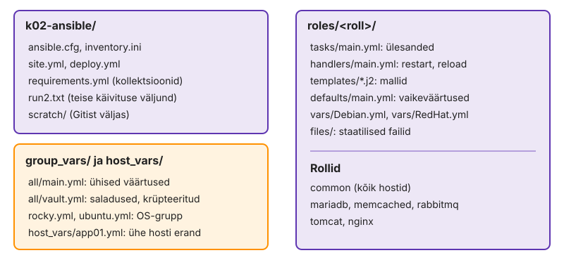

---
tags:
  - Ansible
  - Proxmox
---

# 1. Algseis

Öine jooks ripub pool tundi ühe surnud hosti taga või töötab pipeline'is teise kasutajana kui sinu masinas, sest seade oli kellegi `.bashrc`-s, mitte projektis. Kaustas `k02-ansible/` on konfifail, inventory ja `web.yml`, aga need on tehtud kahe hosti veebimalli jaoks. Nüüd viid VM-id tagasi seisu enne Bashi stacki, annad konfifailile viie hosti stacki seaded ja kontrollid käskudega, mida Ansible inventory'st näeb. Kui konfifail või inventory jääb pooleldi õigeks, näed viga hiljem kaugel kohas: rollis, mis ei leia muutujat, või jooksus, mis ootab kaua puuduvat hosti.

Lõpuks on harul `k02-ansible` konfifail ja inventory, millele rollide muutujad toetuvad, ja iga seade on kontrollitud käsuga, mitte faili lugedes.

**Kui teed seda tööl iga päev:** VM-id on `enne-stack` seisus, `ansible-config dump --only-changed` näitab `DEFAULT_BECOME`, `DEFAULT_FORKS`, `DEFAULT_TIMEOUT` ja `CALLBACK_RESULT_FORMAT` ning `ansible all -m ansible.builtin.ping -o` annab viis `pong`-i. Kui see on sul juba korras, mine otse etappi [„Üks host maas: mida teevad teised“](#uks-host-maas-mida-teevad-teised).

Juurfailid ütlevad, kuidas ja kuhu Ansible ühendub, `group_vars` ja `host_vars` ütlevad, mis väärtused igal hostil kehtivad, ja `roles` ütleb, mida hostidega tehakse. Praegu puudutad ainult juurfaile.

<figure markdown="span">
  
  <figcaption>Joonis L2.1. Kuhu `k02-ansible/` selle korra lõpuks jõuab.</figcaption>
</figure>

## Haru ja VM-id seisus enne stacki

Alustad uuelt harult ja viid viis VM-i tagasi seisu, kus neil on võrk, nimed ja automatiseerimise võti, aga mitte ühtki stacki teenust. Nii teed sama mis uue keskkonna ülesehitamisel: Ansible saab tühjad masinad ja kõik, mis neile tekib, tuleb koodist.

Kui jätaksid eelmise korra Bashi stacki masinatesse alles, näeksid Ansible'i jooksus `ok` ridu, mis pole Ansible'i teene. Siis selgub alles öösel uut keskkonda luues, et playbook ei tõsta stacki puhtal masinal üles.

Snapshot `enne-stack` tegid eelmisel korral enne viie teenuse skripte: `/etc/hosts` plokk ja automatiseerimise võti on olemas, Bashi stacki ja `web.yml`-i tulemusi veel pole. Timer `labseis-check.timer` näitab Labori seisus punast, kuni stack on Ansible'iga üles tõstetud: see on ootuspärane, sest kontrollitavaid teenuseid lihtsalt pole.

> ⚠️ Rollback kustutab VM-idest kõik, mis tehti pärast `enne-stack`-i. Repo control node'is jääb alles ja andmestik on tühi, `site.yml` ehitab kõik uuesti. Snapshot'ile `algus` ära mine: seal pole automatiseerimise võtit ja iga Ansible'i käsk annab `Permission denied (publickey)`.

1. Tee uus haru.

    ```bash
    cd ~/labori-seis
    git switch main && git pull && git switch -c k02-ansible
    ```

2. Proxmoxis iga VM → **Snapshots → `enne-stack` → Rollback**, siis **Start**.

    <!-- EKRAANIPILT: Proxmoxi veebiliides, VM db01 → Snapshots. Nimekirjas snapshot'id "algus" ja "enne-stack", "enne-stack" valitud, nupp Rollback esile tõstetud. Tee enne Rollback'i vajutamist.
    <figure markdown="span">
      
      <figcaption>Joonis L2.2. Rollback snapshot'ile <code>enne-stack</code>.</figcaption>
    </figure>
    -->

3. Vaata, et kõik viis vastavad ja ükski stacki teenus ei käi.

    ```bash
    cd k02-ansible && ansible --version | head -1
    ansible all -m ansible.builtin.ping -o
    ansible all -m ansible.builtin.shell -a 'systemctl list-units --state=running --no-legend | grep -cE "mariadb|memcached|rabbitmq|tomcat|nginx|apache2|httpd" || true' -o
    ```

Null töötavat teenust igal hostil tõestab, et alustad tõesti puhtalt. Kui mõnes hostis on arv 1 või rohkem, ei läinud rollback läbi või käivitasid vale VM-i: vaata Proxmoxis snapshot'i nime enne, kui edasi lähed. Viis `pong`-i ütlevad, et SSH, võti ja Python sihtmasinas töötavad. Järgmised vead on seega sinu koodis, mitte ühenduses.

✅ **Edasi saad minna, kui** `git branch --show-current` on `k02-ansible`, `ansible --version` näitab `core 2.21`, viis `pong`-i ja iga hosti teenuste arv on `0`.

## ansible.cfg viie hosti jaoks

Täiendad olemasolevat konfifaili nii, et see sobib stacki jaoks. Eelmisel korral andsid `become`-i käsureal ja play'is. Stackis on peaaegu iga ülesanne root'ina ja VM-e luuakse snapshot'idest ja hiljem OpenTofuga uuesti, nii et need otsused kuuluvad projekti konfifaili, mitte iga käsu juurde.

Lisa olemasolevale `ansible.cfg`-le:

- `[privilege_escalation]` jaotis ja `become = True`
- `[defaults]` alla `host_key_checking = False` (laboris muutub host key iga uue VM-iga, tootmises `accept-new`), `timeout = 30`, `forks = 10`, `callback_result_format = yaml`, `retry_files_enabled = False`
- repo juure `.gitignore`-i rida `k02-ansible/scratch/`: sinna lähevad selle korra katsefailid

```bash
mkdir -p scratch
ansible-config dump --only-changed
ansible db01 -m ansible.builtin.command -a 'id -un'
ANSIBLE_BECOME=false ansible db01 -m ansible.builtin.command -a 'id -un'
git check-ignore -v scratch/x.yml
```

> `retry_files_enabled` on juba vaikimisi väljas ja `dump --only-changed` seda ei näita. Rida jääb faili, et keegi ei peaks vaikeväärtust meeles pidama.

`dump --only-changed` näitab, mida Ansible kasutab, mitte seda, mida sa arvad faili kirjutanud olevat. Kui mõni seade sealt puudub, on see tavaliselt vale jaotise all ja Ansible ignoreerib seda vaikselt. Kaks erinevat `id -un` vastust tõestavad, et `become` tuleb konfifailist ja et keskkonnamuutuja võidab faili. Sama järjekorda kasutad hiljem pipeline'is, kui tahad ühe jooksu jaoks seadet muuta ilma faili puutumata.

✅ **Edasi saad minna, kui** `dump --only-changed` näitab `DEFAULT_BECOME`, `HOST_KEY_CHECKING`, `DEFAULT_TIMEOUT`, `DEFAULT_FORKS` ja `CALLBACK_RESULT_FORMAT`, `id -un` annab `root`, `ANSIBLE_BECOME=false`-ga `kasutaja` ja `check-ignore` leiab `scratch/` rea.

## Üks host maas: mida teevad teised

Lülitad ühe VM-i välja ja vaatad, mida Ansible teeb ülejäänud neljaga ja kui kaua ta puuduvat hosti ootab. Viie hostiga on harva kõik viis korraga terved: keegi taaskäivitab, snapshot on pooleli või võrk on hetkeks maas.

Liiga pikk ootamine hoiab öist jooksu ühe surnud hosti taga, liiga lühike märgib aeglase, aga elus hosti maha.

1. Proxmoxis mc01 → **Shutdown**. Oota, kuni olek on `stopped`.
2. Mõõda, kui kaua käivitus kestab vaikimisi ja lühema ootamisega.

    ```bash
    time ansible all -m ansible.builtin.ping -o
    time ansible all -m ansible.builtin.ping -o -T 5
    ```

3. Käivita mc01 uuesti ja oota, kuni see vastab.

    ```bash
    until ansible mc01 -m ansible.builtin.ping -o; do sleep 5; done
    ```

4. Kirjuta README-sse: mis tekst oli mc01 real, kui kaua kestsid kaks käivitust ja mille poolest erineb `UNREACHABLE` `FAILED`-ist.

Neli hosti said `pong`-i: üks maas host ei peata teisi, Ansible jätab selle lihtsalt edasistest ülesannetest välja. Kui võrk vastab kohe `No route to host`, on mõlemad käivitused kiired. Kui pakett kaob vastuseta, piirab ootamist `timeout` või `-T`. `UNREACHABLE` tähendab, et hostini ei jõutud üldse, `FAILED` aga seda, et jõuti ja ülesanne ebaõnnestus. PLAY RECAP-is on need eraldi veerud ja pipeline peab mõlemat veaks lugema.

✅ **Edasi saad minna, kui** esimeses käivituses on neli `pong`-i ja mc01 `UNREACHABLE`, pärast käivitamist vastab ka mc01 ja README-s on veateade, kaks aega ja vahe `UNREACHABLE` ning `FAILED` vahel.

## Inventory puu ja muutujad

Inventory on sama mis eelmisel korral. Uus on see, kuidas loed, mida Ansible sellest näeb. Kaustad `group_vars/` ja `host_vars/` inventory kõrval loetakse automaatselt ja rollide muutujad tulevad sinna. Selleks pead teadma, millistesse gruppidesse iga host kuulub, sest muutujat otsitakse just nende gruppide failidest.

Kui grupi nimi ja `group_vars` faili nimi ei klapi, ei anna Ansible viga. Muutuja jääb lihtsalt määramata ja roll ebaõnnestub hiljem hoopis teises kohas.

1. Vaata puud koos muutujatega ja ühte gruppi eraldi.

    ```bash
    ansible-inventory --graph --vars
    ansible-inventory --graph rocky
    ansible-inventory --host mc01
    ```

2. Salvesta sama inventory YAML-kujul ja leia sealt `children`, `hosts` ja `ansible_host`. OpenTofu genereeritud inventory's ja dokumentatsioonis näed mõlemat kirjaviisi.

    ```bash
    ansible-inventory --list --yaml > scratch/inventory.yml
    grep -nE 'children|hosts|ansible_host' scratch/inventory.yml | head -20
    ```

3. Loo `k02-ansible/README.md` pealkirjaga "2. kohtumise märkmed" ja kirjuta sinna: `ansible --version` esimene rida, mitmes grupis on mc01 (`--host` ei ütle seda, `--graph` ütleb) ja millisesse faili paneksid muutuja, mis kehtib ainult Rocky hostidele.

`--host` näitab hosti lõplikke muutujaid, aga mitte seda, kust need tulid. `--graph` näitab puud, aga mitte väärtusi. Veaotsingul vajad mõlemat: puust näed, millised `group_vars` failid hostile üldse kehtivad, ja `--host`-ist näed, mis neist kokku tuli. YAML-kujul inventory on sama puu teise kirjapildiga, nii et kumbagi kuju ei pea eraldi õppima.

✅ **Edasi saad minna, kui** `--graph rocky` näitab `@db` ja `@cache` hostidega db01 ja mc01, `scratch/inventory.yml`-is on `ubuntu` → `children` → `queue`, `app`, `web` ja README-s on kolm vastust.

## Commit

Andmebaasi playbook eeldab, et konfifail ja README on Gitis. Kontrollid ka, et `scratch/` Giti ei lähe. Sinna tulevad hiljem jooksude väljundid, kus on hostinimed, IP-d ja vahel ka saladusi.

```bash
cd ~/labori-seis
git add .gitignore k02-ansible/ansible.cfg k02-ansible/README.md
git commit -m "K2.1 ansible.cfg ja inventory (closes #N)" && git push -u origin k02-ansible
git status --short
```

✅ **Edasi saad minna, kui** `git status --short` on tühi ja `scratch/` pole Gitis (`git ls-files k02-ansible/scratch` on tühi).

📎 **Selle mooduli tõend:** commit `K2.1 ansible.cfg ja inventory`; README-s `ansible --version`, `UNREACHABLE` katse ajad ja vahe `FAILED`-iga, mc01 grupid ja Rocky muutuja koht.

## Miks see nii töötab

**`become` ja sudoers.** `become = True` konfiguratsioonifailis tähendab, et iga ülesanne käivitatakse kujul `sudo -H -S -n -u root /bin/sh -c 'echo BECOME-SUCCESS-<juhuslik>; python3 …'`, ka `ping`. Ansible loeb väljundist markerit, et teada, millal sudo on läbi ja mooduli väljund algab. `-n` tähendab, et paroolita sudo puudumisel ei jää jooks ootama, vaid ebaõnnestub kohe. Kursuse VM-ides on kasutajal `kasutaja` cloud-init'i loodud fail `/etc/sudoers.d/90-cloud-init-users` reaga `NOPASSWD:ALL`, seepärast parooli ei küsita.

**Hostivõtme kontroll.** `host_key_checking = False` sobib laborisse, kus VM-e luuakse snapshot'idest ja OpenTofuga uuesti ning hostivõti muutub sageli. Tootmises on miinimum `StrictHostKeyChecking=accept-new`: uue hosti võti võetakse vastu, aga ühendusest keeldutakse, kui tuntud hosti võti on muutunud. Turvalisem on teada hostivõtmed ette, näiteks cloud-init'i kaudu või SSH sertifikaatidega. Siis ei usaldata pimesi ka esimest ühendust.

**`ansible_host` ja SSH võti.** Inventory's on `ansible_host` IP-aadress, seega `~/.ssh/config` plokk `Host web01 …` ei rakendu ja ssh kasutab vaikevõtit. Automatiseerimise võtme kasutamiseks lisa `[defaults]` alla `private_key_file = ~/.ssh/id_ed25519_labseis`.

**`forks`.** `forks = 10` tähendab, et Ansible töötab korraga kuni kümne hostiga, iga fork on control node'is eraldi protsess koos oma SSH ühendusega. Saja hostiga tehakse vaikeväärtusega 5 iga ülesanne kahekümnes järjestikuses laines. Suurem `forks` tähendab rohkem mälu ja protsessorit control node'is ning rohkem samaaegseid SSH ühendusi; läbi ühe bastion'i jõuab see kiiresti sshd `MaxStartups` piirini (vaikimisi `10:30:100`).

**`timeout` ja `async`.** `timeout` (vaikimisi 10 s) läheb ssh-le `ConnectTimeout`-ina ja piirab ainult ühenduse loomise aega, mitte ülesande kestust. Pika ülesande kestust piiravad `async` ja `poll`.

**`UNREACHABLE` host.** Kui olekus `UNREACHABLE` olnud host muutub uuesti kättesaadavaks, ei korda Ansible selle hosti ülesandeid ise. Järgmine käivitus teeb puudu jäänu ära, sest moodulid kontrollivad enne muutmist hosti seisu.

Kui jõudsid kiiremini: [Lisaülesanded → 11. web01 Rockyle](lisa.md#11-web01-rockyle).
