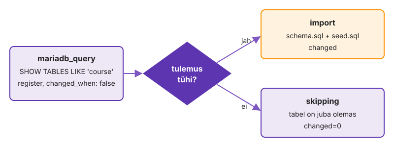

---
tags:
  - Ansible
  - MariaDB
  - Vault
---

# 2. Andmebaas ühe playbook'iga

Andmebaasi skript, mis teisel käivitusel teeb uuesti `ALTER USER`-i ja impordi, kirjutab üle andmed, mida kasutajad vahepeal muutsid, ja parool on repos avatekstina. `k01-bash/services/mariadb.sh` tegi teisel käivitusel kõik uuesti. Nüüd kirjutad db01 jaoks `db.yml`-i ilma rollideta (üks fail, üks play), mis teisel käivitusel ei tee midagi, ja parool läheb kohe Vaulti. Pakett ja teenus on kerged, aga kasutaja, parooli, skeemi ja algandmeid saab teist korda tehes lõhkuda: seisu peab Ansible hoidma, andmeid ta puutuma ei tohi.

Lõpuks paigaldab `db.yml` MariaDB koos andmebaasi, kasutaja ja algandmetega, paroolid on krüpteeritud ja teine jooks on `changed=0`.

**Kui teed seda tööl iga päev:** kirjutad `db.yml`-i, mis paigaldab MariaDB, loob andmebaasi `labseis` ja kasutaja parooliga failist `group_vars/all/vault.yml` (`ansible.mariadb`, socket'i autentimine), ja teine jooks annab `changed=0`. Kui see on sul juba korras, mine otse etappi [„Skeem: import ainult siis, kui seda pole“](#skeem-import-ainult-siis-kui-seda-pole).

## Pakett ja teenus, check tühjal masinal

Kirjutad esimese play, mis paigaldab MariaDB ja paneb teenuse käima. Enne tegelikku käivitust vaatad, mida `--check` sellest arvab. Tühjal masinal on check'il piir ja sa pead seda piiri tundma, et hiljem selle väljundit õigesti lugeda.

Kui sa ei tea, miks check tühjal masinal ebaõnnestub, hakkad seda viga parandama koodis. Siis lisad tingimusi, mida tegelikul käivitusel vaja pole, ja kood läheb keerulisemaks ilma põhjuseta.

Kirjuta `k02-ansible/db.yml`:

- üks play nimega, `hosts: db`
- `ansible.builtin.dnf` paigaldab `mariadb-server` (`lock_timeout: 120`)
- `ansible.builtin.service` paneb teenuse `mariadb` käima ja bootil käivituma
- igal ülesandel on suure tähega nimi ja täisnimega moodul

```bash
ansible-playbook db.yml --syntax-check
ansible-playbook db.yml --check
ansible-playbook db.yml
ansible-playbook db.yml
```

> Check-režiimis jäi pakett paigaldamata, nii et teenust `mariadb` polegi.

Check ennustab iga ülesannet eraldi ja eeldab, et eelmised muudatused juba toimusid, aga ei tee neid. Seepärast ebaõnnestub ülesanne, mis sõltub eelmise ülesande tegelikust tulemusest. `changed=2` esimesel jooksul ja `changed=0` teisel on idempotentsuse kõige lihtsam tõend: moodul kontrollis seisu ja nägi, et midagi teha pole. Kui teine jooks oleks `changed=1`, teeks mõni ülesanne iga kord sama tööd uuesti.

✅ **Edasi saad minna, kui** `--check` ebaõnnestub teenuse ülesandes ("Could not find the requested service"), esimene päris jooks annab `changed=2` ja teine `changed=0`.

## Kollektsioon ja dokumentatsioon enne katsetamist

Andmebaasi ja kasutaja moodulid on kollektsioonis [`ansible.mariadb`](https://docs.ansible.com/projects/ansible/latest/collections/ansible/mariadb/index.html). See läheb kohe `requirements.yml`-i koos versioonivahemikuga, mitte ad-hoc paigaldusena.

Ad-hoc paigaldatud kollektsioon on olemas ainult sinu masinas. Kolleegi masinas, pipeline'is ja automaatses hindajas on teine versioon või pole seda üldse, ja sama playbook ebaõnnestub seal mooduli nime peal.

1. Loo `k02-ansible/requirements.yml` jaotisega `collections:` ja kirjega `ansible.mariadb` versiooniga `">=6.0.0,<7.0.0"`, siis paigalda.

    ```bash
    ansible-galaxy collection install -r requirements.yml
    ansible-galaxy collection list ansible.mariadb
    ```

2. Lisa `db.yml`-i ülesanne `ansible.mariadb.mariadb_db`, mis loob andmebaasi `labseis` (`encoding: utf8mb4`), ja käivita. Saad vea PyMySQL-i kohta.
3. Ava dokumentatsioon ja leia osa REQUIREMENTS: kus peab PyMySQL olema?

    ```bash
    ansible-doc ansible.mariadb.mariadb_db | less
    ```

4. Lisa paigaldusse ühte listi `python3-PyMySQL` ja klient `mariadb` (import vajab käsku `mysql`). Käivita: nüüd on viga `Access denied` või `Can't connect … through socket`.
5. Leia samalt lehelt parameeter socket'i tee jaoks ja socket ise db01-st, siis käivita kaks korda.

    ```bash
    ssh db01 'sudo ss -xlp | grep mysql'
    ```

Kolm järjestikust viga ütlesid kolm eri asja. Esimene ütles, et moodul töötab sihtmasinas ja vajab seal Pythoni teeki. Teine ütles, et moodul ühendub vaikimisi TCP kaudu ja MariaDB root ei saa sealt paroolita sisse. Kolmas, socket'i parameeter, näitas, et root pääseb sisse socket'i kaudu ilma paroolita. Sama järjekorda kasutad iga uue kollektsiooniga: viga, dokumentatsioon, masina enda käsk.

✅ **Edasi saad minna, kui** andmebaas `labseis` on olemas (`ssh db01 "sudo mysql -e 'SHOW DATABASES'"`) ja teine jooks annab `changed=0`.

## Kasutaja ja parool kohe Vaultis

Rakendus vajab andmebaasi kasutajat ja parooli. Parool läheb krüpteeritud faili kohe esimesel korral, mitte "hiljem, kui kõik töötab". Paroolifail ise on väljaspool repot ja Ansible leiab selle keskkonnamuutujast.

Keskkonnamuutuja `ANSIBLE_VAULT_PASSWORD_FILE` on sama mehhanism, mida pipeline hiljem kasutab: runner kirjutab saladuse ajutisse faili ja ekspordib selle tee.

1. Loo paroolifail ja krüpteeritud muutujate fail.

    ```bash
    mkdir -p ~/.config/is1 && openssl rand -base64 24 > ~/.config/is1/vault_pass
    chmod 600 ~/.config/is1/vault_pass
    echo 'export ANSIBLE_VAULT_PASSWORD_FILE=~/.config/is1/vault_pass' >> ~/.bashrc && exec bash
    mkdir -p group_vars/all && ansible-vault create group_vars/all/vault.yml
    ```

2. Kirjuta avanenud redaktoris kolm muutujat: `vault_db_password` (vähemalt 12 märki, hiljem kontrollib seda roll), `vault_mq_password` ja `vault_teacher_token` (Labori seisu koolitaja-token, mille said eelmisel korral).
3. Lisa `db.yml`-i ülesanne `ansible.mariadb.mariadb_user`: kasutaja `labseis`, host `%`, parool `{{ vault_db_password }}`, õigused `labseis.*:ALL`, sama socket ja `no_log: true`.

    ```bash
    head -1 group_vars/all/vault.yml
    ansible-playbook db.yml && ansible-playbook db.yml
    ```

> `vault_password_file` ei lähe `ansible.cfg`-sse: kolleegi masinas ja pipeline'is ebaõnnestuks iga käivitus veaga "vault password file … was not found".

Päis `$ANSIBLE_VAULT;1.1;AES256` tähendab formaadi versiooni 1.1 ja AES-256 CTR-režiimis; võti tuletatakse paroolist PBKDF2-ga ja HMAC kontrollib, et faili pole muudetud. `changed=0` teisel jooksul tõestab, et `mariadb_user` võrdles parooli ja jättis kasutaja rahule. Bashi `mariadb.sh` tegi igal korral `ALTER USER`. `no_log: true` peidab ülesande tulemuse ka `ansible.log`-ist, kuhu muidu jõuaks parool avatekstina.

✅ **Edasi saad minna, kui** `vault.yml` algab `$ANSIBLE_VAULT;1.1;AES256`, teine jooks on `changed=0` ja kasutaja on olemas (`ssh db01 "sudo mysql -e 'SELECT user,host FROM mysql.user'"`).

## Skeem: import ainult siis, kui seda pole

Viid rakenduse skeemi ja algandmed db01-le ja impordid need. Import on erand: moodul impordib iga kord, kui ülesanne käivitub. Sa pead ise küsima masinalt, kas import on vaja.

Import teisel jooksul võib algandmed topelt sisestada või kirjutada üle andmed, mida kasutajad vahepeal muutsid. Tootmises tähendab see andmekadu, mida Ansible'i väljund ei näita, sest see ütleb lihtsalt `changed`.

Päring küsib masinalt, kas tabel `course` on olemas. Kui tulemus on tühi, käivitub import, kui mitte, jääb import vahele.

<figure markdown="span">
  
  <figcaption>Joonis L2.3. Import sõltub masina seisust, mitte sellest, kas baas just loodi.</figcaption>
</figure>

1. Kopeeri `db/schema.sql` ja `db/seed.sql` db01-le `ansible.builtin.copy`-ga: `src: "{{ playbook_dir }}/../db/schema.sql"`, sihtkaust kohas, mis rebootiga ei kao (`/var/lib/labori-seis/sql`, `0750`), failid `0640`.
2. Impordi mõlemad `mariadb_db`-ga (`state: import`, `target:`) ja vaata tulemust.

    ```bash
    ansible-playbook db.yml
    ssh db01 "sudo mysql -N -e 'SELECT COUNT(*) FROM labseis.student'"
    ansible-playbook db.yml | tail -3
    ```

3. Teine jooks on import'i tõttu jälle `changed`. Tee import tingimuslikuks: `ansible.mariadb.mariadb_query` päringuga `SHOW TABLES LIKE 'course'`, `register`, `changed_when: false` ja import ainult tühja tulemuse korral. Struktuuri näitab `ansible.builtin.debug: var=<sinu muutuja>`.

Kolm rida tabelis ja `skipping` teisel jooksul tähendavad, et import käivitus täpselt üks kord. Kui tabelis oleks 6 rida, oleks import käivitunud kaks korda ja `seed.sql` poleks olnud kaitstud. Kui import oleks `skipping` ka esimesel jooksul, loeb tingimus `register`-ist vale välja ja baas jääks tühjaks.

✅ **Edasi saad minna, kui** `student` tabelis on `3` rida ja teine jooks annab `changed=0`, import on `skipping`.

## Kui keegi kustutab andmed

Tühjendad tabeli käsitsi ja vaatad, mida Ansible sellest arvab. Algandmed on `seed.sql`-is olemas ja tabeli saab taastada.

Intsidendi ajal on kiusatus käivitada playbook ja loota, et see "parandab kõik". Kustutatud andmete korral ei paranda see midagi ja roheline PLAY RECAP annab vale kindlustunde.

1. Tühjenda tabel ja käivita playbook.

    ```bash
    ssh db01 "sudo mysql -e 'DELETE FROM labseis.student'"
    ansible-playbook db.yml | grep -E 'Impordi|skipping|changed='
    ssh db01 "sudo mysql -N -e 'SELECT COUNT(*) FROM labseis.student'"
    ```

2. Taasta algandmed ühe ad-hoc käsuga sama mooduliga, mida playbook kasutab.

    ```bash
    ansible db01 -m ansible.mariadb.mariadb_db -a 'name=labseis state=import target=/var/lib/labori-seis/sql/seed.sql login_unix_socket=/var/lib/mysql/mysql.sock'
    ssh db01 "sudo mysql -N -e 'SELECT COUNT(*) FROM labseis.student'"
    ```

3. Kirjuta README-sse kaks lauset: miks playbook andmeid tagasi ei pannud ja kes või mis peaks tootmises kustutatud andmed taastama.

Playbook jäi roheliseks ja tabel jäi tühjaks, sest tingimus küsib struktuuri, mitte sisu. See on õige käitumine: kui Ansible kontrolliks ridade arvu, kirjutaks ta üle andmed, mida kasutaja meelega muutis. Algandmete taastamine töötas, sest `seed.sql` kasutab `INSERT IGNORE`-i. Kasutajate andmete jaoks on vaja varukoopiat, mitte playbook'i.

✅ **Edasi saad minna, kui** pärast `DELETE`-i on playbook `changed=0` ja ridu `0`, pärast ad-hoc importi on ridu jälle `3` ja README-s on kaks lauset.

## Konfifail, --check --diff ja varukoopia

Lisad MariaDB-le konfifaili, mis muudab kuulamisaadressi. Enne tegelikku käivitust vaatad plaani `--check --diff`-iga, siis muudad faili käsitsi ja vaatad, kuidas Ansible soovitud seisu taastab.

Konfifail, mida keegi käsitsi parandas, on järgmise jooksuga kadunud. Kui `backup: true` puudub, pole ka jälge, mis seal oli, ja käsitsi tehtud parandust ei saa enam Giti tõsta.

1. Lisa `ansible.builtin.copy` ülesanne, mis kirjutab `/etc/my.cnf.d/60-labseis.cnf` sisuga `[mysqld]` ja `bind-address = 0.0.0.0`, `mode: "0644"`, `backup: true`. Käivita.
2. Muuda aadress `127.0.0.1`-ks ja vaata ainult plaani. Pane siis `0.0.0.0` tagasi.

    ```bash
    ansible-playbook db.yml --check --diff
    ssh db01 cat /etc/my.cnf.d/60-labseis.cnf
    ```

3. Muuda faili db01-s käsitsi ja käivita playbook: Ansible taastab soovitud seisu ja jätab varukoopia.

    ```bash
    ssh db01 "echo '# käsitsi' | sudo tee -a /etc/my.cnf.d/60-labseis.cnf"
    ansible-playbook db.yml --diff
    ssh db01 'ls /etc/my.cnf.d/'
    ```

4. Kirjuta README-sse: miks MariaDB pärast konfifaili muutust ikka vana aadressi peal kuulab ja kumb neist oleks vale lahendus: eraldi `state: restarted` ülesanne või mitte midagi (vastuse saad rollide lehel).

Diff näitas sama muudatust kahel moel: enne käivitust plaanina ja pärast käsitsi muutmist parandusena. Mõlemal juhul on `-` rida see, mis masinas on, ja `+` rida see, mida kood tahab. Varukoopia `60-labseis.cnf.<pid>.<aeg>~` on tõend, et käsitsi tehtud muudatus oli olemas. Fail muutus, aga teenus ei teadnud sellest: see on handleri ülesanne ja handleri saab MariaDB roll.

✅ **Edasi saad minna, kui** `--check --diff` näitab rida `-`/`+` kujul ja db01 fail jääb muutmata, käsitsi rida kaob ja kaustas on `60-labseis.cnf.<pid>.<aeg>~`.

## Tulemüür ja kontroll app01-st

Kontrollid andmebaasi sealt, kust rakendus selle poole pöördub: app01-st. `active (running)` db01-s ei tähenda, et app01 sinna jõuab. Rocky firewalld blokeerib vaikimisi pordi 3306.

Rocky 9 firewalld `public` tsoonis on vaikimisi lubatud ainult `ssh`, `cockpit` ja `dhcpv6-client`. Ansible'i moodul `ansible.posix.firewalld` räägib firewalld-iga D-Busi kaudu ja vajab sihtmasinas Pythoni teeki `python3-firewall`.

1. Vaata app01-st, kas port on avatud.

    ```bash
    ssh app01 'timeout 3 bash -c "</dev/tcp/db01/3306" && echo avatud'
    ```

2. Lisa `requirements.yml`-i `ansible.posix` (`">=2.2.0,<3.0.0"`) ja paigalda uuesti.
3. Lisa ülesanded: `ansible.builtin.service_facts` ja `ansible.posix.firewalld` port `3306/tcp` (`permanent`, `immediate`), ainult siis, kui `ansible_facts['services']['firewalld.service']['state']` on `running`.
4. Käivita kaks korda ja korda sammu 1 käsku.

`avatud` app01-st tõestab, et tulemüür, kuulamisaadress ja teenus on korras. `permanent` ja `immediate` koos tähendavad, et reegel kehtib kohe ja ka pärast reboot'i. Ühest neist üksi jääks puudu.

✅ **Edasi saad minna, kui** app01-st tuleb `avatud` ja teine jooks on `changed=0`.

## Commit

Commit'id `db.yml`-i, `requirements.yml`-i ja krüpteeritud muutujad. Viimane käsk kontrollib, et paroolifail Gitti ei jõudnud. See on ainus fail, millega `vault.yml`-i saab avada.

```bash
cd ~/labori-seis
git add k02-ansible/db.yml k02-ansible/requirements.yml k02-ansible/group_vars k02-ansible/README.md
git commit -m "K2.2 db.yml: MariaDB, Vault, import (closes #N)" && git push
git ls-files k02-ansible | grep -c vault_pass
```

Kui arv on 1, ei aita ka `ansible-vault rekey`: vana `vault.yml` avaneb ajaloost vana parooliga, nii et vahetada tuleb kõik selle all olnud saladused.

✅ **Edasi saad minna, kui** viimane käsk annab `0`: Gitis on krüpteeritud `vault.yml`, aga mitte paroolifail.

📎 **Selle mooduli tõend:** commit `K2.2 db.yml`; README-s check-jooksu ebaõnnestumise põhjus, andmete kustutamise katse kaks lauset, `--check --diff` rida ja vastus taaskäivituse küsimusele.

## Miks see nii töötab

**MariaDB `unix_socket`.** MariaDB 10.4-st alates on `root@localhost`-il vaikimisi `unix_socket` autentimine: OS-i root pääseb sisse ilma paroolita, kui ühendus tuleb socket'i kaudu. Rocky 9 MariaDB pakett on sellest uuem, seepärast pole kursuse VM-ides root'i parooli ega faili `~/.my.cnf` vaja. Vanemas MariaDB-s või käsitsi muudetud kasutajaga ei pruugi see nii olla.

**`backup: true`.** `backup: true` jätab enne üle kirjutamist koopia `<fail>.<pid>.<aeg>~`. MariaDB direktiiv `!includedir` loeb kaustast ainult `.cnf`-lõpuga faile, nii et varukoopia seadistust ei mõjuta.

**Import'i tingimus.** Tingimus „tabel on olemas" küsib andmebaasi struktuuri, mitte sisu. Kui import katkes poole peal, saab seda ohutult korrata, sest skeem kasutab `CREATE TABLE IF NOT EXISTS`-i ja algandmed `INSERT IGNORE`-i: olemasolevaid tabeleid ja ridu ei looda topelt.

**Andmed Ansible'ist väljas.** Ansible kirjeldab paketid, failid, kasutajad ja tabelid. Ridade sisu muudavad rakendus ja kasutajad. `mariadb_db` `state: import` pole idempotentne ja impordib igal käivitusel, `state: dump` teeb vaikimisi dump'i ilma `single_transaction`-ita ja lukustab tabelid lugemiseks. Ansible loob tühja baasi ja algandmed üks kord, varukoopia ja taastamine on eraldi samm. Selle kohta on lisaprojekt [andmebaasi varukoopia ja taastamine](lisa.md#lisaprojekt-andmebaasi-varukoopia-ja-taastamine).

**YAML-viga ja taane.** Kui oskad playbook'i lugeda andmestruktuurina, on enamik YAML-vigu kohe näha: taane näitab, millise elemendi alla rida kuulub. "conflicting action statements" tähendab peaaegu alati, et kaks moodulit sattusid sama ülesande alla, sest üks rida nihkus.

**Mooduli dokumentatsioon.** Mooduli lehel säästavad kõige rohkem aega kolm osa: Parameters, Requirements ja Examples. Requirements käib sihtmasina kohta, sest moodul töötab seal. Kui paigaldad vea „A MySQL module is required" peale teegi control node'i, ei muuda see midagi.

**Kollektsiooni nimi.** MariaDB moodulid olid varem kollektsioonis `community.mysql`. Need koliti `ansible.mysql`-i, `community.mysql` kuulutati aegunuks ja `ansible.mysql` jätab MariaDB toe versioonis 6.0 maha, nii et MariaDB jaoks on `ansible.mariadb`. Internetis ja AI vastustes näed vana nime veel kaua. Ümbersuunamine töötab, aga annab hoiatuse ja ühel päeval kaob.

**Socket'i tee distrodes.** Ubuntul on MariaDB socket `/run/mysqld/mysqld.sock`, Rockyl `/var/lib/mysql/mysql.sock`. `sudo ss -xlp | grep mysql` näitab seda mõlemas, seepärast on socket'i tee rollis OS-põhine väärtus.

**YAML-i lõksud Ansible'is.** Väärtus, mis algab `{{`-ga, peab olema jutumärkides, muidu loeb parser seda inline-sõnastikuna. Ansible kasutab YAML 1.1 reegleid, kus `yes`, `no`, `on` ja `off` on tõeväärtused: `yes` töötab, aga lint (`yaml[truthy]`) nõuab `true`/`false`. Failirežiim `0644` ilma jutumärkideta on kaheksandsüsteemi arv, `644` aga kümnendarv ja annab vale režiimi.

Kui jõudsid kiiremini: [Lisaülesanded → 5. YAML-viga ja -vvv](lisa.md#5-yaml-viga-ja-vvv), tekitad `db.yml`-is meelega taandevea ja loed `-vvv` väljundist, mis käsuga Ansible hostiga ühendub.
