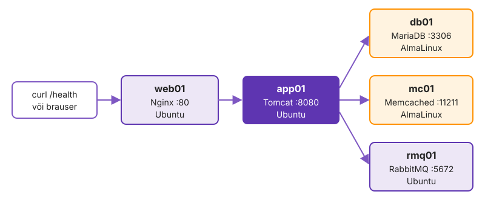
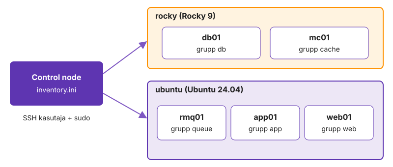
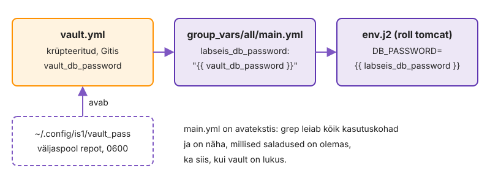

---
tags:
  - Ansible
  - Praktikum
---

# Praktikum: Labori seis rollidega

Täna paigaldad rakenduse Labori seis viide masinasse: kõigepealt parandad ühe suure playbook'i vead ja seejärel jagad selle rollideks.

**Edenemine:** laboritahvel <http://192.168.125.187:8093> (VPN-iga).

??? abstract "Õpiväljundid"

    1. Leiad playbook'i vea sammudega sümptom, hüpotees, tõend, parandus.
    2. Kirjeldad inventory's masinad teenuse ja distributsiooni gruppidena ning valid, kas väärtus kuulub rolli vaikeväärtustesse, grupile või ühele masinale.
    3. Hoiad paroole Vaultis ja kasutad kogude mooduleid.
    4. Jagad playbook'i rollideks nii, et masinate olek ei muutu.
    5. Tõestad korduva käivituse, `--check --diff` ja `ansible-lint`'iga, et projekt on korras.

<figure markdown="span">
  { width="720" }
  <figcaption>Joonis 2.1. Brauser → web01 (Nginx) → app01 (Tomcat), mis kasutab andmebaasi, vahemälu ja sõnumijärjekorda (Talvik, 2026).</figcaption>
</figure>

Rida **Ennusta** tähendab, et enne käsku mõtled läbi, mis juhtub. Vastus on kokkuvolditud plokis.

## Osa 1 · Algne playbook

Kursuse repositooriumi kaustas `k02-ansible` on fail `labseis.yml`. See paigaldab kogu Labori seisu, aga kõik on ühes failis: väärtused ja paroolid on otse sees ning distributsioonide erinevused on lahendatud tingimustega `when`. Selles on ka vead.

### 1.1 Haru ja failid

Alates 2. kohtumisest teed iga kohtumise töö eraldi harus ja ühendad selle päeva lõpus pull request'iga harusse `main`. Käsk `git pull` toob repositooriumi uued failid, ka `labseis.yml`-i.

```bash
cd ~/kursus
git switch main
git pull
git switch -c k02-ansible
cd k02-ansible
cp ../k01/ansible.cfg ../k01/inventory.ini .
ls
```

??? success "Oodatav tulemus"

    Kaustas on `ansible.cfg`, `inventory.ini`, `labseis.yml` ja `requirements.yml`. Kõik selle kohtumise käsud käivitad kaustas `~/kursus/k02-ansible`.

??? warning "Kui `labseis.yml` puudub"

    Laadi see starterist: `curl -fsSLO https://raw.githubusercontent.com/hkhk-tk/is1-starter/main/k02-ansible/labseis.yml` ja sama käsuga `requirements.yml`.

### 1.2 Kogud

Andmebaasi ja RabbitMQ kasutajate moodulid ei ole `ansible-core`'is, vaid eraldi **kogudes** (collections). Fail `requirements.yml` loetleb vajalikud kogud koos versioonidega, et kõigil oleks sama komplekt.

```bash
cat requirements.yml
ansible-galaxy collection install -r requirements.yml
ansible-doc community.mysql.mysql_user | head -20
```

??? success "Oodatav tulemus"

    Kolm kogu on paigaldatud kausta `~/.ansible/collections`. `ansible-doc` näitab mooduli kirjeldust ja parameetreid.

### 1.3 Esimene käivitus

Loe `labseis.yml` enne käivitamist läbi. Iga play käib ühes masinas, väärtused on ülesannetes kirjas.

**Ennusta:** kas Labori seis töötab pärast esimest käivitust?

```bash
ansible-playbook labseis.yml
ssh web01 curl -s localhost/health
```

??? success "Oodatav tulemus"

    Playbook lõpeb ilma vigadeta, kõigis masinates on `failed=0`. Rakendus vastab, aga üks osa ei tööta: `{"status":"UP","db":"UP","queue":"UP","cache":"DOWN"}`. Esimene käivitus võtab umbes 5–8 minutit.

??? warning "Kui app01 ülesanne „Rakendus vastab“ ebaõnnestub"

    Rakendus ei käivitunud. Vaata logi: `ssh app01 sudo journalctl -u tomcat10 -n 40 --no-pager`. Kui seal on `ACCESS_REFUSED`, on RabbitMQ kasutajal teine parool kui rakenduse seadetes.

## Osa 2 · Leia ja paranda vead

Iga viga leiad samade sammudega: **Sümptom** (mida näed), **Hüpotees** (mis võib olla põhjus), **Tõend** (käsk, mis hüpoteesi kinnitab või lükkab ümber), **Paranda** ja **Kontrolli**. Kirjuta iga vea hüpotees enne tõendi otsimist oma K2 issue kommentaariks.

### 2.1 Viga 1: vahemälu ei vasta

**Sümptom:** `/health` näitab `"cache":"DOWN"`. Rakendus app01-s ei saa ühendust Memcachedi serveriga mc01-s.

**Hüpotees:** kirjuta issue'sse, mis võib ühenduse takistada. Mõtle kolmele kohale: kas teenus töötab, kas see kuulab võrgus ja kas midagi on teel ees.

??? tip "Tõend"

    Kontrolli kõiki kolme kohta:

    ```bash
    ssh mc01 systemctl is-active memcached
    ssh mc01 sudo ss -tlnp | grep 11211
    ssh mc01 sudo firewall-cmd --list-ports
    ssh app01 "timeout 3 bash -c '</dev/tcp/mc01/11211' && echo avatud || echo suletud"
    ```

    Teenus töötab ja kuulab aadressil `0.0.0.0:11211`, aga tulemüüris on avatud port `11221/tcp` ja app01-st on port suletud.

??? example "Paranda"

    Ülesandes `Tulemüür lubab vahemälu pordi` on pordi number vale. Paranda see:

    ```yaml
          port: 11211/tcp
    ```

    Vale port jääb tulemüüris avatuks. Sulge see üks kord ad-hoc käsuga:

    ```bash
    ansible mc01 -b -m ansible.posix.firewalld -a "port=11221/tcp permanent=true immediate=true state=disabled"
    ```

**Kontrolli:**

```bash
ansible-playbook labseis.yml
ssh web01 curl -s localhost/health
```

??? success "Oodatav tulemus"

    `{"status":"UP","db":"UP","queue":"UP","cache":"UP"}`. Rakendus loob vahemäluühenduse uuesti, vajadusel oota minut.

### 2.2 Viga 2: teine käivitus muudab masinaid

**Sümptom:** midagi ei ole muutunud, aga playbook teatab muudatustest.

**Ennusta:** mitu ülesannet on teisel käivitusel `changed`?

```bash
ansible-playbook labseis.yml
```

??? success "Oodatav tulemus"

    Kõigis viies masinas on `changed=1` või rohkem. Väljundis on `changed` kahes ülesandes: `Masinad tunnevad üksteist nime järgi` (iga masina kohta) ja app01-s `Tomcat taaskäivitatakse, et seaded rakenduksid`.

**Hüpotees:** kirjuta issue'sse, miks need kaks ülesannet muudavad masinat igal käivitusel.

??? tip "Tõend"

    ```bash
    ssh app01 grep -c db01 /etc/hosts
    ansible-playbook labseis.yml
    ssh app01 grep -c db01 /etc/hosts
    ssh app01 systemctl show tomcat10 -p ActiveEnterTimestamp
    ```

    Iga käivitus lisab faili `/etc/hosts` viis rida juurde ja Tomcat on käivitatud mõni minut tagasi. `shell` ja `command` käivitavad käsu iga kord, sest need moodulid ei tea soovitud olekut. Tomcati taaskäivitus katkestab rakenduse ka siis, kui seaded ei muutunud.

??? example "Paranda: `/etc/hosts`"

    Moodul [`ansible.builtin.blockinfile`](https://docs.ansible.com/projects/ansible/latest/collections/ansible/builtin/blockinfile_module.html) haldab failis ühte märgistatud plokki ja kirjutab selle ainult siis, kui sisu erineb. Asenda esimese play ülesanne:

    ```yaml
        - name: Masinad tunnevad üksteist nime järgi
          ansible.builtin.blockinfile:
            path: /etc/hosts
            marker: "# {mark} labori-seis"
            block: |
              
              {{ hostvars[h].ansible_default_ipv4.address }} {{ h }}
              
    ```

    Filter `sort` hoiab järjekorra samana. Varasemad käivitused jätsid faili palju ridu. Eemalda need üks kord ad-hoc käsuga, enne kui playbook'i uuesti käivitad:

    ```bash
    ansible all -b -m ansible.builtin.lineinfile -a "path=/etc/hosts regexp='^\S+ (web01|app01|rmq01|mc01|db01)$' state=absent"
    ```

??? example "Paranda: Tomcati taaskäivitus"

    Tomcat tuleb taaskäivitada ainult siis, kui seadete fail muutus. Selleks on **handler**: ülesanne, mis käivitub play lõpus ainult siis, kui mõni ülesanne teatas sellest võtmega `notify` ja tegi muudatuse. Kustuta ülesanne `Tomcat taaskäivitatakse, et seaded rakenduksid`. Lisa kahele seadete ülesandele (`Rakenduse seaded on failis` ja `Tomcat loeb rakenduse seaded ja kasutab Java 21`) rida:

    ```yaml
          notify: Restart tomcat
    ```

    Lisa play lõppu (samale taandele kui `tasks:`) handler ja enne ülesannet `Rakendus vastab` rida, mis käivitab ootel handler'id kohe:

    ```yaml
      handlers:
        - name: Restart tomcat
          ansible.builtin.systemd_service:
            name: tomcat10
            state: restarted
            daemon_reload: true
    ```

    ```yaml
        - name: Muudatused rakenduvad enne kontrolli
          ansible.builtin.meta: flush_handlers
    ```

    `daemon_reload: true` loeb muutunud teenusefaili enne taaskäivitust.

**Kontrolli:** käivita playbook kaks korda.

```bash
ansible-playbook labseis.yml
ansible-playbook labseis.yml
ssh app01 grep -c db01 /etc/hosts
```

??? success "Oodatav tulemus"

    Teisel käivitusel on kõigis viies masinas `changed=0`. Failis `/etc/hosts` on db01 üks kord.

### 2.3 Paroolid failis

**Sümptom:**

```bash
grep -n -E "2026" labseis.yml
```

Andmebaasi parool, RabbitMQ parool ja token on failis avatekstina. Fail on Gitis, nii et paroole näeb igaüks, kellel on repositooriumile ligipääs. See ei ole töötamise viga, aga turvaprobleem. Paroolid lähevad 4. osas Vaulti.

Salvesta parandatud playbook:

```bash
cd ~/kursus
git add k02-ansible
git commit -m "k02: labseis.yml vead parandatud"
git push -u origin k02-ansible
```

## Osa 3 · Inventory ja muutujad

`labseis.yml` töötab, aga seda on raske muuta. Masinanimi on iga play päises, väärtused on ülesannetes ja sama paketinime tingimus kordub mitmes kohas. Järgmised osad muudavad projekti ülesehitust nii, et masinate olek jääb samaks.

### 3.1 Inventory gruppideks

1. kohtumisel olid grupid distributsiooni järgi. Labori seisus on igal masinal oma ülesanne, seega lisandub grupp iga teenuse kohta ja distributsioonigrupid koostatakse teenusegruppidest. Järelliide `:children` tähendab, et grupi liikmed on teised grupid.

Muutuja `ansible_host` on masina IP-aadress. `labseis.yml` võtab aadressid faktidest, aga fakte kogub Ansible ainult masinatest, mis käivituses osalevad. Proovi: `ansible-playbook labseis.yml --limit mc01` ebaõnnestub esimeses ülesandes, sest teiste masinate fakte pole. Kui aadress on inventory's, on see alati olemas ja kirjas ainult ühes kohas.

Asenda faili `inventory.ini` sisu ja pane `<web01-IP>` jt asemele oma masinate aadressid (Proxmox, Summary → IPs või `~/.ssh/config`):

??? example "Fail `inventory.ini`"

    ```ini
    [web]
    web01 ansible_host=<web01-IP>

    [app]
    app01 ansible_host=<app01-IP>

    [queue]
    rmq01 ansible_host=<rmq01-IP>

    [cache]
    mc01 ansible_host=<mc01-IP>

    [db]
    db01 ansible_host=<db01-IP>

    [ubuntu:children]
    web
    app
    queue

    [alma:children]
    cache
    db

    [all:vars]
    ansible_user=kasutaja
    ```

**Ennusta:** millised masinad on grupis `ubuntu`?

```bash
ansible-inventory --graph
ansible all -m ansible.builtin.ping
```

??? success "Oodatav tulemus"

    Grupi `ubuntu` all on grupid `web`, `app` ja `queue` ning nende kaudu masinad web01, app01 ja rmq01. Kõik viis masinat vastavad `pong`.

<figure markdown="span">
  { width="720" }
  <figcaption>Joonis 2.2. Iga masin on kahes grupis: teenuse grupis ja distributsiooni grupis (Talvik, 2026).</figcaption>
</figure>

### 3.2 Muutujad kolmel tasemel

Väärtused, mida kasutavad mitu masinat, lähevad kausta `group_vars/all/`. Kaust on vaja, sest 4. osas lisandub sinna krüpteeritud fail. Ühe grupi väärtused lähevad faili `group_vars/<grupp>.yml` ja ühe masina väärtused faili `host_vars/<masin>.yml`. Kui sama muutuja on mitmes kohas, kehtib täpsem.

```bash
mkdir -p group_vars/all host_vars
```

??? example "Fail `group_vars/all/main.yml`"

    Andmebaasi ja järjekorra nimed, mida kasutavad db01, rmq01 ja app01:

    ```yaml
    labseis_db_name: labseis
    labseis_db_user: labseis
    labseis_mq_user: labseis
    ```

??? example "Fail `group_vars/app.yml`"

    Rakendusserveri Java mälu. Väärtus on praegu otse `labseis.yml`-is (`-Xmx512m`):

    ```yaml
    tomcat_heap: 512m
    ```

??? example "Fail `host_vars/web01.yml`"

    Kuhu web01 päringud suunab:

    ```yaml
    nginx_upstream: app01:8080
    ```

**Ennusta:** mida näitab `tomcat_heap` masinas app01 ja mida web01-s?

```bash
ansible app01,web01 -m ansible.builtin.debug -a "var=tomcat_heap"
```

??? success "Oodatav tulemus"

    app01-s `512m`, web01-s `VARIABLE IS NOT DEFINED!`, sest web01 ei ole grupis `app`. Rollid kasutavad neid muutujaid 5.–7. osas.

## Osa 4 · Paroolid Vaulti

**Ansible Vault** krüpteerib faili parooliga. Krüpteeritud faili saab Gitis hoida ja Ansible avab selle käivitamisel. Vaulti parool on failis väljaspool repositooriumi ja `ansible.cfg` ütleb, kust see võtta.

```bash
mkdir -p ~/.config/is1
read -rsp "Vaulti parool: " p && printf '%s\n' "$p" > ~/.config/is1/vault_pass && unset p
chmod 600 ~/.config/is1/vault_pass
echo "vault_password_file = ~/.config/is1/vault_pass" >> ansible.cfg
```

Loo krüpteeritud fail. Käsk avab redaktori. Kirjuta sinna samad väärtused, mis on praegu `labseis.yml`-is, siis masinate olek ei muutu:

```bash
ansible-vault create group_vars/all/vault.yml
```

??? example "Sisu, mille kirjutad redaktoris"

    ```yaml
    vault_db_password: "Labseis2026"
    vault_rabbitmq_password: "Jarjekord2026"
    vault_teacher_token: "opetaja-token-2026"
    ```

    Salvesta ja sulge redaktor. Töökohas oleksid siin tugevad paroolid, mida pole kunagi avatekstina failis olnud.

Lisa faili `group_vars/all/main.yml` read, mis seovad saladused rollides kasutatavate nimedega. Nii näeb loetavast failist, millised saladused on olemas, väärtused on ainult krüpteeritud failis:

??? example "Lisa faili `group_vars/all/main.yml`"

    ```yaml
    labseis_db_password: "{{ vault_db_password }}"
    labseis_mq_password: "{{ vault_rabbitmq_password }}"
    labseis_teacher_token: "{{ vault_teacher_token }}"
    ```

```bash
head -1 group_vars/all/vault.yml
ansible db01 -m ansible.builtin.debug -a "var=labseis_db_password"
```

??? success "Oodatav tulemus"

    Esimene rida on `$ANSIBLE_VAULT;1.1;AES256`. `debug` näitab parooli, sest Ansible avas faili. Sisu muudad käsuga `ansible-vault edit group_vars/all/vault.yml`.

<figure markdown="span">
  { width="720" }
  <figcaption>Joonis 2.3. Väärtus on krüpteeritud failis, nimi loetavas failis ja kasutus mallis (Talvik, 2026).</figcaption>
</figure>

## Osa 5 · Esimene roll: `common`

**Roll** on kaust, kus ühe teenuse ülesanded, mallid, handler'id ja vaikeväärtused on kindlas ülesehituses. Playbook `site.yml` ütleb ainult, milline roll millises grupis käivitub. Esimene roll `common` käib kõigis masinates.

Rollideks jagamisel tõstad ülesande `labseis.yml`-ist rolli ja kontrollid, et masina olek jääb samaks. Kui `--check --diff` ei näita muudatusi, on roll samaväärne.

### 5.1 Rolli kaustad

```bash
mkdir -p roles/common/tasks roles/common/templates roles/common/defaults
```

??? note "Tabel 2.1. Rolli kaustad"

    | Kaust | Mis seal on |
    |---|---|
    | `tasks/main.yml` | rolli ülesanded |
    | `templates/` | mallid (`.j2`), millest Ansible teeb failid |
    | `defaults/main.yml` | vaikeväärtused, mida grupi või masina muutuja saab üle kirjutada |
    | `handlers/main.yml` | ülesanded, mis käivituvad ainult muudatuse järel |

### 5.2 Mall

**Mall** on tekstifail, kuhu Ansible paneb muutujate väärtused (Jinja2). `{{ muutuja }}` asendatakse väärtusega ja `` kordab rida iga loendi elemendi kohta. IP-aadress tuleb nüüd inventory'st (`ansible_host`), mitte faktidest. Väärtus on sama, seega plokk failis `/etc/hosts` ei muutu.

??? example "Fail `roles/common/templates/hosts.j2`"

    ```jinja
    
    {{ hostvars[h].ansible_host }} {{ h }}
    
    ```

??? example "Fail `roles/common/defaults/main.yml`"

    ```yaml
    common_motd: "Seda masinat haldab Ansible (Labori seis)."
    ```

### 5.3 Ülesanded ja `site.yml`

Tõsta `labseis.yml`-i esimese play ülesanne rolli ja lisa teade sisselogimisel. `lookup('ansible.builtin.template', 'hosts.j2')` teeb mallist teksti control node'is ja annab selle plokiks.

??? example "Fail `roles/common/tasks/main.yml`"

    ```yaml
    - name: Masinad tunnevad üksteist nime järgi
      ansible.builtin.blockinfile:
        path: /etc/hosts
        marker: "# {mark} labori-seis"
        block: "{{ lookup('ansible.builtin.template', 'hosts.j2') }}"

    - name: Teade sisselogimisel
      ansible.builtin.copy:
        dest: /etc/motd
        content: "{{ common_motd }}\n"
        mode: "0644"
    ```

??? example "Fail `site.yml`"

    ```yaml
    - name: Kõik masinad
      hosts: all
      become: true
      roles:
        - common
    ```

Kustuta `labseis.yml`-ist esimene play (`Kõik masinad`): seda tööd teeb nüüd roll.

**Ennusta:** mida näitab `--check --diff` failis `/etc/hosts`?

```bash
ansible-playbook site.yml --check --diff
ansible-playbook site.yml
ansible-playbook site.yml
```

??? success "Oodatav tulemus"

    `--diff` näitab ainult faili `/etc/motd` muudatust, `/etc/hosts` ei muutu. Teisel käivitusel on `changed=0`.

```bash
cd ~/kursus && git add k02-ansible && git commit -m "k02: inventory, muutujad, Vault, roll common" && git push
```

## Osa 6 · Rollid `mariadb`, `memcached` ja `rabbitmq`

Iga teenuse roll tehakse samas järjekorras: vaikeväärtused, mall, handler, ülesanded, play `site.yml`-is, kontroll ja vana play kustutamine `labseis.yml`-ist.

### 6.1 Roll `mariadb`

`labseis.yml`-is on MariaDB paigaldus kaks korda: AlmaLinuxile ja Ubuntule, igaüks oma tingimusega. Rollis on erinevad väärtused vaikeväärtustes. Need on AlmaLinuxi omad, sest andmebaas on db01-s. Ubuntu masinas kirjutaksid need üle failis `group_vars/ubuntu.yml`, nagu tegid 1. kohtumisel, ja roll jääks samaks.

```bash
mkdir -p roles/mariadb/tasks roles/mariadb/templates roles/mariadb/defaults roles/mariadb/handlers
```

??? example "Fail `roles/mariadb/defaults/main.yml`"

    ```yaml
    mariadb_port: 3306

    # AlmaLinuxi väärtused. Teises distributsioonis kirjuta need üle grupimuutujatega.
    mariadb_paketid:
      - mariadb-server
      - python3-PyMySQL
    mariadb_conf_dir: /etc/my.cnf.d
    mariadb_socket: /var/lib/mysql/mysql.sock
    ```

Mall asendab `labseis.yml`-is olnud teksti. `{{ ansible_managed }}` lisab faili algusesse märke, et faili haldab Ansible.

??? example "Fail `roles/mariadb/templates/60-labseis.cnf.j2`"

    ```ini
    # {{ ansible_managed }}
    [mysqld]
    bind-address = 0.0.0.0
    port = {{ mariadb_port }}
    ```

Teine handler laadib tabelid. Tabelid laaditakse ainult siis, kui andmebaas just loodi, muidu kirjutaks iga käivitus andmed üle.

??? example "Fail `roles/mariadb/handlers/main.yml`"

    ```yaml
    - name: Restart mariadb
      ansible.builtin.service:
        name: mariadb
        state: restarted

    - name: Load schema
      community.mysql.mysql_db:
        name: "{{ labseis_db_name }}"
        state: import
        target: "/root/{{ item }}"
        login_unix_socket: "{{ mariadb_socket }}"
      loop:
        - schema.sql
        - seed.sql
    ```

Kaks paigaldusülesannet asenduvad ühega: `ansible.builtin.package` valib paketihalduri ise ja paketinimed tulevad vaikeväärtustest. Tingimus `when` jääb ainult tulemüürile, sest `firewalld` on ainult AlmaLinuxis. Parool tuleb Vaultist ja `no_log: true` peidab selle väljundist.

??? example "Fail `roles/mariadb/tasks/main.yml`"

    ```yaml
    - name: MariaDB ja Pythoni teek on paigaldatud
      ansible.builtin.package:
        name: "{{ mariadb_paketid }}"
        state: present

    - name: MariaDB kuulab kõigil liidestel
      ansible.builtin.template:
        src: 60-labseis.cnf.j2
        dest: "{{ mariadb_conf_dir }}/60-labseis.cnf"
        mode: "0644"
      notify: Restart mariadb

    - name: MariaDB töötab ja käivitub koos masinaga
      ansible.builtin.service:
        name: mariadb
        state: started
        enabled: true

    - name: Tulemüür lubab andmebaasi pordi
      ansible.posix.firewalld:
        port: "{{ mariadb_port }}/tcp"
        permanent: true
        immediate: true
        state: enabled
      when: ansible_facts['os_family'] == "RedHat"

    - name: Muudatused rakenduvad enne andmebaasi seadistamist
      ansible.builtin.meta: flush_handlers

    - name: Andmebaas on olemas
      community.mysql.mysql_db:
        name: "{{ labseis_db_name }}"
        encoding: utf8mb4
        state: present
        login_unix_socket: "{{ mariadb_socket }}"
      notify: Load schema

    - name: Rakenduse kasutaja on olemas
      community.mysql.mysql_user:
        name: "{{ labseis_db_user }}"
        host: "%"
        password: "{{ labseis_db_password }}"
        priv: "{{ labseis_db_name }}.*:ALL"
        state: present
        login_unix_socket: "{{ mariadb_socket }}"
      no_log: true

    - name: Skeem ja algandmed on kopeeritud
      ansible.builtin.copy:
        src: "{{ playbook_dir }}/../db/{{ item }}"
        dest: "/root/{{ item }}"
        mode: "0600"
      loop:
        - schema.sql
        - seed.sql
    ```

??? example "Lisa `site.yml`-i"

    ```yaml
    - name: Andmebaas
      hosts: db
      become: true
      roles:
        - mariadb
    ```

Kustuta `labseis.yml`-ist play `Andmebaas`.

**Ennusta:** mida näitab `--check --diff` db01-s ja kas MariaDB taaskäivitatakse?

```bash
ansible-playbook site.yml --limit db01 --check --diff
ansible-playbook site.yml --limit db01
ansible-playbook site.yml --limit db01
```

??? success "Oodatav tulemus"

    `--diff` näitab konfiguratsioonifailis ainult uut rida `# Ansible managed`. Käivitusel on see `changed` ja väljundis `RUNNING HANDLER [mariadb : Restart mariadb]`. Tabeleid uuesti ei laadita, sest andmebaas oli olemas. Teisel käivitusel on `changed=0`.

### 6.2 Roll `memcached`

Rolli ülesehitus on sama mis `mariadb`-l. Mall asendab `labseis.yml`-is olnud teksti, pordi ja mälu väärtus tulevad vaikeväärtustest.

```bash
mkdir -p roles/memcached/tasks roles/memcached/templates roles/memcached/defaults roles/memcached/handlers
```

??? example "Fail `roles/memcached/defaults/main.yml`"

    ```yaml
    memcached_port: 11211
    memcached_mem_mb: 64
    # AlmaLinuxi seadete fail, mall on selle vormingus
    memcached_conf: /etc/sysconfig/memcached
    ```

??? example "Fail `roles/memcached/templates/memcached.j2`"

    ```bash
    # {{ ansible_managed }}
    PORT="{{ memcached_port }}"
    USER="memcached"
    MAXCONN="1024"
    CACHESIZE="{{ memcached_mem_mb }}"
    OPTIONS="-l 0.0.0.0"
    ```

??? example "Fail `roles/memcached/handlers/main.yml`"

    ```yaml
    - name: Restart memcached
      ansible.builtin.service:
        name: memcached
        state: restarted
    ```

??? example "Fail `roles/memcached/tasks/main.yml`"

    ```yaml
    - name: Memcached on paigaldatud
      ansible.builtin.package:
        name: memcached
        state: present

    - name: Memcached kuulab kõigil liidestel
      ansible.builtin.template:
        src: memcached.j2
        dest: "{{ memcached_conf }}"
        mode: "0644"
      notify: Restart memcached

    - name: Memcached töötab ja käivitub koos masinaga
      ansible.builtin.service:
        name: memcached
        state: started
        enabled: true

    - name: Tulemüür lubab vahemälu pordi
      ansible.posix.firewalld:
        port: "{{ memcached_port }}/tcp"
        permanent: true
        immediate: true
        state: enabled
      when: ansible_facts['os_family'] == "RedHat"
    ```

??? example "Lisa `site.yml`-i"

    ```yaml
    - name: Vahemälu
      hosts: cache
      become: true
      roles:
        - memcached
    ```

Kustuta `labseis.yml`-ist play `Vahemälu` ja käivita:

```bash
ansible-playbook site.yml --limit mc01
ansible-playbook site.yml --limit mc01
ssh mc01 sudo ss -tln | grep 11211
```

??? success "Oodatav tulemus"

    Esimesel käivitusel muutub ainult mall (uus rida `# Ansible managed`) ja handler taaskäivitab Memcachedi. Teisel käivitusel on `changed=0`. Memcached kuulab aadressil `0.0.0.0:11211`.

### 6.3 Roll `rabbitmq`

RabbitMQ on ainult Ubuntus. Rakendus logib sisse oma kasutajaga ja vaikekasutaja `guest` eemaldatakse, sest selle parool on kõigil teada. `update_password: on_create` määrab parooli ainult kasutaja loomisel.

```bash
mkdir -p roles/rabbitmq/tasks roles/rabbitmq/defaults
```

??? example "Fail `roles/rabbitmq/defaults/main.yml`"

    ```yaml
    rabbitmq_vhost: /
    ```

??? example "Fail `roles/rabbitmq/tasks/main.yml`"

    ```yaml
    - name: RabbitMQ on paigaldatud
      ansible.builtin.apt:
        name: rabbitmq-server
        state: present
        update_cache: true
        cache_valid_time: 3600

    - name: RabbitMQ töötab ja käivitub koos masinaga
      ansible.builtin.service:
        name: rabbitmq-server
        state: started
        enabled: true

    - name: Rakenduse kasutaja on olemas
      community.rabbitmq.rabbitmq_user:
        user: "{{ labseis_mq_user }}"
        password: "{{ labseis_mq_password }}"
        update_password: on_create
        vhost: "{{ rabbitmq_vhost }}"
        configure_priv: ".*"
        read_priv: ".*"
        write_priv: ".*"
        state: present
      no_log: true

    - name: Vaikekasutajat guest ei ole
      community.rabbitmq.rabbitmq_user:
        user: guest
        state: absent
    ```

??? example "Lisa `site.yml`-i"

    ```yaml
    - name: Sõnumijärjekord
      hosts: queue
      become: true
      roles:
        - rabbitmq
    ```

Kustuta `labseis.yml`-ist play `Sõnumijärjekord`.

**Ennusta:** mis juhtuks, kui `update_password` oleks `always`?

```bash
ansible-playbook site.yml --limit rmq01
ssh rmq01 sudo rabbitmqctl list_users
```

??? success "Oodatav tulemus"

    `changed=0`, sest kasutaja oli olemas. Väärtusega `always` kontrolliks moodul parooli igal käivitusel ja kui RabbitMQ ei saa parooli võrrelda, oleks tulemus iga kord `changed`. Loendis on `labseis`, aga mitte `guest`.

```bash
cd ~/kursus && git add k02-ansible && git commit -m "k02: rollid mariadb, memcached, rabbitmq" && git push
```

## Osa 7 · Rollid `tomcat` ja `nginx`

### 7.1 Roll `tomcat`

Rakendus loeb aadressid ja paroolid keskkonnamuutujatest failist `/etc/labori-seis/env`. Aadressid tulevad inventory gruppidest: `groups['db'][0]` on grupi `db` esimene masin. Kui andmebaas kolib teise masinasse, muudad ainult inventory't.

```bash
mkdir -p roles/tomcat/tasks roles/tomcat/templates roles/tomcat/defaults roles/tomcat/handlers
```

??? example "Fail `roles/tomcat/templates/env.j2`"

    ```bash
    # {{ ansible_managed }}
    DB_HOST={{ groups['db'][0] }}
    DB_NAME={{ labseis_db_name }}
    DB_USER={{ labseis_db_user }}
    DB_PASSWORD={{ labseis_db_password }}
    MEMCACHED_HOST={{ groups['cache'][0] }}
    RABBITMQ_HOST={{ groups['queue'][0] }}
    RABBITMQ_USER={{ labseis_mq_user }}
    RABBITMQ_PASSWORD={{ labseis_mq_password }}
    TEACHER_TOKEN={{ labseis_teacher_token }}
    ```

??? example "Fail `roles/tomcat/templates/labori-seis.conf.j2`"

    Teenuse lisaseaded. Mälu tuleb muutujast `tomcat_heap` (3. osa, `group_vars/app.yml`).

    ```ini
    # {{ ansible_managed }}
    [Service]
    EnvironmentFile=/etc/labori-seis/env
    Environment=JAVA_HOME=/usr/lib/jvm/java-21-openjdk-amd64
    Environment=CATALINA_OPTS=-Xmx{{ tomcat_heap }}
    ```

??? example "Fail `roles/tomcat/defaults/main.yml`"

    ```yaml
    tomcat_heap: 256m
    tomcat_webapps: /var/lib/tomcat10/webapps
    tomcat_war_url: https://github.com/hkhk-tk/is1-starter/releases/download/v1.1.0/labori-seis.war
    ```

    Vaikeväärtus 256m kehtib igal masinal, mille grupil ei ole oma väärtust. app01 saab grupist `app` 512m.

??? example "Fail `roles/tomcat/handlers/main.yml`"

    Sama handler, mille lisasid 2. osas `labseis.yml`-i:

    ```yaml
    - name: Restart tomcat
      ansible.builtin.systemd_service:
        name: tomcat10
        state: restarted
        daemon_reload: true
    ```

Ülesanded on samad mis `labseis.yml`-is, väärtused tulevad muutujatest ja failid mallidest. Moodul [`ansible.builtin.uri`](https://docs.ansible.com/projects/ansible/latest/collections/ansible/builtin/uri_module.html) teeb HTTP päringu ning `until`, `retries` ja `delay` kordavad seda, kuni rakendus vastab. `check_mode: false` laseb päringu teha ka `--check` käivitusel: päring ainult loeb, ilma selleta jääks see vahele ja kontroll ebaõnnestuks.

??? example "Fail `roles/tomcat/tasks/main.yml`"

    ```yaml
    - name: Java 21 ja Tomcat 10 on paigaldatud
      ansible.builtin.apt:
        name:
          - openjdk-21-jre-headless
          - tomcat10
        state: present
        update_cache: true
        cache_valid_time: 3600

    - name: Rakenduse seadete kaust on olemas
      ansible.builtin.file:
        path: /etc/labori-seis
        state: directory
        owner: root
        group: tomcat
        mode: "0750"

    - name: Rakenduse seaded (paroolid) on failis
      ansible.builtin.template:
        src: env.j2
        dest: /etc/labori-seis/env
        owner: root
        group: tomcat
        mode: "0640"
      notify: Restart tomcat
      no_log: true

    - name: Tomcati teenuse lisaseadete kaust on olemas
      ansible.builtin.file:
        path: /etc/systemd/system/tomcat10.service.d
        state: directory
        mode: "0755"

    - name: Tomcat loeb rakenduse seaded ja kasutab Java 21
      ansible.builtin.template:
        src: labori-seis.conf.j2
        dest: /etc/systemd/system/tomcat10.service.d/labori-seis.conf
        mode: "0644"
      notify: Restart tomcat

    - name: Kas juurkontekstis on Tomcati näidisleht?
      ansible.builtin.stat:
        path: "{{ tomcat_webapps }}/ROOT/index.html"
      register: tomcat_naidis

    - name: Näidislehe kaust on eemaldatud
      ansible.builtin.file:
        path: "{{ tomcat_webapps }}/ROOT"
        state: absent
      when: tomcat_naidis.stat.exists

    - name: Rakendus (WAR) on alla laaditud
      ansible.builtin.get_url:
        url: "{{ tomcat_war_url }}"
        dest: "{{ tomcat_webapps }}/ROOT.war"
        owner: tomcat
        group: tomcat
        mode: "0644"

    - name: Tomcat töötab ja käivitub koos masinaga
      ansible.builtin.service:
        name: tomcat10
        state: started
        enabled: true

    - name: Muudatused rakenduvad enne kontrolli
      ansible.builtin.meta: flush_handlers

    - name: Rakendus vastab app01-s
      ansible.builtin.uri:
        url: http://localhost:8080/health/live
        status_code: 200
      register: tomcat_live
      check_mode: false
      until: tomcat_live.status == 200
      retries: 40
      delay: 5
    ```

??? example "Lisa `site.yml`-i"

    ```yaml
    - name: Rakendusserver
      hosts: app
      become: true
      roles:
        - tomcat
    ```

Kustuta `labseis.yml`-ist play `Rakendusserver`.

**Ennusta:** kas Tomcat taaskäivitatakse ja miks?

```bash
ansible-playbook site.yml --limit app01 --check --diff
ansible-playbook site.yml --limit app01
```

??? success "Oodatav tulemus"

    `--diff` näitab teenuse lisaseadete failis uut rida `# Ansible managed` ja `failed=0`. Keskkonnamuutujate faili sisu `--diff` ei näita, sest ülesandel on `no_log: true`. Mõlemad mallid on `changed` ja handler taaskäivitab Tomcati üks kord. Ülesanne `Rakendus vastab app01-s` võib paar korda kirjutada `FAILED - RETRYING`, kuni rakendus käivitub.

### 7.2 Roll `nginx`

Nginx web01-s võtab vastu päringud pordil 80 ja edastab need app01-le. Ubuntus on Nginxi saidid kaustas `/etc/nginx/sites-available` ja sait lülitatakse sisse lingiga kausta `/etc/nginx/sites-enabled`. Handler `Reload nginx` loeb seaded uuesti ilma ühendusi katkestamata. Seda teavitavad kolm ülesannet, aga handler käivitub üks kord.

```bash
mkdir -p roles/nginx/tasks roles/nginx/templates roles/nginx/defaults roles/nginx/handlers
```

??? example "Fail `roles/nginx/templates/labori-seis.conf.j2`"

    ```nginx
    # {{ ansible_managed }}
    upstream labori_seis {
        server {{ nginx_upstream }};
    }

    server {
        listen 80 default_server;
        server_name _;

        location / {
            proxy_pass http://labori_seis;
            proxy_set_header Host $host;
            proxy_set_header X-Real-IP $remote_addr;
            proxy_set_header X-Forwarded-For $proxy_add_x_forwarded_for;
        }
    }
    ```

??? example "Failid `roles/nginx/defaults/main.yml` ja `roles/nginx/handlers/main.yml`"

    ```yaml
    nginx_upstream: app01:8080
    ```

    ```yaml
    - name: Reload nginx
      ansible.builtin.service:
        name: nginx
        state: reloaded
    ```

??? example "Fail `roles/nginx/tasks/main.yml`"

    ```yaml
    - name: Nginx on paigaldatud
      ansible.builtin.apt:
        name: nginx
        state: present
        update_cache: true
        cache_valid_time: 3600

    - name: Labori seisu sait on seadistatud
      ansible.builtin.template:
        src: labori-seis.conf.j2
        dest: /etc/nginx/sites-available/labori-seis
        mode: "0644"
      notify: Reload nginx

    - name: Labori seisu sait on sisse lülitatud
      ansible.builtin.file:
        src: /etc/nginx/sites-available/labori-seis
        dest: /etc/nginx/sites-enabled/labori-seis
        state: link
      notify: Reload nginx

    - name: Vaikesait on välja lülitatud
      ansible.builtin.file:
        path: /etc/nginx/sites-enabled/default
        state: absent
      notify: Reload nginx

    - name: Nginx töötab ja käivitub koos masinaga
      ansible.builtin.service:
        name: nginx
        state: started
        enabled: true
    ```

Viimane play kontrollib, et kogu Labori seis vastab web01 kaudu.

??? example "Lisa `site.yml`-i"

    ```yaml
    - name: Veebiserver
      hosts: web
      become: true
      roles:
        - nginx

    - name: Labori seis vastab
      hosts: web
      gather_facts: false
      tasks:
        - name: Rakendus vastab web01 kaudu
          ansible.builtin.uri:
            url: http://localhost/health
            status_code: 200
          register: health
          check_mode: false
          until: health.status == 200
          retries: 30
          delay: 5
    ```

`labseis.yml`-is pole nüüd ühtki play'd. Kustuta fail:

```bash
git rm labseis.yml
ansible-playbook site.yml
ssh web01 curl -s localhost/health
```

??? success "Oodatav tulemus"

    Nginxi saidi failis lisanduvad rida `# Ansible managed` ja kaks päist (`X-Real-IP`, `X-Forwarded-For`), handler laeb Nginxi seaded uuesti. Kõik play'd lõpevad ilma vigadeta, `/health` vastab `{"status":"UP","db":"UP","queue":"UP","cache":"UP"}`. Ava brauseris `http://<web01-IP>/`: avaneb Labori seisu leht.

```bash
cd ~/kursus && git add -A k02-ansible && git commit -m "k02: rollid tomcat ja nginx, labseis.yml kustutatud" && git push
```

## Osa 8 · Tõestus ja esitamine

### 8.1 Muudatus enne rakendamist ja masinate kaupa

Muuda failis `roles/common/defaults/main.yml` teate teksti, näiteks lisa lõppu ` Küsimused: IT-tugi.`. Võti `serial` käivitab play masinate kaupa: kui esimeses rühmas tuleb viga, ülejäänud masinaid ei puudutata. Lisa `site.yml`-i esimesse play'sse `hosts:` rea järele rida `serial: 2`.

**Ennusta:** mitu korda on väljundis rida `PLAY [Kõik masinad]`?

```bash
ansible-playbook site.yml --check --diff --limit web01
ansible-playbook site.yml
```

??? success "Oodatav tulemus"

    `--check --diff` näitab teate vana ja uut rida ning masinas ei muutu midagi. Käivitusel on rida `PLAY [Kõik masinad]` kolm korda: kaks masinat, kaks masinat ja üks masin.

### 8.2 `ansible-lint`

Syntax-check leiab ainult vigase YAML-i. [`ansible-lint`](https://docs.ansible.com/projects/lint/) kontrollib ka häid tavasid: moodulid on täisnimega, failidel on `mode`, `command` ülesandel on `changed_when`. Automaatne hindaja kasutab sama versiooni.

```bash
sudo apt install -y pipx
pipx install "ansible-lint==26.9.*"
pipx ensurepath && source ~/.bashrc
ansible-lint
```

??? success "Oodatav tulemus"

    Viimane rida algab `Passed: 0 failure(s), 0 warning(s)`. Leiu juures on reegli nimi, fail ja rida. Selgituse leiad [reeglite loendist](https://docs.ansible.com/projects/lint/rules/).

### 8.3 Korduv käivitus

Automaatne hindaja kontrollib salvestatud teise käivituse väljundit.

**Ennusta:** mitu muudatust on kogu playbook'i käivitusel?

```bash
ansible-playbook site.yml | tee run2.txt
```

??? success "Oodatav tulemus"

    PLAY RECAP-is on kõigil viiel masinal `changed=0` ja `failed=0`. Kui mõnes masinas on `changed`, vaata, milline ülesanne muutis, paranda see ja salvesta `run2.txt` uuesti.

??? note "Kontrollnimekiri"

    - [ ] `labseis.yml` on kustutatud, `site.yml` paigaldab kogu Labori seisu
    - [ ] kuus rolli: `common`, `mariadb`, `memcached`, `rabbitmq`, `tomcat`, `nginx`
    - [ ] `group_vars/all/vault.yml` algab reaga `$ANSIBLE_VAULT`, Vaulti parool ei ole Gitis
    - [ ] `ansible-lint` ja `run2.txt` on puhtad

## Töö esitamine

Töö jõuab harusse `main` pull request'iga ja esitatakse tag'iga `k02`.

```bash
cd ~/kursus
git add -A k02-ansible
git commit -m "k02: serial ja run2.txt"
git push
```

Tee GitHubis pull request harust `k02-ansible` harusse `main` (**Compare & pull request**), vaata muudatused üle ja ühenda (**Merge pull request**). Seejärel:

```bash
git switch main
git pull
git tag k02
git push origin k02
```

Tulemuse näed Classroom 50-s.

## Lisaülesanded

??? example "1 · Kui midagi läheb valesti: `block` ja `rescue`"

    Vea korral ütleb viimane play ainult, et `/health` ei vastanud. Põhjus on tavaliselt app01 Tomcati logis. Asenda `site.yml`-i viimane play nii, et vea korral loeb Ansible rakendusserveri logi:

    ```yaml
    - name: Labori seis vastab
      hosts: web
      gather_facts: false
      vars:
        health_retries: 30
      tasks:
        - name: Kontroll, vea korral rakendusserveri logi
          block:
            - name: Rakendus vastab web01 kaudu
              ansible.builtin.uri:
                url: http://localhost/health
                return_content: true
              register: health
              check_mode: false
              until: health.status == 200
              retries: "{{ health_retries }}"
              delay: 5
              failed_when: health.status != 200 or 'DOWN' in (health.content | default(''))
          rescue:
            - name: Tomcati logi app01-st
              ansible.builtin.command: journalctl -u tomcat10 -n 20 --no-pager
              delegate_to: "{{ groups['app'][0] }}"
              become: true
              register: tomcat_logi
              changed_when: false

            - name: Logi viimased read
              ansible.builtin.debug:
                var: tomcat_logi.stdout_lines

            - name: Labori seis ei vasta
              ansible.builtin.fail:
                msg: "Labori seis ei vasta web01 kaudu. Põhjus on tõenäoliselt ülal Tomcati logis."
    ```

    `block` ja `rescue` töötavad nagu `try` ja `catch`, `delegate_to` käivitab ülesande teises masinas. Proovi: `ssh app01 sudo systemctl stop tomcat10`, siis `ansible-playbook site.yml --limit web01 -e health_retries=2`. Kokkuvõttes on `failed=1` ja `rescued=1`. Taasta Tomcat playbook'iga: `ansible-playbook site.yml --limit app01`.

??? example "2 · Distributsiooni väärtused rolli sees"

    Rolli `mariadb` vaikeväärtused on AlmaLinuxi omad. Teine võimalus on, et roll valib väärtused ise. Loo failid `roles/mariadb/vars/RedHat.yml` (praegused väärtused) ja `roles/mariadb/vars/Debian.yml`:

    ```yaml
    mariadb_paketid:
      - mariadb-server
      - python3-pymysql
    mariadb_conf_dir: /etc/mysql/mariadb.conf.d
    mariadb_socket: /run/mysqld/mysqld.sock
    ```

    Eemalda need kolm muutujat failist `defaults/main.yml` ja lisa rolli ülesannete algusesse:

    ```yaml
    - name: Distributsiooni väärtused
      ansible.builtin.include_vars: "{{ ansible_facts['os_family'] }}.yml"
    ```

    Teine käivitus peab andma `changed=0`. Millal on parem, et roll teab väärtusi ise, ja millal, et need on inventory juures?

??? example "3 · Üks krüpteeritud väärtus: `encrypt_string`"

    `vault.yml` krüpteerib terve faili. Vahel on mugavam krüpteerida üks väärtus ja hoida see tavalises muutujate failis:

    ```bash
    ansible-vault encrypt_string 'proov123' --name vault_proov
    ```

    Kopeeri väljund faili `host_vars/db01.yml` ja kontrolli: `ansible db01 -m ansible.builtin.debug -a var=vault_proov`. Väljundis on `"vault_proov": "proov123"`. Mis juhtub `git diff`-is, kui muudad terves krüpteeritud failis ühte parooli? Loe edasi: [Encrypting content with Ansible Vault](https://docs.ansible.com/projects/ansible/latest/vault_guide/vault_encrypting_content.html). Kustuta katse lõpus fail `host_vars/db01.yml`.
