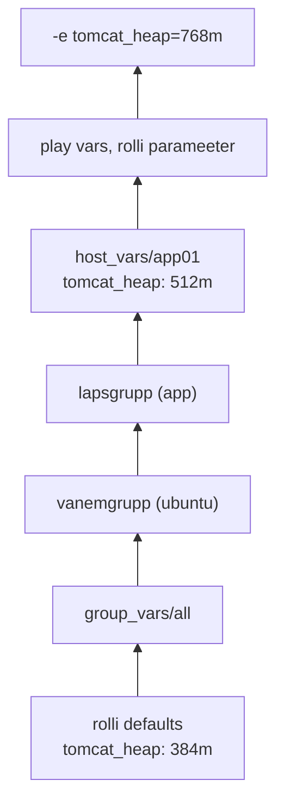
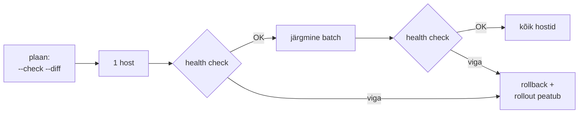

---
tags:
  - Ansible
  - konfiguratsioonihaldus
  - Vault
  - compliance
  - event-driven
---

# 2. kohtumine · Konfiguratsioonihaldus: loeng

**Eeldus:** eelmisel korral kirjutasid inventory ja esimese playbook'i ning nägid, et teine käivitus annab `changed=0`.

Ühe hosti ühe teenusega playbook on veel skript teise süntaksiga. Konfiguratsioonihaldus hakkab end ära tasuma siis, kui hoste ja teenuseid on mitu, inimesi on mitu ja muudatusi tuleb iga nädal. Kood on serverite seisu ainus kirjeldus ja iga muudatus läheb läbi selle koodi kontrollitult, piiratud ulatusega, õigustega ja nii, et selle saab tagasi võtta.

## 🎯 Õpiväljundid

Pärast seda loengut oskad:

- võrrelda Ansible'it Puppeti, Chefi ja Saltiga ning põhjendada, kus push-mudel ei sobi;
- selgitada, kuidas moodul seisu loeb ja muudab, ning valida muutujale ja saladusele õige koha;
- piirata muudatuse riski plaani, osade kaupa rollout'i, rollback'i ja health check'iga;
- kirjeldada patch-halduse elutsüklit ja eristada `--check` auditit OpenSCAP-i skannist;
- kavandada automatiseerimisplatvormi RBAC-i ja CMDB-st tuleva inventory piirid;
- selgitada sündmuspõhise automatiseerimise ahelat ja seda, kus inimene kinnitab;
- eristada Linuxi, võrguseadme ja Windowsi hosti täitmismudelit.


[Konfiguratsioonihaldus](../teemad/konfiguratsioonihaldus.md) · [Patch-haldus](../teemad/patch-haldus.md) · [Turvaautomaatika, compliance ja riskihaldus](../teemad/turvaautomaatika.md) · [Võrguautomaatika ja NetOps](../teemad/vorguautomaatika.md) · [Windowsi automatiseerimine](../teemad/windows-automaatika.md) · [RBAC ja ligipääsu kontroll](../teemad/rbac.md) · [Sündmuspõhine automaatika](../teemad/sundmuspohine-automaatika.md)

## 1. Ansible infra töös

Turvateade tuleb kolmapäeval ja reedeks peab 40 Rocky ja Ubuntu serverit olema paigatud. Pooled vajavad pärast kerneli uuendust reboot'i ja runbook ütleb, mitu rakendushosti tohib korraga maas olla ning mida pärast tagasitulekut kontrollida. Käsitsi on see SSH-tsükkel, tabel ja kaks inimest öises aknas. Ansible'iga on sama runbook playbook: kolleeg vaatab selle PR-is üle, `--check` näitab enne akent, mis muutuks, ja järgmisel kuul käivitub see muutmata.

| Ülesanne | Moodul või muster | Lõks |
|---|---|---|
| paigad ja reboot lainetena | `dnf`/`apt` `state: latest`, `needs-restarting -r` (Rocky) või `/var/run/reboot-required` (Ubuntu), `ansible.builtin.reboot`, `serial` + health check | reboot ainult vajadusel, laine suurus teenuse järgi |
| kasutajad, SSH võtmed, sudo | `user`, `ansible.posix.authorized_key` `exclusive: true`, `copy` `validate: visudo -cf %s` | lahkunu võti kaob igalt hostilt ühe commit'iga |
| hardening ja compliance | `template`/`lineinfile` `validate: sshd -t -f %s`, `sysctl`, `ansible.posix.seboolean`; `--check --diff` auditina | `changed` check'is on kõrvalekalle; vigane `sshd_config` lukustab Ansible'i välja |
| sertifikaadid | `community.crypto`: `openssl_csr`, `x509_certificate`, `get_certificate`; reload handler | moodul aegumist ei vaata, kontroll on eraldi |
| konfi drift | öine `--check --diff`, `fetch`, `failed_when` poliitikana | drift'i korral on väljumiskood `0`, loe PLAY RECAP-i |
| teenuse paigaldus ja uuendus | roll, `template` + handler, `block`/`rescue`, `serial` | rollback on koodis enne, kui seda vaja läheb |
| võrguseadme backup ja muudatus | `cisco.ios`, `junipernetworks.junos`: `*_facts`, `*_config` `backup: true`, ressursimoodulid (`*_interfaces`, `*_ospfv2`); Linuxi ruuter (FRR): `command: vtysh -c '…'`; Pythonis Netmiko | Cisco/Juniperil töötab moodul control node'il `network_cli` kaudu, Linuxi ruuteris nagu serveris |
| dünaamiline inventory | `community.proxmox.proxmox`, `netbox.netbox.nb_inventory`, CMDB | API maas tähendab tühja inventory't ja rohelist jooksu |
| mitme tiimi muudatus | üks playbook mitme play'ga: LB drain, skeemi muudatus `run_once`, app rolling, LB tagasi | järjekord ja peatumise reegel on koodis, mitte protokollis |

*Tabel 2.1. Infra-ülesanne ja Ansible'i muster.*

Kus Ansible ei sobi. **Pidev drift'i parandus:** push parandab ainult siis, kui keegi käivitab. Kui nõue on, et käsitsi muudatus kaob 30 minutiga ilma inimeseta, on vaja pull-mudelit (ptk 2). **Taristu loomine:** VM-ide ja DNS-kirjete moodulid on olemas, state'i pole. Koodist kustutatud VM jääb Proxmoxi alles ja plaani, mis selle eemaldaks, keegi ei näe. OpenTofu loob taristu, Ansible seadistab, mis sinna tekkis. **Meeskond ilma keskse käivitajata:** kui playbook'e käivitatakse sülearvutitest, pole ühist ajakava, logi ega õiguste piiri (ptk 7).

### Mida see admini töös asendab

Enne Ansible'it on enamikul meeskondadel olemas `for host in $(cat hosts)` tsükkel, `pssh` või `clusterssh` ja wiki-runbook. Ad hoc käsk `ansible app -m shell -a '…'` teeb sama mis `pssh`, lisades hostigrupid, paralleelsuse piiri ja hostipõhise tulemuse. Erinevus tekib playbook'iga: tsükkel kontrollib väljumiskoodi ainult siis, kui keegi selle kontrolli kirjutas, playbook peatab hosti esimese vea järel ja RECAP ütleb, millisel hostil töö pooleli jäi. Cron-skript, mis kirjutab igal ööl `/etc/chrony.conf`-i üle, on juba konfiguratsioonihaldus, ainult ilma diff'i, ülevaatuse ja aruandeta. Golden image ja Ansible ei välista teineteist: mall annab baasi kiiresti, playbook hoiab seda pärast paigaldust ja parandab drift'i, mida mall ei näe.

Hind on sõltuvus sihtmasina Pythonist. [Toetusmaatriksi](https://docs.ansible.com/projects/ansible/latest/reference_appendices/release_and_maintenance.html) järgi toetab ansible-core 2.16 hostides veel Python 2.7 ja 3.6, 2.17 alates Python 3.7-st ja 2.18 alates 3.8-st. RHEL 8 süsteemne `platform-python` on 3.6, nii et segapargis lukustatakse control node'i ansible-core versioon vanima hosti järgi või paigaldatakse vanadele hostidele uuem Python ja määratakse `ansible_python_interpreter`. Moodul `raw` töötab ilma Pythonita ja sobib ainult Pythoni enda paigaldamiseks.

## 2. Soovitud seis ja konfihalduse tööriistad

Reedel kell 23 tõstis valvur ühel veebiserveril Nginxi `worker_connections`-i käsitsi, sest koormuse all said kasutajad 502. Esmaspäeval käivitas teine admin sama hostigrupi peal playbook'i, mall kirjutas faili üle, [handler](https://docs.ansible.com/projects/ansible/latest/playbook_guide/playbooks_handlers.html) laadis Nginxi uuesti ja tipptunnil tuli rike tagasi. Faili sisul oli kaks allikat ja intsidendi sulgemine ei nõudnud parandust koodis.

Konfiguratsioonihaldus kirjeldab **soovitud seisu**: pakett on paigaldatud, fail on sellise sisuga, teenus töötab. Control node pakib mooduli koos `module_utils`-iga üheks Pythoni failiks (AnsiballZ) ja saadab selle SSH kaudu hosti. Moodul loeb tegeliku seisu, võrdleb seda argumentidega, muudab ainult vahet ja tagastab JSON-i, kus on `changed`. Idempotentsus on seega mooduli omadus, mitte Ansible'i oma:

```yaml
- ansible.builtin.command: systemctl restart nginx      # alati changed
- ansible.builtin.template: {src: nginx.conf.j2, dest: /etc/nginx/nginx.conf}
  notify: Reload nginx                                   # ainult muutuse korral
```

**Handler** on ülesanne, mis käivitub ainult teavitanud ülesande `changed` korral ja vaikimisi üks kord play osa lõpus. Kui host ebaõnnestub pärast malli muutmist, aga enne play lõppu, jääb handler [vaikimisi käivitamata](https://docs.ansible.com/projects/ansible/latest/playbook_guide/playbooks_error_handling.html). Fail on uus, teenus töötab vana seadistusega ja järgmine jooks näeb mallis `ok`-d, sest teavitust jooksude vahel ei mäletata. `force_handlers: true` käivitab teavitatud handlerid ka ebaõnnestunud hostil.

Ansible on **push-mudel**: control node ühendub ja viib muudatused hostidesse siis, kui keegi playbook'i käivitab. Teised levinud tööriistad teevad sama töö teise mudeliga:

| | Ansible | Puppet | Chef | Salt |
|---|---|---|---|---|
| mudel | push üle SSH, agenti pole | pull: agent küsib kataloogi, vaikimisi iga 30 min | pull: `chef-client` iga 30 min | mõlemad: minion hoiab masteriga ZeroMQ ühendust (4505/4506) |
| keel | YAML + Jinja2, ülesanded järjekorras | oma deklaratiivne DSL, sõltuvused `require`/`notify`-ga | Ruby DSL, retseptid järjekorras | YAML + Jinja2 (SLS) |
| sündmused | eraldi tööriist (ptk 7) | ei | ei | event bus ja reactor sisse ehitatud |
| litsents | ansible-core GPLv3 | ametlikud paketid kommertslitsentsiga, kogukonna haru [OpenVox](https://devclass.com/2024/12/18/community-plans-to-fork-puppet-unhappy-with-perforce-changes-to-open-source-project/) | Progress, vaba build Cinc | Apache 2.0, omanik Broadcom |

*Tabel 2.2. Konfihalduse tööriistad.*

Pull vajab agenti, keskserverit, sertifikaate ja kõrgkäideldavust, aga parandab drift'i ise ja skaleerub tuhandeteni. Eesti näide pull-mudelist on [X-tee](https://docs.x-road.global/Architecture/arc-ss_x-road_security_server_architecture.html): turvaserver laadib globaalse konfiguratsiooni ise, keskus temasse ei ühendu. Push vajab ainult SSH-d ja Pythonit, kuid control node teeb kogu töö: vaikimisi `forks = 5` ja `linear` strateegia tähendavad, et 50 hostiga käivitub iga ülesanne kümnes laines ja järgmine algab alles siis, kui kõige aeglasem host on eelmise lõpetanud. Ansible'il pole ka hostipõhist lukku: kui pipeline ja admin käivitavad sama playbook'i korraga, võidab viimane kirjutaja.

### Mis toimub ühe ülesande ajal

Ühe ülesande hind on mitu SSH operatsiooni: ajutise kausta loomine, mooduli kopeerimine, õiguste seadmine, käivitamine ja koristus. [SSH connection plugin](https://docs.ansible.com/projects/ansible/latest/collections/ansible/builtin/ssh_connection.html) kasutab vaikimisi `-C -o ControlMaster=auto -o ControlPersist=60s`, nii et sama hosti järgmised operatsioonid lähevad olemasolevas ühenduses ja uut võtmevahetust ei tule. `pipelining = True` saadab mooduli otse Pythoni stdin'i ja jätab failiedastuse ära. Vaikimisi on see välja lülitatud, sest `become` sudo'ga ei tööta, kui sudoers'is on `requiretty`. Vanemate RHEL-i mallidega hostidelt tuleb see rida enne eemaldada.

Teine peidetud kulu on faktid. Iga play algab vaikimisi `setup` mooduliga, mis kogub hostist sadu väärtusi: liidesed, kettad, distro, mälu. 300 hosti ja mitme play'ga playbook'is võib see võtta suurema osa jooksu ajast. `gather_facts: false` ja `gather_subset` vähendavad tööd, fact cache (`jsonfile`, `redis`) hoiab tulemust jooksude vahel. Vahemälu hind on vananemine: kui ketas lisati pärast viimast kogumist, otsustab playbook vana teabe järgi.

`linear` strateegia hoiab hostid ülesande kaupa sammus, `free` laseb igal hostil oma tempos edasi minna. `free` lühendab jooksu, kui hostid on eri kiirusega, aga väljund läheb segamini ja ülesanne, mis eeldab, et kõik hostid on eelmise sammu teinud (näiteks klastri liikmete nimekiri), saab poolikud andmed.

Iseseisvaks lugemiseks: [Konfiguratsioonihaldus](../teemad/konfiguratsioonihaldus.md).

## 3. Kus väärtus elab: rollid, muutujad ja saladused

Rakendusserveril on mälu 768 MB, kuigi hosti muutujate failis on 512. Väärtus on kirjas mitmes kohas ja keegi ei tea, kumb võidab.

[Roll](https://docs.ansible.com/projects/ansible/latest/playbook_guide/playbooks_reuse_roles.html) on üks teenus kokkulepitud kaustastruktuuris. Rolli **liides** on tema `defaults/` muutujad: port, mälu, kuulamisaadress. Distrost sõltuvad väärtused (paketinimi, konfifaili kaust) on `vars/` all, millel on palju kõrgem prioriteet. Võõras roll Ansible Galaxyst töötab root'ina sinu masinates, nii et loe enne tema `defaults/` ja `tasks/` ning lukusta versioon `requirements.yml`-is. Rollideks jagamise test: kui pärast refaktorit annab käivitus `changed`, muutus käitumine.

Ansible'il on [22 prioriteeditaset](https://docs.ansible.com/projects/ansible/latest/playbook_guide/playbooks_variables.html#variable-precedence-where-should-i-put-a-variable) ja põhimõte on üks: **spetsiifilisem võidab üldisemat**. Rolli vaikeväärtus on kõige madalamal, kõigile ühine väärtus on grupis `all`, ühe hosti erand hosti failis ja käsurea `-e` võidab kõik.

<figure markdown="span">



  <figcaption>Joonis 2.1. Muutujate prioriteet: ülemine võidab. Täielik järjekord on dokumentatsioonis.</figcaption>
</figure>

Sama sügavusega gruppide puhul võidab tähestikus hilisem nimi, kui `ansible_group_priority` ei ütle teisiti, ja sõnastikud ei liitu üle tasemete. "Mis väärtus siin kehtib" on küsimus tööriistale: `ansible-inventory --host` näitab lõplikke inventory muutujaid.

<figure markdown="span">
  
  <figcaption>Joonis 2.2. Funktsionaalne grupp (db, app) ja OS-grupp (rocky, ubuntu) annavad hostile muutujad kahest suunast.</figcaption>
</figure>

Saladus on muutuja, mille fail on krüpteeritud. [Ansible Vault](https://docs.ansible.com/projects/ansible/latest/vault_guide/index.html) krüpteerib terve faili AES-256-ga, võti tuletatakse paroolist PBKDF2-ga ja fail jääb Giti. Probleem liigub ühe sammu edasi: Vaulti parool on failis väljaspool repot. `ansible-vault rekey` lekke korral ei aita, sest vana fail on Giti ajaloos. Hea muster on vahekiht: krüpteeritud failis on `vault_db_password`, avatud failis `app_db_password: "{{ vault_db_password }}"`, nii et `grep` leiab iga kasutuskoha.

Mitme keskkonnaga repos ei ole üks parool kõigile failidele hea valik. `--vault-id dev@prompt --vault-id prod@/etc/ansible/prod.pass` annab igale failile oma sildi ja parooli, silt kirjutatakse faili päisesse (`$ANSIBLE_VAULT;1.2;AES256;prod`) ja arendaja, kellel on ainult dev parool, prod faili ei ava. Parooli vahetus ei muuda lekkinud saladust kehtetuks: kehtetuks muutub see alles siis, kui andmebaasi parool vahetatakse andmebaasis.

<figure markdown="span">
  
  <figcaption>Joonis 2.3. Saladus jõuab krüpteeritud failist mallini avatud vahekihi kaudu.</figcaption>
</figure>

Krüpteerimine kaitseb saladust ainult repos. Control node dekrüpteerib selle mällu ja saadab mooduli argumendina hosti. `no_log: true` peidab ülesande tulemuse väljundist ja logist, aga `command` argumendina on saladus `ps` väljundis igale kohalikule kasutajale näha. Suuremas keskkonnas võtab pipeline saladused HashiCorp Vaultist või OpenBaost lookup plugin'iga: kasu on auditilogi ja lühiajalised saladused, hind on see, et Vaulti seisaku ajal ei käivitu ükski deploy.

## 4. Muudatuse risk ja selle piiramine

19. juulil 2024 jõudis CrowdStrike'i Falconi sisu-uuendus korraga kõigi klientide Windowsi masinatesse ja [Microsofti hinnangul](https://blogs.microsoft.com/blog/2024/07/20/helping-our-customers-through-the-crowdstrike-outage/) jäi umbes 8,5 miljonit masinat sinisele ekraanile; [juurpõhjuse analüüsi](https://www.crowdstrike.com/content/dam/crowdstrike/www/en-us/wp/2024/08/Channel-File-291-Incident-Root-Cause-Analysis-08.06.2024.pdf) üks parandus on paigaldus canary hostidest ringide kaupa. Cloudflare'i [2. juuli 2019 katkestuses](https://blog.cloudflare.com/details-of-the-cloudflare-outage-on-july-2-2019/) jõudis uus WAF-reegel etapiviisilisest paigaldusest mööda paari sekundiga igasse masinasse ja liiklus oli 27 minutit häiritud. Ansible'i jooks on sama mehhanism: üks käsk muudab kõiki inventory hoste.

Konfihaldus annab riski piiramiseks neli võtet. ITIL-i keeles muudavad need korduva muudatuse standardmuudatuseks: plaani väljund on muudatustaotluse lisa ja rollback on kirjas koodis.

**Plaan.** [Check-režiim](https://docs.ansible.com/projects/ansible/latest/playbook_guide/playbooks_checkmode.html) koos `--diff`-iga näitab, mida käivitus muudaks. Moodul, mis check-režiimi ei toeta, ja `command` jäetakse vahele, nii et seisu küsiv ülesanne saab tühja `register`-i, kui sellel pole `check_mode: false`. Check eeldab, et eelmised ülesanded juba tehti, seepärast on plaan tühjal masinal alati osaliselt vale.

**Piiratud ulatus.** [`serial`](https://docs.ansible.com/projects/ansible/latest/playbook_guide/playbooks_strategies.html) jagab hostid batch'ideks ja käivitab play batch'i kaupa algusest lõpuni. `max_fail_percentage` arvutatakse iga batch'i kohta ja piir peab olema ületatud, mitte saavutatud:

```yaml
- hosts: app
  serial: [1, "25%"]          # canary, siis veerandi kaupa
  max_fail_percentage: 0      # esimese vea järel ülejäänud jäävad puutumata
```

**Rollback.** [Plokk](https://docs.ansible.com/projects/ansible/latest/playbook_guide/playbooks_blocks.html) jagab deploy kolmeks: `block` teeb vahetuse, `rescue` paneb vea korral tagasi eelmise versiooni, `always` kirjutab üles, mis nüüd töötab. Edukas `rescue` annab RECAP-is `failed=0` ja pipeline on roheline, seepärast lõpeb `rescue` `fail`-iga.

**Health check.** Teenus võib olla `active (running)` ja ometi kasutamatu, seega käib kontroll `delegate_to`-ga sealt, kust teenust kasutatakse. Alles see kontroll otsustab, kas rollout läheb järgmisele batch'ile.

<figure markdown="span">



  <figcaption>Joonis 2.4. Muudatus läheb läbi plaani, väikese esimese osa ja kontrolli, enne kui jõuab kõigisse hostidesse.</figcaption>
</figure>

Paljude hostidega lisanduvad rikked, mida viie hostiga ei näe. 50 fork'iga läbi ühe bastion'i ületab ühenduste arv sshd `MaxStartups 10:30:100` piiri ja osa hoste tuleb juhuslikult `UNREACHABLE`. Jooksu lõpus on hostid eri seisus ja see on lubatud ainult siis, kui järgmine idempotentne jooks viib kõik ühte seisu. Andmeid konfihaldus ei kaitse: `mariadb_db` `state: import` impordib igal käivitusel uuesti ja varukoopia on eraldi tööriist.

### Kui kaitse ise on vigane

Kaitsemehhanism on samuti tarkvara. Meta [4. oktoobri 2021 katkestuse](https://engineering.fb.com/2021/10/05/networking-traffic/outage-details/) põhjustas hoolduse ajal antud käsk, mis pidi hindama backbone-võrgu vaba läbilaskevõimet, aga katkestas kõik backbone'i ühendused. Süsteem pidi sellised käsud auditeerima ja peatama, kuid auditivahendi viga laskis käsu läbi. Ansible'is on `--check` sama koodi teine käivitusviis: kui moodul check-režiimis teatab valesti või ülesanne töötab `check_mode: false`-ga, näitab plaan midagi muud kui tegelik käivitus. Plaan vähendab riski, kuid canary batch'i see ei asenda.

`serial` muudab ka teiste märksõnade tähendust. [Dokumentatsiooni](https://docs.ansible.com/projects/ansible/13/playbook_guide/playbooks_strategies.html) järgi käivitub `run_once` ülesanne `serial`-iga play's üks kord iga batch'i kohta, mitte kogu jooksu peale. Andmebaasi migratsioon, mis peab toimuma üks kord, käivitub nelja batch'iga neli korda, seepärast on see eraldi play's enne rolling-osa. `throttle` piirab ühe ülesande või ploki paralleelsust ja ülejäänud play't see ei aeglusta: sobib ülesandele, mis laadib artefakti alla serverist, mis talub ainult paari samaaegset ühendust.

Kolm tiimi ja kaks aastat toovad teistsuguse rikke. Inventory grupid kasvavad, `group_vars/all`-i lisatakse väärtusi, mida keegi ei julge eemaldada, ja ühe tiimi muudatus jõuab teise tiimi hostidele, sest grupid kattuvad. Kaitse on `hosts:` muster, mis on kitsam kui `all`, kohustuslik `--limit` käsitsi käivitusel ning `ansible-lint` ja `--syntax-check` CI-s enne ülevaatust. Playbook, mida pole pool aastat käivitatud, ei ole praktikas enam idempotentne: hostide seis on liikunud ja esimene jooks muudab rohkem, kui keegi ootab. Regulaarne `--check` ka siis, kui muudatusi pole, hoiab selle vahe väikesena.

## 5. Patch-haldus ja compliance

Apache Struts'i haavatavus avalikustati 8. märtsil 2017 ja Equifaxi süsteeme rünnati selle kaudu alates 13. maist. [USA GAO raporti](https://www.gao.gov/assets/700/694347.pdf) järgi ei jõudnud teade paigaldajateni, sest saajate nimekiri oli vananenud, nädal hiljem tehtud skänn haavatavat portaali ei leidnud ja ettevõttel polnud ülevaadet, millistes süsteemides haavatav versioon töötab. GAO andmetel lekkisid vähemalt 145,5 miljoni inimese andmed. Paik oli olemas, puudu oli protsess.

**Patch-haldus** on elutsükkel, mitte `dnf upgrade`. Esiteks inventuur: millistel hostidel on millised turvauuendused saadaval (`dnf updateinfo list --security`, `apt list --upgradable`). Teiseks testring, kus paik elab mõne päeva enne tootmist. Kolmandaks hooldusaken, mis on kokku lepitud teenuse omanikuga. Neljandaks lained: canary, siis `serial` teenuse lubatud katkestuse järgi, reboot ainult siis, kui `needs-restarting -r` või `/var/run/reboot-required` seda nõuab, ja health check enne järgmist lainet. Viiendaks raport: `package_facts` ja `uname -r` igast hostist näitavad, kes on millisel tasemel ja kes jäi aknast välja. Riigiasutuses küsib sama raportit [E-ITS](https://eits.ria.ee/) audit. Kompromiss on kiiruse ja stabiilsuse vahel: `dnf-automatic` või `unattended-upgrades` paikab kiiresti, aga reboot ja teenuse restart tulevad siis, kui need tulevad, ilma laine ja health check'ita.

**Compliance** tähendab, et host vastab välisele standardile, mitte ainult sinu koodile. Levinud baasid on [CIS Benchmarks](https://www.cisecurity.org/cis-benchmarks) ja USA kaitseministeeriumi DISA STIG. `--check --diff` on audit sinu koodi vastu: see näitab drift'i, aga kui koodis pole `PermitRootLogin no` reeglit, ei näita ta midagi. [OpenSCAP](https://www.open-scap.org/) hindab hosti XCCDF-profiili järgi (`oscap xccdf eval --profile …`), annab HTML-raporti ja reeglite kaupa pass/fail. [ComplianceAsCode](https://github.com/ComplianceAsCode/content) genereerib samadest reeglitest ka Ansible'i parandusplaybook'i, nii et skänn ja **security automation** kasutavad üht allikat. Kompromiss: terve CIS Level 1 profiil korraga lõhub tootmise (näiteks `/tmp` `noexec` peatab installerid). Hardening tehakse reeglite kaupa, erandid kirjutatakse koodi koos põhjendusega ja raport läheb auditisse.

### Mida paigaldatakse: repo seis

Testringist pole kasu, kui tootmine paigaldab hiljem teised paketid. `state: latest` tähendab "uusim, mis repos täna on": kui testring paigati esmaspäeval ja tootmine reedel, sai tootmine vahepeal ilmunud uuendused, mida keegi ei testinud. Lahendus on fikseeritud repo seis. [Pulp](https://pulpproject.org/), Foreman/Katello content view või aptly teevad peeglist snapshot'i, testring ja tootmine loevad sama snapshot'i ning uus snapshot liigub keskkondade vahel nagu artefakt pipeline'is. Ilma selleta saab versioonid lukustada playbook'is täpse paketinimega, aga sellist nimekirja on raske hallata. Rocky/RHEL-il paigaldab `ansible.builtin.dnf` koos `security: true`-ga ainult turvateatega märgitud uuendused; Ubuntu `apt` moodulil sellist lippu pole ja turvauuendused eraldatakse `unattended-upgrades`-i allikate või eraldi peegli kaudu.

Reboot'i saab edasi lükata kerneli live patch'iga (kpatch RHEL-il, Canonical Livepatch Ubuntul). See parandab valitud kerneli haavatavused ilma taaskäivituseta, kuid ainult osa CVE-de jaoks ja tavaliselt piiratud aja jooksul ühe kerneli versiooni kohta, nii et reboot tuleb hiljem siiski. Raport peab siis eristama kolme seisu: paik on paigaldatud, paik on live patch'ina aktiivne ja host töötab uue kerneliga.

Iseseisvaks lugemiseks: [Patch-haldus](../teemad/patch-haldus.md).

Iseseisvaks lugemiseks: [Turvaautomaatika, compliance ja riskihaldus](../teemad/turvaautomaatika.md).

## 6. Võrguseadmed ja Windows

Öösel muudeti tuumikruuteris ACL-i ja hommikul ei tea keegi, milline konfiguratsioon enne oli. Võrguinseneri esimene automaatika on sama mis sysadminil: backup ja diff.

Võrguseadmes Pythonit pole, nii et moodul töötab control node'il. [`network_cli`](https://docs.ansible.com/projects/ansible/latest/network/getting_started/network_differences.html) hoiab seadmega SSH CLI sessiooni, saadab käske ja parsib vastuse tekstist. Platvormi ütleb `ansible_network_os` (`cisco.ios.ios`), enable-režiim on `become_method: enable`, mitte `sudo`, ja sessioon on püsiv: üks sisselogimine teenindab kogu play't, mitte iga ülesannet eraldi. `httpapi` räägib seadme REST API-ga (Arista eAPI, FortiOS), `netconf` saadab XML RPC-sid üle pordi 830 ja kasutab candidate-konfi koos `commit`-iga. Junose `commit confirmed` on seadme oma rollback: kui kinnitust minutite jooksul ei tule, võtab seade muudatuse ise tagasi ja kaugelt välja lukustatud ruuter tuleb tagasi. Ressursimoodul (`*_interfaces`, `*_ospfv2`) võrdleb struktureeritud olekut, `*_config` ridu, nii et idempotentsus sõltub sellest, kui täpselt moodul running-konfi loeb.

Paljud võrguinsenerid alustavad automaatikat Pythonist, mitte Ansible'ist. [Netmiko](https://github.com/ktbyers/netmiko) on SSH teegi Paramiko peal ja tunneb üle saja platvormi CLI-d: `ConnectHandler(device_type="cisco_ios", …)` logib sisse, lülitab paging'u välja ja `send_command()` tagastab väljundi, kui prompt on tagasi. Skriptis on veakäsitlus ja parsimine sinu kood, Ansible annab inventory, paralleelsuse, `--check`-i ja recap'i valmis kujul. Väike seadmepõhine tööriist on Pythonis lihtsam, kümnete seadmete ühesugune muudatus Ansible'iga; sageli käivitab Ansible ja keerulisem osa on Pythoni moodul. Laboris on ruuteriks FRR Ubuntu peal: Netmikol pole FRR-i draiverit (ühendus `device_type="linux"` ja `vtysh -c 'show …'`) ja Ansible'i `frr.frr` kollektsioon on aegunud, nii et Ansible kasutab tavalist SSH-d ja `command: vtysh -c '…'`. Lisaülesannete võrguinseneri osa teeb sama kogumise mõlemaga.

**NetOps** tähendab, et võrgu seis on Gitis: öine `*_config backup: true` annab diff'i, compliance-kontroll vaatab, et igal seadmel on NTP, syslog ja AAA read, ja muudatus läheb sama PR-i ja `--check`-i kaudu nagu serveritel. Hind on tootjate erinevus: igal platvormil on oma kollektsioon ja CLI parsimine läheb tarkvarauuendusega katki.

Windowsis töötab moodul PowerShellina. Klassikaline transport on WinRM (5985/5986, Kerberos või NTLM), ansible-core 2.18-st on [ametlikult toetatud ka SSH](https://docs.ansible.com/projects/ansible/latest/os_guide/windows_ssh.html) alates Windows Server 2022-st. Moodulid on `ansible.windows.win_*`, mitte `ansible.builtin`.

Windowsi tüüpiline üllatus on double hop. WinRM-i Kerberose või NTLM-i sessioonis ei saa host Ansible'i autentimist edasi kasutada, nii et ülesanne, mis loeb faili võrgukettalt või pärib AD-d teisest serverist, saab "access denied" ka domeeniadmini kontoga. [Lahendusi on kolm](https://www.redhat.com/en/blog/making-double-hop-windows-ansible): `become` `runas`-iga, kus `logon_flags=netcredentials_only` kasutab antud kontot ainult väljaminevaks autentimiseks; CredSSP või Kerberose delegeerimine ühenduse tasemel; või mooduli enda credential'i parameetrid koos `no_log`-iga. Igal juhul saab kompromiteeritud Windowsi host kasutada kontot, mis talle edasi anti. Kerberose piiratud delegeerimine on neist kõige kitsam, aga vajab AD seadistust.

Iseseisvaks lugemiseks: [Võrguautomaatika ja NetOps](../teemad/vorguautomaatika.md).

Iseseisvaks lugemiseks: [Windowsi automatiseerimine](../teemad/windows-automaatika.md).

## 7. Kes käivitab: platvorm, RBAC, CMDB ja sündmused

Kaks valvurit käivitasid sama `patch.yml`-i eri sülearvutitest kümneminutilise vahega ja teine laine läks käima enne, kui esimese health check lõppes. Keegi ei tea, kumb käivitus tegi app02-le reboot'i.

[AWX](https://github.com/ansible/awx) ja [Semaphore](https://semaphoreui.com/) viivad käivituse ühte kohta: job template seob playbook'i, inventory ja credential'i, ajakava ja logi on serveris ning sama template'i kaks käivitust ei tööta korraga. **RBAC** on seal kolmemõõtmeline: kes tohib millist template'it (playbook'i) millise inventory peal käivitada. AWX-is on template'il rollid Admin, Execute ja Read ning credential'il Use: valvur saab `patch.yml`-i tootmise inventory peal käivitada, aga SSH võtit ega Vaulti parooli ei näe. Semaphore'is on rollid Owner, Manager, Task Runner ja Guest. Piir on Git: kes saab `main`-i commit'ida, muudab seda, mida Execute-õigusega inimene käivitab. Seega on branch protection ja PR-i ülevaatus osa RBAC-ist.

Inventory ei pea olema käsitsi fail. **CMDB** ehk konfiguratsiooniüksuste andmebaas (NetBox, ServiceNow) on hostide, rollide ja omanike allikas ning `netbox.netbox.nb_inventory` teeb sellest grupid saidi, rolli ja tag'i järgi. Kasu on see, et uus server jõuab patch'imise lainesse ilma, et keegi inventory't muudaks. Risk on andmekvaliteet: CMDB-s puuduv host jääb paikamata ja mahavõetud, aga `active` staatusega host saab reboot'i. Filtreeri staatuse järgi ja lisa play algusesse `assert`, mis peatab jooksu, kui hoste on oodatust vähem.

**Sündmuspõhine automatiseerimine** reageerib monitooringu signaalile ilma, et inimene playbook'i käivitaks. [ansible-rulebook](https://docs.ansible.com/projects/rulebook/en/latest/) kuulab allikat (webhook, Alertmanager, Kafka), hindab tingimust ja käivitab heakskiidetud tegevuse:

```yaml
- name: Ketas täis
  condition: event.payload.pct >= 90 and event.payload.mount == "/var"
  throttle: {once_within: 30 minutes, group_by_attributes: [event.payload.host]}
  action:
    run_job_template: {name: disk-cleanup, organization: Infra}
```

Rulebook ei leiuta tegevust: see valib olemasoleva, testitud playbook'i. Riskantse tegevuse ette paneb AWX-i workflow approval sammu, kus inimene kinnitab ja nimi läheb logisse. `throttle` takistab sündmuste tormi: kümme sama hosti häiret pool tundi järjest käivitavad ühe koristuse. Tüüpiline rike on silmus, kus parandus ise tekitab uue häire, näiteks teenuse restart, mis käivitab "teenus maas" reegli. Salti reactor tegi sama mustri ammu, ansible-rulebook toob selle Ansible'i playbook'ide juurde.

### Platvormi sisemus ja hind

AWX ei käivita playbook'i oma protsessis. Iga job töötab execution environment'is: konteineri image'is, kus on ansible-core, kollektsioonid ja Pythoni sõltuvused. Image ehitatakse `ansible-builder`-iga ja kõik jooksud kasutavad sama versiooni, nii et sülearvuti ja serveri erinevus kaob. AWX paigaldatakse awx-operator'iga Kubernetesesse ja job'id käivituvad seal pod'idena, seega saab väike infratiim koos AWX-iga hallata ka Kubernetest ja PostgreSQL-i. [2024. aasta mais–juunis teatas](https://www.jeffgeerling.com/blog/2024/saying-lot-while-saying-nothing-all-about-ansible-awx) AWX-i meeskond komponentide ümberkorraldamisest ja teatest jäi ebaselgeks, mida see väljalasetele tähendab. Enne tootmisesse valimist vaata projekti viimase väljalaske kuupäeva. Semaphore on Go-s kirjutatud server koos andmebaasiga ja kasutab serverisse paigaldatud Ansible'it, nii et versioonide ühtlus jääb sinu hooleks.

Platvorm asendab tavaliselt jump host'i, kus mitu admini jagavad sama SSH võtit, ja muudatustaotluse, mille lisaks on kopeeritud terminali väljund. Job'i logi koos käivitaja, commit'i ja inventory'ga annab sama tõendi automaatselt ning ITSM-i muudatuskirje saab sellele viidata.

Iseseisvaks lugemiseks: [RBAC ja ligipääsu kontroll](../teemad/rbac.md).

Iseseisvaks lugemiseks: [Sündmuspõhine automaatika](../teemad/sundmuspohine-automaatika.md).

Laboris proovid seda Labori seisu peal: `patch.yml` paikab viis hosti lainetena ja reboot'ib ainult need, mis seda vajavad, ning `--check --diff` on sinu öine drift'i audit. Platvormi osa on lisaülesandes [Semaphore](lisa.md#18-ansible-teenusena-semaphore), sündmuste osa ülesandes [ketas üle 90% ja inimese kinnitus](lisa.md#19-sundmuspohine-koristus-ketas-ule-90-ja-inimese-kinnitus).

## Kokkuvõte

<div class="grid cards kokkuvote" markdown>

-   **Ansible infra töös**

    Kirjuta runbook playbook'iks ja lase see PR-is üle vaadata. Taristu loo OpenTofuga ja pideva drift'i paranduseks vali pull-mudel.

-   **Idempotentsus**

    Eelista moodulit `command`-ile, sest ainult moodul loeb seisu ja muudab vahet. Arvesta, et push maksab control node'i ajaga ja hostipõhist lukku Ansible ei paku.

-   **Väärtuse koht**

    Pane väärtus kõige kitsamale tasemele, mis seda vajab, ja küsi lõpptulemust tööriistalt. Vault kaitseb saladust repos, `no_log` ainult väljundis.

-   **Muudatuse ulatus**

    Usalda `--check`-i ainult moodulite osas, mis seda toetavad, ja alusta canary batch'iga. Lõpeta `rescue` `fail`-iga ja lase health check'il otsustada, kas rollout jätkub.

-   **Patch-haldus**

    Vii paik läbi inventuuri, testringi, akna, lainete ja raporti ning reboot'i ainult vajadusel. Võrdle raportit inventory'ga, sest puuduv host jääb raportist välja.

-   **Compliance**

    Mõõda hosti välise standardi vastu OpenSCAP-iga. `--check` näitab ainult drift'i sinu koodist, mitte kõrvalekallet CIS-ist või STIG-ist.

-   **Platvorm ja RBAC**

    Anna õigus kujul kes × template × inventory ja lase credential'it kasutada ilma seda näitamata. Kaitse `main`-i haru, sest Git on osa õiguste piirist.

-   **Sündmuspõhine automaatika**

    Lase rulebook'il valida olemasolev testitud playbook. Pane riskantse tegevuse ette inimese kinnitus ja piira sündmuste tormi `throttle`-iga.

</div>

<div class="kontrollkysimus" markdown>
**Kontrollküsimus:** Miks võib patch-raport näidata 100% paigatud hoste ka siis, kui osa servereid on paikamata, ja kust see viga tuleb?
</div>

## Kontrolli ennast

??? question "Kolleeg parandas tootmises konfifaili käsitsi ja intsident lahenes. Mis juhtub järgmisel playbook'i käivitusel ja mis on õige järgmine samm?"
    Käivitus kirjutab faili koodi järgi üle ja rike tuleb tagasi. Õige samm on viia parandus koodi, käivitada `--check --diff`, mis peab nüüd näitama, et midagi ei muutu, ja kirjutada põhjus commit'i sõnumisse.

??? question "Play ebaõnnestus app01-l pärast seda, kui mall muutis Tomcati unit-faili. Järgmine jooks on roheline, aga Tomcat töötab vana `-Xmx`-iga. Miks?"
    Handler oli teavitatud, aga host ebaõnnestus enne play osa lõppu ja vaikimisi handlerit siis ei käivitata. Järgmises jooksus on mall `ok` ja teavitust ei tule. Lahendus on `force_handlers: true` ja kontroll, mis võrdleb töötava protsessi seadeid (`systemctl show`) failiga.

??? question "Öine `--check --diff` on kõigil hostidel `changed=0`, aga OpenSCAP-i CIS-raport näitab 40 ebaõnnestunud reeglit. Kas üks neist valetab?"
    Ei. Check võrdleb hosti sinu koodiga ja kood on juba käivitatud. OpenSCAP võrdleb hosti välise standardiga ja need 40 reeglit pole sinu koodis. Lisa reeglid koodi ükshaaval või kirjuta erand koos põhjendusega.

??? question "Valvuril on AWX-is `patch.yml` template'ile Execute-õigus tootmise inventory peal. Kuidas saab ta ikkagi muuta, mida tootmises tehakse?"
    Kui ta saab `main`-i commit'ida, muudab ta playbook'i, mida template käivitab. RBAC-i piir on ka repos: branch protection ja kohustuslik PR-i ülevaatus.

??? question "Rulebook käivitab ketta koristuse iga häire peale. Häireid tuleb samalt hostilt minutis kümme ja koristus restardib teenuse. Mis läheb valesti ja kuidas seda piirata?"
    Koristusi käivitub paralleelselt mitu ja teenuse restart võib tekitada uue häire, nii et tekib silmus. `throttle` `once_within` hosti kaupa käivitab ühe tegevuse ajaakna kohta, AWX-i approval samm jätab riskantse sammu inimesele ja reegel, mis paranduse enda tekitatud häiret ei arvesta, katkestab silmuse.
