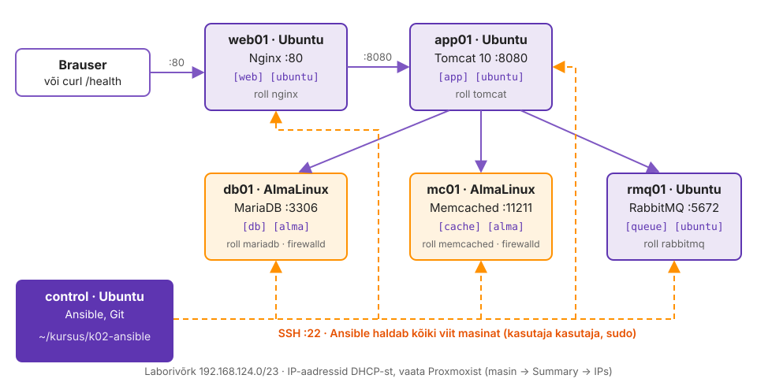
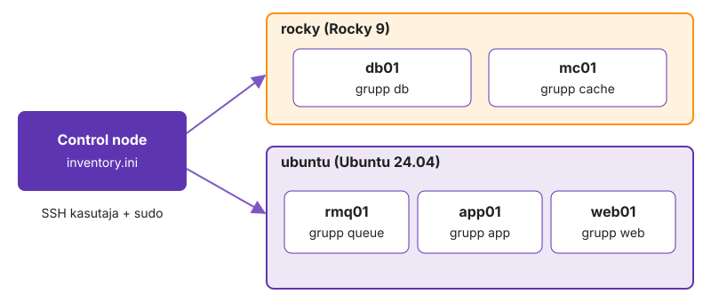
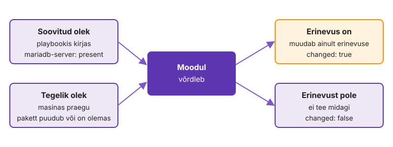
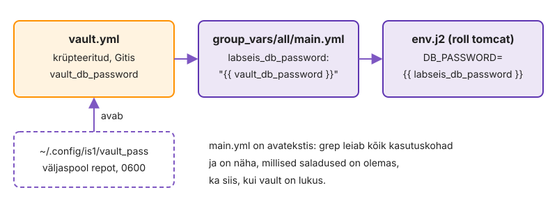

---
tags:
  - Ansible
  - Loeng
---

# Loeng: Labori seis rollidega

1\. kohtumisel kirjutasid playbook'e, mis teevad viies masinas sama, ja panid distributsioonide erinevused grupimuutujatesse. Täna paigaldad viide masinasse rakenduse koos kõigi teenustega ja muudad ühe suure playbook'i rollidega projektiks. Loengu läbiv näide on üks teenus, Nginx web01-s: vaatame, kuidas see liigub ühest failist rolli ja kuidas igal sammul kontrollida, et tulemus jäi samaks.

??? abstract "Õpiväljundid"

    Pärast loengut ja praktikumi oskad:

    - leida playbook'i vea sammudega sümptom, hüpotees, tõend, parandus ja korduskontroll;
    - jagada masinad inventory's teenuse ja distributsiooni gruppidesse ning kontrollida, kust muutuja väärtus tuleb;
    - kirjutada malli ja handler'i paari, mis taaskäivitab teenuse ainult muudatuse korral;
    - tõsta playbook'i osa rolli ja tõestada, et serveri olek ja rakenduse käitumine ei muutunud;
    - kasutada kogusid ja hoida paroole Vaultis;
    - viia muudatus läbi järjekorras süntaks, lint, eelvaade, üks masin, kõik masinad.

## 1. Ühest failist projektiks

Rakendus Labori seis vajab viit teenust ja iga masin teeb erinevat tööd. Brauser saadab päringu web01-le, Nginx suunab selle app01-le ja rakendus kasutab andmebaasi, vahemälu ja sõnumijärjekorda.

<figure markdown="span">
  { width="860" }
  <figcaption>Joonis 2.1. Labori topoloogia: rakenduse liiklus (lilla) ja Ansible'i haldusühendused (oranž) (Talvik, 2026).</figcaption>
</figure>

Praktikumi algne playbook `labseis.yml` paigaldab kõik viis teenust ühest failist. Selle Nginxi osa näeb välja nii (lühendatud):

```yaml
- name: Veebiserver
  hosts: web01
  become: true
  tasks:
    - name: Nginx on paigaldatud
      ansible.builtin.apt:
        name: nginx
        state: present
        update_cache: true

    - name: Labori seisu sait on seadistatud
      ansible.builtin.copy:
        dest: /etc/nginx/sites-available/labori-seis
        content: |
          upstream labori_seis {
              server app01:8080;
          }
          server {
              listen 80 default_server;
              location / {
                  proxy_pass http://labori_seis;
              }
          }
        mode: "0644"
      notify: Reload nginx

  handlers:
    - name: Reload nginx
      ansible.builtin.service:
        name: nginx
        state: reloaded
```

Selles play's on kolme liiki asju segamini. **Ülesanded** (`tasks`) ütlevad, mida teha. **Seadistusväärtus** `app01:8080` on peidetud konfiguratsioonifaili teksti sisse. **Handler** laeb seaded uuesti. Kui rakendusserver kolib teise masinasse, tuleb otsida see üks rida 300-realisest failist üles. Andmebaasi play's kordub sama muster: paigaldus kaks korda (Ubuntu ja AlmaLinux) ning väärtused on ülesannete sees.

**Refaktoreerimine** tähendab, et koodi ülesehitus muutub, aga süsteemi käitumine jääb samaks. Pärast refaktoreerimist kontrollitakse kahte asja. Esiteks Ansible'i muudatusi: `--check --diff` näitab kavandatavaid erinevusi ja teine käivitus näitab, kas ülesanded muudavad juba seadistatud masinaid uuesti. Teiseks rakenduse käitumist: samad teenused töötavad ja rakendus vastab nagu enne. `changed=0` üksi ei tõesta samaväärsust, sest ülesanne, mis refaktoreerimisel kogemata välja jäi, ei raporteeri samuti midagi.

??? question "Kontrolli ennast"

    1. Rakendusserver kolib app01-st app02-le. Mitu kohta tuleb `labseis.yml`-is muuta ja kuidas need üles leiad?
    2. Uus `site.yml` annab teisel käivitusel `changed=0`. Mida kontrollid veel, enne kui ütled, et refaktoreerimine õnnestus?

## 2. Vigade otsimine

Playbook võib lõppeda `failed=0` ja süsteem ikka mitte töötada. Viga leitakse samade sammudega nagu iga teine haldusviga: **sümptom** (mida näed), **hüpotees** (mis võib olla põhjus), **tõend** (käsk, mis hüpoteesi kinnitab või lükkab ümber), järeldus, parandus ja korduskontroll. Hüpotees kirjutatakse üles enne tõendi otsimist, siis on näha, kas mõttekäik oli õige.

Üks juhtum algusest lõpuni. Pärast MariaDB paigaldust vastab rakendus nii:

```text
$ ssh web01 curl -s localhost/health
{"status":"DOWN","db":"DOWN","queue":"UP","cache":"UP"}
```

**Hüpotees:** rakendus app01-s ei saa andmebaasiga db01-s ühendust. Võimalikud põhjused on, et MariaDB ei tööta, kuulab ainult kohalikke ühendusi või tulemüür blokeerib pordi.

**Tõend:** iga põhjuse jaoks üks käsk.

```text
$ ssh db01 systemctl is-active mariadb
active
$ ssh db01 sudo ss -tln | grep 3306
LISTEN 0  80  127.0.0.1:3306  0.0.0.0:*
$ ssh db01 sudo firewall-cmd --list-ports
3306/tcp
```

**Järeldus:** teenus töötab ja tulemüür lubab pordi, aga MariaDB kuulab aadressil `127.0.0.1`, st ainult db01 enda ühendusi. Konfiguratsioonifailis on rida `bind-address = 127.0.0.1`.

**Parandus:** konfiguratsioonifail `bind-address = 0.0.0.0` ja handler, mis taaskäivitab MariaDB. **Korduskontroll:** `ss` näitab `0.0.0.0:3306` ja `/health` näitab `"db":"UP"`. `0.0.0.0` tähendab kuulamist kõigil IPv4-liidestel, mitte ligipääsu ainult rakendusserverist. Kes tohib ühenduda, määrab tulemüür (ja andmebaasi kasutaja `host`).

Teine sage viga on playbook, mis muudab masinat igal käivitusel. Moodulid `shell` ja `command` käivitavad käsu iga kord, sest need ei tea soovitud olekut. Selliste ülesannete asemel kasutatakse moodulit, mis kontrollib olekut, ja taaskäivitust handler'iga.

??? note "Tabel 2.1. Käsk ja moodul"

    | Käsk ülesandes | Moodul, mis kontrollib olekut |
    |---|---|
    | `echo "…" >> /etc/hosts` | `ansible.builtin.blockinfile` |
    | `sed -i 's/…/…/' fail` | `ansible.builtin.lineinfile` või `template` |
    | `systemctl restart teenus` igal käivitusel | handler, mida teavitab `notify` |
    | `mysql -e "CREATE USER …"` | `community.mysql.mysql_user` |

??? question "Kontrolli ennast"

    1. Juhtumis oli kolm hüpoteesi. Milline väljundirida näitas kindlat takistust app01-st tulevale ühendusele?
    2. Miks annab `command: systemctl restart tomcat10` igal käivitusel `changed`, ka siis, kui seaded ei muutunud?

## 3. Grupid ja muutujad

1\. kohtumise inventory's olid grupid distributsiooni järgi. Labori seisus lisanduvad grupid teenuse järgi ja distributsioonigrupid koostatakse nendest. Järelliide `:children` tähendab, et grupi liikmed on teised grupid. Muutuja `ansible_host` on masina IP-aadress: kui see on inventory's, on aadress kirjas ainult ühes kohas.

??? example "Labori seisu inventory `inventory.ini`"

    ```ini
    [web]
    web01 ansible_host=<web01-IP>

    [app]
    app01 ansible_host=<app01-IP>

    [queue]
    rmq01 ansible_host=<rmq01-IP>

    [cache]
    mc01 ansible_host=<mc01-IP>

    [db]
    db01 ansible_host=<db01-IP>

    [ubuntu:children]
    web
    app
    queue

    [alma:children]
    cache
    db

    [all:vars]
    ansible_user=kasutaja
    ```

<figure markdown="span">
  { width="720" }
  <figcaption>Joonis 2.2. Iga masin on teenuse grupis ja distributsiooni grupis (Talvik, 2026).</figcaption>
</figure>

Muutujad on kaustades `group_vars` ja `host_vars`. Selles projektis on kõigi masinate ühised muutujad kaustas `group_vars/all/`, et hoida loetavad muutujad failis `main.yml` ja krüpteeritud paroolid failis `vault.yml` eraldi. Kausta kuju ei ole kohustuslik, see on projekti valik.

```text
group_vars/all/main.yml    labseis_db_name: labseis
group_vars/all/vault.yml   (krüpteeritud paroolid, 6. osa)
group_vars/app.yml         tomcat_heap: 512m
host_vars/web01.yml        nginx_upstream: app01:8080
roles/tomcat/defaults/main.yml   tomcat_heap: 256m
```

Muutuja `tomcat_heap` on kahes kohas: roll pakub vaikeväärtuse 256m ja rakendusgrupp määrab 512m. Kumb kehtib, seda saab kontrollida:

```text
$ ansible app01 -m ansible.builtin.debug -a var=tomcat_heap
app01 | SUCCESS => { "tomcat_heap": "512m" }
$ ansible app01 -m ansible.builtin.debug -a var=tomcat_heap -e tomcat_heap=1g
app01 | SUCCESS => { "tomcat_heap": "1g" }
```

Grupimuutuja on tugevam kui rolli vaikeväärtus ja käsurea `-e` on tugevam kui kõik teised. Tabel on valitud tasemete lihtsustatud võrdlus. Kogu järjekorras on üle kahekümne taseme ja dokumentatsioon soovitab sama muutujat mitte mitmes kohas määrata, kui selleks pole põhjust.

??? note "Tabel 2.2. Selle projekti muutujate tasemed (nõrgemast tugevamani)"

    | Koht | Näide |
    |---|---|
    | rolli `defaults/main.yml` | `tomcat_heap: 256m` |
    | `group_vars/all/` | `labseis_db_name: labseis` |
    | `group_vars/<grupp>.yml` | `group_vars/app.yml`: `tomcat_heap: 512m` |
    | `host_vars/<masin>.yml` | `host_vars/web01.yml`: `nginx_upstream: app01:8080` |
    | käsurea `-e` | `-e tomcat_heap=1g` |

    Kogu järjekord: [Variable precedence](https://docs.ansible.com/projects/ansible/latest/playbook_guide/playbooks_variables.html#understanding-variable-precedence). `ansible-inventory --host app01` näitab inventory põhjal leitud masina muutujaid (`host_vars` ja `group_vars`). Rolli vaikeväärtusi ja playbook'is määratud väärtusi see ei näita, nende kontrolliks lisa `debug`-ülesanne play'sse või rolli.

Teiste masinate andmetele pääseb ligi muutujatega `groups` ja `hostvars`. `groups['db'][0]` on grupi `db` esimene masin ja `hostvars['db01'].ansible_host` selle IP-aadress. Rakenduse seadetes on `DB_HOST={{ groups['db'][0] }}`, nii et andmebaasi kolimisel muudetakse ainult inventory't.

??? question "Kontrolli ennast"

    1. Enne käsku: mis väärtuse saab web01, kui küsid `tomcat_heap`? Miks?
    2. Lisad `host_vars/app01.yml` faili `tomcat_heap: 768m`. Mis väärtuse näitab `debug` nüüd ja milline rida tabelis seda seletab?

## 4. Mallid ja handler'id

Mooduliga `copy` saab kopeerida olemasoleva faili või määrata sisu ülesande sees võtmega `content`. Pikem konfiguratsioon, mis sõltub muutujatest, viiakse eraldi Jinja2 malli ja failiks teeb selle moodul `template`. Nii on ülesanded ja konfiguratsioonitekst eri failides. Mallis asendatakse `{{ muutuja }}` väärtusega ja `` kordab ridu. Mallifaili laiend on `.j2`. Rida `{{ ansible_managed }}` lisab faili algusesse märkuse, et faili haldab Ansible.

Enne rolle on vahepealne etapp. Ülesanded ja handler on veel failis `labseis.yml`, aga väärtus ja konfiguratsioonitekst on juba eraldi failides:

```text
k02-ansible/
├── ansible.cfg
├── inventory.ini
├── labseis.yml                        ülesanded ja handler
├── host_vars/
│   └── web01.yml                      nginx_upstream: app01:8080
└── templates/
    └── labori-seis-nginx.conf.j2      konfiguratsioonitekst
```

Nginxi näide tervikuna. **Lähteandmed** failis `host_vars/web01.yml`:

```yaml
nginx_upstream: app01:8080
```

**Mall** `templates/labori-seis-nginx.conf.j2`:

```nginx
# {{ ansible_managed }}
upstream labori_seis {
    server {{ nginx_upstream }};
}
server {
    listen 80 default_server;
    location / {
        proxy_pass http://labori_seis;
    }
}
```

**Ülesanne**, mis mallist faili teeb ja handler'it teavitab, ning **handler**:

```yaml
# labseis.yml, play "Veebiserver"
  tasks:
    - name: Labori seisu sait on seadistatud
      ansible.builtin.template:
        src: labori-seis-nginx.conf.j2
        dest: /etc/nginx/sites-available/labori-seis
        mode: "0644"
      notify: Reload nginx

  handlers:
    - name: Reload nginx
      ansible.builtin.service:
        name: nginx
        state: reloaded
```

Ansible otsib malli kaustast `templates/` playbook'i kõrval.

**Tulemus** web01-s:

```text
$ ssh web01 head -4 /etc/nginx/sites-available/labori-seis
# Ansible managed
upstream labori_seis {
    server app01:8080;
}
```

**Võrdlus enne käivitamist.** Mall annab sama teksti nagu algne `content:`, kui väärtus on sama. `--check --diff` näitab ainult uut esimest rida, mille lisas `{{ ansible_managed }}`:

```text
$ ansible-playbook labseis.yml --limit web01 --check --diff
--- before: /etc/nginx/sites-available/labori-seis
+++ after: /etc/nginx/sites-available/labori-seis
@@ -1,3 +1,4 @@
+# Ansible managed
 upstream labori_seis {
```

**Kaks käivitust.** Esimesel korral fail muutub ja handler käivitub play lõpus. Teisel korral on fail juba õige, ülesanne on `ok` ja handler ei käivitu:

```text
# esimene käivitus (lühendatud)
TASK [Labori seisu sait on seadistatud]   changed: [web01]
RUNNING HANDLER [Reload nginx]            changed: [web01]

# teine käivitus
TASK [Labori seisu sait on seadistatud]   ok: [web01]
web01 : ... changed=0
```

Handler käivitub play lõpus üks kord, isegi kui teda teavitas mitu ülesannet. Mõnikord peab uus seadistus kehtima enne järgmisi ülesandeid. Tomcati play's kontrollib viimane ülesanne, et rakendus vastab. Kui Tomcati taaskäivitus jääks play lõppu, kontrolliks see ülesanne veel vana seadistusega rakendust. Rida `ansible.builtin.meta: flush_handlers` enne kontrolli käivitab ootel handler'id kohe.

<figure markdown="span">
  { width="720" }
  <figcaption>Joonis 2.3. Kui fail ei muutu, ei käivitu ka handler (Talvik, 2026).</figcaption>
</figure>

??? question "Kontrolli ennast"

    1. Milline väljundirida näitab, et Nginx laaditi uuesti?
    2. Muudad `host_vars/web01.yml` väärtuseks `app02:8080`. Milline fail muutub web01-s, kas handler käivitub ja kuidas kontrollid tulemust?

## 5. Rollid

**Roll** on kindla ülesehitusega kaust ühe teenuse jaoks. Ansible leiab failid nime järgi ja `site.yml` määrab ainult, milline roll millises grupis käivitub. Eelmises osas eraldatud väärtus ja mall on juba olemas, nüüd koondatakse ühe teenuse osad ühte kausta. Nginxi play jaguneb rolli failide vahel nii:

??? note "Tabel 2.3. Nginxi play osad ja rolli failid"

    | `labseis.yml`-is | Rollis | Mis muutub |
    |---|---|---|
    | `tasks:` all olevad ülesanded | `roles/nginx/tasks/main.yml` | sama sisu |
    | mall `templates/labori-seis-nginx.conf.j2` | `roles/nginx/templates/labori-seis.conf.j2` | sama sisu, rolli sees lühem nimi |
    | `handlers:` all olev handler | `roles/nginx/handlers/main.yml` | sama sisu |
    | `host_vars/web01.yml` | jääb samaks, lisaks `roles/nginx/defaults/main.yml` | vaikeväärtus rollis, projekti väärtus inventory juures |
    | play päis `hosts: web01`, `become: true` | `site.yml` | `hosts: web` (grupp, mitte masin) |

Uus `site.yml` seob grupi rolliga:

```yaml
- name: Veebiserver
  hosts: web
  become: true
  roles:
    - nginx
```

**Võrdlus enne ja pärast.** Projektis muutus palju: üks play asendus viie failiga. Serveris ei tohi muutuda midagi peale selle, mida muutsid teadlikult. Mall ja väärtus on samad mis eelmises etapis, seega `ansible-playbook site.yml --limit web01 --check --diff` ei näita ühtegi erinevust ja annab `changed=0`. Praktikumis lisad mallile ka kaks päist (`X-Real-IP`, `X-Forwarded-For`), siis näitab `--diff` ka neid: need on teadlikud muudatused. Pärast käivitamist kontrollitakse rakendust (`curl -s localhost/health`) ja teist käivitust (`changed=0`). Praktikumis teed sama ülejäänud nelja teenusega, koondad kõigi masinate ühised ülesanded rolli `common` ja otsustad igal korral, millised väärtused jäävad rolli vaikeväärtusteks ja millised lähevad grupimuutujatesse.

Playde järjekord `site.yml`-is on oluline: andmebaas, vahemälu ja sõnumijärjekord paigaldatakse enne rakendust, sest rakendus ühendub käivitumisel nende kõigiga. `defaults` on kõige nõrgemad ja mõeldud ülekirjutamiseks, `vars` on tugevamad kui `group_vars` ja sobivad väärtustele, mida rolli kasutaja ei peaks muutma. Projekti kaustastruktuur järgib dokumentatsiooni soovitust [Sample Ansible setup](https://docs.ansible.com/projects/ansible/latest/tips_tricks/sample_setup.html).

Valmis rolle jagatakse [Ansible Galaxys](https://galaxy.ansible.com/). Enne valmis rolli kasutamist vaata, millal seda viimati uuendati, milliseid distributsioone see toetab, kas sellel on testid ja millise litsentsiga see on. Selles projektis käivitatakse rollid play kaudu `become: true` õigustes, nii et võõras roll on võõras kood juurkasutaja õigustes.

??? note "Tabel 2.4. Kust muudatust alustada"

    | Mida muudad | Fail |
    |---|---|
    | masinad ja aadressid | `inventory.ini` |
    | grupi seadistus | `group_vars/<grupp>.yml` |
    | ühe masina erand | `host_vars/<masin>.yml` |
    | teenuse ülesanded | `roles/<teenus>/tasks/main.yml` |
    | konfiguratsioonitekst | `roles/<teenus>/templates/` |
    | muudatusele järgnev tegevus | `roles/<teenus>/handlers/main.yml` |
    | rolli kohandatav vaikeväärtus | `roles/<teenus>/defaults/main.yml` |
    | gruppide ja rollide sidumine | `site.yml` |

??? question "Kontrolli ennast"

    1. Enne `--check --diff` käsku: millised failid web01-s muutuvad pärast Nginxi play tõstmist rolli?
    2. Miks on `site.yml`-is `hosts: web`, mitte `hosts: web01`?
    3. Tahad muuta ühe rakendusserveri mälu. Millisest failist alustad? Aga siis, kui tahad muuta kõigi rakendusserverite paigaldusülesannet?

## 6. Kogud ja Vault

Moodulid `apt`, `template` ja `service` kuuluvad kogusse `ansible.builtin`, mis on `ansible-core`'iga kaasas. Andmebaasi, RabbitMQ ja tulemüüri moodulid on eraldi kogudes. Mooduli täisnimi näitab kogu: `community.mysql.mysql_user` on moodul `mysql_user` kogust `community.mysql`. Selle projekti fail `requirements.yml`:

```yaml
collections:
  - name: ansible.posix
    version: 1.6.2
  - name: community.mysql
    version: 3.12.0
  - name: community.rabbitmq
    version: 1.4.0
```

```bash
ansible-galaxy collection install -r requirements.yml
ansible-doc community.mysql.mysql_user
```

Versioon on kinni, et sama projekt töötaks kuu aja pärast samamoodi ja kõigil õppijatel oleks sama komplekt.

**Ansible Vault** krüpteerib faile või üksikuid väärtusi. Selles projektis hoiame rakenduse paroole repositooriumis Vaultiga krüpteeritud muutujafailis. Selle avamiseks vajalik parool jääb repositooriumist välja. Kogu kasutuskäik:

```bash
# 1. Vaulti parool control node'is, väljaspool repositooriumi
mkdir -p ~/.config/is1 group_vars/all
read -rsp "Vaulti parool: " p && printf '%s\n' "$p" > ~/.config/is1/vault_pass && unset p
chmod 600 ~/.config/is1/vault_pass

# 2. Krüpteeritud fail: redaktoris vault_db_password: "…" jne
ansible-vault create group_vars/all/vault.yml

# 3. Loetavas failis viide
echo 'labseis_db_password: "{{ vault_db_password }}"' >> group_vars/all/main.yml

# 4. Kontroll ja kasutamine: Ansible avab faili ise
head -1 group_vars/all/vault.yml          # $ANSIBLE_VAULT;1.1;AES256
ansible-playbook site.yml --limit db01    # parooli ei küsita

# Muutmine ja vaatamine (view näitab paroole terminalis, selle väljundit ei lisata tõenditesse)
ansible-vault edit group_vars/all/vault.yml
ansible-vault view group_vars/all/vault.yml
```

Enne 2. sammu lisa failis `ansible.cfg` olemasolevasse sektsiooni `[defaults]` rida `vault_password_file`. Teist sektsiooni `[defaults]` ei looda:

```ini
[defaults]
inventory = inventory.ini
vault_password_file = ~/.config/is1/vault_pass
```

Viide loetavas failis näitab, millised saladused projektis on, ja `grep labseis_db_password` leiab kõik kasutuskohad ka siis, kui Vault on lukus. Vault kaitseb salvestatud faili, aga mitte käivituse väljundit: ülesanne, mis kasutab parooli, saab võtmesõna `no_log: true`, et parool ei jõuaks logisse.

<figure markdown="span">
  { width="720" }
  <figcaption>Joonis 2.4. Saladus krüpteeritud failis, viide loetavas failis, kasutus mallis (Talvik, 2026).</figcaption>
</figure>

**Töökohas on saladused sageli keskserveris.** Ansible Vault sobib väikesele meeskonnale ja ühele repositooriumile: lisaserverit pole vaja ja kõik on Gitis. Suuremas organisatsioonis hoitakse saladusi tavaliselt keskses saladuste serveris, näiteks HashiCorp Vault või selle avatud lähtekoodiga haru [OpenBao](https://openbao.org/), või pilveteenuse saladuste halduris (AWS Secrets Manager, Azure Key Vault). Ansible küsib parooli käivituse ajal lookup'iga ([`community.hashi_vault`](https://docs.ansible.com/projects/ansible/latest/collections/community/hashi_vault/index.html)). Gitis pole siis ka krüpteeritud väärtust, ligipääsu saab ühe inimese või masina kaupa tühistada ja iga päring jääb serveri logisse. Mõlemat kasutatakse ka koos: Ansible Vaultis on ainult keskserveri ligipääsutoken.

??? note "Tabel 2.5. Ansible Vault ja keskne saladuste server"

    | | Ansible Vault | HashiCorp Vault, OpenBao |
    |---|---|---|
    | Kus saladus on | krüpteeritud failis Gitis | serveris, Gitis ainult viide |
    | Kes saab lugeda | kõik, kellel on Vaulti parool | kellel on token ja õigus selle saladuse jaoks |
    | Ligipääsu tühistamine | parool tuleb vahetada ja fail uuesti krüpteerida | tokeni tühistamine |
    | Logi | puudub | iga päring logitakse |
    | Lisataristu | pole vaja | server, varundus, kõrgkäideldavus |

Selles kursuses kasutame Ansible Vaulti, sest mõte (saladus ei ole avatekstis ja kasutatakse muutuja kaudu) on sama ja lisaserverit pole vaja. Keskserverit proovid praktikumi lisaülesandes 4.

??? question "Kontrolli ennast"

    1. Kellelgi on repositooriumi koopia, aga mitte faili `~/.config/is1/vault_pass`. Mida näeb ta failist `vault.yml`?
    2. Miks on paroolidega ülesannetel `no_log: true`, kui fail on niikuinii krüpteeritud?

## 7. Kontrollitud muudatus

Viie masinaga projektis võib üks vigane mall peatada teenuse kõigis grupi masinates korraga. Seepärast viiakse iga muudatus läbi samas järjekorras. Näide: muudad rolli `common` sisselogimise teadet.

```bash
# 1. Süntaks: vigane YAML või tundmatu võti
ansible-playbook site.yml --syntax-check

# 2. Head tavad: täisnimed, mode, changed_when
ansible-lint

# 3. Eelvaade ühes masinas: mis muutuks, midagi muutmata
ansible-playbook site.yml --check --diff --limit web01

# 4. Rakendamine ühes masinas ja kontroll
ansible-playbook site.yml --limit web01
ssh web01 cat /etc/motd
ssh web01 curl -s localhost/health

# 5. Ülejäänud masinad ja korduskontroll
ansible-playbook site.yml
ansible-playbook site.yml       # changed=0
```

Võtmesõna `serial` töötleb play masinaid partiide kaupa. Rolli `common` play käib kõigis viies masinas ja `serial: 2` jagab need kolmeks partiiks: kaks, kaks ja üks masin. Väljundis on play päis iga partii kohta. `serial` määrab ainult partii suuruse. Kas vea korral kogu play peatub, määravad eraldi `any_errors_fatal` ja `max_fail_percentage`. Teenuse play'del on selles projektis üks masin, seal partiidest kasu pole.

??? note "Tabel 2.6. Muudatuse kontroll"

    | Võti või võtmesõna | Tulemus |
    |---|---|
    | `--syntax-check` | leiab vigase YAML-i ja tundmatud võtmed |
    | `ansible-lint` | kontrollib häid tavasid; automaatne hindaja kasutab sama tööriista |
    | `--check --diff` | simuleerib käivituse ja näitab failide erinevusi; kõik moodulid ei toeta kontrollrežiimi täielikult |
    | `--limit web01` | rakendab muudatuse ainult valitud masinates |
    | `serial: 2` | töötleb play masinaid kuni kahe kaupa; peatamise reeglid määratakse eraldi |

Kontrollrežiim on simulatsioon. Ülesanne, mis sõltub eelmise ülesande tegelikust tulemusest, võib `--check` käivitusel anda teistsuguse tulemuse kui tegelik käivitus. Seepärast järgneb eelvaatele alati rakendamine ühes masinas ja rakenduse kontroll ([Check mode](https://docs.ansible.com/projects/ansible/latest/playbook_guide/playbooks_checkmode.html), [serial](https://docs.ansible.com/projects/ansible/latest/playbook_guide/playbooks_strategies.html)).

??? question "Kontrolli ennast"

    1. `--check --diff` ei näidanud ühtki erinevust, aga pärast käivitust rakendus ei vasta. Mis võis juhtuda ja milline järjekorra samm selle leiab?
    2. Viie masinaga play'l on `serial: 2` ja esimeses partiis ebaõnnestub üks masin. Mida pead teadma, et öelda, kas teine partii käivitub?

??? abstract "Kokkuvõte"

    | Mõiste | Lühidalt |
    |---|---|
    | refaktoreerimine | ülesehitus muutub, käitumine mitte; kontroll `--check --diff`, `changed=0` ja rakenduse test |
    | sümptom, hüpotees, tõend | vigade otsimise sammud, hüpotees enne tõendit |
    | `:children` | grupp, mille liikmed on teised grupid |
    | `group_vars`, `host_vars`, `defaults` | muutujate tasemed; kontroll `ansible-inventory --host` ja `debug` |
    | mall ja handler | mall teeb faili, handler käivitub ainult faili muutumisel, üks kord |
    | roll | ühe teenuse ülesanded, mallid, handler'id ja vaikeväärtused ühes kaustas |
    | kogu | moodulite pakett, versioon failis `requirements.yml` |
    | Vault | krüpteeritud saladused Gitis, parool väljaspool repositooriumi, `no_log` väljundi jaoks |
    | kontrollitud muudatus | süntaks, lint, eelvaade, üks masin, kõik masinad |
