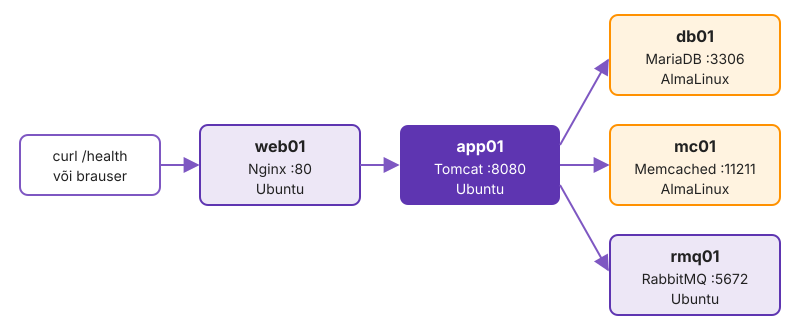
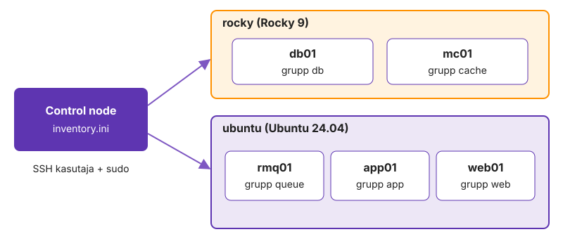
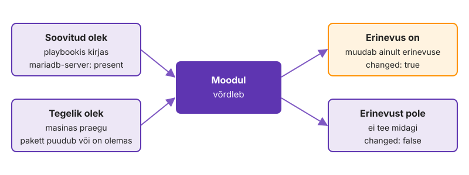
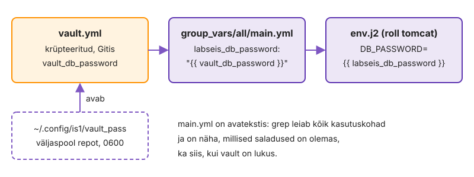

---
tags:
  - Ansible
  - Loeng
---

# 2. kohtumine · Labori seis viies masinas

??? abstract "Õpiväljundid"

    Päeva lõpuks oskad:

    - jagada masinad inventory's gruppidesse teenuse ja distributsiooni järgi ning koostada gruppe gruppidest;
    - otsustada, kas väärtus kuulub rolli vaikeväärtustesse, grupile või ühele masinale;
    - kirjutada Jinja2 malli ja taaskäivitada teenust handler'iga ainult konfiguratsiooni muutumisel;
    - jagada projekt rollideks, kasutada kogude mooduleid ja hoida paroole Vaultis;
    - kontrollida muudatust enne rakendamist (`--check --diff`, `--limit`, `serial`).

## 1. Viis masinat, viis teenust

1. kohtumisel tegid kõigis masinates sama: kaust, paketid, kasutajad. Täna paigaldad viide masinasse rakenduse Labori seis koos kõigi teenustega, mida see vajab. Iga masin teeb erinevat tööd:

{ width="720" }

| Masin | Teenus | Ülesanne |
|---|---|---|
| web01 | Nginx | võtab vastu HTTP päringud ja suunab need rakendusserverisse |
| app01 | Tomcat | käivitab rakenduse (Java WAR-fail) |
| db01 | MariaDB | hoiab andmeid |
| mc01 | Memcached | hoiab vahemälu |
| rmq01 | RabbitMQ | edastab sõnumeid järjekorra kaudu |

Kui kõik see oleks ühes playbook'is, tekiks mitmesajarealine fail, mida on raske lugeda ja ohtlik muuta. Seetõttu jaotatakse projekt osadeks: inventory grupid, muutujad, mallid ja rollid.

### Grupid

1. kohtumise inventory's olid grupid distributsiooni järgi (`ubuntu`, `alma`). Nüüd lisanduvad grupid teenuse järgi ja distributsioonigrupid koostatakse nendest:

```ini
[web]
web01 ansible_host=192.168.125.11

[app]
app01 ansible_host=192.168.125.12

[queue]
rmq01 ansible_host=192.168.125.13

[cache]
mc01 ansible_host=192.168.125.14

[db]
db01 ansible_host=192.168.125.15

[ubuntu:children]
web
app
queue

[alma:children]
cache
db

[all:vars]
ansible_user=kasutaja
```

{ width="720" }

Teenusegrupp määrab, **mida** masinas teha (db01 saab MariaDB). Distributsioonigrupp hoiab 1. kohtumisel tehtud grupimuutujaid, mis ütlevad, **kuidas** seda teha (paketinimed, failide asukohad). Sufiks `:children` tähendab, et grupi liikmed on teised grupid. Inventory struktuuri näeb käsuga `ansible-inventory --graph`.

## 2. Muutujad ja faktid

1. kohtumisel panid distributsioonide erinevused faili `group_vars/<grupp>.yml`. Labori seisus on muutujaid rohkem ja need on eri tasemetel. Andmebaasi nimi, kasutaja ja parool on vaja nii db01-s (andmebaasi loomiseks) kui ka app01-s (rakenduse ühendamiseks). Kui väärtus on kirjas ühes kohas muutujana, ei saa need kaks kohta omavahel lahku minna.

### Kus muutujaid hoitakse

Grupi muutujad võivad olla ühes failis või kaustas, kus on mitu faili. Kausta kuju on vajalik, kui osa muutujaid on krüpteeritud (`vault.yml`). Ühe masina muutujad on kaustas `host_vars`:

```text
group_vars/all/main.yml     # kõik masinad: andmebaasi nimi ja kasutaja
group_vars/all/vault.yml    # kõik masinad: paroolid krüpteeritult
group_vars/app.yml          # grupp app: tomcat_heap
host_vars/web01.yml         # ainult web01: nginx_upstream
```

Rollis on oma vaikeväärtused failis `roles/<roll>/defaults/main.yml`. Need on kõige nõrgemad: iga `group_vars` või `host_vars` väärtus kirjutab need üle.

### Milline väärtus jääb kehtima

Kui sama muutuja on mitmes kohas, kehtib täpsem väärtus. Lihtsustatud järjekord nõrgemast tugevamani:

| Koht | Näide selles projektis |
|---|---|
| rolli `defaults/main.yml` | `tomcat_heap: 256m` |
| `group_vars/all` | `labseis_db_name: labseis` |
| `group_vars/<grupp>` | `group_vars/app.yml`: `tomcat_heap: 512m` |
| `host_vars/<masin>` | `host_vars/web01.yml`: `nginx_upstream: app01:8080` |
| käsurea `-e` | `-e tomcat_heap=1g` |

Tomcat saab 512 MB mälu, sest grupi väärtus on tugevam kui rolli vaikeväärtus. Ühe masina muutujaid näeb käsuga `ansible-inventory --host app01`. Kogu järjekord on lehel [Variable precedence](https://docs.ansible.com/projects/ansible/latest/playbook_guide/playbooks_variables.html#understanding-variable-precedence).

### Faktid

Faktid on andmed, mida Ansible kogub masinast iga play alguses: distributsioon, IP-aadressid, mälu. 1. kohtumisel kasutasid fakti `ansible_facts['os_family']` tingimuses `when`. Labori seisus on tingimus ainult tulemüüri ülesannetes, sest `firewalld` on olemas ainult AlmaLinuxis:

```yaml
- name: Tulemüür lubab andmebaasi pordi
  ansible.posix.firewalld:
    port: "{{ mariadb_port }}/tcp"
    permanent: true
    immediate: true
    state: enabled
  when: ansible_facts['os_family'] == "RedHat"
```

Paketinimede ja failiteede erinevused on muutujates, mitte tingimustes. `when` sobib siis, kui ülesanne on ühes distributsioonis vajalik ja teises mitte.

Teiste masinate andmetele pääseb ligi muutujatega `groups` ja `hostvars`. Rakenduse seadetes on andmebaasi aadress `{{ groups['db'][0] }}`, st grupi `db` esimene masin. Kui andmebaas kolib teise masinasse, muudetakse ainult inventory't.

## 3. Mallid ja handler'id

### Mall

Moodul `copy` kopeerib faili muutmata kujul. Moodul `template` töötleb faili enne kopeerimist Jinja2-ga: `{{ muutuja }}` asendatakse väärtusega, `` ja `` kordavad või valivad ridu. Mallifailid on rolli kaustas `templates/` ja nende laiend on `.j2`.

Nginxi seadistus web01-s tuleb mallist, kus rakendusserveri aadress on muutujas:

```nginx
# {{ ansible_managed }}
upstream labori_seis {
    server {{ nginx_upstream }};
}

server {
    listen 80 default_server;
    location / {
        proxy_pass http://labori_seis;
    }
}
```

Rida `{{ ansible_managed }}` lisab faili algusesse märkuse, et faili haldab Ansible ja käsitsi tehtud muudatused kirjutatakse üle.

Tsükliga mall koostab rollis `common` faili `/etc/hosts` read kõigi inventory masinate kohta:

```jinja

{{ hostvars[h].ansible_host }} {{ h }}

```

Filter `sort` hoiab masinate järjekorra alati samana. Ilma selleta võib järjekord käivituste vahel muutuda ja fail oleks iga kord `changed`.

### Handler

Kui Nginxi konfiguratsioonifail muutub, tuleb Nginx uuesti laadida. Kui fail ei muutunud, ei ole selleks põhjust. Handler on ülesanne, mis käivitub ainult siis, kui mõni teine ülesanne teda `notify` abil teavitas ja oli `changed`:

```yaml
# roles/nginx/tasks/main.yml
- name: Labori seisu sait on seadistatud
  ansible.builtin.template:
    src: labori-seis.conf.j2
    dest: /etc/nginx/sites-available/labori-seis
    mode: "0644"
  notify: Reload nginx

# roles/nginx/handlers/main.yml
- name: Reload nginx
  ansible.builtin.service:
    name: nginx
    state: reloaded
```

Handler käivitub play lõpus üks kord, isegi kui teda teavitas mitu ülesannet. Kui teenus peab enne järgmisi ülesandeid uue seadistusega töötama, käivitab ülesanne `ansible.builtin.meta: flush_handlers` ootel handler'id kohe. Rollis `mariadb` on see enne andmebaasi loomist, sest MariaDB peab enne seda uue konfiguratsiooniga taaskäivituma.

{ width="720" }

Teisel käivitusel ei muutu ükski fail, seega ei käivitu ka ükski handler. Kokkuvõttes on `changed=0`.

## 4. Rollid

Roll on kaust kindla ülesehitusega. Ansible leiab failid nime järgi, neid ei pea playbook'is eraldi nimetama:

```text
roles/nginx/
├── defaults/main.yml     # vaikeväärtused, mida võib üle kirjutada
├── handlers/main.yml     # handler'id
├── tasks/main.yml        # ülesanded
└── templates/            # mallid
    └── labori-seis.conf.j2
```

Rolli skeleti loob käsk `ansible-galaxy role init roles/nginx`. Kogu projekti kaustastruktuur (`inventory`, `group_vars`, `host_vars`, `roles`, `site.yml`) järgib dokumentatsiooni soovitust [Sample Ansible setup](https://docs.ansible.com/projects/ansible/latest/tips_tricks/sample_setup.html), nii et teine Ansible'i kasutaja leiab sinu projektist asjad samast kohast. Selles projektis on kuus rolli: `common` kõigile masinatele ja üks roll iga teenuse jaoks. Fail `site.yml` määrab, milline roll millises grupis käivitub:

```yaml
- name: Kõik masinad
  hosts: all
  become: true
  serial: 2
  roles:
    - common

- name: Andmebaas
  hosts: db
  become: true
  roles:
    - mariadb

# … vahemälu, järjekord, rakendus

- name: Veebiserver
  hosts: web
  become: true
  roles:
    - nginx
```

Playde järjekord on oluline: andmebaas, vahemälu ja sõnumijärjekord paigaldatakse enne rakendust, sest rakendus ühendub käivitumisel nende kõigiga. Viimane play kontrollib mooduliga `uri`, et `http://localhost/health` web01-s vastab koodiga 200.

`defaults` ja `vars` erinevad tugevuse poolest. `defaults` on kõige nõrgemad ja mõeldud ülekirjutamiseks. `vars` on tugevamad kui `group_vars` ning sobivad väärtustele, mida rolli kasutaja ei peaks muutma.

Rolli `mariadb` vaikeväärtused on AlmaLinuxi omad, sest andmebaas on db01-s:

```yaml
# roles/mariadb/defaults/main.yml
mariadb_paketid:
  - mariadb-server
  - python3-PyMySQL
mariadb_conf_dir: /etc/my.cnf.d
mariadb_socket: /var/lib/mysql/mysql.sock
```

Kui sama rolli on vaja Ubuntu masinas, ei muudeta rolli, vaid kirjutatakse need väärtused üle failis `group_vars/ubuntu.yml`. Nii jääb roll samaks ja inventory kirjeldab, milline masin on.

## 5. Kogud

Moodulid `apt`, `template` ja `service` kuuluvad kogusse `ansible.builtin`, mis on Ansible'iga kaasas. Andmebaasi, RabbitMQ kasutajate ja tulemüüri moodulid on eraldi kogudes. Mooduli täisnimi näitab, millisest kogust see pärineb:

| Moodul | Kogu | Kasutus selles projektis |
|---|---|---|
| [`community.mysql.mysql_db`](https://docs.ansible.com/projects/ansible/latest/collections/community/mysql/mysql_db_module.html) | community.mysql | andmebaas `labseis` |
| [`community.mysql.mysql_user`](https://docs.ansible.com/projects/ansible/latest/collections/community/mysql/mysql_user_module.html) | community.mysql | andmebaasi kasutaja |
| [`community.rabbitmq.rabbitmq_user`](https://docs.ansible.com/projects/ansible/latest/collections/community/rabbitmq/rabbitmq_user_module.html) | community.rabbitmq | järjekorra kasutaja |
| [`ansible.posix.firewalld`](https://docs.ansible.com/projects/ansible/latest/collections/ansible/posix/firewalld_module.html) | ansible.posix | AlmaLinuxi tulemüüri pordid |

Vajalikud kogud ja nende versioonid on failis `requirements.yml`:

```yaml
collections:
  - name: community.mysql
    version: 3.12.0
  - name: community.rabbitmq
    version: 1.4.0
  - name: ansible.posix
    version: 1.6.2
```

Käsk `ansible-galaxy collection install -r requirements.yml` paigaldab need control node'i. Versioon on fikseeritud, et sama projekt töötaks kuu aja pärast samamoodi. Mooduli dokumentatsiooni näeb ka ilma brauserita: `ansible-doc community.mysql.mysql_user`.

## 6. Paroolid Vaultis

Andmebaasi ja RabbitMQ paroolid peavad olema repositooriumis, sest playbook vajab neid. Avatekstina ei tohi neid sinna panna: kõik, kellel on ligipääs repositooriumile või selle koopiale, näeksid neid.

Ansible Vault krüpteerib terve faili. Krüpteeritud faili saab Gitis hoida ja Ansible avab selle käivitamisel automaatselt:

```bash
ansible-vault create group_vars/all/vault.yml   # uus krüpteeritud fail
ansible-vault edit group_vars/all/vault.yml     # muutmine
ansible-vault view group_vars/all/vault.yml     # vaatamine
```

Paroolid on kahes failis. `vault.yml` on krüpteeritud ja sisaldab ainult saladusi eesliitega `vault_`. `main.yml` on avatekstis ja viitab neile:

```yaml
# group_vars/all/main.yml
labseis_db_password: "{{ vault_db_password }}"
```

{ width="720" }

Nii leiab `grep labseis_db_password` kõik kasutuskohad ka siis, kui Vault on lukus, ja on näha, millised saladused projektis on.

Vaulti parool ise on control node'is failis `~/.config/is1/vault_pass`, ligipääs ainult omanikule (`chmod 600`). Failis `ansible.cfg` on rida `vault_password_file = ~/.config/is1/vault_pass`, seega ei pea parooli igal käivitusel sisestama. See fail asub väljaspool repositooriumi ja Giti ei lähe.

Ansible võib parooli näidata ka väljundis, näiteks `--diff` või vea korral. Ülesanne võtmesõnaga `no_log: true` peidab oma väljundi. Seda kasutatakse paroole sisaldavate ülesannete juures.

## 7. Kontrollitud muudatus

1. kohtumisel kasutasid `--check --diff` ja `--limit` võtmeid ühe faili puhul. Viie masina ja viie teenusega projektis on need veel olulisemad, sest üks vigane mall võib peatada teenuse kõigis grupi masinates korraga.

| Võti või võtmesõna | Tulemus |
|---|---|
| `--check --diff` | näitab, mis failides muutuks, midagi muutmata |
| `--limit app01` | rakendab muudatuse ainult valitud masinates |
| `serial: 2` | play töötleb korraga ainult kahte masinat |
| `--syntax-check`, `ansible-lint` | leiab vead enne käivitamist |

Vaikimisi täidab Ansible iga ülesande kõigis play masinates ja liigub seejärel järgmise ülesande juurde. Võtmesõna `serial` muudab seda: play täidetakse esmalt esimeses masinate rühmas ja alles siis järgmises. Kui esimeses rühmas mõni ülesanne ebaõnnestub, peatub play enne, kui viga jõuab teiste masinateni. Väljundis näed sama play päist mitu korda, üks kord iga rühma kohta.

Muudatuse tavaline järjekord:

1. muuda muutujat või malli;
2. vaata `--check --diff --limit <masin>` abil, mis muutuks;
3. rakenda muudatus `--limit` abil ühes masinas ja kontrolli teenust;
4. rakenda muudatus kõigis masinates;
5. käivita playbook uuesti ja veendu, et kokkuvõttes on `changed=0`;
6. tee commit ja saada muudatused GitHubi.

??? info "Loe juurde"

    - [Roles](https://docs.ansible.com/projects/ansible/latest/playbook_guide/playbooks_reuse_roles.html)
    - [Templating (Jinja2)](https://docs.ansible.com/projects/ansible/latest/playbook_guide/playbooks_templating.html)
    - [Handlers](https://docs.ansible.com/projects/ansible/latest/playbook_guide/playbooks_handlers.html)
    - [Ansible Vault](https://docs.ansible.com/projects/ansible/latest/vault_guide/index.html)
    - [Strategies ja serial](https://docs.ansible.com/projects/ansible/latest/playbook_guide/playbooks_strategies.html)

## 8. Kokkuvõte

- **Grupid** inventory's jagavad masinad teenuse ja distributsiooni järgi; `:children` koostab grupi gruppidest.
- **Muutujad** on `group_vars` ja `host_vars` failides; kehtima jääb täpsem väärtus, rolli `defaults` on kõige nõrgemad.
- **Mall** koostab muutujatest ja faktidest iga masina jaoks oma konfiguratsioonifaili; **handler** taaskäivitab teenuse ainult muudatuse korral.
- **Roll** hoiab ühe teenuse ülesanded, mallid ja vaikeväärtused ühes kaustas; `site.yml` määrab, milline roll millises grupis käivitub.
- **Kogud** paigaldatakse `requirements.yml` järgi; mooduli täisnimi näitab kogu.
- **Vault** hoiab paroole Gitis krüpteeritult; Vaulti parool Giti ei lähe.
- **Muudatus:** kõigepealt `--check --diff`, siis üks masin, seejärel kõik.

Järgmisel kohtumisel paned rakenduse konteinerisse. Ansible jääb tööriistaks, mis paigaldab masinatesse Dockeri ja käivitab konteinerid.
