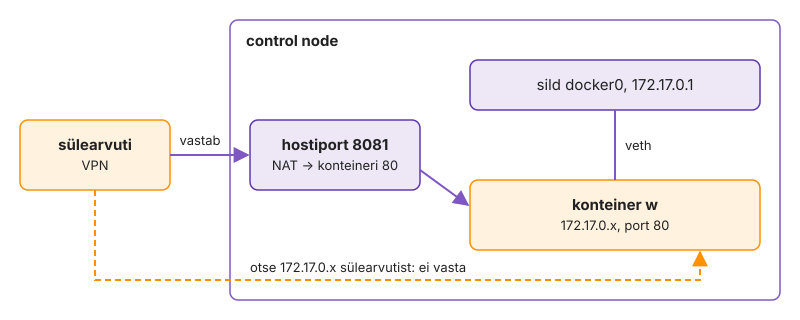

---
tags:
  - Docker
  - cgroup
  - Linux
---

# 1. Konteinerid käsitsi

Kui konteiner tootmises seiskub, saab OOM-kill'i või avab pordi tulemüürist mööda, on põhjus hostis, mitte Dockeri väljundis, ja seni, kuni ei tea, kus konteiner hostis paistab, on ta must kast. Docker ei too ühtegi uut tuuma mehhanismi: ta paneb kokku protsessid, cgroup'id, nftables'i ja failiõigused, mida sa juba tunned. Käivitad konteinerid ilma Compose'ita ja vaatad hostist, kus asuvad protsess, piirangud, port ja andmed. Lõpuks on iga rida, mille hiljem Compose'i faili kirjutad, sulle tuttav ühe `docker run` võtmena.

**Kui teed seda tööl iga päev:** `docker info --format '{{.CgroupVersion}} {{.RegistryConfig.Mirrors}}'` annab `2` ja kooli peegli, haru `k03-docker` on olemas ja `docker ps` töötab ilma `sudo`-ta. Kui see on sul juba korras, mine otse etappi „[Mälu, CPU ja protsessid](#malu-cpu-ja-protsessid)“.

Tabel L3.1 näitab versioone, millega praktikum on läbi proovitud. Uuem Docker sobib. Vanema Compose'iga puuduvad sildid nagu `!override` ja prod-failis saad süntaksivea, mis ei ütle, et viga on versioonis.

| Komponent | Versioon |
|---|---|
| Docker Engine, Compose plugin | 29, v5 (vähemalt 28 ja v2) |
| baasimage'id | `mariadb:11.4`, `memcached:1.6-alpine`, `rabbitmq:4.1-management-alpine`, `nginx:1.30-alpine`, `alpine:3.22` |
| ehitus ja käitus | `maven:3-eclipse-temurin-21`, `tomcat:10.1-jre21-temurin` |

*Tabel L3.1. Testitud versioonid.*

## Haru, Docker ja mirror

Klass on ühe NAT-aadressi taga. Ilma peeglita jõuab Docker Hubi anonüümne tõmbepiir täis juba esimese tunni jooksul ja kõigi build'id ebaõnnestuvad korraga veaga `toomanyrequests`.

1. Loo repo juures haru ja kaust ning tõendifail.

    ```bash
    git switch main && git pull && git switch -c k03-docker
    mkdir -p k03-docker && touch k03-docker/TOEND.md
    git tag -l k02; git check-ignore k03-docker/.env
    ```

2. Kontrolli Dockerit. Control node'i golden image'is on see tavaliselt olemas; kui ei, paigalda [Dockeri ametlikust repost](https://docs.docker.com/engine/install/ubuntu/) paketid `docker-ce docker-ce-cli containerd.io docker-buildx-plugin docker-compose-plugin`, mitte Ubuntu `docker.io`.

    ```bash
    docker version --format '{{.Server.Version}}'
    docker compose version
    docker info --format '{{.RegistryConfig.Mirrors}} {{.CgroupVersion}}'
    ```

3. Kui mirrors-nimekiri on tühi, lisa `/etc/docker/daemon.json`-i `{ "registry-mirrors": ["https://mirror.lab.hkhk.ee"] }` (aadressi ütleb koolitaja) ja `sudo systemctl restart docker`.
4. Lisa end gruppi `docker`, logi välja ja sisse (VS Code: Remote-SSH → Kill VS Code Server on Host).

    ```bash
    sudo usermod -aG docker "$USER"
    ```

> ⚠️ [Grupi `docker`](https://docs.docker.com/engine/install/linux-postinstall/) liige saab käivitada konteineri, mis mount'ib hosti `/`. Näiteks `docker run -v /:/host alpine chroot /host` annab root-shelli hostis ilma paroolita ja `sudo` logisse sellest midagi ei jää. Klassi VM-il on see teadlik valik, jagatud serveris mitte.

Kui `docker info` näitab cgroup'i versiooni 2, töötavad mooduli piirangukatsed nii, nagu siin kirjas. Tühi mirrors-nimekiri pärast restarti tähendab, et `daemon.json` on vigane või vales kohas; siis vaata `journalctl -u docker`. `git check-ignore` vastus näitab, et `.env` jääb Gitist välja juba enne, kui sa selle lood.

✅ **Edasi saad minna, kui** haru on `k03-docker`, server on 28 või uuem, `docker compose` vastab, mirrors-nimekirjas on kooli peegel, cgroup'i versioon on 2 ja `docker ps` töötab ilma `sudo`-ta.

## Engine hostis: teenus, kataloog ja konfiguratsioonifail

Enne esimest konteinerit vaatad, mis Docker hostis on. See on tavaline systemd teenus oma kataloogi, konfiguratsioonifaili ja logiga, täpselt nagu nginx või MariaDB, mida oled varem hallanud. Kui tead, kus need kolm asja on, parandad Dockerit samamoodi nagu iga teist teenust.

Kõige sagedasem põhjus, miks `dockerd` ei käivitu, on käsitsi muudetud `daemon.json`. Kuna vaikimisi on `live-restore` välja lülitatud, viib iga `systemctl restart docker` maha kõik hosti konteinerid, ja vigase konfiguratsiooniga need enam ei käivitu.

1. Vaata, millised üksused Dockeri moodustavad ja kes socket'it kuulab.

    ```bash
    systemctl is-active docker containerd docker.socket
    systemctl cat docker | grep -E '^(ExecStart|Requires|After)='
    sudo ss -xlp | grep docker.sock
    ```

2. Küsi daemonilt tema enda seadeid ja vaata, mis tema kataloogis ruumi võtab.

    ```bash
    docker info --format '{{.Driver}} {{.DockerRootDir}} {{.CgroupDriver}} {{.LoggingDriver}}'
    docker info | grep -iE 'storage driver|driver-type|live restore'
    sudo du -sh /var/lib/docker/* 2>/dev/null | sort -h | tail -6
    ```

3. Kontrolli konfiguratsioonifaili daemonit peatamata, siis tee meelega vigane koopia ja kontrolli seda.

    ```bash
    sudo dockerd --validate --config-file /etc/docker/daemon.json
    printf '{ "log-driver": "json-file", }\n' > /tmp/vigane.json
    sudo dockerd --validate --config-file /tmp/vigane.json; echo "kood $?"
    ```

4. Loe daemoni logist, millal ta viimati käivitus.

    ```bash
    sudo journalctl -u docker --since '30 min ago' --no-pager | grep -iE 'starting up|daemon has completed' | tail -3
    ```

> `Driver` väärtus `overlay2` tähendab klassikalist kihisalvestust `/var/lib/docker/overlay2` all. `overlayfs` tähendab containerd'i image store'i, kus kihid on `/var/lib/containerd` all. Kursuse käsud töötavad mõlemaga.

`docker.socket` kuulab socket'it ka siis, kui `dockerd` seisab: esimene `docker` käsk käivitab daemoni. `containerd` on eraldi teenus, kes konteinereid tegelikult käitab, ja `dockerd` räägib temaga. `DockerRootDir` on kataloog, mida jälgid kettaruumi monitooringus, sest seal on konteinerite logid, volume'id ja build cache. `--validate` leidis vea ilma teenust peatamata, nagu `nginx -t` või `sshd -t`.

✅ **Edasi saad minna, kui** kolm üksust on `active`, tead oma `Driver` ja `DockerRootDir` väärtust, kehtiv konfiguratsioon annab `configuration OK`, vigane koopia annab veateate ja koodi ≠ 0 ning journal'is on daemoni viimane start. Kirjuta TOEND.md-sse `docker info` rida ja üks lause: kuidas muudaksid `daemon.json`-i tootmisserveris.

## Elutsükkel ja PID 1

Uurid konteineri elutsüklit ja seda, milline protsess see hostis on. Sama nginx paistab hostis tavalise protsessina, konteineris on ta PID 1. Elutsükli käsud `run`, `stop`, `start` ja `rm` muudavad eri asju: protsessi, kirjutatavat kihti või mõlemat.

Kui sa ei tea, et konteiner lõpeb koos PID 1-ga, otsid valest kohast. Teenus "ebaõnnestub", aga tegelikult lõpetas entrypoint'i skript oma töö ja konteiner tegi täpselt seda, mida pidi.

1. Käivita konteiner, mis lõpetab kohe, ja nginx esiplaanil (Ctrl+C), taustal, peatatuna ja uuesti käivitatuna.

    ```bash
    docker run hello-world; docker ps -a --format '{{.Names}} {{.Status}}'
    docker run --name fg nginx:1.30-alpine
    docker run -d --name w -p 8081:80 nginx:1.30-alpine
    docker stop w && docker start w && docker ps --filter name=w
    ```

2. Võrdle sama protsessi hostis ja konteineris ning leia tema namespace'id ja cgroup.

    ```bash
    ps -ef | grep '[n]ginx: master'
    docker exec w ps; docker exec w id
    sudo lsns -p "$(docker inspect -f '{{.State.Pid}}' w)"
    cat /proc/"$(docker inspect -f '{{.State.Pid}}' w)"/cgroup
    ```

3. Proovi kustutada image, mida konteiner kasutab: `docker rmi nginx:1.30-alpine`.
4. Käivita Ubuntu ilma terminalita ja terminaliga, sees `cat /proc/1/comm` ja `ps`.

    ```bash
    docker run ubuntu:24.04
    docker run -it --rm ubuntu:24.04 bash
    ```

> Ubuntu image'is pole `ps`-i: image'is on ainult see, mida peaprotsess vajab.

`lsns` näitas, et konteiner on hulk namespace'e ühe hostiprotsessi ümber, mitte eraldi masin. `rmi` viga tõestab, et konteiner kasutab image'i kihte otse ka peatatuna. Ubuntu ilma `-it`-ita lõpetas, sest bash ilma terminalita sai stdin'ist kohe faililõpu ja väljus koodiga 0.

✅ **Edasi saad minna, kui** `fg` on pärast Ctrl+C `Exited`, `w` tuli `start`-iga tagasi sama ID-ga, hostis on nginx'il tavaline PID ja konteineris PID 1, `rmi` andis vea `conflict` konteineri ID-ga ja Ubuntu ilma `-it`-ita lõpetas kohe koodiga 0. Kirjuta TOEND.md-sse `docker ps -a` väljund ja `lsns` read.

## Pordid ja konteineri IP

Konteiner saab IP sisemises sillas `docker0`. Selle aadressi poole saab pöörduda ainult hostist. Väljast jõuab konteinerini ainult avaldatud pordi kaudu, mille jaoks Docker kirjutab NAT-reegli.

Tootmisserveris tähendab see, et `-p 8081:80` avab pordi kõigile, kes hostini jõuavad. Tavapärase UFW seadistusega hosti tulemüür seda ei peata, sest Dockeri DNAT-reegel rakendub enne UFW reegleid. Täpne käitumine sõltub tulemüüri taustaprogrammist ja Dockeri versioonist, seetõttu kontrolli pordi ligipääsetavust teisest masinast (`nc -zv <host> 8081`).

1. Leia konteineri IP ja proovi seda control node'ist, siis avalda teine konteiner juhusliku pordiga.

    ```bash
    IP=$(docker inspect -f '{{range .NetworkSettings.Networks}}{{.IPAddress}}{{end}}' w)
    curl -sI "http://$IP" | head -1; curl -sI localhost:8081 | head -1
    docker run -d --name w2 -P nginx:1.30-alpine && docker port w2
    sudo nft list ruleset | grep -i dnat | head -3
    ```

2. Ava sülearvuti brauseris (VPN) `http://<control node IP>:8081` ja proovi ka `http://<konteineri IP>`.
3. Koristus: `docker rm -f w w2 fg && docker container prune -f`.

Joonis L3.1 näitab kahte teed. Hostist jõuad konteinerini otse silla kaudu. Sülearvutist on ainus tee hostiport, mille tuum DNAT-reegliga konteineri pordile 80 ümber suunab.

<figure markdown="span">
  
  <figcaption>Joonis L3.1. Kust konteiner w vastab: hostiport on nähtav väljast, konteineri IP ainult hostist.</figcaption>
</figure>

Kui konteineri IP vastaks sülearvutist, oleks su võrgus marsruut hosti sisemisse silda ja see oleks võrgu seadistuse viga, mitte Dockeri omadus. `-P` valis juhusliku kõrge pordi. See sobib testiks, aga mitte teenusele, sest port muutub iga uue konteineriga ja keegi ei tea, kuhu ühendada.

✅ **Edasi saad minna, kui** konteineri IP (`172.17.x.x`) vastab control node'ist, aga mitte sülearvutist, hostiport vastab mõlemast ja nft-reeglites on DNAT pordile 80.

## Võrgudraiverid: bridge, host ja none

Siiani olid kõik konteinerid vaikevõrgus `bridge`. Dockeril on veel kaks sisseehitatud draiverit: `host`, kus konteiner kasutab otse hosti võrgupinu, ja `none`, kus võrku pole üldse. Proovid mõlemat ja vaatad, mis muutub portide, liideste ja isolatsiooniga.

Tootmisserveris küsib `--network host`-i tavaliselt monitooringuagent või VPN-tööriist. Kui admin lubab seda mõtlemata, kaob konteineri võrguisolatsioon. Konteiner näeb kõiki hosti liideseid ja võib kuulata mis tahes porti, ka seda, mida hosti enda teenus vajab.

1. Vaata vaikevõrke ja silla aadressiruumi.

    ```bash
    docker network ls
    docker network inspect bridge -f '{{range .IPAM.Config}}{{.Subnet}} gw {{.Gateway}}{{end}}'
    ip -br addr show docker0
    ```

2. Kontrolli, kas port 80 on hostis vaba, ja käivita nginx hosti võrgus koos pordivõtmega.

    ```bash
    sudo ss -tlnp | grep -E ':80 ' || echo "80 vaba"
    docker run -d --name hostnet --network host -p 9999:80 nginx:1.30-alpine
    sleep 2; sudo ss -tlnp | grep -E ':(80|9999) '; docker port hostnet
    docker exec hostnet ip -br addr | head -4
    ```

3. Käivita konteiner ilma võrguta ja proovi välja jõuda, siis korista.

    ```bash
    docker run --rm --network none alpine:3.22 ip -br addr
    docker run --rm --network none alpine:3.22 wget -qO- -T 3 http://example.com; echo "kood $?"
    docker rm -f hostnet
    ```

> Kui port 80 oli hõivatud, lõpetab `hostnet` kohe ja `docker logs hostnet` näitab `Address in use`. See on host-võrgu teine hind: pordikonflikt hosti teenusega.

`bridge` võrgu lüüs on sama aadress, mis `docker0` liidesel: sild on hosti liides ja konteinerid on selle taga. Host-võrgus kuulas pordil 80 `nginx` ise, mitte `docker-proxy`, `docker port` oli tühi ja CLI hoiatas, et `-p` jäetakse kõrvale. Konteiner nägi hosti liideseid nimepidi. Kuna DNAT-i pole, kehtib siin hosti tulemüür tavapäraselt. `none` jättis ainult `lo` ja sobib tööle, mis ei tohi kunagi võrku puutuda, näiteks võtmete genereerimine või failide teisendus.

✅ **Edasi saad minna, kui** `bridge` alamvõrk on `172.17.0.0/16` ja lüüs sama mis `docker0` aadress, host-võrgus kuulab pordil 80 `nginx` (või logis on `Address in use`), `docker port` on tühi ja pordil 9999 ei kuula keegi, `none` konteineris on ainult `lo` ja `wget` ebaõnnestub. Kirjuta TOEND.md-sse üks lause: millise teenuse paneksid host-võrku ja mis selle hind on.

## Mälu, CPU ja protsessid

Piiranguid vaikimisi pole. Konteiner ilma piiranguta näeb kogu hosti mälu ja CPU-d nagu iga teine protsess. Pane piirangud ise ja vaata, kuhu Docker need kirjutab ja mis juhtub ületamisel.

Üks lekkiv teenus ilma piiranguta käivitab hosti OOM killeri. See võib tappa hoopis `sshd` või andmebaasi, mitte süüdlase.

1. Käivita konteiner 64 MB mälu ja ilma swap'ita, mis sööb mälu, kuni tuum ta tapab.

    ```bash
    docker run --name oom -m 64m --memory-swap 64m alpine:3.22 sh -c 'tail /dev/zero'
    echo "kood $?"
    docker inspect -f '{{.State.OOMKilled}} {{.State.ExitCode}}' oom
    sudo dmesg | grep -i 'killed process' | tail -1
    ```

2. Käivita CPU-koormus poole tuuma piiranguga ja vaata `docker stats`-i.

    ```bash
    docker run -d --name cpu --cpus 0.5 --pids-limit 50 alpine:3.22 sh -c 'yes > /dev/null'
    docker stats --no-stream cpu
    docker exec cpu cat /sys/fs/cgroup/cpu.max /sys/fs/cgroup/pids.max
    ```

3. Muuda töötava konteineri piirangut ja vaata cgroup'i faili hostis.

    ```bash
    docker update --memory 128m --memory-swap 128m cpu
    docker exec cpu cat /sys/fs/cgroup/memory.max
    docker rm -f oom cpu
    ```

> `docker exec` näeb konteineri enda cgroup'i juurena (cgroup namespace). Hostis on sama fail `/sys/fs/cgroup/system.slice/docker-<id>.scope/` all.

Kood 137 on 128 + 9: protsess sai SIGKILL-i. `OOMKilled: true` ütleb, et tappis tuum mälupiiri tõttu, mitte keegi `docker kill`-iga. `docker update` muutis faili töötaval konteineril protsessi taaskäivitamata: piir on lihtsalt cgroup'i fail.

✅ **Edasi saad minna, kui** `oom` lõpetas koodiga 137 ja `OOMKilled` on `true`, `docker stats` näitab `cpu` konteineril umbes 50% CPU-d, `cpu.max` on `50000 100000` ja `memory.max` pärast `update`-i `134217728`. Kirjuta TOEND.md-sse kolm väärtust ja üks lause: mis juhtuks samas olukorras ilma `-m`-ita.

## Restart-poliitika: kes konteineri uuesti käivitab

Konteineris pole systemd'i, aga keegi peab selle pärast ebaõnnestumist või taaskäivitust uuesti käivitama. Seda teeb `dockerd` restart-poliitika järgi. Proovid kaht poliitikat ja vaatad, mis vahe neil on, kui admin on konteineri käsitsi peatanud.

Vale poliitika annab kaks klassikalist viga: teenus ei käivitu pärast hoolduse järgset taaskäivitust või käivitub teenus, mille sa meelega peatasid.

1. Käivita nginx poliitikaga `unless-stopped` ja tapa tema PID 1 hostist.

    ```bash
    docker run -d --name rs --restart unless-stopped nginx:1.30-alpine
    sudo kill -9 "$(docker inspect -f '{{.State.Pid}}' rs)"
    sleep 3; docker inspect -f '{{.RestartCount}} {{.State.Status}}' rs
    ```

2. Käivita teine konteiner poliitikaga `always`, peata mõlemad käsitsi ja taaskäivita daemon.

    ```bash
    docker run -d --name ra --restart always nginx:1.30-alpine
    docker stop rs ra && sudo systemctl restart docker
    docker ps -a --filter name=rs --filter name=ra --format '{{.Names}} {{.Status}}'
    docker rm -f rs ra
    ```

3. Proovi kolmandat poliitikat konteineriga, mis ebaõnnestub alati veaga.

    ```bash
    docker run -d --name rf --restart on-failure:3 alpine:3.22 sh -c 'sleep 2; exit 1'
    sleep 30; docker inspect -f '{{.RestartCount}} {{.State.Status}} {{.State.ExitCode}}' rf
    docker rm rf
    ```

`RestartCount` 1 ja olek `running` näitavad, et daemon märkas PID 1 lõppemist ja käivitas sama konteineri uuesti, sama ID ja kirjutatava kihiga. Pärast daemoni restarti on `ra` üleval ja `rs` `Exited`: `always` ei arvesta sinu käsitsi peatamist, `unless-stopped` arvestab. Seepärast kasutab sinu `compose.yaml` `unless-stopped`-i. `on-failure:3` proovis kolm korda ja jättis siis konteineri seisma. Nii ei taaskäivitu katkine konteiner lõputult ning logi ja väljumiskood jäävad sulle uurimiseks alles.

✅ **Edasi saad minna, kui** `rs` käivitus pärast `kill -9`-i ise uuesti, pärast daemoni restarti on `ra` `Up` ja `rs` `Exited`, `rf` näitab `3 exited 1` ning kõik kolm on kustutatud. Kirjuta TOEND.md-sse üks lause: kumba poliitikat kasutaksid andmebaasile ja miks.

## Käivitusvõtmed, mida admin vajab

`docker run`-il on sadu võtmeid, aga igapäevatöös kordub umbes kuus. Proovid neid nii, et iga katse näitab üht lõksu: mis jääb alles, kust tuleb keskkond, kellena protsess töötab, kes korjab signaalid, mis juhtub vale teega ja kuidas vaadata sisse konteinerisse, mis ebaõnnestub kohe.

Samad võtmed on Compose'i failis teiste nimedega: `env_file`, `user`, `init`, `volumes`, `entrypoint`. Kui sa nende käitumist käsureal ei tunne, ei tunne sa seda ka failis, ja vead tulevad välja alles tootmises.

1. `--rm`, `--env-file` ja `-e`: tee keskkonnafail ja vaata, mida konteiner saab.

    ```bash
    printf 'A=yks\nB="kaks"\n' > /tmp/k03.env
    D=neli docker run --rm --env-file /tmp/k03.env -e D -e E=viis alpine:3.22 env | grep -E '^[A-E]='
    docker ps -aq --filter ancestor=alpine:3.22 | wc -l
    ```

2. `--user`: kirjuta bind mount'i root'ina ja oma UID-ga.

    ```bash
    mkdir -p /tmp/k03-user && cd /tmp/k03-user
    docker run --rm -v "$PWD:/w" alpine:3.22 touch /w/root.txt
    docker run --rm --user "$(id -u):$(id -g)" -v "$PWD:/w" alpine:3.22 touch /w/mina.txt
    ls -ln; cd - && rm -rf /tmp/k03-user
    ```

3. `--init`: mõõda, kui kaua `stop` kestab ilma ja koos sellega.

    ```bash
    docker run -d --name noinit alpine:3.22 sleep 300
    docker run -d --name init --init alpine:3.22 sleep 300 && docker top init
    time docker stop noinit; time docker stop init
    docker rm noinit init
    ```

4. `-v` ja `--mount` olematu hostiteega.

    ```bash
    docker run --rm -v /tmp/k03-puudub:/data alpine:3.22 ls -la /data
    ls -ld /tmp/k03-puudub && sudo rmdir /tmp/k03-puudub
    docker run --rm --mount type=bind,src=/tmp/k03-puudub,dst=/data alpine:3.22 ls /data
    ```

5. `--entrypoint`: käivita nginx vigase konfiguratsiooniga, mis lõpeb kohe, ja uuri konteinerit seestpoolt.

    ```bash
    printf 'server { listen 80 }\n' > /tmp/k03-ngx.conf
    docker run -d --name ngx -v /tmp/k03-ngx.conf:/etc/nginx/conf.d/default.conf:ro nginx:1.30-alpine
    sleep 2; docker exec ngx true; docker logs ngx 2>&1 | tail -1
    docker run --rm --entrypoint sh -v /tmp/k03-ngx.conf:/etc/nginx/conf.d/default.conf:ro nginx:1.30-alpine -c 'nginx -t; ls /etc/nginx/conf.d'
    docker rm ngx
    ```

> `--rm` kustutab koos konteineriga ka tema logi. Kui konteiner ebaõnnestub ja tahad teada miks, käivita ta ilma `--rm`-ita.

`B` sai väärtuseks `"kaks"` koos jutumärkidega: `--env-file` ei tõlgenda jutumärke, Compose'i `.env` tõlgendab. `-e D` ilma väärtuseta võttis väärtuse sinu shellist. `root.txt` kuulub UID 0-le ja `mina.txt` sulle, seepärast käivitad tööriista-konteineri, mis kirjutab sinu kausta, alati `--user`-iga. `noinit` peatus umbes 10 sekundiga, sest `sleep` PID 1-na ei käsitle SIGTERM-i ja tuum ei rakenda PID 1-le vaikekäitumist. `--init` pani PID 1-ks väikese init'i, kes andis signaali edasi ja korjab ka zombie-protsessid. `-v` lõi puuduva kausta vaikselt root'i omanikuna, `--mount` keeldus: vale tee jääb nii kohe silma, mitte siis, kui teenus käivitub tühja konfiguratsiooniga. Ebaõnnestunud konteinerisse `exec` ei pääse, aga sama image sama mount'iga ja teise ENTRYPOINT-iga näitab viga otse.

✅ **Edasi saad minna, kui** `env` näitab `A=yks`, `B="kaks"`, `D=neli`, `E=viis` ja alles jäänud konteinereid on 0, `root.txt` omanik on 0 ja `mina.txt` sinu UID, `docker top init` näitab kaht protsessi, `docker-init` ja tema all `sleep`, `noinit` peatus umbes 10 s ja `init` alla sekundi, `-v` lõi kausta omanikuga root, `--mount` andis `bind source path does not exist`, `docker exec ngx` ütles `is not running` ja `nginx -t` näitas vigast rida. Kirjuta TOEND.md-sse kaks `stop` aega ja üks lause: millal kasutad `--mount`-i `-v` asemel.

## Oma võrk ja kolm backend'i teenust

Labori seis otsib teenuseid nimede järgi `db01`, `mc01` ja `rmq01`. Vaikimisi bridge-võrgus nimelahendust pole, seega teed oma võrgu. Samal ajal näed esimest korda kõige tavalisemat käivitusviga: andmebaas, mis lõpetab kohe, sest kohustuslik muutuja puudub.

Teenuste IP-d muutuvad iga uue konteineriga. Rakendus, mis viitab IP-le, läheb katki esimesel uuesti loomisel; nimi jääb samaks.

1. Loo võrk ja käivita andmebaas meelega ilma paroolita.

    ```bash
    docker network create labnet
    docker run -d --name db01 --network labnet mariadb:11.4
    docker ps -a --filter name=db01; docker logs db01 | tail -5
    ```

2. Kustuta `db01` ja käivita see uuesti nii, et nõuded on täidetud:

    - root-parool, andmebaas `labseis`, kasutaja `labseis` ja tema parool `-e` võtmetega (nimed logist ja [image'i lehelt](https://hub.docker.com/_/mariadb))
    - andmed nimega volume'is `dbtest` kataloogis `/var/lib/mysql`
    - võrk `labnet`

3. Lisa samasse võrku `mc01` (`memcached:1.6-alpine`) ja `rmq01` (`rabbitmq:4.1-management-alpine`, `--hostname rmq01`, kasutaja ja parool muutujatest `RABBITMQ_DEFAULT_USER` ja `RABBITMQ_DEFAULT_PASS`).
4. Kontrolli nimelahendust samast võrgust ja vaikevõrgust.

    ```bash
    docker run --rm --network labnet busybox:1.37 nslookup db01
    docker run --rm busybox:1.37 nslookup db01
    ```

> Rikke otsimise järjekord on alati sama: `docker ps -a` (väljumiskood), `docker logs`, `docker inspect`.

Vastus serverilt `127.0.0.11` tähendab, et nime lahendas Dockeri sisseehitatud DNS, mitte hosti resolver. Vaikevõrgus seda DNS-i pole ja nimi ei lahendu. Seepärast töötab Labori seisu rakendus Compose'is muutmata: Compose loob igale projektile oma võrgu.

✅ **Edasi saad minna, kui** esimene db01 oli `Exited (1)` ja logis oli puuduva muutuja nimi, nüüd on kolm konteinerit `Up` võrgus `labnet`, `nslookup` vastab `labnet`-is serveriga `127.0.0.11` ja vaikevõrgus ei vasta.

## Sisemine võrk

Võrk `--internal` laseb konteineritel teineteist näha, aga väljapääsu ei anna. Seda kasutad prod-failis andmebaasi ja rakenduse võrgu jaoks. Siin vaatad, kuidas see käitub ja kuidas üks konteiner saab olla kahes võrgus korraga.

Kui andmebaasi konteineris on haavatavus, ei saa ründaja sisemisest võrgust ise koodi alla laadida ega andmeid otse välja saata.

1. Tee sisemine võrk, ühenda sinna töötav `mc01` ja proovi internetti ja naabrit.

    ```bash
    docker network create --internal sisemine
    docker run --rm --network sisemine alpine:3.22 wget -qO- -T 3 http://example.com
    docker network connect sisemine mc01
    docker run --rm --network sisemine busybox:1.37 sh -c 'echo stats | nc -w 1 mc01 11211 | head -2'
    ```

2. Vaata, mis on konteineri sees ühe ja kahe võrguga.

    ```bash
    docker inspect -f '{{json .NetworkSettings.Networks}}' mc01 | jq 'keys'
    docker network inspect -f '{{.Internal}}' sisemine
    ```

Kaks võrku ühel konteineril tähendab kaht liidest ja kaht IP-d. Nii on prod-failis web01: üks liides välimises võrgus, teine sisemises. `wget` ebaõnnestus, sest sisemises võrgus pole vaikemarsruuti, mitte sellepärast, et DNS oleks katki.

✅ **Edasi saad minna, kui** `wget` internetti ebaõnnestub, `mc01` vastab sisemises võrgus `STAT pid`-iga ja `mc01`-l on kaks võrku. Kirjuta TOEND.md-sse üks lause: millisesse võrku paneksid andmebaasi ja miks.

## Andmed volume'is ja bind mount'is

Viimaks vaatad, kuhu andmed lähevad. Konteineri kirjutatav kiht kaob `rm`-iga. Volume ja bind mount jäävad alles, aga käituvad õiguste poolest erinevalt.

Andmebaas kirjutatavas kihis kaotab kõik andmed esimesel image'i uuendusel, sest uuendus tähendab alati uut konteinerit.

1. Kirjuta tabelisse rida, kustuta konteiner ja käivita see uuesti sama käsuga (sama volume `dbtest`).

    ```bash
    docker exec -it db01 mariadb -ulabseis -p labseis -e "CREATE TABLE proov (id INT); INSERT INTO proov VALUES (42);"
    docker rm -f db01
    ```

2. Kontrolli, kas rida on alles ja kus andmed hostis on.

    ```bash
    docker exec -it db01 mariadb -ulabseis -p labseis -e "SELECT * FROM proov;"
    docker inspect -f '{{json .Mounts}}' db01 | jq '.[] | {Type, Name, Source}'
    ```

3. Sama image [bind mount'iga](https://docs.docker.com/engine/storage/bind-mounts/) kodukataloogis, siis kustuta konteiner ja proovi kausta kustutada.

    ```bash
    mkdir -p "$HOME/k03-bind"
    docker run -d --name dbbind -e MARIADB_ROOT_PASSWORD=x -v "$HOME/k03-bind:/var/lib/mysql" mariadb:11.4
    sleep 15; ls -ln "$HOME/k03-bind" | head -3
    docker rm -f dbbind; rm -rf "$HOME/k03-bind"
    ```

4. Koristus enne järgmist moodulit.

    ```bash
    docker rm -f db01 mc01 rmq01 && docker volume rm dbtest
    docker network rm labnet sisemine && sudo rm -rf "$HOME/k03-bind"
    docker ps -aq | wc -l
    ```

Joonis L3.2 näitab kolme kohta, kuhu `/var/lib/mysql` võib sattuda. Loe seda kahe küsimusega: mis jääb alles, kui konteiner kustutada, ja kelle õigustega on failid hostis.

<figure markdown="span">
  
  <figcaption>Joonis L3.2. Kolm kohta, kuhu konteineri andmed võivad sattuda.</figcaption>
</figure>

UID 999 on konteineri `mysql` kasutaja. Hostis ei pruugi sellel numbril nime olla, aga tuum kontrollib õigusi numbri järgi. Seepärast ei saanud sinu tavakasutaja faile kustutada.

✅ **Edasi saad minna, kui** rida `42` jäi pärast `docker rm -f`-i alles, `Mounts` näitab `volume` ja allikat `/var/lib/docker/volumes/dbtest/_data`, bind mount'i failide omanik on UID 999, tavaline `rm -rf` andis `Permission denied` ja viimane käsk näitab `0`.

📎 **Selle mooduli tõend:** TOEND.md-s `docker version` ja mirrors-rida, `docker info` rida ja `daemon.json`-i lause, `docker ps -a`, `lsns`, host-võrgu lause, OOM-i kood ja `memory.max`, restart-poliitika lause, kaks `stop` aega ja `--mount`-i lause, sisemise võrgu lause, `Mounts` ja bind mount'i UID; commit `K3.1 konteinerid käsitsi`.

## Miks see nii töötab

**Konteineri elutsükkel.** Konteiner on olekus `running` täpselt seni, kuni tema PID 1 töötab. Kui PID 1 lõpetab, salvestab `containerd-shim` väljumiskoodi, `dockerd` märgib konteineri `Exited (<kood>)` ja rakendab restart-poliitikat. Ilma `-d`-ta on CLI ühendatud konteineri stdio-ga ja Ctrl+C saadab signaali PID 1-le.

**Peatamine ja kustutamine.** Peatatud konteineri kirjutatav kiht jääb alles. Konteineri kustutamisel (`docker rm`) eemaldatakse ka selle kirjutatav kiht. Konteiner kasutab image'i kihte otse overlay mount'i alumiste kihtidena, seetõttu tuleb enne image'i eemaldamist kustutada kõik seda kasutavad konteinerid, ka peatatud.

**Taaskäivituspoliitika.** Konteineri taaskäivitamise eest vastutab daemon. `dockerd` jälgib, millal PID 1 töö lõpetab, ja käivitab sama konteineri uuesti. Väärtusega `unless-stopped` jätab daemon meelde, et konteiner peatati käsitsi, ega käivita seda ka pärast daemoni taaskäivitamist.

**Konteineri võrk.** Vaikimisi bridge-võrgu korral saab konteiner IP-aadressi hosti sisemises sillas `docker0`; Compose loob igale projektile oma silla (`br-…`). Väljast pääseb konteinerini ainult avaldatud pordi kaudu.

**Konteineri kataloog.** Konteineri enda kataloog `/var/lib/docker/containers/<id>` on vaid kümneid kilobaite, sest failisüsteem tuleb image'i kihtidest. Kus need kihid asuvad, sõltub salvestusdraiverist: `overlay2` korral kataloogis `/var/lib/docker/overlay2`, Docker 29 uues paigalduses containerd'i image store'is (vt [App image](lab-3-app-image.md#miks-see-nii-tootab) lehe lõpus lõiku "Image store").

**Mälupiir cgroup'is.** Mälupiir on cgroup'i fail `memory.max`. Docker määrab cgroup'is mälupiiri, piirangut jõustab tuum. Kubernetes teeb sama `resources.limits` kaudu.

**Bind mount ja volume.** Bind mount ühendab konteinerisse hosti kataloogi koos hosti õigustega ja sobib konfiguratsioonifailile või koodile arendaja masinas. Andmebaasi andmed lähevad nimega volume'isse, mille esimesel ühendamisel kopeerib Docker image'i sihtkataloogi sisu koos omaniku ja õigustega.

**Linuxi tuum.** Linuxi konteiner vajab Linuxi tuuma. Docker Desktop käivitab Windowsis ja macOS-is taustal väikese Linuxi virtuaalmasina.

**Namespace'id.** `lsns` näitab konteineri namespace'e: eraldi protsessipuu, võrgu, failisüsteemi ühendused ja hostinime. Samu namespace'e kasutab ka systemd, kui teenusele on määratud näiteks `PrivateNetwork=` või `PrivateTmp=`. Docker kasutab neid lihtsalt rohkem korraga.

**Docker Engine taustal.** Docker Engine koosneb mitmest protsessist. `dockerd` võtab vastu API päringud ning haldab võrke, volume'eid ja image'eid. `containerd` haldab konteineri elutsüklit. `runc` loob namespace'id ja cgroup'id ning käivitab konteineri protsessi; pärast käivitamist lõpetab `runc` töö.

**`containerd-shim`.** Iga konteineri jaoks käivitab containerd väikese `containerd-shim`-protsessi, mis jääb konteineri protsessi vanemprotsessiks. Seetõttu ei ole konteineri protsess `dockerd` alamprotsess ja daemoni saab taaskäivitada konteinereid peatamata (vt järgmist lõiku).

**Daemoni taaskäivitamine.** Vaikeseadega peatab `systemctl restart docker` kõik konteinerid. Kui `daemon.json`-is on `"live-restore": true`, jäävad konteinerid daemoni taaskäivitamise ajaks tööle. Swarmi režiimis see seade ei toimi.

**`daemon.json` ja käsurida.** `daemon.json`-i võtmed on samad mis `dockerd` käsurea võtmed. Kui sama seadistusparameeter on nii failis kui ka systemd unit'i `ExecStart` real, keeldub daemon käivitumast. Tüüpiline näide on `hosts`.

**Seadistuse uuesti laadimine.** Mõne seadistusvõtme, näiteks `debug` ja `registry-mirrors`, väärtuse loeb daemon uuesti käsu `systemctl reload docker` käivitamisel, ilma et konteinerid peatuksid. Ülejäänud võtmete muutmine nõuab daemoni taaskäivitamist.

**Võrgudraiverid.** Laboris kasutasid draivereid `bridge`, `host` ja `none`. Sisseehitatud draivereid on veel: `macvlan` ja `ipvlan` annavad konteinerile oma aadressi otse kohtvõrgus, nagu oleks see eraldi masin, ja `overlay` ühendab konteinereid mitme hosti vahel. `overlay`-võrku kasutab Swarm.

**`--init`.** Võti `--init` seab PID 1-ks `docker-init`-protsessi (`tini`), mis edastab signaalid põhiprotsessile ja koristab zombie-protsessid. Seda vajab image, mille põhiprotsess ei ole kirjutatud PID 1 rolli jaoks, näiteks shelliskript, mis käivitab alamprotsesse.

**`--env-file`.** `docker run --env-file` loeb read sõna-sõnalt: jutumärgid jäävad väärtuse osaks ja `${…}` viiteid ei asendata. Compose'i `.env` ja `env_file` tõlgendavad jutumärke ja viiteid. Näiteks rida `DB_HOST="db01"` annab `docker run --env-file` korral väärtuse `"db01"` koos jutumärkidega, Compose'is aga väärtuse `db01`.

**`--mount` ja `-v`.** `--mount` kasutab selgesõnalist võti=väärtus-süntaksit ja annab puuduva allikakataloogi korral vea. `-v` on vanem lühivorm, mis loob puuduva kataloogi hostis vaikselt.

**`--user`.** `--user` töötab ka numbrilise UID-ga, mida image'i failis `/etc/passwd` ei leidu.

Kui jõudsid kiiremini: [Lisaülesanded → 10. Docker socket'i audit](lisa.md#10-docker-socketi-audit), kirjutad skripti, mis leiab hostist konteinerid, millel on socket, `--privileged` või host-võrk.
