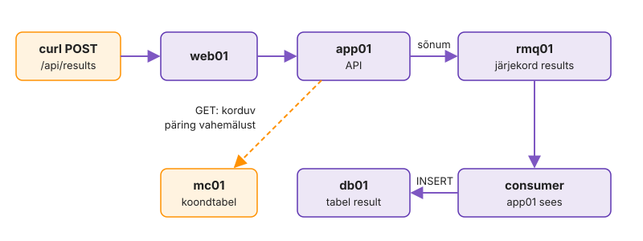

---
tags:
  - Docker
  - Compose
  - Labori seis
---

# 4. Kogu stack Compose'iga

Viis `docker run` käsku shelli ajaloos ei ole soovitud olek: järgmine admin ei tea, millise võtmega mida käivitati, ja pärast taaskäivitust käivituvad teenused vales järjekorras. Võrk, nimed, volume'id ja muutujad, mis `docker run`-iga olid pikad käsuread, lähevad nüüd faili, mida saab Gitis hoida, üle vaadata ja korduvalt käivitada. Compose on Ansible'i playbook'i vaste konteineritele: fail kirjeldab soovitud olekut ja `up -d` viib süsteemi sellesse olekusse. Kirjuta fail teenus teenuse haaval ([failivormingu viide](https://docs.docker.com/reference/compose-file/services/)), iga teenuse järel `docker compose up -d <teenus>` ja kontroll, kõik käsud kaustas `k03-docker/`. Lõpuks käib kogu Labori seis ühe `compose.yaml`-iga ja üks tulemus läbib ahela web01-st db01-ni.

**Kui teed seda tööl iga päev:** sinu Compose'i failides on healthcheck'id ja `depends_on` tingimusega `service_healthy` ning teine `docker compose up -d` ei loo midagi uuesti. Kui see on sul juba korras, kirjuta `compose.yaml` tabeli L3.3 järgi ise ja mine otse etappi „[Riku ja vaata](#riku-ja-vaata)“.

Tabel L3.3 kirjeldab, milline stack peab olema. Read on käivitusjärjekorras. Veerg "Hostis avatud" ütleb, kes on väljast nähtav; kõik teised räägivad ainult projekti võrgus.

| Teenus | Image | Hostis avatud | Healthcheck |
|---|---|---|---|
| db01 | sinu `db/Dockerfile`, kontekst `..` | ei | `healthcheck.sh --connect --innodb_initialized` |
| mc01 | `memcached:1.6-alpine` | ei | `echo stats \| nc -w 1 127.0.0.1 11211 \| grep -q uptime` |
| rmq01 | `rabbitmq:4.1-management-alpine` | 15672 (haldus-UI) | `rabbitmq-diagnostics -q ping` |
| app01 | sinu `app/Dockerfile`, kontekst `..` | ei | Dockerfile'ist |
| web01 | sinu `web/`, kontekst `./web` | `${WEB_PORT:-8080}:80` | Dockerfile'ist |

*Tabel L3.3. Stacki teenused. Image'i nimi on igal ehitataval teenusel `${REGISTRY:?}/${OWNER:?}/labori-seis-<db|app|web>:${TAG:-dev}`.*

## .env ja db01

Alustad saladustest ja andmebaasist, sest kõik teised sõltuvad neist. `.env` hoiab paroole ja jääb Gitist välja. `.env.example` näitab, millised muutujad on vaja, ja läheb Giti; automaatne hindaja kasutab just seda faili. Compose loeb `.env`-i projekti kaustast ja asendab `${VAR}` viited enne, kui fail üldse valideeritakse.

1. Loo `.env.example` (läheb Giti) muutujatega `DB_PASSWORD`, `DB_ROOT_PASSWORD`, `RABBITMQ_PASSWORD`, `TEACHER_TOKEN` (väärtus `muuda-mind`) ning `REGISTRY=gitea.lab.hkhk.ee`, `OWNER=<sinu-github>`, `TAG=dev`, `WEB_PORT=8080`. Tee sellest `.env` oma paroolidega.

    ```bash
    cd k03-docker && cp .env.example .env && chmod 600 .env
    git check-ignore -v .env
    ```

2. Kirjuta `compose.yaml` algus: `name: labori-seis`, teenus `db01` nende nõuetega:

    - `build.context: ..` ja `build.dockerfile: k03-docker/db/Dockerfile`, image nimi tabeli L3.3 järgi
    - `environment`: `MARIADB_ROOT_PASSWORD: ${DB_ROOT_PASSWORD:?}`, andmebaas ja kasutaja `labseis`, `MARIADB_PASSWORD: ${DB_PASSWORD:?}`
    - nimega volume `dbdata` kataloogis `/var/lib/mysql`, faili lõpus `volumes: dbdata:`
    - healthcheck intervalliga 10 s ja 10 kordusega

3. Käivita ja vaata olekut.

    ```bash
    docker compose up -d --build db01
    sleep 25; docker compose ps
    ```

> `required variable DB_ROOT_PASSWORD is missing` tähendab, et `.env` puudub või oled vales kaustas. `${VAR:?}` teebki täpselt seda.

`(healthy)` tähendab rohkem kui `Up`. MariaDB healthcheck kontrollis, et InnoDB on initsialiseeritud ja ühendusi võetakse vastu. Ainult seda olekut saavad teised teenused `depends_on`-iga oodata.

**Edasi saad minna, kui** db01 on `Up (healthy)`.

## mc01 ja rmq01

Kaks backend'i teenust tulevad otse ametlikest image'itest, oma Dockerfile'i pole vaja. Mõlemal on healthcheck ja ainult RabbitMQ halduse UI on hostis nähtav.

Avatud memcached'i port on tuntud rünnakuvektor: vahemälust saab lugeda kõike, mis sinna pandi, ja UDP kaudu on seda kasutatud võimendusrünnakuteks. Port, mida keegi väljast ei vaja, jääb kinni.

Lisa kaks teenust tabeli L3.3 järgi:

- rmq01: `hostname: rmq01`, kasutaja `labseis` ja parool `.env`-ist (muutujad nagu `docker run -e`-ga), andmed volume'is `rmqdata` (`/var/lib/rabbitmq`)
- hostis on avatud ainult RabbitMQ halduse UI port `15672`, mc01-l `ports:` pole
- healthcheck tabelist; toruga käsk vajab `CMD-SHELL` kuju
- uus volume läheb ka faili lõpu `volumes:` alla

```bash
docker compose up -d mc01 rmq01
sleep 30; docker compose ps
```

<!-- EKRAANIPILT: RabbitMQ halduse UI, http://<control node IP>:15672 → Overview pärast sisselogimist kasutajaga labseis; näha node rabbit@rmq01 ja olek running; pärast etappi "mc01 ja rmq01"
<figure markdown="span">
  
  <figcaption>Joonis L3.3. RabbitMQ haldus: node'i nimi on `rabbit@rmq01`, sest hostname on fikseeritud.</figcaption>
</figure>
-->

Node'i nimi `rabbit@rmq01` tuleb `hostname`-ist. Ilma selleta oleks nimi konteineri juhuslik ID ja iga uus konteiner leiaks volume'ist võõra node'i andmed: järjekorrad oleksid tühjad, kuigi andmed on kettal alles.

**Edasi saad minna, kui** kolm teenust on `(healthy)` ja brauseris `http://<control node IP>:15672` laseb sisse kasutajaga `labseis`, node'i nimi on `rabbit@rmq01`.

## app01

Rakendus käivitub backend'i teenuste järel, sest ta vajab kõiki kolme.

Ilma tingimuseta `service_healthy` ebaõnnestub app01 esimesel käivitusel, sest MariaDB initsialiseerib veel. Logides on siis hulk ühendusvigu, mis peidavad tegeliku vea, kui see peaks tekkima.

Lisa `app01`:

- build nagu db01, aga oma Dockerfile ja `args: GIT_SHA: ${TAG:-dev}`
- image `${APP_IMAGE:-${REGISTRY:?}/${OWNER:?}/labori-seis-app:${TAG:-dev}}`: GitHub Actionsi pipeline annab `APP_IMAGE`-iga valmis image'i
- `environment`: ainult kolm saladust (`DB_PASSWORD`, `RABBITMQ_PASSWORD`, `TEACHER_TOKEN`); hostinimed on rakenduses vaikeväärtustena olemas
- `depends_on` kolmele teenusele, igaühel `condition: service_healthy`

```bash
docker compose up -d --build app01
until docker compose exec app01 curl -fs localhost:8080/health/live; do sleep 5; done; echo
docker compose logs app01 | grep -m1 'Server startup'
docker compose exec app01 curl -s localhost:8080/health; echo
```

> `db` DOWN ja logis `Access denied`: volume initsialiseeriti varem teise parooliga. Laboris on baas veel tühi, nii et `docker compose down -v` ja uuesti. Tootmises kustutaks see andmed: tee enne varukoopia ja kontrolli taastamist või muuda parool baasis endas.

Neli `UP`-i tähendavad, et app01 jõudis iga backend'i teenuseni nime ja parooliga. `Server startup` logis ütleb, kui kaua Tomcat käivitus. See aeg on põhjus, miks healthcheck'il on `start-period`: enne seda ei loeta ebaõnnestunud kontrolle.

**Edasi saad minna, kui** `/health` annab `{"status":"UP","db":"UP","queue":"UP","cache":"UP"}` ja app01 on `(healthy)`.

## web01 ja ühised seaded

Viimane teenus avab stacki väljapoole. Kuna kõigil teenustel on samad restart- ja logiseaded, kirjutad need üks kord ja viitad neile YAML-ankruga.

Ilma logide rotatsioonita täidab üks jutukas konteiner `/var/lib/docker` partitsiooni ja siis seiskub kogu Docker koos kõigi teenustega.

1. Lisa `web01`: kontekst `./web`, image tabeli L3.3 järgi, port `"${WEB_PORT:-8080}:80"`, `depends_on: app01` tingimusega `service_healthy`.
2. Kirjuta kõigile teenustele kehtivad seaded üks kord faili algusesse [laiendusvälja](https://docs.docker.com/reference/compose-file/extension/) `x-common: &common` alla ja lisa igale teenusele `<<: *common`:

    - `restart: unless-stopped`
    - `logging`: draiver `json-file`, `max-size: "10m"`, `max-file: "3"`

3. Käivita kogu stack ja kontrolli.

    ```bash
    docker compose up -d --build
    docker compose ps
    curl -s http://localhost:8080/health; echo; curl -s http://localhost:8080/version; echo
    docker compose top app01
    ```

<!-- EKRAANIPILT: Labori seisu avaleht brauseris, http://<control node IP>:8080 (web01 kaudu), koondtabel nähtav; pärast etappi "web01 ja ühised seaded" `docker compose up -d --build`
<figure markdown="span">
  
  <figcaption>Joonis L3.4. Labori seis Compose'i stackist, web01 kaudu.</figcaption>
</figure>
-->

> `port is already allocated`: pordil 8080 on midagi muud (`ss -tlnp | grep 8080`); muuda `.env`-is `WEB_PORT`.

`top` näitas hosti PID-i: Compose'i teenus on endiselt hostiprotsess, nagu `docker run`-iga käivitatud konteiner. Ühised seaded ühes kohas tähendavad, et kuues teenus saab need ühe reaga ja automaatse hindaja `deps` leiab restart-poliitika igalt teenuselt.

**Edasi saad minna, kui** viis teenust on `(healthy)`, `/version` näitab sinu `TAG`-i, `top` näitab app01 `java` protsessi hosti PID-iga ja `http://<control node IP>:8080` avab Labori seisu. Salvesta `docker compose ps` ekraanipilt faili `k03-docker/img/compose-ps.png`.

## Töötava teenuse uurimine

Stacki uurid samamoodi kui iga töötavat teenust, kui kasutaja ütleb "läks aeglaseks" või "annab vahel vea". Iga käsk vastab ühele küsimusele: mis toimub praegu (`logs -f`), mis juhtus viimasel ajal (`--since`), milline on seadistus (`inspect --format`), kui palju ressurssi kulub (`stats`), mis protsessid töötavad (`top`) ja milline fail konteineris on (`cp`).

`docker restart` säilitab konteineri ja tema logi, aga `up -d --force-recreate` loob uue konteineri ja `json-file` logi kaob koos vanaga. Enne recreate'i tasub vajalikud väljad ja logiread välja võtta.

1. Jälgi teises terminalis web01 logi (`docker compose logs -f --since 1m web01`) ja tee esimeses päringuid.

    ```bash
    for i in 1 2 3; do curl -s -o /dev/null localhost:8080/; done
    curl -s -o /dev/null -w '%{http_code}\n' localhost:8080/olematu
    ```

2. Küsi app01 kohta ainult neid välju, mida vajad.

    ```bash
    C=labori-seis-app01-1
    docker inspect -f '{{.State.Health.Status}} restart={{.RestartCount}} start={{.State.StartedAt}}' $C
    docker inspect -f '{{index .Config.Labels "com.docker.compose.service"}} {{.Config.Image}}' $C
    docker inspect -f '{{range $n, $v := .NetworkSettings.Networks}}{{$n}}={{$v.IPAddress}} {{end}}' $C
    docker inspect -f '{{range .State.Health.Log}}{{.ExitCode}} {{end}}' $C
    ```

3. Vaata ressursse, protsesse ja viimase kümne minuti vigu.

    ```bash
    docker stats --no-stream --format 'table {{.Name}}\t{{.CPUPerc}}\t{{.MemUsage}}\t{{.PIDs}}'
    docker top $C -eo pid,user,rss,args | cut -c1-110
    docker compose logs --since 10m --timestamps app01 | grep -ciE 'error|exception'
    ```

4. Kopeeri web01-st välja konfiguratsioon, mille entrypoint template'ist tegi, ja võrdle seda oma template'iga.

    ```bash
    docker compose cp web01:/etc/nginx/conf.d/default.conf /tmp/web01-default.conf
    diff web/nginx.conf /tmp/web01-default.conf
    ```

> `docker cp` töötab ka teises suunas, hostist konteinerisse. See sobib silumiseks, aga mitte parandamiseks: järgmine `up -d` loob konteineri uuesti ja sinu fail kaob.

Logis tekkisid read samal hetkel, kui tegid päringu, ja `/olematu` andis 404 rea, mida saad otsida ilma kogu logi kerimata. `Health.Log` hoiab viie viimase kontrolli väljumiskoode: nullid tähendavad, et healthcheck on järjest õnnestunud, üks number vahel näitab ajutist tõrget. `stats` näitab, et suurima mäluga on app01 ja db01. `top` näitab java protsessi hosti PID-iga ja kasutajaga `10001`, sest hostis sellel UID-l nime pole. `diff` näitas ainult `resolver` rida: entrypoint asendas `${NGINX_LOCAL_RESOLVERS}` DNS-serveri aadressiga ja kõik muu on sinu fail.

**Edasi saad minna, kui** nägid logis oma päringuid ja 404 rida, inspect-päringud andsid `healthy`, teenuse nime, võrgu ja IP ning nullidest koosneva healthcheck'i ajaloo, `top` näitab kasutajat `10001` ja `diff` erineb ainult `resolver` real. Kirjuta TOEND.md-sse `inspect` väljundid ja üks lause: mida vaataksid esimesena, kui app01 `RestartCount` kasvab.

## Muudatus ja idempotentsus

Ansible'i playbook andis teisel käivitusel `changed=0`. Compose'i `up -d` võrdleb iga teenuse seadistuse räsi konteineri sildiga `com.docker.compose.config-hash` ja loob uuesti ainult selle, mis erineb. Muudad üht väärtust ja vaatad, kes uuesti luuakse.

Kui sa ei tea, mida `up -d` puudutab, kardad seda tootmises käivitada ja hakkad konteinereid käsitsi parandama. Nii tekib erinevus faili ja tegeliku oleku vahel, ja järgmine `up -d` kirjutab sinu käsitsi parandused üle.

1. Käivita `up -d` muutmata failiga ja loe väljundit.

    **Ennusta:** kas muutmata failiga `up -d` loob mõne konteineri uuesti?

    ```bash
    docker compose up -d
    ```

2. Muuda `.env`-is `WEB_PORT` väärtuseks `8088`, uuenda stacki ja vaata, mis loodi uuesti.

    **Ennusta:** millised teenused pordi muutus uuesti loob?

    ```bash
    sed -i 's/^WEB_PORT=.*/WEB_PORT=8088/' .env && docker compose up -d
    docker compose ps --format '{{.Service}} {{.RunningFor}} {{.Ports}}'
    curl -s -o /dev/null -w '%{http_code}\n' http://localhost:8088/health
    ```

3. Pane `WEB_PORT` tagasi endisele väärtusele ja `docker compose up -d`.

Esimene `up -d` ütles kõigi kohta `Running`: midagi ei muutunud ja midagi ei loodud. Pordi muutus puudutas ainult web01-t, sest ainult tema seadistus erines; `RunningFor` näitab, et teised jäid alles. Kui `up -d` loob ilma muudatuseta midagi uuesti, on failis väärtus, mis muutub iga käivitusega.

**Edasi saad minna, kui** muutmata `up -d` ei loonud midagi, pordi muutus lõi uuesti ainult web01, `/health` vastas pordil 8088 ja `WEB_PORT` on tagasi endine.

## Tulemus web01-st db01-ni

`/health` ütleb, et ühendused on olemas. Nüüd saadad ühe tulemuse läbi ahela web01 → app01 → rmq01 → consumer → db01 (consumer on app01 sees töötav RabbitMQ listener, mis kirjutab sõnumi baasi) ja loed koondtabelit mc01 kaudu. Demotoken `demo-kati-token` on `db/seed.sql`-is.

Roheline `/health` ei tõesta, et kasutaja andmed jõuavad kohale. Sõnum võib järjekorda kinni jääda, kui consumer ei tööta, ja API vastab ikka `accepted`.

Joonis L3.5 näitab, et POST ja GET käivad eri teid. Kirjutamine on asünkroonne: app01 vastab kohe ja tulemus jõuab baasi alles siis, kui consumer sõnumi järjekorrast võtab. Lugemine käib vahemälu kaudu.

<figure markdown="span">
  
  <figcaption>Joonis L3.5. Ühe tulemuse teekond läbi stacki.</figcaption>
</figure>

1. Kontrolli stacki seestpoolt kontroll-image'iga.

    ```bash
    docker run --rm --network labori-seis_default labseis-kontroll:test; echo
    ```

2. Saada tulemus ja vaata järjekorda.

    ```bash
    curl -s -X POST http://localhost:8080/api/results \
      -H 'Authorization: Bearer demo-kati-token' -H 'Content-Type: application/json' \
      -d '{"lab":"lab-03","check":"compose","status":"OK","host":"'"$(hostname)"'"}'; echo
    sleep 2; docker compose exec rmq01 rabbitmqctl list_queues name messages consumers
    ```

3. Loe tulemus ja koondtabel, siis vahemälu statistika.

    ```bash
    curl -s -H 'Authorization: Bearer demo-kati-token' http://localhost:8080/api/results | jq '.[] | {lab, check, status}'
    for i in 1 2 3; do curl -s -o /dev/null http://localhost:8080/; done
    docker compose exec mc01 sh -c 'echo stats | nc -w 1 127.0.0.1 11211' | grep -E 'get_(hits|misses)'
    ```

0 sõnumit ja 1 consumer tähendab, et sõnum läbis järjekorra: consumer võttis selle ja kirjutas baasi. Kui sõnumeid oleks 1 ja consumer'eid 0, töötaks API, aga andmed oleksid järjekorras kinni. `get_hits` üle nulli näitab, et korduv GET tuli vahemälust ega koormanud andmebaasi.

**Edasi saad minna, kui** kontroll-image annab `/health` JSON-i, POST vastab `{"status":"accepted"}`, järjekorras `results` on 0 sõnumit ja 1 consumer, GET näitab `lab-03 / compose / OK` ja `get_hits` on suurem kui 0. Kirjuta kolm väljundit TOEND.md-sse.

## Riku ja vaata

Peatad ühe sõltuvuse, lood rakenduse uuesti ja taaskäivitad terve masina. Need kolm juhtuvad tootmises: järjekorra server läheb hooldusse, pipeline uuendab rakendust, host saab tuumauuenduse.

1. Peata rmq01 ja jälgi, mis juhtub app01-ga.

    ```bash
    docker compose stop rmq01
    curl -s -o /dev/null -w '%{http_code}\n' http://localhost:8080/health
    sleep 45; docker compose ps app01 web01
    docker compose start rmq01
    ```

2. Loo app01 uuesti (sama, mida GitHub Actionsi pipeline teeb) ja küsi kohe web01 kaudu.

    ```bash
    docker compose up -d --force-recreate --no-deps app01
    until curl -fs -o /dev/null http://localhost:8080/health; do sleep 3; done; echo ok
    ```

3. Taaskäivita control node (`sudo reboot`) ja vaata pärast sisselogimist `docker compose ps`.

Healthcheck märkis app01 `unhealthy`, aga keegi teda ei taaskäivitanud. Kui rmq01 tagasi tuli, taastas rakendus ühenduse ise. Recreate ilma 502-ta tõestab `nginx.conf`-i resolver'it: web01 leidis app01 uue IP 10 sekundi jooksul. Pärast taaskäivitust käivitas stacki `restart: unless-stopped`, mitte sina.

**Edasi saad minna, kui** `/health` andis 503 ja app01 läks `unhealthy`, pärast `start`-i läks kõik `healthy` ilma app01 taaskäivituseta, recreate'i järel vastas web01 ilma 502-ta ja pärast reboot'i oli stack üleval ilma käsuta.

## Commit

Enne commit'i käivitad kolm automaatse hindaja testi, mis loevad sama `compose.yaml`-i. `git status` peab näitama, et `.env` jääb välja.

```bash
cd .. && for t in compose deps tags; do bash autograde/check.sh k03 "$t"; done
git status --short
git add k03-docker/compose.yaml k03-docker/.env.example k03-docker/img k03-docker/TOEND.md
git commit -m "K3.4 compose: kogu stack healthcheck'idega" && git push
```

Testid kasutavad `.env.example` väärtusi, mitte sinu `.env`-i. Seepärast peab näidisfail sisaldama kõiki muutujaid, mida `${VAR:?}` nõuab; muidu ebaõnnestub `compose` GitHubis, kuigi sinu masinas töötab.

**Edasi saad minna, kui** `compose`, `deps` ja `tags` annavad `OK` ja `git status` ei näita `.env`-i.

**Selle osa tõend:** commit `K3.4 …`; `img/compose-ps.png`; TOEND.md-s `/health`, `inspect` väljundid ja `RestartCount`-i lause, POST, `list_queues`, `get_hits`, idempotentsuse katse ja rikketesti tulemus.

## Miks see nii töötab

**Avaldamata pordid.** Teenustel `db01` ja `mc01` pole `ports`-seadistust, sest neid vajab ainult `app01`, mis on nendega samas võrgus.

**Healthcheck ja Kubernetes.** Healthcheck märgib teenuse oleku, kuid ei käivita teenust ise uuesti: app01 ei taaskäivitu, kui rmq01 kaob. Kubernetes tegutseb oleku põhjal ise ja eristab seetõttu kahte kontrolli: `/health/live` (kas protsess töötab; kui ei, taaskäivita) ja `/health` (kas teenus on valmis päringuid vastu võtma).

**`restart: always` healthcheck'i asemel.** Vanemates juhendites asendab healthcheck'i `restart: always`: rakendus lõpetab vea tõttu töö ja Docker käivitab selle uuesti, kuni andmebaas on valmis. Need kaks seadistust lahendavad eri probleemi. `restart` reageerib ainult sellele, et protsess lõpetas töö. Healthcheck kontrollib, kas töötav protsess teenindab päringuid, ja koos tingimusega `condition: service_healthy` ootab sõltuv teenus enne käivitamist, kuni sõltuvus on valmis. Ainult `restart: always` korral on logid vigu täis ja vigast seadistust ei saa eristada ajutisest tõrkest, sest mõlemal juhul käivitub konteiner üha uuesti.

**Volume koodi peal.** Veebis leiduvates Tomcati näidetes on sageli kataloog `webapps` volume'is. Tulemus sõltub image'i entrypoint'ist ja mount'i sihtkataloogist. Nimega volume'i korral kopeerib Docker esimesel ühendamisel image'i sihtkataloogi sisu (WAR-faili) tühja volume'isse ja hilisem uus image ei jõua enam konteinerisse, sest volume katab image'i kataloogi. Bind mount'i korral katab hosti kataloog image'i sisu kohe ja rakendust pole konteineris üldse. Sama lõks on igal kataloogil, kuhu image toob koodi ja millele ühendatakse volume.

**`depends_on`.** Lihtne `depends_on` määrab ainult käivitusjärjekorra: Compose käivitab sõltuvuse enne, kuid ei oota, kas see on valmis. `condition: service_healthy` ootab, kuni sõltuvuse healthcheck annab oleku `healthy`. Mõlemad mõjuvad käsu `docker compose up` ajal. Kui db01 hiljem ise taaskäivitub, ei tee Compose app01-ga midagi ja rakendus peab ühenduse ise taastama. Labori seis teeb seda, nagu nägid rmq01 peatamisel.

**`docker inspect --format`.** `docker inspect --format` kasutab Go `text/template` süntaksit konteineri JSON-objekti peal. `{{.State.Health.Status}}` võtab ühe välja ja `{{json .Mounts}}` annab alampuu JSON-ina `jq` jaoks. `{{index .Config.Labels "nimi"}}` loeb võtme, milles on punkt, ja `{{range}}` käib läbi loendi või võtme-väärtuse paarid.

**Sama template mujal.** Sama template töötab image'ite, võrkude ja volume'ite peal ning käskudes `docker ps --format` ja `docker stats --format`.

**Logide ajavahemik.** Logide ajavahemiku piiramiseks saab kasutada valikuid `--since` ja `--until` (suhteline aeg, näiteks `10m`, või ajatempel). Valik `--timestamps` lisab igale reale Dockeri enda ajatempli. Kui rakendus kirjutab oma ajatempli teises ajavööndis, on erinevus kohe näha.

**Compose ja orkestraator.** Compose haldab üht hosti. Kui host läheb rikki, on stack maas. Kui tahad kahte app01 koopiat, uuendust ilma 502-ta või teenuse kolimist teisele masinale, Compose ei aita. Seda tööd teeb orkestraator. Dockeril on oma sisseehitatud orkestraator Swarm ([Lisaülesanded → 1. Swarm ühel node'il](lisa.md#1-swarm-uhel-nodeil)). Orkestraatoris ei käivita sa konteinerit ise. Ütled, et koopiaid peab olema kolm, ja manager hoiab seda olekut: kustutatud koopia asemele tuleb uus, ilma et keegi oleks käsu andnud. See on sama control loop, mida teeb Kubernetes. Swarmi uuendus vahetab koopiad ükshaaval ja teenus vastab kogu aja, sest avaldatud port on Swarmi ingress-võrgus ja suunab liikluse ainult töötavatele koopiatele.

**Miks Kubernetes, mitte Swarm.** Swarm on lihtne ja loeb sama Compose'i vormingut (`docker stack deploy -c`). Meie `compose.yaml` töötaks seal peaaegu muutmata, välja arvatud kaks asja: `build:` ei toimi, image peab olema registry's, ja `depends_on` jäetakse kõrvale. Orkestraator eeldab, et rakendus talub puuduvat sõltuvust ja ühendub ise uuesti, nagu Labori seis Compose'i rikketestis tegi. Swarmi ökosüsteem on aga väike ja areneb aeglaselt. Kubernetest toetavad pilvede hallatud teenused, monitooringu- ja turvatööriistad, ja seda küsitakse tööpakkumistes.

Sisuline vahe on mudelis. Kubernetes eristab liveness'i ja readiness'i kontrolli (`livenessProbe` ja `readinessProbe`), Swarmil on üks healthcheck. Kubernetesel on namespace'id, RBAC, NetworkPolicy, püsikettad CSI kaudu ja laiendused (operaatorid, Helm), mis teevad temast platvormi, mitte ainult konteinerite käivitamise vahendi. Hind on keerukus, ja seepärast kasutame 7. kohtumisel k3s-i, mis paneb sama API ühe binaarina kokku.

**Compose'ist Kubernetesesse.** Tabel L3.4 näitab, kuidas tänane töö Kubernetesesse üle läheb. Mõisted jäävad samaks, muutub ainult see, kes soovitud olekut hoiab.

| Compose'is | Kubernetesis |
|---|---|
| teenus `app01` ja tema `image` | Deployment ja pod template |
| `restart: unless-stopped` | kontroller hoiab koopiate arvu |
| healthcheck `/health` | `livenessProbe` `/health/live` ja `readinessProbe` `/health` |
| `deploy.resources.limits` | `resources.limits` ja `requests` |
| `secrets:` failid `/run/secrets/` all | Secret, mount'itud volume'ina |
| võrgud `front` ja `back` | Service ja NetworkPolicy |
| nimega volume `dbdata` | PersistentVolumeClaim |
| `ports: "8080:80"` | Service (NodePort) või Ingress |

*Tabel L3.4. Compose'i mõisted Kubernetesis.*

Image'id, healthcheck'i otspunktid, mitte-root kasutaja, ressursipiirid ja saladused failidena lähevad Kubernetesesse muutmata.

Kui jõudsid kiiremini: [Lisaülesanded → 6. Healthcheck'i ajastus](lisa.md#6-healthchecki-ajastus), mõõdad `docker events`-iga app01 käivitusaega ja valid healthcheck'i väärtused mõõtmise järgi.
