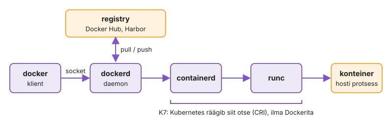
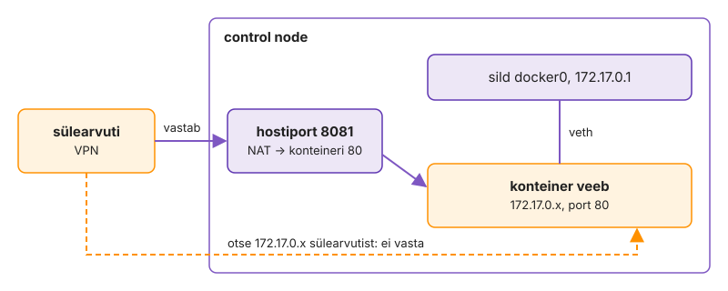
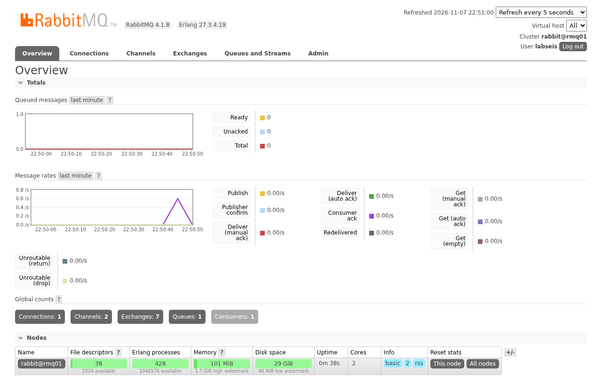
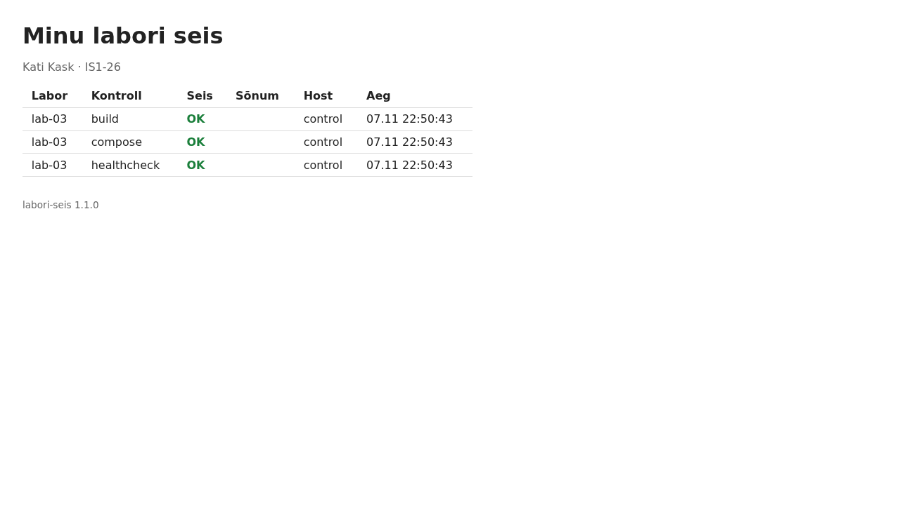
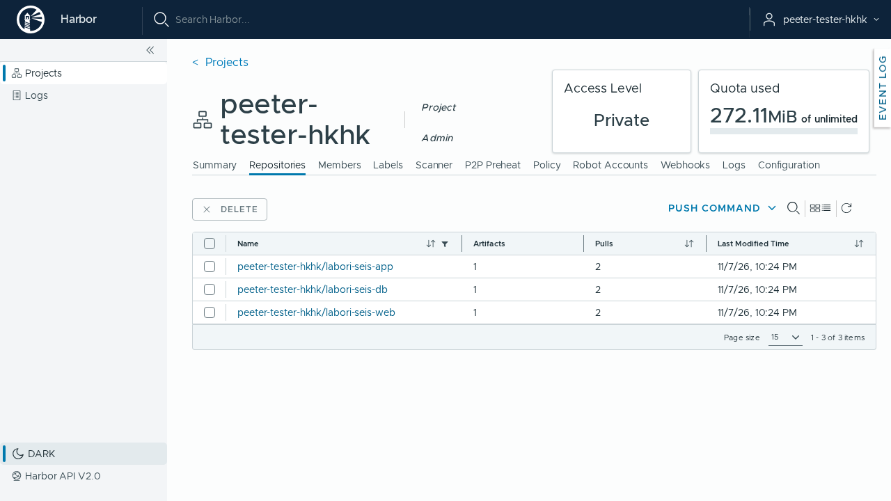

---
tags:
  - Docker
  - Compose
  - Harbor
  - Praktikum
---

# Praktikum: Labori seis konteinerites

Kahel esimesel kohtumisel seadistasid Ansible'iga teenused otse virtuaalmasinatesse. Täna pakid sama rakenduse, Labori seisu, konteineritesse. Paigaldad Dockeri, ehitad image'id oma Dockerfile'idest, käivitad viis teenust ühe `compose.yaml`-iga, lükkad image'id kursuse registry'sse Harbor ja esitad töö.

Iga osa alguses on eesmärk ja kontroll. Kui oskad, tee osa eesmärgi järgi ise ja ava lahendused ainult kontrolliks. Töö tulemus on sinu harus `k03-docker` olev kood ja automaatkontroll kontrollib seda GitHubis.

**Edenemine:** laboritahvel <http://is126.kaaren.lab.hkhk.lan> (VPN-iga).

Küsimused: [Küsimused ja teated](https://github.com/hkhk-tk/is126-arutelu/discussions). Lisa küsimusele käsk ja kogu veateade tekstina. Enne saatmist eemalda paroolid ja tokenid.

??? tip "Algseis: mida saad valmis kujul ja mida teed ise"

    **Saad valmis kujul:** starteris kaust `k03-docker` rakenduse koodi, Nginxi konfiguratsioonifaili, `.env.example`-i, Harbori CA ja mallidega, kuhu kirjutad Dockerfile'id ja `compose.yaml`-i. Harbori vahemälu tõmbab image'id Docker Hubist. 2. kohtumise tööd see praktikum ei vaja: alustad harust `main`.

    **Teed ise:** paigaldad Dockeri, kirjutad kolm Dockerfile'i ja `compose.yaml`-i, lükkad image'id Harborisse ning esitad töö tag'iga `k03`. Kodutöö on boonus.

    **Kui midagi läks katki:** `git restore <fail>` toob faili tagasi viimase commit'i kujul. `docker compose down` ja `docker compose up -d` loovad konteinerid uuesti. `docker compose down -v` kustutab ka andmebaasi andmed.

??? abstract "Õpiväljundid"

    1. Paigaldad Dockeri, tõmbad image'id Docker Hubist ja Harbori kaudu ning selgitad, kus konteiner hostis paistab: protsess, port ja andmed.
    2. Kirjutad ametlike image'ite põhjal Dockerfile'id ja mitmeastmelise app-image'i.
    3. Kirjeldad viie teenusega stacki `compose.yaml`-is healthcheck'ide ja sõltuvustega.
    4. Lükkad image'id Harborisse ja käivitad stacki registry image'itest.
    5. Kontrollid töö automaatkontrolli testidega ja esitad selle.

??? info "Testitud versioonid"

    Docker Engine 29 (vähemalt 28), Compose v5 (vähemalt v2.24.4), ansible-core 2.16, Harbor 2.15, `mariadb:11.4`, `rabbitmq:4.1-management-alpine`, `memcached:1.6-alpine`, `nginx:1.30-alpine`, `tomcat:10.1-jre21-temurin`, `maven:3-eclipse-temurin-21`, `alpine:3.22`, Podman 5 (AlmaLinux 9.8), Trivy 0.76. Vanem Compose ei toeta silte nagu `!override`. Prod-faili lugemisel annab see süntaksivea, mille teade ei viita versioonile.

    Dokumentatsioon: [Dockerfile](https://docs.docker.com/reference/dockerfile/), [Compose'i fail](https://docs.docker.com/reference/compose-file/), [Harbor](https://goharbor.io/docs/2.14.0/), [Podman](https://docs.podman.io/), [Trivy](https://trivy.dev/docs/latest/).

## Osa 1 · Docker ja esimesed konteinerid

Paigaldad Dockeri käsitsi, käivitad esimese konteineri ja tutvud Docker Hubi ning kursuse registry Harboriga. Seejärel käivitad konteinerid ilma Compose'ita ja vaatad hostist, kus on konteineri protsess, piirangud, port ja andmed. Docker ei too uusi tuuma mehhanisme: konteiner on hostis tavaline protsess, mida piiravad cgroup'id ja nftables'i reeglid.

**Eesmärk:** Docker töötab control'is, image'id tulevad Harbori kaudu ja oskad konteinereid käivitada, peatada ja eemaldada.  
**Kontroll:** `docker run --rm $HUB/hello-world` prindib `Hello from Docker!`: Docker töötab ja image tuli Harbori vahemälu kaudu.  
**Kus:** control, kaust `~/kursus/k03-docker`, konteinerid käsitsi ilma Compose'ita.

### 1.1 Haru ja failid

Iga kohtumise töö käib eraldi harus. Käsk `git pull` toob repositooriumi uued failid, ka kausta `k03-docker` algfailid.

```bash
cd ~/kursus
git switch main
git pull
git switch -c k03-docker
cd k03-docker
ls -AR
git check-ignore -v .env
```

??? success "Oodatav tulemus"

    Kaustas on mallid `compose.yaml`, `db/Dockerfile`, `web/Dockerfile` ja `app/Dockerfile` ning failid `.env.example` ja `web/nginx.conf`. Mallid täidad selle praktikumi käigus. `git check-ignore` näitab rida `.gitignore:…:k03-docker/.env`: paroolidega fail `.env` jääb Gitist välja.

??? warning "Kui failid puuduvad"

    Kui `git pull` ei toonud kausta `k03-docker` faile, kirjuta koolitajale. Koolitaja saadab need sinu repositooriumisse.

??? warning "Kui tuleb viga `a branch named 'k03-docker' already exists`"

    Haru on sul juba olemas, näiteks eelmisest katsest. Uut haru pole vaja teha. Vaheta olemasolevale harule käsuga `git switch k03-docker` ja jätka käsust `cd k03-docker`.

### 1.2 Paigalda Docker

Konteinerite käivitamiseks on control'is vaja Dockerit. Seda seal veel pole, nii et paigaldad selle kõigepealt.

Paigaldus käib nagu iga teise programmi puhul `apt`-iga, aga Dockeri enda paketihoidlast. Ubuntu oma pakett `docker.io` on vanem ja selles pole Compose'i, mida vajad 4. osas. Käsud on Dockeri [ametlikust juhendist](https://docs.docker.com/engine/install/ubuntu/). Need eemaldavad vanad paketid, lisavad Dockeri paketihoidla ja paigaldavad Dockeri.

```bash
sudo apt-get remove -y docker.io docker-compose docker-compose-v2 podman-docker containerd runc
sudo apt-get update
sudo apt-get install -y ca-certificates curl
sudo install -m 0755 -d /etc/apt/keyrings
sudo curl -fsSL https://download.docker.com/linux/ubuntu/gpg -o /etc/apt/keyrings/docker.asc
sudo chmod a+r /etc/apt/keyrings/docker.asc
```

Nüüd lisa paketihoidla. Fail `docker.sources` ütleb `apt`-ile, kust Dockeri pakette võtta, ja lubab ainult Dockeri võtmega allkirjastatud pakette.

```bash
sudo tee /etc/apt/sources.list.d/docker.sources <<EOF
Types: deb
URIs: https://download.docker.com/linux/ubuntu
Suites: $(. /etc/os-release && echo "${UBUNTU_CODENAME:-$VERSION_CODENAME}")
Components: stable
Signed-By: /etc/apt/keyrings/docker.asc
EOF
sudo apt-get update
sudo apt-get install -y docker-ce docker-ce-cli containerd.io docker-buildx-plugin docker-compose-plugin
```

Docker on nüüd paigaldatud, aga `docker` käsk töötab ainult `sudo`-ga. Ilma selleta tuleb viga `permission denied … docker.sock`. Et ei peaks iga käsu ette `sudo` kirjutama, lisa oma kasutaja gruppi `docker`:

```bash
sudo usermod -aG docker "$USER"
```

Uus grupp hakkab kehtima alles siis, kui logid uuesti sisse. VS Code'is vajuta ++f1++, vali **Remote-SSH: Kill VS Code Server on Host** ja ühenda control'iga uuesti.

Kontrolli, et kõik töötab:

```bash
id                                      # grupp docker on nimekirjas
docker version --format 'klient {{.Client.Version}}, server {{.Server.Version}}'
docker compose version                  # Compose on olemas
systemctl is-active docker containerd   # mõlemad teenused töötavad
```

??? success "Oodatav tulemus"

    `id` real on grupp `docker`. `docker version` näitab kliendi ja serveri versiooni, mõlemad 28 või uuemad. `docker compose version` näitab Compose'i versiooni. `systemctl` vastab kaks korda `active`.

??? warning "Kui tuleb ikka `permission denied … docker.sock`"

    Uus grupp ei hakanud veel kehtima. Kontrolli käsuga `id`, kas grupp `docker` on olemas. Kui see puudub, logi uuesti sisse nagu ülal kirjas. Kui see puudub ka siis, käivita `usermod` käsk uuesti.

!!! warning "Grupp `docker` annab root'i õigused"

    Grupi `docker` liige saab Dockeri kaudu muuta kõiki hosti faile ilma parooli küsimata, nagu root. Kursuse masinas on see lubatud. Jagatud serveris lisa gruppi `docker` ainult neid, kellel on niikuinii root'i õigus.

### 1.3 Esimene konteiner

Nüüd käivitad esimese konteineri. Selleks on vaja kahte mõistet. **Image** on nagu programmi paigalduspakett. Selles on programmi failid ja seaded, millega programm käivitub. **Konteiner** on image'ist käivitatud programm. Ühest image'ist saab käivitada mitu konteinerit.

Proovi image'iga `hello-world`. Selles on üks väike programm, mis prindib tervituse ja lõpetab.

**Küsimus enne käsku:** image'it `hello-world` sinu masinas veel ei ole. Kust Docker selle võtab?

```bash
docker run hello-world
```

??? success "Oodatav tulemus"

    Esimene rida `Unable to find image 'hello-world:latest' locally` tähendab, et image'it masinas polnud. Rida `Pulling from library/hello-world` tähendab, et Docker laadis image'i alla **Docker Hubist**. Docker Hub on Dockeri avalik image'ite hoidla (registry). Lõpuks prindib programm `Hello from Docker!` ja selgitab neljas punktis, mis juhtus.

Teate neli punkti vastavad joonisele 3.1. Käsk `docker` saadab sinu soovi taustteenusele `dockerd`. `dockerd` laadib image'i alla, käivitab sellest konteineri ja saadab programmi väljundi sinu terminali.

<figure markdown="span">
  
  <figcaption>Joonis 3.1. Docker Engine'i osad: klient, daemon, containerd ja runc (Talvik, 2026).</figcaption>
</figure>

Käivita sama käsk teist korda ja vaata seejärel konteinerid ja image'id üle. Nii näed, kas image laaditakse uuesti alla, kas töö lõpetanud konteiner jääb masinasse alles ja mitu image'it masinas on.

```bash
docker run hello-world | head -3
docker ps          # töötavad konteinerid
docker ps -a       # kõik konteinerid, ka lõpetanud
docker image ls    # image'id
```

??? success "Oodatav tulemus"

    Teisel korral allalaadimist ei olnud, sest image oli juba masinas. `docker ps` on tühi, sest ükski konteiner ei tööta. `docker ps -a` näitab kahte konteinerit olekus `Exited (0)`. See tähendab, et programm lõpetas töö edukalt ja konteiner peatus koos sellega. Peatatud konteinerid jäävad masinasse, kuni need kustutad. `docker image ls` näitab ühte image'it `hello-world`, sest mõlemad konteinerid tehti samast image'ist.

### 1.4 Docker Hub

Eelmises sammus tuli image `hello-world` Docker Hubist. **Docker Hub** (<https://hub.docker.com>) on Dockeri avalik registry ehk image'ite hoidla. Kui image'i nimes pole registry aadressi, võtab Docker image'i sealt.

Lühike nimi `nginx` tähendab tegelikult täisnime `docker.io/library/nginx:latest`. Selles on neli osa.

- `docker.io` on registry aadress.
- `library` on ametlike image'ite kaust.
- `nginx` on image'i nimi.
- `latest` on tag ehk versioon.

Ava brauseris Docker Hub ja otsi `nginx`. Tulemuste juures on märk, mis näitab, kes image'i teeb.

- **Docker Official Image** on Dockeri hallatud image. Selle Dockerfile on avalik ja seda uuendatakse turvaparandustega. Nimes pole kasutajanime, näiteks `nginx` või `mariadb`.
- **Verified Publisher** on tarkvara tootja enda image, näiteks `grafana/grafana`.
- Märgita image'i võib üles laadida igaüks. Enne kasutamist vaata, kas lehel on link lähtekoodile ja millal image'it viimati uuendati.

Ava image'i `nginx` leht ja vaheleht **Tags**. Tag `latest` näitab alati uusimat versiooni, nii et sama käsk annab kuu aja pärast teise image'i. Seepärast on selles praktikumis igal image'il versioon nimes, näiteks `nginx:1.30-alpine`. Osa `alpine` tähendab, et image on tehtud väikese Alpine Linuxi peale.

Tõmba sama image lühikese nimega ja täisnimega. Siis vaata, mida image sisaldab.

```bash
docker pull nginx:1.30-alpine
docker pull docker.io/library/nginx:1.30-alpine
docker image ls nginx
docker image inspect nginx:1.30-alpine --format '{{.Config.ExposedPorts}} {{.Config.Cmd}}'   # port ja käivituskäsk
```

??? success "Oodatav tulemus"

    Teine `pull` vastab `Image is up to date`. See tähendab, et lühike nimi ja täisnimi on sama image. `inspect` näitab porti `80/tcp` ja käsku, millega Nginx käivitub.

Image'i lehel on kirjas ka see, mida image käivitamiseks vajab. Ava image'i [`mariadb`](https://hub.docker.com/_/mariadb) leht ja leia vastused allolevatele küsimustele. Neid läheb vaja 1.8-s, kui käivitad andmebaasi konteinerina.

??? question "Mida vajab MariaDB image?"

    1. Milline keskkonnamuutuja peab olema määratud, et konteiner käivituks?
    2. Millised muutujad loovad andmebaasi ja kasutaja?
    3. Millises kataloogis hoiab MariaDB andmeid?
    4. Millist porti server kuulab?

    ??? success "Vastus"

        1. Üks kolmest muutujast `MARIADB_ROOT_PASSWORD`, `MARIADB_ALLOW_EMPTY_ROOT_PASSWORD` või `MARIADB_RANDOM_ROOT_PASSWORD`. Ilma nendeta konteiner lõpetab töö kohe.
        2. `MARIADB_DATABASE`, `MARIADB_USER` ja `MARIADB_PASSWORD`.
        3. `/var/lib/mysql`.
        4. `3306`.

### 1.5 Harbor: kursuse registry

Kogu klass läheb internetti ühe kooli IP-aadressi kaudu. Docker Hub piirab, mitu image'it saab ühelt aadressilt tunnis tõmmata ([piirangud](https://docs.docker.com/docker-hub/usage/)), ja klassi peale saab see piir kiiresti täis. Seepärast on kursusel oma registry **Harbor**. See hoiab Docker Hubi image'ide koopiaid ja sinna saad panna ka oma image'id.

??? note "Tabel 3.1. Docker Hub ja Harbor"

    | | Docker Hub | Harbor |
    |---|---|---|
    | Asukoht | internetis, haldab Docker Inc. | laborivõrgus, kursuse VM |
    | Kes näeb | kõik | ainult kursus (VPN-iga) |
    | Sisu | ametlikud ja kasutajate image'id | sinu image'id ja Docker Hubi image'ite koopiad |
    | Tõmmete piir | piiratud tõmmete arv IP-aadressi kohta | piirangut pole |
    | Haavatavuste skänn | ainult tasulises paketis | Trivy skannib iga image'i |

**Usalda Harborit.** Harbori sertifikaadi on teinud kursuse oma sertifitseerimiskeskus (CA), mida Ubuntu ei tunne. Kopeeri CA fail Dockerile ja süsteemile ning kontrolli ühendust.

```bash
sudo mkdir -p /etc/docker/certs.d/harbor.lab.hkhk.lan
sudo cp roles/docker/files/harbor-ca.crt /etc/docker/certs.d/harbor.lab.hkhk.lan/ca.crt
sudo cp roles/docker/files/harbor-ca.crt /usr/local/share/ca-certificates/labori-ca.crt
sudo update-ca-certificates
curl -s https://harbor.lab.hkhk.lan/api/v2.0/ping; echo
```

**Tõmba image Harborist.** Docker Hubi image'id on Harboris projektis `dockerhub`. Nende nime ees on pikk eesliide, mille paned muutujasse `HUB`. Selle praktikumi käsud kasutavad seda muutujat.

```bash
echo 'export HUB=harbor.lab.hkhk.lan/dockerhub/library' >> ~/.bashrc
source ~/.bashrc
docker pull $HUB/nginx:1.30-alpine
docker image ls
```

**Logi sisse.** Sul on Harboris konto ja oma privaatne projekt. Mõlema nimi on sinu GitHubi kasutajanimi väikeste tähtedega ja parool on `Passw0rd`. Docker küsib parooli eraldi.

```bash
docker login harbor.lab.hkhk.lan -u <github-kasutaja>
```

Ava brauseris <https://harbor.lab.hkhk.lan> ja logi samade andmetega sisse. Lehel **Projects** on projekt `dockerhub`, kus on äsja tõmmatud `library/nginx`, ja sinu oma projekt. Oma projekti näevad ainult selle liikmed ja sinna paned 5. osas oma image'id.

??? success "Oodatav tulemus"

    `curl` vastab `Pong`. `docker image ls` näitab Nginxi kahe nimega, `nginx` ja `harbor.lab.hkhk.lan/dockerhub/library/nginx`, ja ID on mõlemal sama. `docker login` vastab `Login Succeeded`. Veebiliideses on projekt `dockerhub` koos image'iga `library/nginx` ja sinu tühi projekt.

??? warning "Kui `x509: certificate signed by unknown authority`"

    CA puudub kaustas `/etc/docker/certs.d/harbor.lab.hkhk.lan/` või kausta nimi ei ole täpselt registry nimi. Korda selle sammu kahte esimest käsku.

??? warning "Kui brauser hoiatab sertifikaadi eest"

    Brauser ei tunne kursuse CA-d. Brauseris võid hoiatuse kõrvale jätta või importida faili `roles/docker/files/harbor-ca.crt` oma arvutis usaldatud juursertifikaatide hulka (Windowsis topeltklõps, **Install Certificate**, **Local Machine**, **Trusted Root Certification Authorities**). Kui nimi `harbor.lab.hkhk.lan` sinu arvutis ei avane, kasuta aadressi <https://192.168.125.42>.

### 1.6 Elutsükkel ja PID 1

Konteineris töötab üks peaprogramm. Linuxis on selle protsessi number 1 (PID 1). Konteiner töötab seni, kuni töötab see programm. Kui programm lõpetab, peatub ka konteiner. Seda on hea teada, sest peatunud konteiner ei tähenda alati viga. Vahel lõpetas programm lihtsalt oma töö.

**Esiplaanil ja taustal.** Käivita Nginx esiplaanil. Terminal jääb siis Nginxi logi näitama. Lõpeta see klahvidega Ctrl+C.

```bash
docker run --name fg $HUB/nginx:1.30-alpine
```

Käivita teine Nginx taustal. Võti `-d` jätab terminali vabaks ja `-p 8081:80` suunab control'i pordi 8081 konteineri porti 80.

```bash
docker run -d --name veeb -p 8081:80 $HUB/nginx:1.30-alpine
docker ps -a
```

Peata konteiner ja käivita see uuesti.

```bash
docker stop veeb
docker start veeb
docker ps
```

??? success "Oodatav tulemus"

    `fg` on olekus `Exited`, sest Ctrl+C lõpetas Nginxi. `veeb` on pärast `start`-i jälle `Up` ja konteineri ID on sama. `stop` peatab programmi, aga konteiner ja selle failid jäävad alles.

**Image ja konteiner.** **Küsimus enne käsku:** kas image'i saab kustutada, kui seda kasutab peatatud konteiner `fg`? 1.5-s nägid, et sama Nginxi image on masinas kahe nimega. Eemalda kõigepealt Docker Hubi nimi ja siis Harbori nimi.

```bash
docker rmi nginx:1.30-alpine
docker image ls
docker rmi $HUB/nginx:1.30-alpine
```

??? success "Oodatav tulemus"

    Esimene `rmi` ütleb ainult `Untagged: nginx:1.30-alpine` ja `image ls` näitab sama ID-d Harbori nime all edasi. Kui image'il on mitu nime, eemaldab `rmi` ainult ühe nime. Teine `rmi` annab vea `conflict` konteineri ID-ga, sest see on image'i viimane nimi ja konteiner kasutab image'i kihte ka peatatuna. Image'i saab kustutada alles siis, kui kõik seda kasutavad konteinerid on kustutatud.

**Konteiner, mis lõpetab kohe.** Käivita Ubuntu image ilma käsuta.

```bash
docker run $HUB/ubuntu:24.04
docker ps -a
```

Käivita sama image nüüd nii, et saad selle sees käske anda. Võti `-it` ühendab sinu terminali konteineriga.

```bash
docker run -it --rm $HUB/ubuntu:24.04 bash
```

Konteineris käivita `cat /proc/1/comm` ja `ps`, seejärel `exit`.

??? success "Oodatav tulemus"

    Esimene Ubuntu lõpetas kohe koodiga 0. Selle peaprogramm on käsurida `bash`, mis loeb käske terminalist. Ilma terminalita sisendit polnud, nii et `bash` lõpetas kohe. `-it`-ga on PID 1 `bash` ja konteiner töötab, kuni kirjutad `exit`.

### 1.7 Pordid ja konteineri IP

Konteineril on oma võrguaadress, aga seda näeb ainult control. Sinu arvutist jõuad konteinerini ainult avaldatud pordi kaudu. `-p 8081:80` tähendab, et control'i port 8081 viib konteineri porti 80.

Proovi hostiporti kõigepealt control'is.

```bash
curl -sI http://localhost:8081 | head -1
```

Ava oma arvuti brauseris (VPN-iga) `http://<control IP>:8081`.

<figure markdown="span">
  
  <figcaption>Joonis 3.2. Kust konteiner veeb vastab: hostiport on nähtav väljast, konteineri IP ainult hostist (Talvik, 2026).</figcaption>
</figure>

??? success "Oodatav tulemus"

    `curl` saab vastuseks `200 OK` ja brauser näitab Nginxi tervituslehte.

!!! warning "Avaldatud port on avatud kõigile"

    `-p 8081:80` avab pordi kõigile, kes control'ini jõuavad. Ubuntu tulemüür UFW seda ei peata, sest Docker lisab oma võrgureeglid UFW reeglitest mööda. Serveris avalda ainult need pordid, mida on tõesti vaja, ja kontrolli neid teisest masinast.

Eemalda katse konteinerid.

```bash
docker rm -f veeb fg
docker container prune -f
docker ps -a
```

### 1.8 Oma võrk ja kolm backend'i teenust

Labori seis otsib teenuseid nimede järgi: `db01`, `mc01` ja `rmq01`. Konteineri IP muutub iga uue konteineriga, nimi jääb samaks. Vaikevõrgus `bridge` nimesid ei lahendata, seepärast teed oma võrgu.

Tee võrk `labnet` ja käivita sinna MariaDB:

```bash
docker network create labnet
docker run -d --name db01 --network labnet $HUB/mariadb:11.4
```

Vaata, kas konteiner töötab, ja kui ei, siis miks:

```bash
docker ps -a
docker logs db01
```

??? success "Oodatav tulemus"

    `db01` on olekus `Exited (1)` ja logi viimastel ridadel on puuduva muutuja nimi. See on kõige tavalisem käivitusviga: kohustuslik muutuja puudub. Rikke otsimise järjekord on alati sama: `docker ps -a` (väljumiskood), `docker logs` ja vajadusel `docker inspect`.

**Ülesanne.** Kustuta `db01` ja käivita see uuesti nii, et nõuded on täidetud. Muutujate nimed leidsid 1.4-s [image'i lehelt](https://hub.docker.com/_/mariadb).

- võrk `labnet`;
- `-e` võtmetega root'i parool, andmebaas `labseis`, kasutaja `labseis` ja tema parool;
- andmed nimega volume'is `dbtest` kataloogis `/var/lib/mysql`.

Lisa samasse võrku veel kaks teenust:

- `mc01` image'ist `memcached:1.6-alpine`;
- `rmq01` image'ist `rabbitmq:4.1-management-alpine`, hostinimi `rmq01` (`--hostname`), kasutaja ja parool muutujatest `RABBITMQ_DEFAULT_USER` ja `RABBITMQ_DEFAULT_PASS`.

??? example "Lahendus"

    ```bash
    docker rm -f db01
    docker run -d --name db01 --network labnet -v dbtest:/var/lib/mysql \
      -e MARIADB_ROOT_PASSWORD=Juur123 -e MARIADB_DATABASE=labseis \
      -e MARIADB_USER=labseis -e MARIADB_PASSWORD=Labseis123 $HUB/mariadb:11.4
    docker run -d --name mc01 --network labnet $HUB/memcached:1.6-alpine
    docker run -d --name rmq01 --network labnet --hostname rmq01 \
      -e RABBITMQ_DEFAULT_USER=labseis -e RABBITMQ_DEFAULT_PASS=Labseis123 $HUB/rabbitmq:4.1-management-alpine
    docker ps
    ```

Kontrolli nimelahendust võrgust `labnet` ja vaikevõrgust:

```bash
docker run --rm --network labnet $HUB/alpine:3.22 sh -c 'getent hosts db01; grep nameserver /etc/resolv.conf'
docker run --rm $HUB/alpine:3.22 getent hosts db01; echo "kood $?"
```

??? success "Oodatav tulemus"

    Kolm konteinerit on `Up`. Võrgus `labnet` annab `getent` db01 IP-aadressi ja nimeserver on `127.0.0.11`. Vaikevõrgus nimi ei lahendu ja kood on 2. `127.0.0.11` on Dockeri sisseehitatud DNS, mis töötab ainult ise loodud võrkudes. Compose loob igale projektile oma võrgu, seepärast leiavad teenused seal üksteist nime järgi.

### 1.9 Andmed volume'is

Konteineri enda failid kaovad `docker rm`-iga. Andmebaas, mille andmed on konteineri sees, kaotab kõik andmed esimesel image'i uuendusel, sest uuendus tähendab alati uut konteinerit. Volume ja bind mount jäävad alles, aga käituvad õiguste poolest erinevalt.

**Volume.** Kirjuta `db01` andmebaasi tabel ühe reaga (parool on `Labseis123`):

```bash
docker exec -it db01 mariadb -ulabseis -p labseis -e "CREATE TABLE proov (id INT); INSERT INTO proov VALUES (42);"
```

Kustuta konteiner ja käivita see uuesti sama käsuga nagu 1.8 lahenduses, sama volume'iga `dbtest`:

```bash
docker rm -f db01
docker run -d --name db01 --network labnet -v dbtest:/var/lib/mysql \
  -e MARIADB_ROOT_PASSWORD=Juur123 -e MARIADB_DATABASE=labseis \
  -e MARIADB_USER=labseis -e MARIADB_PASSWORD=Labseis123 $HUB/mariadb:11.4
```

Kontrolli, kas rida on alles, ja vaata, kus andmed hostis asuvad:

```bash
docker exec -it db01 mariadb -ulabseis -p labseis -e "SELECT * FROM proov;"
docker inspect -f '{{json .Mounts}}' db01 | jq
```

??? success "Oodatav tulemus"

    Rida `42` on alles. `Mounts` näitab tüüpi `volume` ja allikat `/var/lib/docker/volumes/dbtest/_data`: andmed on hostis Dockeri kataloogis, mitte konteineris.

??? warning "Kui tuleb `ERROR 2002` või `Access denied`"

    MariaDB käivitub umbes 15 sekundit. `ERROR 2002 … mysqld.sock` tähendab, et server pole veel valmis. Oota 15 sekundit ja proovi uuesti. Kui tuleb `Access denied`, kustutati konteiner enne, kui MariaDB jõudis andmebaasi luua. Siis alusta 1.8-st uuesti: `docker rm -f db01; docker volume rm dbtest`.

<figure markdown="span">
  
  <figcaption>Joonis 3.3. Kolm kohta, kuhu konteineri andmed võivad sattuda (Talvik, 2026).</figcaption>
</figure>

Eemalda enne järgmist osa kõik katse konteinerid, volume ja võrgud:

```bash
docker rm -f db01 mc01 rmq01
docker volume rm dbtest
docker network rm labnet
docker ps -a
```

??? success "Oodatav tulemus"

    `docker ps -a` on tühi.

### 1.10 Commit

```bash
cd ~/kursus
git status --short
git push -u origin k03-docker
cd k03-docker
```

Selles osas tegid katseid käsurealt ja faile tavaliselt ei muutnud. Siis on `git status` tühi ja commit'i pole vaja. `git push` saadab haru `k03-docker` GitHubi.

## Osa 2 · db ja web image

Ehitad db01 ja web01 image'id ametlike image'ite põhjal. Ametlik image teeb juba suure osa tööst, seega kirjutad Dockerfile'i ainult puuduva osa jaoks ja baasimage'i turvaparandused tulevad uuendusega kaasa.

**Eesmärk:** image'id `labseis-db` ja `labseis-web` ehituvad sinu Dockerfile'idest. Nginx'i konfiguratsioonifail `web/nginx.conf` on starteris valmis.  
**Kontroll:** `docker image ls 'labseis-*'` näitab mõlemat image'it. Kõiki faile kontrollib `k03 files` pärast 4. osa.  
**Kus:** control, kaust `~/kursus/k03-docker`.

Rakenduse failid on repositooriumi juures (`pom.xml`, `src/`, `db/`) ja jäävad puutumata, Dockerfile'id ainult loevad neid. db ja app vajavad neid faile, seega on nende **ehituskontekst** repositooriumi juur `..`. web'i kontekst on tema oma kaust.

```text
~/kursus/
├── .dockerignore                      ← 2.3
├── pom.xml  src/  db/                 ← rakendus, ei muuda
└── k03-docker/
    ├── db/Dockerfile                  ← 2.1
    ├── web/Dockerfile  web/nginx.conf ← 2.2
    ├── app/Dockerfile                 ← 3. osa
    └── compose.yaml  .env.example     ← 4. osa
```

### 2.1 db/Dockerfile

Andmebaasi image põhineb ametlikul MariaDB image'il ja sisaldab lisaks Labori seisu skeemi ja näidisandmeid. Starteri `db/Dockerfile`-is on TODO-read: kirjutad ainult baasi ja failide kopeerimise. Algseadistuse teeb entrypoint. Kui skeem on image'is, on andmebaasi struktuur versioonitud koos rakendusega ja iga uus keskkond saab sama alguse.

Nõuded ([juhiste viide](https://docs.docker.com/reference/dockerfile/)):

- baas `mariadb:11.4`, eesliide tuleb ehituse argumendist `HUB` vaikeväärtusega `docker.io/library`;
- `db/schema.sql` ja `db/seed.sql` lähevad kausta `/docker-entrypoint-initdb.d/` nii, et skeem käivitub enne andmeid (failid käivitatakse failinimede tähestikulises järjekorras);
- `COPY`, mitte `ADD`: `ADD` pakib arhiive lahti ja laeb faile URL-ilt, mida siin vaja pole.

??? example "Lahendus: `k03-docker/db/Dockerfile`"

    ```dockerfile
    ARG HUB=docker.io/library
    FROM ${HUB}/mariadb:11.4
    COPY db/schema.sql /docker-entrypoint-initdb.d/01-schema.sql
    COPY db/seed.sql /docker-entrypoint-initdb.d/02-seed.sql
    ```

    `ARG` enne `FROM`-i on ainuke juhis, mis tohib olla `FROM`-ist eespool. Argument kehtib ainult `FROM` real. Numbrid failinimede ees panevad paika järjekorra.

Ehita ja kontrolli. `--build-arg HUB` ilma väärtuseta võtab väärtuse sinu shelli muutujast:

```bash
docker build --build-arg HUB -f db/Dockerfile -t labseis-db:test ..
docker run -d --name dbt -e MARIADB_ROOT_PASSWORD=x -e MARIADB_DATABASE=labseis labseis-db:test
sleep 20; docker exec dbt mariadb -uroot -px labseis -e "SHOW TABLES;"
docker rm -f dbt
```

??? success "Oodatav tulemus"

    `SHOW TABLES` näitab nelja tabelit: course, lab, result, student. Mõlemad SQL-failid käivitusid ja õiges järjekorras: seed kirjutab tabelitesse, mille skeem lõi. Vale järjekorra korral lõpeks konteineri esimene käivitus veaga `Table doesn't exist`. Volume jääks siis pooleldi algseadistatuks ja järgmine käivitus jätaks init-skriptid vahele.

??? warning "Kui `\"/db/schema.sql\": not found`"

    Kontekst pole repositooriumi juur: viimane argument `..` peab osutama kaustale `~/kursus`.

### 2.2 web/Dockerfile ja Nginx'i mall

web01 on app01 ees pöördproksi. Nginx lahendab `upstream` nime ainult käivitusel. Kui app01 konteiner luuakse uuesti uue IP-ga, vastab web01 502-ga, ja 5. kohtumise GitHub Actionsi konveier uuendab app01 iga commit'iga. [Ametlik Nginx'i image](https://hub.docker.com/_/nginx) oskab konfiguratsioonifaili mallist genereerida ja konteineri DNS-serveri sinna kirjutada.

Konfiguratsioonifail `web/nginx.conf` on starteris valmis. Selle esimene rida `resolver ${NGINX_LOCAL_RESOLVERS} valid=10s ipv6=off;` on mall: Nginx'i image'i entrypoint asendab muutuja konteineri DNS-serveri aadressiga. `set $app_upstream` ja `proxy_pass $app_upstream` panevad Nginx'i nime `app01` lahendama iga päringu ajal, mitte ainult käivitusel.

Täida starteri `web/Dockerfile` nende nõuete järgi:

-  `nginx:1.30-alpine` (eesliide `HUB` nagu db-s), konfiguratsioonifail kopeeritakse `/etc/nginx/templates/default.conf.template`, `ENV NGINX_ENTRYPOINT_LOCAL_RESOLVERS=1`;
- `HEALTHCHECK`, mis küsib `wget`-iga `http://127.0.0.1/health` (Alpine'is curl'i pole).

??? example "Fail `k03-docker/web/nginx.conf` (starteris)"

    ```nginx
    resolver ${NGINX_LOCAL_RESOLVERS} valid=10s ipv6=off;

    server {
        listen 80;

        location / {
            set $app_upstream http://app01:8080;
            proxy_pass $app_upstream;
            proxy_set_header Host $host;
            proxy_set_header X-Real-IP $remote_addr;
            proxy_set_header X-Forwarded-For $proxy_add_x_forwarded_for;
            proxy_set_header X-Forwarded-Proto $scheme;
        }
    }
    ```

??? example "Lahendus: `k03-docker/web/Dockerfile`"

    ```dockerfile
    ARG HUB=docker.io/library
    FROM ${HUB}/nginx:1.30-alpine
    ENV NGINX_ENTRYPOINT_LOCAL_RESOLVERS=1
    COPY nginx.conf /etc/nginx/templates/default.conf.template
    HEALTHCHECK --interval=10s --timeout=3s --start-period=10s --retries=3 \
      CMD wget -qO- http://127.0.0.1/health || exit 1
    ```

```bash
docker build --build-arg HUB -t labseis-web:test web
docker run --rm labseis-web:test nginx -T 2>/dev/null | grep -E 'resolver|proxy_pass'
```

??? success "Oodatav tulemus"

    `resolver` real on IP-aadress ja `proxy_pass $app_upstream;` on alles. `nginx -T` näitab lõplikku konfiguratsiooni, mille entrypoint mallist tegi. IP-aadress tähendab, et `envsubst` sai muutuja kätte. `proxy_pass $app_upstream` tähendab, et Nginx lahendab nime iga päringu ajal, mitte ainult käivitusel.

??? warning "Kui näed `${NGINX_LOCAL_RESOLVERS}` muutmata kujul"

    `ENV` jäi puudu või fail pole kaustas `templates/`.

### 2.3 .dockerignore

Ehituskontekst on kõik, mis saadetakse builderile enne esimest juhist. Docker ei vaata, mida Dockerfile tegelikult kasutab. Kõik, mis on kontekstis, võib `COPY . .` abil image'isse jõuda, ka `.env` paroolidega ja OpenTofu `tfstate`. Saladus image'is jõuab igasse koopiasse: registry'sse, iga masina kettale ja igaühele, kes image'i tõmbab. Kustutamine hilisemas kihis ei aita, sest varasem kiht on alles.

Loo repositooriumi juurde [`.dockerignore`](https://docs.docker.com/build/concepts/context/) lubamisnimekirjana (allowlist): esimene rida `*`, siis `!` ridadega tagasi ainult see, mida Dockerfile'id kopeerivad.

??? example "Lahendus: `~/kursus/.dockerignore`"

    ```text
    *
    !pom.xml
    !src
    !db
    ```

    Reeglid loetakse ülevalt alla ja hilisem reegel kirjutab varasema üle. `*` jätab välja kõik, `!` read toovad tagasi ainult vajaliku.

```bash
docker build -q --build-arg HUB -f db/Dockerfile -t labseis-db:test ..
(cd .. && bash autograde/check.sh k03 files)
```

??? success "Oodatav tulemus"

    db-image ehitub endiselt ja `k03 files` annab `OK` või kurdab ainult app-image'i ja Compose'i failide üle, mida sul veel pole. `.dockerignore` on kaitse. Kui Dockerfile'is on kunagi `COPY . .`, ei jõua `.env` ega `.git` image'isse. Lubamisnimekirjaga ei jõua uus fail image'isse enne, kui sa selle ise lubad. Keelunimekirja (`.env`, `.git`) tuleb iga uue saladusefailiga täiendada, ja see ununeb.

### 2.4 Commit

```bash
(cd ~/kursus && git add .dockerignore k03-docker && git commit -m "k03: db ja web Dockerfile, .dockerignore" && git push)
git ls-files
```

`git ls-files` näitab, mida automaatkontroll näeb. Fail, mis on töökaustas, aga mitte Gitis, puudub ka GitHubi ehituses, ja see viga tuleb välja alles esitamisel.

??? success "Oodatav tulemus"

    `git ls-files` näitab faile `db/Dockerfile`, `web/Dockerfile` ja `web/nginx.conf`.

## Osa 3 · App image

Ehitad rakenduse image'i kahes astmes, nii et lõppimage'isse jõuab ainult rakendus, mitte Maven ega lähtekood. Sama image'i ehitab 5. kohtumisel konveier ja 7. kohtumisel käivitab Kubernetes, seega iga siin tehtud viga kordub igal ehitusel.

**Eesmärk:** app-image ehitub kahes astmes ja lõppimage'is pole Maveni ega lähtekoodi.  
**Kontroll:** `bash ../autograde/check.sh k03 multistage` annab `OK`.  
**Kus:** control, kaust `~/kursus/k03-docker`.

### 3.1 Mitmeastmeline Dockerfile

Kirjutad Dockerfile'i kahes astmes. Esimene aste ehitab WAR-i, teine käivitab selle. Lõppimage'isse jõuab ainult see, mille sa `COPY --from` abil teisest astmest üle tood.

<figure markdown="span">
  
  <figcaption>Joonis 3.4. Mitmeastmeline ehitus: lõppimage'isse jõuab ainult WAR (Talvik, 2026).</figcaption>
</figure>

Tabel 3.2 on plaan astmete kaupa: esimene aste on ehitusmasin, mis pärast ehitust kustutatakse; teine läheb tootmisse; lõpu read on metaandmed, mis muutuvad iga commit'iga ja peavad seepärast olema viimased.

??? note "Tabel 3.2. App-Dockerfile'i plaan"

    | Aste | Mida teeb |
    |---|---|
    | `FROM ${HUB}/maven:3-eclipse-temurin-21 AS build` | töökataloog `/src`; **ainult** `pom.xml`; `mvn -B -q dependency:go-offline`; siis `src/`; `mvn -B -q package -DskipTests` |
    | `FROM ${HUB}/tomcat:10.1-jre21-temurin` | `RUN`-i pole vaja (`curl` on baasis olemas ja `webapps` on tühi); `COPY --from=build` WAR → `webapps/ROOT.war`; `EXPOSE 8080`; `HEALTHCHECK` `curl -fsS http://localhost:8080/health` (`--start-period=60s`) |
    | lõpp | `ARG GIT_SHA=unknown`, `ENV GIT_SHA=${GIT_SHA}`, `LABEL org.opencontainers.image.revision="${GIT_SHA}"`, `CMD ["catalina.sh", "run"]` |

Täida starteri `app/Dockerfile` [kahes astmes](https://docs.docker.com/build/building/multi-stage/) tabeli järgi. Kirjuta see ise, ühe astmega näidet ära kopeeri.

??? example "Lahendus: `app/Dockerfile`"

    ```dockerfile
    ARG HUB=docker.io/library
    FROM ${HUB}/maven:3-eclipse-temurin-21 AS build
    WORKDIR /src
    COPY pom.xml .
    RUN mvn -B -q dependency:go-offline
    COPY src ./src
    RUN mvn -B -q package -DskipTests

    FROM ${HUB}/tomcat:10.1-jre21-temurin
    COPY --from=build /src/target/labori-seis.war /usr/local/tomcat/webapps/ROOT.war
    EXPOSE 8080
    HEALTHCHECK --interval=10s --timeout=3s --start-period=60s --retries=3 \
      CMD curl -fsS http://localhost:8080/health || exit 1
    ARG GIT_SHA=unknown
    ENV GIT_SHA=${GIT_SHA}
    LABEL org.opencontainers.image.revision="${GIT_SHA}"
    CMD ["catalina.sh", "run"]
    ```

    `pom.xml` eraldi ja enne `src`-i: sõltuvuste kiht muutub ainult siis, kui `pom.xml` muutub. Käitusaste ei vaja `RUN`-i: ametliku Tomcati image'i kaust `webapps` on tühi (näiterakendused on kaustas `webapps.dist`) ja healthcheck'i `curl` tuleb baasist (eclipse-temurin).

```bash
docker build --build-arg HUB -f app/Dockerfile --build-arg GIT_SHA=$(git rev-parse --short HEAD) -t labseis-app:multi ..
docker image ls labseis-app
docker history labseis-app:multi | head -8
docker image inspect -f '{{json .Config.Labels}}' labseis-app:multi
```

??? success "Oodatav tulemus"

    `history` ülemistes ridades on WAR (umbes 30 MB), Maveni kihte pole, ja label'is on sinu SHA. Maven, JDK ja kaust `~/.m2` jäid ehitusastmesse ega jõudnud lõppimage'isse. Kui näed `history` ülemistes ridades Maveni kihte, kopeerib käitusaste valest kohast. Label SHA-ga ütleb hiljem registry's, millisest commit'ist image tehti, ilma Giti vaatamata.

### 3.2 Commit

Enne commit'i käivita automaatkontrolli test, mis kontrollib app-Dockerfile'i ülesehitust.

```bash
(cd .. && bash autograde/check.sh k03 multistage)
(cd ~/kursus && git add k03-docker && git commit -m "k03: mitmeastmeline app-image" && git push)
```

??? success "Oodatav tulemus"

    `multistage` annab `OK`. Test vaatab ainult faili kuju: kaks `FROM`-i ja `COPY --from`. Kas image töötab, näed 4. osas, kui app01 käivitub Compose'iga. Automaatkontrolli `build` ehitab selle esitamisel puhtast kloonist.

## Osa 4 · Kogu stack Compose'iga

Kirjeldad kogu Labori seisu ühes failis `compose.yaml`. Viis pikka `docker run` käsku shelli ajaloos ei näita, kuidas teenused käivitati. Compose'i fail on Gitis ja `docker compose up -d` viib süsteemi failis kirjeldatud olekusse, nagu playbook Ansible'is. Kirjutad faili ühe teenuse kaupa ([failivormingu viide](https://docs.docker.com/reference/compose-file/services/)) ja kontrollid iga teenuse järel tulemust.

**Eesmärk:** viis teenust käivituvad ühe käsuga, andmebaasi andmed jäävad volume'isse ja app01 ootab, kuni sõltuvused on valmis.  
**Kontroll:** `docker compose up -d --wait` ja `curl -s localhost:8080/health` annab neli `UP`-i; automaatkontrolli testid `compose` ja `deps` annavad `OK`.  
**Kus:** control, kaust `~/kursus/k03-docker`, põhistack `compose.yaml`.

<figure markdown="span">
  
  <figcaption>Joonis 3.5. Labori seis Compose'i stackina (Talvik, 2026).</figcaption>
</figure>

Tabel 3.3 kirjeldab valmis stacki. Read on käivitusjärjekorras. Veerg „Hostis avatud“ näitab, millised teenused on väljast nähtavad. Kõik teised suhtlevad ainult projekti võrgus. Ehitataval teenusel on image'i nimi `${REGISTRY:?}/${OWNER:?}/labori-seis-<db|app|web>:${TAG:-dev}`, ametlikul image'il on ees `${HUB:-docker.io/library}/`.

??? note "Tabel 3.3. Stacki teenused"

    | Teenus | Image | Hostis avatud | Healthcheck |
    |---|---|---|---|
    | db01 | sinu `db/Dockerfile`, kontekst `..` | ei | `healthcheck.sh --connect --innodb_initialized` |
    | mc01 | `memcached:1.6-alpine` | ei | `echo stats \| nc -w 1 127.0.0.1 11211 \| grep -q uptime` |
    | rmq01 | `rabbitmq:4.1-management-alpine` | 15672 (halduse UI) | `rabbitmq-diagnostics -q ping` |
    | app01 | sinu `app/Dockerfile`, kontekst `..` | ei | Dockerfile'ist |
    | web01 | sinu `web/`, kontekst `./web` | `${WEB_PORT:-8080}:80` | Dockerfile'ist |

### 4.1 .env ja db01

Starteri `compose.yaml`-is on db01 TODO-ga ja ülejäänud teenused kommentaaris. Täidad teenused ükshaaval: eemaldad kommentaarimärgid alles siis, kui hakkad seda teenust täitma, sest Compose kontrollib kogu faili ja kontrollid iga teenuse järel tulemust. Alustad saladustest ja andmebaasist, sest kõik teised sõltuvad neist. `.env` hoiab paroole ja jääb Gitist välja. Starteri `.env.example` näitab, milliseid muutujaid on vaja, ja on Gitis; automaatkontroll kasutab just seda faili. Compose loeb `.env`-i projekti kaustast ja asendab `${VAR}` viited enne, kui fail üldse valideeritakse.

??? example "Fail `.env.example` (starteris)"

    ```bash
    DB_PASSWORD=muuda-mind
    DB_ROOT_PASSWORD=muuda-mind
    RABBITMQ_PASSWORD=muuda-mind
    TEACHER_TOKEN=muuda-mind
    HUB=docker.io/library
    REGISTRY=harbor.lab.hkhk.lan
    OWNER=sinu-github-kasutaja
    TAG=dev
    WEB_PORT=8080
    ```

    `HUB=docker.io/library` on näidisfailis meelega: GitHubi automaatkontroll Harborit ei näe ja tõmbab Docker Hubist.

Loo selle põhjal fail `.env` oma väärtustega. `OWNER` on sinu GitHubi kasutajanimi väikeste tähtedega, `HUB` sama mis shellis:

```bash
cp .env.example .env && chmod 600 .env
sed -i -e "s|^HUB=.*|HUB=$HUB|" -e "s|^OWNER=.*|OWNER=<github-kasutaja>|" .env
nano .env          # paroolid
git check-ignore -v .env
```

Kui sama muutuja on ka shellis, kehtib shelli väärtus ja `.env`-i rida ei mõju. `HUB` on sul `.bashrc`-is, seepärast on `.env`-is sama väärtus. Kui `.env`-i muudatus ei mõju, kontrolli käsuga `printenv HUB` (või muu muutuja nimega), kas see on shellis määratud. Paroolide väärtusi ära kleebi küsimustesse ega ekraanipiltidele.

??? example "Ülesanne: db01 `compose.yaml`-is"

    Nõuded: `name: labori-seis`; teenusel `db01` on `build.context: ..`, `build.dockerfile: k03-docker/db/Dockerfile` ja argument `HUB`; image'i nimi tabeli 3.3 järgi; `environment`-is root-parool, andmebaas ja kasutaja `labseis` ja kasutaja parool; nimega volume `dbdata` kataloogis `/var/lib/mysql`; healthcheck intervalliga 10 s ja 10 kordusega.

    ```yaml
    name: labori-seis

    services:
      db01:
        build:
          context: ..
          dockerfile: k03-docker/db/Dockerfile
          args:
            HUB: ${HUB:-docker.io/library}
        image: ${REGISTRY:?}/${OWNER:?}/labori-seis-db:${TAG:-dev}
        environment:
          MARIADB_ROOT_PASSWORD: ${DB_ROOT_PASSWORD:?}
          MARIADB_DATABASE: labseis
          MARIADB_USER: labseis
          MARIADB_PASSWORD: ${DB_PASSWORD:?}
        volumes:
          - dbdata:/var/lib/mysql
        healthcheck:
          test: ["CMD", "healthcheck.sh", "--connect", "--innodb_initialized"]
          interval: 10s
          retries: 10

    volumes:
      dbdata:
    ```

    `${VAR:?}` katkestab, kui muutujat pole. `${VAR:-x}` annab vaikeväärtuse.

```bash
docker compose up -d --build db01
sleep 25; docker compose ps
```

??? success "Oodatav tulemus"

    db01 on `Up (healthy)`. `(healthy)` tähendab rohkem kui `Up`: MariaDB healthcheck kontrollis, et InnoDB on algseadistatud ja ühendusi võetakse vastu. Ainult seda olekut saavad teised teenused `depends_on`-iga oodata.

??? warning "Kui `required variable DB_ROOT_PASSWORD is missing`"

    `.env` puudub või oled vales kaustas. `${VAR:?}` teebki täpselt seda.

### 4.2 mc01 ja rmq01

Kaks backend'i teenust käivitad otse ametlikest image'itest, oma Dockerfile'i pole vaja. Avatud Memcachedi port on tuntud ründevektor: vahemälust saab lugeda kõike, mis sinna pandi, ja UDP kaudu on seda kasutatud võimendusrünnakuteks. Porti, mida väljast ei vajata, ei avaldata.

Nõuded: rmq01-l `hostname: rmq01`, kasutaja `labseis` ja parool `.env`-ist (muutujad nagu `docker run -e`-ga), andmed volume'is `rmqdata` (`/var/lib/rabbitmq`); hostis on avatud ainult RabbitMQ halduse UI port `15672`, mc01-l `ports:` pole; healthcheck tabelist, toruga käsk vajab `CMD-SHELL` kuju; volume `rmqdata` on faili lõpus jaotises `volumes:` juba olemas.

??? example "Lahendus: mc01 ja rmq01"

    ```yaml
      mc01:
        image: ${HUB:-docker.io/library}/memcached:1.6-alpine
        healthcheck:
          test: ["CMD-SHELL", "echo stats | nc -w 1 127.0.0.1 11211 | grep -q uptime"]
          interval: 10s
          retries: 5

      rmq01:
        image: ${HUB:-docker.io/library}/rabbitmq:4.1-management-alpine
        hostname: rmq01
        environment:
          RABBITMQ_DEFAULT_USER: labseis
          RABBITMQ_DEFAULT_PASS: ${RABBITMQ_PASSWORD:?}
        ports:
          - "15672:15672"
        volumes:
          - rmqdata:/var/lib/rabbitmq
        healthcheck:
          test: ["CMD", "rabbitmq-diagnostics", "-q", "ping"]
          interval: 10s
          retries: 10
    ```

    Faili lõppu:

    ```yaml
    volumes:
      dbdata:
      rmqdata:
    ```

```bash
docker compose up -d mc01 rmq01
sleep 30; docker compose ps
```

Ava brauseris `http://<control IP>:15672` ja logi sisse kasutajaga `labseis`.

<figure markdown="span">
  
  <figcaption>Joonis 3.6. RabbitMQ haldus: node'i nimi on `rabbit@rmq01`, sest hostinimi on fikseeritud (Talvik, 2026).</figcaption>
</figure>

??? success "Oodatav tulemus"

    Kolm teenust on `(healthy)` ja halduse UI näitab node'i `rabbit@rmq01`. Nimi tuleb võtmest `hostname`. Ilma selleta oleks nimi konteineri juhuslik ID ja iga uus konteiner leiaks volume'ist võõra node'i andmed: järjekorrad oleksid tühjad, kuigi andmed on kettal alles.

### 4.3 app01

Rakendus käivitub backend'i teenuste järel, sest vajab kõiki kolme. Ilma tingimuseta `service_healthy` käivitub app01 ajal, kui MariaDB alles algseadistab. Rakendus ootab ja ühendub hiljem ise, aga logides on siis hulk ühendusvigu, mis peidavad tegeliku vea, kui see peaks tekkima.

Nõuded: build nagu db01, aga oma Dockerfile ja argumendid `HUB` ja `GIT_SHA: ${TAG:-dev}`; image `${APP_IMAGE:-${REGISTRY:?}/${OWNER:?}/labori-seis-app:${TAG:-dev}}` (5. kohtumise konveier annab `APP_IMAGE`-iga valmis image'i); `environment`-is ainult kolm saladust (`DB_PASSWORD`, `RABBITMQ_PASSWORD`, `TEACHER_TOKEN`), hostinimed on rakenduses vaikeväärtustena olemas; `depends_on` kolmele teenusele, igaühel `condition: service_healthy`.

??? example "Lahendus: app01"

    ```yaml
      app01:
        build:
          context: ..
          dockerfile: k03-docker/app/Dockerfile
          args:
            HUB: ${HUB:-docker.io/library}
            GIT_SHA: ${TAG:-dev}
        image: ${APP_IMAGE:-${REGISTRY:?}/${OWNER:?}/labori-seis-app:${TAG:-dev}}
        environment:
          DB_PASSWORD: ${DB_PASSWORD:?}
          RABBITMQ_PASSWORD: ${RABBITMQ_PASSWORD:?}
          TEACHER_TOKEN: ${TEACHER_TOKEN:?}
        depends_on:
          db01:
            condition: service_healthy
          mc01:
            condition: service_healthy
          rmq01:
            condition: service_healthy
    ```

```bash
docker compose up -d --build --wait --wait-timeout 180 app01
docker compose logs app01 | grep -m1 'Server startup'
docker compose exec app01 curl -s localhost:8080/health; echo
```

??? success "Oodatav tulemus"

    `up --wait` ootab, kuni app01 healthcheck annab `healthy`, ja lõpetab veaga, kui seda 180 sekundi jooksul ei juhtu. Siis vaata `docker compose logs app01`. `/health` annab `{"status":"UP","db":"UP","queue":"UP","cache":"UP"}` ja app01 on `(healthy)`. Neli `UP`-i tähendavad, et app01 jõudis iga backend'i teenuseni nime ja parooliga. `Server startup` logis ütleb, kui kaua Tomcat käivitus. See aeg on põhjus, miks healthcheck'il on `start-period`: selle aja jooksul ebaõnnestunud kontrolle ei loeta.

??? warning "Kui `db` on DOWN ja logis `Access denied`"

    MariaDB loeb paroolid muutujatest ainult siis, kui andmekataloog on tühi. Volume `dbdata` algseadistati varem teise parooliga ja uus `.env`-i parool seda ei muuda. Selles etapis on baasis ainult skeem ja näidisandmed, mille init-skript loob uuesti, seega võid volume'i kustutada: `docker compose down -v` eemaldab stacki volume'id (ka RabbitMQ oma) ja järgmine `up` algseadistab baasi uue parooliga. Tootmises kustutaks see andmed: seal muudetakse parool baasis endas.

### 4.4 web01 ja ühised seaded

Viimase teenuse kaudu pääseb stackile ligi väljast. Kõigil teenustel on samad restart- ja logiseaded, seega kirjutad need üks kord ja viitad neile YAML-ankruga. Ilma logide rotatsioonita täidab üks palju logi kirjutav konteiner `/var/lib/docker` partitsiooni ja siis seiskub kogu Docker koos kõigi teenustega.

Nõuded: `web01` kontekstiga `./web` ja argumendiga `HUB`, image tabeli 3.3 järgi, port `"${WEB_PORT:-8080}:80"`, `depends_on: app01` tingimusega `service_healthy`. Kõigile teenustele kehtivad seaded üks kord faili algusesse [laiendusvälja](https://docs.docker.com/reference/compose-file/extension/) `x-common: &common` alla ja igale teenusele `<<: *common`: `restart: unless-stopped` ning `logging` draiveriga `json-file`, `max-size: "10m"`, `max-file: "3"`.

??? example "Lahendus: ühised seaded (faili algusesse pärast `name:`)"

    ```yaml
    x-common: &common
      restart: unless-stopped
      logging:
        driver: json-file
        options:
          max-size: "10m"
          max-file: "3"
    ```

    Lisa iga teenuse esimeseks reaks:

    ```yaml
      db01:
        <<: *common
    ```

    `&common` paneb plokile nime, `*common` viitab sellele ja `<<:` liidab ploki võtmed teenuse võtmetega.

??? example "Lahendus: web01"

    ```yaml
      web01:
        <<: *common
        build:
          context: ./web
          args:
            HUB: ${HUB:-docker.io/library}
        image: ${REGISTRY:?}/${OWNER:?}/labori-seis-web:${TAG:-dev}
        ports:
          - "${WEB_PORT:-8080}:80"
        depends_on:
          app01:
            condition: service_healthy
    ```

```bash
docker compose up -d --build
docker compose ps
curl -s http://localhost:8080/health; echo; curl -s http://localhost:8080/version; echo
docker compose top app01
```

Ava brauseris `http://<control IP>:8080/s/demo-kati-token`. See on näidisõppija vaade: token tuleb failist `db/seed.sql`. Õpetaja vaade on `/?token=<TEACHER_TOKEN>`.

<figure markdown="span">
  
  <figcaption>Joonis 3.7. Labori seis Compose'i stackist web01 kaudu (Talvik, 2026).</figcaption>
</figure>

??? success "Oodatav tulemus"

    Viis teenust on `(healthy)`, `/version` näitab sinu `TAG`-i, `top` näitab app01 `java` protsessi hosti PID-iga ja brauseris avaneb Labori seis. `top` näitas hosti PID-i: Compose'i teenus on endiselt hostiprotsess nagu `docker run`-iga käivitatud konteiner. Ühised seaded ühes kohas tähendavad, et kuues teenus saab need ühe reaga ja automaatkontrolli `deps` leiab restart-poliitika igalt teenuselt.

??? warning "Kui `port is already allocated`"

    Port 8080 on juba kasutusel. Vaata, milline protsess seda kasutab: `ss -tlnp | grep 8080`. Muuda `.env`-is `WEB_PORT`.

### 4.5 Commit

Enne commit'i käivitad kolm automaatkontrolli testi, mis loevad sama `compose.yaml`-i. Testid kasutavad `.env.example` väärtusi, mitte sinu `.env`-i. Seepärast peab näidisfail sisaldama kõiki muutujaid, mida `${VAR:?}` nõuab, muidu ebaõnnestub `compose` GitHubis, kuigi sinu masinas töötab.

```bash
(cd .. && for t in compose deps tags; do bash autograde/check.sh k03 "$t"; done)
git status --short
(cd ~/kursus && git add k03-docker && git commit -m "k03: kogu stack Compose'iga" && git push)
```

??? success "Oodatav tulemus"

    `compose`, `deps` ja `tags` annavad `OK` ja `git status` ei näita `.env`-i.

## Osa 5 · Harbor

Lükkad oma image'id Harborisse. Registry'st saab sama image'i tõmmata iga masin, mis Harborini jõuab. Harbor skannib iga image'i Trivy'ga.

**Eesmärk:** kolm image'it on sinu Harbori projektis SHA-tag'iga ja stack käivitub registry image'itest.  
**Kontroll:** automaatkontrolli test `tags` annab `OK` ja Harbori veebiliideses on kolm repositooriumi.  
**Kus:** control, kaust `~/kursus/k03-docker`, põhistack `compose.yaml`.

<figure markdown="span">
  
  <figcaption>Joonis 3.8. Image'i teekond: Docker Hub, Harbori vahemälu, sinu projekt ja kasutajad (Talvik, 2026).</figcaption>
</figure>

### 5.1 Push Harborisse

Tag'iks saab commit'i lühike SHA, et iga image'i saaks seostada koodiga. Tag `latest` või `dev` ei ütle, mis kood image'is on. Kui midagi läheb katki, ei tea sa, millise versiooni juurde tagasi minna, ega saa tõestada, mis tootmises töötas.

1.5-s logisid Harborisse sisse. Pane `.env`-is tag'iks commit'i SHA, seejärel ehita image'id ja lükka need Harborisse:

Enne seda kontrolli, et kõik Dockerfile'id ja `compose.yaml` on commit'itud. Muidu ei vasta SHA image'i sisule.

```bash
git status --short
TAG=$(git rev-parse --short HEAD) && sed -i "s/^TAG=.*/TAG=$TAG/" .env
grep -E '^(REGISTRY|OWNER|TAG)=' .env
docker compose build && docker compose push
```

Anna web-image'ile teine nimi ja lükka see ka selle nimega:

```bash
W=harbor.lab.hkhk.lan/<github-kasutaja>/labori-seis-web
docker tag "$W:$TAG" "$W:k03" && docker image ls "$W"
docker push "$W:k03"
```

Ava Harboris oma projekt ja vali **Repositories**. Klõpsa repositooriumil `labori-seis-app` ja seejärel image'i real. Veerg **Vulnerabilities** näitab, mitu turvaauku Trivy image'ist leidis. Harbor skannib iga image'i kohe pärast push'i.

<figure markdown="span">
  
  <figcaption>Joonis 3.9. Kolm image'it sinu Harbori projektis (Talvik, 2026).</figcaption>
</figure>

??? success "Oodatav tulemus"

    Harboris on kolm repositooriumi tag'iga `<lühike SHA>`, web-image'i kahel real on sama ID ja teine push ütles iga kihi kohta `Layer already exists`. Registry hoiab kihte, mitte terveid image'eid: sama sisuga kiht salvestatakse üks kord. Uus tag on ainult uus nimi sama manifesti juurde, seepärast on IMAGE ID mõlemal real sama.

??? warning "Kui `denied: requested access to the resource is denied`"

    `OWNER` pole sinu Harbori kasutajanimi või logisid sisse teise kasutajana. Kasutajanimi ja projekti nimi on GitHubi kasutajanimi väikeste tähtedega.

??? warning "Kui `x509: certificate signed by unknown authority`"

    CA puudub kaustas `/etc/docker/certs.d/harbor.lab.hkhk.lan/`. Korda 1.5 sertifikaadi samme. `insecure-registries` ei ole lahendus: see lülitab sertifikaadi kontrolli välja ja parool liigub siis serverile, mille identiteeti keegi ei kontrolli.

??? note "Kui Harbor ei vasta: GHCR"

    GitHubi registry GHCR sobib samaks tööks. Loo GitHubis **Settings → Developer settings → Personal access tokens → Tokens (classic)** token õigusega `write:packages` ([juhend](https://docs.github.com/en/packages/working-with-a-github-packages-registry/working-with-the-container-registry)).

    ```bash
    sed -i -e 's/^REGISTRY=.*/REGISTRY=ghcr.io/' .env
    docker login ghcr.io -u <github-kasutaja>        # parooliks token
    docker compose build && docker compose push
    ```

    Pakett on vaikimisi privaatne. GitHubis näed seda profiili all **Packages**. Trivy skannimise saad siis teha käsurealt ([IS2, osa 3](https://hkhk-tk.github.io/is2-automatiseerimine/k03/syvenemine/)).

### 5.2 Stack registry'st

Kustutad oma image'id kohalikult ja käivitad stacki ainult registry'st: nii käivitavad rakenduse konveier ja Kubernetese klaster. Kui mõni image on ainult sinu masinas, töötab käivitus sinu juures ja ebaõnnestub igal teisel masinal. Seda viga on lihtne mitte märgata, sest sinu masinas on kõik alati olemas.

```bash
docker compose down
docker image rm $(docker compose config --images | grep labori-seis-)
docker compose pull && docker compose up -d --no-build --wait
docker compose images
curl -s http://localhost:8080/version; echo
```

??? success "Oodatav tulemus"

    `pull` tõmbas app-, db- ja web-image'i Harborist (olemasolevad kihid `Already exists`), `docker compose images` näitab Harbori nimesid SHA-tag'iga ja `/version` sama SHA-d. Töötav kood on tõendatavalt see, mis on Gitis.  Andmebaasi andmed on alles, sest `down` ilma `-v`-ta ei puuduta volume'eid.

??? warning "Kui `pull` ebaõnnestub teatega `current image with … vulnerabilities cannot be pulled`"

    Projekti seadetes on haavatava image'i tõmbamise keeld sees. Lülita see projekti **Configuration** all välja.

### 5.3 Kontrolli haru

Selles osas muutus ainult `.env`, mis jääb Gitist välja, ja image'id registry's. Uut commit'i pole vaja, kui jälgitavad failid ei muutunud.

```bash
git status --short
git push
```

??? success "Oodatav tulemus"

    `git status` on tühi ega näita `.env`-i. `git push` vastab `Everything up-to-date`.

## Osa 6 · Enne esitamist

Automaatkontroll võtab sinu `compose.yaml`-i, Dockerfile'id ja `.env.example`-i täpselt sellisel kujul, nagu need GitHubis on. Käivitad samad kontrollid ise.

**Eesmärk:** GitHubis on kõik vajalikud failid ja image'id ehituvad.  
**Kontroll:** kuus automaatkontrolli testi annavad `OK`.  
**Kus:** control, kaust `~/kursus/k03-docker`, põhistack `compose.yaml`.

### 6.1 Failide kontroll

Automaatkontroll näeb ainult repositooriumi. Kontrolli Compose'i faile ja Dockerfile'e, seejärel käivita automaatkontrolli testid ning kontrolli saladusi ja idempotentsust:

```bash
docker compose -f compose.yaml config -q && echo compose OK
for d in app db; do docker build --check -f $d/Dockerfile ..; done
docker build --check web
(cd .. && for t in files compose deps multistage tags build; do bash autograde/check.sh k03 "$t"; done)
git ls-files .. | grep -E '(^|/)\.env$|secrets/|backup/|\.pem$|\.key$|tfstate'
docker compose up -d --wait
git status --short
```

??? success "Oodatav tulemus"

    `build --check` ei anna hoiatusi, kuus kontrolli annavad `OK` (`build` ehitab kõik kolm image'it ja on aeglaseim), `git ls-files | grep` on tühi, `up -d` ütleb kõigi kohta `Running` või `Healthy` ja midagi ei looda uuesti. `build --check` leiab Dockerfile'i vead (näiteks shell-vormi CMD või valesti suurtähtedega kirjutatud `AS`) ilma ehitamata. Tühi `grep` tähendab, et jälgitavate failide hulgas pole nende nimedega faile. See ei tõesta, et failide sisus või varasemates commit'ides pole saladusi.

??? note "Kontrollnimekiri enne esitamist"

    - [ ] Kolm Dockerfile'i, `compose.yaml`, `.env.example` ja repositooriumi juure `.dockerignore` on Gitis.
    - [ ] `.env`, paroolid ja tokenid ei ole Gitis.
    - [ ] Kuus automaatkontrolli testi annavad `OK`.
    - [ ] Viis teenust on `healthy` ja Labori seis avaneb brauseris.
    - [ ] Kolm oma image'it on Harboris SHA-tag'iga.
    - [ ] Stack käivitus registry image'itest ilma ehitamata.

## Töö esitamine

Töö jõuab harusse `main` pull request'iga ja esitatakse tag'iga `k03`.

Kui `git status --short` näitab veel muudatusi, salvesta need commit'ina. Kui muudatusi pole, jäta commit vahele.

```bash
cd ~/kursus
git status --short
git add .dockerignore k03-docker && git commit -m "k03: valmis"
git push
gh pr create --base main --head k03-docker --title "K3 Docker" --body "3. kohtumise praktikum"
```

Vaata pull request GitHubis üle ja ühenda (**Merge pull request**). Seejärel:

```bash
cd ~/kursus
git switch main
git pull
git tag k03
git push origin k03
```

Tulemuse näed Classroom 50-s.

??? warning "K3 tulemus on 0, kuigi töö on tehtud"

    Tag `k03` osutab siis harus `main` olevatele algfailidele, sest pull request jäi tegemata või haru `k03-docker` ei jõudnud GitHubi. Tee pull request ja ühenda see, seejärel tõsta tag uuele commit'ile:

    ```bash
    cd ~/kursus && git switch main && git pull
    git tag -f k03 && git push -f origin k03
    ```

Võid jätta stacki control'is tööle. Järgmisel kohtumisel saad kasutada oma lahendust, aga alustamiseks on olemas ka koolitaja valmis starter.

## Rikkeotsing

Iga osa tabelit loe ülevalt alla: esimeses veerus on see, mida näed, teises käsk, mille väljund näitab põhjust.

??? note "Tabel 3.4. Osa 1 · Docker ja esimesed konteinerid"

    | Mida näed | Kontrolli | Tõenäoline põhjus | Miks see juhtub |
    |---|---|---|---|
    | `permission denied … docker.sock` | `id`, `ls -l /var/run/docker.sock` | kasutaja pole grupis `docker` või sessioon on vana: logi välja ja sisse, VS Code'is käivita server uuesti | grupiliikmesus loetakse sisselogimisel; vana shell ja VS Code'i server töötavad vanade gruppidega edasi |
    | `docker: command not found` või `docker compose` puudub | `dpkg -l \| grep -E 'docker-ce\|compose'` | Docker pole paigaldatud ametlikust repositooriumist; paigalda `docker-ce … docker-compose-plugin`, mitte `docker.io` ega eraldi `docker-compose` | Ubuntu `docker.io` on vanem ja Compose'i plugin tuleb ainult Dockeri repositooriumist; vana `docker-compose` (v1) on eraldi programm |
    | apt: `Could not get lock` Dockerit paigaldades | `cloud-init status` | cloud-init paigaldab veel uuendusi: `cloud-init status --wait`, apt'ile `-o DPkg::Lock::Timeout=120` | uue VM-i esimestel minutitel käivitab cloud-init apt'i ja hoiab dpkg lukus |
    | `toomanyrequests: … pull rate limit` | `echo $HUB`, `grep HUB .env` | image tõmmati otse Docker Hubist: nimes peab olema `$HUB/` (Harbori vahemälu) | Docker Hub loeb anonüümseid tõmbeid IP kaupa ja kogu klass on ühe NAT-aadressi taga |
    | `docker rmi`: `conflict: unable to …` | `docker ps -a --filter ancestor=<image>` | image'it kasutab konteiner, ka peatatud: eemalda enne konteiner (`docker rm`) | peatatud konteineri kirjutatav kiht toetub image'i kihtidele ja vajab neid |
    | konteiner on kohe `Exited (0)` | `docker inspect -f '{{.Config.Cmd}}' <konteiner>` | PID 1 lõpetas: bash ilma terminalita (`-it` puudub) või teenus läks taustale | konteiner töötab täpselt nii kaua kui PID 1; kui teenus läheb taustale, lõpetab PID 1 |
    | `Exited (137)`, `OOMKilled: true` | `docker inspect -f '{{.HostConfig.Memory}}' <konteiner>`, `docker stats` | mälupiir liiga väike; JVM-il `-XX:MaxRAMPercentage` | cgroup'i `memory.max` ületamisel tapab tuum protsessi SIGKILL-iga (128 + 9) |
    | `docker update --memory`: `Memory limit should be smaller than already set memoryswap limit` | `docker inspect -f '{{.HostConfig.MemorySwap}}'` | anna koos `--memory-swap` sama väärtusega | `--memory-swap` on mälu ja swap'i summa ega tohi olla väiksem kui mälupiir |
    | `cat: /sys/fs/cgroup/memory.max: No such file` | `docker info --format '{{.CgroupVersion}}'` | host kasutab cgroup v1: fail on `/sys/fs/cgroup/memory/memory.limit_in_bytes` | cgroup v1 ja v2 failipuu on erinev; Ubuntu 24.04 vaikimisi v2 |
    | konteiner ei käivitu pärast `kill -9`-i ega taaskäivitust | `docker inspect -f '{{.HostConfig.RestartPolicy.Name}}' <k>` | restart-poliitika puudub (`no`) | ilma poliitikata ei tee `dockerd` PID 1 lõppemise peale midagi |
    | käsitsi peatatud konteiner käivitus pärast daemoni taaskäivitust uuesti | `docker inspect -f '{{.HostConfig.RestartPolicy.Name}}' <k>` | poliitika on `always`: kasuta `unless-stopped` | `always` käivitab kõik konteinerid daemoni stardil, sõltumata sellest, kas administraator need peatas |
    | `getent hosts db01` ei anna midagi, kood 2 | `docker inspect -f '{{json .NetworkSettings.Networks}}' db01 \| jq 'keys'` | konteiner on vaikevõrgus `bridge`, `--network labnet` jäi puudu | sisseehitatud DNS (`127.0.0.11`) töötab ainult kasutaja loodud võrkudes |
    | MariaDB `Exited (1)` kohe | `docker logs db01 \| tail -5` | root-parooli muutuja puudub (`MARIADB_ROOT_PASSWORD`) | entrypoint keeldub initsialiseerimast baasi, millel pole root-parooli määratud |
    | konteineri IP ei vasta sülearvutist | `docker port <konteiner>` | konteineri IP on ainult hostis: kasuta avaldatud porti | `docker0` sild on hosti sisevõrk ja väljast sinna marsruuti pole |
    | `wget` sisemisest võrgust ootab kaua ja ebaõnnestub | `docker network inspect -f '{{.Internal}}' <võrk>` | ootuspärane: `internal` võrgul pole väljapääsu | sisemisel võrgul pole vaikemarsruuti ega NAT-i välja |
    | `dockerd --validate`: `unknown flag: --validate` | `dockerd --version` | Docker on vanem kui 23; paigalda ametlikust repositooriumist (1.2) | konfiguratsiooni kontrollimise võti lisati daemonile versioonis 23 |
    | `systemctl restart docker` järel `failed`, `docker ps` ei vasta | `sudo journalctl -u docker -n 20`, `sudo dockerd --validate --config-file /etc/docker/daemon.json` | `daemon.json` on vigane või sama võti on ka unit'i `ExecStart` real | daemon loeb faili ainult käivitusel ja keeldub käivitumast, kui JSON on vigane või võti on kahes kohas |
    | `docker info` näitab `overlayfs`, juhend räägib `overlay2`-st | `docker info \| grep -A1 'Storage Driver'` | ootuspärane: uus paigaldus kasutab containerd'i image store'i | Docker 29 vaikimisi salvestus on containerd'i snapshotter, uuendatud masinad jäävad `overlay2` peale |
    | `--network host`: `Published ports are discarded` | `docker inspect -f '{{.HostConfig.NetworkMode}}' <k>` | ootuspärane: host-võrgus `-p` ei kehti | konteiner kuulab otse hosti liidestel, NAT-i ja pordi suunamist pole |
    | host-võrgu nginx lõpetab kohe, logis `Address in use` | `sudo ss -tlnp \| grep ':80 '` | port 80 on hostis juba kasutusel | host-võrgus jagab konteiner hostiga sama pordiruumi |
    | `--env-file`: väärtuses on jutumärgid | `cat <fail>` | eemalda failist jutumärgid | `docker run --env-file` loeb rea sõna-sõnalt; jutumärke tõlgendab ainult Compose'i `.env` |
    | `--env-file`: `variable '…' contains whitespaces` | `grep -n ' ' <fail>` | real on `export` või tühik võtme ees | võtme nimi on kõik märgid `=` märgini ja tühik nimes pole lubatud |
    | `docker stop` kestab 10 s, image käivitab lihtsa skripti või `sleep`-i | `docker top <k>` | PID 1 ei käsitle SIGTERM-i: lisa `--init` (Compose'is `init: true`) | tuum ei rakenda PID 1-le signaali vaikekäitumist; init annab signaali edasi |
    | `docker exec`: `container … is not running` | `docker ps -a`, `docker logs <k>` | konteiner ebaõnnestus: vaata logi või käivita sama image `--entrypoint sh` | `exec` vajab töötavat PID 1 protsessi, mille namespace'idesse siseneda |

??? note "Tabel 3.5. Osa 2 · db ja web image"

    | Mida näed | Kontrolli | Tõenäoline põhjus | Miks see juhtub |
    |---|---|---|---|
    | `"/db/schema.sql": not found` | build'i viimane argument, `.dockerignore` | kontekst pole repositooriumi juurkaust või lubamisnimekirjast puudub `!db` | `COPY` teed on alati konteksti suhtes, mitte Dockerfile'i asukoha suhtes |
    | `"/src": not found` | `cat .dockerignore` | lubamisnimekirjast puudub `!src` | `*` jätab kõik välja ja builder ei näe faile, mida pole tagasi lubatud |
    | muudetud `seed.sql` ei jõua baasi | `docker volume ls` | init-skriptid käivituvad ainult tühja volume'iga: laboriandmetega `docker volume rm` või `docker compose down -v` (kustutab andmed; tootmisbaasis varukoopia enne või migratsioon) | entrypoint jätab `/docker-entrypoint-initdb.d/` vahele, kui `/var/lib/mysql` on juba initsialiseeritud |
    | `nginx -T` näitab `${NGINX_LOCAL_RESOLVERS}` muutmata kujul | `docker run --rm labseis-web:test ls /etc/nginx/templates` | `ENV NGINX_ENTRYPOINT_LOCAL_RESOLVERS=1` puudub või fail pole `templates/` all | envsubst käsitleb ainult `templates/*.template` faile ja asendab ainult defineeritud muutujad |
    | web konteiner `Exited (1)`, logis `host not found in upstream` | `docker run --rm labseis-web:test nginx -T \| grep proxy_pass` | `proxy_pass` kasutab nime otse, mitte muutujat `$app_upstream` | staatiline upstream lahendatakse käivitusel ja lahendamata nimega nginx ei käivitu |
    | web annab 502 ja logis `could not be resolved` | `docker network inspect <võrk>` | app01 pole samas võrgus või pole veel käivitunud | muutujaga `proxy_pass` lahendab nginx nime päringu ajal ja vastab 502-ga, kui nimi ei lahendu |
    | `k03 files`: `.dockerignore ei jäta .env faili välja` | `grep -n env .dockerignore` | denylist'is puudub `**/.env`; allowlist'iga (`*`) seda viga ei tule | ilma `**/` eesliiteta kehtib muster ainult konteksti juures, mitte `k03-docker/.env`-ile |

??? note "Tabel 3.6. Osa 3 · App image"

    | Mida näed | Kontrolli | Tõenäoline põhjus | Miks see juhtub |
    |---|---|---|---|
    | `COPY . .` ei too lähtekoodi | `cat .dockerignore` | allowlist töötab: naiivne variant vajab `!pom.xml` ja `!src` | `COPY . .` kopeerib konteksti, ja kontekst on pärast `.dockerignore`-i peaaegu tühi |
    | iga build ehitab käitusastme kihid uuesti | `grep -n GIT_SHA k03-docker/app/Dockerfile` | `ARG/ENV GIT_SHA` on käitusastme alguses, mitte lõpus | muutuja väärtus on järgmiste kihtide sisend; uus väärtus tühistab cache'i kõigile järgnevatele |
    | Maven laeb iga build'iga kõik sõltuvused | `grep -n COPY k03-docker/app/Dockerfile` | `src` kopeeritakse enne `dependency:go-offline`-i | koodi muutus muudab `COPY src` kihi ja kõik järgnevad, sh sõltuvuste allalaadimine, käivituvad uuesti |
    | `docker stop` kestab 10 s | `docker exec <k> cat /proc/1/cmdline \| tr '\0' ' '` | CMD on shell-vormis, PID 1 on `sh` | `sh -c` ei edasta SIGTERM-i lapsele; Docker ootab 10 s ja saadab SIGKILL-i |
    | app konteiner `unhealthy` ilma andmebaasita | `docker exec <k> curl -s localhost:8080/health/live` | ootuspärane: `/health` annab 503, kui db pole | `/health` kontrollib sõltuvusi, `/health/live` ainult protsessi |
    | `k03 tags` FAIL app-image'i järel | `ls k03-docker/compose.yaml` | test vajab ka `compose.yaml`-i, mis tekib Compose'i lehel | test loeb ametlike image'ite tag'id Compose'i failist |
    | `grep upperdir … mountinfo`: `Permission denied` või tühi | `docker inspect -f '{{.State.Pid}}' <k>` | `sudo` puudu või konteiner ei tööta | teise protsessi `mountinfo` on loetav ainult root'ile ja ainult töötava protsessi kohta |

??? note "Tabel 3.7. Osa 4 · Kogu stack Compose'iga"

    | Mida näed | Kontrolli | Tõenäoline põhjus | Miks see juhtub |
    |---|---|---|---|
    | `required variable DB_ROOT_PASSWORD is missing` | `pwd`, `ls -la .env` | `.env` puudub või käsk ei tööta kaustas `k03-docker/` | Compose otsib `.env`-i projekti kaustast ja `${VAR:?}` katkestab, kui väärtust pole |
    | `port is already allocated` | `ss -tlnp \| grep 8080` | port on kasutusel (vana konteiner, varem paigaldatud teenus): muuda `WEB_PORT`-i või peata porti kasutav teenus | üks hostiport saab olla seotud ainult ühe kuulajaga |
    | app01 jääb olekusse `starting` või `unhealthy` | `docker compose exec app01 curl -s localhost:8080/health`, `docker compose logs app01` | db või rmq ei vasta, vale parool | `/health` on DOWN, kui ükski sõltuvus ei vasta, ja healthcheck kordab seda |
    | db `Access denied` pärast parooli muutmist | `docker volume ls \| grep dbdata` | volume initsialiseeriti vana parooliga: laboriandmetega `docker compose down -v` (kaotab andmed; tootmisbaasis varukoopia enne või parooli muutmine baasis) | parool kirjutati baasi esimesel käivitusel; muutuja muutmine hiljem kasutajat ei muuda |
    | web01 annab 502 | `docker compose ps`, `nginx -T \| grep -E 'resolver\|proxy_pass'` | app01 pole valmis või nginx kasutab vana IP-d (`resolver` ja `proxy_pass $app_upstream`) | staatiline upstream jääb vanale IP-le, kui app01 luuakse uuesti |
    | `up -d` loob teenuse iga kord uuesti | `docker compose config` kahe käivituse vahel | failis on väärtus, mis muutub (näiteks `latest` või muutuja, mis tuleb käsurealt) | Compose võrdleb seadistuse räsi; muutunud räsi tähendab uut konteinerit |
    | RabbitMQ halduses on järjekorrad pärast konteineri uuesti loomist tühjad | `docker compose exec rmq01 hostname` | `hostname: rmq01` puudub: node'i nimi muutus | RabbitMQ andmekataloog on node'i nime järgi ja uus nimi tähendab uut, tühja node'i |
    | järjekorras on sõnumid, consumer'eid 0 | `docker compose logs app01 \| grep -i rabbit` | app01 consumer ei ühendunud või parool on vale | API ja consumer on eraldi komponendid; POST õnnestub ka siis, kui consumer ei tööta |
    | `k03 deps`: `restart-poliitika puudub` | `docker compose config \| grep restart` | `<<: *common` puudub mõnel teenusel | ankru seaded kehtivad ainult teenustele, kuhu ankur on lisatud |
    | `k03 deps`: `port on hostis avatud` | `docker compose config \| grep -B3 published` | app01, db01 või mc01 all on `ports:` | test nõuab, et väljast oleks nähtav ainult web01 |
    | healthcheck toruga ei tööta | `docker inspect -f '{{json .State.Health.Log}}' <k>` | `CMD` kuju ei käivita shelli: kasuta `CMD-SHELL` | `CMD` käivitab programmi otse ja `\|` läheb talle argumendina |
    | `docker compose logs -f --since 1m` ei näita midagi | `docker compose ps web01`, `date -u` | viimase minuti jooksul pole päringuid tehtud või vaatad valet teenust | `--since` filtreerib Dockeri ajatempli järgi; vanemad read jäävad välja |
    | `docker inspect -f`: `map has no entry for key` | `docker inspect <k> \| jq '.[0] \| keys'` | välja nimi on vale või punktiga silt vajab `index`-it | Go template (`--format` muster) loeb JSON-i välju täpse nimega; punktiga võtme jaoks on `{{index .Config.Labels "a.b"}}` |
    | `docker top … -eo`: `error: unsupported option` | `docker top <k>` ilma võtmeteta | võtmed antakse hosti `ps`-ile: kasuta `ps` süntaksit | `docker top` käivitab hostis `ps` ja filtreerib konteineri protsessid |
    | `docker compose cp`: `Could not find the file` | `docker compose exec web01 ls /etc/nginx/conf.d` | tee on vale või fail on tmpfs'is, mis kadus | `cp` loeb konteineri failisüsteemist praegust olekut |

??? note "Tabel 3.8. Osa 6 · Enne esitamist ja töö esitamine"

    | Mida näed | Kontrolli | Tõenäoline põhjus | Miks see juhtub |
    |---|---|---|---|
    | tag pole GitHubis | `git ls-remote --tags origin` | tavaline `git push` tag'e ei lükka: `git push origin k03` | Git lükkab vaikimisi ainult harud |
    | parandus pärast esitamist | `git log --oneline -1 k03` | tag viitab vanale commit'ile: `git tag -f k03 && git push -f origin k03` | tag on fikseeritud viide ühele commit'ile ega liigu koos haruga |
    | `k03 build` ebaõnnestub kloonis või automaatses hindajas, lokaalselt töötab | `git status`, `git ls-files k03-docker` | Dockerfile, `.dockerignore` või kopeeritav fail on commit'imata | värske kloon sisaldab ainult Gitis olevat |
    | `git clone -b k03-docker`: `Remote branch not found` | `git branch --show-current` | haru on teise nimega või kloonid valest kaustast | `-b` otsib haru lähterepositooriumist täpselt selle nimega |
    | `k03 files`: `k03-docker/.env on Gitis` | `git ls-files k03-docker/.env` | fail lisati varem: `git rm --cached k03-docker/.env` | `.gitignore` ei puuduta faile, mida Git juba jälgib |

Dockeri paigalduse kirjutad rolliks [kodutöös](kodutoo.md). Docker Engine hostis, restart-poliitika, mitte-root kasutaja, tootmise seaded, Trivy ja Harbori poliitikad, Podman ning [18 lisaülesannet](https://hkhk-tk.github.io/is2-automatiseerimine/k03/lisa/) on kursusel [IT-infrastruktuuri automatiseerimine II](https://hkhk-tk.github.io/is2-automatiseerimine/k03/syvenemine/).
