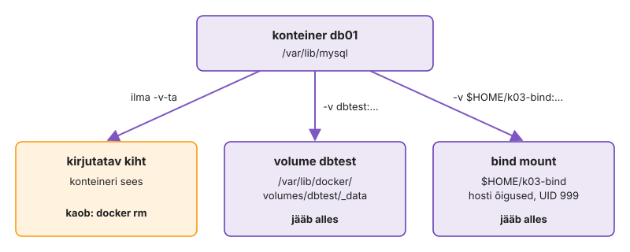
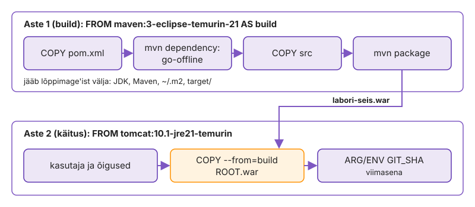
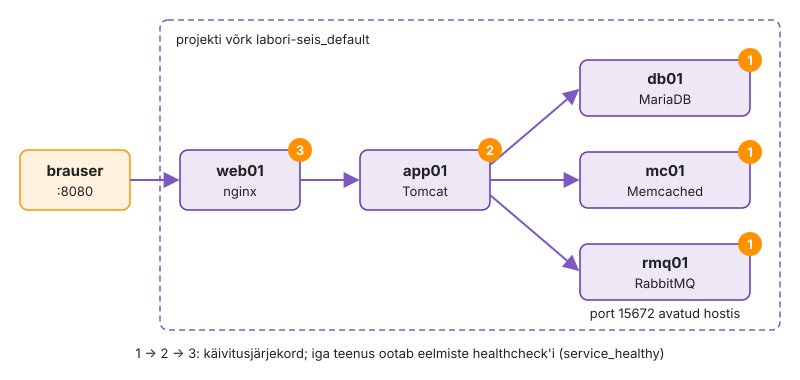
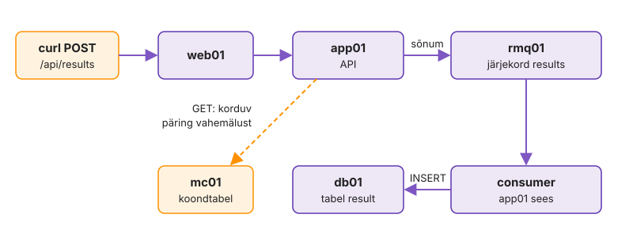
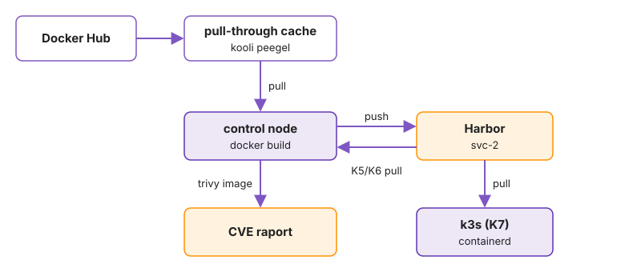
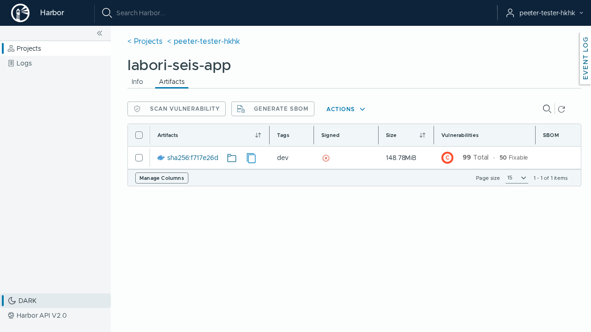

---
tags:
  - Docker
  - Compose
  - Harbor
  - Praktikum
---

# Praktikum: Labori seis konteinerites

Kahel esimesel kohtumisel seadistasid Ansible'iga teenused otse virtuaalmasinatesse. Täna pakid sama rakenduse, Labori seisu, konteineritesse. Paigaldad Dockeri, ehitad image'id oma Dockerfile'idest, käivitad viis teenust ühe `compose.yaml`-iga, lükkad image'id kursuse registry'sse Harbor ja parandad vigase stacki.

Iga osa alguses on eesmärk ja kontroll. Kui oskad, tee osa eesmärgi järgi ise ja ava lahendused ainult kontrolliks. Töö tulemus on sinu harus `k03-docker` olev kood ja automaatkontroll kontrollib seda GitHubis.

**Edenemine:** laboritahvel <http://is126.kaaren.lab.hkhk.lan> (VPN-iga).

Küsimused: [Küsimused ja teated](https://github.com/hkhk-tk/is126-arutelu/discussions). Lisa küsimusele käsk ja kogu veateade tekstina. Enne saatmist eemalda paroolid ja tokenid.

??? abstract "Õpiväljundid"

    1. Paigaldad Dockeri, tõmbad image'id Docker Hubist ja Harbori kaudu ning selgitad, kus konteiner hostis paistab: protsess, port ja andmed.
    2. Kirjutad ametlike image'ite põhjal Dockerfile'id ja mitmeastmelise app-image'i, mis töötab mitte-root kasutajana.
    3. Kirjeldad viie teenusega stacki `compose.yaml`-is healthcheck'ide ja sõltuvustega ning tõestad, et `up -d` on idempotentne.
    4. Lükkad image'id Harborisse, loed Trivy tulemust ning eristad tag'i ja digest'i.
    5. Parandad vigase Compose'i faili nii, et stack käivitub ise ja läbib kontrolli.

??? info "Testitud versioonid"

    Docker Engine 29 (vähemalt 28), Compose v5 (vähemalt v2.24.4), ansible-core 2.16, Harbor 2.15, `mariadb:11.4`, `rabbitmq:4.1-management-alpine`, `memcached:1.6-alpine`, `nginx:1.30-alpine`, `tomcat:10.1-jre21-temurin`, `maven:3-eclipse-temurin-21`, `alpine:3.22`, Podman 5 (AlmaLinux 9.8), Trivy 0.76. Vanem Compose ei toeta silte nagu `!override`. Prod-faili lugemisel annab see süntaksivea, mille teade ei viita versioonile.

    Dokumentatsioon: [Dockerfile](https://docs.docker.com/reference/dockerfile/), [Compose'i fail](https://docs.docker.com/reference/compose-file/), [Harbor](https://goharbor.io/docs/2.14.0/), [Podman](https://docs.podman.io/), [Trivy](https://trivy.dev/docs/latest/).

## Osa 1 · Docker ja esimesed konteinerid

Paigaldad Dockeri käsitsi, käivitad esimese konteineri ja tutvud Docker Hubi ning kursuse registry Harboriga. Seejärel käivitad konteinerid ilma Compose'ita ja vaatad hostist, kus on konteineri protsess, piirangud, port ja andmed. Docker ei too uusi tuuma mehhanisme: konteiner on hostis tavaline protsess, mida piiravad cgroup'id ja nftables'i reeglid.

**Eesmärk:** Docker töötab control'is, image'id tulevad Harbori kaudu ja oskad konteinereid käivitada, peatada ja eemaldada.  
**Kontroll:** `docker run --rm $HUB/hello-world` töötab ilma `sudo`-ta.  
**Kus:** control, kaust `~/kursus/k03-docker`, konteinerid käsitsi ilma Compose'ita.

### 1.1 Haru ja failid

Iga kohtumise töö käib eraldi harus. Käsk `git pull` toob repositooriumi uued failid, ka kausta `k03-docker` algfailid.

```bash
cd ~/kursus
git switch main
git pull
git switch -c k03-docker
cd k03-docker
ls -R
git check-ignore -v .env
```

??? success "Oodatav tulemus"

    Kaustas on `web/nginx.conf`, `intsident/compose.yaml`, `docker.yml` ja `roles/docker/files/harbor-ca.crt`. `intsident/compose.yaml` on meelega vigane: selle parandad 6. osas. `docker.yml` ja `roles/` on kodutöö jaoks. `git check-ignore` näitab rida `.gitignore:…:k03-docker/.env`: fail `.env`, kuhu tulevad paroolid, jääb Gitist välja juba enne, kui sa selle lood. Kõik selle kohtumise käsud käivitad kaustas `~/kursus/k03-docker`, kui juures pole kirjas teisiti.

??? warning "Kui failid puuduvad"

    Laadi need starterist (käivita kaustas `~/kursus/k03-docker`):

    ```bash
    B=https://raw.githubusercontent.com/hkhk-tk/is1-starter/main/k03-docker
    mkdir -p roles/docker/files intsident web
    curl -fsSLo docker.yml "$B/docker.yml"
    curl -fsSLo roles/docker/files/harbor-ca.crt "$B/roles/docker/files/harbor-ca.crt"
    curl -fsSLo intsident/compose.yaml "$B/intsident/compose.yaml"
    curl -fsSLo web/nginx.conf "$B/web/nginx.conf"
    ```

### 1.2 Docker käsitsi

Docker Engine paigaldatakse Dockeri enda apt-repositooriumist. Ubuntu pakett `docker.io` on vanem ja Compose'i pluginat seal pole. Paigalda Docker [ametliku juhendi](https://docs.docker.com/engine/install/ubuntu/) järgi: eemalda vanad paketid, lisa repositooriumi võti ja repositoorium ning paigalda paketid.

```bash
sudo apt-get remove -y docker.io docker-compose docker-compose-v2 podman-docker containerd runc
sudo apt-get update
sudo apt-get install -y ca-certificates curl
sudo install -m 0755 -d /etc/apt/keyrings
sudo curl -fsSL https://download.docker.com/linux/ubuntu/gpg -o /etc/apt/keyrings/docker.asc
sudo chmod a+r /etc/apt/keyrings/docker.asc
```

Fail `docker.sources` seob repositooriumi võtmega: sellest repositooriumist võetakse pakette ainult selle võtme allkirjaga.

```bash
sudo tee /etc/apt/sources.list.d/docker.sources <<EOF
Types: deb
URIs: https://download.docker.com/linux/ubuntu
Suites: $(. /etc/os-release && echo "${UBUNTU_CODENAME:-$VERSION_CODENAME}")
Components: stable
Signed-By: /etc/apt/keyrings/docker.asc
EOF
sudo apt-get update
sudo apt-get install -y docker-ce docker-ce-cli containerd.io docker-buildx-plugin docker-compose-plugin
```

Ilma `sudo`-ta saab Dockerit kasutada grupi `docker` liige. Grupiliikmesus rakendub alles uues sisselogimisseansis, seega logi pärast järgmist käsku välja ja uuesti sisse (VS Code'is **Remote-SSH: Kill VS Code Server on Host** ja ühendu uuesti).

```bash
sudo usermod -aG docker "$USER"
```

Pärast uut sisselogimist kontrolli versioone ja teenust:

```bash
id
docker version --format 'klient {{.Client.Version}}, server {{.Server.Version}}'
docker compose version
systemctl is-active docker containerd
```

??? success "Oodatav tulemus"

    `id` näitab gruppi `docker`. Klient ja server on 28 või uuemad, `docker compose` vastab ja mõlemad teenused on `active`. `docker` käsud töötavad ilma `sudo`-ta.

??? warning "Kui `permission denied … docker.sock`"

    Kasutaja pole grupis `docker` või sessioon on vana. Kontrolli `id`. Vana shell ja VS Code'i server töötavad vanade gruppidega edasi, seepärast logi välja ja sisse.

!!! warning "Grupp `docker` on root'i õigus"

    [Grupi `docker`](https://docs.docker.com/engine/install/linux-postinstall/) liige saab käivitada konteineri, mis mount'ib hosti `/`. Näiteks `docker run -v /:/host alpine chroot /host` annab root-shelli hostis ilma paroolita ja `sudo` logisse sellest midagi ei jää. Kursuse VM-is on see teadlik valik, jagatud serveris mitte.

### 1.3 Esimene konteiner

Image on pakitud failisüsteem koos käivitamise seadetega. Konteiner on image'ist käivitatud protsess. Image'i `hello-world` ainus programm prindib teate ja lõpetab.

**Küsimus enne käsku:** image'it `hello-world` masinas ei ole. Kust Docker selle saab?

```bash
docker run hello-world
```

??? success "Oodatav tulemus"

    Esimesed read on `Unable to find image 'hello-world:latest' locally` ja `Pulling from library/hello-world`. Docker tõmbas image'i registry'st **Docker Hub**, sest nime ees polnud muud registry't. Seejärel tuleb `Hello from Docker!` ja nelja sammu loetelu.

Loe teate nelja sammu ja võrdle neid joonisega. Klient `docker` on käsurea programm, mis saadab päringu daemonile `dockerd`. Daemon tõmbab image'i, loob sellest konteineri ja saadab programmi väljundi kliendile tagasi.

<figure markdown="span">
  
  <figcaption>Joonis 3.1. Docker Engine'i osad: klient, daemon, containerd ja runc (Talvik, 2026).</figcaption>
</figure>

Käivita sama image teist korda ja vaata, mis masinasse jäi:

```bash
docker run hello-world | head -3
docker ps
docker ps -a
docker image ls
```

??? success "Oodatav tulemus"

    Teisel korral tõmmet ei olnud, sest image oli juba masinas. `docker ps` on tühi, `docker ps -a` näitab kaht konteinerit olekus `Exited (0)` ja `docker image ls` näitab ühte image'it `hello-world`. Konteiner lõpetas koos oma programmiga, aga jäi masinasse alles, kuni selle kustutad.

### 1.4 Docker Hub

**Docker Hub** (<https://hub.docker.com>) on Dockeri avalik registry. Kui image'i nimes pole registry aadressi, tõmbab Docker selle Docker Hubist. Lühike nimi `nginx` tähendab täisnime `docker.io/library/nginx:latest`: registry `docker.io`, ametlike image'ite nimeruum `library`, repositoorium `nginx` ja tag `latest`.

Ava brauseris <https://hub.docker.com> ja otsi `nginx`. Tulemuste juures on märk, kes image'i teeb:

- **Docker Official Image**: Dockeri hallatud image, mille Dockerfile on avalik ja mida uuendatakse turvaparandustega. Nimes pole kasutajanime (`nginx`, `mariadb`).
- **Verified Publisher**: tarkvara tootja enda image, näiteks `grafana/grafana`.
- Märgita image'i võib laadida üles igaüks. Enne kasutamist vaata, kas lehel on link lähtekoodile ja Dockerfile'ile ning millal image'it viimati uuendati.

Ava ametliku image'i `nginx` leht ja vaheleht **Tags**. Tag `latest` liigub iga uue versiooniga edasi, seega sama käsk annab kuu aja pärast teise image'i. Selles praktikumis on igal image'il versioon nimes, näiteks `nginx:1.30-alpine`. `alpine` tähendab, et image on tehtud väikese Alpine Linuxi peale.

Tõmba image lühinimega ja täisnimega:

```bash
docker pull nginx:1.30-alpine
docker pull docker.io/library/nginx:1.30-alpine
docker image ls nginx
docker image inspect nginx:1.30-alpine --format '{{.Config.ExposedPorts}} {{.Config.Cmd}}'
```

??? success "Oodatav tulemus"

    Teine `pull` ütleb `Image is up to date`: lühinimi ja täisnimi on sama image. `inspect` näitab porti `80/tcp` ja käsku, millega Nginx käivitub.

Image'i lehe ülevaates on kirjas, mida image käivitamiseks vajab. Ava ametliku image'i [`mariadb`](https://hub.docker.com/_/mariadb) leht ja leia sealt vastused. Neid läheb vaja 1.10-s, kui käivitad andmebaasi konteinerina.

??? question "Mida vajab MariaDB image?"

    1. Milline keskkonnamuutuja peab olema määratud, et konteiner käivituks?
    2. Millised muutujad loovad andmebaasi ja kasutaja?
    3. Millises kataloogis hoiab MariaDB andmeid?
    4. Millist porti server kuulab?

    ??? success "Vastus"

        1. Üks kolmest: `MARIADB_ROOT_PASSWORD`, `MARIADB_ALLOW_EMPTY_ROOT_PASSWORD` või `MARIADB_RANDOM_ROOT_PASSWORD`. Ilma nendeta konteiner lõpetab.
        2. `MARIADB_DATABASE`, `MARIADB_USER` ja `MARIADB_PASSWORD`.
        3. `/var/lib/mysql`.
        4. `3306`.

### 1.5 Harbor: kursuse registry

Docker Hub lubab ühelt IP-aadressilt 100 anonüümset tõmmet kuue tunni jooksul. Kogu klass on kooli ühe NAT-aadressi taga ja ühe stacki ehitus tõmbab kümmekond image'it, nii et piir saab täis juba esimese tunni jooksul. Siis ebaõnnestuvad kõigi tõmbed korraga veaga `toomanyrequests`. Seepärast on kursusel oma registry **Harbor**.

??? note "Tabel 3.1. Docker Hub ja Harbor"

    | | Docker Hub | Harbor |
    |---|---|---|
    | Asukoht | internetis, haldab Docker Inc. | laborivõrgus, kursuse VM |
    | Kes näeb | kõik | ainult kursus (VPN-iga) |
    | Sisu | ametlikud ja kasutajate image'id | sinu image'id ja Docker Hubi image'ite koopiad |
    | Tõmmete piir | 100 anonüümset tõmmet IP kohta 6 tunni jooksul | piirangut pole |
    | Haavatavuste skänn | ainult tasulises paketis | Trivy skannib iga image'i |

Harboris on kahte liiki projekte:

- **`dockerhub`** on avalik **pull-through cache** (vahemälu). Esimene tõmme laeb image'i Docker Hubist ja hoiab seda alles, järgmised tõmbed tulevad Harborist. Image'i nimi on siis `harbor.lab.hkhk.lan/dockerhub/library/nginx:1.30-alpine`.
- **Sinu projekt** kannab sinu GitHubi kasutajanime ja on privaatne. Sinna lükkad 6. osas oma image'id.

Harbori sertifikaadi on allkirjastanud kursuse oma CA, mida Ubuntu ei tunne. Docker usaldab registry't, kui CA on kaustas `/etc/docker/certs.d/<registry nimi>/`. Süsteemi usaldatud sertifikaatide hulka läheb sama fail, et ka `curl` ja Trivy Harborit usaldaksid. CA on starteris failina `roles/docker/files/harbor-ca.crt`.

```bash
sudo mkdir -p /etc/docker/certs.d/harbor.lab.hkhk.lan
sudo cp roles/docker/files/harbor-ca.crt /etc/docker/certs.d/harbor.lab.hkhk.lan/ca.crt
sudo cp roles/docker/files/harbor-ca.crt /usr/local/share/ca-certificates/labori-ca.crt
sudo update-ca-certificates
curl -s https://harbor.lab.hkhk.lan/api/v2.0/ping; echo
```

Et vahemälu pikka nime ei peaks iga kord kirjutama, pane eesliide muutujasse `HUB`. Kõik selle praktikumi käsud kasutavad seda muutujat.

```bash
echo 'export HUB=harbor.lab.hkhk.lan/dockerhub/library' >> ~/.bashrc
source ~/.bashrc
docker pull $HUB/nginx:1.30-alpine
docker image ls
```

Harbori konto on sul olemas. Kasutajanimi on sinu GitHubi kasutajanimi väikeste tähtedega, parool `Passw0rd`. Logi sisse käsurealt ja ava brauseris <https://harbor.lab.hkhk.lan>.

```bash
docker login harbor.lab.hkhk.lan -u <github-kasutaja>
```

??? success "Oodatav tulemus"

    `curl` vastab `Pong` ilma sertifikaadi veata. `docker image ls` näitab sama Nginxi kahe nimega: `nginx` ja `harbor.lab.hkhk.lan/dockerhub/library/nginx`. IMAGE ID on mõlemal sama, sest vahemälu andis edasi sama image'i. `docker login` ütleb `Login Succeeded`. Harboris näed projekte `dockerhub` ja oma projekti, mis on veel tühi.

??? warning "Kui `x509: certificate signed by unknown authority`"

    CA puudub kaustas `/etc/docker/certs.d/harbor.lab.hkhk.lan/` või kausta nimi ei ole täpselt registry nimi. Korda selle sammu kahte esimest käsku.

??? warning "Kui brauser hoiatab sertifikaadi eest"

    Brauser ei tunne kursuse CA-d. Brauseris võid hoiatuse kõrvale jätta või importida faili `roles/docker/files/harbor-ca.crt` oma arvutis usaldatud juursertifikaatide hulka (Windowsis topeltklõps, **Install Certificate**, **Local Machine**, **Trusted Root Certification Authorities**). Kui nimi `harbor.lab.hkhk.lan` sinu arvutis ei avane, kasuta aadressi <https://192.168.125.42>.

??? info "Miks mitte `registry-mirrors`?"

    Dockeri `daemon.json` võti `registry-mirrors` suunab Docker Hubi tõmbed teise serverisse, aga ainult sellisesse, kus image'id on juurtasemel (`/v2/library/nginx`). Harbori vahemälu on projekti all (`/dockerhub/library/nginx`), ja seda Docker ei toeta. Podman toetab, seda näed 7. osas. Seepärast on Dockeri image'ite nimes eesliide `$HUB`. GitHubi automaatkontroll Harborit ei näe (see on VPN-i taga) ja kasutab vaikimisi `docker.io/library`.

### 1.6 Engine hostis: teenus, kataloog ja konfiguratsioonifail

Docker on tavaline systemd teenus oma kataloogi, konfiguratsioonifaili ja logiga, täpselt nagu Nginx või MariaDB, mida 2. kohtumisel seadistasid. Kui tead, kus need asuvad, parandad Dockerit samamoodi nagu iga teist teenust.

Vaata, millised üksused Dockeri moodustavad ja kes socket'it kuulab:

```bash
systemctl is-active docker containerd docker.socket
systemctl cat docker | grep -E '^(ExecStart|Requires|After)='
sudo ss -xlp | grep docker.sock
```

Vaata daemoni seadeid ja seda, mis tema andmekataloogis ruumi võtab:

```bash
docker info --format '{{.Driver}} {{.DockerRootDir}} {{.CgroupDriver}} {{.LoggingDriver}}'
docker info | grep -iE 'storage driver|driver-type|live restore'
sudo du -sh /var/lib/docker/* 2>/dev/null | sort -h | tail -6
```

Daemoni konfiguratsioonifail on `/etc/docker/daemon.json`. Paigaldus seda faili ei loo ja Docker töötab vaikeseadetega. Kõige sagedasem põhjus, miks `dockerd` ei käivitu, on käsitsi muudetud `daemon.json`. Vaikimisi on `live-restore` välja lülitatud, seega iga `systemctl restart docker` peatab kõik hosti konteinerid ja vigase konfiguratsiooniga need enam ei käivitu.

Loo fail ühe seadega ja kontrolli seda daemonit peatamata. Seejärel tee meelega vigane koopia ja kontrolli seda. Alles siis taaskäivita daemon:

```bash
echo '{ "log-driver": "json-file" }' | sudo tee /etc/docker/daemon.json
sudo dockerd --validate --config-file /etc/docker/daemon.json
printf '{ "log-driver": "json-file", }\n' > /tmp/vigane.json
sudo dockerd --validate --config-file /tmp/vigane.json; echo "kood $?"
sudo systemctl restart docker
sudo journalctl -u docker --since '30 min ago' --no-pager | grep -iE 'starting up|daemon has completed' | tail -3
```

??? success "Oodatav tulemus"

    Kolm üksust on `active`. Kehtiv konfiguratsioon annab `configuration OK`, vigane koopia annab veateate ja koodi, mis pole 0. Journal'is on daemoni viimane käivitus.

    `docker.socket` kuulab socket'it ka siis, kui `dockerd` seisab: esimene `docker` käsk käivitab daemoni. `containerd` on eraldi teenus, mis konteinereid tegelikult käitab, ja `dockerd` suhtleb temaga. `DockerRootDir` on kataloog, mida jälgid kettaruumi monitooringus, sest seal on konteinerite logid, volume'id ja build cache. `--validate` leidis vea ilma teenust peatamata, nagu `nginx -t` või `sshd -t`.

    `Driver` väärtus `overlay2` tähendab klassikalist kihisalvestust `/var/lib/docker/overlay2` all. `overlayfs` tähendab containerd'i image store'i, kus kihid on `/var/lib/containerd` all. Kursuse käsud töötavad mõlemaga.

### 1.7 Elutsükkel ja PID 1

Konteiner töötab seni, kuni töötab tema esimene protsess (PID 1). Kui see lõpetab, lõpetab ka konteiner. Kui seda ei tea, otsid viga valest kohast: teenus näib ebaõnnestuvat, aga tegelikult lõpetas käivitusskript oma töö.

**Esiplaanil ja taustal.** Käivita Nginx esiplaanil. Terminal jääb Nginxi logi näitama, lõpeta Ctrl+C-ga:

```bash
docker run --name fg $HUB/nginx:1.30-alpine
```

Käivita teine Nginx taustal (`-d`) ja ava hosti port 8081 konteineri pordile 80 (`-p`):

```bash
docker run -d --name veeb -p 8081:80 $HUB/nginx:1.30-alpine
docker ps -a
```

Peata konteiner ja käivita see uuesti:

```bash
docker stop veeb
docker start veeb
docker ps
```

??? success "Oodatav tulemus"

    `fg` on olekus `Exited`, sest Ctrl+C lõpetas Nginxi. `veeb` on pärast `start`-i jälle `Up` sama konteineri ID-ga: `stop` peatab protsessi, aga konteiner ja selle failid jäävad alles.

**Konteiner hostist vaadatuna.** Nginx konteineris on hostis tavaline protsess. Leia see hosti protsesside hulgast ja vaata sama protsessi konteineri seest:

```bash
ps -ef | grep '[n]ginx: master'
docker exec veeb ps
docker exec veeb id
```

Konteineri eraldatuse teevad tuuma namespace'id ja cgroup. Vaata neid hostist:

```bash
PID=$(docker inspect -f '{{.State.Pid}}' veeb)
echo $PID
sudo lsns -p $PID
cat /proc/$PID/cgroup
```

??? success "Oodatav tulemus"

    Hostis on Nginxil tavaline PID, konteineris on sama protsess PID 1. `lsns` näitab, et konteiner on hulk namespace'e ühe hostiprotsessi ümber, mitte eraldi masin.

**Image ja konteiner.** **Küsimus enne käsku:** kas image'i saab kustutada, kui seda kasutab peatatud konteiner `fg`?

```bash
docker rmi $HUB/nginx:1.30-alpine
```

??? success "Oodatav tulemus"

    `rmi` annab vea `conflict` konteineri ID-ga. Konteiner kasutab image'i kihte ka peatatuna, seepärast tuleb enne kustutada kõik seda image'it kasutavad konteinerid.

**Konteiner, mis lõpetab kohe.** Käivita Ubuntu image ilma käsuta:

```bash
docker run $HUB/ubuntu:24.04
docker ps -a
```

Käivita sama image interaktiivselt (`-it`):

```bash
docker run -it --rm $HUB/ubuntu:24.04 bash
```

Konteineris käivita `cat /proc/1/comm` ja `ps`, siis `exit`.

??? success "Oodatav tulemus"

    Esimene Ubuntu lõpetas kohe koodiga 0: bash ilma terminalita sai sisendist kohe faililõpu ja väljus. `-it`-ga on PID 1 `bash`. Ubuntu image'is pole käsku `ps`: image'is on ainult see, mida peaprotsess vajab.

### 1.8 Pordid ja konteineri IP

Konteiner saab IP-aadressi hosti sisemises sillas `docker0`. Selle aadressi poole saab pöörduda ainult hostist. Väljast jõuab konteinerini ainult avaldatud pordi kaudu (`-p`), mille jaoks Docker kirjutab NAT-reegli.

Tootmisserveris tähendab see, et `-p 8081:80` avab pordi kõigile, kes hostini jõuavad. Tavapärase UFW seadistusega hosti tulemüür seda ei peata, sest Dockeri NAT-reegel rakendub enne UFW reegleid. Seepärast kontrolli avatud porte teisest masinast.

Leia konteineri `veeb` IP-aadress ja proovi seda ning hostiporti control'ist:

```bash
IP=$(docker inspect -f '{{range .NetworkSettings.Networks}}{{.IPAddress}}{{end}}' veeb)
echo $IP
curl -sI http://$IP | head -1
curl -sI http://localhost:8081 | head -1
```

Ava oma arvuti brauseris (VPN-iga) `http://<control IP>:8081` ja seejärel `http://<konteineri IP>`.

Vaata NAT-reeglit, mille Docker pordi jaoks kirjutas:

```bash
sudo nft list ruleset | grep -i dnat | head -3
```

<figure markdown="span">
  
  <figcaption>Joonis 3.2. Kust konteiner veeb vastab: hostiport on nähtav väljast, konteineri IP ainult hostist (Talvik, 2026).</figcaption>
</figure>

??? success "Oodatav tulemus"

    Konteineri IP (`172.17.x.x`) vastab control'ist, aga mitte sinu arvutist. Hostiport 8081 vastab mõlemast. nft-reeglites on DNAT pordile 80. Kui konteineri IP vastaks sinu arvutist, oleks võrgus marsruut hosti sisemisse silda: see oleks võrgu seadistuse viga.

Eemalda katse konteinerid:

```bash
docker rm -f veeb fg
docker container prune -f
docker ps -a
```

### 1.9 Restart-poliitika: kes konteineri uuesti käivitab

Konteineris pole systemd'd. Pärast tõrget või masina taaskäivitust käivitab konteineri uuesti `dockerd` restart-poliitika järgi. Vale poliitika annab kaks tüüpilist viga: teenus ei käivitu pärast hooldusjärgset taaskäivitust või käivitub teenus, mille sa meelega peatasid.

**Protsess lõpetab.** Käivita Nginx poliitikaga `unless-stopped`:

```bash
docker run -d --name rs --restart unless-stopped $HUB/nginx:1.30-alpine
```

Lõpeta konteineri PID 1 hostist, oota paar sekundit ja vaata konteineri olekut:

```bash
sudo kill -9 $(docker inspect -f '{{.State.Pid}}' rs)
sleep 3
docker inspect -f '{{.RestartCount}} {{.State.Status}}' rs
```

??? success "Oodatav tulemus"

    `RestartCount` on 1 ja olek `running`. Daemon märkas, et PID 1 lõpetas, ja käivitas sama konteineri uuesti.

**Daemon taaskäivitub.** Käivita teine konteiner poliitikaga `always`. Seejärel peata mõlemad käsitsi:

```bash
docker run -d --name ra --restart always $HUB/nginx:1.30-alpine
docker stop rs ra
```

**Küsimus enne käsku:** kumb konteiner on pärast daemoni taaskäivitust `Up`, `rs` või `ra`?

```bash
sudo systemctl restart docker
docker ps -a --filter name=rs --filter name=ra
```

??? success "Oodatav tulemus"

    `ra` on `Up` ja `rs` on `Exited`. `always` ei arvesta, et peatasid konteineri käsitsi, `unless-stopped` arvestab. Seepärast kasutab sinu `compose.yaml` hiljem `unless-stopped`-i.

**Konteiner, mis ebaõnnestub alati.** Poliitika `on-failure:3` proovib kolm korda ja jätab siis konteineri seisma:

```bash
docker run -d --name rf --restart on-failure:3 $HUB/alpine:3.22 sh -c 'sleep 2; exit 1'
sleep 30
docker inspect -f '{{.RestartCount}} {{.State.Status}} {{.State.ExitCode}}' rf
```

??? success "Oodatav tulemus"

    Väljund on `3 exited 1`. Katkine konteiner ei taaskäivitu lõputult ning logi ja väljumiskood jäävad uurimiseks alles.

Eemalda katse konteinerid:

```bash
docker rm -f rs ra rf
```

### 1.10 Oma võrk ja kolm backend'i teenust

Labori seis otsib teenuseid nimede järgi: `db01`, `mc01` ja `rmq01`. Konteineri IP muutub iga uue konteineriga, nimi jääb samaks. Vaikevõrgus `bridge` nimesid ei lahendata, seepärast teed oma võrgu.

Tee võrk `labnet` ja käivita sinna MariaDB:

```bash
docker network create labnet
docker run -d --name db01 --network labnet $HUB/mariadb:11.4
```

Vaata, kas konteiner töötab, ja kui ei, siis miks:

```bash
docker ps -a
docker logs db01
```

??? success "Oodatav tulemus"

    `db01` on olekus `Exited (1)` ja logi viimastel ridadel on puuduva muutuja nimi. See on kõige tavalisem käivitusviga: kohustuslik muutuja puudub. Rikke otsimise järjekord on alati sama: `docker ps -a` (väljumiskood), `docker logs` ja vajadusel `docker inspect`.

**Ülesanne.** Kustuta `db01` ja käivita see uuesti nii, et nõuded on täidetud. Muutujate nimed leidsid 1.4-s [image'i lehelt](https://hub.docker.com/_/mariadb).

- võrk `labnet`;
- `-e` võtmetega root'i parool, andmebaas `labseis`, kasutaja `labseis` ja tema parool;
- andmed nimega volume'is `dbtest` kataloogis `/var/lib/mysql`.

Lisa samasse võrku veel kaks teenust:

- `mc01` image'ist `memcached:1.6-alpine`;
- `rmq01` image'ist `rabbitmq:4.1-management-alpine`, hostinimi `rmq01` (`--hostname`), kasutaja ja parool muutujatest `RABBITMQ_DEFAULT_USER` ja `RABBITMQ_DEFAULT_PASS`.

??? example "Lahendus"

    ```bash
    docker rm -f db01
    docker run -d --name db01 --network labnet -v dbtest:/var/lib/mysql \
      -e MARIADB_ROOT_PASSWORD=Juur123 -e MARIADB_DATABASE=labseis \
      -e MARIADB_USER=labseis -e MARIADB_PASSWORD=Labseis123 $HUB/mariadb:11.4
    docker run -d --name mc01 --network labnet $HUB/memcached:1.6-alpine
    docker run -d --name rmq01 --network labnet --hostname rmq01 \
      -e RABBITMQ_DEFAULT_USER=labseis -e RABBITMQ_DEFAULT_PASS=Labseis123 $HUB/rabbitmq:4.1-management-alpine
    docker ps
    ```

Kontrolli nimelahendust võrgust `labnet` ja vaikevõrgust:

```bash
docker run --rm --network labnet $HUB/alpine:3.22 sh -c 'getent hosts db01; grep nameserver /etc/resolv.conf'
docker run --rm $HUB/alpine:3.22 getent hosts db01; echo "kood $?"
```

??? success "Oodatav tulemus"

    Kolm konteinerit on `Up`. Võrgus `labnet` annab `getent` db01 IP-aadressi ja nimeserver on `127.0.0.11`. Vaikevõrgus nimi ei lahendu ja kood on 2. `127.0.0.11` on Dockeri sisseehitatud DNS, mis töötab ainult ise loodud võrkudes. Compose loob igale projektile oma võrgu, seepärast leiavad teenused seal üksteist nime järgi.

### 1.11 Andmed volume'is ja bind mount'is

Konteineri enda failid kaovad `docker rm`-iga. Andmebaas, mille andmed on konteineri sees, kaotab kõik andmed esimesel image'i uuendusel, sest uuendus tähendab alati uut konteinerit. Volume ja bind mount jäävad alles, aga käituvad õiguste poolest erinevalt.

**Volume.** Kirjuta `db01` andmebaasi tabel ühe reaga (parool on `Labseis123`):

```bash
docker exec -it db01 mariadb -ulabseis -p labseis -e "CREATE TABLE proov (id INT); INSERT INTO proov VALUES (42);"
```

Kustuta konteiner ja käivita see uuesti sama käsuga nagu 1.10 lahenduses, sama volume'iga `dbtest`:

```bash
docker rm -f db01
docker run -d --name db01 --network labnet -v dbtest:/var/lib/mysql \
  -e MARIADB_ROOT_PASSWORD=Juur123 -e MARIADB_DATABASE=labseis \
  -e MARIADB_USER=labseis -e MARIADB_PASSWORD=Labseis123 $HUB/mariadb:11.4
```

Kontrolli, kas rida on alles, ja vaata, kus andmed hostis asuvad:

```bash
docker exec -it db01 mariadb -ulabseis -p labseis -e "SELECT * FROM proov;"
docker inspect -f '{{json .Mounts}}' db01 | jq
```

??? success "Oodatav tulemus"

    Rida `42` on alles. `Mounts` näitab tüüpi `volume` ja allikat `/var/lib/docker/volumes/dbtest/_data`: andmed on hostis Dockeri kataloogis, mitte konteineris.

**Bind mount.** [Bind mount](https://docs.docker.com/engine/storage/bind-mounts/) ühendab konteinerisse hosti kausta. Tee kaust oma kodukataloogi ja käivita MariaDB nii, et andmekataloog on selles kaustas:

```bash
mkdir ~/k03-bind
docker run -d --name dbbind -e MARIADB_ROOT_PASSWORD=x -v ~/k03-bind:/var/lib/mysql $HUB/mariadb:11.4
```

Oota 15 sekundit, kuni MariaDB loob oma failid, ja vaata, kellele need kuuluvad:

```bash
ls -ln ~/k03-bind | head -3
```

Kustuta konteiner ja proovi kausta kustutada:

```bash
docker rm -f dbbind
rm -rf ~/k03-bind
```

??? success "Oodatav tulemus"

    Failide omanik on UID 999 ja `rm -rf` annab `Permission denied`. UID 999 on konteineri kasutaja `mysql`. Hostis ei pruugi sellel numbril nime olla, aga tuum kontrollib õigusi numbri järgi, seepärast ei saa sinu kasutaja faile kustutada.

<figure markdown="span">
  
  <figcaption>Joonis 3.3. Kolm kohta, kuhu konteineri andmed võivad sattuda (Talvik, 2026).</figcaption>
</figure>

Eemalda enne järgmist osa kõik katse konteinerid, volume ja võrgud:

```bash
docker rm -f db01 mc01 rmq01
docker volume rm dbtest
docker network rm labnet
sudo rm -rf ~/k03-bind
docker ps -a
```

??? success "Oodatav tulemus"

    `docker ps -a` on tühi.

### 1.12 Commit

```bash
(cd ~/kursus && git add k03-docker && git commit -m "k03: Docker käsitsi ja konteinerid" && git push -u origin k03-docker)
```

??? info "Miks see nii töötab"

    **Konteineri elutsükkel.** Konteiner on olekus `running` täpselt seni, kuni tema PID 1 töötab. Kui PID 1 lõpetab, salvestab `containerd-shim` väljumiskoodi, `dockerd` märgib konteineri `Exited (<kood>)` ja rakendab restart-poliitikat. Ilma `-d`-ta on CLI ühendatud konteineri stdio-ga ja Ctrl+C saadab signaali PID 1-le.

    **Peatamine ja kustutamine.** Peatatud konteineri kirjutatav kiht jääb alles. Konteineri kustutamisel (`docker rm`) eemaldatakse ka selle kirjutatav kiht. Konteiner kasutab image'i kihte otse overlay mount'i alumiste kihtidena, seetõttu tuleb enne image'i eemaldamist kustutada kõik seda kasutavad konteinerid, ka peatatud.

    **Taaskäivituspoliitika.** Konteineri taaskäivitamise eest vastutab daemon. `dockerd` jälgib, millal PID 1 töö lõpetab, ja käivitab sama konteineri uuesti. Väärtusega `unless-stopped` jätab daemon meelde, et konteiner peatati käsitsi, ega käivita seda ka pärast daemoni taaskäivitamist.

    **Konteineri võrk.** Vaikimisi bridge-võrgu korral saab konteiner IP-aadressi hosti sisemises sillas `docker0`. Compose loob igale projektile oma silla (`br-…`). Väljast pääseb konteinerini ainult avaldatud pordi kaudu.

    **Konteineri kataloog.** Konteineri enda kataloog `/var/lib/docker/containers/<id>` on vaid kümneid kilobaite, sest failisüsteem tuleb image'i kihtidest. Kus need kihid asuvad, sõltub salvestusdraiverist: `overlay2` korral kataloogis `/var/lib/docker/overlay2`, Docker 29 uues paigalduses containerd'i image store'is (vt 3. osa „Miks see nii töötab“, lõik „Image store“).

    **Bind mount ja volume.** Bind mount ühendab konteinerisse hosti kataloogi koos hosti õigustega ja sobib konfiguratsioonifailile või koodile arendaja masinas. Andmebaasi andmed lähevad nimega volume'isse, mille esimesel ühendamisel kopeerib Docker image'i sihtkataloogi sisu koos omaniku ja õigustega.

    **Linuxi tuum.** Linuxi konteiner vajab Linuxi tuuma. Docker Desktop käivitab Windowsis ja macOS-is taustal väikese Linuxi virtuaalmasina.

    **Namespace'id.** `lsns` näitab konteineri namespace'e: eraldi protsessipuu, võrgu, failisüsteemi ühendused ja hostinime. Samu namespace'e kasutab ka systemd, kui teenusele on määratud näiteks `PrivateNetwork=` või `PrivateTmp=`. Docker kasutab neid lihtsalt rohkem korraga.

    **Docker Engine taustal.** Docker Engine koosneb mitmest protsessist. `dockerd` võtab vastu API-päringud ning haldab võrke, volume'eid ja image'eid. `containerd` haldab konteineri elutsüklit. `runc` loob namespace'id ja cgroup'id ning käivitab konteineri protsessi. Pärast käivitamist lõpetab `runc` töö.

    **`containerd-shim`.** Iga konteineri jaoks käivitab containerd väikese `containerd-shim`-protsessi, mis jääb konteineri protsessi vanemprotsessiks. Seetõttu ei ole konteineri protsess `dockerd` alamprotsess ja daemoni saab taaskäivitada konteinereid peatamata (vt järgmist lõiku).

    **Daemoni taaskäivitamine.** Vaikeseadega peatab `systemctl restart docker` kõik konteinerid. Kui `daemon.json`-is on `"live-restore": true`, jäävad konteinerid daemoni taaskäivitamise ajaks tööle. Swarmi režiimis see seade ei toimi.

    **`daemon.json` ja käsurida.** `daemon.json`-i võtmed on samad mis `dockerd` käsurea võtmed. Kui sama seadistusparameeter on nii failis kui ka systemd unit'i `ExecStart` real, keeldub daemon käivitumast. Tüüpiline näide on `hosts`.

    **Seadistuse uuesti laadimine.** Mõne seadistusvõtme, näiteks `debug` ja `registry-mirrors`, väärtuse loeb daemon uuesti käsu `systemctl reload docker` käivitamisel, ilma et konteinerid peatuksid. Ülejäänud võtmete muutmine nõuab daemoni taaskäivitamist.

## Osa 2 · db ja web image

Ehitad db01 ja web01 image'id ametlike image'ite põhjal. Ametlik image teeb juba suure osa tööst, seega kirjutad Dockerfile'i ainult puuduva osa jaoks ja baasimage'i turvaparandused tulevad uuendusega kaasa.

**Eesmärk:** image'id `labseis-db` ja `labseis-web` ehituvad sinu Dockerfile'idest. Nginx'i konfiguratsioonifail `web/nginx.conf` on starteris valmis.  
**Kontroll:** `docker image ls 'labseis-*'` näitab mõlemat image'it ja 2.5 katse annab oodatud tulemuse.  
**Kus:** control, kaust `~/kursus/k03-docker`.

Rakenduse failid on repositooriumi juures (`pom.xml`, `src/`, `db/`) ja jäävad puutumata, Dockerfile'id ainult loevad neid. db ja app vajavad neid faile, seega on nende **ehituskontekst** repositooriumi juur `..`. web'i kontekst on tema oma kaust.

```text
~/kursus/
├── .dockerignore                      ← 2.6
├── pom.xml  src/  db/                 ← rakendus, ei muuda
└── k03-docker/
    ├── db/Dockerfile                  ← 2.2
    ├── web/Dockerfile  web/nginx.conf ← 2.4
    ├── app/Dockerfile  kontroll/      ← 3. osa
    └── compose.yaml  .env.example     ← 4. osa
```

### 2.1 Mis on ametliku image'i sees

Ametlikus image'is on käivitusloogika juba olemas: entrypoint, vaikekasutaja, avatud pordid ja volume'id. Need on image'i metaandmetes ja `docker image inspect` näitab neid ilma konteinerit käivitamata. Kui sa ei tea, et MariaDB image kuulutab `/var/lib/mysql` volume'iks, tekib iga testkonteineriga hosti uus nimeta volume. Need kogunevad kausta `/var/lib/docker/volumes` ja hiljem pole näha, millise katse jaoks need tehti.

```bash
docker pull -q $HUB/mariadb:11.4
docker image inspect $HUB/mariadb:11.4 --format '{{json .Config.Entrypoint}} {{json .Config.Cmd}}'
docker image inspect $HUB/mariadb:11.4 --format '{{json .Config.Volumes}} {{json .Config.ExposedPorts}} {{.Config.User}}'
docker image inspect $HUB/nginx:1.30-alpine --format '{{json .Config.Entrypoint}} {{json .Config.Cmd}}'
docker run --rm --entrypoint ls $HUB/nginx:1.30-alpine /docker-entrypoint.d
```

??? success "Oodatav tulemus"

    MariaDB ENTRYPOINT on skript `docker-entrypoint.sh`, mis algseadistab tühja `/var/lib/mysql` ja loeb kausta `/docker-entrypoint-initdb.d/`. Nginx'i entrypoint käivitab enne Nginx'it skriptid kaustast `/docker-entrypoint.d/`, nende seas `20-envsubst-on-templates.sh`, mis teeb mallist lõpliku konfiguratsiooni.

    Tühi `User` tähendab, et image käivitub root'ina ja entrypoint vahetab kasutaja ise, kui ettevalmistus on tehtud. `Volumes` väljal olev kataloog saab iga konteineriga anonüümse volume'i, kui sa ise nime ei anna. Nginx'i kaust `/docker-entrypoint.d` on hook: iga sinna pandud skript käivitub enne Nginx'it.

### 2.2 db/Dockerfile

Andmebaasi image põhineb ametlikul MariaDB image'il ja sisaldab lisaks Labori seisu skeemi ja näidisandmeid. Dockerfile'is kirjutad ainult failide kopeerimise. Algseadistuse teeb entrypoint. Kui skeem on image'is, on andmebaasi struktuur versioonitud koos rakendusega ja iga uus keskkond saab sama alguse.

Nõuded ([juhiste viide](https://docs.docker.com/reference/dockerfile/)):

- baas `mariadb:11.4`, eesliide tuleb ehituse argumendist `HUB` vaikeväärtusega `docker.io/library`;
- `db/schema.sql` ja `db/seed.sql` lähevad kausta `/docker-entrypoint-initdb.d/` nii, et skeem käivitub enne andmeid (failid käivitatakse failinimede tähestikulises järjekorras);
- `COPY`, mitte `ADD`: `ADD` pakib arhiive lahti ja laeb faile URL-ilt, mida siin vaja pole.

??? example "Lahendus: `k03-docker/db/Dockerfile`"

    ```dockerfile
    ARG HUB=docker.io/library
    FROM ${HUB}/mariadb:11.4
    COPY db/schema.sql /docker-entrypoint-initdb.d/01-schema.sql
    COPY db/seed.sql /docker-entrypoint-initdb.d/02-seed.sql
    ```

    `ARG` enne `FROM`-i on ainuke juhis, mis tohib olla `FROM`-ist eespool. Argument kehtib ainult `FROM` real. Numbrid failinimede ees panevad paika järjekorra.

Ehita ja kontrolli. `--build-arg HUB` ilma väärtuseta võtab väärtuse sinu shelli muutujast:

```bash
docker build --build-arg HUB -f db/Dockerfile -t labseis-db:test ..
docker run -d --name dbt -e MARIADB_ROOT_PASSWORD=x -e MARIADB_DATABASE=labseis labseis-db:test
sleep 20; docker exec dbt mariadb -uroot -px labseis -e "SHOW TABLES;"
```

??? success "Oodatav tulemus"

    `SHOW TABLES` näitab nelja tabelit: course, lab, result, student. Mõlemad SQL-failid käivitusid ja õiges järjekorras: seed kirjutab tabelitesse, mille skeem lõi. Vale järjekorra korral lõpeks konteineri esimene käivitus veaga `Table doesn't exist`. Volume jääks siis pooleldi algseadistatuks ja järgmine käivitus jätaks init-skriptid vahele.

??? warning "Kui `\"/db/schema.sql\": not found`"

    Kontekst pole repositooriumi juur: viimane argument `..` peab osutama kaustale `~/kursus`.

### 2.3 Init-skripti lõks

Init-skriptid käivituvad ainult tühja andmekataloogiga. Tõestad selle ise: muudad seed-faili, ehitad image'i uuesti ja vaatad, kas muudatus jõuab baasi. Tootmises tähendab see, et skeemi muudatus ei saa tugineda init-skriptile. Olemasolev baas vajab migratsiooni (Flyway, Liquibase või käsitsi SQL), mitte uut image'it.

Lisa faili `../db/seed.sql` lõppu ajutiselt rida, mis lisab tabelisse `course` kursuse `('TEST', 'proov')`. Vaata faili algusest, kuidas teised read on kirjutatud. Ehita image uuesti ja käivita `dbt` uue volume'iga:

```bash
docker rm -f dbt
docker build -q --build-arg HUB -f db/Dockerfile -t labseis-db:test ..
docker run -d --name dbt -v dbt:/var/lib/mysql -e MARIADB_ROOT_PASSWORD=x -e MARIADB_DATABASE=labseis labseis-db:test
sleep 20; docker exec dbt mariadb -uroot -px labseis -e "SELECT * FROM course"
```

Muuda lisatud real `'TEST'` väärtuseks `'TEST2'`, ehita uuesti ja käivita `dbt` **sama volume'iga** `dbt`.

**Küsimus enne käsku:** kas `TEST2` jõuab baasi?

```bash
docker rm -f dbt
docker build -q --build-arg HUB -f db/Dockerfile -t labseis-db:test ..
docker run -d --name dbt -v dbt:/var/lib/mysql -e MARIADB_ROOT_PASSWORD=x -e MARIADB_DATABASE=labseis labseis-db:test
sleep 20; docker exec dbt mariadb -uroot -px labseis -e "SELECT * FROM course"
git restore ../db/seed.sql
docker rm -f dbt && docker volume rm dbt
```

??? success "Oodatav tulemus"

    Esimesel käivitusel oli `TEST` tabelis, teisel `TEST2` ei olnud. Teine käivitus leidis volume'ist valmis andmekataloogi ja jättis kogu `/docker-entrypoint-initdb.d/` vahele. Image oli uus, andmed vanad. Sama juhtub parooliga: muudetud `MARIADB_PASSWORD` ei muuda olemasoleva kasutaja parooli. Compose'i stackis on see kõige sagedasem `Access denied` põhjus.

### 2.4 web/Dockerfile ja Nginx'i mall

web01 on app01 ees pöördproksi. Nginx lahendab `upstream` nime ainult käivitusel. Kui app01 konteiner luuakse uuesti uue IP-ga, vastab web01 502-ga, ja 5. kohtumise GitHub Actionsi konveier uuendab app01 iga commit'iga. [Ametlik Nginx'i image](https://hub.docker.com/_/nginx) oskab konfiguratsioonifaili mallist genereerida ja konteineri DNS-serveri sinna kirjutada.

Konfiguratsioonifail `web/nginx.conf` on starteris valmis. Selle esimene rida `resolver ${NGINX_LOCAL_RESOLVERS} valid=10s ipv6=off;` on mall: Nginx'i image'i entrypoint asendab muutuja konteineri DNS-serveri aadressiga. `set $app_upstream` ja `proxy_pass $app_upstream` panevad Nginx'i nime `app01` lahendama iga päringu ajal, mitte ainult käivitusel.

Kirjuta `web/Dockerfile` nende nõuete järgi:

-  `nginx:1.30-alpine` (eesliide `HUB` nagu db-s), konfiguratsioonifail kopeeritakse `/etc/nginx/templates/default.conf.template`, `ENV NGINX_ENTRYPOINT_LOCAL_RESOLVERS=1`;
- `HEALTHCHECK`, mis küsib `wget`-iga `http://127.0.0.1/health` (Alpine'is curl'i pole).

??? example "Fail `k03-docker/web/nginx.conf` (starteris)"

    ```nginx
    resolver ${NGINX_LOCAL_RESOLVERS} valid=10s ipv6=off;

    server {
        listen 80;

        location / {
            set $app_upstream http://app01:8080;
            proxy_pass $app_upstream;
            proxy_set_header Host $host;
            proxy_set_header X-Real-IP $remote_addr;
            proxy_set_header X-Forwarded-For $proxy_add_x_forwarded_for;
            proxy_set_header X-Forwarded-Proto $scheme;
        }
    }
    ```

??? example "Lahendus: `k03-docker/web/Dockerfile`"

    ```dockerfile
    ARG HUB=docker.io/library
    FROM ${HUB}/nginx:1.30-alpine
    ENV NGINX_ENTRYPOINT_LOCAL_RESOLVERS=1
    COPY nginx.conf /etc/nginx/templates/default.conf.template
    HEALTHCHECK --interval=10s --timeout=3s --start-period=10s --retries=3 \
      CMD wget -qO- http://127.0.0.1/health || exit 1
    ```

```bash
docker build --build-arg HUB -t labseis-web:test web
docker run --rm labseis-web:test nginx -T 2>/dev/null | grep -E 'resolver|proxy_pass'
```

??? success "Oodatav tulemus"

    `resolver` real on IP-aadress ja `proxy_pass $app_upstream;` on alles. `nginx -T` näitab lõplikku konfiguratsiooni, mille entrypoint mallist tegi. IP-aadress tähendab, et `envsubst` sai muutuja kätte. `proxy_pass $app_upstream` tähendab, et Nginx lahendab nime iga päringu ajal, mitte ainult käivitusel.

??? warning "Kui näed `${NGINX_LOCAL_RESOLVERS}` muutmata kujul"

    `ENV` jäi puudu või fail pole kaustas `templates/`.

### 2.5 Mis juhtub, kui app01 puudub

Sinu web-image peab käivituma ka siis, kui app01 veel pole. Staatilise upstream'iga Nginx keeldub käivitumast, kui nimi ei lahendu. Compose'is tähendaks see, et web01 ebaõnnestub iga kord, kui app01 alles käivitub, ja restart-poliitika taaskäivitab seda tsüklis. Proovid seda testvõrgus ilma app01-ta ja võrdled tavalise staatilise `proxy_pass`-iga, mida enamik veebinäiteid kasutab.

```bash
docker network create k03web
docker run -d --name webt --network k03web labseis-web:test
sleep 3; docker exec webt wget -qO- -T 3 http://127.0.0.1/; echo "kood $?"
docker logs webt 2>&1 | grep -m1 'could not be resolved'
docker run --rm --network k03web $HUB/nginx:1.30-alpine sh -c \
  'echo "server { listen 80; location / { proxy_pass http://app01:8080; } }" > /etc/nginx/conf.d/default.conf && nginx -t'
docker rm -f webt && docker network rm k03web
```

??? success "Oodatav tulemus"

    `webt` oli `Up` ja `wget` sai 502 (kood pole 0), logis oli `could not be resolved`. Staatiline konfiguratsioon andis `host not found in upstream`. Sinu image käivitus ja vastas 502-ga: konfiguratsioon on korras, puudu on ainult backend. Staatilise konfiguratsiooniga Nginx ei jõudnudki porti kuulama: `nginx -t` ebaõnnestus juba nime lahendamisel. 502 tähendab, et Nginx töötab, aga upstream ei vasta. `Exited (1)` tähendab, et konfiguratsioon ei läbi kontrolli.

### 2.6 .dockerignore

Ehituskontekst on kõik, mis saadetakse builderile enne esimest juhist. Docker ei vaata, mida Dockerfile tegelikult kasutab. Kõik, mis on kontekstis, võib `COPY . .` abil image'isse jõuda, ka `.env` paroolidega ja OpenTofu `tfstate`. Saladus image'is jõuab igasse koopiasse: registry'sse, iga masina kettale ja igaühele, kes image'i tõmbab. Kustutamine hilisemas kihis ei aita, sest varasem kiht on alles.

Mõõda praegust ehituskonteksti:

```bash
docker build --no-cache --build-arg HUB -f db/Dockerfile .. 2>&1 | grep -i 'transferring context'
```

Loo repositooriumi juurde [`.dockerignore`](https://docs.docker.com/build/concepts/context/) lubamisnimekirjana (allowlist): esimene rida `*`, siis `!` ridadega tagasi ainult see, mida Dockerfile'id kopeerivad.

??? example "Lahendus: `~/kursus/.dockerignore`"

    ```text
    *
    !pom.xml
    !src
    !db
    ```

    Reeglid loetakse ülevalt alla ja hilisem reegel kirjutab varasema üle. `*` jätab välja kõik, `!` read toovad tagasi ainult vajaliku.

```bash
docker build --no-cache --build-arg HUB -f db/Dockerfile .. 2>&1 | grep -i 'transferring context'
(cd .. && bash autograde/check.sh k03 files)
```

??? success "Oodatav tulemus"

    Kontekst langes megabaitidelt mõnesaja kilobaidini, db-image ehitub endiselt ja `k03 files` annab `OK` või kurdab ainult app-image'i ja Compose'i failide üle, mida sul veel pole. Väiksem kontekst tähendab kiiremat ehitust, aga peamine võit on turvalisus. Lubamisnimekirjaga ei jõua uus fail image'isse enne, kui sa selle ise lubad. Keelunimekirja (`.env`, `.git`) tuleb iga uue saladusefailiga täiendada, ja see ununeb.

### 2.7 Commit

```bash
(cd ~/kursus && git add .dockerignore k03-docker && git commit -m "k03: db ja web Dockerfile, .dockerignore" && git push)
git ls-files
```

`git ls-files` näitab, mida automaatkontroll näeb. Fail, mis on töökaustas, aga mitte Gitis, puudub ka GitHubi ehituses, ja see viga tuleb välja alles esitamisel.

??? success "Oodatav tulemus"

    `git status` on puhas ja `git ls-files` näitab faile `db/Dockerfile`, `web/Dockerfile` ja `web/nginx.conf`.

??? info "Miks see nii töötab"

    **MariaDB init-skriptid.** MariaDB image'i entrypoint-skript `docker-entrypoint.sh` algseadistab tühja andmekataloogi ja käivitab seejärel kaustas `/docker-entrypoint-initdb.d/` olevad failid tähestikulises järjekorras. Kui andmekataloogis on juba andmebaas, jäetakse need skriptid vahele. See on teadlik disain: image ei tea, kas olemasolevas baasis on tootmisandmed, ega riski nende ülekirjutamisega.

    **Skeemi muudatus.** Kui algskript ebaõnnestub poole käivituse pealt, võib andmekataloog jääda osaliselt algseadistatuks ja järgmine käivitus peab seda valmis baasiks. Ära kustuta volume'it enne, kui oled veendunud, et selle andmed võib kaotada või need on varundatud. Praktikumis saab vajaduse korral andmekataloogi uuesti luua, tootmisbaasis tuleb olukord enne parandada või varukoopiast taastada.

    **Nginx'i mallid.** Ametlik Nginx'i image genereerib kaustas `/etc/nginx/templates/` olevatest `*.template` failidest `envsubst`'iga konfiguratsioonifailid. `envsubst` asendab ainult keskkonnas defineeritud muutujad, seetõttu jäävad Nginx'i enda muutujad `$host` ja `$app_upstream` puutumata.

    **Resolver ja muutuja `proxy_pass`-is.** `NGINX_ENTRYPOINT_LOCAL_RESOLVERS=1` salvestab muutujasse `NGINX_LOCAL_RESOLVERS` konteineri `/etc/resolv.conf`-is oleva DNS-serveri aadressi, Dockeri kasutaja loodud võrgus `127.0.0.11`. Millal Nginx nime lahendab, sõltub sellest, kuidas `proxy_pass` on kirjutatud:

    - `proxy_pass http://app01:8080;` lahendab nime `app01` ainult Nginx'i käivitamisel. Kui app01 konteinerit sel hetkel pole, keeldub Nginx käivitumast (`host not found in upstream`).
    - `set $app_upstream http://app01:8080;` ja `proxy_pass $app_upstream;` lahendab nime iga päringu ajal `resolver`-real määratud DNS-serverist. Nginx käivitub ka ilma app01-ta ja vastab 502-ga, kuni app01 on üleval. Kui app01 saab uue IP-aadressi, leiab Nginx selle ise.

    **`.dockerignore` lubamisnimekirjana.** `.dockerignore` reeglid loetakse ülevalt alla ja hilisem reegel kirjutab varasema üle. Lubamisnimekiri algab reaga `*`, mis jätab ehituskontekstist välja kõik, ja `!`-ga algavad read toovad tagasi ainult selle, mida Dockerfile'id kopeerivad (`!pom.xml`, `!src`, `!db`).

    **`ARG` enne `FROM`-i.** Argument, mis on enne esimest `FROM`-i, kehtib ainult `FROM` ridadel. Kui sama väärtust on vaja ka astme sees, korratakse astmes `ARG HUB` ilma väärtuseta.

## Osa 3 · App image

Ehitad rakenduse image'i kahes astmes, nii et see on väike, ei tööta root'ina ja peatub korrektselt. Sama image'i ehitab 5. kohtumisel konveier ja 7. kohtumisel käivitab Kubernetes, seega iga siin tehtud viga kordub igal ehitusel. Lisaks teed väikese kontroll-image'i, millega küsid stacki olekut seestpoolt.

**Eesmärk:** app-image ehitub kahes astmes, töötab kasutajana 10001 ja on naiivsest variandist mitusada MB väiksem.  
**Kontroll:** `bash ../autograde/check.sh k03 multistage` annab `OK`.  
**Kus:** control, kaust `~/kursus/k03-docker`.

### 3.1 Naiivne variant ja selle suurus

Võrdluseks teed kõigepealt image'i nii, nagu enamik veebinäiteid: ühes astmes, kuhu kopeeritakse kogu repositoorium ja kus Maven ehitab rakenduse. See töötab, aga image kannab kaasas JDK, Maveni ja kogu sõltuvuste vahemälu.

Kirjuta ajutine `app/Dockerfile.naive` (Giti see ei lähe): üks aste `maven:3-eclipse-temurin-21` peal, `COPY . .` ja `mvn -B -q package -DskipTests`, käivitus `java -jar target/labori-seis.war` (WAR on käivitatav, Tomcat on selle sees).

??? example "Lahendus: `app/Dockerfile.naive`"

    ```dockerfile
    ARG HUB=docker.io/library
    FROM ${HUB}/maven:3-eclipse-temurin-21
    WORKDIR /src
    COPY . .
    RUN mvn -B -q package -DskipTests
    CMD ["java", "-jar", "target/labori-seis.war"]
    ```

```bash
time docker build --build-arg HUB -f app/Dockerfile.naive -t labseis-app:naive ..
docker image ls labseis-app
```

??? success "Oodatav tulemus"

    Image on suurusjärgus 800 MB või rohkem ja esimene ehitus oli aeglane. Aega võttis peamiselt sõltuvuste allalaadimine, mahtu ehitustööriistad.

??? warning "Kui `COPY . .` ei too lähtekoodi kaasa"

    Lubamisnimekiri töötab: kontrolli, et `pom.xml` ja `src` on `.dockerignore`-is lubatud.

### 3.2 Mitmeastmeline Dockerfile

Kirjutad Dockerfile'i kahes astmes. Esimene aste ehitab WAR-i, teine käivitab selle. Lõppimage'isse jõuab ainult see, mille sa `COPY --from` abil teisest astmest üle tood.

<figure markdown="span">
  
  <figcaption>Joonis 3.4. Mitmeastmeline ehitus: lõppimage'isse jõuab ainult WAR (Talvik, 2026).</figcaption>
</figure>

Tabel 3.2 on plaan astmete kaupa: esimene aste on ehitusmasin, mis pärast ehitust kustutatakse; teine läheb tootmisse; lõpu read on metaandmed, mis muutuvad iga commit'iga ja peavad seepärast olema viimased.

??? note "Tabel 3.2. App-Dockerfile'i plaan"

    | Aste | Mida teeb |
    |---|---|
    | `FROM ${HUB}/maven:3-eclipse-temurin-21 AS build` | töökataloog `/src`; **ainult** `pom.xml`; `mvn -B -q dependency:go-offline`; siis `src/`; `mvn -B -q package -DskipTests` |
    | `FROM ${HUB}/tomcat:10.1-jre21-temurin` | `RUN`-i pole vaja (`curl` on baasis olemas ja `webapps` on tühi); `COPY --from=build` WAR → `webapps/ROOT.war`; `EXPOSE 8080`; `HEALTHCHECK` `curl -fsS http://localhost:8080/health` (`--start-period=60s`) |
    | lõpp | `ARG GIT_SHA=unknown`, `ENV GIT_SHA=${GIT_SHA}`, `LABEL org.opencontainers.image.revision="${GIT_SHA}"`, `CMD ["catalina.sh", "run"]` |

Kirjuta `app/Dockerfile` [kahes astmes](https://docs.docker.com/build/building/multi-stage/) tabeli järgi. Kirjuta see ise, ühe astmega näidet ära kopeeri.

??? example "Lahendus: `app/Dockerfile` (esimene versioon)"

    ```dockerfile
    ARG HUB=docker.io/library
    FROM ${HUB}/maven:3-eclipse-temurin-21 AS build
    WORKDIR /src
    COPY pom.xml .
    RUN mvn -B -q dependency:go-offline
    COPY src ./src
    RUN mvn -B -q package -DskipTests

    FROM ${HUB}/tomcat:10.1-jre21-temurin
    COPY --from=build /src/target/labori-seis.war /usr/local/tomcat/webapps/ROOT.war
    EXPOSE 8080
    HEALTHCHECK --interval=10s --timeout=3s --start-period=60s --retries=3 \
      CMD curl -fsS http://localhost:8080/health || exit 1
    ARG GIT_SHA=unknown
    ENV GIT_SHA=${GIT_SHA}
    LABEL org.opencontainers.image.revision="${GIT_SHA}"
    CMD ["catalina.sh", "run"]
    ```

    `pom.xml` eraldi ja enne `src`-i: sõltuvuste kiht muutub ainult siis, kui `pom.xml` muutub. Käitusaste ei vaja `RUN`-i: ametliku Tomcati image'i kaust `webapps` on tühi (näiterakendused on kaustas `webapps.dist`) ja healthcheck'i `curl` tuleb baasist (eclipse-temurin).

```bash
docker build --build-arg HUB -f app/Dockerfile --build-arg GIT_SHA=$(git rev-parse --short HEAD) -t labseis-app:multi ..
docker image ls labseis-app
docker history labseis-app:multi | head -8
docker image inspect -f '{{json .Config.Labels}}' labseis-app:multi
```

??? success "Oodatav tulemus"

    `multi` on mitusada MB väiksem kui `naive`. `history` ülemistes ridades on WAR (umbes 50–60 MB) Maveni kihte pole, ja label'is on sinu SHA. Suuruse vahe tuleb JDK-st, Mavenist ja kaustast `~/.m2`. Kui näed `history` ülemistes ridades Maveni kihte, kopeerib käitusaste valest kohast. Label SHA-ga ütleb hiljem registry's, millisest commit'ist image tehti, ilma Giti vaatamata.

### 3.3 Mis lõppimage'isse jõudis

Lisaks suurusele vaata image'i sisu: mis programmid on image'is olemas ja mida ründaja konteineris kasutada saaks. Kompilaator ja ehitustööriistad tootmise image'is on ründajale tööriistakast: nendega saab konteineris koodi ehitada, sõltuvusi alla laadida ja oma tööriistu kokku panna.

```bash
docker run --rm --entrypoint sh labseis-app:naive -c 'command -v java mvn javac'
docker run --rm --entrypoint sh labseis-app:multi -c 'command -v java mvn javac; java -version 2>&1 | head -1'
docker run --rm --entrypoint ls labseis-app:multi -l /usr/local/tomcat/webapps
docker run --rm --entrypoint sh labseis-app:multi -c 'ls /src 2>&1; find / -name "*.java" 2>/dev/null | head -3'
```

??? success "Oodatav tulemus"

    `naive` näitab kolme teed, `multi` ainult `java` teed (JRE). `webapps` all on ainult `ROOT.war`, Tomcati näiterakendusi pole. `/src` puudub: lähtekood jäi ehitusastmesse, mida registry'sse ei lükata.

### 3.4 Cache töötab ja läheb katki

Cache lühendab korduva ehituse sekunditeni, aga ainult siis, kui juhiste järjekord seda lubab. Esimene muutunud kiht tühistab kõik järgnevad. CI-s tähendab purunenud cache iga commit'iga minuteid lisaaega ja uusi kihte, mis tuleb igale masinale uuesti tõmmata.

Muuda üht rida mõnes Java-failis (näiteks kommentaar failis `../src/main/java/…/VersionController.java`) ja ehita uuesti sama käsuga nagu 3.2-s. Seejärel tõsta ajutiselt `ARG GIT_SHA` ja `ENV GIT_SHA` käitusastme algusesse (kohe `FROM …tomcat…` järele) ja ehita kaks korda erineva väärtusega.

**Küsimus enne käsku:** kas WAR-i kopeerimise kiht (`COPY --from=build`) ehitatakse teisel korral uuesti?

```bash
docker build --build-arg HUB -f app/Dockerfile --build-arg GIT_SHA=aaa -t labseis-app:multi .. 2>&1 | grep -E 'CACHED|COPY --from' | head -5
docker build --build-arg HUB -f app/Dockerfile --build-arg GIT_SHA=bbb -t labseis-app:multi .. 2>&1 | grep -E 'CACHED|COPY --from' | head -5
```

Pane read tagasi lõppu ja võta Java-faili muudatus tagasi: `git restore ../src`.

??? success "Oodatav tulemus"

    Esimesel katsel oli `dependency:go-offline` samm `CACHED` ja uuesti käivitusid ainult `COPY src` ja järgmised: `pom.xml`-i eraldi kopeerimine töötab. Teisel katsel tehti `COPY --from=build` iga SHA-ga uuesti, kuigi WAR ei muutunud: ka üks `ARG` vales kohas ehitab kõik järgnevad kihid uuesti, sest muutuja väärtus on kihi sisendi osa. Mida sagedamini juhis muutub, seda lähemal faili lõpule see peab olema.

### 3.5 Kihid kettal: history, GraphDriver ja kirjutatav kiht

Kui saladus või suur fail satub ühte kihti ja järgmine `RUN rm` selle „eemaldab“, jääb see registry'sse ja igale masinale alles. Igaüks, kes image'i tõmbab, saab kihi lahti pakkida ja faili kätte ilma konteinerit käivitamata.

Vaata app-image'i kihte koos suuruse ja juhisega, kihtide arvu ja salvestusdraiverit:

```bash
docker history --format '{{.Size}}\t{{.CreatedBy}}' labseis-app:multi | head -8 | cut -c1-100
docker image inspect -f '{{len .RootFS.Layers}} kihti' labseis-app:multi; docker info -f '{{.Driver}}'
docker image inspect labseis-app:multi | jq '.[0].GraphDriver // "GraphDriver puudub: containerd store"'
```

Ehita proov-image, kus fail luuakse ühes kihis ja kustutatakse järgmises:

```bash
printf 'FROM %s/alpine:3.22\nRUN head -c 50000000 /dev/urandom > /suur\nRUN rm /suur\n' "$HUB" | docker build -q -t kihtproov -
docker image ls kihtproov; docker history kihtproov | head -4
```

Käivita app konteinerina, kirjuta konteineris fail ja vaata kirjutatavat kihti `docker diff`-iga ja hostist:

```bash
docker run -d --name kiht labseis-app:multi && sleep 20
docker exec kiht sh -c 'echo proov > /tmp/minu.txt'; docker diff kiht | head -8
U=$(sudo grep -o 'upperdir=[^,]*' /proc/"$(docker inspect -f '{{.State.Pid}}' kiht)"/mountinfo | head -1 | cut -d= -f2)
echo "$U"; sudo ls -l "$U/tmp"; docker rm -f kiht
```

??? success "Oodatav tulemus"

    `history` näitas, et suured on ainult apt'i ja WAR-i kihid. `ENV`, `LABEL` ja `CMD` on 0 B, sest need muudavad ainult metaandmeid. `kihtproov` on üle 50 MB, kuigi Alpine ise on alla 10 MB ja `/suur` on kustutatud: 50 MB kiht on alles ja `rm` lisas paari KB suuruse kihi, mis ainult peidab faili. `docker diff` näitas `A` (lisatud) ja `C` (muudetud) ridu, ka Tomcati `work` ja `logs` muudatusi, ning rida `A /tmp/minu.txt`. Sama fail paistis hostis kirjutatava kihi kaustas. Konteineri kirjutatav kiht on lihtsalt kataloog hosti kettal ja kaob `docker rm`-iga.

    `overlay2` draiveriga näitab `GraphDriver.Data` kihtide kaustu (`LowerDir`, `UpperDir`) otse. containerd'i image store'iga (`overlayfs`) välja `GraphDriver` pole ja kausta leiad konteineri mount'ide andmetest, nagu viimases plokis. See töötab mõlemaga.

### 3.6 Kes on PID 1

`docker stop` saadab PID 1-le SIGTERM-i ja ootab 10 sekundit. Kas Tomcat selle kätte saab, sõltub CMD vormist. Tomcat, mis ei saa SIGTERM-i, ei lõpeta pooleliolevaid päringuid ega sulge andmebaasi ühendusi. Iga uuendus katkestab siis kasutajate päringuid ja lisab 10 sekundit seisakut.

```bash
docker run -d --name appt labseis-app:multi
docker exec appt cat /proc/1/cmdline | tr '\0' ' '; echo
time docker stop appt
docker rm appt
```

Muuda viimane rida ajutiselt shell-vormi `CMD catalina.sh run`, ehita, käivita uue konteinerina ja korda samu käske. Seejärel pane exec-vorm tagasi ja ehita uuesti.

??? success "Oodatav tulemus"

    Exec-vormiga on PID 1 `java` ja `stop` võtab paar sekundit. Shell-vormiga on PID 1 `/bin/sh -c …` ja `stop` kestab umbes 10 s. Shell ei andnud signaali edasi ja 10 sekundi pärast lõpetas Docker protsessi SIGKILL-iga. Exec-vormis sai Java signaali ja lõpetas paari sekundiga. Kui `docker logs appt` näitab pärast peatamist `Stopping service [Catalina]`, jõudis signaal kohale.

    Olek `unhealthy` on siin ootuspärane: andmebaasi pole ja `/health` annab 503. Rakendus ise vastab: `docker exec appt curl -s localhost:8080/health/live`.

### 3.7 Mitte-root kasutaja

Ametlik Tomcati image töötab root'ina, ja konteineri root on hosti root, kui user namespace'i pole (vaikimisi pole). Kui rakenduses on kaugkäivituse haavatavus, saab root'ina töötav protsess üle kirjutada Tomcati binaarid ja konfiguratsiooni. UID 10001-na saab ründaja kirjutada ainult logidesse ja ajutistesse kaustadesse.

Nõuded:

- käitusastmes luuakse süsteemikasutaja UID-ga 10001 ilma kodukataloogi ja shellita (`useradd --system`);
- kasutajale kuuluvad ainult `logs`, `temp`, `work`, `webapps` ja `conf/Catalina` kaust `/usr/local/tomcat` all, ülejäänu jääb root'ile;
- WAR kopeeritakse `COPY --from=build --chown=10001:10001`;
- `USER 10001` numbrina, enne `CMD`-i;
- kasutaja loomine, kausta loomine ja omanike muutmine on ühes `RUN`-is, et kihte juurde ei tuleks.

??? example "Lahendus: käitusaste"

    ```dockerfile
    FROM ${HUB}/tomcat:10.1-jre21-temurin
    RUN useradd --system --uid 10001 --no-create-home --shell /usr/sbin/nologin labseis \
     && mkdir -p /usr/local/tomcat/conf/Catalina \
     && chown -R 10001:10001 /usr/local/tomcat/logs /usr/local/tomcat/temp /usr/local/tomcat/work \
          /usr/local/tomcat/webapps /usr/local/tomcat/conf/Catalina
    COPY --from=build --chown=10001:10001 /src/target/labori-seis.war /usr/local/tomcat/webapps/ROOT.war
    EXPOSE 8080
    HEALTHCHECK --interval=10s --timeout=3s --start-period=60s --retries=3 \
      CMD curl -fsS http://localhost:8080/health || exit 1
    ARG GIT_SHA=unknown
    ENV GIT_SHA=${GIT_SHA}
    LABEL org.opencontainers.image.revision="${GIT_SHA}"
    USER 10001
    CMD ["catalina.sh", "run"]
    ```

```bash
docker rm -f appt; docker build -q --build-arg HUB -f app/Dockerfile -t labseis-app:multi ..
docker run -d --name appt labseis-app:multi && sleep 40
docker exec appt id; docker exec appt curl -s localhost:8080/health/live; echo
docker exec appt touch /usr/local/tomcat/conf/x
docker image inspect -f '{{.Config.User}}' labseis-app:multi
```

??? success "Oodatav tulemus"

    `id` näitab `uid=10001`, `/health/live` vastab `{"status":"UP"}`, `touch` annab `Permission denied` ja image'i `User` on `10001`. Konfiguratsioon on kirjutuskaitstud ka töötavale rakendusele. `/health/live` vastas, seega said kõik kirjutatavad kaustad õige omaniku. Numbrilist `User`-it kontrollivad Trivy `config` ja hiljem Kubernetes.

??? warning "Kui Tomcat ei käivitu ja logis on `Permission denied`"

    Mõni kirjutatav kaust kuulub veel root'ile.

### 3.8 ENTRYPOINT ja CMD: kontroll-image

Kontroll-image on tööriist, mis teeb ühe asja ja lõpetab: küsib Labori seisult olekut. Compose'i stackis kontrollid sellega stacki seestpoolt. `ENTRYPOINT` määrab programmi ja `CMD` selle vaikeargumendid, ja mõlemat saab käsureal asendada. Sama muster on Trivy, kubectl'i ja CI image'itel. Kui sa ei tea, mis on ENTRYPOINT, ei saa sa neid konveieris õigesti kasutada ja saad vea `unknown command`.

Nõuded failile `kontroll/Dockerfile` (kontekst on see kaust): baas `alpine:3.22` (eesliide `HUB`), `apk add --no-cache curl`, `LABEL org.opencontainers.image.description="Labori seisu kontroll"`, `USER nobody`, `ENTRYPOINT ["curl", "-fsS", "--max-time", "5"]` ja `CMD ["http://web01/health"]`.

??? example "Lahendus: `kontroll/Dockerfile`"

    ```dockerfile
    ARG HUB=docker.io/library
    FROM ${HUB}/alpine:3.22
    RUN apk add --no-cache curl
    LABEL org.opencontainers.image.description="Labori seisu kontroll"
    USER nobody
    ENTRYPOINT ["curl", "-fsS", "--max-time", "5"]
    CMD ["http://web01/health"]
    ```

Ehita ja käivita app testvõrgus. Seejärel käivita kontroll-image kolmel viisil: ilma argumendita, argumendiga ja asendatud ENTRYPOINT-iga.

```bash
docker build --build-arg HUB -t labseis-kontroll:test kontroll
docker network create k03test
docker rm -f appt; docker run -d --name appt --network k03test labseis-app:multi
docker run --rm --network k03test labseis-kontroll:test; echo "exit=$?"
sleep 30; docker run --rm --network k03test labseis-kontroll:test http://appt:8080/health/live; echo
docker run --rm --entrypoint sh labseis-kontroll:test -c 'id; head -2 /etc/os-release'
docker rm -f appt && docker network rm k03test
```

??? success "Oodatav tulemus"

    Esimene annab `Could not resolve host: web01` ja `exit=6`: töötas vaike-CMD. Teine annab `{"status":"UP"}`: argument asendas CMD-i. Kolmas annab `uid=65534(nobody)`: asendati programm ise. Kood 6 on curl'i kood „nime ei lahendatud“, nii et skript saab eristada nimeviga ühendusveast (7) või HTTP veast (22).

### 3.9 Commit

Enne commit'i käivita automaatkontrolli test, mis kontrollib app-Dockerfile'i ülesehitust.

```bash
rm -f app/Dockerfile.naive
(cd .. && bash autograde/check.sh k03 multistage)
(cd ~/kursus && git add k03-docker && git commit -m "k03: mitmeastmeline app, mitte-root, kontroll-image" && git push)
```

??? success "Oodatav tulemus"

    `multistage` annab `OK` ja `Dockerfile.naive` pole Gitis. `multistage` vaatab ainult faili kuju: kaks `FROM`-i ja `COPY --from`. Kas image töötab, nägid ise. Automaatkontrolli `build` ehitab selle esitamisel puhtast kloonist.

??? info "Miks see nii töötab"

    **Kihid ja kettaruum.** `docker history` loetleb kihid koos suurusega. `docker system df` näitab, kui palju ruumi võtavad image'id, konteinerid, volume'id ja ehituse vahemälu (build cache).

    **Mitmeastmeline ehitus.** Mitmeastmelise ehituse (multi-stage build) vaheaste ei jõua registry'sse. See jääb ainult ehituse vahemällu ja eemaldatakse käsuga `docker builder prune`. Seetõttu pole lõppimage'is lähtekoodi ega kompilaatorit.

    **Numbriline UID.** Mitte-root kasutaja numbriline UID on vajalik Kubernetese `runAsNonRoot` jaoks. Kubernetes peab suutma kindlaks teha, et kasutaja ei ole UID 0. Ainult kasutajanime (`USER labseis`) põhjal ei pruugi see image'i metaandmetest selguda.

    **Shell- ja exec-vorm.** Exec-vormis (`CMD ["java", "-jar", "app.jar"]`) on rakendus ise PID 1 ja saab käsu `docker stop` saadetud signaali `SIGTERM` otse kätte. Shell-vormis (`CMD java -jar app.jar`) käivitab Docker `/bin/sh -c …` ja PID 1 on shell, mis signaali rakendusele edasi ei anna. Siis ootab `docker stop` 10 sekundit ja lõpetab konteineri signaaliga `SIGKILL`. Kui enne rakendust on vaja käivitada skript, lõpeta see käsuga `exec "$@"`, nagu ametlikud entrypoint'id teevad: rakendus asendab shelli ja saab ise PID 1-ks.

    **Kontroll-image ja tööriista-image'id.** Kontroll-image'is on image'i põhiprotsess (`ENTRYPOINT`) tööriist ise, nii et `docker run` argumendid lähevad tööriistale, mitte shellile. Samamoodi on ehitatud tööriista-image'id, näiteks Trivy ja GitHub Actionsi CI konteinerid. Tööriista asemel muu käsu käivitamiseks tuleb `ENTRYPOINT` üle kirjutada (`docker run --entrypoint sh …`).

    **Image store.** Image'i kihtide salvestus sõltub Docker Engine'i seadistusest. Vanemates ja uuendatud paigaldustes on salvestusdraiver `overlay2` ja kihid asuvad kataloogis `/var/lib/docker/overlay2`. Docker 29 uutes paigaldustes on vaikimisi containerd'i image store: `docker info` näitab draiverit `overlayfs` ja kihid asuvad kataloogis `/var/lib/containerd`. Kumb variant sinu masinas on, näitab `docker info -f '{{.Driver}}'`.

    **Overlay-ühendus.** Konteineri juurfailisüsteem on mõlemal juhul overlay-ühendus (overlay mount): kirjutuskaitstud alumised kihid (`lowerdir`) ja üks kirjutatav ülemine kiht (`upperdir`). Kui hilisem kiht faili kustutab, lisatakse ülemisse kihti whiteout-kirje, aga alumises kihis jääb fail alles. Kui konteiner muudab alumises kihis olevat faili, kopeerib overlayfs enne esimest kirjutust terve faili `upperdir`-i (copy-up). Seepärast on suur ja sageli muutuv fail, näiteks andmebaasi tabelifail, kirjutatavas kihis aeglane ja täidab `/var/lib/docker` partitsiooni.

    **Pakitud ja lahtipakitud suurus.** Registry's hoitakse kihte pakitud tar-arhiividena, `docker image ls` näitab lahtipakitud suurust.

## Osa 4 · Kogu stack Compose'iga

Kirjeldad kogu Labori seisu ühes failis `compose.yaml`. Viis pikka `docker run` käsku shelli ajaloos ei näita, kuidas teenused käivitati. Compose'i fail on Gitis ja `docker compose up -d` viib süsteemi failis kirjeldatud olekusse, nagu playbook Ansible'is. Kirjutad faili ühe teenuse kaupa ([failivormingu viide](https://docs.docker.com/reference/compose-file/services/)) ja kontrollid iga teenuse järel tulemust.

**Eesmärk:** viis teenust käivituvad ühe käsuga, andmebaasi andmed jäävad volume'isse ja app01 ootab, kuni sõltuvused on valmis.  
**Kontroll:** `docker compose up -d --wait` ja `curl -s localhost:8080/health` annab neli `UP`-i; automaatkontrolli testid `compose` ja `deps` annavad `OK`.  
**Kus:** control, kaust `~/kursus/k03-docker`, põhistack `compose.yaml`.

<figure markdown="span">
  
  <figcaption>Joonis 3.5. Labori seis Compose'i stackina (Talvik, 2026).</figcaption>
</figure>

Tabel 3.3 kirjeldab valmis stacki. Read on käivitusjärjekorras. Veerg „Hostis avatud“ näitab, millised teenused on väljast nähtavad. Kõik teised suhtlevad ainult projekti võrgus. Ehitataval teenusel on image'i nimi `${REGISTRY:?}/${OWNER:?}/labori-seis-<db|app|web>:${TAG:-dev}`, ametlikul image'il on ees `${HUB:-docker.io/library}/`.

??? note "Tabel 3.3. Stacki teenused"

    | Teenus | Image | Hostis avatud | Healthcheck |
    |---|---|---|---|
    | db01 | sinu `db/Dockerfile`, kontekst `..` | ei | `healthcheck.sh --connect --innodb_initialized` |
    | mc01 | `memcached:1.6-alpine` | ei | `echo stats \| nc -w 1 127.0.0.1 11211 \| grep -q uptime` |
    | rmq01 | `rabbitmq:4.1-management-alpine` | 15672 (halduse UI) | `rabbitmq-diagnostics -q ping` |
    | app01 | sinu `app/Dockerfile`, kontekst `..` | ei | Dockerfile'ist |
    | web01 | sinu `web/`, kontekst `./web` | `${WEB_PORT:-8080}:80` | Dockerfile'ist |

### 4.1 .env ja db01

Alustad saladustest ja andmebaasist, sest kõik teised sõltuvad neist. `.env` hoiab paroole ja jääb Gitist välja. `.env.example` näitab, milliseid muutujaid on vaja, ja läheb Giti; automaatkontroll kasutab just seda faili. Compose loeb `.env`-i projekti kaustast ja asendab `${VAR}` viited enne, kui fail üldse valideeritakse.

??? example "Ülesanne: `.env.example`"

    ```bash
    DB_PASSWORD=muuda-mind
    DB_ROOT_PASSWORD=muuda-mind
    RABBITMQ_PASSWORD=muuda-mind
    TEACHER_TOKEN=muuda-mind
    HUB=docker.io/library
    REGISTRY=harbor.lab.hkhk.lan
    OWNER=sinu-github-kasutaja
    TAG=dev
    WEB_PORT=8080
    ```

    `HUB=docker.io/library` on näidisfailis meelega: GitHubi automaatkontroll Harborit ei näe ja tõmbab Docker Hubist.

Loo selle põhjal fail `.env` oma väärtustega. `OWNER` on sinu GitHubi kasutajanimi väikeste tähtedega, `HUB` sama mis shellis:

```bash
cp .env.example .env && chmod 600 .env
sed -i -e "s|^HUB=.*|HUB=$HUB|" -e "s|^OWNER=.*|OWNER=<github-kasutaja>|" .env
nano .env          # paroolid
git check-ignore -v .env
```

??? example "Ülesanne: `compose.yaml` algus ja db01"

    Nõuded: `name: labori-seis`; teenusel `db01` on `build.context: ..`, `build.dockerfile: k03-docker/db/Dockerfile` ja argument `HUB`; image'i nimi tabeli 3.2 järgi; `environment`-is root-parool, andmebaas ja kasutaja `labseis` ja kasutaja parool; nimega volume `dbdata` kataloogis `/var/lib/mysql`; healthcheck intervalliga 10 s ja 10 kordusega.

    ```yaml
    name: labori-seis

    services:
      db01:
        build:
          context: ..
          dockerfile: k03-docker/db/Dockerfile
          args:
            HUB: ${HUB:-docker.io/library}
        image: ${REGISTRY:?}/${OWNER:?}/labori-seis-db:${TAG:-dev}
        environment:
          MARIADB_ROOT_PASSWORD: ${DB_ROOT_PASSWORD:?}
          MARIADB_DATABASE: labseis
          MARIADB_USER: labseis
          MARIADB_PASSWORD: ${DB_PASSWORD:?}
        volumes:
          - dbdata:/var/lib/mysql
        healthcheck:
          test: ["CMD", "healthcheck.sh", "--connect", "--innodb_initialized"]
          interval: 10s
          retries: 10

    volumes:
      dbdata:
    ```

    `${VAR:?}` katkestab, kui muutujat pole. `${VAR:-x}` annab vaikeväärtuse.

```bash
docker compose up -d --build db01
sleep 25; docker compose ps
```

??? success "Oodatav tulemus"

    db01 on `Up (healthy)`. `(healthy)` tähendab rohkem kui `Up`: MariaDB healthcheck kontrollis, et InnoDB on algseadistatud ja ühendusi võetakse vastu. Ainult seda olekut saavad teised teenused `depends_on`-iga oodata.

??? warning "Kui `required variable DB_ROOT_PASSWORD is missing`"

    `.env` puudub või oled vales kaustas. `${VAR:?}` teebki täpselt seda.

### 4.2 mc01 ja rmq01

Kaks backend'i teenust käivitad otse ametlikest image'itest, oma Dockerfile'i pole vaja. Avatud Memcachedi port on tuntud ründevektor: vahemälust saab lugeda kõike, mis sinna pandi, ja UDP kaudu on seda kasutatud võimendusrünnakuteks. Porti, mida väljast ei vajata, ei avaldata.

Nõuded: rmq01-l `hostname: rmq01`, kasutaja `labseis` ja parool `.env`-ist (muutujad nagu `docker run -e`-ga), andmed volume'is `rmqdata` (`/var/lib/rabbitmq`); hostis on avatud ainult RabbitMQ halduse UI port `15672`, mc01-l `ports:` pole; healthcheck tabelist, toruga käsk vajab `CMD-SHELL` kuju; lisa uus volume ka faili lõpus olevasse jaotisse `volumes:`.

??? example "Lahendus: mc01 ja rmq01"

    ```yaml
      mc01:
        image: ${HUB:-docker.io/library}/memcached:1.6-alpine
        healthcheck:
          test: ["CMD-SHELL", "echo stats | nc -w 1 127.0.0.1 11211 | grep -q uptime"]
          interval: 10s
          retries: 5

      rmq01:
        image: ${HUB:-docker.io/library}/rabbitmq:4.1-management-alpine
        hostname: rmq01
        environment:
          RABBITMQ_DEFAULT_USER: labseis
          RABBITMQ_DEFAULT_PASS: ${RABBITMQ_PASSWORD:?}
        ports:
          - "15672:15672"
        volumes:
          - rmqdata:/var/lib/rabbitmq
        healthcheck:
          test: ["CMD", "rabbitmq-diagnostics", "-q", "ping"]
          interval: 10s
          retries: 10
    ```

    Faili lõppu:

    ```yaml
    volumes:
      dbdata:
      rmqdata:
    ```

```bash
docker compose up -d mc01 rmq01
sleep 30; docker compose ps
```

Ava brauseris `http://<control IP>:15672` ja logi sisse kasutajaga `labseis`.

<figure markdown="span">
  
  <figcaption>Joonis 3.6. RabbitMQ haldus: node'i nimi on `rabbit@rmq01`, sest hostinimi on fikseeritud (Talvik, 2026).</figcaption>
</figure>

??? success "Oodatav tulemus"

    Kolm teenust on `(healthy)` ja halduse UI näitab node'i `rabbit@rmq01`. Nimi tuleb võtmest `hostname`. Ilma selleta oleks nimi konteineri juhuslik ID ja iga uus konteiner leiaks volume'ist võõra node'i andmed: järjekorrad oleksid tühjad, kuigi andmed on kettal alles.

### 4.3 app01

Rakendus käivitub backend'i teenuste järel, sest vajab kõiki kolme. Ilma tingimuseta `service_healthy` ebaõnnestub app01 esimesel käivitusel, sest MariaDB alles algseadistab. Logides on siis hulk ühendusvigu, mis peidavad tegeliku vea, kui see peaks tekkima.

Nõuded: build nagu db01, aga oma Dockerfile ja argumendid `HUB` ja `GIT_SHA: ${TAG:-dev}`; image `${APP_IMAGE:-${REGISTRY:?}/${OWNER:?}/labori-seis-app:${TAG:-dev}}` (5. kohtumise konveier annab `APP_IMAGE`-iga valmis image'i); `environment`-is ainult kolm saladust (`DB_PASSWORD`, `RABBITMQ_PASSWORD`, `TEACHER_TOKEN`), hostinimed on rakenduses vaikeväärtustena olemas; `depends_on` kolmele teenusele, igaühel `condition: service_healthy`.

??? example "Lahendus: app01"

    ```yaml
      app01:
        build:
          context: ..
          dockerfile: k03-docker/app/Dockerfile
          args:
            HUB: ${HUB:-docker.io/library}
            GIT_SHA: ${TAG:-dev}
        image: ${APP_IMAGE:-${REGISTRY:?}/${OWNER:?}/labori-seis-app:${TAG:-dev}}
        environment:
          DB_PASSWORD: ${DB_PASSWORD:?}
          RABBITMQ_PASSWORD: ${RABBITMQ_PASSWORD:?}
          TEACHER_TOKEN: ${TEACHER_TOKEN:?}
        depends_on:
          db01:
            condition: service_healthy
          mc01:
            condition: service_healthy
          rmq01:
            condition: service_healthy
    ```

```bash
docker compose up -d --build app01
until docker compose exec app01 curl -fs localhost:8080/health/live; do sleep 5; done; echo
docker compose logs app01 | grep -m1 'Server startup'
docker compose exec app01 curl -s localhost:8080/health; echo
```

??? success "Oodatav tulemus"

    `/health` annab `{"status":"UP","db":"UP","queue":"UP","cache":"UP"}` ja app01 on `(healthy)`. Neli `UP`-i tähendavad, et app01 jõudis iga backend'i teenuseni nime ja parooliga. `Server startup` logis ütleb, kui kaua Tomcat käivitus. See aeg on põhjus, miks healthcheck'il on `start-period`: selle aja jooksul ebaõnnestunud kontrolle ei loeta.

??? warning "Kui `db` on DOWN ja logis `Access denied`"

    MariaDB loeb paroolid muutujatest ainult siis, kui andmekataloog on tühi. Volume `dbdata` algseadistati varem teise parooliga ja uus `.env`-i parool seda ei muuda. Selles etapis on baasis ainult skeem ja näidisandmed, mille init-skript loob uuesti, seega võid volume'i kustutada: `docker compose down -v` eemaldab stacki volume'id (ka RabbitMQ oma) ja järgmine `up` algseadistab baasi uue parooliga. Tootmises kustutaks see andmed: seal muudetakse parool baasis endas.

### 4.4 web01 ja ühised seaded

Viimase teenuse kaudu pääseb stackile ligi väljast. Kõigil teenustel on samad restart- ja logiseaded, seega kirjutad need üks kord ja viitad neile YAML-ankruga. Ilma logide rotatsioonita täidab üks palju logi kirjutav konteiner `/var/lib/docker` partitsiooni ja siis seiskub kogu Docker koos kõigi teenustega.

Nõuded: `web01` kontekstiga `./web` ja argumendiga `HUB`, image tabeli 3.2 järgi, port `"${WEB_PORT:-8080}:80"`, `depends_on: app01` tingimusega `service_healthy`. Kõigile teenustele kehtivad seaded üks kord faili algusesse [laiendusvälja](https://docs.docker.com/reference/compose-file/extension/) `x-common: &common` alla ja igale teenusele `<<: *common`: `restart: unless-stopped` ning `logging` draiveriga `json-file`, `max-size: "10m"`, `max-file: "3"`.

??? example "Lahendus: ühised seaded (faili algusesse pärast `name:`)"

    ```yaml
    x-common: &common
      restart: unless-stopped
      logging:
        driver: json-file
        options:
          max-size: "10m"
          max-file: "3"
    ```

    Lisa iga teenuse esimeseks reaks:

    ```yaml
      db01:
        <<: *common
    ```

    `&common` paneb plokile nime, `*common` viitab sellele ja `<<:` liidab ploki võtmed teenuse võtmetega.

??? example "Lahendus: web01"

    ```yaml
      web01:
        <<: *common
        build:
          context: ./web
          args:
            HUB: ${HUB:-docker.io/library}
        image: ${REGISTRY:?}/${OWNER:?}/labori-seis-web:${TAG:-dev}
        ports:
          - "${WEB_PORT:-8080}:80"
        depends_on:
          app01:
            condition: service_healthy
    ```

```bash
docker compose up -d --build
docker compose ps
curl -s http://localhost:8080/health; echo; curl -s http://localhost:8080/version; echo
docker compose top app01
```

Ava brauseris `http://<control IP>:8080/s/demo-kati-token`. See on näidisõppija vaade: token tuleb failist `db/seed.sql`. Õpetaja vaade on `/?token=<TEACHER_TOKEN>`.

<figure markdown="span">
  
  <figcaption>Joonis 3.7. Labori seis Compose'i stackist web01 kaudu (Talvik, 2026).</figcaption>
</figure>

??? success "Oodatav tulemus"

    Viis teenust on `(healthy)`, `/version` näitab sinu `TAG`-i, `top` näitab app01 `java` protsessi hosti PID-iga ja brauseris avaneb Labori seis. `top` näitas hosti PID-i: Compose'i teenus on endiselt hostiprotsess nagu `docker run`-iga käivitatud konteiner. Ühised seaded ühes kohas tähendavad, et kuues teenus saab need ühe reaga ja automaatkontrolli `deps` leiab restart-poliitika igalt teenuselt.

??? warning "Kui `port is already allocated`"

    Port 8080 on juba kasutusel. Vaata, milline protsess seda kasutab: `ss -tlnp | grep 8080`. Muuda `.env`-is `WEB_PORT`.

### 4.5 Töötava teenuse uurimine

Töötavat stacki uurid samade küsimustega nagu iga teist teenust, kui kasutaja ütleb „läks aeglaseks“ või „annab vahel vea“. Iga käsk vastab ühele küsimusele: mis juhtub praegu (`logs -f`), mis juhtus viimasel ajal (`--since`), milline on seadistus (`inspect --format`), kui palju ressurssi kulub (`stats`), mis protsessid töötavad (`top`) ja milline fail konteineris on (`cp`). `docker restart` säilitab konteineri ja tema logi, aga `up -d --force-recreate` loob uue konteineri ja `json-file` logi kaob koos vanaga. Enne konteineri uuesti loomist salvesta vajalikud väljad ja logiread.

Jälgi teises terminalis web01 logi (`docker compose logs -f --since 1m web01`) ja tee esimeses päringuid:

```bash
for i in 1 2 3; do curl -s -o /dev/null localhost:8080/; done
curl -s -o /dev/null -w '%{http_code}\n' localhost:8080/olematu
```

Küsi app01 kohta ainult neid välju, mida vajad:

```bash
C=labori-seis-app01-1
docker inspect -f '{{.State.Health.Status}} restart={{.RestartCount}} start={{.State.StartedAt}}' $C
docker inspect -f '{{index .Config.Labels "com.docker.compose.service"}} {{.Config.Image}}' $C
docker inspect -f '{{range $n, $v := .NetworkSettings.Networks}}{{$n}}={{$v.IPAddress}} {{end}}' $C
docker inspect -f '{{range .State.Health.Log}}{{.ExitCode}} {{end}}' $C
```

Vaata ressursse, protsesse ja viimase kümne minuti vigu:

```bash
docker stats --no-stream --format 'table {{.Name}}\t{{.CPUPerc}}\t{{.MemUsage}}\t{{.PIDs}}'
docker top $C -eo pid,user,rss,args | cut -c1-110
docker compose logs --since 10m --timestamps app01 | grep -ciE 'error|exception'
```

Kopeeri web01-st välja konfiguratsioon, mille entrypoint mallist tegi, ja võrdle seda oma malliga:

```bash
docker compose cp web01:/etc/nginx/conf.d/default.conf /tmp/web01-default.conf
diff web/nginx.conf /tmp/web01-default.conf
```

??? success "Oodatav tulemus"

    Logis tekkisid read samal hetkel, kui tegid päringu, ja päring `/olematu` andis logisse 404 rea, mida saad otsida ilma kogu logi kerimata. Inspect-päringud andsid `healthy`, teenuse nime, võrgu ja IP. `Health.Log` hoiab viie viimase kontrolli väljumiskoode: nullid tähendavad, et healthcheck on järjest õnnestunud. `-1` või `1` alguses tähendab, et kontroll ei õnnestunud ajal, kui Tomcat alles käivitus. `stats` näitab, et kõige rohkem mälu kasutavad app01 ja db01. `top` näitab Java protsessi hosti PID-iga ja kasutajaga `10001`, sest hostis sellel UID-l nime pole. `diff` näitab erinevust ainult `resolver` real: entrypoint asendas `${NGINX_LOCAL_RESOLVERS}` DNS-serveri aadressiga ja kõik muu on sinu fail.

    `docker cp` töötab ka teises suunas, hostist konteinerisse. See sobib silumiseks, aga mitte parandamiseks: järgmine `up -d` loob konteineri uuesti ja sinu fail kaob.

### 4.6 Muudatus ja idempotentsus

Ansible'i playbook andis teisel käivitusel `changed=0`. Compose'i `up -d` võrdleb iga teenuse seadistuse räsi konteineri sildiga `com.docker.compose.config-hash` ja loob uuesti ainult selle, mis erineb. Kui sa ei tea, mida `up -d` puudutab, kardad seda tootmises käivitada ja hakkad konteinereid käsitsi parandama. Nii tekib erinevus faili ja tegeliku oleku vahel (triiv), ja järgmine `up -d` kirjutab sinu käsitsi parandused üle.

**Küsimus enne käsku:** kas muutmata failiga `up -d` loob mõne konteineri uuesti?

```bash
docker compose up -d
```

Muuda `.env`-is `WEB_PORT` väärtuseks `8088` ja uuenda stacki.

**Küsimus enne käsku:** millised teenused luuakse pordi muutmise järel uuesti?

```bash
sed -i 's/^WEB_PORT=.*/WEB_PORT=8088/' .env && docker compose up -d --wait
docker compose ps --format '{{.Service}} {{.RunningFor}} {{.Ports}}'
curl -s -o /dev/null -w '%{http_code}\n' http://localhost:8088/health
sed -i 's/^WEB_PORT=.*/WEB_PORT=8080/' .env && docker compose up -d
```

??? success "Oodatav tulemus"

    Esimene `up -d` ütles kõigi kohta `Running`: midagi ei muutunud ja midagi ei loodud. Pordi muutmise järel loodi uuesti ainult web01, sest ainult selle seadistus erines. `RunningFor` näitab, et teised jäid alles. `/health` vastas pordil 8088. Kui `up -d` loob ilma muudatuseta midagi uuesti, on failis väärtus, mis muutub iga käivitusega.

### 4.7 Tulemus web01-st db01-ni

`/health` ütleb, et ühendused on olemas. Roheline `/health` ei tõesta, et kasutaja andmed jõuavad kohale: sõnum võib järjekorda kinni jääda, kui consumer ei tööta, ja API vastab ikka `accepted`. Nüüd saadad ühe tulemuse läbi ahela web01 → app01 → rmq01 → consumer → db01 (consumer on app01 sees töötav RabbitMQ listener, mis kirjutab sõnumi baasi) ja loed koondtabelit mc01 kaudu. Demotoken `demo-kati-token` on failis `db/seed.sql`.

<figure markdown="span">
  
  <figcaption>Joonis 3.8. Ühe tulemuse teekond läbi stacki (Talvik, 2026).</figcaption>
</figure>

Joonis näitab, et POST- ja GET-päringud käivad eri teid. Kirjutamine on asünkroonne: app01 vastab kohe ja tulemus jõuab baasi alles siis, kui consumer sõnumi järjekorrast võtab. Lugemine käib vahemälu kaudu.

```bash
docker run --rm --network labori-seis_default labseis-kontroll:test; echo
curl -s -X POST http://localhost:8080/api/results \
  -H 'Authorization: Bearer demo-kati-token' -H 'Content-Type: application/json' \
  -d '{"lab":"lab-03","check":"compose","status":"OK","host":"'"$(hostname)"'"}'; echo
sleep 2; docker compose exec rmq01 rabbitmqctl list_queues name messages consumers
curl -s -H 'Authorization: Bearer demo-kati-token' http://localhost:8080/api/results | jq '.[] | {lab, check, status}'
T=$(grep '^TEACHER_TOKEN=' .env | cut -d= -f2)
for i in 1 2 3; do curl -s -o /dev/null "http://localhost:8080/?token=$T"; done
docker compose exec mc01 sh -c 'echo stats | nc -w 1 127.0.0.1 11211' | grep -E 'get_(hits|misses)'
```

??? success "Oodatav tulemus"

    Kontroll-image annab `/health` JSON-i, POST vastab `{"status":"accepted"}`, järjekorras `results` on 0 sõnumit ja 1 consumer, GET näitab `lab-03 / compose / OK` ja `get_hits` on suurem kui 0. 0 sõnumit ja 1 consumer tähendab, et sõnum läbis järjekorra: consumer võttis selle ja kirjutas baasi. Kui sõnumeid oleks 1 ja consumer'eid 0, töötaks API, aga andmed oleksid järjekorras kinni. `get_hits` üle nulli näitab, et korduv õpetaja vaate päring tuli vahemälust ega koormanud andmebaasi.

### 4.8 Riku ja vaata

Peatad ühe sõltuvuse, lood rakenduse uuesti ja taaskäivitad terve masina. Need kolm juhtuvad tootmises: järjekorraserver läheb hooldusse, konveier uuendab rakendust, host saab tuumauuenduse.

```bash
docker compose stop rmq01
curl -s -o /dev/null -w '%{http_code}\n' http://localhost:8080/health
sleep 45; docker compose ps app01 web01
docker compose start rmq01
docker compose up -d --force-recreate --no-deps app01
until curl -fs -o /dev/null http://localhost:8080/health; do sleep 3; done; echo ok
```

Taaskäivita control (`sudo reboot`) ja vaata pärast sisselogimist `docker compose ps`.

??? success "Oodatav tulemus"

    `/health` andis 503 ja app01 läks `unhealthy`, aga keegi seda ei taaskäivitanud. Kui rmq01 uuesti käivitus, taastas rakendus ühenduse ise. Uuesti loomise järel vastas web01 ilma 502-ta: `nginx.conf`-i `resolver` leidis app01 uue IP 10 sekundi jooksul. Pärast taaskäivitust käivitas stacki `restart: unless-stopped`, mitte sina.

### 4.9 Commit

Enne commit'i käivitad kolm automaatkontrolli testi, mis loevad sama `compose.yaml`-i. Testid kasutavad `.env.example` väärtusi, mitte sinu `.env`-i. Seepärast peab näidisfail sisaldama kõiki muutujaid, mida `${VAR:?}` nõuab, muidu ebaõnnestub `compose` GitHubis, kuigi sinu masinas töötab.

```bash
(cd .. && for t in compose deps tags; do bash autograde/check.sh k03 "$t"; done)
git status --short
(cd ~/kursus && git add k03-docker && git commit -m "k03: kogu stack Compose'iga" && git push)
```

??? success "Oodatav tulemus"

    `compose`, `deps` ja `tags` annavad `OK` ja `git status` ei näita `.env`-i.

??? info "Miks see nii töötab"

    **Avaldamata pordid.** Teenustel `db01` ja `mc01` pole `ports`-seadistust, sest neid vajab ainult `app01`, mis on nendega samas võrgus.

    **Healthcheck ja Kubernetes.** Healthcheck märgib teenuse oleku, kuid ei käivita teenust ise uuesti: app01 ei taaskäivitu, kui rmq01 kaob. Kubernetes tegutseb oleku põhjal ise ja eristab seetõttu kahte kontrolli: `/health/live` (kas protsess töötab, kui ei, taaskäivita) ja `/health` (kas teenus on valmis päringuid vastu võtma).

    **`restart: always` healthcheck'i asemel.** Vanemates juhendites asendab healthcheck'i `restart: always`: rakendus lõpetab vea tõttu töö ja Docker käivitab selle uuesti, kuni andmebaas on valmis. Need kaks seadistust lahendavad eri probleemi. `restart` reageerib ainult sellele, et protsess lõpetas töö. Healthcheck kontrollib, kas töötav protsess teenindab päringuid, ja koos tingimusega `condition: service_healthy` ootab sõltuv teenus enne käivitamist, kuni sõltuvus on valmis. Ainult `restart: always` korral on logid vigu täis ja vigast seadistust ei saa eristada ajutisest tõrkest, sest mõlemal juhul käivitub konteiner üha uuesti.

    **Volume koodi peal.** Veebis leiduvates Tomcati näidetes on sageli kataloog `webapps` volume'is. Tulemus sõltub image'i entrypoint'ist ja mount'i sihtkataloogist. Nimega volume'i korral kopeerib Docker esimesel ühendamisel image'i sihtkataloogi sisu (WAR-faili) tühja volume'isse ja hilisem uus image ei jõua enam konteinerisse, sest volume katab image'i kataloogi. Bind mount'i korral katab hosti kataloog image'i sisu kohe ja rakendust pole konteineris üldse. Sama lõks on igal kataloogil, kuhu image toob koodi ja millele ühendatakse volume.

    **`depends_on`.** Lihtne `depends_on` määrab ainult käivitusjärjekorra: Compose käivitab sõltuvuse enne, kuid ei oota, kas see on valmis. `condition: service_healthy` ootab, kuni sõltuvuse healthcheck annab oleku `healthy`. Mõlemad mõjuvad käsu `docker compose up` ajal. Kui db01 hiljem ise taaskäivitub, ei tee Compose app01-ga midagi ja rakendus peab ühenduse ise taastama. Labori seis teeb seda, nagu nägid rmq01 peatamisel.

    **`docker inspect --format`.** `docker inspect --format` kasutab Go `text/template` süntaksit konteineri JSON-objekti peal. `{{.State.Health.Status}}` võtab ühe välja ja `{{json .Mounts}}` annab alampuu JSON-ina `jq` jaoks. `{{index .Config.Labels "nimi"}}` loeb võtme, milles on punkt, ja `{{range}}` käib läbi loendi või võtme-väärtuse paarid. Sama mall töötab image'ite, võrkude ja volume'ite peal ning käskudes `docker ps --format` ja `docker stats --format`.

    **Logide ajavahemik.** Logide ajavahemiku piiramiseks on valikud `--since` ja `--until` (suhteline aeg, näiteks `10m`, või ajatempel). Valik `--timestamps` lisab igale reale Dockeri enda ajatempli. Kui rakendus kirjutab oma ajatempli teises ajavööndis, on erinevus kohe näha.

    **Compose ja orkestraator.** Compose haldab üht hosti. Kui host läheb rikki, on stack maas. Kui tahad kahte app01 koopiat, uuendust ilma 502-ta või teenuse kolimist teisele masinale, Compose ei aita. Seda tööd teeb orkestraator. Dockeril on oma sisseehitatud orkestraator Swarm (lisaülesanne 1). Orkestraatoris ei käivita sa konteinerit ise. Ütled, et koopiaid peab olema kolm, ja manager hoiab seda olekut: kustutatud koopia asemele tuleb uus, ilma et keegi oleks käsu andnud. Sama juhtimistsüklit (control loop) kasutab Kubernetes. Swarmi uuendus vahetab koopiad ükshaaval ja teenus vastab kogu aja, sest avaldatud port on Swarmi ingress-võrgus ja suunab liikluse ainult töötavatele koopiatele.

    **Miks Kubernetes, mitte Swarm.** Swarm on lihtne ja loeb sama Compose'i vormingut (`docker stack deploy -c`). Meie `compose.yaml` töötaks seal peaaegu muutmata, välja arvatud kaks asja: `build:` ei toimi, image peab olema registry's, ja `depends_on` jäetakse kõrvale. Orkestraator eeldab, et rakendus talub puuduvat sõltuvust ja ühendub ise uuesti, nagu Labori seis rikketestis tegi. Swarmi ökosüsteem on aga väike ja areneb aeglaselt. Kubernetest toetavad pilvede hallatud teenused, monitooringu- ja turvatööriistad, ja selle oskust küsitakse tööpakkumistes.

    Sisuline vahe on mudelis. Kubernetes eristab liveness'i ja readiness'i kontrolli (`livenessProbe` ja `readinessProbe`), Swarmil on üks healthcheck. Kubernetesel on namespace'id, RBAC, NetworkPolicy, püsikettad CSI kaudu ja laiendused (operaatorid, Helm), mis teevad sellest platvormi, mitte ainult konteinerite käivitamise vahendi. Hind on keerukus, ja seepärast kasutame 7. kohtumisel k3s-i, mis paneb sama API ühe binaarina kokku.

    **Compose'ist Kubernetesesse.** Tabel näitab, kuidas tänane töö Kubernetesesse üle läheb. Mõisted jäävad samaks, muutub ainult see, kes soovitud olekut hoiab.

    | Compose'is | Kubernetesis |
    |---|---|
    | teenus `app01` ja tema `image` | Deployment ja pod template |
    | `restart: unless-stopped` | kontroller hoiab koopiate arvu |
    | healthcheck `/health` | `livenessProbe` `/health/live` ja `readinessProbe` `/health` |
    | `deploy.resources.limits` | `resources.limits` ja `requests` |
    | `secrets:` failid `/run/secrets/` all | Secret, mount'itud volume'ina |
    | võrgud `front` ja `back` | Service ja NetworkPolicy |
    | nimega volume `dbdata` | PersistentVolumeClaim |
    | `ports: "8080:80"` | Service (NodePort) või Ingress |

    Image'id, healthcheck'i otspunktid, mitte-root kasutaja, ressursipiirid ja saladused failidena lähevad Kubernetesesse muutmata.

## Osa 5 · Harbor

Lükkad oma image'id Harborisse, kust 5. kohtumise konveier ja 7. kohtumise klaster neid tõmbavad. Harbor skannib iga image'i Trivy'ga. Oma projektis seadistad robotkonto, muutumatud tag'id ja haavatava image'i tõmbamise keelu.

**Eesmärk:** kolm image'it on sinu Harbori projektis SHA-tag'iga ja stack käivitub registry image'itest.  
**Kontroll:** automaatkontrolli test `tags` annab `OK` ja Harbori veebiliideses on kolm repositooriumi.  
**Kus:** control, kaust `~/kursus/k03-docker`, põhistack `compose.yaml`.

<figure markdown="span">
  
  <figcaption>Joonis 3.9. Image'i teekond: Docker Hub, Harbori vahemälu, sinu projekt ja kasutajad (Talvik, 2026).</figcaption>
</figure>

### 5.1 Push Harborisse

Tag'iks saab commit'i lühike SHA, et iga image'i saaks seostada koodiga. Tag `latest` või `dev` ei ütle, mis kood image'is on. Kui midagi läheb katki, ei tea sa, millise versiooni juurde tagasi minna, ega saa tõestada, mis tootmises töötas.

1.5-s logisid Harborisse sisse. Pane `.env`-is tag'iks commit'i SHA, seejärel ehita image'id ja lükka need Harborisse:

```bash
TAG=$(git rev-parse --short HEAD) && sed -i "s/^TAG=.*/TAG=$TAG/" .env
grep -E '^(REGISTRY|OWNER|TAG)=' .env
docker compose build && docker compose push
```

Anna web-image'ile teine nimi ja lükka see ka selle nimega:

```bash
W=harbor.lab.hkhk.lan/<github-kasutaja>/labori-seis-web
docker tag "$W:$TAG" "$W:k03" && docker image ls "$W"
docker push "$W:k03"
```

Ava Harboris oma projekt ja vali **Repositories**.

<figure markdown="span">
  
  <figcaption>Joonis 3.10. Kolm image'it sinu Harbori projektis (Talvik, 2026).</figcaption>
</figure>

??? success "Oodatav tulemus"

    Harboris on kolm repositooriumi tag'iga `<lühike SHA>`, web-image'i kahel real on sama IMAGE ID ja teine push ütles iga kihi kohta `Layer already exists`. Registry hoiab kihte, mitte terveid image'eid: sama sisuga kiht salvestatakse üks kord. Uus tag on ainult uus nimi sama manifesti juurde, seepärast on IMAGE ID mõlemal real sama.

??? warning "Kui `denied: requested access to the resource is denied`"

    `OWNER` pole sinu Harbori kasutajanimi või logisid sisse teise kasutajana. Kasutajanimi ja projekti nimi on GitHubi kasutajanimi väikeste tähtedega.

??? warning "Kui `x509: certificate signed by unknown authority`"

    CA puudub kaustas `/etc/docker/certs.d/harbor.lab.hkhk.lan/`. Korda 1.5 sertifikaadi samme. `insecure-registries` ei ole lahendus: see lülitab sertifikaadi kontrolli välja ja parool liigub siis serverile, mille identiteeti keegi ei kontrolli.

??? note "Kui Harbor ei vasta: GHCR"

    GitHubi registry GHCR sobib samaks tööks. Loo GitHubis **Settings → Developer settings → Personal access tokens → Tokens (classic)** token õigusega `write:packages` ([juhend](https://docs.github.com/en/packages/working-with-a-github-packages-registry/working-with-the-container-registry)).

    ```bash
    sed -i -e 's/^REGISTRY=.*/REGISTRY=ghcr.io/' .env
    docker login ghcr.io -u <github-kasutaja>        # parooliks token
    docker compose build && docker compose push
    ```

    Pakett on vaikimisi privaatne. GitHubis näed seda profiili all **Packages**. Trivy skannimise saad siis teha käsurealt ([Süvenemine](syvenemine.md), osa 3).

### 5.2 Trivy skannib push'i ajal

Harbori projektis on seade **Automatically scan images on push**. Iga uus image skannitakse Trivy'ga kohe pärast push'i ja tulemus on image'i juures. Nii näeb iga image'i kasutaja leide enne tõmbamist, ka siis, kui ise Trivy't käivitama ei hakka.

Ava Harboris `labori-seis-app`. Veerg **Vulnerabilities** näitab leidude arvu raskusastme kaupa. Klõpsa sellel, et näha leide pakettide kaupa.

<figure markdown="span">
  
  <figcaption>Joonis 3.11. Trivy tulemus Harboris app-image'i juures (Talvik, 2026).</figcaption>
</figure>

??? question "Leia Harboris"

    1. Mitu CRITICAL leidu on app-image'il ja mitu db-image'il?
    2. Vali üks CRITICAL leid: mis pakett ja millises versioonis on parandus (`Fixed in version`)?
    3. Mis on image'i **Build History** viimased read ja kust need tulevad?

??? success "Vastus"

    Leide on app-image'il kõige rohkem, peamiselt Java teekides ja Ubuntu pakettides. Web-image'il (Alpine) on neid kõige vähem. Build History on sama, mida näitab `docker history`: Dockerfile'i juhised.

### 5.3 Oma projekti seaded

Oma projektis oled **projectAdmin**: saad seadistada samu asju, mida ettevõtte registry administraator teeb iga meeskonna projektile. Iga seade on üks klõps, aga igal neist on tagajärg. Harbori juhend: [Project configuration](https://goharbor.io/docs/2.14.0/working-with-projects/project-configuration/).

**Muutumatud tag'id.** Ava projekt, **Policy → Tag Immutability → Add Rule**, repositooriumid `**`, tag'id `k03`. Proovi siis sama tag'i üle kirjutada:

```bash
docker tag $HUB/nginx:1.30-alpine "$W:k03"
docker push "$W:k03"
docker tag "$W:$TAG" "$W:k03"
```

Esimene `docker tag` seob nime `k03` teise image'iga (tavalise Nginxiga). Viimane rida tõstab kohaliku nime tagasi sinu web-image'ile.

??? success "Oodatav tulemus"

    Push ebaõnnestub teatega, et tag on muutumatu. Kui keegi lükkab sama tag'i alla uue image'i, saab järgmine `pull` teise sisu, ilma et keegi seda märkaks. Muutumatu tag tähendab, et `k03` jääb igaveseks samaks image'iks. Kustutada saad reegli samast vaatest.

**Haavatava image'i tõmbamise keeld.** **Configuration → Deployment security → Prevent vulnerable images from running**, piiriks **Critical**, salvesta. Seejärel:

**Küsimus enne käsku:** kas oma app-image'i saad veel tõmmata?

```bash
docker image rm "harbor.lab.hkhk.lan/<github-kasutaja>/labori-seis-app:$TAG"
docker pull "harbor.lab.hkhk.lan/<github-kasutaja>/labori-seis-app:$TAG"
```

??? success "Oodatav tulemus"

    Tõmme ebaõnnestub, sest image'il on CRITICAL leide. Harbor keeldub andmast image'it, mida ta peab ohtlikuks, ükskõik kes seda küsib: arendaja, konveier või klaster. Lülita seade välja, muidu ei käivitu stack 5.5-s registry'st. Tootmises lisatakse aktsepteeritud leiud projekti **CVE allowlist**'i koos põhjendusega.

**Robotkonto.** **Robot Accounts → New Robot Account**: nimi `podman`, aegumine 30 päeva, õigus **Repository: Pull**. Salvesta saladus kohe: Harbor näitab seda ainult ühe korra. Seda kontot kasutad 7. osas: AlmaLinuxi server vajab ainult image'i tõmbamist, mitte lükkamist ega kustutamist.

??? success "Oodatav tulemus"

    Kontol on nimi kujul `robot$<github-kasutaja>+podman`. Robotkonto ei saa veebiliidesesse sisse logida ja sellel on ainult need õigused, mis talle andsid.

### 5.4 Tag ja digest

Tag on silt, mida saab ümber tõsta. Digest on manifesti räsi ja ei muutu kunagi. Digest'iga viide tagab, et tootmises töötab täpselt see, mida testisid. Vaatad, et sinu kaks web-tag'i viitavad samale digest'ile, ja tõmbad image'i digest'i järgi.

```bash
docker image inspect -f '{{json .RepoDigests}}' "$W:$TAG" | jq .
D=$(docker image inspect -f '{{index .RepoDigests 0}}' "$W:k03")
docker pull "$D" && docker image ls --digests "$W"
docker compose config --images
docker compose images
```

??? success "Oodatav tulemus"

    `RepoDigests` näitab mõlemal tag'il sama `sha256:` väärtust, `pull "$D"` ütles `Image is up to date` ja `image ls --digests` näitab kaht rida sama digest'iga. Nimi on erinev, sisu sama. `pull` digest'i järgi ei laadinud midagi alla, sest kõik kihid olid olemas. Compose'is ja Kubernetes'es saab image'i kirjutada kujul `nimi@sha256:…`, ja siis ei muuda ükski uus push seda, mis töötab. Harboris näed sama digest'i artefakti real.

### 5.5 Stack registry'st

Kustutad oma image'id kohalikult ja käivitad stacki ainult registry'st: nii käivitavad rakenduse konveier ja Kubernetese klaster. Kui mõni image on ainult sinu masinas, töötab käivitus sinu juures ja ebaõnnestub igal teisel masinal. Seda viga on lihtne mitte märgata, sest sinu masinas on kõik alati olemas.

```bash
docker compose down
docker image rm $(docker compose config --images | grep labori-seis-)
docker compose pull && docker compose up -d --no-build --wait
docker compose images
curl -s http://localhost:8080/version; echo
```

??? success "Oodatav tulemus"

    `pull` tõmbas app-, db- ja web-image'i Harborist (olemasolevad kihid `Already exists`), `docker compose images` näitab Harbori nimesid SHA-tag'iga ja `/version` sama SHA-d. Töötav kood on tõendatavalt see, mis on Gitis. 4. osas lisatud tulemus on andmebaasis alles, sest `down` ilma `-v`-ta ei puuduta volume'eid.

??? warning "Kui `pull` ebaõnnestub teatega `current image with … vulnerabilities cannot be pulled`"

    6.3 tõmbamise keeld on sees. Lülita see projekti **Configuration** all välja.

### 5.6 Commit

```bash
(cd ~/kursus && git add k03-docker && git status --short && git commit -m "k03: image'id Harboris" && git push)
```

??? success "Oodatav tulemus"

    Commit on GitHubis ja `git status` ei näita `.env`-i ega `secrets/`-i.

??? info "Miks see nii töötab"

    **Registry sisselogimine.** `~/.docker/config.json` näitab, milliste registry'de autentimisandmed on salvestatud. Kui credential helper puudub, on parool seal Base64-kodeeringus, mitte krüpteeritult, seetõttu ei jagata faili kellegagi.

    **Registry prügikoristus.** Kustutatud tag ei vabasta kohe kettaruumi. Kihid jäävad registry's alles, kuni registry prügikoristus (garbage collection) need eemaldab. Harboris käivitab selle süsteemiadministraator ajakava järgi.

    **Robotkonto ja CI.** Inimese parool konveieris tähendab, et konveieril on kõik inimese õigused ja parooli vahetus katkestab konveieri töö. Robotkontol on ainult vajalik õigus (pull või push), aegumisaeg ja see ei saa veebiliidesesse sisse logida. Seepärast antakse CI-le eraldi robotkonto ja seda ei jagata kasutajate vahel.

    **Pull-through cache ja replikatsioon.** Harbori vahemälu projekt `dockerhub` tõmbab image'i esimesel küsimisel ja hoiab seda. Replikatsioon kopeerib image'eid ajakava järgi kahe registry vahel. Mõlemad on süsteemiadministraatori seaded, sest need puudutavad kogu registry't.

    **Trivy pakettide nimekiri.** `trivy image --list-all-pkgs --format json` näitab kõiki pakette, mille Trivy image'ist leidis. Samast paketiloendist koosneb ka SBOM.

    **`--ignore-unfixed`.** `--ignore-unfixed` peidab leiud, millele parandust veel pole. See sobib konveieri peatamise tingimuseks, aga mitte raportiks, sest parandamata riski peab keegi teadlikult aktsepteerima.

    **X-tee konteinerina.** Samad küsimused tulevad ette ka Eesti riigi taristus. X-tee turvaserverit levitatakse ka konteineri image'ina ([Security Server Sidecar](https://github.com/nordic-institute/X-Road-Security-Server-sidecar)), nii et asutus saab selle käivitada ilma eraldi virtuaalmasinat ehitamata. Ka selle image'i puhul tuleb jälgida versiooni, CVE-sid ja SBOM-i samamoodi nagu praktikumis.

## Osa 6 · Vigane stack

**Kus:** control, kaust `~/kursus/k03-docker`, intsidendistack `intsident/compose.yaml` pordil 8090.

Failis `intsident/compose.yaml` on sama Labori seis eraldi projektina `labori-seis-intsident`. Fail on süntaktiliselt korras ja `docker compose config -q` laseb selle läbi, aga stack ei käivitu: selles on kolm viga ja restart-poliitika puudub. Paranda konfiguratsioon nii, et stack käivitub automaatselt ja läbib kontrolli. Parandused teed failis, mitte töötavas konteineris, ja lood uuesti ainult need teenused, mida parandus puudutab.

Teade `dependency failed to start` ütleb ainult, et keegi ahelas ei jõudnud `healthy` olekusse. Tabel 3.4 näitab, millise käsuga näed, milline teenus on katki.

??? note "Tabel 3.4. Compose'i stacki veaotsing"

    | Mida näed | Vaata esimesena | Tõenäoline koht |
    |---|---|---|
    | `up` lõpeb `dependency failed to start` | `docker compose ps -a`: kes on `Exited`, kes `unhealthy` | sõltuvus, mitte app01 ise |
    | teenus `Exited (1)` kohe pärast käivitust | `docker compose logs <teenus> \| tail -20` | andmekataloog, õigused, kasutaja |
    | teenus `unhealthy`, aga protsess töötab | `docker inspect -f '{{json .State.Health}}' <konteiner> \| jq` | healthcheck'i käsk, port |
    | web01 `unhealthy`, `curl` annab 502 | `docker compose exec web01 getent hosts app01` | võrgud: kes on millises võrgus |
    | kõik `healthy`, aga `/health` ütleb `DOWN` | `docker compose exec app01 curl -s localhost:8080/health` | parool või volume, mis algseadistati varem |

### 6.1 Algseis

Control'is pole kahe stacki jaoks piisavalt mälu. Kahe stacki samaaegne käivitamine annab OOM-kille, mis näevad välja nagu stacki vead. Peata põhistack (volume'id jäävad alles) ja käivita intsidendistack:

```bash
docker compose down
docker compose -f intsident/compose.yaml --env-file .env config -q && echo OK
alias dci='docker compose -f intsident/compose.yaml --env-file .env'
dci up -d
dci ps -a
```

Alias `dci` kehtib ainult selles shellis. Uues terminalis defineeri see uuesti. Projekti nimi `labori-seis-intsident` hoiab konteinerid, võrgud ja volume'id põhistackist eraldi.

??? success "Oodatav tulemus"

    `config -q` annab `OK`, aga `up` lõpeb veaga `dependency failed to start`. `ps -a` näitab, millised teenused on `Exited` ja millised `unhealthy`. Teenused, mis ootavad sõltuvust, ei käivitunudki ja nende logid on tühjad. Alusta teenusest, mis on `Exited` või `unhealthy`, mitte ahela viimasest teenusest.

### 6.2 db01 ei käivitu

**Mis ei tööta:** db01 lõpetab kohe pärast käivitust ja kõik teised teenused ootavad seda.

**Kontrolli:**

```bash
dci ps -a db01; dci logs db01 | tail -10
docker inspect -f '{{.Config.User}} {{json .Mounts}}' labori-seis-intsident-db01-1 | jq .
ls -ln intsident/data
```

??? success "Oodatav tulemus"

    Logis on õiguste viga andmekataloogis. MariaDB töötab kasutajana `999`, aga hosti kaust `intsident/data` kuulub root'ile (UID 0). Kausta lõi Docker bind mount'i jaoks, sest seda polnud olemas.

**Paranda** `intsident/compose.yaml`-is. `user: "999:999"` jääb alles, sest andmebaas ei tohi töötada root'ina. Parandus peab töötama ka uuel masinal ilma käsitsi `chown`-ita.

??? example "Lahendus"

    Nimega volume'i täidab Docker esimesel ühendamisel image'i kataloogi sisuga koos omanikuga (`mysql`, 999). Asenda db01 `volumes` rida ja lisa faili lõppu volume:

    ```yaml
        volumes:
          - dbdata:/var/lib/mysql
    ```

    ```yaml
    volumes:
      dbdata:
      rmqdata:
    ```

**Käivita uuesti:**

```bash
dci up -d --wait db01
dci exec db01 id
```

??? success "Oodatav tulemus"

    db01 on `(healthy)` ja `id` näitab `uid=999`. Tee commit: `git commit -am "fix(intsident): db01 nimega volume"`.

### 6.3 mc01 on unhealthy

**Mis ei tööta:** mc01 protsess töötab, aga Docker märgib selle `unhealthy`-ks ja seepärast app01 ei käivitu.

**Kontrolli:**

```bash
docker inspect -f '{{json .State.Health}}' labori-seis-intsident-mc01-1 | jq '.Status, .Log[-1]'
dci exec mc01 sh -c 'netstat -tln 2>/dev/null || cat /proc/net/tcp'
dci exec mc01 sh -c 'echo stats | nc -w 1 127.0.0.1 11211 | head -2'
```

??? success "Oodatav tulemus"

    Memcached kuulab pordil 11211 ja vastab käsule `stats`. Healthcheck küsib teist porti, seepärast on iga kontroll ebaõnnestunud. Teenuse enda logis pole midagi, sest teenus töötab.

**Paranda** mc01 healthcheck nii, et see kontrollib porti, millel Memcached kuulab.

??? example "Lahendus"

    ```yaml
        healthcheck:
          test: ["CMD-SHELL", "echo stats | nc -w 1 127.0.0.1 11211 | grep -q uptime"]
    ```

**Käivita uuesti:**

```bash
dci up -d --wait mc01
dci up -d --wait app01
```

??? success "Oodatav tulemus"

    mc01 on `(healthy)` ja app01 jõuab `(healthy)` olekusse. Commit: `fix(intsident): mc01 healthcheck õigele pordile`.

### 6.4 web01 annab 502

**Mis ei tööta:** app01 on `healthy`, aga web01 on `unhealthy` ja `curl -s -o /dev/null -w '%{http_code}\n' localhost:8090/` annab 502.

**Kontrolli:**

```bash
dci exec web01 getent hosts app01
dci logs web01 | grep -m3 -iE 'resolve|upstream|error'
docker network inspect -f '{{.Name}}: {{range .Containers}}{{.Name}} {{end}}' labori-seis-intsident_front labori-seis-intsident_back
```

??? success "Oodatav tulemus"

    `getent` ei leia nime `app01` ja logis on `could not be resolved`. web01 on ainult võrgus `front`, app01 ainult võrgus `back`. Nimi `app01` lahendub ainult võrgus, kus app01 on.

**Paranda** võrgud nii, et app01 jääb sisemisse võrku `back` ja väljast on nähtav ainult web01. Kui paned kõik teenused ühte võrku, töötab stack samuti, aga app01 ja andmebaas jäävad sisemisest võrgust välja.

??? example "Lahendus"

    web01 on mõlemas võrgus:

    ```yaml
      web01:
        networks: [front, back]
    ```

**Käivita uuesti:**

```bash
dci up -d --wait web01
curl -s localhost:8090/health; echo
```

??? success "Oodatav tulemus"

    web01 on `(healthy)` ja `/health` annab `"status":"UP"`. Commit: `fix(intsident): web01 ka back-võrku`.

### 6.5 Stack pärast daemoni taaskäivitust

**Mis ei tööta:** pärast Dockeri või VM-i taaskäivitust jääb intsidendistack seisma. Taaskäivitamisel ei arvesta `dockerd` `depends_on`-i (see kehtib ainult `docker compose up`-i ajal) ja käivitab ainult need konteinerid, mille restart-poliitika seda lubab.

**Kontrolli:** peata mc01, nagu teeksid seda hoolduseks, ja taaskäivita daemon. Pärast seda ära anna ühtegi `dci` käsku peale `ps`-i.

```bash
dci stop mc01 && sudo systemctl restart docker
sleep 120; dci ps -a --format '{{.Service}} {{.Status}}'
curl -s -w ' HTTP %{http_code}\n' localhost:8090/health
```

??? success "Oodatav tulemus"

    Kõik teenused on `Exited` ja `/health` ei vasta. Vaata iga konteineri poliitikat: `docker inspect -f '{{.Name}} {{.HostConfig.RestartPolicy.Name}}' $(dci ps -aq)` annab `no`.

**Paranda** fail nende nõuete järgi:

- pärast daemoni taaskäivitust on db01, rmq01, app01 ja web01 120 s jooksul `healthy` ilma käsitsi sekkumiseta;
- käsitsi peatatud mc01 jääb olekusse `Exited`;
- poliitika on kirjas ühes kohas, mitte viie teenuse juures eraldi.

??? example "Lahendus"

    Sama ühine plokk nagu põhistackis. Faili algusesse pärast `name:` rida:

    ```yaml
    x-common: &common
      restart: unless-stopped
    ```

    ja iga teenuse esimeseks reaks `<<: *common`. `always` käivitaks ka käsitsi peatatud mc01.

**Käivita uuesti:** uuenda stacki (`dci up -d --wait`), korda selle sammu kontrollkäske ja lõpuks käivita mc01: `dci start mc01`.

??? success "Oodatav tulemus"

    120 s pärast on neli teenust `healthy` ja mc01 on `Exited`. `/health` annab HTTP 200 ja `"cache":"DOWN"`, pärast `dci start mc01` `"cache":"UP"`. Vahemälu on rakendusele valikuline: `/health` annab 503 ainult siis, kui andmebaas või järjekord puudub. Commit: `fix(intsident): restart-poliitika unless-stopped`.

### 6.6 Konteinerid uuesti failist

Viimane kontroll eemaldab intsidendistacki konteinerid ja võrgud ning loob need failist uuesti. Volume'id jäävad alles, nii et see kontroll ei käivita andmebaasi algseadistust uuesti. See näitab, et parandused on failis, mitte varem käsitsi muudetud konteinerites.

```bash
dci down && dci up -d --wait
dci ps --format '{{.Service}} {{.Status}}'
curl -s localhost:8090/health; echo
```

??? success "Oodatav tulemus"

    Viis teenust on `healthy` ilma käsitsi sekkumiseta ja `/health` pordil 8090 on `UP`.

Eemalda intsidendistack koos andmetega ja käivita põhistack uuesti. `down -v` kustutab intsidendistacki volume'id ja `rm -rf` kausta, mille vigane bind mount lõi. Neis on ainult selle osa testandmed, põhistacki andmeid see ei puuduta.

```bash
dci down -v && sudo rm -rf intsident/data
docker compose up -d --wait && curl -s localhost:8080/health; echo
```

??? success "Oodatav tulemus"

    Põhistack on jälle üleval ja `/health` pordil 8080 on `UP`.

### 6.7 Commit

```bash
(cd ~/kursus && git add k03-docker && git commit -m "k03: intsidendi parandused" && git push)
```

??? info "Miks see nii töötab"

    **Volume'i omanik.** Kui nimega volume on tühi, täidab Docker selle esimesel ühendamisel image'i sihtkataloogi sisuga, sealhulgas omaniku ja õigustega. Tulemus sõltub seega image'ist: kui image'is sihtkataloogi pole või selle omanik on root, ei saa mitte-root teenus volume'isse kirjutada.

    **Bind mount'i kaust.** Compose'i lühivorm (`- ./data:/var/lib/mysql`) loob puuduva hosti kausta root'i omana. Mitte-root teenus (`user: "999:999"`) ei saa siis oma andmekataloogi kirjutada.

    **Vale port healthcheck'is.** Healthcheck, mis küsib vale porti, muudab muidu töötava teenuse olekuks `unhealthy`. Kõik teenused, mille käivitamine sõltub selle teenuse olekust `service_healthy`, võivad jääda käivitamata.

    **Võrk teenuse omadusena.** Compose'is määratakse võrgud iga teenuse juures. Kui web01 ja app01 pole ühes võrgus, ei lahendu nimi `app01` ja Nginx vastab 502-ga.

    **Restart ja `depends_on`.** `depends_on` koos `condition: service_healthy`-ga on Compose'i kliendi loogika: `docker compose up` ootab enne järgmise teenuse loomist. Daemon ei tea sellest midagi. Pärast `dockerd` taaskäivitust käivitab see kõik konteinerid, mille restart-poliitika seda lubab, paralleelselt ja ilma järjekorrata. `unless-stopped` jätab vahele konteinerid, mille administraator peatas `docker stop`-iga, `always` käivitab ka need. Järjekorra puudumist peab taluma rakendus ise. app01 HikariCP pool (`initialization-fail-timeout=-1`) lubab Springil käivituda ka ilma andmebaasita ja ühendus luuakse hiljem, RabbitMQ listener proovib uuesti ja Nginx lahendab `app01` nime uuesti iga 10 s järel. Ühel YAML-ankrul (`x-…: &…`) põhinev ühine plokk hoiab poliitika ühes kohas nagu põhistacki `compose.yaml`-is.

    **Süntaktiliselt korras fail.** Kõigil kolmel rikkel on ühine joon: fail on süntaktiliselt korras ja `docker compose config -q` laseb selle läbi. Need vead avastab ainult käivitamine või test, mis kontrollib tulemust, mitte ainult faili süntaksit. Seetõttu on konveieris lisaks süntaksikontrollile (lint) ka samm, mis käivitab stacki ja küsib `/health`-i.

    **Ennetav kontroll.** Intsidendi järel lisatakse kontroll, mis püüab sama vea järgmine kord varem kinni, juba enne käivitamist.

## Osa 7 · Enne esitamist

Konveier võtab 5. kohtumisel sinu `compose.yaml`-i, Dockerfile'id ja `.env.example`-i täpselt sellisel kujul, nagu need `main`-is on. Käivitad samad kontrollid ise ja proovid ehitust puhtast kloonist.

**Eesmärk:** GitHubis on kõik vajalikud failid ja image'id ehituvad puhtast kloonist.  
**Kontroll:** kuus automaatkontrolli testi annavad `OK`.  
**Kus:** control, kaust `~/kursus/k03-docker`, põhistack `compose.yaml`.

### 7.1 Failide kontroll

Automaatkontroll näeb ainult repositooriumi. Kontrolli Compose'i faile ja Dockerfile'e, seejärel käivita automaatkontrolli testid ning kontrolli saladusi ja idempotentsust:

```bash
docker compose -f compose.yaml config -q && echo compose OK
for d in app db; do docker build --check -f $d/Dockerfile ..; done
for d in web kontroll; do docker build --check $d; done
(cd .. && for t in files compose deps multistage tags build; do bash autograde/check.sh k03 "$t"; done)
git ls-files .. | grep -E '(^|/)\.env$|secrets/|backup/|\.pem$|\.key$|tfstate'
docker compose up -d --wait
git status --short
```

??? success "Oodatav tulemus"

    `build --check` ei anna hoiatusi, kuus kontrolli annavad `OK` (`build` ehitab kõik kolm image'it ja on aeglaseim), `git ls-files | grep` on tühi, `up -d` ütleb kõigi kohta `Running` või `Healthy` ja midagi ei looda uuesti. `build --check` leiab Dockerfile'i vead (näiteks shell-vormi CMD või valesti suurtähtedega kirjutatud `AS`) ilma ehitamata. Tühi `grep` tähendab, et ükski saladus ega varukoopia pole Giti ajalukku jõudnud.

### 7.2 Puhta klooni test

Kohalik kontroll käivitub sinu töökaustas, kus on ka commit'imata failid. Automaatkontroll alustab GitHubist tehtud puhtast kloonist. Sama teed ka sina: kloonid oma haru GitHubist, mitte kohalikust kaustast. See on klassikaline „minu masinas töötab“ olukord: Dockerfile kopeerib faili, mis on töökaustas, aga mitte Gitis, ja GitHubis ebaõnnestub ehitus, kuigi sinu juures läks kõik läbi.

```bash
(cd ~/kursus && git push)
rm -rf /tmp/k03-proov
(cd ~/kursus && gh repo clone "$(gh repo view --json nameWithOwner -q .nameWithOwner)" /tmp/k03-proov -- -q -b k03-docker)
ls -a /tmp/k03-proov/k03-docker
(cd /tmp/k03-proov && bash autograde/check.sh k03 files && bash autograde/check.sh k03 build)
rm -rf /tmp/k03-proov
```

??? success "Oodatav tulemus"

    Kloonis puuduvad `.env` ja `secrets/`, `files` ja `build` annavad `OK`. See on õige: automaatkontroll töötab `.env.example`-iga. Kui klooni ehitus õnnestus, ei sõltu image ühestki failist, mis on ainult sinu töökaustas. Kui see ebaõnnestus, näitab veateade puuduvat faili: lisa see Giti või `.dockerignore` lubamisnimekirja.

### 7.3 Lõppkontroll

Kontrolli seda, mida automaatkontroll ei näe: stacki täielikku taaskäivitust, versiooni, rikkele reageerimist ja vastust stacki seest tehtud päringule.

```bash
docker compose down && docker compose up -d --wait && docker compose ps
curl -s http://localhost:8080/version; echo
docker compose stop rmq01; curl -s -o /dev/null -w '%{http_code}\n' http://localhost:8080/health
docker compose start rmq01 && sleep 30; curl -s -o /dev/null -w '%{http_code}\n' http://localhost:8080/health
docker run --rm --network labori-seis_default labseis-kontroll:test; echo
```

??? success "Oodatav tulemus"

    Viis teenust on `(healthy)` pärast `down` ja `up`-i, `/version` näitab sama SHA-d mis Harbori image'i tag, `/health` annab rmq01 peatamisel 503 ja pärast käivitust 200 ilma app01 taaskäivituseta ning kontroll-image annab `/health` JSON-i.

??? note "Kontrollnimekiri"

    - [ ] `compose.yaml`, Dockerfile'id ja `.env.example` on Gitis, `.env` ja `secrets/` mitte
    - [ ] kolm image'it on Harboris SHA-tag'iga
    - [ ] intsidendistack käivitub pärast `dci down` ja `dci up -d --wait` ise ja `/health` pordil 8090 on `UP`

## Töö esitamine

Töö jõuab harusse `main` pull request'iga ja esitatakse tag'iga `k03`.

```bash
(cd ~/kursus && git add -A k03-docker && git commit -m "k03: valmis" && git push)
gh pr create --base main --head k03-docker --title "K3 Docker" --body "3. kohtumise praktikum"
```

Vaata pull request GitHubis üle ja ühenda (**Merge pull request**). Seejärel:

```bash
cd ~/kursus
git switch main
git pull
git tag k03
git push origin k03
```

Tulemuse näed Classroom 50-s.

??? warning "K3 tulemus on 0, kuigi töö on tehtud"

    Tag `k03` osutab siis harus `main` olevatele algfailidele, sest pull request jäi tegemata või haru `k03-docker` ei jõudnud GitHubi. Tee pull request ja ühenda see, seejärel tõsta tag uuele commit'ile:

    ```bash
    cd ~/kursus && git switch main && git pull
    git tag -f k03 && git push -f origin k03
    ```

Jäta Compose'i stack control'is tööle, sest 5. kohtumisel on seda vaja.

??? info "Miks see nii töötab"

    **Puhas kloon.** Puhas kloon sisaldab ainult commit'itud ja push'itud faile. Automaatkontroll ja konveier näevad sama mis puhas kloon: `.env`, `secrets/`, `backup/` ja commit'imata muudatused sealt puuduvad, aga `docker build` ehituskontekst töökaustas sisaldab neid.

    **`.env.example`.** `.env.example` kirjeldab nõutavaid keskkonnamuutujaid ja võimaldab konfiguratsiooni valideerida. See peab sisaldama iga muutujat, mida `compose.yaml` nõuab, väärtustega, millega fail läbib valideerimise.

    **Tag `k03`.** Tag `k03` määrab, milline commit esitatakse, ja automaatkontroll hindab alati seda commit'i, millele tag viitab. Tag `main`-i commit'il tähendab, et kontrollitakse sama koodi, mis on kursuse põhiharus. Kursusel on tag'i ümbertõstmine pärast parandust lubatud.

## Rikkeotsing

Iga osa tabelit loe ülevalt alla: esimeses veerus on see, mida näed, teises käsk, mille väljund näitab põhjust.

??? note "Tabel 3.5. Osa 1 · Docker ja esimesed konteinerid"

    | Mida näed | Kontrolli | Tõenäoline põhjus | Miks see juhtub |
    |---|---|---|---|
    | `permission denied … docker.sock` | `id`, `ls -l /var/run/docker.sock` | kasutaja pole grupis `docker` või sessioon on vana: logi välja ja sisse, VS Code'is käivita server uuesti | grupiliikmesus loetakse sisselogimisel; vana shell ja VS Code'i server töötavad vanade gruppidega edasi |
    | `docker: command not found` või `docker compose` puudub | `dpkg -l \| grep -E 'docker-ce\|compose'` | Docker pole paigaldatud ametlikust repositooriumist; paigalda `docker-ce … docker-compose-plugin`, mitte `docker.io` ega eraldi `docker-compose` | Ubuntu `docker.io` on vanem ja Compose'i plugin tuleb ainult Dockeri repositooriumist; vana `docker-compose` (v1) on eraldi programm |
    | apt: `Could not get lock` Dockerit paigaldades | `cloud-init status` | cloud-init paigaldab veel uuendusi: `cloud-init status --wait`, apt'ile `-o DPkg::Lock::Timeout=120` | uue VM-i esimestel minutitel käivitab cloud-init apt'i ja hoiab dpkg lukus |
    | `toomanyrequests: … pull rate limit` | `echo $HUB`, `grep HUB .env` | image tõmmati otse Docker Hubist: nimes peab olema `$HUB/` (Harbori vahemälu) | Docker Hub loeb anonüümseid tõmbeid IP kaupa ja kogu klass on ühe NAT-aadressi taga |
    | `docker rmi`: `conflict: unable to …` | `docker ps -a --filter ancestor=<image>` | image'it kasutab konteiner, ka peatatud: eemalda enne konteiner (`docker rm`) | peatatud konteineri kirjutatav kiht toetub image'i kihtidele ja vajab neid |
    | konteiner on kohe `Exited (0)` | `docker inspect -f '{{.Config.Cmd}}' <konteiner>` | PID 1 lõpetas: bash ilma terminalita (`-it` puudub) või teenus läks taustale | konteiner töötab täpselt nii kaua kui PID 1; kui teenus läheb taustale, lõpetab PID 1 |
    | `Exited (137)`, `OOMKilled: true` | `docker inspect -f '{{.HostConfig.Memory}}' <konteiner>`, `docker stats` | mälupiir liiga väike; JVM-il `-XX:MaxRAMPercentage` | cgroup'i `memory.max` ületamisel tapab tuum protsessi SIGKILL-iga (128 + 9) |
    | `docker update --memory`: `Memory limit should be smaller than already set memoryswap limit` | `docker inspect -f '{{.HostConfig.MemorySwap}}'` | anna koos `--memory-swap` sama väärtusega | `--memory-swap` on mälu ja swap'i summa ega tohi olla väiksem kui mälupiir |
    | `cat: /sys/fs/cgroup/memory.max: No such file` | `docker info --format '{{.CgroupVersion}}'` | host kasutab cgroup v1: fail on `/sys/fs/cgroup/memory/memory.limit_in_bytes` | cgroup v1 ja v2 failipuu on erinev; Ubuntu 24.04 vaikimisi v2 |
    | konteiner ei käivitu pärast `kill -9`-i ega taaskäivitust | `docker inspect -f '{{.HostConfig.RestartPolicy.Name}}' <k>` | restart-poliitika puudub (`no`) | ilma poliitikata ei tee `dockerd` PID 1 lõppemise peale midagi |
    | käsitsi peatatud konteiner käivitus pärast daemoni taaskäivitust uuesti | `docker inspect -f '{{.HostConfig.RestartPolicy.Name}}' <k>` | poliitika on `always`: kasuta `unless-stopped` | `always` käivitab kõik konteinerid daemoni stardil, sõltumata sellest, kas administraator need peatas |
    | `getent hosts db01` ei anna midagi, kood 2 | `docker inspect -f '{{json .NetworkSettings.Networks}}' db01 \| jq 'keys'` | konteiner on vaikevõrgus `bridge`, `--network labnet` jäi puudu | sisseehitatud DNS (`127.0.0.11`) töötab ainult kasutaja loodud võrkudes |
    | MariaDB `Exited (1)` kohe | `docker logs db01 \| tail -5` | root-parooli muutuja puudub (`MARIADB_ROOT_PASSWORD`) | entrypoint keeldub initsialiseerimast baasi, millel pole root-parooli määratud |
    | konteineri IP ei vasta sülearvutist | `docker port <konteiner>` | konteineri IP on ainult hostis: kasuta avaldatud porti | `docker0` sild on hosti sisevõrk ja väljast sinna marsruuti pole |
    | `wget` sisemisest võrgust ootab kaua ja ebaõnnestub | `docker network inspect -f '{{.Internal}}' <võrk>` | ootuspärane: `internal` võrgul pole väljapääsu | sisemisel võrgul pole vaikemarsruuti ega NAT-i välja |
    | `rm -rf ~/k03-bind`: `Permission denied` | `ls -ln ~/k03-bind` | failid kuuluvad UID 999-le: `sudo rm -rf` | konteiner kirjutas bind mount'i oma UID-ga ja tuum kontrollib hostis sama numbrit |
    | `dockerd --validate`: `unknown flag: --validate` | `dockerd --version` | Docker on vanem kui 23; paigalda ametlikust repositooriumist (1.2) | konfiguratsiooni kontrollimise võti lisati daemonile versioonis 23 |
    | `systemctl restart docker` järel `failed`, `docker ps` ei vasta | `sudo journalctl -u docker -n 20`, `sudo dockerd --validate --config-file /etc/docker/daemon.json` | `daemon.json` on vigane või sama võti on ka unit'i `ExecStart` real | daemon loeb faili ainult käivitusel ja keeldub käivitumast, kui JSON on vigane või võti on kahes kohas |
    | `docker info` näitab `overlayfs`, juhend räägib `overlay2`-st | `docker info \| grep -A1 'Storage Driver'` | ootuspärane: uus paigaldus kasutab containerd'i image store'i | Docker 29 vaikimisi salvestus on containerd'i snapshotter, uuendatud masinad jäävad `overlay2` peale |
    | `--network host`: `Published ports are discarded` | `docker inspect -f '{{.HostConfig.NetworkMode}}' <k>` | ootuspärane: host-võrgus `-p` ei kehti | konteiner kuulab otse hosti liidestel, NAT-i ja pordi suunamist pole |
    | host-võrgu nginx lõpetab kohe, logis `Address in use` | `sudo ss -tlnp \| grep ':80 '` | port 80 on hostis juba kasutusel | host-võrgus jagab konteiner hostiga sama pordiruumi |
    | `--env-file`: väärtuses on jutumärgid | `cat <fail>` | eemalda failist jutumärgid | `docker run --env-file` loeb rea sõna-sõnalt; jutumärke tõlgendab ainult Compose'i `.env` |
    | `--env-file`: `variable '…' contains whitespaces` | `grep -n ' ' <fail>` | real on `export` või tühik võtme ees | võtme nimi on kõik märgid `=` märgini ja tühik nimes pole lubatud |
    | `docker stop` kestab 10 s, image käivitab lihtsa skripti või `sleep`-i | `docker top <k>` | PID 1 ei käsitle SIGTERM-i: lisa `--init` (Compose'is `init: true`) | tuum ei rakenda PID 1-le signaali vaikekäitumist; init annab signaali edasi |
    | `--mount`: `bind source path does not exist` | `ls -ld <tee>` | tee on vale või kaust loomata | `--mount` ei loo puuduvat allikat, `-v` lõi selle hoiatuseta ja omanikuks sai root |
    | `-v` järel on konteineris tühi kaust ootuspärase faili asemel | `ls -ld <hosti tee>` | hosti tee oli vale ja Docker lõi tühja kausta | `-v` loob puuduva allika kaustana; kasuta `--mount`-i, mis annab vea |
    | `docker exec`: `container … is not running` | `docker ps -a`, `docker logs <k>` | konteiner ebaõnnestus: vaata logi või käivita sama image `--entrypoint sh` | `exec` vajab töötavat PID 1 protsessi, mille namespace'idesse siseneda |

??? note "Tabel 3.6. Osa 2 · db ja web image"

    | Mida näed | Kontrolli | Tõenäoline põhjus | Miks see juhtub |
    |---|---|---|---|
    | `"/db/schema.sql": not found` | build'i viimane argument, `.dockerignore` | kontekst pole repositooriumi juurkaust või lubamisnimekirjast puudub `!db` | `COPY` teed on alati konteksti suhtes, mitte Dockerfile'i asukoha suhtes |
    | `"/src": not found` | `cat .dockerignore` | lubamisnimekirjast puudub `!src` | `*` jätab kõik välja ja builder ei näe faile, mida pole tagasi lubatud |
    | muudetud `seed.sql` ei jõua baasi | `docker volume ls` | init-skriptid käivituvad ainult tühja volume'iga: laboriandmetega `docker volume rm` või `docker compose down -v` (kustutab andmed; tootmisbaasis varukoopia enne või migratsioon) | entrypoint jätab `/docker-entrypoint-initdb.d/` vahele, kui `/var/lib/mysql` on juba initsialiseeritud |
    | `nginx -T` näitab `${NGINX_LOCAL_RESOLVERS}` muutmata kujul | `docker run --rm labseis-web:test ls /etc/nginx/templates` | `ENV NGINX_ENTRYPOINT_LOCAL_RESOLVERS=1` puudub või fail pole `templates/` all | envsubst käsitleb ainult `templates/*.template` faile ja asendab ainult defineeritud muutujad |
    | web konteiner `Exited (1)`, logis `host not found in upstream` | `docker run --rm labseis-web:test nginx -T \| grep proxy_pass` | `proxy_pass` kasutab nime otse, mitte muutujat `$app_upstream` | staatiline upstream lahendatakse käivitusel ja lahendamata nimega nginx ei käivitu |
    | web annab 502 ja logis `could not be resolved` | `docker network inspect <võrk>` | app01 pole samas võrgus või pole veel käivitunud | muutujaga `proxy_pass` lahendab nginx nime päringu ajal ja vastab 502-ga, kui nimi ei lahendu |
    | `transferring context` on ikka MB-d | `head -3 .dockerignore` | `.dockerignore` pole repo juures või esimene rida pole `*` | builder loeb `.dockerignore` ainult konteksti juurest |
    | `k03 files`: `.dockerignore ei jäta .env faili välja` | `grep -n env .dockerignore` | denylist'is puudub `**/.env`; allowlist'iga (`*`) seda viga ei tule | ilma `**/` eesliiteta kehtib muster ainult konteksti juures, mitte `k03-docker/.env`-ile |

??? note "Tabel 3.7. Osa 3 · App image"

    | Mida näed | Kontrolli | Tõenäoline põhjus | Miks see juhtub |
    |---|---|---|---|
    | `COPY . .` ei too lähtekoodi | `cat .dockerignore` | allowlist töötab: naiivne variant vajab `!pom.xml` ja `!src` | `COPY . .` kopeerib konteksti, ja kontekst on pärast `.dockerignore`-i peaaegu tühi |
    | iga build ehitab käitusastme kihid uuesti | `grep -n GIT_SHA k03-docker/app/Dockerfile` | `ARG/ENV GIT_SHA` on käitusastme alguses, mitte lõpus | muutuja väärtus on järgmiste kihtide sisend; uus väärtus tühistab cache'i kõigile järgnevatele |
    | Maven laeb iga build'iga kõik sõltuvused | `grep -n COPY k03-docker/app/Dockerfile` | `src` kopeeritakse enne `dependency:go-offline`-i | koodi muutus muudab `COPY src` kihi ja kõik järgnevad, sh sõltuvuste allalaadimine, käivituvad uuesti |
    | `docker stop` kestab 10 s | `docker exec <k> cat /proc/1/cmdline \| tr '\0' ' '` | CMD on shell-vormis, PID 1 on `sh` | `sh -c` ei edasta SIGTERM-i lapsele; Docker ootab 10 s ja saadab SIGKILL-i |
    | app konteiner `unhealthy` ilma andmebaasita | `docker exec <k> curl -s localhost:8080/health/live` | ootuspärane: `/health` annab 503, kui db pole | `/health` kontrollib sõltuvusi, `/health/live` ainult protsessi |
    | Tomcat ei käivitu pärast `USER 10001`, logis `Permission denied` | `docker run --rm --entrypoint ls labseis-app:multi -ln /usr/local/tomcat` | mõni kirjutatav kaust (`logs`, `temp`, `work`, `webapps`, `conf/Catalina`) kuulub root'ile | Tomcat pakib WAR-i lahti ja kirjutab logisid; mitte-root kasutaja vajab neis kaustades omandit |
    | `useradd: UID 10001 is not unique` | `docker run --rm --entrypoint getent tomcat:10.1-jre21-temurin passwd 10001` | baasimage'is on see UID juba olemas: vali teine | UID peab olema image'i `/etc/passwd`-is unikaalne |
    | `naive` ja `multi` on peaaegu sama suured | `docker history labseis-app:multi \| head -8` | käitusaste kopeerib midagi suurt build-astmest või baas on vale | `COPY --from` kopeerib selle, mis antud teel on; vale tee toob kaasa `~/.m2` või kogu `/src` |
    | kontroll-image: `Could not resolve host: web01` | `docker run` `--network` | ootuspärane testvõrgus; stacki võrgus (`labori-seis_default`) peab vastama | nimi lahendub ainult võrgus, kus see teenus on |
    | `k03 tags` FAIL app-image'i järel | `ls k03-docker/compose.yaml` | test vajab ka `compose.yaml`-i, mis tekib Compose'i lehel | test loeb ametlike image'ite tag'id Compose'i failist |
    | `template: … map has no entry for key "GraphDriver"` | `docker info -f '{{.Driver}}'` | containerd'i image store: kasuta `jq '.[0].GraphDriver // …'` või konteineri `mountinfo`-t | containerd'i salvestusega ei ole image'il `GraphDriver` välja |
    | `grep upperdir … mountinfo`: `Permission denied` või tühi | `docker inspect -f '{{.State.Pid}}' <k>` | `sudo` puudu või konteiner ei tööta | teise protsessi `mountinfo` on loetav ainult root'ile ja ainult töötava protsessi kohta |
    | `kihtproov` on suur, kuigi fail kustutati | `docker history kihtproov` | ootuspärane: kustutamine hilisemas kihis ei vähenda image'it | alumine kiht on muutumatu; `rm` lisab ainult whiteout-kirje |

??? note "Tabel 3.8. Osa 4 · Kogu stack Compose'iga"

    | Mida näed | Kontrolli | Tõenäoline põhjus | Miks see juhtub |
    |---|---|---|---|
    | `required variable DB_ROOT_PASSWORD is missing` | `pwd`, `ls -la .env` | `.env` puudub või käsk ei tööta kaustas `k03-docker/` | Compose otsib `.env`-i projekti kaustast ja `${VAR:?}` katkestab, kui väärtust pole |
    | `port is already allocated` | `ss -tlnp \| grep 8080` | port on kasutusel (vana konteiner, varem paigaldatud teenus): muuda `WEB_PORT`-i või peata porti kasutav teenus | üks hostiport saab olla seotud ainult ühe kuulajaga |
    | app01 jääb olekusse `starting` või `unhealthy` | `docker compose exec app01 curl -s localhost:8080/health`, `docker compose logs app01` | db või rmq ei vasta, vale parool | `/health` on DOWN, kui ükski sõltuvus ei vasta, ja healthcheck kordab seda |
    | db `Access denied` pärast parooli muutmist | `docker volume ls \| grep dbdata` | volume initsialiseeriti vana parooliga: laboriandmetega `docker compose down -v` (kaotab andmed; tootmisbaasis varukoopia enne või parooli muutmine baasis) | parool kirjutati baasi esimesel käivitusel; muutuja muutmine hiljem kasutajat ei muuda |
    | web01 annab 502 | `docker compose ps`, `nginx -T \| grep -E 'resolver\|proxy_pass'` | app01 pole valmis või nginx kasutab vana IP-d (`resolver` ja `proxy_pass $app_upstream`) | staatiline upstream jääb vanale IP-le, kui app01 luuakse uuesti |
    | `up -d` loob teenuse iga kord uuesti | `docker compose config` kahe käivituse vahel | failis on väärtus, mis muutub (näiteks `latest` või muutuja, mis tuleb käsurealt) | Compose võrdleb seadistuse räsi; muutunud räsi tähendab uut konteinerit |
    | RabbitMQ halduses on järjekorrad pärast konteineri uuesti loomist tühjad | `docker compose exec rmq01 hostname` | `hostname: rmq01` puudub: node'i nimi muutus | RabbitMQ andmekataloog on node'i nime järgi ja uus nimi tähendab uut, tühja node'i |
    | järjekorras on sõnumid, consumer'eid 0 | `docker compose logs app01 \| grep -i rabbit` | app01 consumer ei ühendunud või parool on vale | API ja consumer on eraldi komponendid; POST õnnestub ka siis, kui consumer ei tööta |
    | `k03 deps`: `restart-poliitika puudub` | `docker compose config \| grep restart` | `<<: *common` puudub mõnel teenusel | ankru seaded kehtivad ainult teenustele, kuhu ankur on lisatud |
    | `k03 deps`: `port on hostis avatud` | `docker compose config \| grep -B3 published` | app01, db01 või mc01 all on `ports:` | test nõuab, et väljast oleks nähtav ainult web01 |
    | healthcheck toruga ei tööta | `docker inspect -f '{{json .State.Health.Log}}' <k>` | `CMD` kuju ei käivita shelli: kasuta `CMD-SHELL` | `CMD` käivitab programmi otse ja `\|` läheb talle argumendina |
    | kontroll-image: `Could not resolve host` stacki võrgus | `docker network ls` | võrgu nimi on `<projekt>_default`: projekti nimi `name:` real | Compose paneb võrgu nimele projekti nime ette |
    | `docker compose logs -f --since 1m` ei näita midagi | `docker compose ps web01`, `date -u` | viimase minuti jooksul pole päringuid tehtud või vaatad valet teenust | `--since` filtreerib Dockeri ajatempli järgi; vanemad read jäävad välja |
    | `docker inspect -f`: `map has no entry for key` | `docker inspect <k> \| jq '.[0] \| keys'` | välja nimi on vale või punktiga silt vajab `index`-it | Go template (`--format` muster) loeb JSON-i välju täpse nimega; punktiga võtme jaoks on `{{index .Config.Labels "a.b"}}` |
    | `docker top … -eo`: `error: unsupported option` | `docker top <k>` ilma võtmeteta | võtmed antakse hosti `ps`-ile: kasuta `ps` süntaksit | `docker top` käivitab hostis `ps` ja filtreerib konteineri protsessid |
    | `docker compose cp`: `Could not find the file` | `docker compose exec web01 ls /etc/nginx/conf.d` | tee on vale või fail on tmpfs'is, mis kadus | `cp` loeb konteineri failisüsteemist praegust olekut |

??? note "Tabel 3.9. Osa 5 · Harbor"

    | Mida näed | Kontrolli | Tõenäoline põhjus | Miks see juhtub |
    |---|---|---|---|
    | `x509: certificate signed by unknown authority` | `ls /etc/docker/certs.d/harbor.lab.hkhk.lan/` | kursuse CA puudub: korda 1.5 sertifikaadi samme; `insecure-registries` ei ole lahendus | Docker usaldab registry sertifikaati ainult süsteemi või `certs.d` CA põhjal |
    | `denied: requested access to the resource is denied` | `grep OWNER .env` | `OWNER` pole sinu Harbori kasutajanimi (GitHubi nimi väikeste tähtedega) või logisid sisse teise kasutajana | registry lubab push'i ainult oma namespace'i ja õigusega tokenile |
    | `unauthorized` pärast `docker login` | `cat ~/.docker/config.json \| jq '.auths \| keys'` | sisselogimisel kasutati vale registry nime või robotkonto on aegunud | volitused on salvestatud registry hostinime kaupa |
    | `docker pull <nimi>@sha256:…`: `manifest unknown` | `docker image inspect -f '{{json .RepoDigests}}' <image>` | digest on lokaalse image'i ID, mitte registry digest | image ID ja manifesti digest on eri räsid; registry tunneb ainult manifesti oma |
    | `docker compose pull` ehitab või ei leia image'it | `docker compose config --images` | `TAG` `.env`-is erineb push'itud tag'ist | Compose otsib registry'st täpselt seda nime ja tag'i, mis on failis |
    | `current image with … vulnerabilities cannot be pulled` | projekt → **Configuration** | haavatava image'i tõmbamise keeld on sees | Harbor kontrollib enne tõmbamist Trivy tulemust |
    | push: `… configured as immutable` | projekt → **Policy → Tag Immutability** | tag on muutumatu: kasuta uut tag'i | muutumatut tag'i ei saa üle kirjutada ega kustutada |

??? note "Tabel 3.10. Osa 6 · Vigane stack"

    | Mida näed | Kontrolli | Tõenäoline põhjus | Miks see juhtub |
    |---|---|---|---|
    | `dci: command not found` | `alias dci` | alias kehtib ainult selles shellis: defineeri uuesti | aliased ei pärandu uude shelli ega skripti |
    | `up` ütleb `dependency failed to start` | `dci ps -a` | sõltuvus on `Exited` või `unhealthy`; vaata veaotsingu tabelit | `service_healthy` tingimus ei käivita teenust enne, kui sõltuvus on terve |
    | pärast parandust on ikka sama viga | `dci config` | fail on parandatud, aga konteiner on vana: `dci up -d --wait <teenus>` | töötav konteiner ei loe faili uuesti; muudatus jõuab kohale alles uue konteineriga |
    | pärast `systemctl restart docker` on intsidendistack `Exited` | `docker inspect -f '{{.Name}} {{.HostConfig.RestartPolicy.Name}}' $(dci ps -aq)` | poliitika on `no`: lisa see ühisesse plokki ja `dci up -d` | `depends_on` kehtib ainult `compose up`-i ajal, daemon käivitab ainult poliitikaga konteinerid |
    | `intsident/data` ei kustu | `ls -ln intsident/data` | kaust kuulub root'ile või UID-le 999: `sudo rm -rf` | kausta lõi Docker või konteiner, mitte sinu kasutaja |

??? note "Tabel 3.11. Osa 7 · Enne esitamist ja töö esitamine"

    | Mida näed | Kontrolli | Tõenäoline põhjus | Miks see juhtub |
    |---|---|---|---|
    | tag pole GitHubis | `git ls-remote --tags origin` | tavaline `git push` tag'e ei lükka: `git push origin k03` | Git lükkab vaikimisi ainult harud |
    | parandus pärast esitamist | `git log --oneline -1 k03` | tag viitab vanale commit'ile: `git tag -f k03 && git push -f origin k03` | tag on fikseeritud viide ühele commit'ile ega liigu koos haruga |
    | `k03 build` ebaõnnestub kloonis või automaatses hindajas, lokaalselt töötab | `git status`, `git ls-files k03-docker` | Dockerfile, `.dockerignore` või kopeeritav fail on commit'imata | värske kloon sisaldab ainult Gitis olevat |
    | `git clone -b k03-docker`: `Remote branch not found` | `git branch --show-current` | haru on teise nimega või kloonid valest kaustast | `-b` otsib haru lähterepositooriumist täpselt selle nimega |
    | `k03 files`: `k03-docker/.env on Gitis` | `git ls-files k03-docker/.env` | fail lisati varem: `git rm --cached k03-docker/.env` | `.gitignore` ei puuduta faile, mida Git juba jälgib |

Ressursid, tootmise seaded, Trivy käsurealt ja Podman on lehel [Süvenemine](syvenemine.md). Dockeri paigalduse kirjutad rolliks [kodutöös](kodutoo.md). Kogenud õppijatele on 18 lisaülesannet eraldi lehel: [Lisaülesanded](lisa.md).
