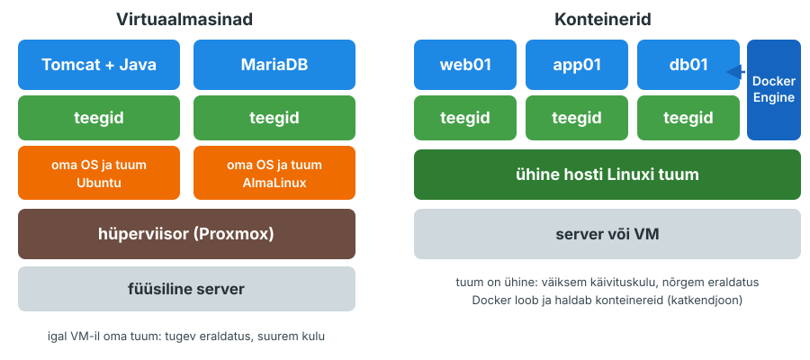
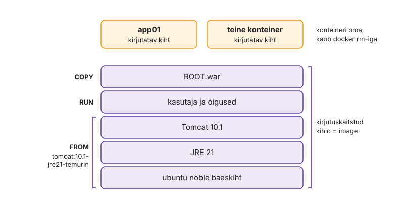
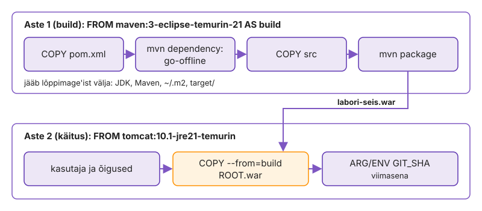
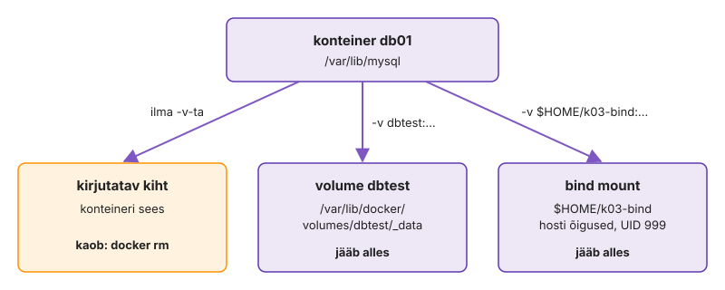
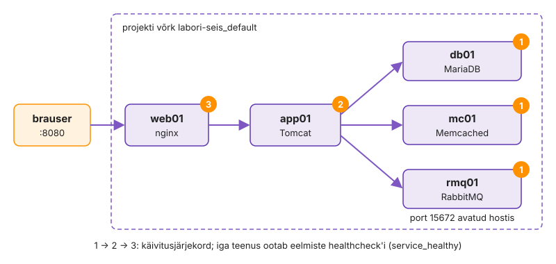
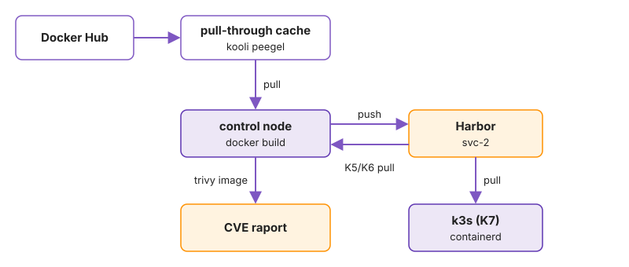

---
tags:
  - Docker
  - Podman
  - Loeng
---

# Loeng: konteineriseerimine Docker, Compose ja Podmaniga

2\. kohtumisel kirjeldasid Ansible'iga, millised paketid, failid ja teenused peavad viies serveris olemas olema. **Konteineriseerimisel** see töö ei kao, vaid jaguneb kaheks. Hosti seadistusse jäävad konteinerite käituskeskkond, salvestus, võrgud ja ligipääsud. Rakendus ja selle kasutajaruumi sõltuvused (JRE, Tomcat, WAR) pakitakse **image**'isse, mis ehitatakse enne paigaldust, mitte alles tootmisserveris. Image käivitatakse **konteinerina**, ja konfiguratsioon ning püsivad andmed antakse väljast. Docker ja Podman on tööriistad, millega seda tehakse, ja mõlemad kasutavad samu OCI image'eid.

Loengu keskne mõte on üks lause: konteiner on ühekordne, image on muutumatu, olek on mujal. Võrgud, Compose, rakenduse kasutuselevõtt ehk deploy, registry ja baas-image'ite haldus tulenevad sellest jaotusest. Iga osa vastab ühele küsimusele sama viie teenusega komplekti ehk stacki kohta, mida 2. kohtumisel Ansible'iga seadistasid.

??? note "Tabel 3.1. Läbiv näide: Labori seis konteinerites"

    | Osa | Küsimus Labori seisu kohta |
    |---|---|
    | 1. Konteiner on protsess | Kus app01 Java protsess nüüd tegelikult töötab ja kes seda juhib? |
    | 2. Image | Kuhu lähevad JRE, Tomcat ja rakenduse WAR? |
    | 3. Olek | Kuhu lähevad db01 andmed, paroolid ja Nginx'i konfiguratsioon? |
    | 4. Compose | Kuidas teenused üksteist leiavad ja millal app01 tohib käivituda? |
    | 5. Ansible ja Docker | Kes paigaldab hostile Dockeri ja stacki? |
    | 6. Deploy | Kuidas viime app01 uuele versioonile ja tagasi? |
    | 7. Registry | Kust saavad image'i konveier, klaster ja AlmaLinuxi server? |
    | 8. Tarneahel | Mida teeme, kui Tomcati baasis leitakse haavatavus? |
    | 9. Podman | Kuidas käitaksime db01 ja mc01 systemd teenusena ilma Dockerita? |
    | 10. Litsentsid | Mille eest peab ettevõte maksma? |

??? abstract "Õpiväljundid"

    Pärast loengut ja praktikumi oskad:

    - selgitada, kuidas namespace'id ja cgroup'id teevad hosti protsessist konteineri, ning eristada konteinerit VM-ist isolatsiooni ja ressursside poolest;
    - kirjeldada image'it kui kihtidest koosnevat muutumatut artefakti ning eristada tag'i ja digest'i;
    - põhjendada, miks andmed, saladused ja logid peavad asuma konteinerist väljaspool, ning valida [volume'i](https://docs.docker.com/engine/storage/volumes/) ja bind mount'i vahel;
    - kirjeldada stacki Compose'is ja jagada töö Ansible'i ja Compose'i vahel;
    - võrrelda push- ja pull-mudelit konteinerite deploy automatiseerimisel;
    - valida, kus image'eid hoida (avalik registry, oma registry, pull-through cache), ning hinnata SBOM-i ja skannimise abil, mida uuesti ehitada;
    - võrrelda Dockeri ja Podmani käitusmudelit ning teada, millised tööriistad on tasuta ja millised mitte.

## Kolm põhimõistet ja Dockeri tööriistad

Enne tööriistu kolm sõna, mis korduvad kogu loengus. Igaühe kohta on lähem selgitus oma osas.

- **Image** on pakett, milles on rakendus koos kõigega, mida see käivitamiseks vajab: Labori seisu puhul JRE, Tomcat ja WAR-fail. Seda ei paigaldata serverisse failideks laiali, vaid käivitatakse tervikuna. Image ei muutu: uus versioon on uus image.
- **Konteiner** on image'ist käivitatud protsess. Samast image'ist võib käivitada mitu konteinerit, nagu samast programmist mitu protsessi.
- **Registry** on server, kus image'eid hoitakse ja kust neid alla laaditakse. See on image'ite jaoks sama, mis apt-repositoorium pakettide jaoks, mida kasutasid 1. kohtumisel: `docker pull` laadib image'i alla nagu `apt install` paketi, ja `docker push` laadib oma image'i üles, et teised masinad saaksid seda kasutada.

Sõna „Docker“ kasutatakse mitme eri asja kohta. Selles loengus töötame peamiselt Docker Engine'i, käsurea ja Compose'iga, aga need kuuluvad laiemasse tööriistade ja teenuste ökosüsteemi.

| Tööetapp | Tööriist või teenus | Roll |
|---|---|---|
| käivita serveris | Docker Engine (käsk `docker`) | ehitab image'id ja käivitab konteinerid; see on praktikumis control'is |
| kirjelda mitu teenust | Docker Compose | kõik rakenduse teenused ühes failis, käivitus ühe käsuga |
| arenda oma arvutis | Docker Desktop, redaktori laiendused | sama Engine Windowsis ja macOS-is koos graafilise vaatega |
| hoia ja jaga image'eid | Docker Hub või muu registry (meil Harbor) | image'ite hoidla, kust teised masinad need alla laadivad |
| leia turvaauke | Docker Scout | analüüsib image'i komponente ja teadaolevaid turvaauke ning soovitab parandusi |
| vali hooldatud baas | Docker Hardened Images | minimaalsed hooldatud baas-image'id koos komponentide nimekirja ja päritolutõendiga |
| eralda AI-agendid | Docker Sandboxes | käivitab AI-agendi eraldi väikeses virtuaalmasinas |

*Tabel 3.2. Dockeri ökosüsteem tööetappide järgi.*

Kõik need ei ole kohustuslikud. Serveris ei ole Docker Engine'i kasutamiseks vaja Docker Desktopi, ja image'eid võib Docker Hubi asemel hoida asutuse registry's. Docker Desktop on arendaja töökeskkond, Docker Engine käitab konteinereid, Docker Hub hoiab image'eid ja Compose kirjeldab mitmest teenusest koosnevat rakendust: need ei ole sama asja neli nime.

Loengu läbiv töövoog on: rakenduse lähtekood → image'i ehitamine → registry → konteineri käivitamine. Compose kirjeldab, kuidas rakenduse konteinerid koos töötavad. Andmed ja käivitamisel antav konfiguratsioon on image'i ehitamisest eraldi. Põhjalikumalt käsitleme Engine'it, CLI-d, Compose'i ja registry rolli. Turvatööriistade ja AI-agentide juurde tuleme tagasi osades 8 ja 9.

??? info "Süvenemiseks: veel Dockeri tooteid"

    - [Docker Desktop](https://docs.docker.com/desktop/) ühendab Windowsis ja macOS-is Engine'i (Linuxi VM-is), CLI, Compose'i ja ehitustööriistad. Laiendused (Extensions) lisavad näiteks kettakasutuse, logide ja turvakontrolli vaate.
    - [Docker Scout](https://docs.docker.com/scout/) analüüsib image'i komponente ja CVE-sid ning soovitab parandusi (osa 8).
    - [Docker Hardened Images](https://docs.docker.com/dhi/) on minimaalsed hooldatud baas-image'id koos SBOM-i ja päritolutõenditega (osa 8).
    - [Docker Sandboxes](https://docs.docker.com/ai/sandboxes/) käivitab AI-agendi microVM-is, millel on oma tuum ja oma Docker Engine (osa 9).
    - AI Governance ja MCP Gateway piiravad tsentraalselt agentide võrgu- ja faililigipääsu ning tööriistakutseid ja koguvad auditilogi.

## 1. Konteiner on isoleeritud protsess

**Labori seis:** Kus app01 Java protsess nüüd tegelikult töötab ja kes seda juhib?

Kaks Java versiooni samas serveris tähendasid seni kahte käsitsi hallatud JDK-d või teist VM-i.

[Konteiner](https://docs.docker.com/get-started/docker-concepts/the-basics/what-is-a-container/) on hosti tuumas töötav tavaline protsess, mida tuum isoleerib kahe mehhanismiga. [Namespace'id](https://man7.org/linux/man-pages/man7/namespaces.7.html) muudavad seda, mida protsess näeb: oma PID-puu, kus ta on PID 1, oma võrguliidesed, mount'id ja hostinimi. [cgroup'id](https://man7.org/linux/man-pages/man7/cgroups.7.html) piiravad mälu, CPU-aega ja protsesside arvu. systemd kasutab samu mehhanisme (`PrivateTmp=`, `MemoryMax=`).

Hostis ja konteineris ei tööta kaks Nginx'i koopiat. Allolev näide vaatab sama protsessi kahe vaate kaudu: hostis on see tavaline protsess oma PID-iga, konteineris on sama protsess PID 1. Namespace muudab seda, mida protsess näeb, mitte ei loo talle eraldi masinat.

Konteinerit ei käivita käsureaprogramm ise, vaid root'ina töötav daemon:

```text
docker CLI ──API──► /var/run/docker.sock ──► dockerd (root) ──► containerd ──► runc ──► konteineri protsess
```

??? note "Tabel 3.3. Docker Engine'i osad"

    | Osa | Ülesanne |
    |---|---|
    | `docker` CLI | võtab kasutaja käsu ja saadab API-päringu |
    | `dockerd` | haldab konteinereid, image'eid, võrke ja volume'eid |
    | `containerd` | haldab konteinerite madalama taseme elutsüklit |
    | `containerd-shim` | jääb käivitatud konteineri juurde vahendajaks ja jälgijaks |
    | `runc` | loob namespace'id ja cgroup'i ning käivitab protsessi |

??? info "Süvenemiseks: käivitusahel ja daemoni taaskäivitus"

    `dockerd` annab töö edasi `containerd`-le, see käivitab iga konteineri jaoks `containerd-shim`-i ja shim kutsub välja `runc`-i. `runc` loob namespace'id ja [cgroup'i](https://docs.docker.com/engine/containers/resource_constraints/), käivitab protsessi ja lõpetab ise töö. Konteineri protsessi vanem on shim, mitte `dockerd`. Kas daemoni taaskäivitus konteinerid peatab, sõltub seadest [`live-restore`](https://docs.docker.com/engine/daemon/live-restore/), mis on vaikimisi välja lülitatud. Tavaline `apt upgrade` paketiga `docker-ce` taaskäivitab seega kõik hosti konteinerid. Paikamise plaanis on see sama oluline kui tuumauuendus.

<figure markdown="span">
  
  <figcaption>Joonis 3.1. VM-il on oma tuum ja OS, konteiner jagab hosti tuuma ja kannab kaasas ainult oma failipuud (Talvik, 2026).</figcaption>
</figure>

Kuna eraldi tuuma pole, käivitub konteiner sekunditega, aga tuuma haavatavus puudutab kõiki konteinereid. Hüperviisor on palju kitsam ründepind.

### Esimene konteiner

Iga konteineri töö algab samade käskudega. Eesmärk ei ole käske pähe õppida, vaid osata vastata kolmele küsimusele: kas konteiner töötab, miks rakendus ei vasta ja mida see logib.

```bash
docker run -d --name veeb -p 8080:80 nginx:1.30-alpine
docker ps
docker logs veeb
docker exec -it veeb sh
docker stop veeb
docker rm veeb
```

??? note "Tabel 3.4. Käsu `docker run -d --name veeb -p 8080:80 nginx:1.30-alpine` osad"

    | Osa | Tähendus |
    |---|---|
    | `docker run` | loo image'ist uus konteiner ja käivita see |
    | `-d` | taustal; ilma selleta on terminal konteineri väljundiga seotud ja Ctrl+C peatab selle |
    | `--name veeb` | nimi, millega konteinerile hiljem viitad; ilma selleta saab juhusliku nime |
    | `-p 8080:80` | hosti port 8080 suunatakse konteineri pordile 80; ilma selleta pole konteiner väljast nähtav |
    | `nginx:1.30-alpine` | image'i nimi ja tag; kui image'it hostis pole, tõmmatakse see registry'st |

??? note "Tabel 3.5. Elutsükli ja uurimise käsud"

    | Käsk | Vastab küsimusele |
    |---|---|
    | `docker ps`, `docker ps -a` | mis töötab; `-a` näitab ka peatatud konteinereid ja nende väljumiskoodi |
    | `docker logs <nimi>` | mida PID 1 kirjutas stdout'i ja stderr'i |
    | `docker exec -it <nimi> sh` | mis on töötava konteineri sees; käivitab sinna uue protsessi |
    | `docker inspect <nimi>` | täielik seadistus: image, võrgud, mount'id, keskkond, olek |
    | `docker stop`, `docker start` | peata ja käivita sama konteiner; kirjutatav kiht jääb alles |
    | `docker rm` | kustuta konteiner koos kirjutatava kihiga |

Veaotsing algab samadest küsimustest:

1. Olek: kas konteiner töötab ja milline on väljumiskood (`docker ps -a`)?
2. Logid: mida rakendus ütles (`docker logs`)?
3. Seadistus: millise image'i, võrgu ja mount'idega see käivitati (`docker inspect`)?
4. Sisemine kontroll: mida on vaja konteineri sees uurida (`docker exec`)?

### Docker socket

Dockeris ei halda käsureaprogramm konteinerit ise. `docker ps` saadab päringu Unix socket'i `/var/run/docker.sock` kaudu daemonile `dockerd`. Socket on protsessidevaheline suhtluskanal samas masinas: failisüsteemis paistab see failina, aga see pole tekstifail, mida loetakse. Selle kaudu antakse töötavale daemonile korraldusi.

```text
docker CLI ── „anna konteinerite nimekiri“ ──► /var/run/docker.sock ──► dockerd
docker CLI ◄───────────────── vastus ──────────────────────────────────┘
```

Sama kanali kaudu käib ka konteinerite loomine, peatamine ja hosti kataloogide mount'imine. Socket ei ole seega ainult oleku vaatamise liides, vaid juhtimisliides.

```bash
docker run -d --name veeb nginx:alpine
ps -o pid,user,cmd -C nginx          # hostis: tavaline protsess, kasutaja root
docker exec veeb ps                   # konteineris: sama protsess on PID 1
sudo lsns -p "$(pgrep -o nginx)"     # tema namespace'id
```

Sellest tuleneb kolm tagajärge.

### Protsessi lõpp peatab konteineri

Kui konteineri PID 1 lõpeb, peatub ka konteiner. systemd'i konteineris pole, seega peab teenus töötama esiplaanil ja `SIGTERM`-i peale lõpetama. `docker stop` ootab vaikimisi 10 sekundit (`--stop-timeout`, Compose'is `stop_grace_period`) ja saadab siis `SIGKILL`-i. Kui PID 1 on shell, mis signaali edasi ei anna, saab andmebaas iga uuendusega `SIGKILL`-i.

### Dockeri juhtimisõigus on root'i õigus

Isolatsioon ei kaitse vaikimisi õigusi. Docker ei kasuta vaikimisi user namespace'i, nii et `uid=0` konteineris on hostis samuti UID 0. Kõiki hosti root'i õigusi sellel siiski pole: capability'te piirang ja seccomp (vt allpool) võtavad osa ära. Suurem risk on socket. Kes saab socket'i kaudu daemonile käske anda, saab paluda käivitada konteineri, mis mount'ib hosti `/`, ja muuta selle kaudu hosti mis tahes faili. Selleks pole vaja turvaauku, piisab daemoni tavalistest võimalustest, ja `sudo` logisse sellest midagi ei jää ([Docker Engine security](https://docs.docker.com/engine/security/)). Grupp `docker` annab ligipääsu socket'ile ehk root'iga võrdse õiguse ning selle liikmeid tuleb auditeerida nagu `sudoers`-it. Sama kehtib konteineri kohta, millele socket on mount'itud (`-v /var/run/docker.sock:/var/run/docker.sock`): tavaline konteiner käitab ainult oma rakendust, socket'iga konteiner saab juhtida ka teisi konteinereid ja nende kaudu hosti. Kui see rakendus kompromiteeritakse, juhib ründaja hosti Dockerit.

```text
kasutaja ei saa hosti kaitstud faili otse muuta
        │  aga saab Dockerit juhtida (grupp docker)
        ▼
docker run -v /:/host … ──► root'ina töötav dockerd loob konteineri hosti juurkataloogiga
        │
        ▼
konteineris saab hosti faile muuta
```

### Ressursipiir kaitseb teisi teenuseid

cgroup'id kaitsevad naabreid siis, kui piir on seatud, ja vaikimisi seda pole. Lekkiv Java protsess võtab kogu hosti mälu ja OOM killer valib ohvri kogu hosti seast, võib-olla andmebaasi. Piiriga tapab tuum protsessi ainult selles cgroup'is ja konteiner lõpeb koodiga 137 (128 + `SIGKILL`).

??? info "Süvenemiseks: mida tuum veel piirab"

    Namespace'id ja cgroup'id ei ole ainsad piirangud. Docker käivitab protsessi kitsendatud capability'te komplektiga: root konteineris ei saa vaikimisi laadida tuumamooduleid, muuta süsteemiaega ega seadistada hosti võrguliideseid. Lisaks filtreerib [vaikimisi seccomp-profiil](https://docs.docker.com/engine/security/seccomp/) süsteemikutseid ja keelab kümneid neist, näiteks `mount`, `reboot` ja `kexec_load`. Lipp `--privileged` lülitab need kõik välja ja annab ligipääsu hosti seadmetele. Konteiner, mis vajab `--privileged`-i, on sisuliselt root-shell hostis ja vajab sama ülevaatust nagu uus `sudoers`-i rida.

    Need piirangud vähendavad ründepinda, aga ei kõrvalda seda. 2019. aastal avaldatud [CVE-2019-5736](https://nvd.nist.gov/vuln/detail/CVE-2019-5736) lubas konteineris root'ina töötaval protsessil üle kirjutada hosti `runc`-i binaari, kui keegi käivitas konteineris `docker exec`-i, ja iga järgmine `runc`-i käivitus töötas siis ründaja koodina hosti root'i õigustes. Paik tuli `runc`-i, mitte image'isse. Konteinerihosti paikamine hõlmab seega tuuma, `runc`-i, `containerd`-d ja `dockerd`-d, mitte ainult rakendusi. Mitme kliendi või usaldamatu koodi jaoks kasutatakse seepärast VM-i, kerget VM-i iga konteineri ümber (Kata Containers) või kasutajaruumi tuuma (gVisor), mitte ainult namespace'e.

    Ressursipiirangud vajavad sama tähelepanu ka protsesside arvu puhul. Vaikimisi pole `--pids-limit`-i seatud, nii et fork-pomm või lekkiv lõimede kogum ühes konteineris ammendab hosti `pid_max`-i ja ka SSH-sessioon ei saa enam uut protsessi luua. Tootmises seatakse mälu ja protsesside piir igale teenusele. CPU piir sõltub koormusest: liiga madal `--cpus` paneb latentsuse kõikuma, sest tuum piirab CPU-aega iga 100 ms perioodi kaupa.

??? question "Kontrolli ennast"

    1. app01 lõpeb iga paari minuti järel koodiga 137. Mida see kood ütleb ja millised on kaks tõenäolist põhjust?
    2. Kumb on turvalisem: kasutaja grupis `docker` või kasutaja, kellel on `sudo` õigus ainult käsule `systemctl restart nginx`?

## 2. Image kui muutumatu artefakt

**Labori seis:** Kuhu lähevad JRE, Tomcat ja rakenduse WAR?

Sama playbook kahe nädala vahega võib anda erineva tulemuse, kui repositooriumisse ilmus uus paketiversioon. Image'i puhul on vastupidi: tulemus ehitatakse üks kord ja sama artefakt liigub muutmata testi ja tootmisse.

Enne kihtide tehnilist kirjeldust lihtne mudel: Dockerfile kirjeldab, kuidas image ehitatakse, image on see, mis käivitamiseks pakitakse, ja konteiner on image'i käivitatud eksemplar.

```text
Dockerfile ja lähtekood ──build──► image ──run──► konteiner 1
                                         └──run──► konteiner 2
```

**Küsimus:** kui samast image'ist käivitada kaks konteinerit, kas ühes tehtud failimuudatus jõuab teise? Vastus tuleneb sellest, kuidas image on üles ehitatud.

**Image** on [OCI](https://opencontainers.org/) formaadis manifest, mis viitab konfiguratsiooni-JSON-ile (`Entrypoint`, `Cmd`, `Env`, `User`) ja järjestatud kihtide nimekirjale. Iga kiht on tar-arhiiv. Dockerfile'is lisab iga `RUN`, `COPY` ja `ADD` ühe kihi, `CMD`, `ENV` ja `USER` muudavad ainult konfiguratsiooni. Käivitamisel ühendab overlayfs kirjutuskaitstud kihid (`lowerdir`) ja konteineri oma kirjutatava kihi (`upperdir`). Kui protsess muudab alumises kihis olevat faili, kopeerib tuum enne kirjutamist terve faili ülemisse kihti (copy-up). 2 GB andmefail kirjutatavas kihis tähendab seega 2 GB koopiat esimesel kirjutusel.

<figure markdown="span">
  
  <figcaption>Joonis 3.2. Kirjutuskaitstud kihid on ühised, igal konteineril on oma õhuke kirjutatav kiht (Talvik, 2026).</figcaption>
</figure>

Vastus küsimusele: ei jõua. Mõlemad konteinerid loevad samu kirjutuskaitstud kihte, aga kirjutavad igaüks oma kirjutatavasse kihti, mis kaob koos konteineriga.

### Muutumatus ja selle tagajärjed

Muutumatusel on kolm tagajärge. Esiteks kaob `docker exec`-iga muudetud konfiguratsioonifail järgmise uuendusega, sest uus konteiner tuleb image'ist. Parandus läheb Dockerfile'i ja uude image'isse. Teiseks on tagasipööramine (rollback) eelmise image'i käivitamine, eeldusel et see on veel registry's. Kolmandaks jääb kõik, mis kihti jõudis, sinna alatiseks. Hilisemas kihis tehtud `rm` lisab ainult whiteout-kirje. Image'isse kopeeritud `.env` või SSH võti on kõigil, kes image'i alla laadivad.

### Dockerfile rida-realt

Lihtne Dockerfile on retsept, mida `docker build` täidab ülevalt alla. Iga rida on üks juhis.

```dockerfile
FROM python:3.12-slim
WORKDIR /app
COPY requirements.txt .
RUN pip install --no-cache-dir -r requirements.txt
COPY app.py .
ENV PORT=8000
USER 10001
EXPOSE 8000
CMD ["python", "app.py"]
```

??? note "Tabel 3.6. Dockerfile'i juhised"

    | Juhis | Mida teeb | Kiht? |
    |---|---|---|
    | `FROM` | baas-image, millele kõik järgnev ehitatakse | baasi kihid |
    | `WORKDIR` | töökataloog järgmistele juhistele ja konteineris | metaandmed |
    | `COPY` | failid ehituskontekstist image'isse | jah |
    | `RUN` | käsk ehituse ajal (paketid, sõltuvused) | jah |
    | `ENV` | keskkonnamuutuja image'is ja konteineris | metaandmed |
    | `USER` | kasutaja, kellena järgmised juhised ja konteiner töötavad | metaandmed |
    | `EXPOSE` | dokumenteerib pordi; porti ei avalda, selleks on `-p` | metaandmed |
    | `CMD` | vaikimisi käivituskäsk | metaandmed |

`requirements.txt` kopeeritakse enne koodi: kui muutub ainult `app.py`, kasutab ehitus sõltuvuste kihti vahemälust. Sama töö käib arendaja masinas sageli redaktorist: VS Code'i ja IntelliJ laiendused näitavad Dockerfile'i vigu, ehitavad image'i, käivitavad Compose'i stacki ja avavad konteineri logi. Taustal on samad käsud. Ehituskontekst on kaust, mis saadetakse builder'ile (`docker build -t minu-app:1.0 .`, punkt lõpus). Fail `.dockerignore` jätab sealt välja selle, mida image ei vaja, eriti `.env`-i ja `.git`-i.

**`CMD` ja `ENTRYPOINT`.** `CMD` määrab vaikimisi käivituskäsu. Kui on määratud ka `ENTRYPOINT`, määrab see käivitatava programmi ja `CMD` on selle vaikeargumendid. `docker run image arg` asendab `CMD`-i väärtuse, `--entrypoint` asendab programmi. Tööriista-image'ites (Trivy, curl) on programm `ENTRYPOINT`-is, nii et `docker run aquasec/trivy image nginx` annab argumendid otse Trivy'le. Mõlemad kirjutatakse exec-vormis (`["python", "app.py"]`): shell-vormis (`CMD python app.py`) on PID 1 shell ja `SIGTERM` rakenduseni ei jõua.

### Mitmeastmeline ehitus

Seepärast eraldab [mitmeastmeline ehitus](https://docs.docker.com/build/building/multi-stage/) ehitamise käitamisest. Kompilaator, sõltuvuste vahemälu ja lähtekood jäävad ehitusastmesse:

```dockerfile
FROM maven:3-eclipse-temurin-21 AS build
COPY . /src
RUN cd /src && mvn -q package
FROM tomcat:10-jre21
COPY --from=build /src/target/app.war /usr/local/tomcat/webapps/ROOT.war
USER 10001
```

<figure markdown="span">
  
  <figcaption>Joonis 3.3. Mitmeastmeline ehitus: lõppimage'isse jõuab ainult WAR (Talvik, 2026).</figcaption>
</figure>

Ehituse vahemälu (build cache) kasutab kihi uuesti, kui juhis ja sisendi räsi pole muutunud, ja esimene muutunud kiht tühistab kõik järgmised ([head tavad](https://docs.docker.com/build/building/best-practices/)). Näites laeb Maven iga koodimuudatuse järel sõltuvused uuesti, seepärast kopeeritakse `pom.xml` eraldi ette.

Image'i nimel on kaks osa. **Tag** on liigutatav viide manifestile. `latest` on lihtsalt vaikimisi tag ega tähenda „uusim“. `nginx:1.27` osutab pärast turvaparandust teisele sisule. **Digest** (`sha256:…`) on manifesti räsi: sama digest tähendab alati samu baite. Tootmises seotakse tag koodi versiooniga (git-commit'i SHA) ja kõige rangemates kohtades viidatakse digest'ile.

??? info "Mitu arhitektuuri ühe tag'i all"

    Üks tag võib osutada mitmele image'ile korraga. Ametlike image'ite tag viitab tavaliselt image index'ile (Dockeri terminites manifest list), mis sisaldab eraldi manifesti `amd64`, `arm64` ja teiste arhitektuuride jaoks, ning klient valib hosti arhitektuuri järgi. Index'i digest ja platvormi manifesti digest on erinevad. Kui konveier kirjutab üles `amd64` manifesti digest'i ja ARM-iga host proovib sama digest'i tõmmata, saab ta vale arhitektuuri image'i ja protsess lõpeb veaga `exec format error`. Kui hostide arhitektuurid erinevad, viita index'i digest'ile.

Muutumatus kehtib artefakti, mitte ehituse kohta. Sama Dockerfile kahe nädala pärast annab teise image'i, sest `FROM` tag ja `apt-get install` tõmbavad uuemad versioonid. Korratavus vajab fikseeritud baasi digest'i ja versioonidega paketinimekirja, värskus vajab vastupidist. Kumba eelistada, on poliitika küsimus.

??? question "Kontrolli ennast"

    1. Tootmises parandati `docker exec`-iga Nginx'i konfiguratsioonifaili ja kõik töötas. Järgmisel päeval oli viga tagasi. Mis juhtus ja kuidas oleks pidanud tegema?
    2. Miks kopeeritakse Dockerfile'is `pom.xml` enne lähtekoodi?

## 3. Andmed ja olek väljaspool konteinerit

**Labori seis:** Kuhu lähevad db01 andmed, paroolid ja Nginx'i konfiguratsioon, kui andmebaasi konteiner asendatakse?

MariaDB uuendus on `docker rm` ja `docker run`: mis oli kirjutatavas kihis, on kadunud.

Olekut on kolme liiki. **Andmed** lähevad volume'isse või bind mount'i. **Volume** on Dockeri hallatav kataloog (`local` draiveriga `/var/lib/docker/volumes/<nimi>/_data`), mille elutsükkel on konteinerist lahus. Bind mount'ist erineb volume failide omaniku poolest. Kui tühi volume ühendatakse kataloogi, kus image'is on juba failid, kopeerib Docker vaikimisi selle kataloogi sisu koos omaniku ja õigustega volume'isse, nii et andmekataloog saab kohe õige UID. Tähtis on, et volume oleks tühi, nimi ei mängi rolli. Kopeerimise saab keelata valikuga `volume-nocopy`. Bind mount on hosti kataloog hosti õigustega. Puuduva kataloogi loob `-v` root'i omanikuna ja mitte-root teenus ei saa sinna kirjutada. Bind mount sobib konfiguratsioonifailile, volume andmebaasile.

??? note "Tabel 3.7. Volume ja bind mount"

    | | Volume | Bind mount |
    |---|---|---|
    | kus | Dockeri hallatav kataloog `/var/lib/docker/volumes/` all | hosti kataloog, mille tee annad ise |
    | kes haldab | `docker volume ls`, `docker volume rm` | hosti failisüsteem ja tavalised õigused |
    | tühja ühendamisel | image'i sisu kopeeritakse sisse | hosti kataloog katab image'i sisu |
    | omanik | image'i kasutaja (näiteks `mysql`, UID 999) | hosti omanik; puuduv kaust tekib root'ina |
    | sobib | andmebaas, järjekord, muu püsiv olek | konfiguratsioonifail, kood arendaja masinas |
    | Compose'is | `- dbdata:/var/lib/mysql` | `- ./nginx.conf:/etc/nginx/nginx.conf:ro` |

<figure markdown="span">
  
  <figcaption>Joonis 3.4. Kolm kohta, kuhu konteiner saab kirjutada. Konteineri kustutamise järel jäävad alles ainult kaks neist (Talvik, 2026).</figcaption>
</figure>

Volume'i juures on peamine elutsükkel, mitte kataloogi asukoht. Iga rakenduse osa puhul küsi, mis peab juhtuma, kui konteiner asendatakse uuega.

??? note "Tabel 3.8. Mis juhtub konteineri asendamisel"

    | Mis | Kust tuleb | Konteineri asendamisel |
    |---|---|---|
    | rakenduse binaar (WAR, Tomcat, JRE) | image'ist | asendub uue väljalaskega |
    | konfiguratsioon | keskkonnamuutujad, mount'itud fail või image | rakendub see, mis on failis või Gitis kirjas |
    | saladus | fail (`secrets:`) või saladuste hoidla | antakse uuele konteinerile uuesti |
    | andmebaasi andmed | volume | jäävad alles |
    | ajutised failid, logifailid konteineris | kirjutatav kiht | kaovad |

**Seadistus ja saladused** tulevad käivitamisel väljast: sama image töötab testis ja tootmises, vahe on keskkonnas ja mount'itud failides. Keskkonnamuutuja on saladuse jaoks halb koht. `docker inspect` näitab seda kõigile, kellel on socket'ile ligipääs, see on loetav failist `/proc/<pid>/environ` ja pärandub igale alamprotsessile. Fail ([Compose'is `secrets:`](https://docs.docker.com/compose/how-tos/use-secrets/), Kubernetesis Secret) jätab keskkonda ainult tee. **Logid** lähevad PID 1 stdout'i ja stderr'i. Vaikimisi [`json-file`](https://docs.docker.com/engine/logging/drivers/json-file/) draiver kirjutab need faili `/var/lib/docker/containers/<id>/<id>-json.log` ilma rotatsioonita, kuni `max-size` on seatud. Üks jutukas konteiner täidab partitsiooni ja peatab kõik teised.

Ametlike andmebaasi-image'ite entrypoint algseadistab andmekataloogi ainult siis, kui see on tühi ([MariaDB image](https://hub.docker.com/_/mariadb)). Muudetud algne SQL või `MARIADB_PASSWORD` olemasolevat volume'it ei muuda. See on Compose'i stackides sage `Access denied` põhjus: image'i ja oleku elutsükkel on lahus ja skeemimuudatus vajab migratsiooni.

??? info "Süvenemiseks: olek hostis"

    Kui olek on konteinerist väljas, on see hostis ja administraatori vastutus jääb samaks. Volume'i kataloogi kopeerimine töötava MariaDB alt annab ebaühtlase koopia, täpselt nagu `rsync` töötava andmebaasi `/var/lib/mysql`-ist. Varundus käib endiselt andmebaasi tööriistaga (`mariadb-dump`, `mariadb-backup`) konteineri sees või kõrvalkonteineris, mis jagab sama volume'it, ja taastamist testitakse samamoodi nagu enne. Volume'id ei kuulu image'isse, nii et image'ite varundus ei asenda andmete varundust.

    Ka salvestusdraiveril on eeldused. `overlay2` XFS-i peal nõuab failisüsteemi, mis on loodud valikuga `ftype=1` ([overlay2 nõuded](https://docs.docker.com/engine/storage/drivers/overlayfs-driver/)). Vanad RHEL 7 aegsed XFS-id loodi mõnikord `ftype=0`-ga ja Docker keeldub neil overlay2 kasutamast. Tootmishostis pannakse `/var/lib/docker` eraldi LVM-i köitele, et image'id, kirjutatavad kihid ja `json-file` logid ei täidaks juurfailisüsteemi. `docker system df` näitab, kui palju sellest on image'id, konteinerid, volume'id ja build cache.

??? question "Kontrolli ennast"

    1. Muutsid `.env`-is `DB_PASSWORD`-i ja käivitasid `docker compose up -d`. Rakendus annab `Access denied`. Miks?
    2. Asutus varundab kindlaid hosti katalooge ja administraatorid haldavad andmete asukohta ise. Kas valiksid MariaDB jaoks volume'i või bind mount'i? Mida kontrollid enne otsust?

## 4. Mitu teenust Compose'iga

**Labori seis:** Kuidas teenused üksteist leiavad ja millal app01 tohib käivituda?

Viie `docker run` käsuga käivitatud stacki soovitud olek on kirjas ainult shelli ajaloos. [Compose](https://docs.docker.com/compose/) kirjutab selle faili.

`compose.yaml` kirjeldab teenused, võrgud ja volume'id. `docker compose up -d` loob puuduva teenuse, loob uuesti teenuse, mille seadistus muutus, ja jätab ülejäänu puutumata. Tulemus on idempotentne nagu playbook. Erinevus on mehhanismis: Ansible muudab olemasolevat serverit, Compose peatab vana konteineri ja loob uue. Selle vahe jooksul teenus ei vasta, sest Compose ei tee järkjärgulist uuendust (rolling update).

<figure markdown="span">
  
  <figcaption>Joonis 3.5. Viie teenusega stack. Iga teenus ootab enne käivitumist, kuni sõltuvuste healthcheck annab oleku healthy (Talvik, 2026).</figcaption>
</figure>

Kahe teenusega näide näitab kõiki põhivõtmeid korraga: valmis image ja oma ehitus, port, keskkond, volume ja sõltuvus.

```yaml
name: labori-seis
services:
  app01:
    build: ..                               # oma image Dockerfile'ist
    environment:
      DB_HOST: db01                         # teenuse nimi, mitte IP
      DB_NAME: labseis
      DB_USER: labseis
      DB_PASSWORD: ${DB_PASSWORD:?}         # väärtus .env-failist
    ports: ["8080:8080"]                    # ainult see on väljast nähtav
    depends_on:
      db01: { condition: service_healthy }  # oota, kuni db01 vastab
  db01:
    image: mariadb:11.4                     # valmis image registry'st
    environment:
      MARIADB_ROOT_PASSWORD: ${DB_ROOT_PASSWORD:?}
      MARIADB_DATABASE: labseis             # luuakse esimesel käivitusel
      MARIADB_USER: labseis
      MARIADB_PASSWORD: ${DB_PASSWORD:?}
    volumes: ["dbdata:/var/lib/mysql"]      # andmed elavad konteinerist kauem
    healthcheck:
      test: ["CMD", "healthcheck.sh", "--connect", "--innodb_initialized"]
      interval: 5s
      timeout: 3s
      retries: 10
      start_period: 20s
volumes:
  dbdata:
```

??? note "Tabel 3.9. Compose'i faili võtmed"

    | Võti | Mida õppija peab oskama |
    |---|---|
    | `services` | kirjeldada rakendust ja selle sõltuvusi eraldi teenustena |
    | `image` ja `build` | eristada valmis image'i kasutamist oma image'i ehitamisest |
    | `ports` | avaldada hosti kaudu ainult see teenus, mida väljast vaja on |
    | `environment`, `.env` | anda teenusele seadistus käivitamisel |
    | `volumes` | hoida andmed konteineri elutsüklist lahus |
    | `networks`, teenuse nimi | ühendada rakendus andmebaasiga nime järgi |
    | `healthcheck`, `depends_on` | siduda sõltuvuste käivitamine valmisoleku kontrolliga |
    | `restart` | taaskäivitada teenus pärast viga või masina taaskäivitust |

??? note "Tabel 3.10. Compose'i käsud"

    | Käsk | Mida teeb |
    |---|---|
    | `docker compose up -d` | viib stacki faili kirjeldatud olekusse |
    | `docker compose ps` | teenuste olek ja healthcheck |
    | `docker compose logs -f <teenus>` | teenuse logi jooksvalt |
    | `docker compose exec <teenus> sh` | käsk töötavas teenuses |
    | `docker compose config` | fail pärast muutujate asendamist, nii nagu Compose seda näeb |
    | `docker compose down` | peatab ja kustutab konteinerid ja võrgud; volume'id jäävad, kui pole `-v` |

Näite lihtsustamiseks antakse paroolid siin keskkonnamuutujatena. Failipõhist edastamist (`secrets:`) kirjeldab osa 3 ja see on praktikumi tootmisfailis.

Töötava stacki uurimist alusta olekust ja logidest, seejärel kontrolli seadistust:

1. `docker compose ps`: kas teenus töötab ja kas see on `healthy`?
2. `docker compose logs <teenus>`: mida rakendus ütleb?
3. `docker compose config`: mida Compose failist ja `.env`-ist tegelikult luges?
4. `docker compose exec <teenus> sh`: mida on vaja konteineri sees uurida?

Esimene mõiste on teenuse leidmine. Kasutaja loodud võrgus vastab sisseehitatud DNS aadressil `127.0.0.11` teenuse nimele: app01 ühendub nimega `db01`, mitte IP-ga, sest konteineri IP muutub iga uue konteineriga.

??? info "Süvenemiseks: seadistuse räsi ja aadressivarud"

    `up -d` arvutab iga teenuse seadistusest räsi ja võrdleb seda konteineri sildiga `com.docker.compose.config-hash`. Kui räsi erineb, luuakse konteiner uuesti.

    Iga uus võrk saab alamvõrgu vaikimisi aadressivarudest `172.17.0.0/16`–`172.31.0.0/16` ja `192.168.0.0/16`. Kui ettevõtte VPN või serverivõrk kasutab samu vahemikke, kaob hostist marsruut nendesse ja SSH-sessioon katkeb esimese `docker compose up`-iga. Seepärast pannakse tootmishostides `daemon.json`-i `default-address-pools` vahemikuga, mis on võrguosakonnaga kokku lepitud.

Teine mõiste on segmenteerimine. Konteiner näeb ainult neid naabreid, kellega tal on ühine võrk, ja `internal: true` võrgul pole vaikemarsruuti. Kui andmebaas, vahemälu ja järjekord on ainult sisemises võrgus, ei saa rakendusse sisse murdnud ründaja sealt otse internetti. Avaldatud porti suunab Docker NAT-reegliga, mis rakendub enne UFW reegleid, seega `ufw deny` porti ei sulge ([Docker ja tulemüür](https://docs.docker.com/engine/network/packet-filtering-firewalls/)).

Kolmas mõiste on valmisolek: käivitatud konteiner ei ole veel teenus, mis vastab. [`depends_on`](https://docs.docker.com/reference/compose-file/services/) tagab ainult käivitusjärjekorra. **Healthcheck** on käsk, mida Docker konteineri sees perioodiliselt käivitab. Selle väljumiskoodi järgi on olek `starting`, `healthy` või `unhealthy`. [Vaikeväärtused](https://docs.docker.com/reference/dockerfile/#healthcheck) on `interval` 30 s, `timeout` 30 s, `retries` 3 ja `start_period` 0. Tingimusega `service_healthy` ootab Compose, kuni sõltuvus vastab:

```yaml
services:
  app01:
    depends_on:
      db01: { condition: service_healthy }
  db01:
    healthcheck: { test: ["CMD", "healthcheck.sh", "--connect"], interval: 5s }
```

Healthcheck ainult märgib oleku. Compose ei taaskäivita `unhealthy` konteinerit ja `restart:` reageerib ainult protsessi lõppemisele. Kui andmebaas öösel taaskäivitub, peab rakendus ise uuesti ühenduma. Healthcheck peab seega kontrollima seda, mida klient vajab: `/health`, mis vaatab üle andmebaasi ja järjekorra, mitte avatud porti.

Compose tunneb oma konteinerid ära projekti nime järgi, mis on vaikimisi `compose.yaml`-i kataloogi nimi ja satub iga konteineri sildile `com.docker.compose.project`. Kaks stacki samas hostis kataloogides `/srv/a/app` ja `/srv/b/app` saavad sama projekti nime ning teine `up` peab esimese teenuseid enda omadeks: loob need ümber või eemaldab `--remove-orphans`-iga. Tootmishostis antakse projekti nimi seepärast selgelt (`name:` faili alguses või `-p`).

Mitu koopiat, katkestuseta uuendus ja mitu hosti on juba orkestraatori töö (7. kohtumine).

??? question "Kontrolli ennast"

    1. Muutmata failiga `docker compose up -d` lõi app01 uuesti. Mida see failis olevate väärtuste kohta ütleb?
    2. db01 on `healthy`, aga app01 ei käivitunud pärast masina taaskäivitust õiges järjekorras. Miks `depends_on` siin ei aidanud?

??? info "Loe juurde"

    [Võrguautomaatika ja NetOps](../teemad/vorguautomaatika.md)

## 5. Ansible ja Docker koos

**Labori seis:** Kes paigaldab hostile Dockeri ja stacki?

Compose kirjeldab, mis töötab ühe hosti konteinerites. Keegi peab aga paigaldama Dockeri, panema paika `daemon.json`-i ja CA-sertifikaadid, kopeerima hosti `compose.yaml`-i ja `.env`-i ning käivitama `up -d`. Viie hostiga on see jälle käsitsi töö, mille 1. ja 2. kohtumisel automatiseerisid.

Töö jaguneb kaheks kihiks. **Ansible hoiab hosti:** paketid, Dockeri daemoni seaded, tulemüür, kasutajad, saladused (Vaultist), failid, mida stack vajab. **Compose hoiab rakendust:** millised konteinerid, millise image'iga, millises võrgus. Ansible ei kirjelda iga konteinerit eraldi, ta annab hostile Compose'i faili ja palub Compose'il soovitud olekusse jõuda.

Selleks on kogus [`community.docker`](https://docs.ansible.com/projects/ansible/latest/collections/community/docker/index.html) moodul [`docker_compose_v2`](https://docs.ansible.com/projects/ansible/latest/collections/community/docker/docker_compose_v2_module.html). See käivitab hostis `docker compose up` ja teatab `changed` ainult siis, kui mõni konteiner loodi, muudeti või kustutati. Idempotentsuse annab Compose ise, moodul loeb tema väljundit.

```yaml
- name: Labori seis konteinerites
  hosts: docker
  become: true
  roles:
    - docker                                  # paketid, daemon.json, CA
  tasks:
    - name: Rakenduse kaust
      ansible.builtin.file:
        path: /srv/labseis
        state: directory
        mode: "0750"

    - name: Compose'i fail
      ansible.builtin.copy:
        src: compose.yaml
        dest: /srv/labseis/compose.yaml
        mode: "0640"

    - name: Saladused Vaultist .env-i
      ansible.builtin.template:
        src: env.j2
        dest: /srv/labseis/.env
        mode: "0600"
      no_log: true

    - name: Stack töötab
      community.docker.docker_compose_v2:
        project_src: /srv/labseis
        pull: missing
        wait: true
      register: stack
```

Moodul ei vaja `notify`-d ega handler'it: kui `compose.yaml` või `.env` muutus, näeb Compose seadistuse räsi muutust ja loob ainult puudutatud teenused uuesti. Teisel käivitusel on tulemus `changed=0`. `wait: true` ootab healthcheck'e nagu `docker compose up --wait`. Väärtus `pull: always` tõmbab igal käivitusel registry'st uue image'i: nii viib sama playbook uue versiooni hostidesse, kui tag'i järgi on registry's uus sisu.

Samas kogus on ka üksiku konteineri moodul `docker_container` ning `docker_image`, `docker_network` ja `docker_volume`. Need sobivad ühe tööriista-konteineri jaoks (näiteks monitooringuagent igas hostis). Rakenduse stacki kirjeldamine nendega tähendaks Compose'i faili kordamist YAML-is Ansible'i süntaksis, ja siis ei saa sama faili enam arendaja masinas `docker compose up`-iga käivitada.

Sama muster on kursuse Harbori paigalduses. Playbook teeb kursuse CA-ga sertifikaadi, paigaldab rolliga Dockeri, laadib alla Harbori paigaldaja, kirjutab mallist `harbor.yml`-i ja käivitab Harbori Compose'i stacki. Kolmas play seadistab Harbori API kaudu (`ansible.builtin.uri`) Docker Hubi vahemälu ja Trivy skannimise. Kogu registry on uuesti ehitatav ühe käsuga, ja seda näed loengu demos.

??? question "Kontrolli ennast"

    1. Miks ei kirjelda Ansible iga Labori seisu konteinerit eraldi `docker_container` mooduliga?
    2. `docker_compose_v2` annab teisel käivitusel `changed=1`. Kust hakkad põhjust otsima?

## 6. Deploy konteineritega

**Labori seis:** Kuidas viime app01 uuele versioonile ja vajaduse korral tagasi?

Tüüpiline intsident: sisevõrgu hostil jälgib automaatne uuendaja tag'i `mariadb:latest`. Öösel ilmub uus põhiversioon, uuendaja loob konteineri uue image'iga ja hommikul rakendus ei käivitu, sest olemasolev andmekataloog vajab `mariadb-upgrade`-i. Muudatusel pole piletit ja Gitist ei selgu, mis enne töötas.

Konteineri uuendus on alati sama jada: tag lahendatakse digest'iks ja image tõmmatakse, vana konteiner peatatakse ja sama seadistusega luuakse uus, kasutuselevõtu automaatika (konveier, playbook) või administraator kontrollib valmisolekut ja otsustab selle põhjal, kas uuendus õnnestus või tuleb tagasi pöörata, ja lõpuks koristatakse vanad image'id. **Deploy automatiseerimine** tähendab, et see jada käib igas hostis ühtemoodi ja jätab jälje. Otsustada tuleb, kes selle käivitab.

**Push-mudelis** käivitab selle väline osapool, konveier või playbook. See kirjutab hosti `.env`-i uue tag'i ning käivitab `docker compose pull` ja `up -d` (või `docker_compose_v2` mooduli). Versioon on Gitis, muudatus on commit ja korraga uuendatavate hostide arvu otsustab see, kes uuenduse käivitab. Selle hind on, et konveier peab hostini jõudma ja tal on seal Dockeri socket'i ehk root'i õigus.

**Pull-mudelis** jälgib host ise registry't. Podmanis teeb seda [`podman auto-update`](https://docs.podman.io/en/latest/markdown/podman-auto-update.1.html). Quadleti failis on `AutoUpdate=registry` ja `podman-auto-update.timer` käivitub vaikimisi iga päev keskööl. See võrdleb kohaliku image'i digest'i registry omaga ning muutuse korral tõmbab uue image'i ja taaskäivitab unit'i. Kui unit ei käivitu, läheb Podman tagasi eelmisele image'ile (`--rollback` on vaikimisi sees). Ebaõnnestumist näeb Podman aga ainult siis, kui konteiner annab sd_notify kaudu teada, et on valmis. Quadleti `Notify=healthy` seob selle teate healthcheck'iga. Ilma selleta loetakse õnnestunuks iga protsess, mis käivitus. Dockeri jaoks teevad sama kolmanda osapoole tööriistad.

Pull-mudel ei vaja sissetulevat ligipääsu ega konveieri õigusi hostis ja sobib paljudele väikestele hostidele kontorites või tehastes. Uuenduse hetke ja sisu määrab aga see, kes registry's tag'i liigutab, ja kõik hostid uuendavad samal ööl. Tootmisteenuses tähendab see muudatust ilma muudatustaotluseta. Kui pull-mudel on tootmises, jälgib host kas tag'i, mida liigutab ainult heakskiidetud konveier (näiteks `prod`), või paiga taseme tag'i (`11.4`, mitte `latest`).

Läbime ühe ebaõnnestumise. Rakendus v1 töötab. Konveier paneb `.env`-i tag'i v2 ja käivitab `up -d`. Protsess käivitub, aga rakendus ei saa andmebaasiga ühendust ja `/health` annab 503.

**Küsimus:** mida vaatad ja mille põhjal otsustad tagasi minna? Kas v1 töötab pärast seda, kui v2 jõudis skeemi muuta?

Vastus seob kokku viis eelmist mõistet. Protsessi käivitumine ei tähenda valmisolekut: healthcheck näitab olekut, aga otsuse teeb konveier, playbook või administraator. Compose'i healthcheck üksi tagasi ei pööra. Tagasi saab minna ainult siis, kui v1 image on veel hostis või registry's. Konfiguratsioon peab olema versiooniga koos: kui v2 vajas uut keskkonnamuutujat, peab tagasipööramine ka selle taastama. Andmed jäävad volume'isse: kui v2 muutis skeemi nii, et v1 seda ei talu, ei aita image'i vahetus ja tuleb taastada varukoopiast. Seepärast tehakse skeemimuudatused tagasiühilduvaks (allpool „Deploy suures skaalas“).

Viimane samm on koristus. Tagasipööramine on kiire ainult siis, kui eelmine image on veel hostis või registry's. Cron'iga käivitatav `docker image prune -a` kustutab kõik image'id, mida ükski konteiner ei kasuta, ka tagasipööramise sihtmärgi. Ilma koristuseta kasvab `/var/lib/docker` iga uuendusega. Hostis hoitakse praegust ja eelmist versiooni, registry's väljalaskeid nii kaua, kui tagasipööramine on lubatud.

??? info "Deploy suures skaalas"

    Viiekümne hosti juures muutub uuendus võrguküsimuseks. Kui kõik hostid tõmbavad sama 800 MB image'i samal minutil, on kitsaskoht registry või kontori ühendus, mitte Docker. Kihid on räsi järgi jagatud, seega tõmmatakse ainult muutunud kihid, eeldusel et baas on sama. Pull-mudelis hajutatakse käivitusaeg taimeri `RandomizedDelaySec=` abil, push-mudelis piirab konveier korraga uuendatavate hostide arvu, nagu Ansible'i `serial` 2. kohtumisel.

    Pooleli jäänud uuendus on konteinerite puhul sama probleem nagu playbook'iga. Kui 50 hostist 12 said uue versiooni ja siis registry kadus, töötab tootmises kaks versiooni. Andmebaasiskeemi muudatus peab seepärast olema tagasiühilduv vähemalt ühe väljalaske ulatuses: kõigepealt lisatakse veerg, mida vana versioon ignoreerib, ja alles järgmises väljalaskes eemaldatakse vana. Ilma selleta ei saa tagasi pöörata, sest eelmine image ei tööta uue skeemiga.

    Muudatuste haldus ei kao, see muutub. Image'i tag'i muutus Gitis on muudatustaotlus, konveieri logi tõendab, et muudatus tehti, ja eelmine digest on tagasipööramise plaan. Paljud organisatsioonid loevad sellise uuenduse ITIL-i standardmuudatuseks, mida ei pea iga kord muudatusnõukogus kinnitama, sest protsess ise on kinnitatud.

    Loe juurde: [Patch-haldus](../teemad/patch-haldus.md).

??? question "Kontrolli ennast"

    1. Kumb mudel, push või pull, sobib 40 kaupluse kassaserverile, kuhu sissetulevat ühendust ei lubata? Mida peab siis tag'ide kohta kokku leppima?
    2. Miks võib öine `docker image prune -a` muuta tagasipööramise võimatuks?

## 7. Kus image'id hoitakse

**Labori seis:** Kust saavad image'i konveier, klaster ja AlmaLinuxi server?

Image, mis on ainult ehitaja masinas, ei jõua tootmisse. Kui control'is ehitatud app-image peab käivituma ka teises serveris, konveieris või klastris, peab see olema kohas, kust kõik need masinad selle kätte saavad. See koht on **registry**.

Töö käib kahe käsuga. `docker push` laadib image'i registry'sse üles, `docker pull` laadib selle alla. `docker run` teeb `pull`-i ise, kui image'it masinas veel pole. Image'i nimes on registry aadress ees: `harbor.lab.hkhk.lan/maasikas/labori-seis-app:1.0` tähendab registry't `harbor.lab.hkhk.lan`, projekti `maasikas`, image'it `labori-seis-app` ja versiooni `1.0`. Kui registry aadressi pole (`nginx:alpine`), on see Docker Hub.

Registry ei ole ainult failide hoidla. Seal otsustatakse, mis tootmisse jõuab: kes tohib image'eid üles laadida, kes alla laadida ja mida enne kontrollitakse. Seepärast on registry valik ja seadistus administraatori töö samamoodi nagu apt-repositooriumide haldus.

??? info "Süvenemiseks: mis on registry sees"

    Registry pakub OCI distribution API-t (`/v2/`). Image on seal kihid ja manifest, mis on salvestatud räsi järgi failidena (blob'id). Tag on muudetav viide manifestile. `docker push` küsib iga kihi kohta, kas see on juba olemas, ja saadab ainult puuduvad. Seepärast on teine sama baasiga image kiire üles laadida.

<figure markdown="span">
  
  <figcaption>Joonis 3.6. Image'i teekond: Docker Hub, Harbori vahemälu, oma projekt ja kasutajad (Talvik, 2026).</figcaption>
</figure>

**Avalikud registry'd** on internetis ja enamasti tasuta avalike image'ite jaoks. [Docker Hub](https://hub.docker.com/) on vaikimisi registry: nimi `nginx` tähendab `docker.io/library/nginx`. Hubis on igaühe image'id, ja päritolu järgi on neil märgised: **Docker Official Images** (`library/`, Dockeri hallatud kogumik, näiteks `nginx`, `mariadb`), **Verified Publisher** (tarkvaratootja enda image'id) ja **Docker-Sponsored Open Source** (avatud lähtekoodiga projektide image'id). Märgiseta image võib olla ükskõik kelle oma. [GHCR](https://docs.github.com/en/packages/working-with-a-github-packages-registry/working-with-the-container-registry) (`ghcr.io`) on seotud GitHubi repositooriumide ja õigustega ning sobib, kui kood ja konveier on GitHubis. [Quay](https://quay.io/) on Red Hati registry, kus on paljud Kubernetese ja Red Hati projektide image'id. Pilvede registry'd (AWS ECR, Azure ACR, Google Artifact Registry) on mõeldud samas pilves töötavatele teenustele. Avalik registry sobib avatud tarkvarale ja väikesele meeskonnale. Piiranguks on tõmbepiirid, sõltuvus internetiühendusest ja see, et asutuse image'id on kellegi teise serveris.

**Oma registry** (on-prem) töötab asutuse võrgus. [Harbor](https://goharbor.io/) on CNCF-i projekt: projektid ja õigused, robotkontod konveierite jaoks, Trivy skannimine, säilitus- ja muutumatuse reeglid, replikatsioon teise registry'sse. Sonatype [Nexus Repository](https://www.sonatype.com/products/sonatype-nexus-repository) ja JFrog [Artifactory](https://jfrog.com/artifactory/) hoiavad image'ite kõrval ka Maveni, npm-i, PyPI ja apt-i pakette, mis on mugav, kui asutusel on juba üks artefaktide hoidla. GitLab ja Gitea pakuvad registry't koodihoidla juures. Kõige lihtsam on [`registry:2`](https://distribution.github.io/distribution/) ehk CNCF Distribution: üks konteiner ilma kasutajaliidese, õiguste ja skannimiseta. See on teiste registry'de alus, aga tootmisse sobib üksi harva.

**Pull-through cache** (vahemälu) on registry, mis küsib puuduva image'i ülesvoolu registry'st (näiteks Docker Hubist), annab selle kliendile ja hoiab alles. Järgmised tõmbed tulevad kohalikust võrgust. Docker Hubi [piir autentimata klientidele](https://docs.docker.com/docker-hub/usage/pulls/) on 100 tõmmet kuue tunni jooksul IPv4-aadressi kohta, tasuta kontoga 200. Klass või CI farm on ühe NAT-aadressi taga ja jõuab piirini tunniga. Vahemälu lahendab ka teise probleemi: kui Docker Hub on maas või image kustutatakse, on see asutuses alles.

Kursuse Harboris on kõik kolm rolli: projekt `dockerhub` on Docker Hubi vahemälu, igal õppijal on privaatne projekt, kuhu ta oma image'id lükkab, ja iga push skannitakse Trivy'ga. Docker ei oska Harbori vahemälu kasutada vaikimisi peeglina (`registry-mirrors` toetab ainult registry juurt), seepärast on Dockeri image'ite nimes eesliide `harbor.lab.hkhk.lan/dockerhub/library/`. Podman oskab: `registries.conf` lubab peegli projekti all ja image'i nimi jääb `docker.io/…`.

Registry usaldus käib TLS-i kaudu. Asutuse oma CA-ga allkirjastatud sertifikaadi jaoks pannakse CA fail kausta `/etc/docker/certs.d/<registry>/ca.crt` (Podmanis `/etc/containers/certs.d/`). `insecure-registries` lülitab kontrolli välja ja parool liigub siis serverile, mille identiteeti keegi ei kontrolli.

??? note "Tabel 3.11. Registry valik"

    | Vajadus | Valik |
    |---|---|
    | avatud lähtekoodiga projekt, image kõigile | Docker Hub, GHCR, Quay |
    | kood ja konveier GitHubis, väike meeskond | GHCR |
    | teenused ühes pilves | selle pilve registry (ECR, ACR, Artifact Registry) |
    | asutuse võrk, õigused projektide kaupa, skannimine | Harbor |
    | lisaks image'itele Maveni, npm-i ja apt-i pakettide hoidla | Nexus, Artifactory |
    | test või üks meeskond ilma kasutajaliideseta | `registry:2` |
    | Docker Hubi piir või internetita võrk | pull-through cache (Harbor, Nexus, `registry:2` proxy) |

??? question "Kontrolli ennast"

    1. Klassis on 20 õppijat ühe NAT-aadressi taga ja igaüks tõmbab kümme image'it. Mis juhtub ilma vahemäluta?
    2. Miks on `insecure-registries` halb lahendus ka siis, kui registry on sisevõrgus?

## 8. Baas-image'id ja tarneahel

**Labori seis:** Mida teeme, kui Tomcati baasis leitakse turvaauk?

Detsembris 2021 avaldati Log4j-s [Log4Shell](https://logging.apache.org/security.html) (CVE-2021-44228), mis lubas kaugelt koodi käivitada, ja [RIA hoiatas](https://www.err.ee/1608432728/ria-java-turvanorkus-ohustab-ka-eesti-ettevotteid-ja-asutusi) Eesti asutusi. Paikamisest raskem oli leida, millistesse rakendustesse teek oli pakitud. Asutuses, kus 40 Dockerfile'i alustavad 12 erinevast `FROM`-ist, on sama küsimus iga OpenSSL-i paiga puhul.

**SOE** (standard operating environment) oli 1. kohtumisel piiratud hulk toetatud OS-i ja seadistuse kombinatsioone. Konteinerite puhul on SOE väike hulk heakskiidetud baas-image'eid, näiteks üks JRE, üks Pythoni ja üks minimaalne OS-image, mida ehitab platvormimeeskond. Baas tuleb ülesvoolu (upstream) fikseeritud digest'ist, sisaldab asutuse CA-sertifikaate, ajavööndit ja mitte-root kasutajat ning on skannitud ja avaldatud asutuse registry's. Ülesvoolu valikul loeb, kui kaua ja kui kiiresti turvaparandused tulevad: Debian slim, Alpine, distroless ja Red Hat UBI (vabalt levitatav, RHEL-i elutsükliga) erinevad just selle poolest.

`FROM` kopeerib baasi kihid rakenduse image'isse ja hosti `apt upgrade` neid ei puuduta. Parandatud baas ei paranda ühtegi rakendust enne, kui need on uuesti ehitatud ja uuendatud. Sellest tuleneb image'i elutsükkel.

??? note "Tabel 3.12. Baas-image'i elutsükkel"

    | Etapp | Mis juhtub | Kes |
    |---|---|---|
    | Ehitus | baas ehitatakse ajakava järgi (näiteks kord nädalas) ja kriitilise CVE korral kohe; kuupäevaga tag ja liikuv tag | platvormimeeskond |
    | Kontroll | skannimine, SBOM, test, alles siis avaldamine | konveier |
    | Kasutus | rakenduse Dockerfile viitab baasi digest'ile; Renovate või Dependabot avab PR-i, kui digest muutub | rakenduse meeskond |
    | Aegumine | vana baasiga image saab tähtaja, mis ajaks see uuesti ehitatakse | platvormimeeskond |
    | Eemaldus | registry säilitusreegel kustutab tag'id, mida ükski keskkond ei kasuta | registry |

Ühine baas teeb küsimuse „kus see teek on“ lihtsaks, aga on ka ühine rikkepunkt. Vigane baas nurjab korraga kõik ehitused ja iga baasi uuendus käivitab kümnete image'ite ehituse ja uuenduse. Digest annab korratavuse, liikuv tag värskuse, mõlemat koos annab automaatne PR. E-ITS-i moodul [SYS.1.6 Konteinerdus](https://eits.ria.ee/et/versioon/2024/eits-poohidokumendid/etalonturbe-kataloog/sys-itsuesteemid/sys1-server/sys16-konteinerdus) käsitleb ka image'ite päritolu ja uuendamist.

Baas on tarneahela esimene lüli, järgnevad ehituse ajal alla laaditud paketid, ehitus ise, registry ja deploy. 2024. aasta [xz tagauks](https://nvd.nist.gov/vuln/detail/CVE-2024-3094) jõudis laialt kasutatud paketti hooldaja kaudu. Märtsis 2026 jõudis ründaja Trivy enda GitHub Actioni tag'idesse ([Microsoft](https://www.microsoft.com/en-us/security/blog/2026/03/24/detecting-investigating-defending-against-trivy-supply-chain-compromise/)). Digest'i või commit'i SHA järgi viidanud konveiereid see ei puudutanud.

Sisu teadmine algab **SBOM**-ist (software bill of materials, komponentide nimekiri standardvormingus, näiteks [CycloneDX](https://cyclonedx.org/)). [Trivy](https://trivy.dev/docs/latest/) loeb image'i kihtidest paketihalduri andmebaasi (`/var/lib/dpkg/status`, `/lib/apk/db/installed`) ja rakenduse teegid (JAR-ide `pom.properties`) ning võrdleb neid CVE-andmebaasiga, mis uueneb mitu korda päevas. Salvestatud SBOM-i uus skannimine vastab küsimusele „kas meil on see teek kuskil“ sekunditega, image'eid alla laadimata. Leiu korral uuendad baasi, uuendad teeki või aktsepteerid riski kirjaliku otsusena koos aegumiskuupäevaga (Trivy `.trivyignore` toetab `exp:` välja). Harbor teeb sama skannimise iga push'i ajal ja võib keelata image'i tõmbamise, kui leidudes on kriitiline haavatavus.

Trivy ei ole ainus skanner. [Docker Scout](https://docs.docker.com/scout/) kasutab samuti image'i komponentide nimekirja ja haavatavuste andmebaasi, näitab leide Docker Desktopis ja Hubis ning soovitab, millisele baasile üle minna. Põhimõte on sama: SBOM, võrdlus CVE-andmebaasiga, otsus.

Baas-image'ite hooldamiseks on kolm teed. Asutus ehitab ja hooldab oma baasid ise (SOE ülal). Asutus võtab aluseks välise pakkuja hooldatud baasid, näiteks [Docker Hardened Images](https://docs.docker.com/dhi/) või Red Hat UBI. Või ühendab mõlemad: võtab hooldatud baasi ja lisab sellele oma CA, ajavööndi ja kasutaja. Docker Hardened Images on alates detsembrist 2025 tasuta ja Apache 2.0 litsentsiga ([pressiteade](https://www.docker.com/press-release/docker-makes-hardened-images-free-open-and-transparent-for-everyone/)), tasulises tasemes on lisaks kiirem paikamise lubadus ja vastavusnõuded. Pakkuja väide „peaaegu null CVE-d“ ei ole garantii: rakenduse meeskond peab oma image'it ikka skannima, testima ja uuesti ehitama.

Skanneri tulemus vajab tõlgendamist. Tüüpiline Debiani baasil image annab kümneid leide, millest enamik on teekides, mida rakendus ei kasuta, või haavatavustes, millele distributsioon pole veel paika avaldanud. Kui konveier nurjab iga `HIGH` leiu peale, õpivad meeskonnad ignoreerimisfaile pikendama. Toimivam reegel on nurjata ainult parandatavate (`--ignore-unfixed`) kriitiliste leidude peale ja jälgida ülejäänut raportina. Väiksem baas vähendab leidude arvu, sest pakette on vähem. Alpine sisaldab tavaliselt shelli (BusyBox) ja paketihaldurit `apk`. Distroless-tüüpi käitusimage'ites neid üldjuhul pole, nii et veaotsing tuleb kavandada teisiti, näiteks eraldi silumiskonteineriga.

??? question "Kontrolli ennast"

    1. Miks ei piisa hosti `apt upgrade`-ist, kui OpenSSL-is avaldatakse kriitiline haavatavus, ja mida teed konteinerite puhul selle asemel?
    2. Täna näitas Trivy 0 CRITICAL leidu. Kas image on kuu aja pärast ka puhas, kui sa midagi ei muuda? Kuidas aitab SBOM?

??? info "Loe juurde"

    [Standard Operating Environment ja IT-süsteemi elutsükkel](../teemad/soe-ja-elutsukkel.md), [Turvaautomaatika, compliance ja riskihaldus](../teemad/turvaautomaatika.md)

## 9. Konteiner ilma daemonita: Podman ja systemd

**Labori seis:** Kuidas käitaksime db01 ja mc01 systemd teenusena ilma Dockerita?

AlmaLinuxi ja RHEL-i serveris on vaikimisi [Podman](https://docs.podman.io/), mitte Docker: `dnf install docker` paigaldab paketi `podman-docker`. Image'id on samad OCI image'id, erinev on see, kes konteinerit käitab.

<figure markdown="span">
  
  <figcaption>Joonis 3.7. Docker on klient ja root-daemon. Podman käivitab konteineri ise ja lõpetab, teenust hoiab systemd (Talvik, 2026).</figcaption>
</figure>

**Daemonita mudel.** Peamine arhitektuuri erinevus on juhtimismudel. Dockeris saadab CLI käsu kesksele daemonile, mis töötab kogu aeg. `podman run` loob konteineri ise `crun`-iga, jätab selle juurde väikese jälgija `conmon` ja lõpetab. Daemonita ei tähenda protsessideta: iga konteineri juures on `conmon`, nagu Dockeris `containerd-shim`. Puudub kõiki konteinereid juhtiv keskne teenus, mille taaskäivitus peataks kõik konteinerid. Selle hind: pärast masina taaskäivitust ei käivita konteinerit keegi, kui seda ei tee systemd.

```text
Docker:  docker CLI ──► dockerd (root) ──► containerd ──► shim ──► konteiner
Podman:  podman ──► crun ──► konteiner
                    conmon jälgib konteinerit, podman lõpetab töö
```

Podmani käsud on teadlikult Dockeri omadega samad (`podman pull`, `podman run -d --name veeb -p 8080:80 docker.io/library/nginx:alpine`, `podman ps`, `podman logs`). Podman ehitab image'eid, tõmbab ja lükkab neid registry'sse ning käivitab konteinereid. Vahe on taustal.

??? note "Tabel 3.13. Docker ja Podman: juhtimine"

    | Aspekt | Docker | Podman |
    |---|---|---|
    | kohalik juhtimine | CLI → API → daemon | CLI haldab konteinereid ise teekide ja käitusprogrammi kaudu |
    | keskne daemon | vajalik | kohalikuks kasutuseks pole vaja |
    | API | arhitektuuri keskne osa | eraldi teenus (`podman.socket`), lülitatakse vajadusel sisse |
    | töötava konteineri jälgija | `containerd-shim` | `conmon` |
    | rootless | toetatud: kasutajal töötab oma `dockerd` | toetatud ilma kasutaja daemonita |
    | teenus pärast taaskäivitust | daemon ja restart-poliitika | systemd (Quadlet) |

**Rootless.** Rootless-režiim on olemas mõlemal, aga eri kujul. Rootless Dockeris töötab tavakasutaja oma `dockerd`. Rootless Podmanis keskset teenust pole. Turvalisuse küsimus on usalduspiir: kelle õigustes töötab juhtimiskomponent ja kelleks kaardistatakse konteineri kasutajad. Rootful Dockeri juhtimisõigus on sisuliselt hosti administraatori õigus. Rootless Podman võimaldab hallata konteinereid tavakasutaja õiguste piires. Tabel 3.14 näitab, kelleks konteineri root hostis muutub.

??? note "Tabel 3.14. Konteineri UID 0 hostis"

    | Käitusrežiim | Konteineri UID 0 hostis |
    |---|---|
    | rootful Docker vaikimisi | hosti UID 0, aga piiratud capability'te ja seccomp'iga |
    | Docker `userns-remap`-iga | hosti mitte-root UID; daemon ise jääb root'iks |
    | rootless Docker | daemon ja konteinerid töötavad tavakasutaja õigustes |
    | rootless Podman | käivitanud tavakasutaja; teised UID-d `/etc/subuid` vahemikust |

```text
rootful Docker:   kasutaja grupis docker ──► docker.sock ──► dockerd (root) ──► konteinerid, hosti mount'id
rootless Podman:  tavakasutaja ──► podman ──► konteiner kasutaja user namespace'is
```

Tavakasutaja konteinerid töötavad tema user namespace'is: konteineri UID 0 on hostis see kasutaja, ülejäänud UID-d tulevad `/etc/subuid` vahemikust. Konteinerist välja pääsenud ründaja saab tavakasutaja õigused. See vähendab õiguste ülempiiri, aga ei kaitse andmeid, mis on konteinerisse mount'itud, ega tuuma haavatavuste eest. Piirid tulevad tuumast: port alla 1024 vajab sysctl'i `ip_unprivileged_port_start`, võrk käib kasutajaruumi `pasta` kaudu ja cgroup v2 piirangud kehtivad ainult kontrolleritega, mille systemd on kasutajale delegeerinud.

**SELinux.** Mõlemad tööriistad kasutavad samu tuuma kaitsemehhanisme (capability'd, seccomp, SELinux või AppArmor). Erinevus on selles, et RHEL-i peres on SELinux vaikimisi sees ja Podman arvestab sellega. Konteineri protsess töötab domeenis `container_t` ja loeb ainult silti `container_file_t`. Bind mount kodukaustast annab AVC keelu, kuigi failiõigused lubavad. `:Z` annab failile selle konteineri privaatse sildi (MCS kategooriad), `:z` jagatud sildi. Ubuntus testitud Compose ebaõnnestub seepärast AlmaLinuxis esimese bind mount'iga.

**Quadlet.** Fail `~/.config/containers/systemd/labseis-db.container` (`Image=`, `PublishPort=`, `Volume=`, `Secret=`, `[Install]`) muutub `systemctl --user daemon-reload`-il generaatori abil unit'iks `labseis-db.service`. Taaskäivituse, `MemoryMax=`, logid ja sõltuvused annab systemd. Kasutaja teenus käivitub masina käivitumisel ainult `loginctl enable-linger`-iga. `podman generate systemd` on aegunud.

??? info "Süvenemiseks: mitu kasutajat ühes hostis"

    Iga rootless kasutaja vajab failides `/etc/subuid` ja `/etc/subgid` oma vahemikku, vaikimisi 65 536 UID-d. Kui vahemikud kattuvad, on kahe kasutaja konteinerid hosti vaates sama UID ja pääsevad teineteise failidele ligi. Kesksete kontodega (FreeIPA, Active Directory) hallatakse vahemikke seetõttu keskselt, mitte iga hosti `useradd`-iga. Rootless overlay töötab tuumas alates versioonist 5.13. Vanemal tuumal kasutab Podman `fuse-overlayfs`-i, mis on aeglasem ja kulutab CPU-d kasutajaruumis.

**Mis on mõlemal ühine.** Konteineri turvalisus ei sõltu ainult sellest, kas käsk on `docker` või `podman`. Mõlemal tuleb vaadata, millise kasutajana rakendus töötab, millised hosti kataloogid on konteinerisse mount'itud, millised capability'd on antud, kas juhtimisliides (socket või API) on kellelegi kättesaadav ja kas hosti turvamehhanismid (SELinux või AppArmor) on sees.

**Ühilduvus.** `podman.socket` pakub Dockeri REST API-t, nii et `docker` CLI töötab `DOCKER_HOST`-iga, Swarm mitte. `podman kube generate` teeb konteinerist Kubernetese `Pod` manifesti.

**AI-agendid konteineris.** Uuem kasutusviis on koodi kirjutavate AI-agentide eraldamine. Agent käivitab käske, paigaldab pakette ja ehitab image'eid, ja tal ei tohi olla ligipääsu hosti Dockerile ega failidele väljaspool projekti. [Docker Sandboxes](https://docs.docker.com/ai/sandboxes/) käivitab agendi microVM-is, millel on oma tuum ja oma Docker Engine. See on sama põhimõte nagu Kata Containers (osa 1): kui koodi ei usaldata, ei piisa namespace'idest. See on konteinerite kõrval uus haru, mitte tavalise rakenduste käitamise asendus.

**Millal mida.** Podman koos Quadletiga sobib RHEL-i pere serverisse, kus töötab üks või paar teenust: haldus, logid ja audit käivad samade tööriistadega mis teistel teenustel. Docker jääb arendusmasinasse, CI agendile ja sinna, kus tööriistad eeldavad Compose'i ja Dockeri socket'it.

??? question "Kontrolli ennast"

    1. AlmaLinuxi serveris töötab Quadleti teenus pärast `systemctl --user start`-i, aga pärast masina taaskäivitust mitte, kuni keegi sisse logib. Miks ja mis on parandus?
    2. Fail on õigustega `644`, aga konteiner ei saa seda lugeda. Kust otsid põhjust?

## 10. Litsentsid ja kulud

**Labori seis:** Mille eest peab ettevõte maksma, kui kasutab sama lahendust?

Konteineritööriistade nimed on sarnased, aga litsentsid ja hinnad erinevad. Enne kui meeskond tööriista standardiks valib, tuleb teada, mis on tasuta ja mille eest makstakse.

**Docker Engine** (Moby projekt, `dockerd`, CLI, Compose, BuildKit) on avatud lähtekoodiga [Apache 2.0](https://www.apache.org/licenses/LICENSE-2.0) litsentsiga ja Linuxi serveris tasuta ka ettevõttele. **Podman**, **containerd**, **runc** ja **Harbor** on samuti Apache 2.0. **Docker Desktop** (Windowsi ja macOS-i rakendus, mis käivitab taustal Linuxi VM-i) on teine toode. Selle [tingimuste](https://docs.docker.com/subscription/desktop-license/) järgi on ärikasutus tasuta väikeettevõttele, kus on alla 250 töötaja ja aastakäive alla 10 miljoni USA dollari. Suuremate organisatsioonide professionaalne kasutus ja valitsusasutuste kasutus vajavad tasulist tellimust. Isiklikule, hariduslikule ja mitteärilisele avatud lähtekoodiga kasutusele kehtivad erandid. Arendaja sülearvutis on tasuta alternatiivid Podman Desktop, Rancher Desktop või Docker Engine WSL-is.

**Docker Hub** on teenus, mitte tarkvara. Tasuta kasutusel on tõmbepiir (7. osa) ja privaatsete repositooriumide arv on piiratud. Tasulised tellimused tõstavad piire ja lisavad meeskonna õigused. Sellepärast hoiab asutus oma image'id oma registry's ja Docker Hubi image'id vahemälus.

**Image'i sisu** on eraldi küsimus. Image on pakettide kogum ja igal paketil on oma litsents: Debiani baasis on GPL-i, LGPL-i, MIT-i ja BSD paketid, Java teekides enamasti Apache 2.0. Kui asutus levitab image'it klientidele, kehtivad nende pakettide tingimused, näiteks GPL-i nõue teha lähtekood kättesaadavaks. SBOM sisaldab iga komponendi litsentsi, nii et litsentside ülevaade tuleb samast failist, mida kasutad haavatavuste otsimiseks.

```bash
trivy image --format cyclonedx -o sbom.json labori-seis-app:dev
jq -r '[.components[].licenses[]?.license | (.id // .name)] | group_by(.) | map("\(length) \(.[0])") | .[]' sbom.json | sort -rn | head
```

Litsentsi muutus on tarneahela risk samamoodi nagu haavatavus. HashiCorp viis 2023. aastal Terraformi ja Vaulti BSL-i litsentsile, mis piirab konkureerivat kasutust. Kogukond tegi neist avatud harud OpenTofu ja OpenBao, mida kasutame 4. kohtumisel. Sama küsimus kehtib iga tööriista kohta, mille ümber meeskond oma automaatika ehitab: kes projekti omab ja mis juhtub, kui litsents muutub.

??? note "Tabel 3.15. Tööriistad ja litsentsid"

    | Tööriist | Litsents | Tasu |
    |---|---|---|
    | Docker Engine, CLI, Compose | Apache 2.0 | tasuta |
    | Docker Desktop | kommertslitsents | tasuta alla 250 töötaja ja alla 10 M$ käibe; suurem ettevõte ja valitsusasutus maksavad |
    | Podman, Podman Desktop, Buildah | Apache 2.0 | tasuta |
    | containerd, runc, Kubernetes | Apache 2.0 | tasuta |
    | Harbor, CNCF Distribution (`registry:2`) | Apache 2.0 | tasuta |
    | Docker Hub | teenus | tasuta piirangutega, tasulised tellimused |
    | Nexus, Artifactory | tasuta põhiversioon, kommertsversioon | täisfunktsioonid tasulised |
    | Trivy | Apache 2.0 | tasuta |
    | Docker Hardened Images | Apache 2.0 (alates 12.2025) | tasuta; paikamise lubadus ja vastavusnõuded tasulised |
    | Docker Scout | teenus | tasuta piiratud arvule repositooriumidele, rohkem tasulises tellimuses |

??? question "Kontrolli ennast"

    1. 400 töötajaga ettevõtte arendajad tahavad Windowsis konteinereid käivitada. Millised on valikud ja mis on nende hind?
    2. Kust leiad, millise litsentsiga paketid on sinu app-image'is?

??? abstract "Kokkuvõte"

    | Mõiste | Lühidalt |
    |---|---|
    | konteiner | hosti protsess, vaadet eraldavad namespace'id, ressursse piiravad cgroup'id; PID 1 lõpp peatab konteineri |
    | grupp `docker` | võrdub root'i õigusega, auditeeri nagu `sudoers`-it |
    | image | muutumatu kihtidest artefakt; parandus Dockerfile'i ja uude image'isse |
    | tag ja digest | tag liigub, digest on sisu räsi; tootmises git-SHA tag või digest |
    | olek | andmed volume'is, saladused failides, logid stdout'is rotatsiooniga |
    | healthcheck | märgib oleku; `service_healthy` ootab, taaskäivitust ei tee |
    | Ansible ja Compose | Ansible hoiab hosti, Compose rakendust; `docker_compose_v2` |
    | push ja pull | uuenduse käivitab konveier või host ise; tagasipööramiseks hoia eelmine image alles |
    | registry | avalik (Docker Hub, GHCR, Quay), oma (Harbor, Nexus), pull-through cache |
    | baas-image ja SBOM | baasi paik vajab rakenduse uut ehitust; SBOM ütleb, mida ehitada ja millised litsentsid |
    | Podman ja Quadlet | daemonita, rootless, systemd teenus; linger ja `:Z` |
    | litsentsid | Engine ja Podman Apache 2.0, Docker Desktop tasuline suures ettevõttes |
