---
tags:
  - Docker
  - Podman
  - Loeng
---

# Loeng: konteineriseerimine Docker, Compose ja Podmaniga

2\. kohtumisel seadistasid Ansible'iga serveritesse paketid ja failid, mida rakendus vajab. **Konteineriseerimisel** see töö jaguneb kaheks.

Hosti jäävad konteinerite käituskeskkond, salvestus, võrgud ja ligipääsud. Rakendus koos Java, Tomcati ja teiste sõltuvustega pakitakse **image**'isse.

Image'i põhjal luuakse **konteiner**. Seadistus ja püsivad andmed antakse sellele käivitamisel väljast.

Loengu eesmärk on selgitada konteineriseeritud rakenduse elutsüklit. Rakenduse lähtekoodist ehitatakse image ja see laaditakse registry'sse. Käitushost laadib image'i registry'st ja loob selle põhjal konteineri. Compose kirjeldab, kuidas rakenduse konteinerid koos töötavad. Kogu loengu vältel kehtib sama jaotus: konteinerit saab igal ajal kustutada ja uuesti luua, image'it pärast ehitamist ei muudeta, ja kõik, mis peab alles jääma, hoitakse konteinerist väljaspool. Näited kasutavad kogu loengu vältel sama viie teenusega komplekti ehk stacki, mida 2. kohtumisel Ansible'iga seadistasid.

??? abstract "Õpiväljundid"

    Pärast loengut ja praktikumi oskad:

    - eristada image'it ja konteinerit ning selgitada konteineri erinevust VM-ist;
    - lugeda lihtsat Dockerfile'i ja Compose'i faili;
    - selgitada, miks rakendusel, seadistusel ja andmetel on eri elutsükkel ning kuhu andmed pannakse ([volume](https://docs.docker.com/engine/storage/volumes/) või bind mount);
    - kontrollida konteineri olekut ja logisid ning eristada käivitunud konteinerit valmis teenusest;
    - põhjendada, miks uus versioon tähendab konteineri asendamist.

    Ansible ja Docker koos, deploy, baas-image'i haldus, skannimine, SBOM ja litsentsid on kursuse IS2 [loengus](https://hkhk-tk.github.io/is2-automatiseerimine/k03/loeng/).

## Kolm põhimõistet

Kolm mõistet korduvad kogu loengus.

- **Image** on pakett, milles on rakendus koos kõigega, mida see käivitamiseks vajab: Labori seisu puhul JRE, Tomcat ja WAR-fail. Seda ei paigaldata serverisse failideks laiali, vaid käivitatakse tervikuna. Image ei muutu: uus versioon on uus image.
- **Konteiner** on image'ist käivitatud protsess. Samast image'ist võib käivitada mitu konteinerit, nagu samast programmist mitu protsessi.
- **Registry** on server, kus image'eid hoitakse ja kust neid alla laaditakse. See on image'ite jaoks sama, mis apt-repositoorium pakettide jaoks, mida kasutasid 1. kohtumisel: `docker pull` laadib image'i alla nagu `apt install` paketi, ja `docker push` laadib oma image'i üles, et teised masinad saaksid seda kasutada.

Joonis seob käsurea, Docker Engine'i ja registry üheks töövooks.

<figure markdown="span">
  
  <figcaption>Joonis 3.1. Docker tervikuna: klient, host ja registry (Talvik, 2026).</figcaption>
</figure>

??? note "Loengu mõistekaart ja Dockeri tööriistad"

    Image, konteiner ja registry on osa suuremast tervikust. Dockerfile kirjeldab, kuidas image ehitatakse, ja konteinerid vajavad lisaks võrku, et teenused teineteist leiaksid, ning volume'it, et andmed säiliksid. Compose kirjeldab kogu stacki ühes failis. Konteineri käivitamise korralduse saadab käsurida Docker Engine'ile (`dockerd`).

    <figure markdown="span">
      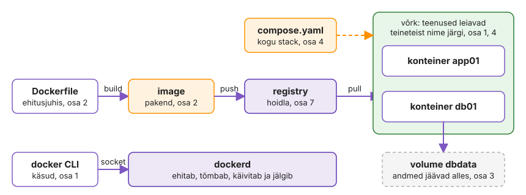
      <figcaption>Joonis 3.2. Dockeri põhimõisted ja loengu osad, kus neid selgitatakse (Talvik, 2026).</figcaption>
    </figure>

    *Tabel 3.1. Dockeri ökosüsteem ja tooted*

    Sõna „Docker“ kasutatakse mitme eri asja kohta. Selles loengus töötame peamiselt Docker Engine'i, käsurea ja Compose'iga, aga need kuuluvad laiemasse tööriistade ja teenuste ökosüsteemi.

    | Tööetapp | Tööriist või teenus | Roll |
    |---|---|---|
    | käivita serveris | Docker Engine (käsk `docker`) | ehitab image'id ja käivitab konteinerid |
    | kirjelda mitu teenust | Docker Compose | kõik rakenduse teenused ühes failis, käivitus ühe käsuga |
    | arenda oma arvutis | Docker Desktop, redaktori laiendused | sama Engine Windowsis ja macOS-is koos graafilise vaatega |
    | hoia ja jaga image'eid | Docker Hub või muu registry (kursusel Harbor) | image'ite hoidla, kust teised masinad need alla laadivad |
    | leia turvaauke | Docker Scout | analüüsib image'i komponente ja teadaolevaid turvaauke ning soovitab parandusi |
    | vali hooldatud baas | Docker Hardened Images | minimaalsed hooldatud baas-image'id koos komponentide nimekirja ja päritolutõendiga |
    | eralda AI-agendid | Docker Sandboxes | käivitab AI-agendi eraldi väikeses virtuaalmasinas |

    Kõik need ei ole kohustuslikud. Serveris ei ole Docker Engine'i kasutamiseks vaja Docker Desktopi, ja image'eid võib Docker Hubi asemel hoida asutuse registry's. Loengus käsitleme põhjalikumalt Engine'it, käsurida, Compose'i ja registry't. Turvatööriistad ja AI-agentide eraldamine on kursuse IS2 [loengus](https://hkhk-tk.github.io/is2-automatiseerimine/k03/loeng/).

    - [Docker Desktop](https://docs.docker.com/desktop/) ühendab Windowsis ja macOS-is Engine'i (Linuxi VM-is), CLI, Compose'i ja ehitustööriistad. Laiendused (Extensions) lisavad näiteks kettakasutuse, logide ja turvakontrolli vaate.
    - [Docker Scout](https://docs.docker.com/scout/), [Docker Hardened Images](https://docs.docker.com/dhi/) ja [Docker Sandboxes](https://docs.docker.com/ai/sandboxes/) on kirjeldatud kursuse IS2 [loengus](https://hkhk-tk.github.io/is2-automatiseerimine/k03/loeng/).

## 1. Konteiner on isoleeritud protsess

Serveris töötab kaks rakendust, mis vajavad erinevat Java versiooni. Kummalegi saab teha oma image'i, milles on sobiv Java ja rakenduse failid, ning sõltuvusi ei pea hosti samadesse kataloogidesse paigaldama. Kui image'i põhjal käivitatakse rakendus, tekib konteiner. See ei ole uus virtuaalmasin: rakenduse protsess kasutab endiselt hosti Linuxi tuuma.

### Kuidas konteinerid tekkisid

Konteinerite taga on kaks vana probleemi. Rakendus töötas arendaja masinas, aga serveris puudus mõni teek või oli selle versioon teine. Teiseks vajas iga rakendus, mida teistest eraldada taheti, oma serverit. Virtualiseerimine lahendas teise probleemi 2000. aastatel, kuid iga VM kannab kaasas terve operatsioonisüsteemi ja vajab hooldust nagu eraldi server.

**Ilma konteinerita.** Java ja Tomcat paigaldatakse serverisse paketina, nagu 2. kohtumisel Ansible'iga. Kui teine rakendus vajab teist Java versiooni, tuleb kaks versiooni samasse serverisse kõrvuti seadistada või võtta teine server. Arendaja masinas võib olla teine versioon kui serveris.

**Konteineriga.** Kumbki rakendus saab oma image'i, milles on sobiv Java. Serverisse paigaldatakse ainult Docker. Sama image töötab arendaja masinas ja serveris ühtemoodi, sest sõltuvused on image'i sees.

??? info "Süvenemiseks: konteinerite ajalugu"

    Protsessi eraldamine samas operatsioonisüsteemis on vanem kui Docker. Unixi käsk `chroot` (1979) andis protsessile oma juurkataloogi. FreeBSD jail (2000) ja Solaris Zones (2005) eraldasid lisaks protsessid, võrgu ja kasutajad. Linuxi tuuma lisandusid namespace'id järk-järgult aastatel 2002–2013. cgroup'id tulid Google'i inseneridelt ja jõudsid tuuma 2008. aastal. Samal aastal ilmus LXC, mis pani need kokku konteineriks.

    Docker (2013, [esimene esitlus PyConil](https://www.youtube.com/watch?v=wW9CAH9nSLs)) uut isolatsiooni ei leiutanud: esimesed versioonid kasutasid LXC-d. Uus oli pakend. Dockerfile kirjeldab, kuidas image ehitatakse, image sisaldab rakendust koos kõigi sõltuvustega, ja registry (Docker Hub) levitab seda nagu apt-repositoorium pakette. Sama image töötab arendaja masinas, testis ja tootmises. 2015. aastal loodi [Open Container Initiative](https://opencontainers.org/about/overview/), mis kirjeldab image'i vormingu ja käitamise standardina, nii et image ei sõltu enam ühest tööriistast. Samal aastal ilmus Kubernetese esimene versioon, mis käitab konteinereid paljudes serverites (7. kohtumine). Kubernetes ei vaja Dockerit: see käivitab samu OCI image'eid oma käituskeskkonnaga. Red Hat tegi 2018. aastal Podmani, mis käitab samu image'eid ilma keskse daemonita (osa 6).

    Konteinerid muutsid ka rakenduste ülesehitust. Varem paigaldati rakendus sageli ühe suure tervikuna (**monoliit**), mida uuendati ja skaleeriti korraga. Konteinerid võimaldavad rakenduse komponente eraldi pakendada ja käitada. See toetab **mikroteenuste** arhitektuuri, kus rakendus koosneb väikestest eraldi uuendatavatest teenustest, aga mitmest konteinerist koosnev lahendus ei ole automaatselt mikroteenustel põhinev. Labori seisus töötavad rakendus ja selle abiteenused (veebiserver, andmebaas, vahemälu, järjekord) eraldi konteinerites, aga rakendus app01 ise on üks tervik. Pilves käitatakse konteinereid sageli hallatud teenusena ([Amazon ECS](https://aws.amazon.com/ecs/), [Google GKE](https://cloud.google.com/kubernetes-engine), [Azure AKS](https://azure.microsoft.com/products/kubernetes-service)), kus orkestraatorit haldab teenusepakkuja.

    <figure markdown="span">
      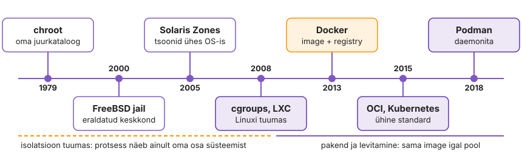
      <figcaption>Joonis 3.3. Isolatsioon oli tuumas olemas enne Dockerit, Docker lisas image'i ja registry (Talvik, 2026).</figcaption>
    </figure>

### Konteiner ja virtuaalmasin

Konteinerit on kõige lihtsam mõista virtuaalmasinaga võrreldes. **Virtualiseerimisel** jagab tarkvarakiht ehk **hüperviisor** ühe füüsilise serveri protsessori, mälu ja ketta mitme virtuaalmasina vahel. Kursuse masinad on Proxmoxi hüperviisoril töötavad VM-id. Igas VM-is on oma operatsioonisüsteem koos oma tuumaga, mis tuleb käivitada ja hooldada nagu eraldi serveris.

Konteineril oma tuuma ei ole: selle protsessid töötavad hosti tuumal ja image sisaldab ainult rakendust ja selle sõltuvusi. Konteineri käivitamisel ei käivitata uut tuuma, seetõttu on käivituskulu üldjuhul väiksem kui virtuaalmasinal. Image'i suurus ja see, millal rakendus on valmis, sõltuvad siiski pakitud tarkvarast.

<figure markdown="span">
  
  <figcaption>Joonis 3.4. Virtuaalmasinal on oma tuum, konteinerid jagavad hosti tuuma (Talvik, 2026).</figcaption>
</figure>

Igal konteineril on oma rakendus ja teegid, nii et app01 Java ja db01 teegid ei sega teineteist. Tuum on aga ühine: konteinerite protsessid teevad süsteemikutsed otse hosti tuumale. Docker Engine loob ja haldab konteinereid, aga ei asu nende ja tuuma vahel.

<figure markdown="span">
  
  <figcaption>Joonis 3.5. Igal konteineril on oma rakendus ja teegid, tuum on ühine; Docker loob ja haldab konteinereid, aga ei ole nende ja tuuma vahel (Talvik, 2026).</figcaption>
</figure>

Ühise tuuma kasutamisel on ka piirang: tuuma haavatavus puudutab kõiki samas hostis töötavaid konteinereid. Hüperviisor on palju kitsam ründepind, sest VM-id jagavad ainult virtualiseeritud riistvara. Seepärast käitatakse konteinereid tavaliselt virtuaalmasinates, nagu ka selles kursuses.

??? info "Süvenemiseks: rakenduskonteiner ja süsteemikonteiner"

    Konteinereid on kahte tüüpi. **Rakenduskonteiner** (Docker, Podman) käivitab ühe rakenduse: selles pole init-süsteemi ega SSH-d ja konteiner lõpeb koos rakendusega. **Süsteemikonteiner** (LXC) käivitab terve Linuxi kasutajaruumi koos systemd ja teenustega ning seda hallatakse nagu väikest serverit. Proxmoxis on lisaks VM-idele ka LXC konteinerid (CT), mis kasutavad samu tuuma mehhanisme. Selles loengus räägime rakenduskonteineritest.

### Esimene konteiner

Näidetes kasutame Linuxi serveris tavapärast Docker Engine'it. Selle taustteenus (daemon) töötab root'i õigustes, sellist paigaldust nimetatakse rootful'iks. Tavakasutaja õigustes käitamist (rootless) käsitleb osa 6.

Allolev näide näitab konteineri elutsüklit käivitamisest eemaldamiseni. Kommentaar iga käsu kõrval ütleb, mida väljundis tähele panna.

```bash
docker run -d --name veeb -p 8080:80 nginx:1.30-alpine
docker ps
curl -sI http://localhost:8080 | head -1     # HTTP/1.1 200 OK
docker logs veeb                             # päringu rida logis
docker exec -it veeb sh                      # shell konteineris

# järgmised käsud konteineris
ps
cat /etc/os-release
exit

# järgmised käsud jälle hostis
docker stop veeb
docker rm veeb
```

Käsk loob ja käivitab Nginxi konteineri ning võti `-d` jätab selle taustale tööle. Võtmes `-p 8080:80` on vasakul hosti port ja paremal konteineri port: brauser pöördub hosti pordile 8080 ja Docker suunab liikluse konteineri pordile 80. Brauseris avaneb leht aadressil `http://<serveri IP>:8080`. `docker ps` näitab konteineri olekut `Up`, `docker logs` iga päringu rida.

Peatamine ja eemaldamine on erineva tagajärjega. `docker stop` peatab konteineri ja `docker start` käivitab sama konteineri uuesti. Kirjutatavasse kihti tehtud muudatused jäävad siis alles. `docker rm` kustutab konteineri koos selle kihiga, ja uus `docker run` alustab image'i algsest sisust. Joonis näitab konteineri olekuid ja käske, mis viivad ühest olekust teise.

<figure markdown="span">
  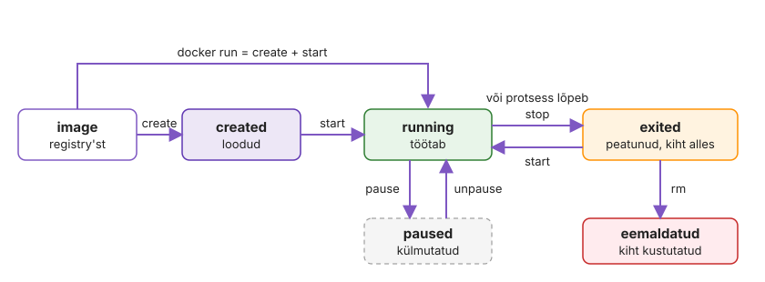
  <figcaption>Joonis 3.6. Konteineri elutsükkel: stop jätab kirjutatava kihi alles, rm kustutab selle (Talvik, 2026).</figcaption>
</figure>

??? note "Käskude teatmik: docker run ja elutsükkel"

    *Tabel 3.2. Käsu `docker run -d --name veeb -p 8080:80 nginx:1.30-alpine` osad*

    | Osa | Tähendus |
    |---|---|
    | `docker run` | loo image'ist uus konteiner ja käivita see |
    | `-d` | taustal; ilma selleta on terminal konteineri väljundiga seotud ja Ctrl+C peatab selle |
    | `--name veeb` | nimi, millega konteinerile hiljem viitad; ilma selleta saab juhusliku nime |
    | `-p 8080:80` | hosti port 8080 suunatakse konteineri pordile 80; ilma selleta pole konteiner väljast nähtav |
    | `nginx:1.30-alpine` | image'i nimi ja tag; kui image'it hostis pole, tõmmatakse see registry'st |

    *Tabel 3.3. Elutsükli ja uurimise käsud*

    | Käsk | Vastab küsimusele |
    |---|---|
    | `docker pull <image>` | laadi image registry'st alla ilma konteinerit käivitamata |
    | `docker image ls` (vanem kuju `docker images`) | millised image'id on hostis ja kui suured need on |
    | `docker ps`, `docker ps -a` | mis töötab; `-a` näitab ka peatatud konteinereid ja nende väljumiskoodi |
    | `docker logs <nimi>` | mida PID 1 kirjutas stdout'i ja stderr'i |
    | `docker exec -it <nimi> sh` | mis on töötava konteineri sees; käivitab sinna uue protsessi |
    | `docker inspect <nimi>` | täielik seadistus: image, võrgud, mount'id, keskkond, olek |
    | `docker stop`, `docker start` | peata ja käivita sama konteiner; kirjutatav kiht jääb alles |
    | `docker pause`, `docker unpause` | külmuta konteineri protsessid hetkeks ja jätka; mälu jääb alles |
    | `docker rm` | kustuta konteiner koos kirjutatava kihiga |

Veaotsing algab samadest küsimustest:

1. Olek: kas konteiner töötab ja milline on väljumiskood (`docker ps -a`)?
2. Logid: mida rakendus ütles (`docker logs`)?
3. Seadistus: millise image'i, võrgu ja mount'idega see käivitati (`docker inspect`)?
4. Sisemine kontroll: mida on vaja konteineri sees uurida (`docker exec`)?

### Dockeri juhtimisõigus on root'i õigus

!!! warning "Hoiatus: grupp docker võrdub root'iga"

    Kes saab Dockerit juhtida (kasutaja grupis `docker` või konteiner, millesse on mount'itud `docker.sock`), saab muuta hosti mis tahes faili.

Socket'i kaudu saab paluda daemonil luua konteineri, millesse on mount'itud hosti juurkataloog. Konteineri root saab siis muuta hosti faile, kuigi kasutajal endal `sudo` õigust pole.

<figure markdown="span">
  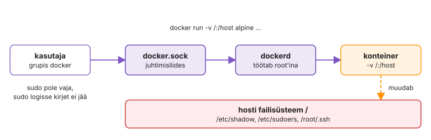
  <figcaption>Joonis 3.7. Grupp docker annab socket'i kaudu root'i õigused hostis (Talvik, 2026).</figcaption>
</figure>

??? info "Süvenemiseks: miks socket annab root'i õigused"

    Protsessi eraldamine ei tähenda, et see töötab automaatselt väiksemate õigustega. Docker ei kasuta vaikimisi user namespace'i, nii et `uid=0` konteineris on hostis samuti UID 0. Kõiki hosti root'i õigusi sellel siiski pole, sest capability'te piirangud ja seccomp (vt selle osa viimane süvenemisplokk) piiravad protsessi võimalusi. Suurem risk on socket. Kes saab socket'i kaudu daemonile käske anda, saab paluda käivitada konteineri, mis mount'ib hosti `/`, ja muuta selle kaudu hosti mis tahes faili. Selleks pole vaja turvaauku, piisab daemoni tavalistest võimalustest, ja `sudo` logisse sellest midagi ei jää ([Docker Engine security](https://docs.docker.com/engine/security/)). Grupp `docker` annab ligipääsu socket'ile ehk root'iga võrdse õiguse ning selle liikmeid tuleb auditeerida nagu `sudoers`-it. Sama kehtib konteineri kohta, millele socket on mount'itud (`-v /var/run/docker.sock:/var/run/docker.sock`): tavaline konteiner käitab ainult oma rakendust, socket'iga konteiner saab juhtida ka teisi konteinereid ja nende kaudu hosti. Kui see rakendus kompromiteeritakse, juhib ründaja hosti Dockerit.

### Protsessi lõpp peatab konteineri

Kui konteineri PID 1 lõpeb, peatub ka konteiner. Tavalises rakenduse konteineris systemd'i pole, seega peab teenus töötama esiplaanil ja `SIGTERM`-i peale lõpetama.

??? info "Süvenemiseks: signaalid ja --init"

    `docker stop` ootab vaikimisi 10 sekundit (`--stop-timeout`, Compose'is `stop_grace_period`) ja saadab siis `SIGKILL`-i. Kui PID 1 on shell, mis signaali edasi ei anna, saab andmebaas iga uuendusega `SIGKILL`-i. Shell PID 1-na ei korja ka lõpetanud alamprotsesse. Võti `--init` paneb PID 1-ks väikese init-programmi, mis edastab signaalid ja koristab alamprotsessid.

### Kes konteineri uuesti käivitab

Pärast protsessi lõppu või masina taaskäivitust otsustab **restart-poliitika**, kas daemon konteineri uuesti käivitab. Teenustele sobib tavaliselt `unless-stopped`: Docker käivitab konteineri uuesti, välja arvatud siis, kui administraator selle ise peatas.

??? info "Süvenemiseks: restart-poliitikad, healthcheck ja --init"

    `no` (vaikimisi) ei käivita kunagi. `on-failure:3` käivitab ainult veakoodiga lõpu korral ja kuni kolm korda (daemoni taaskäivitusel seda konteinerit uuesti ei käivitata), nii et katkine konteiner ei käivitu lõputult ning logi jääb uurimiseks alles. `always` käivitab alati, ka siis, kui administraator konteineri käsitsi peatas ja seejärel daemon taaskäivitus. `unless-stopped` jätab meelde käsitsi peatamise ja sobib seepärast teenustele.

    *Tabel 3.4. Kolm eri mehhanismi*

    | Mehhanism | Millele reageerib |
    |---|---|
    | restart-poliitika | konteineri põhiprotsessi lõpule ja poliitika järgi daemoni käivitumisele |
    | healthcheck | kontrollib, kas teenus vastab; märgib oleku, aga ei taasta ise midagi |
    | `--init` | edastab signaalid põhiprotsessile ja koristab lõpetanud alamprotsessid |

### Kuidas konteiner võrku kasutab

Vaikevõrgus `bridge` saab konteiner IP-aadressi hosti sisemises sillas `docker0` ja väljast jõuab selleni ainult avaldatud pordi (`-p 8080:80`) kaudu.

??? info "Süvenemiseks: võrguviisid, capability'd, seccomp ja ressursipiirid"

    **Võrguviisid.** Võrgus `host` kasutab konteiner otse hosti võrku: NAT-i pole, `-p` ei kehti ja konteiner võib sattuda pordikonflikti hosti teenustega. Seda küsivad tavaliselt monitooringuagendid. Võrgus `none` on ainult loopback ja see sobib tööle, mis ei tohi võrku puutuda. Kasutaja loodud võrgus (`docker network create`) lahendab Dockeri sisseehitatud DNS aadressil `127.0.0.11` teiste konteinerite nimed. Võrk `--internal` laseb konteineritel teineteist näha, aga väljapääsu ei anna.

    Namespace'id ja cgroup'id ei ole ainsad piirangud. Docker käivitab protsessi kitsendatud capability'te komplektiga: root konteineris ei saa vaikimisi laadida tuumamooduleid, muuta süsteemiaega ega seadistada hosti võrguliideseid. Lisaks filtreerib [vaikimisi seccomp-profiil](https://docs.docker.com/engine/security/seccomp/) süsteemikutseid ja keelab kümneid neist, näiteks `mount`, `reboot` ja `kexec_load`. Lipp `--privileged` lülitab need kõik välja ja annab ligipääsu hosti seadmetele. Konteiner, mis vajab `--privileged`-i, on sisuliselt root-shell hostis ja vajab sama ülevaatust nagu uus `sudoers`-i rida.

    Need piirangud vähendavad ründepinda, aga ei kõrvalda seda. 2019. aastal avaldatud [CVE-2019-5736](https://nvd.nist.gov/vuln/detail/CVE-2019-5736) lubas konteineris root'ina töötaval protsessil üle kirjutada hosti `runc`-i binaari, kui keegi käivitas konteineris `docker exec`-i, ja iga järgmine `runc`-i käivitus töötas siis ründaja koodina hosti root'i õigustes. Paik tuli `runc`-i, mitte image'isse. Konteinerihosti paikamine hõlmab seega tuuma, `runc`-i, `containerd`-d ja `dockerd`-d, mitte ainult rakendusi. Mitme kliendi või usaldamatu koodi jaoks kasutatakse seepärast VM-i, kerget VM-i iga konteineri ümber (Kata Containers) või kasutajaruumi tuuma (gVisor), mitte ainult namespace'e.

    Ressursipiirangud vajavad sama tähelepanu ka protsesside arvu puhul. Vaikimisi pole `--pids-limit`-i seatud, nii et fork-pomm või lekkiv lõimede kogum ühes konteineris ammendab hosti `pid_max`-i ja ka SSH-sessioon ei saa enam uut protsessi luua. Tootmises on mõistlik seada mälu ja protsesside piir igale teenusele. CPU piir sõltub koormusest: liiga madal `--cpus` paneb latentsuse kõikuma, sest tuum piirab CPU-aega iga 100 ms perioodi kaupa.

**Leia viga.** Eesmärk on avada Nginxi leht brauseris aadressil `http://<serveri IP>:8080`. Konteiner käivitati nii:

```bash
docker run -d --name veeb nginx:1.30-alpine
docker ps                                   # STATUS: Up
curl -I http://localhost:8080               # curl: (7) Failed to connect to localhost port 8080
```

Konteiner töötab, aga leht ei avane. Miks?

??? success "Vastus"

    - **Oli:** käsus puudub pordi avaldamine `-p`.
    - **Õige:** `docker run -d --name veeb -p 8080:80 nginx:1.30-alpine`.
    - **Miks:** konteiner on oma võrgus ja Nginx kuulab konteineri pordil 80. Ilma võtmeta `-p` ei suuna Docker ühtegi hosti porti konteinerisse, nii et hosti pordil 8080 ei kuula keegi. `docker ps` veerg PORTS näitab sel juhul ainult `80/tcp`, mitte `0.0.0.0:8080->80/tcp`.

??? question "Kontrolli ennast"

    1. Milline osa konteineri keskkonnast on konteineri oma ja milline on hostiga ühine?
    2. app01 lõpeb iga paari minuti järel koodiga 137. Mida see kood ütleb ja millised on kaks tõenäolist põhjust?
    3. Kumb on turvalisem: kasutaja grupis `docker` või kasutaja, kellel on `sudo` õigus ainult käsule `systemctl restart nginx`?

## 2. Image kui muutumatu artefakt

Tarkvaraarenduses nimetatakse **artefaktiks** ehitamise käigus loodud tulemit, mida saab säilitada, kontrollida ja järgmisse tööetappi edasi anda. Näiteks kompileeritud Java rakendus, tarkvarapakett või konteineri image. Labori seisu ehitamisel tekib kõigepealt WAR-fail. Seejärel pakitakse WAR koos Tomcati ja JRE-ga image'isse. Nii WAR kui ka image on ehitusartefaktid.

<figure markdown="span">
  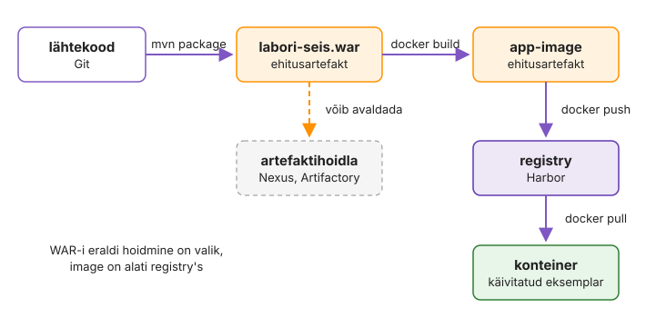
  <figcaption>Joonis 3.8. Ehitusartefaktid Labori seisus: WAR ja image (Talvik, 2026).</figcaption>
</figure>

**Ilma image'ita.** Playbook paigaldab rakenduse igasse serverisse eraldi. Sama playbook kahe nädala vahega võib anda erineva tulemuse, kui repositooriumisse ilmus uus paketiversioon, ja testserveris ning tootmises võivad olla eri versioonid.

**Image'iga.** Tulemus ehitatakse üks kord ja sama artefakt liigub muutmata testi ja tootmisse. Serverid ei paigalda rakendust, vaid laadivad alla valmis image'i.

Arendaja ehitab image'i ja proovib selle oma masinas konteinerina läbi. Seejärel laadib ta image'i registry'sse. Testserver ja tootmisserver tõmbavad sealt täpselt sama image'i, mitte ei paigalda rakendust uuesti. Tootmises kasutatakse sama image'it, seadistus, andmed ja käituskeskkond võivad aga erineda. Seda, et sisu on sama, saab kontrollida image'i räsi ehk digest'i järgi (osa 5).

<figure markdown="span">
  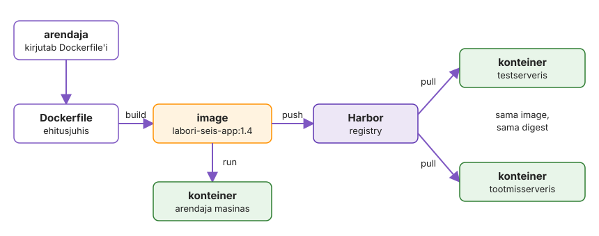
  <figcaption>Joonis 3.9. Image ehitatakse üks kord ja iga masin käivitab sama image'i (Talvik, 2026).</figcaption>
</figure>

### Dockerfile 1: valmis WAR image'isse

Labori seisu rakendus ehitatakse Maveniga ja tulemus on fail `labori-seis.war`. 2. kohtumisel paigaldas Ansible Java ja Tomcati serverisse. Nüüd kirjeldab **Dockerfile** keskkonna, millesse valmis rakendus pakitakse. Dockerfile on tekstifail, mille juhiseid `docker build` täidab ülevalt alla. Lihtne näide koosneb kolmest juhisest:

```dockerfile
FROM tomcat:10.1-jre21-temurin
COPY target/labori-seis.war /usr/local/tomcat/webapps/ROOT.war
CMD ["catalina.sh", "run"]
```

Näide vastab kolmele küsimusele. Käituskeskkond tuleb baas-image'ist: `FROM` valib image'i, kus on juba JRE ja Tomcat. Rakenduse lisab `COPY`: Tomcat avab faili `webapps/ROOT.war` juurtee `/` all. Mida konteiner käivitab, määrab `CMD`, ja see protsess on konteineris PID 1.

Selles etapis pakib Dockerfile juba valmis WAR-i. WAR-i ehitamine käib veel väljaspool image'i ehitust:

```text
mvn package          docker build              docker run
     │                    │                        │
     ▼                    ▼                        ▼
valmis WAR         Tomcat + JRE + WAR        töötav rakendus
```

Ehituskontekst on kaust, mis saadetakse builder'ile (`docker build -t labseis-app:1.0 .`, punkt lõpus). Fail `.dockerignore` jätab sealt välja selle, mida image ei vaja, eriti `.env`-i ja `.git`-i. Käsk `docker build --check` kontrollib Dockerfile'i levinud vigu ilma image'it ehitamata.

Lisaks kolmele juhisele kohtab Dockerfile'ides veel mõnda. Tabel 3.5 seletab need, mis on Labori seisu Dockerfile'ides.

??? note "Tabel 3.5. Dockerfile'i juhised"

    | Juhis | Mida teeb | Tekitab kihi |
    |---|---|---|
    | `FROM` | valib baas-image'i, mille peale ehitatakse | |
    | `WORKDIR` | töökataloog järgmistele juhistele ja konteineri käivitamisel | |
    | `COPY` | kopeerib faili ehituskontekstist (või `--from` teisest astmest) image'isse | jah |
    | `RUN` | käivitab ehitamise ajal käsu, näiteks paketi paigalduse | jah |
    | `ARG` | muutuja, mis kehtib ainult ehitamise ajal; väärtus antakse `docker build --build-arg NIMI=…`, näiteks `ARG HUB=docker.io/library` ja `FROM ${HUB}/nginx:…` | |
    | `ENV` | keskkonnamuutuja, mis jääb image'isse ja on olemas ka töötavas konteineris | |
    | `USER` | millise kasutajana järgmised juhised ja konteineri protsess töötavad | |
    | `EXPOSE` | dokumenteerib, millist porti rakendus kuulab; porti ei avalda, selleks on `-p` | |
    | `HEALTHCHECK` | käsk, millega Docker kontrollib, kas teenus vastab (osa 4) | |
    | `ENTRYPOINT` | programm, mis käivitub alati; `CMD` väärtus antakse sellele argumendiks | |
    | `CMD` | vaikimisi käsk; `docker run <image> <käsk>` asendab selle | |

    Ametlike image'ite `ENTRYPOINT` on sageli skript, mis enne põhiprotsessi käivitamist teeb ettevalmistusi. Näiteks Nginxi image teeb kausta `/etc/nginx/templates/` failidest konfiguratsioonifailid, MariaDB image loob tühja andmekataloogi korral andmebaasi ja kasutaja.

### Dockerfile 2: kes ehitab WAR-i

Senine Dockerfile eeldab, et `target/labori-seis.war` on juba olemas. Kes selle ehitab, ja kas ehitaja masinas peab olema sobiv JDK ja Maven? Ehitamiseks on vaja tööriistu, mida rakenduse käitamisel enam ei vajata.

[Mitmeastmeline ehitus](https://docs.docker.com/build/building/multi-stage/) toob WAR-i ehitamise Dockerfile'i sisse, aga jätab kompilaatori, sõltuvuste vahemälu ja lähtekoodi eraldi ehitusastmesse. Põhiküsimus on, millised failid peavad lõppimage'isse jõudma ja milliseid vajati ainult ehitamiseks. Lõppimage'isse kopeeritakse ainult valmis WAR.

Ehitusaste ja ühenduskoht `COPY --from` näevad välja nii:

```dockerfile
FROM maven:3-eclipse-temurin-21 AS build
WORKDIR /src
COPY pom.xml .
RUN mvn -q dependency:go-offline
COPY src ./src
RUN mvn -q package

FROM tomcat:10.1-jre21-temurin
COPY --from=build /src/target/labori-seis.war /usr/local/tomcat/webapps/ROOT.war
```

??? example "Täielik mitmeastmeline Dockerfile"

    ```dockerfile
    FROM maven:3-eclipse-temurin-21 AS build
    WORKDIR /src
    COPY pom.xml .
    RUN mvn -q dependency:go-offline      # sõltuvused omaette kihis
    COPY src ./src
    RUN mvn -q package

    FROM tomcat:10.1-jre21-temurin
    WORKDIR /usr/local/tomcat
    RUN useradd --system --uid 10001 labseis \
     && chown -R 10001 logs temp work webapps
    COPY --from=build /src/target/labori-seis.war webapps/ROOT.war
    ARG GIT_SHA=unknown                   # muutub iga commit'iga, seepärast lõpus
    ENV GIT_SHA=${GIT_SHA}
    USER 10001
    CMD ["catalina.sh", "run"]
    ```

    Käitusastmes loob `useradd` süsteemikasutaja ja `USER 10001` paneb Tomcati töötama selle kasutajana, mitte root'ina. Põhjalikumalt selgitab mitte-root kasutajat kursuse IS2 [loeng](https://hkhk-tk.github.io/is2-automatiseerimine/k03/loeng/). Commit'i SHA (`GIT_SHA`, antakse `docker build --build-arg GIT_SHA=…`) on viimaste ridade seas: kui see oleks faili alguses, ehitataks iga commit'iga kõik järgnevad kihid uuesti.

<figure markdown="span">
  
  <figcaption>Joonis 3.10. Mitmeastmeline ehitus: lõppimage'isse jõuab ainult WAR (Talvik, 2026).</figcaption>
</figure>

??? note "Tabel 3.6. Kaks Dockerfile'i"

    | Variant | Mille eest Dockerfile vastutab | Mis jääb väljapoole |
    |---|---|---|
    | 1. valmis WAR | käituskeskkond ja rakenduse lisamine | WAR ehitatakse enne |
    | 2. mitmeastmeline | WAR-i ehitamine, käitusimage'i koostamine ja käituskasutaja | seadistus ja püsivad andmed antakse käivitamisel |

### Kuidas image'i kihid ja konteineri muudatused eristuvad

**Küsimus:** kui samast image'ist käivitada kaks konteinerit, kas ühes tehtud failimuudatus jõuab teise? Vastus tuleneb sellest, kuidas image on üles ehitatud.

Image koosneb kirjutuskaitstud kihtidest. Dockerfile'is lisab iga `RUN`, `COPY` ja `ADD` ühe kihi. Käivitamisel saab konteiner nende peale oma õhukese kirjutatava kihi, kuhu läheb kõik, mida konteineris muudetakse.

<figure markdown="span">
  
  <figcaption>Joonis 3.11. Kirjutuskaitstud kihid on ühised, igal konteineril on oma õhuke kirjutatav kiht (Talvik, 2026).</figcaption>
</figure>

Vastus küsimusele: ei jõua. Mõlemad konteinerid loevad samu kirjutuskaitstud kihte, aga kirjutavad igaüks oma kirjutatavasse kihti, mis kaob koos konteineriga.

??? info "Süvenemiseks: OCI image, overlayfs ja kihtide uurimine"

    [OCI](https://opencontainers.org/) **image** koosneb manifestist, konfiguratsioonist ja failisüsteemi kihtidest. Manifest kirjeldab, millised konfiguratsiooni- ja kihifailid image'isse kuuluvad. Konfiguratsioon (JSON) sisaldab muu hulgas `Entrypoint`, `Cmd`, `Env` ja `User` väärtusi. Iga kiht on tar-arhiiv. Dockerfile'is lisab iga `RUN`, `COPY` ja `ADD` ühe kihi, `CMD`, `ENV` ja `USER` muudavad ainult konfiguratsiooni. Käivitamisel ühendab overlayfs kirjutuskaitstud kihid (`lowerdir`) ja konteineri oma kirjutatava kihi (`upperdir`). Kui protsess muudab alumises kihis olevat faili, kopeerib tuum enne kirjutamist terve faili ülemisse kihti (copy-up). 2 GB andmefail kirjutatavas kihis tähendab seega 2 GB koopiat esimesel kirjutusel.

    Kihte saab uurida ilma konteinerit käivitamata: `docker history <image>` näitab iga kihi suurust ja juhist, millest see tekkis. Töötava konteineri kirjutatavat kihti näitab `docker diff <konteiner>`: millised failid on lisatud (`A`), muudetud (`C`) või kustutatud (`D`).

### Muutumatus ja selle tagajärjed

Muutumatusel on kolm tagajärge. Esiteks kaob `docker exec`-iga muudetud konfiguratsioonifail järgmise uuendusega, sest uus konteiner tuleb image'ist. Parandus läheb Dockerfile'i ja uude image'isse. Teiseks saab rakenduse versiooni tagasi vahetada (rollback) eelmise image'i käivitamisega, kui see on veel registry's ning konfiguratsioon ja andmete seis seda toetavad. Kolmandaks jääb kõik, mis kihti jõudis, sinna alatiseks. Hilisemas kihis tehtud `rm` peidab faili, aga varasemast kihist see ei kao. Image'isse kopeeritud `.env` või SSH võti on kõigil, kes image'i alla laadivad.

Valmis image'i sisu ei muutu. Sama Dockerfile'i uuesti ehitamisel võib tulemus aga erineda, kui sisendid on vahepeal muutunud. Näiteks kahe nädala pärast annab sama Dockerfile teise image'i, sest `FROM` tag ja `apt-get install` tõmbavad uuemad versioonid. Korratavus vajab fikseeritud baasi digest'i (image'i sisu räsi) ja versioonidega paketinimekirja, värskus vajab vastupidist. Kumba eelistada, on poliitika küsimus.

**Leia viga.** Eesmärk on, et rakendus avaneks aadressil `http://<serveri IP>:8080/`. Dockerfile:

```dockerfile
FROM tomcat:10.1-jre21-temurin
COPY target/labori-seis.war /usr/local/tomcat/webapps/labori-seis.war
CMD ["catalina.sh", "run"]
```

Konteiner töötab ja logis on `Deployment of web application archive … has finished`, aga aadress `/` annab vastuseks 404. Miks?

??? success "Vastus"

    - **Oli:** WAR kopeeriti nimega `labori-seis.war`.
    - **Õige:** `COPY target/labori-seis.war /usr/local/tomcat/webapps/ROOT.war`.
    - **Miks:** Tomcat avab iga WAR-faili tee all, mis vastab faili nimele. `labori-seis.war` on aadressil `/labori-seis/`, juurtee `/` all avaneb ainult `ROOT.war`. Rakendus töötab, aga vales kohas.

??? question "Kontrolli ennast"

    1. Kumb on muutumatu, image või konteiner? Mis juhtub `docker exec`-iga tehtud muudatusega uuendamisel?
    2. Miks ei kustuta hilisem `RUN rm .env` faili image'ist, kui varasem `COPY` selle sinna kopeeris?

## 3. Andmed ja olek väljaspool konteinerit

Konteineri kirjutatav kiht kuulub selle konteineri juurde. Kui konteiner eemaldatakse, kaovad ka sinna kirjutatud failid. MariaDB uuendamine tähendab vana konteineri eemaldamist ja uue loomist uuest image'ist, seega ei saa andmebaasi andmekataloog olla ainult konteineri kirjutatavas kihis.

**Ilma nimega volume'ita.** Pärast `docker rm` ja uut `docker run`-i on andmebaas tühi, sest uus konteiner alustab tühjast andmekataloogist. MariaDB image loob küll iga konteineri jaoks ise nimeta volume'i, aga uus konteiner saab uue ja tühja.

**Volume'iga.** Andmekataloog `/var/lib/mysql` on volume'is, mis on konteinerist eraldi. Uus konteiner ühendab sama volume'i ja leiab sealt eelmised tabelid.

### Andmed: volume ja bind mount

Andmete säilitamiseks ühendatakse konteinerisse volume või hosti kataloog. **Volume**'i loob ja haldab Docker (`local` draiveriga kataloogis `/var/lib/docker/volumes/<nimi>/_data`) ja selle elutsükkel on konteinerist lahus. **Bind mount**'i puhul määrab administraator ise, milline hosti fail või kataloog konteinerisse ühendatakse. Labori seisus peab db01 andmekataloog säilima ka siis, kui MariaDB konteiner asendatakse. Tabel 3.7 võrdleb selleks kahte võimalust.

??? note "Tabel 3.7. Volume ja bind mount"

    | | Volume | Bind mount |
    |---|---|---|
    | kus | Dockeri hallatav kataloog `/var/lib/docker/volumes/` all | hosti kataloog, mille tee annad ise |
    | kes haldab | `docker volume ls`, `docker volume rm` | hosti failisüsteem ja tavalised õigused |
    | tühja ühendamisel | image'i sisu kopeeritakse sisse | hosti kataloog katab image'i sisu |
    | failiõigused | tuleb sobitada rakenduse kasutajaga; tühja volume'i eeltäitmine võib säilitada image'i failide omaniku ja õigused | hosti failide omanik ja õigused; puuduv kaust tekib root'ina |
    | sobib | andmebaas, järjekord, muu püsiv olek | konfiguratsioonifail, kood arendaja masinas |
    | Compose'is | `- dbdata:/var/lib/mysql` | `- ./nginx.conf:/etc/nginx/nginx.conf:ro` |

<figure markdown="span">
  
  <figcaption>Joonis 3.12. Kolm kohta, kuhu konteiner saab kirjutada. Konteineri kustutamise järel jäävad alles ainult kaks neist. Joonisel on näitena volume `dbtest` ja kaust `$HOME/k03-bind`, Compose'i näites on sama roll volume'il `dbdata` (Talvik, 2026).</figcaption>
</figure>

Mõlemal juhul peavad failiõigused sobima konteineris töötava protsessi kasutajaga, aga volume ja bind mount käituvad siin erinevalt.

Tühja volume'i esmakordsel ühendamisel võib Docker kopeerida sinna image'i sihtkataloogi sisu. Koos failidega säilivad nende omanikud ja õigused. See käitumine sõltub volume'i tühjusest, mitte selle nimest, ja eeltäitmise saab keelata valikuga `volume-nocopy`.

MariaDB image'is kuulub andmekataloog `/var/lib/mysql` kasutajale `mysql`. Kui sinna ühendatakse tühi volume, saab see sama omaniku ja MariaDB saab kohe kirjutada.

Bind mount'il on hosti kataloogi õigused. Tüüpiline valik on seepärast bind mount konfiguratsioonifailile ja volume andmebaasile.

Käsureal on mount'i jaoks kaks kuju. `-v /tee:/data` on lühivorm, mis loob puuduva hosti kausta vaikselt root'i omanikuna, ja mitte-root teenusel võib puududa sinna kirjutamise õigus. `--mount type=bind,src=/tee,dst=/data` annab puuduva kausta korral vea, nii et vale tee jääb kohe silma.

!!! danger "Andmekadu"

    Enne volume'ite eemaldamist (`docker compose down -v`, `docker volume rm`, `docker volume prune`) kontrolli, milliseid volume'eid käsk puudutab ja kas taastatav varukoopia on olemas. Konteineri uuesti loomine kustutatud volume'i andmeid ei taasta.

Andmebaas on ainult üks rakenduse osa. Iga osa puhul tasub küsida, mis peab juhtuma, kui konteiner asendatakse uuega. Tabel 3.8 vastab sellele Labori seisu osade kaupa.

??? note "Tabel 3.8. Mis juhtub konteineri asendamisel"

    | Mis | Kust tuleb | Konteineri asendamisel |
    |---|---|---|
    | rakenduse binaar (WAR, Tomcat, JRE) | image'ist | asendub uue väljalaskega |
    | konfiguratsioon | keskkonnamuutujad, mount'itud fail või image | rakendub see, mis on failis või Gitis kirjas |
    | saladus | fail (`secrets:`) või saladuste hoidla | antakse uuele konteinerile uuesti |
    | andmebaasi andmed | volume | jäävad alles |
    | ajutised failid, logifailid konteineris | kirjutatav kiht | kaovad |

### Seadistus ja saladused

Seadistus ja saladused tulevad käivitamisel väljast: sama image töötab testis ja tootmises, vahe on keskkonnas ja mount'itud failides. Keskkonnamuutujad antakse käsureal võtmega `-e` või failist võtmega `--env-file`. `--env-file` loeb väärtused sõna-sõnalt, nii et jutumärgid jäävad väärtuse osaks. Compose'i `.env` (osa 4) tõlgendab jutumärke.

Keskkonnamuutuja on saladuse jaoks halb koht. `docker inspect` näitab seda kõigile, kellel on socket'ile ligipääs, see on loetav failist `/proc/<pid>/environ` ja pärandub igale alamprotsessile. Fail ([Compose'is `secrets:`](https://docs.docker.com/compose/how-tos/use-secrets/), Kubernetesis Secret) jätab keskkonda ainult tee. See vähendab juhusliku lekke riski (logis, veateates, `inspect`-i väljundis), aga ei kaitse saladust Dockeri administraatori eest, kes saab faili lugeda.

Ametlike andmebaasi-image'ite entrypoint algseadistab andmekataloogi ainult siis, kui see on tühi ([MariaDB image](https://hub.docker.com/_/mariadb)). Muudetud algne SQL või `MARIADB_PASSWORD` olemasolevat volume'it ei muuda. See on Compose'i stackides sage `Access denied` põhjus: image'i ja oleku elutsükkel on lahus ja skeemimuudatus vajab migratsiooni.

### Kust konteineri logid tulevad

Logid kirjutab rakendus oma standardväljundisse ja veaväljundisse (stdout, stderr) ning Docker kogub need konteineri logiks. Vaikimisi [`json-file`](https://docs.docker.com/engine/logging/drivers/json-file/) draiver kirjutab need faili `/var/lib/docker/containers/<id>/<id>-json.log` ilma rotatsioonita, kuni `max-size` on seatud. Üks jutukas konteiner võib täita partitsiooni ja põhjustada ka teiste teenuste tõrkeid.

Kasvu piiramiseks seatakse `json-file` draiverile `max-size` ja `max-file`, kas konteineri kaupa või kõigile uutele konteineritele daemoni konfiguratsioonifailis `daemon.json`. Draiver `journald` saadab konteineri logi hosti journal'isse, kus see on teiste teenuste logide kõrval ja `journalctl`-iga filtreeritav.

**Leia viga.** Eesmärk on, et db01 andmed säiliksid konteineri asendamisel. Konteiner käivitati nii:

```bash
docker volume create dbdata
docker run -d --name db01 -e MARIADB_ROOT_PASSWORD=Passw0rd \
  -v dbdata:/var/lib/mariadb mariadb:11.4
```

Pärast `docker rm -f db01` ja sama käsu uuesti käivitamist on andmebaas tühi, kuigi volume `dbdata` on olemas. Miks?

??? success "Vastus"

    - **Oli:** volume ühendati kataloogi `/var/lib/mariadb`.
    - **Õige:** `-v dbdata:/var/lib/mysql`.
    - **Miks:** MariaDB image hoiab andmeid kataloogis `/var/lib/mysql`. Volume ühendati kataloogi, mida keegi ei kasuta. Andmed läksid nimeta volume'isse, mille MariaDB image iga konteineri jaoks ise loob, ja uus konteiner sai uue tühja nimeta volume'i. `docker inspect db01` jaotises `Mounts` on näha, kuhu volume ühendati.

??? question "Kontrolli ennast"

    1. Mis jääb alles pärast `docker rm`-i: kirjutatav kiht, volume või bind mount?
    2. Miks on keskkonnamuutuja saladuse jaoks halb koht?

## 4. Mitu teenust Compose'iga

Rakendus koosneb mitmest teenusest, mis peavad ühes võrgus koos töötama. **Compose** on tööriist, mis kirjeldab kõik teenused ühes YAML-failis ja käivitab need ühe käsuga.

**Ilma Compose'ita.** Iga teenus käivitatakse oma `docker run` käsuga, kus on pordid, võrk, volume'id ja keskkonnamuutujad. Viie teenusega stacki soovitud olek on kirjas ainult shelli ajaloos ja uuendamisel tuleb meeles pidada õiget järjekorda.

**Compose'iga.** Sama info on failis `compose.yaml`, mis on Gitis. [Compose](https://docs.docker.com/compose/) loeb faili ja viib stacki selle järgi soovitud olekusse käsuga `docker compose up -d`.

`compose.yaml` kirjeldab teenused, võrgud ja volume'id. `docker compose up -d` loob puuduva teenuse, loob uuesti teenuse, mille seadistus muutus, ja jätab ülejäänu puutumata. Tulemus on idempotentne nagu playbook. Erinevus on mehhanismis: Ansible muudab olemasolevat serverit, Compose peatab vana konteineri ja loob uue. Selle aja jooksul teenus ei vasta, sest Compose ei tee järkjärgulist uuendust (rolling update).

<figure markdown="span">
  
  <figcaption>Joonis 3.13. Viie teenusega stack. Iga teenus ootab enne käivitumist, kuni sõltuvuste healthcheck annab oleku healthy (Talvik, 2026).</figcaption>
</figure>

Allolev näide on väljavõte viie teenusega failist. Selles on kaks teenust: app01 ehitatakse oma Dockerfile'ist ja db01 võetakse valmis image'ist. Vaata näites, kust tuleb kummagi teenuse image, kuidas rakendus saab andmebaasi aadressi ja kuhu ühendatakse andmed.

```yaml
name: labori-seis
services:
  app01:
    build: ..
    environment:
      DB_HOST: db01                  # ühendus teenuse nime, mitte muutuva IP kaudu
      DB_NAME: labseis
      DB_USER: labseis
      DB_PASSWORD: ${DB_PASSWORD:?}  # väärtus tuleb .env-failist
    ports:
      - "8080:8080"                  # ainult see port on väljast nähtav
    depends_on:
      db01:
        condition: service_healthy   # app01 ootab, kuni db01 vastab
  db01:
    image: mariadb:11.4
    environment:
      MARIADB_ROOT_PASSWORD: ${DB_ROOT_PASSWORD:?}
      MARIADB_DATABASE: labseis      # luuakse ainult esimesel käivitusel
      MARIADB_USER: labseis
      MARIADB_PASSWORD: ${DB_PASSWORD:?}
    volumes:
      - dbdata:/var/lib/mysql        # andmed säilivad konteineri asendamisel
    healthcheck:
      test: ["CMD", "healthcheck.sh", "--connect", "--innodb_initialized"]
      interval: 5s
      timeout: 3s
      retries: 10
      start_period: 20s
volumes:
  dbdata:
```

??? note "Tabel 3.9. Compose'i faili võtmed"

    | Võti | Tähendus |
    |---|---|
    | `services` | rakenduse teenused ja nende käitusseadistus |
    | `image` | registry'st võetav image |
    | `build` | oma image'i ehitamise seadistus (kontekst, Dockerfile, argumendid) |
    | `ports` | hosti kaudu avaldatavad pordid |
    | `environment` | keskkonnamuutujad, mis antakse konteinerile |
    | `env_file` | konteineri keskkonnamuutujad failist |
    | `volumes` | konteinerisse ühendatavad volume'id ja hosti failid |
    | `networks` | võrgud, kus teenus asub; samas võrgus leiavad teenused üksteist nime järgi |
    | `healthcheck` | käsk, millega Docker kontrollib, kas teenus vastab |
    | `depends_on` | millised teenused peavad enne käivituma ja kas oodatakse nende healthcheck'i |
    | `restart` | kas ja millal Docker teenuse uuesti käivitab |

Fail `.env` projekti kaustas ei lähe konteinerisse: sealt võtab Compose väärtused, millega asendab failis viited `${MUUTUJA}`. Konteineri keskkond tuleb võtmetest `environment` ja `env_file`. `.env`-failis olev muutuja ei muutu automaatselt konteineri keskkonnamuutujaks, selle edasiandmine tuleb Compose'i failis eraldi määrata.

Näite lihtsustamiseks antakse paroolid siin keskkonnamuutujatena. Failipõhist edastamist (`secrets:`) kirjeldab osa 3.

??? note "Teatmik: docker run ja Compose, Compose'i käsud"

    *Tabel 3.10. `docker run` võtmed Compose'is*

    | `docker run` | `compose.yaml` |
    |---|---|
    | image käsu lõpus | `image:` |
    | `-p 8080:80` | `ports:` |
    | `-e NIMI=väärtus` | `environment:` |
    | `--env-file` | `env_file:` |
    | `-v`, `--mount` | `volumes:` |
    | `--network` | `networks:` |
    | `--restart` | `restart:` |

    *Tabel 3.11. Compose'i käsud*

    | Käsk | Mida teeb |
    |---|---|
    | `docker compose up -d` | viib stacki faili kirjeldatud olekusse |
    | `docker compose ps` | teenuste olek ja healthcheck |
    | `docker compose logs -f <teenus>` | teenuse logi jooksvalt |
    | `docker compose exec <teenus> sh` | käsk töötavas teenuses |
    | `docker compose config` | fail pärast muutujate asendamist, nii nagu Compose seda näeb |
    | `docker compose down` | peatab ja kustutab konteinerid ja võrgud; volume'id jäävad, kui pole `-v` |

### Kuidas teenused üksteist leiavad

Kasutaja loodud võrgus vastab sisseehitatud DNS aadressil `127.0.0.11` teenuse nimele: app01 ühendub nimega `db01`, mitte IP-ga, sest konteineri IP muutub iga uue konteineriga.

??? info "Süvenemiseks: sisemine ja välimine võrk, Nginx ja muutuv IP"

    Konteiner näeb ainult neid naabreid, kellega tal on ühine võrk, ja `internal: true` võrgul pole vaikemarsruuti. Kui andmebaas, vahemälu ja järjekord on ainult sisemises võrgus, ei saa ründaja nende konteinerite kaudu otse internetti. Teenus, mis on ka mõnes teises võrgus (näiteks web01), saab sealt edasi. Avaldatud porti suunab Docker NAT-reegliga, mis rakendub enne UFW reegleid, seega `ufw deny` porti ei sulge ([Docker ja tulemüür](https://docs.docker.com/engine/network/packet-filtering-firewalls/)).

    Tootmisfailis võib olla näiteks kaks võrku. Sisemises võrgus `back` on kõik teenused, välimises `front` ainult need, mis vajavad väljapääsu või avaldatud porti.

    <figure markdown="span">
      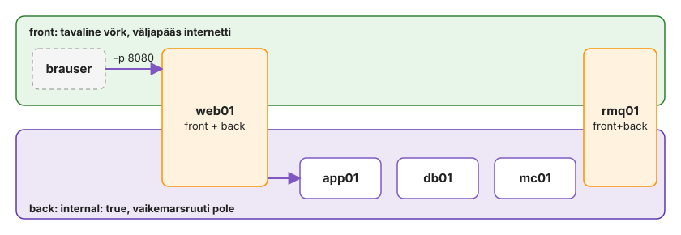
      <figcaption>Joonis 3.14. Tootmisfaili võrgud: app01, db01 ja mc01 on ainult sisemises võrgus (Talvik, 2026).</figcaption>
    </figure>

    **Nginx ja konteineri muutuv IP.** Teenuse nimi lahendub Dockeri DNS-is iga kord, kui keegi seda küsib. Nginx lahendab `proxy_pass` aadressi vaikimisi ainult käivitusel, nii et kui app01 luuakse uuesti uue IP-ga, vastab web01 kuni enda taaskäivituseni 502-ga. Lahendus: Nginx'i seadistusse lisatakse `resolver 127.0.0.11` ja aadress pannakse muutujasse, siis lahendatakse nimi uuesti. Ametlik Nginxi image oskab resolveri aadressi ise lisada: kui konfiguratsioonifail on kaustas `/etc/nginx/templates/` ja seatud on `NGINX_ENTRYPOINT_LOCAL_RESOLVERS=1`, asendab image'i käivitusskript programmiga `envsubst` mallis muutuja `${NGINX_LOCAL_RESOLVERS}` konteineri DNS-serveri aadressiga.

### Millal teenus on valmis

Käivitatud konteiner ei ole veel teenus, mis vastab. [`depends_on`](https://docs.docker.com/reference/compose-file/services/) tagab ainult käivitusjärjekorra. **Healthcheck** on käsk, mida Docker konteineri sees perioodiliselt käivitab. Selle väljumiskoodi järgi on olek `starting`, `healthy` või `unhealthy`. [Vaikeväärtused](https://docs.docker.com/reference/dockerfile/#healthcheck) on `interval` 30 s, `timeout` 30 s, `retries` 3 ja `start_period` 0. Tingimusega `service_healthy` ootab Compose, kuni sõltuvus vastab. Näites ootab app01 nii, kuni db01 healthcheck annab oleku `healthy`.

Healthcheck ainult märgib oleku. Compose ei taaskäivita `unhealthy` konteinerit ja `restart:` reageerib ainult protsessi lõppemisele. Kui andmebaas öösel taaskäivitub, peab rakendus ise uuesti ühenduma. Healthcheck peab seega kontrollima seda, mida klient vajab: `/health`, mis vaatab üle andmebaasi ja järjekorra, mitte avatud porti.

??? info "Süvenemiseks: sama stack eri keskkondades"

    Järgmised võtted aitavad sama stacki eri keskkondades hallata ja nende kasutamine sõltub lahenduse ülesehitusest.

    **Projekti nimi.** Compose tunneb oma konteinerid ära projekti nime järgi, mis on vaikimisi `compose.yaml`-i kataloogi nimi ja satub iga konteineri sildile `com.docker.compose.project`. Kaks stacki samas hostis kataloogides `/srv/a/app` ja `/srv/b/app` saavad sama projekti nime ning teine `up` peab esimese teenuseid enda omadeks: loob need ümber või eemaldab `--remove-orphans`-iga. Tootmishostis antakse projekti nimi seepärast selgelt (`name:` faili alguses või `-p`).

    **YAML-i ankrud.** Mitmele teenusele ühised seaded (näiteks `restart` ja `logging`) kirjutatakse üks kord laiendusvälja alla (`x-common: &common`) ja igas teenuses viidatakse neile reaga `<<: *common`. See on YAML-i ankur: `&` annab plokile nime ja `*` viitab sellele.

    **Mitme faili liitmine.** Tootmise erisused (ressursipiirid, saladused failidest, sisemine võrk) pannakse sageli eraldi faili, mis liidetakse põhifaili peale: `docker compose -f compose.yaml -f compose.prod.yaml up -d` või keskkonnamuutujaga `COMPOSE_FILE=compose.yaml:compose.prod.yaml`. Compose ühendab failid väljadele kehtivate reeglite järgi: näiteks `environment` liidetakse võtme kaupa, `command` asendatakse ja pordid ning mount'id liidetakse loendina. Kui tavapärane liitmine ei sobi, märgitakse väli sildiga `!override` (Compose 2.24.4 või uuem). Lõpptulemust kontrolli käsuga `docker compose … config` ([liitmise reeglid](https://docs.docker.com/reference/compose-file/merge/)). Nii jääb `compose.yaml` kõigile ühiseks ja tootmise erinevused on ühes failis.

    **Seadistuse räsi ja aadressivarud.** `up -d` arvutab iga teenuse seadistusest räsi ja võrdleb seda konteineri sildiga `com.docker.compose.config-hash`. Kui räsi erineb, luuakse konteiner uuesti.

    Iga uus võrk saab alamvõrgu vaikimisi aadressivarudest `172.17.0.0/16`–`172.31.0.0/16` ja `192.168.0.0/16`. Kui ettevõtte VPN või serverivõrk kasutab samu vahemikke, kaob hostist marsruut nendesse ja SSH-sessioon katkeb esimese `docker compose up`-iga. Selle vältimiseks saab `daemon.json`-is määrata `default-address-pools` vahemikuga, mis on võrguosakonnaga kokku lepitud.

    **Süvenemisküsimused**

    1. `compose.yaml` ei muutunud, aga `docker compose up -d` lõi app01 uuesti. Milliseid sisendeid ja varasemaid tegevusi kontrollid?
    2. db01 on `healthy`, aga app01 ei käivitunud pärast masina taaskäivitust õiges järjekorras. Miks `depends_on` siin ei aidanud?

Mitu koopiat, katkestuseta uuendus ja mitu hosti on juba orkestraatori töö (7. kohtumine).

### Kui stack ei tööta

Töötava stacki uurimine algab olekust ja logidest, seejärel kontrollitakse seadistust:

1. `docker compose ps`: kas teenus töötab ja kas see on `healthy`?
2. `docker compose logs <teenus>`: mida rakendus ütleb?
3. `docker compose config`: mida Compose failist ja `.env`-ist tegelikult luges?
4. `docker compose exec <teenus> sh`: mida on vaja konteineri sees uurida?

Loe juurde: [Võrguautomaatika ja NetOps](../teemad/vorguautomaatika.md)

**Leia viga.** Eesmärk on, et app01 ühenduks Compose'i stackis andmebaasiga. Failis on:

```yaml
  app01:
    environment:
      DB_HOST: localhost
```

`docker compose ps` näitab db01 olekut `healthy`, aga app01 logis on `Connection refused`. Miks?

??? success "Vastus"

    - **Oli:** `DB_HOST: localhost`.
    - **Õige:** `DB_HOST: db01`.
    - **Miks:** igal konteineril on oma võrk ja `localhost` tähendab konteineri sees konteinerit ennast. app01 konteineris andmebaasi pole. Teise teenuseni jõuab teenuse nime kaudu, mille Dockeri DNS lahendab db01 aadressiks.

??? question "Kontrolli ennast"

    1. Kuidas leiab app01 andmebaasi ja miks mitte IP-aadressi järgi?
    2. Mis vahe on sellel, et konteiner töötab, ja sellel, et teenus on valmis?

## 5. Kus image'id hoitakse

### Registry roll ja image'i aadress

Image, mis on ainult ehitaja masinas, ei jõua tootmisse. Kui control'is ehitatud app-image peab käivituma ka teises serveris, konveieris või klastris, peab see olema kohas, kust kõik need masinad selle kätte saavad. See koht on **registry**.

Töö käib kahe käsuga. `docker push` laadib image'i registry'sse üles, `docker pull` laadib selle alla. `docker run` teeb `pull`-i ise, kui image'it masinas veel pole. Image'i nimes on registry aadress ees:

```text
harbor.lab.hkhk.lan / maasikas / labori-seis-app : 1.0
└ registry            └ projekt  └ image           └ tag
```

Kui registry aadressi pole (`nginx:alpine`), on see Docker Hub.

**Tag** on image'i versiooni silt (`1.0`, `11.4`, `latest`). Sama tag'i võib hiljem panna ka teisele image'ile, nii et tag ei taga, et sisu on sama. **Digest** (`sha256:…`) on image'i sisu räsi: kui sisu muutub, muutub ka digest. `docker image ls --digests` näitab mõlemat.

Kohalikult ehitatud image'il on sageli lühike nimi (`labseis-app:1.0`). Enne üleslaadimist annab `docker tag` sellele teise nime, mille alguses on registry aadress, ja `docker login <registry>` logib registry'sse sisse. Uus nimi ei tee image'ist koopiat, mõlemad nimed viitavad samale image'ile.

**Ilma registry'ta.** Image tuleb teise masinasse viia failina: `docker save` pakib selle arhiiviks, `scp` kopeerib ja `docker load` laadib teises masinas sisse. Iga uue versiooni ja iga masinaga tuleb seda korrata ning keegi ei näe, milline versioon kus on.

**Registry'ga.** Image laaditakse üks kord üles ja iga masin, konveier või klaster laadib selle nime järgi alla. Registry näitab, millised versioonid on olemas.

Registry ei ole ainult failide hoidla. Seal otsustatakse, mis tootmisse jõuab: kes tohib image'eid üles laadida, kes alla laadida ja mida enne kontrollitakse. Seepärast on registry valik ja seadistus administraatori töö samamoodi nagu apt-repositooriumide haldus.

??? info "Süvenemiseks: mis on registry sees"

    Registry pakub OCI distribution API-t (`/v2/`). Image on seal kihid ja manifest, mis on salvestatud räsi järgi failidena (blob'id). Tag on muudetav viide manifestile. `docker push` küsib iga kihi kohta, kas see on juba olemas, ja saadab ainult puuduvad. Seepärast on teine sama baasiga image kiire üles laadida.

### Pakkuja hallatav registry

**Avalikud registry'd** on internetis ja enamasti tasuta avalike image'ite jaoks. [Docker Hub](https://hub.docker.com/) on vaikimisi registry: nimi `nginx` tähendab `docker.io/library/nginx`. Hubis on igaühe image'id, ja päritolu järgi on neil märgised: **Docker Official Images** (`library/`, Dockeri hallatud kogumik, näiteks `nginx`, `mariadb`), **Verified Publisher** (tarkvaratootja enda image'id) ja **Docker-Sponsored Open Source** (avatud lähtekoodiga projektide image'id). Märgiseta image võib olla ükskõik kelle oma.

Teised avalikud registry'd on seotud konkreetse platvormiga. [GHCR](https://docs.github.com/en/packages/working-with-a-github-packages-registry/working-with-the-container-registry) (`ghcr.io`) on seotud GitHubi repositooriumide ja õigustega ning sobib, kui kood ja konveier on GitHubis. [Quay](https://quay.io/) on Red Hati registry, kus on paljud Kubernetese ja Red Hati projektide image'id. Pilvede registry'd (AWS ECR, Azure ACR, Google Artifact Registry) on seotud selle pilve õiguste ja teenustega, aga neid saab kasutada ka väljaspool pilve.

Avalik registry sobib avatud tarkvarale ja väikesele meeskonnale. Piiranguks on tõmbepiirid, sõltuvus internetiühendusest ja see, et asutuse image'id on kellegi teise serveris.

### Asutuse oma registry

**Oma registry** (on-prem) töötab asutuse võrgus. [Harbor](https://goharbor.io/) on CNCF-i projekt: projektid ja õigused, robotkontod konveierite jaoks, Trivy skannimine, säilitus- ja muutumatuse reeglid, replikatsioon teise registry'sse. Sonatype [Nexus Repository](https://www.sonatype.com/products/sonatype-nexus-repository) ja JFrog [Artifactory](https://jfrog.com/artifactory/) hoiavad image'ite kõrval ka Maveni, npm-i, PyPI ja apt-i pakette, mis on mugav, kui asutusel on juba üks artefaktide hoidla. GitLab ja Gitea pakuvad registry't koodihoidla juures. Kõige lihtsam on [`registry:2`](https://distribution.github.io/distribution/) ehk CNCF Distribution: üks konteiner ilma kasutajaliidese, õiguste ja skannimiseta. See on teiste registry'de alus, aga tootmisse sobib üksi harva.

### Pull-through cache

**Pull-through cache** (vahemälu) on registry, mis küsib puuduva image'i ülesvoolu registry'st (näiteks Docker Hubist), annab selle kliendile ja hoiab alles. Järgmised tõmbed tulevad kohalikust võrgust. Docker Hubi [piir autentimata klientidele](https://docs.docker.com/docker-hub/usage/pulls/) on 100 tõmmet kuue tunni jooksul IPv4-aadressi (IPv6 puhul /64 alamvõrgu) kohta, tasuta kontoga 200 (kontrollitud 8. novembril 2026). Klass või CI farm on ühe NAT-aadressi taga ja jõuab piirini tunniga. Vahemälu lahendab ka teise probleemi: kui Docker Hub on maas või image kustutatakse, on see asutuses alles.

Kursuse laboris kasutame Harborit. Sinna laaditakse oma rakenduse image, et teised masinad saaksid selle alla laadida. Harboris on igal õppijal oma projekt ja sinna laaditud image'eid kontrollitakse Trivy'ga.

Joonis näitab, kuidas image'id kursuse laboris liiguvad.

<figure markdown="span">
  
  <figcaption>Joonis 3.15. Image'i teekond: Docker Hub, Harbori vahemälu, oma projekt ja kasutajad (Talvik, 2026).</figcaption>
</figure>

### Ligipääs ja usaldus

Registry'ga suhtlemisel kaitseb TLS kahte asja: klient kontrollib sertifikaadi abil serveri identiteeti ja ühendus on krüpteeritud. Image'i päritolu (kes selle ehitas) see ei tõenda, selleks on allkirjad ja päritolutõendid. Asutuse oma CA-ga allkirjastatud sertifikaadi jaoks pannakse CA fail kausta `/etc/docker/certs.d/<registry>/ca.crt` (Podmanis `/etc/containers/certs.d/`). `insecure-registries` lülitab kontrolli välja ja parool liigub siis serverile, mille identiteeti keegi ei kontrolli.

??? info "Süvenemiseks: registry valik, artefaktihoidlad ja AI-rakenduste hoidlad"

    **Registry ja artefaktihoidla**

    Konteineriregistry hoiab ja levitab image'eid ning võib toetada ka teisi OCI-artefakte (näiteks Helm chart'e). **Artefaktihoidla** haldab mitut tüüpi tarkvarapakette ja ehitustulemeid. [Sonatype Nexus Repository](https://help.sonatype.com/en/formats.html) ja [JFrog Artifactory](https://jfrog.com/artifactory/) hoiavad eraldi repositooriumides näiteks Java `.jar`- ja `.war`-faile (Maven), npm- ja Pythoni pakette, konteineri image'eid, `.deb`- ja `.rpm`-pakette ning Helm chart'e. Sellepärast nimetab Google oma teenust Artifact Registry'ks, mitte ainult Container Registry'ks.

    Nexuses on kolme tüüpi [repositooriume](https://help.sonatype.com/en/repository-types.html). **Hosted** on asutuse oma pakettide hoidla: CI avaldab sinna näiteks ühise Java teegi ja teised rakendused kasutavad seda sõltuvusena. **Proxy** on välise hoidla vahemälu: Maven, pip või Docker küsib paketti Nexuselt, Nexus laadib puuduva Maven Centralist, PyPI-st või Docker Hubist ja hoiab selle alles. **Group** ühendab sama vormingu mitu hoidlat ühe aadressi taha, nii et Maven saab ühe URL-i kaudu nii asutuse oma teegid kui ka avalikud sõltuvused. Harbori projekt `dockerhub` on sama mõttega proxy, ainult image'itele.

    Labori seisus võiks Nexust kasutada kahes kohas: Maven laadib ehitamisel sõltuvused Nexuse proxy kaudu ja valmis WAR avaldatakse hosted-hoidlasse. Image laaditakse ikkagi registry'sse. WAR-i eraldi hoidmine ei ole kohustuslik, kui töövoog vajab ainult image'it.

    Hoidla valimisel tuleb eristada kolme küsimust: milliseid paketivorminguid on vaja, kes teenust haldab ja millised funktsioonid kuuluvad valitud väljaandesse. **Ise hallatav** (self-hosted) lahendus töötab asutuse serveris või pilve virtuaalmasinas ja serverid, varundus ning uuendused on asutuse kanda. **SaaS** tähendab, et teenust haldab pakkuja ja hind sõltub sageli ka salvestatud ja alla laaditud andmemahust.

    *Tabel 3.12. Artefaktihoidlate väljaanded*

    | Väljaanne | Mida hoiab | Tasuta | Ise hallatav | SaaS | Piirang |
    |---|---|---|---|---|---|
    | Nexus Repository Community Edition | mitme vormingu paketid, ka Docker/OCI image'id | jah | jah | ei | kuni 40 000 komponenti ja 100 000 päringut päevas; SSO ja kõrgkäideldavus ei kuulu sisse |
    | Nexus Repository tasulised tasemed (Pro, Pro+, Enterprise) | samad vormingud | ei | jah | jah | kasutuspõhine hind, funktsioonid sõltuvad tasemest |
    | JFrog Artifactory OSS | Java artefaktid (Maven) | jah | jah | ei | teisi paketivorminguid tasuta versioon ei hoia |
    | JFrog Container Registry (JCR) | Docker/OCI image'id, Helm, Generic | jah | jah | ei | teisi paketivorminguid pole; haavatavuste skannimine ainult pilveversioonis |
    | JFrog Artifactory tasulised paketid | kõik vormingud | ei | jah | jah | funktsioonid sõltuvad tellimusest |

    Allikad (kontrollitud 8. novembril 2026): [Nexuse väljaanded](https://help.sonatype.com/en/nexus-repository-tiers-and-feature-availability.html), [Nexus Community Edition](https://help.sonatype.com/en/ce-onboarding.html), [Artifactory OSS](https://jfrog.com/open-source/), [JFrog Container Registry](https://jfrog.com/container-registry/). Pull-through cache ei ole täielik varukoopia: selles on ainult need image'id, mida keegi on küsinud.

    Tasuta tarkvara ei tähenda tasuta teenust: ise hallates jäävad asutuse kanda serverid, salvestus, varundus, uuendused ja rikete lahendamine.

    **AI-rakenduste hoidlad**

    AI-teenus võtab käituskeskkonna, mudeli ja sõltuvused sageli eri kohtadest. Image tuleb tavalisest registry'st (Harbor, Docker Hub, GHCR) või NVIDIA GPU-tarkvara puhul [NVIDIA NGC](https://catalog.ngc.nvidia.com/) registry'st `nvcr.io`. Mudeli kaalud, tokenizer ja seadistus tulevad mudelihoidlast, näiteks [Hugging Face Hubist](https://huggingface.co/docs/hub/index) või asutuse sisemisest hoidlast. Pythoni paketid tulevad PyPI-st või asutuse paketiproxy kaudu. Artifactory ja Nexus oskavad uuemates versioonides vahendada ka Hugging Face'i sisu, aga funktsioonid sõltuvad versioonist ja väljaandest.

    <figure markdown="span">
      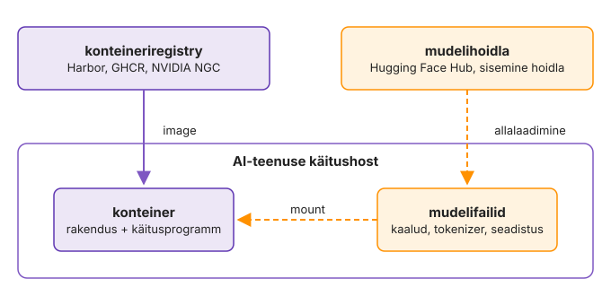
      <figcaption>Joonis 3.16. AI-teenuse image ja mudel tulevad eri hoidlatest (Talvik, 2026).</figcaption>
    </figure>

    Mudel ja image ei pea olema üks artefakt. Mõnikord pakitakse väike mudel ka image'isse; see on arhitektuurivalik. Mudelifailid on sageli gigabaitides ja muutuvad teises tempos kui rakendus. Seepärast laaditakse mudel eraldi ja ühendatakse konteinerisse käivitamisel, samamoodi nagu andmebaasi andmed volume'ist.

    *Tabel 3.13. Registry valik*

    | Vajadus | Valik |
    |---|---|
    | avatud lähtekoodiga projekt, image kõigile | { .logo width="14" height="14" }Docker Hub, { .logo width="14" height="14" }GHCR, { .logo width="14" height="14" }Quay |
    | kood ja konveier GitHubis või GitLabis | GHCR, { .logo width="14" height="14" }GitLab Container Registry |
    | teenused ühes pilves | { .logo width="14" height="14" }ECR, ACR, { .logo width="14" height="14" }Artifact Registry |
    | asutuse võrk, õigused projektide kaupa, skannimine | { .logo width="14" height="14" }Harbor |
    | lisaks image'itele Maveni, npm-i ja Pythoni pakettide hoidla | { .logo width="14" height="14" }Nexus, { .logo width="14" height="14" }Artifactory |
    | test või üks meeskond ilma kasutajaliideseta | `registry:2` |
    | Docker Hubi piir või internetita võrk | pull-through cache (Harbor, Nexus, `registry:2` proxy) |

    **Harbori vahemälu Dockeris ja Podmanis.** Kursuse Harboril on kolm rolli: projekt `dockerhub` on Docker Hubi vahemälu, igal õppijal on privaatne projekt, kuhu ta oma image'id üles laadib, ja iga üleslaadimine (push) skannitakse Trivy'ga. Docker ei oska Harbori vahemälu kasutada vaikimisi peeglina (`registry-mirrors` toetab ainult registry juurt), seepärast on Dockeri image'ite nimes eesliide `harbor.lab.hkhk.lan/dockerhub/library/`. Podman oskab: `registries.conf` lubab peegli projekti all ja image'i nimi jääb `docker.io/…`.

    **Süvenemisküsimused**

    1. Klassis on 20 õppijat ühe NAT-aadressi taga ja igaüks tõmbab kümme image'it. Mis juhtub ilma vahemäluta?
    2. Miks on `insecure-registries` halb lahendus ka siis, kui registry on sisevõrgus?

**Leia viga.** Eesmärk on laadida control'is ehitatud image Harborisse projekti `maasikas`. Käsud:

```bash
docker login harbor.lab.hkhk.lan
docker build -t labseis-app:1.0 .
docker push labseis-app:1.0
```

Väljundi esimene rida on `The push refers to repository [docker.io/library/labseis-app]` ja push lõpeb veaga `denied: requested access to the resource is denied`. Miks?

??? success "Vastus"

    - **Oli:** image'i nimes puudub registry aadress ja projekt.
    - **Õige:** `docker tag labseis-app:1.0 harbor.lab.hkhk.lan/maasikas/labseis-app:1.0` ja siis `docker push harbor.lab.hkhk.lan/maasikas/labseis-app:1.0`.
    - **Miks:** nimi ilma registry aadressita tähendab Docker Hubi (`docker.io/library/labseis-app`). Docker proovis laadida image'i Docker Hubi ametlike image'ite alla, kuhu tavakasutaja kirjutada ei saa. Sisselogimine Harborisse ei muuda seda, kuhu nimi viitab.

??? question "Kontrolli ennast"

    1. Miks ei piisa sellest, et image on ainult arendaja arvutis?
    2. Milline osa image'i aadressist näitab registry't ja milline versiooni?

## 6. Konteiner ilma daemonita: Podman ja systemd

Docker ei ole ainus viis konteinereid käivitada. Kõik allolevad tööriistad käivitavad samu OCI image'eid, seega Docker Hubist või Harborist tõmmatud image töötab neis kõigis.

??? note "Tabel 3.14. Docker ja selle alternatiivid"

    | Tööriist | Mis see on | Kus seda kasutatakse |
    |---|---|---|
    | [Docker Engine](https://docs.docker.com/engine/) | daemon `dockerd`, käsk `docker` ja Compose | Linuxi serverid, arendus |
    | [Podman](https://podman.io/) | ilma daemonita, töötab ka tavakasutajana, teenused systemd kaudu | AlmaLinux, RHEL, Fedora |
    | [Docker Desktop](https://docs.docker.com/desktop/), [Podman Desktop](https://podman-desktop.io/), [Rancher Desktop](https://rancherdesktop.io/) | graafiline arenduskeskkond Windowsis ja macOS-is, Linux töötab nende sees virtuaalmasinas | arendaja arvuti |

    Kubernetese käituskeskkonnad ja süsteemikonteinerid on kursuse IS2 [loengus](https://hkhk-tk.github.io/is2-automatiseerimine/k03/loeng/#muud-konteinerite-kaituskeskkonnad).

AlmaLinuxi ja RHEL-i serveris on vaikimisi [Podman](https://docs.podman.io/), mitte Docker: `dnf install docker` paigaldab paketi `podman-docker`. Image'id on samad OCI image'id, erinev on see, kes konteinerit käitab.

Podmani põhikäsud on teadlikult Dockeri omadega sarnased (`podman pull`, `podman run -d --name veeb -p 8080:80 docker.io/library/nginx:alpine`, `podman ps`, `podman logs`). Podman ehitab image'eid, laadib neid registry'st alla ja üles ning käivitab konteinereid. Erinevus on selles, kuidas konteinereid taustal juhitakse.

Kohaliku Dockeri kasutamisel saadab käsurida korraldused püsivalt töötavale Docker daemonile. Podmani kohalik kasutamine samasugust keskset daemonit ei vaja: käsk loob konteineri ise ja teenusena hoiab seda töös systemd.

<figure markdown="span">
  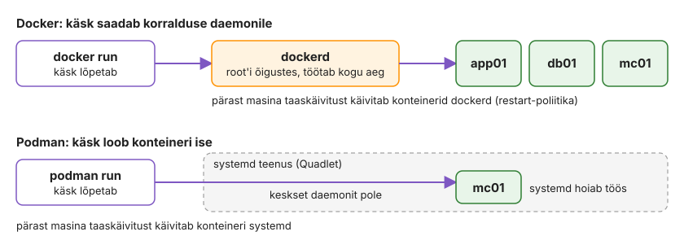
  <figcaption>Joonis 3.17. Docker juhib konteinereid daemoni kaudu, Podmanis hoiab teenust töös systemd (Talvik, 2026).</figcaption>
</figure>

**Rootful** tähendab, et konteinereid juhtiv protsess töötab root'i õigustes. Nii töötab vaikimisi paigaldatud Docker. **Rootless** tähendab, et tavakasutaja käivitab konteinerid oma õigustes ja konteiner ei saa hostis rohkem, kui see kasutaja tohib. Podman töötab rootless-režiimis ilma lisaseadistuseta, kui seda käivitab tavakasutaja.

**Dockeriga.** Teenuse konteiner käivitatakse `docker run --restart unless-stopped …` või Compose'iga. Pärast masina taaskäivitust käivitab konteineri uuesti `dockerd`. Kes saab Dockerit juhtida, sel on hostis root'i õigused.

**Podmaniga.** Sama image käivitatakse käsuga `podman run`. Teenuseks teeb konteineri systemd: konteineri kirjeldus on unit'i failis, `systemctl` käivitab ja peatab selle ning `journalctl` näitab logi nagu teistel teenustel. Tavakasutaja konteineril on hostis ainult selle kasutaja õigused.

Selle loengu põhimõisted ei sõltu tööriistast: image, konteiner, võrk ja püsisalvestus on samad ka Podmani kasutamisel.

??? info "Süvenemiseks: rootless, SELinux ja Podmani konteiner systemd teenusena"

    <figure markdown="span">
      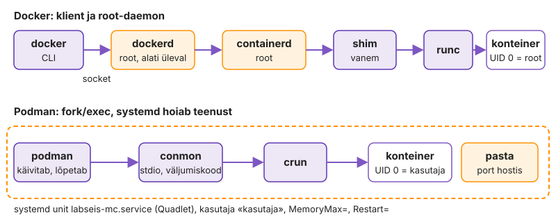
      <figcaption>Joonis 3.18. Docker on klient ja root-daemon. Podman käivitab konteineri ise ja lõpetab, teenust hoiab systemd (Talvik, 2026).</figcaption>
    </figure>

    **Daemonita mudel.** Peamine arhitektuuri erinevus on juhtimismudel. Dockeris saadab CLI käsu kesksele daemonile, mis töötab kogu aeg. `podman run -d` loob konteineri ise `crun`-iga, jätab selle juurde väikese jälgija `conmon` ja käsk ise lõpetab. Daemonita ei tähenda protsessideta: iga konteineri juures on `conmon`, nagu Dockeris `containerd-shim`. Puudub kõiki konteinereid juhtiv keskne teenus, mille taaskäivitus peataks kõik konteinerid. Piirang: pärast masina taaskäivitust ei käivita konteinerit keegi, kui seda ei tee systemd.

    *Tabel 3.15. Docker ja Podman: juhtimine*

    | Aspekt | Docker | Podman |
    |---|---|---|
    | kohalik juhtimine | CLI → API → daemon | CLI haldab konteinereid ise teekide ja käitusprogrammi kaudu |
    | keskne daemon | vajalik | kohalikuks kasutuseks pole vaja |
    | API | arhitektuuri keskne osa | eraldi teenus (`podman.socket`), lülitatakse vajadusel sisse |
    | töötava konteineri jälgija | `containerd-shim` | `conmon` |
    | rootless | toetatud: kasutajal töötab oma `dockerd` | toetatud ilma kasutaja daemonita |
    | teenus pärast taaskäivitust | daemon ja restart-poliitika | systemd (Quadlet) |

    **Kuidas rootless muudab kasutaja õigusi?** Rootless-režiim on olemas mõlemal, aga eri kujul. Rootless Dockeris töötab tavakasutaja oma `dockerd`. Rootless Podmanis keskset teenust pole. Turvalisuse küsimus on usalduspiir: kelle õigustes töötab juhtimiskomponent ja kelleks kaardistatakse konteineri kasutajad. Rootful Dockeri juhtimisõigus on sisuliselt hosti administraatori õigus. Rootless Podman võimaldab hallata konteinereid tavakasutaja õiguste piires. Tabel 3.16 näitab, kelleks konteineri root hostis muutub.

    *Tabel 3.16. Konteineri UID 0 hostis*

    | Käitusrežiim | Konteineri UID 0 hostis |
    |---|---|
    | rootful Docker vaikimisi | hosti UID 0, aga piiratud capability'te ja seccomp'iga |
    | Docker `userns-remap`-iga | hosti mitte-root UID; daemon ise jääb root'iks |
    | rootless Docker | daemon ja konteinerid töötavad tavakasutaja õigustes |
    | rootless Podman | käivitanud tavakasutaja; teised UID-d `/etc/subuid` vahemikust |

    <figure markdown="span">
      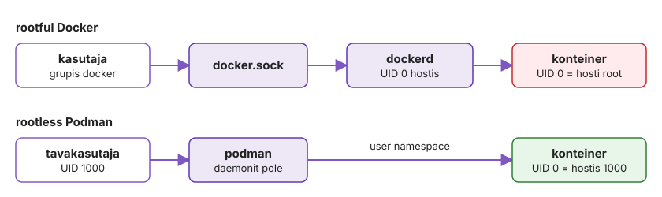
      <figcaption>Joonis 3.19. Usalduspiir: rootful Dockeris on konteineri root hosti root, rootless Podmanis tavakasutaja (Talvik, 2026).</figcaption>
    </figure>

    Tavakasutaja konteinerid töötavad tema user namespace'is: konteineri UID 0 on hostis see kasutaja, ülejäänud UID-d tulevad `/etc/subuid` vahemikust. Kui ründaja pääseb konteinerist välja tavalise vea kaudu, on tal tavakasutaja õigused. See vähendab õiguste ülempiiri, aga ei kaitse andmeid, mis on konteinerisse mount'itud, ega tuuma haavatavuste eest. Piirid tulevad tuumast: port alla 1024 vajab sysctl'i `ip_unprivileged_port_start`, võrk käib kasutajaruumi `pasta` kaudu ja cgroup v2 piirangud kehtivad ainult kontrolleritega, mille systemd on kasutajale delegeerinud.

    **Miks bind mount SELinuxiga ei tööta?** Mõlemad tööriistad kasutavad samu tuuma kaitsemehhanisme (capability'd, seccomp, SELinux või AppArmor). Erinevus on selles, et RHEL-i peres on SELinux vaikimisi sees ja Podman arvestab sellega. Konteineri protsess töötab domeenis `container_t` ja SELinuxi poliitika lubab sel lugeda üldjuhul ainult silti `container_file_t` kandvaid faile. Bind mount kodukaustast annab AVC keelu, kuigi failiõigused lubavad. `:Z` annab failile selle konteineri privaatse sildi (MCS kategooriad), `:z` jagatud sildi. Ubuntus testitud bind mount võib seepärast AlmaLinuxis ebaõnnestuda.

    **Kuidas Podmani konteiner systemd teenuseks teha?** mc01 teenus Quadleti failina:

    ```ini
    # ~/.config/containers/systemd/labseis-mc.container
    [Container]
    Image=docker.io/library/memcached:1.6-alpine
    ContainerName=labseis-mc
    PublishPort=11211:11211
    HealthCmd=sh -c 'echo stats | nc -w 1 127.0.0.1 11211 | grep -q uptime'

    [Service]
    Restart=on-failure
    MemoryMax=128M

    [Install]
    WantedBy=default.target
    ```

    Fail `labseis-mc.container` muutub `systemctl --user daemon-reload`-il generaatori abil unit'iks `labseis-mc.service`. db01 jaoks lisanduvad samasse vormi read `Volume=` ja `Secret=`. `PublishPort=` on näites sellepärast, et rakendus töötab teises masinas. Kui teenused on samas hostis ja ühises võrgus, ei pea vahemälu ega andmebaasi porti hostis avaldama. Taaskäivituse, `MemoryMax=`, logid ja sõltuvused annab systemd. Kasutaja teenus käivitub masina käivitumisel ainult `loginctl enable-linger`-iga. `podman generate systemd` on aegunud.

    **Mitu kasutajat ühes hostis**

    Iga rootless kasutaja vajab failides `/etc/subuid` ja `/etc/subgid` oma vahemikku, vaikimisi 65 536 UID-d. Kui vahemikud kattuvad, on kahe kasutaja konteinerid hosti vaates sama UID ja pääsevad teineteise failidele ligi. Kesksete kontodega (FreeIPA, Active Directory) hallatakse vahemikke seetõttu keskselt, mitte iga hosti `useradd`-iga. Rootless overlay töötab tuumas alates versioonist 5.13. Vanemal tuumal kasutab Podman `fuse-overlayfs`-i, mis on aeglasem ja kulutab CPU-d kasutajaruumis.

    **Mis on mõlemal ühine.** Konteineri turvalisus ei sõltu ainult sellest, kas käsk on `docker` või `podman`. Mõlemal tuleb vaadata, millise kasutajana rakendus töötab, millised hosti kataloogid on konteinerisse mount'itud, millised capability'd on antud, kas juhtimisliides (socket või API) on kellelegi kättesaadav ja kas hosti turvamehhanismid (SELinux või AppArmor) on sees.

    **Ühilduvus.** `podman.socket` pakub Dockeri REST API-t, nii et `docker` CLI töötab `DOCKER_HOST`-iga, Swarm mitte. `podman kube generate` teeb konteinerist Kubernetese `Pod` manifesti.

    **Süvenemisküsimused**

    1. AlmaLinuxi serveris töötab Quadleti teenus pärast `systemctl --user start`-i, aga pärast masina taaskäivitust mitte, kuni keegi sisse logib. Miks ja mis on parandus?
    2. Konteineri protsess ei saa faili lugeda, kuigi faili õigused on `644`. Koosta kontrollimise järjekord.

**Millal mida.** Podman koos Quadletiga sobib RHEL-i pere serverisse, kus töötab üks või paar teenust: haldus, logid ja audit käivad samade tööriistadega mis teistel teenustel. Docker sobib näiteks arendaja masinasse, CI agendile ja sinna, kus tööriistad eeldavad Compose'i ja Dockeri socket'it.

??? info "Süvenemiseks: Dockeri alternatiivid"

    Kuna image'i vorming ja käitamine on OCI standardis kirjas, saab Dockeri osi asendada teiste tööriistadega ja image jääb samaks ([ülevaade Dockeri alternatiividest](https://spacelift.io/blog/docker-alternatives)). Alternatiiv ei asenda tavaliselt Dockerit tervikuna, vaid ühte osa: arendaja töökeskkonda, konteinerite käivitamist ühes serveris või mitme serveri haldust.

    *Tabel 3.17. Dockeri alternatiivid*

    | Tööriist | Mida asendab | Millal valida |
    |---|---|---|
    | [Podman](https://podman.io/) | Docker Engine ja käsurida | RHEL-i pere server, rootless, systemd teenused (Quadlet) |
    | [Podman Desktop](https://podman-desktop.io/), [Rancher Desktop](https://rancherdesktop.io/) | Docker Desktop | arendaja Windowsi või macOS-i masin; Docker Desktop on suuremas ettevõttes tasuline (litsentsid on kursuse IS2 loengus) |
    | Kubernetes, OpenShift | käsitsi hallatud Dockeri hostid | palju servereid, kõrgkäideldavus (7. kohtumine) |
    | virtuaalmasin | konteineri isolatsioon | tugevam eraldatus, usaldamatu kood, teine OS |
    | PaaS (Heroku, AWS Elastic Beanstalk, Google App Engine) | kogu käituskeskkonna haldus | meeskond ei soovi konteinereid ise hallata; hinnaks on sõltuvus teenusepakkujast |

    Kubernetese käituskeskkonnad (containerd, CRI-O) ja süsteemikonteinerid (LXC) on kursuse IS2 [loengus](https://hkhk-tk.github.io/is2-automatiseerimine/k03/loeng/#muud-konteinerite-kaituskeskkonnad).

**Leia viga.** Eesmärk on käivitada AlmaLinuxi serveris tavakasutajana Nginx pordil 80. Käsk:

```bash
podman run -d --name veeb -p 80:80 docker.io/library/nginx:alpine
```

Podman ei käivita konteinerit ja veateates on pordi 80 kohta `Permission denied`. Miks?

??? success "Vastus"

    - **Oli:** tavakasutaja proovis avaldada hosti porti 80.
    - **Õige:** `-p 8080:80` ehk hosti port 1024 või suurem, või administraator lubab madalad pordid sysctl'iga `net.ipv4.ip_unprivileged_port_start`.
    - **Miks:** Linuxis tohib alla 1024 pordi avada ainult root. Rootless Podman töötab tavakasutaja õigustes ja tal seda õigust pole. Rootful Docker ei anna seda viga, sest `dockerd` töötab root'ina.

??? question "Kontrolli ennast"

    1. Mis vahe on keskse daemoniga (Docker) ja daemonita (Podman) juhtimisel?
    2. Kas Podmani kasutamiseks peab Labori seisu rakenduse koodi ümber kirjutama? Milline osa lahendusest muutub?

??? abstract "Kokkuvõte"

    Dockerfile kirjeldab, kuidas rakenduse image ehitatakse. Image'i põhjal luuakse konteiner, milles rakendus töötab.

    Compose kirjeldab, kuidas rakenduse teenused koos käivitatakse: milliseid image'eid kasutatakse, kuidas teenused suhtlevad ning kust tulevad seadistus ja andmed.

    Konteineri võib asendada, aga püsivad andmed peavad säilima. Seetõttu hoitakse andmebaasi andmed väljaspool konteineri kirjutatavat kihti.

    Kui rakendus ei vasta, alusta konteinerite olekust ja logidest. Töötav konteiner ei tähenda veel, et rakendus on kasutusvalmis.

    Rakenduse uuendamisel kasutatakse uut image'it. Enne uuenduse õnnestunuks lugemist kontrollitakse teenust ja vajaduse korral võetakse kasutusele eelmine sobiv versioon.

??? question "Kontrolli ennast: kogu loeng"

    1. Mis vahe on image'il ja konteineril?
    2. Miks `docker stop` ja `docker rm` ei ole sama? Mis jääb alles?
    3. Kuhu pannakse andmebaasi andmed, et need säiliksid konteineri asendamisel?
    4. Mida kirjeldab Dockerfile ja mida Compose'i fail?
    5. Kuidas leiab rakendus andmebaasi, kui mõlemad on Compose'i stackis?
    6. Kust alustad, kui rakendus ei vasta?
    7. Mis vahe on `.env` failil ja `environment` võtmel? Kumb jõuab konteinerisse?
