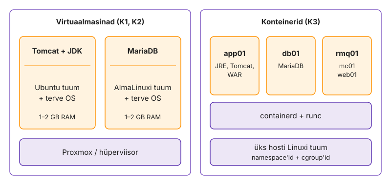
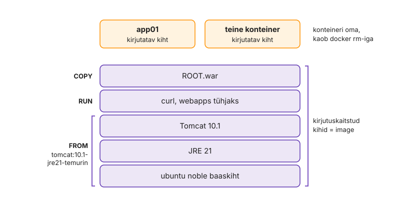
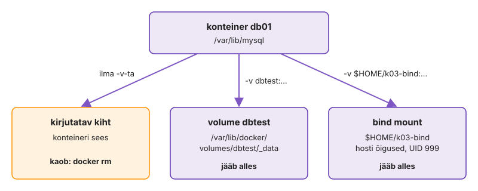
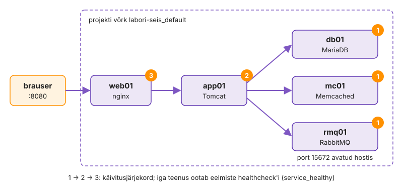
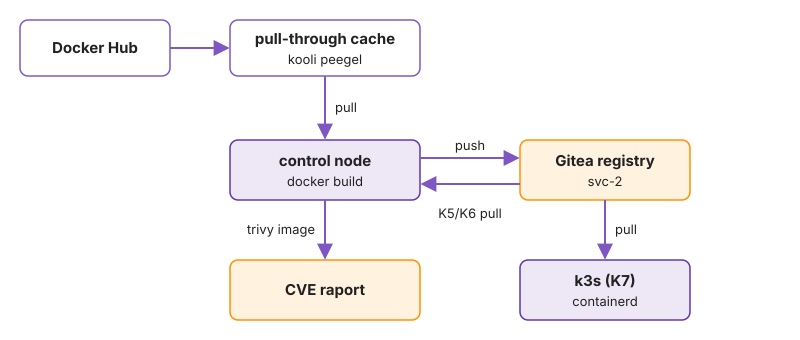
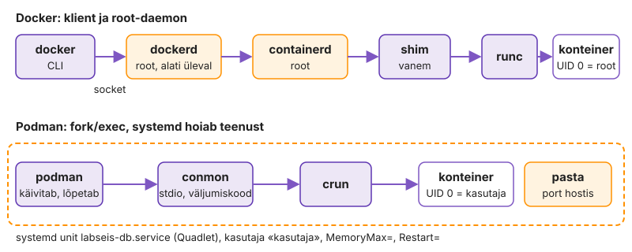

---
tags:
  - Docker
  - konteinerid
  - Compose
  - tarneahel
---

# 3. kohtumine · Docker: loeng

**Eeldus:** eelmisel korral viis Ansible viiest serverist koosneva stacki rollide ja muutujatega soovitud seisu.

Seni oli iga teenus server, mida sa seadistasid: paketid, konfifail, systemd unit. Täna muutub töö ühik. Teenus on valmis pakitud artefakt, mis käivitatakse protsessina, ja kõik, mis peab alles jääma, elab sellest väljaspool. **Konteiner on ühekordne, image on muutumatu, olek on mujal.** Võrgud, Compose, deploy ja baas-image'ite haldus tulenevad sellest jaotusest.

## 🎯 Õpiväljundid

Pärast seda loengut oskad:

- selgitada, kuidas namespace'id ja cgroup'id teevad hosti protsessist konteineri, ning eristada konteinerit VM-ist isolatsiooni ja ressursside poolest;
- kirjeldada image'it kui kihtidest koosnevat muutumatut artefakti ning eristada tag'i ja digest'i;
- põhjendada, miks andmed, saladused ja logid peavad elama konteinerist väljaspool, ning valida [volume'i](https://docs.docker.com/engine/storage/volumes/) ja bind mount'i vahel;
- selgitada, kuidas Compose kirjeldab stacki soovitud seisu ja miks "käivitatud" ei tähenda "valmis";
- võrrelda push- ja pull-mudelit konteinerite deploy automatiseerimisel ning põhjendada, kumb sobib tootmisteenusele;
- kirjeldada heakskiidetud baas-image'ite (SOE) elutsüklit ning hinnata SBOM-i ja haavatavuste skännimise abil, mida uuesti ehitada;
- võrrelda Dockeri ja Podmani käitusmudelit ning põhjendada, millal käivitada konteiner rootless'is systemd teenusena.


## 1. Konteiner on isoleeritud protsess

Kaks Java versiooni samas serveris tähendas seni kaht käsitsi hoitud JDK-d või teist VM-i.

[Konteiner](https://docs.docker.com/get-started/docker-concepts/the-basics/what-is-a-container/) on hosti tuumas töötav tavaline protsess, mida tuum isoleerib kahe mehhanismiga. [Namespace'id](https://man7.org/linux/man-pages/man7/namespaces.7.html) muudavad seda, mida protsess näeb: oma PID-puu, kus ta on PID 1, oma võrguliidesed, mount'id ja hostname. [cgroup'id](https://man7.org/linux/man-pages/man7/cgroups.7.html) piiravad mälu, CPU-aega ja protsesside arvu. systemd kasutab samu mehhanisme (`PrivateTmp=`, `MemoryMax=`).

Käsu teekond on neljaastmeline. `docker` CLI saadab REST-päringu socket'ile `/var/run/docker.sock`, `dockerd` annab töö edasi `containerd`-le, see käivitab iga konteineri jaoks `containerd-shim`-i ja shim kutsub välja `runc`-i. `runc` loob namespace'id ja [cgroup'i](https://docs.docker.com/engine/containers/resource_constraints/), käivitab protsessi ja lõpetab ise töö. Konteineri protsessi vanem on shim, mitte `dockerd`. Kas daemoni restart konteinerid peatab, sõltub seadest [`live-restore`](https://docs.docker.com/engine/daemon/live-restore/), mis on vaikimisi välja lülitatud. Tavaline `apt upgrade` paketiga `docker-ce` taaskäivitab seega kõik hosti konteinerid. Patch-akna plaanis on see sama oluline kui tuumauuendus.

<figure markdown="span">
  
  <figcaption>Joonis 3.1. VM-il on oma tuum ja OS, konteiner jagab hosti tuuma ja kannab kaasas ainult oma failipuud.</figcaption>
</figure>

Kuna eraldi tuuma pole, käivitub konteiner sekunditega, aga tuuma haavatavus puudutab kõiki konteinereid. Hüperviisor on palju kitsam ründepind.

```bash
docker run -d --name w nginx:alpine
ps -o pid,user,cmd -C nginx          # hostis: tavaline protsess, kasutaja root
docker exec w ps                     # konteineris: sama protsess on PID 1
sudo lsns -p "$(pgrep -o nginx)"     # tema namespace'id
```

Siit tuleb kolm tagajärge. Esiteks, kui konteineri PID 1 lõpeb, peatub ka konteiner. systemd't konteineris pole, seega peab teenus töötama esiplaanil ja `SIGTERM`-i peale lõpetama. `docker stop` ootab vaikimisi 10 sekundit (`--stop-timeout`, Compose'is `stop_grace_period`) ja saadab siis `SIGKILL`-i. Kui PID 1 on shell, mis signaali edasi ei anna, saab andmebaas iga deploy'ga `SIGKILL`-i.

Teiseks ei kaitse isolatsioon vaikimisi õigusi. Docker ei kasuta vaikimisi user namespace'i, nii et `uid=0` konteineris on hosti root. Grupi `docker` liige saab käivitada konteineri, mis mount'ib hosti `/`, ja `sudo` logisse sellest midagi ei jää ([Docker Engine security](https://docs.docker.com/engine/security/)). Grupi liikmete nimekirja tuleb auditeerida nagu `sudoers`-it.

Kolmandaks kaitsevad cgroup'id naabreid ainult siis, kui piir on seatud, ja vaikimisi pole. Lekkiv Java protsess võtab kogu hosti mälu ja OOM killer valib ohvri kogu hosti seast, võib-olla andmebaasi. Piiriga tapab tuum protsessi ainult selles cgroup'is ja konteiner lõpeb koodiga 137 (128 + `SIGKILL`).

### Mida tuum veel piirab

Namespace'id ja cgroup'id ei ole ainsad piirangud. Docker käivitab protsessi kitsendatud capability'te komplektiga: root konteineris ei saa vaikimisi laadida tuumamooduleid, muuta süsteemiaega ega seadistada hosti võrguliideseid. Lisaks filtreerib [vaikimisi seccomp-profiil](https://docs.docker.com/engine/security/seccomp/) süsteemikutseid ja keelab kümneid neist, näiteks `mount`, `reboot` ja `kexec_load`. Lipp `--privileged` lülitab need kõik välja ja annab ligipääsu hosti seadmetele. Konteiner, mis vajab `--privileged`-i, on sisuliselt root-shell hostis ja vajab sama ülevaatust nagu uus `sudoers`-i rida.

Need piirangud vähendavad ründepinda, aga ei kõrvalda seda. 2019. aastal avaldatud [CVE-2019-5736](https://nvd.nist.gov/vuln/detail/CVE-2019-5736) lubas konteineris root'ina töötaval protsessil üle kirjutada hosti `runc`-i binaari, kui keegi käivitas konteineris `docker exec`-i, ja iga järgmine `runc`-i käivitus töötas siis ründaja koodina hosti root'i õigustes. Paik tuli `runc`-i, mitte image'isse. Konteinerihosti patch-haldus hõlmab seega tuuma, `runc`-i, `containerd`-d ja `dockerd`-d, mitte ainult rakendusi. Mitme kliendi või usaldamatu koodi jaoks kasutatakse seepärast VM-i, kerget VM-i iga konteineri ümber (Kata Containers) või kasutajaruumi tuuma (gVisor), mitte ainult namespace'e.

Ressursipiirangud vajavad sama tähelepanu ka protsesside arvu puhul. Vaikimisi pole `--pids-limit`-i seatud, nii et fork-pomm või lekkiv thread pool ühes konteineris ammendab hosti `pid_max`-i ja ka SSH-sessioon ei saa enam uut protsessi luua. Tootmises seatakse mälu ja protsesside piir igale teenusele, CPU piir sõltub koormusest: liiga madal `--cpus` paneb latentsuse kõikuma, sest tuum piirab CPU-aega iga 100 ms perioodi kaupa.

## 2. Image kui muutumatu artefakt

Sama playbook kahe nädala vahega võib anda erineva tulemuse, kui repositooriumisse ilmus uus paketiversioon. Image pöörab selle ümber: tulemus ehitatakse üks kord ja sama artefakt liigub muutmata testi ja tootmisse.

**Image** on [OCI](https://opencontainers.org/) formaadis manifest, mis viitab konfiguratsiooni-JSON-ile (`Entrypoint`, `Cmd`, `Env`, `User`) ja järjestatud kihtide nimekirjale. Iga kiht on tar-arhiiv. Dockerfile'is lisab iga `RUN`, `COPY` ja `ADD` ühe kihi, `CMD`, `ENV` ja `USER` muudavad ainult konfiguratsiooni. Käivitamisel ühendab overlayfs kirjutuskaitstud kihid (`lowerdir`) ja konteineri oma kirjutatava kihi (`upperdir`). Kui protsess muudab alumises kihis olevat faili, kopeerib tuum enne kirjutamist terve faili ülemisse kihti (copy-up). 2 GB andmefail kirjutatavas kihis tähendab seega 2 GB koopiat esimesel kirjutusel.

<figure markdown="span">
  
  <figcaption>Joonis 3.2. Kirjutuskaitstud kihid on ühised, igal konteineril on oma õhuke kirjutatav kiht.</figcaption>
</figure>

Muutumatusel on kolm tagajärge. Esiteks kaob `docker exec`-iga muudetud konfifail järgmise deploy'ga, sest uus konteiner tuleb image'ist. Parandus läheb Dockerfile'i ja uude image'isse. Teiseks on rollback eelmise image'i käivitamine, eeldusel et see on veel registry's. Kolmandaks jääb kõik, mis kihti jõudis, sinna alatiseks. Hilisemas kihis tehtud `rm` lisab ainult whiteout-kirje. Image'isse kopeeritud `.env` või SSH võti on kõigil, kes image'i alla laadivad.

Seepärast eraldab [mitmeastmeline build](https://docs.docker.com/build/building/multi-stage/) ehitamise käitamisest. Kompilaator, sõltuvuste vahemälu ja lähtekood jäävad build-astmesse:

```dockerfile
FROM maven:3-eclipse-temurin-21 AS build
COPY . /src
RUN cd /src && mvn -q package
FROM tomcat:10-jre21
COPY --from=build /src/target/app.war /usr/local/tomcat/webapps/ROOT.war
USER 10001
```

Build cache kasutab kihi uuesti, kui juhis ja sisendi räsi pole muutunud, ja esimene muutunud kiht tühistab kõik järgmised ([head tavad](https://docs.docker.com/build/building/best-practices/)). Näites laeb Maven iga koodimuudatuse järel sõltuvused uuesti, seepärast kopeeritakse `pom.xml` eraldi ette.

Image'i nimel on kaks osa. **Tag** on liigutatav viide manifestile; `latest` on lihtsalt vaikimisi tag ega tähenda "uusim". `nginx:1.27` osutab pärast turvaparandust teisele sisule. **Digest** (`sha256:…`) on manifesti räsi: sama digest tähendab alati samu baite. Tootmises seotakse tag koodi versiooniga (git-commit'i SHA) ja kõige rangemates kohtades viidatakse digest'ile.

Üks tag võib osutada ka mitmele image'ile korraga. Ametlike image'ite tag viitab tavaliselt image index'ile (Dockeri terminites manifest list), mis sisaldab eraldi manifesti `amd64`, `arm64` ja teiste arhitektuuride jaoks, ning klient valib hosti arhitektuuri järgi. Index'i digest ja platvormi manifesti digest on erinevad. Kui pipeline kirjutab üles `amd64` manifesti digest'i ja ARM-iga host proovib sama digest'i tõmmata, saab ta vale arhitektuuri image'i ja protsess lõpeb veaga `exec format error`. Kui hostide arhitektuurid erinevad, viita index'i digest'ile.

Muutumatus kehtib artefakti, mitte build'i kohta. Sama Dockerfile kahe nädala pärast annab teise image'i, sest `FROM` tag ja `apt-get install` tõmbavad uuemad versioonid. Korratavus vajab fikseeritud baasi digest'i ja versioonidega paketinimekirja, värskus vajab vastupidist. Kumba eelistada, on poliitika küsimus.

## 3. Andmed ja olek väljaspool konteinerit

MariaDB uuendus on `docker rm` ja `docker run`: mis oli kirjutatavas kihis, on kadunud.

Olekut on kolme liiki. **Andmed** lähevad volume'isse või bind mount'i. **Volume** on Dockeri hallatav kataloog (`local` draiveriga `/var/lib/docker/volumes/<nimi>/_data`), mille elutsükkel on konteinerist lahus. Vahe bind mount'iga on omanikes. Tühja nimega volume'i täidab Docker esimesel ühendamisel image'i sihtkataloogi sisuga koos omaniku ja õigustega, nii et andmekataloog saab kohe õige UID. Bind mount on hosti kataloog hosti õigustega; puuduva kataloogi loob `-v` root'i omanikuna ja mitte-root teenus ei saa sinna kirjutada. Bind mount sobib konfifailile, volume andmebaasile.

<figure markdown="span">
  
  <figcaption>Joonis 3.3. Kolm kohta, kuhu konteiner saab kirjutada. Konteineri kustutamise üle elavad ainult kaks neist.</figcaption>
</figure>

**Seadistus ja saladused** tulevad käivitamisel väljast: sama image töötab testis ja tootmises, vahe on keskkonnas ja mount'itud failides. Keskkonnamuutuja on saladuse jaoks halb koht. `docker inspect` näitab seda kõigile, kellel on socket'ile ligipääs, ja see on loetav failist `/proc/<pid>/environ` ning pärandub igale lapsprotsessile. Fail ([Compose'is `secrets:`](https://docs.docker.com/compose/how-tos/use-secrets/), Kubernetesis Secret) jätab keskkonda ainult tee. **Logid** lähevad PID 1 stdout'i ja stderr'i. Vaikimisi [`json-file`](https://docs.docker.com/engine/logging/drivers/json-file/) draiver kirjutab need faili `/var/lib/docker/containers/<id>/<id>-json.log` ilma rotatsioonita, kuni `max-size` on seatud. Üks jutukas konteiner täidab partitsiooni ja peatab kõik teised.

Ametlike andmebaasi-image'ite entrypoint algseadistab andmekataloogi ainult siis, kui see on tühi ([MariaDB image](https://hub.docker.com/_/mariadb)). Muudetud algne SQL või `MARIADB_PASSWORD` olemasolevat volume'it ei muuda. See on Compose'i stackides kõige sagedasem `Access denied` põhjus: image'i ja oleku elutsükkel on lahus ja skeemimuudatus vajab migratsiooni.

### Olek hostis

Kui olek on konteinerist väljas, on see hostis ja admini vastutus jääb samaks. Volume'i kataloogi kopeerimine töötava MariaDB alt annab ebaühtlase koopia, täpselt nagu `rsync` töötava andmebaasi `/var/lib/mysql`-ist. Varundus käib endiselt andmebaasi tööriistaga (`mariadb-dump`, `mariadb-backup`) konteineri sees või kõrvalkonteineris, mis jagab sama volume'it, ja taastamist testitakse samamoodi nagu enne. Volume'id ei kuulu image'isse, nii et image'ite varundus ei asenda andmete varundust.

Ka salvestusdraiveril on eeldused. `overlay2` XFS-i peal nõuab failisüsteemi, mis on loodud valikuga `ftype=1` ([overlay2 nõuded](https://docs.docker.com/engine/storage/drivers/overlayfs-driver/)). Vanad RHEL 7 aegsed XFS-id loodi mõnikord `ftype=0`-ga ja Docker keeldub neil overlay2 kasutamast. Tootmishostis pannakse `/var/lib/docker` eraldi LVM-i köitele, et image'id, kirjutatavad kihid ja `json-file` logid ei täidaks juurfailisüsteemi. `docker system df` näitab, kui palju sellest on image'id, konteinerid, volume'id ja build cache.

## 4. Mitu teenust Compose'iga

Viie `docker run` käsuga käivitatud stacki soovitud seis on kirjas ainult shelli ajaloos. [Compose](https://docs.docker.com/compose/) paneb selle faili.

`compose.yaml` kirjeldab teenused, võrgud ja volume'id. `docker compose up -d` arvutab iga teenuse seadistusest räsi ja võrdleb seda konteineri sildiga `com.docker.compose.config-hash`: puuduva loob, muutunud teenuse loob uuesti, ülejäänu jätab puutumata. Tulemus on idempotentne nagu playbook. Erinevus on mehhanismis: Ansible muudab olemasolevat serverit, Compose peatab vana konteineri ja loob uue. Selle vahe jooksul teenus ei vasta, sest Compose ei tee rolling update'i.

<figure markdown="span">
  
  <figcaption>Joonis 3.4. Viie teenusega stack. Iga teenus ootab enne käivitumist, kuni sõltuvuste healthcheck annab oleku healthy.</figcaption>
</figure>

Esimene mõiste on teenuse leidmine. Kasutaja loodud võrgus vastab sisseehitatud DNS aadressil `127.0.0.11` teenuse nimele, sest konteineri IP muutub iga uue konteineriga. Iga uus võrk saab alamvõrgu vaikimisi aadressivarudest `172.17.0.0/16`–`172.31.0.0/16` ja `192.168.0.0/16`. Kui ettevõtte VPN või serverivõrk kasutab samu vahemikke, kaob hostist marsruut nendesse ja SSH-sessioon katkeb esimese `docker compose up`-iga. Seepärast pannakse tootmishostides `daemon.json`-i `default-address-pools` vahemikuga, mis on võrguosakonnaga kokku lepitud.

Teine mõiste on segmenteerimine. Konteiner näeb ainult neid naabreid, kellega tal on ühine võrk, ja `internal: true` võrgul pole vaikemarsruuti. Kui andmebaas, vahemälu ja järjekord on ainult sisemises võrgus, ei saa rakendusse sisse murdnud ründaja sealt otse internetti. Avaldatud porti suunab Docker NAT-reegliga, mis rakendub enne UFW reegleid, seega `ufw deny` porti ei sulge ([Docker ja tulemüür](https://docs.docker.com/engine/network/packet-filtering-firewalls/)).

Kolmas mõiste on valmisolek: käivitatud konteiner ei ole veel teenus, mis vastab. [`depends_on`](https://docs.docker.com/reference/compose-file/services/) tagab ainult käivitusjärjekorra. **Healthcheck** on käsk, mida Docker konteineri sees perioodiliselt käivitab. Selle väljumiskoodi järgi on olek `starting`, `healthy` või `unhealthy`. [Vaikeväärtused](https://docs.docker.com/reference/dockerfile/#healthcheck) on `interval` 30 s, `timeout` 30 s, `retries` 3 ja `start_period` 0. Tingimusega `service_healthy` ootab Compose, kuni sõltuvus vastab:

```yaml
services:
  app01:
    depends_on:
      db01: { condition: service_healthy }
  db01:
    healthcheck: { test: ["CMD", "healthcheck.sh", "--connect"], interval: 5s }
```

Healthcheck ainult märgib oleku. Compose ei taaskäivita `unhealthy` konteinerit ja `restart:` reageerib ainult protsessi lõppemisele. Kui andmebaas öösel taaskäivitub, peab rakendus ise uuesti ühenduma. Healthcheck peab seega kontrollima seda, mida klient vajab: `/health`, mis vaatab üle andmebaasi ja järjekorra, mitte avatud porti.

Compose tunneb oma konteinerid ära projekti nime järgi, mis on vaikimisi `compose.yaml`-i kataloogi nimi ja satub iga konteineri sildile `com.docker.compose.project`. Kaks stacki samas hostis kataloogides `/srv/a/app` ja `/srv/b/app` saavad sama projekti nime ning teine `up` peab esimese teenuseid enda omadeks: loob need ümber või eemaldab `--remove-orphans`-iga. Tootmishostis antakse projekti nimi seepärast selgelt (`name:` faili alguses või `-p`).

Mitu koopiat, katkestuseta uuendus ja mitu hosti on juba orkestraatori töö.

Iseseisvaks lugemiseks: [Võrguautomaatika ja NetOps](../teemad/vorguautomaatika.md).

## 5. Deploy konteineritega

Tüüpiline intsident: sisevõrgu hostil jälgib automaatne uuendaja tag'i `mariadb:latest`. Öösel ilmub uus põhiversioon, uuendaja loob konteineri uue image'iga ja hommikul rakendus ei käivitu, sest olemasolev andmekataloog vajab `mariadb-upgrade`-i. Muudatusel pole ticket'it ja Gitist ei selgu, mis enne töötas.

Konteineri deploy on alati sama jada: tag lahendatakse digest'iks ja image tõmmatakse, vana konteiner peatatakse ja sama seadistusega luuakse uus, health check otsustab, kas jääda või minna tagasi, ja lõpuks koristatakse vanad image'id. **Deployment automation** tähendab, et see jada käib igal hostil ühtemoodi ja jätab jälje. Otsustada tuleb, kes selle käivitab.

**Push-mudelis** käivitab selle väline osapool, pipeline või playbook. See kirjutab hosti `.env`-i uue tag'i ning käivitab `docker compose pull` ja `up -d`. Versioon on Gitis, muudatus on commit ja korraga uuendatavate hostide arvu otsustab see, kes deploy'd käivitab. Hind: pipeline peab hostini jõudma ja tal on seal Dockeri socket'i ehk root'i õigus.

**Pull-mudelis** jälgib host ise registry't. Podmanis teeb seda [`podman auto-update`](https://docs.podman.io/en/latest/markdown/podman-auto-update.1.html). Quadleti failis on `AutoUpdate=registry` ja `podman-auto-update.timer` käivitub vaikimisi iga päev keskööl. See võrdleb kohaliku image'i digest'i registry omaga ning muutuse korral tõmbab uue image'i ja taaskäivitab unit'i. Kui unit ei käivitu, läheb Podman tagasi eelmisele image'ile (`--rollback` on vaikimisi sees). Ebaõnnestumist näeb Podman aga ainult siis, kui konteiner annab sd_notify kaudu teada, et on valmis. Quadleti `Notify=healthy` (uuemates Podmani versioonides) seob selle teate healthcheck'iga. Ilma selleta loetakse õnnestunuks iga protsess, mis käivitus. Dockeri jaoks teevad sama kolmanda osapoole tööriistad.

Pull-mudel ei vaja sissetulevat ligipääsu ega pipeline'i õigusi hostis ja sobib paljudele väikestele hostidele kontorites või tehastes. Deploy hetke ja sisu määrab aga see, kes registry's tag'i liigutab, ja kõik hostid uuendavad samal ööl. Tootmisteenuses on see muudatus ilma change'ita. Kui pull-mudel on tootmises, jälgib host kas tag'i, mida liigutab ainult heakskiidetud pipeline (näiteks `prod`), või paiga taseme tag'i (`11.4`, mitte `latest`).

Viimane samm on koristus. Rollback on kiire ainult siis, kui eelmine image on veel hostis või registry's. Cron'is käiv `docker image prune -a` kustutab kõik image'id, mida ükski konteiner ei kasuta, ka rollback'i sihtmärgi. Ilma koristuseta kasvab `/var/lib/docker` iga deploy'ga. Hostis hoitakse praegust ja eelmist versiooni, registry's väljalaskeid nii kaua, kui rollback on lubatud.

### Deploy suures skaalas

Viiekümne hosti juures muutub deploy võrguküsimuseks. Kui kõik hostid tõmbavad sama 800 MB image'i samal minutil, on kitsaskoht registry või kontori ühendus, mitte Docker. Kihid on räsi järgi jagatud, seega tõmmatakse ainult muutunud kihid, eeldusel et baas on sama. Pull-mudelis hajutatakse käivitusaeg taimeri `RandomizedDelaySec=` abil, push-mudelis piirab pipeline korraga uuendatavate hostide arvu, nagu Ansible'i `serial` eelmisel korral.

Pooleli jäänud uuendus on konteinerite puhul sama probleem nagu playbook'iga. Kui 50 hostist 12 said uue versiooni ja siis registry kadus, töötab tootmises kaks versiooni. Andmebaasiskeemi muudatus peab seepärast olema tagasiühilduv vähemalt ühe väljalaske ulatuses: kõigepealt lisatakse veerg, mida vana versioon ignoreerib, ja alles järgmises väljalaskes eemaldatakse vana. Ilma selleta ei saa rollback'i teha, sest eelmine image ei tööta uue skeemiga.

Change management ei kao, see muutub. Image'i tag'i muutus Gitis on muudatustaotlus, pipeline'i logi tõendab, et muudatus tehti, ja eelmine digest on rollback'i plaan. Paljud organisatsioonid loevad sellise deploy ITIL-i standardmuudatuseks, mida ei pea iga kord CAB-is kinnitama, sest protsess ise on kinnitatud.

Iseseisvaks lugemiseks: [Patch-haldus](../teemad/patch-haldus.md).

## 6. Baas-image'id ja tarneahel

Detsembris 2021 avaldati Log4j-s [Log4Shell](https://logging.apache.org/security.html) (CVE-2021-44228), mis lubas kaugelt koodi käivitada, ja [RIA hoiatas](https://www.err.ee/1608432728/ria-java-turvanorkus-ohustab-ka-eesti-ettevotteid-ja-asutusi) Eesti asutusi. Paikamisest raskem oli leida, millistesse rakendustesse teek oli pakitud. Asutuses, kus 40 Dockerfile'i alustavad 12 erinevast `FROM`-ist, on sama küsimus iga OpenSSL-i paiga puhul.

**SOE** (standard operating environment) oli 1. kohtumisel piiratud hulk toetatud OS-i ja seadistuse kombinatsioone. Konteinerite puhul on SOE väike hulk heakskiidetud baas-image'eid, näiteks üks JRE, üks Pythoni ja üks minimaalne OS-image, mida ehitab platvormitiim. Baas tuleb upstream'i fikseeritud digest'ist, sisaldab asutuse CA-sertifikaate, ajavööndit ja mitte-root kasutajat ning on skännitud ja avaldatud sisemises registry's. Upstream'i valikul loeb, kui kaua ja kui kiiresti turvaparandused tulevad: Debian slim, Alpine, distroless ja Red Hat UBI (vabalt levitatav, RHEL-i elutsükliga) erinevad just selle poolest.

`FROM` kopeerib baasi kihid rakenduse image'isse ja hosti `apt upgrade` neid ei puuduta. Parandatud baas ei paranda ühtegi rakendust enne, kui need on uuesti ehitatud ja deploy'tud. Sellest tuleb image'i elutsükkel.

| Etapp | Mis toimub | Kes |
|---|---|---|
| Ehitus | baas ehitatakse ajakava järgi (näiteks kord nädalas) ja kriitilise CVE korral kohe; kuupäevaga tag ja liikuv tag | platvormitiim |
| Kontroll | skänn, SBOM, test, alles siis avaldamine | pipeline |
| Kasutus | rakenduse Dockerfile viitab baasi digest'ile; Renovate või Dependabot avab PR-i, kui digest muutub | rakenduse tiim |
| Aegumine | vana baasiga image saab tähtaja, mis ajaks see uuesti ehitatakse | platvormitiim |
| Eemaldus | registry retention-reegel kustutab tag'id, mida ükski keskkond ei kasuta | registry |

Ühine baas teeb küsimuse "kus see teek on" lihtsaks, aga on ka ühine rikkepunkt. Vigane baas nurjab korraga kõik build'id ja iga baasi uuendus käivitab kümnete image'ite build'i ja deploy'. Digest annab korratavuse, liikuv tag värskuse, mõlemat koos annab automaatne PR. E-ITS-i moodul [SYS.1.6 Konteinerdus](https://eits.ria.ee/et/versioon/2024/eits-poohidokumendid/etalonturbe-kataloog/sys-itsuesteemid/sys1-server/sys16-konteinerdus) käsitleb ka image'ite päritolu ja uuendamist.

Baas on tarneahela esimene lüli, järgnevad build'i ajal alla laaditud paketid, build ise, registry ja deploy. 2024. aasta [xz backdoor](https://nvd.nist.gov/vuln/detail/CVE-2024-3094) jõudis laialt kasutatud paketti hooldaja kaudu. Märtsis 2026 jõudis ründaja Trivy enda GitHub Actioni tag'idesse ([Microsoft](https://www.microsoft.com/en-us/security/blog/2026/03/24/detecting-investigating-defending-against-trivy-supply-chain-compromise/)); digest'i või commit'i SHA järgi viidanud pipeline'e see ei puudutanud.

<figure markdown="span">
  
  <figcaption>Joonis 3.5. Image'i teekond pärast build'i: registry on keskpunkt, kust kõik edasised keskkonnad image'i võtavad.</figcaption>
</figure>

**Registry** pakub OCI distribution API-t (`/v2/`): kihid ja manifestid on räsi järgi salvestatud blob'id, tag on muudetav viide manifestile. Pipeline ja klaster võtavad image'i registry'st, nii et seal otsustatakse, mis tootmisse jõuab. Docker Hubi [piir autentimata klientidele](https://docs.docker.com/docker-hub/usage/pulls/) on 100 tõmmet kuue tunni jooksul IPv4-aadressi kohta, seepärast käib NAT-i taga olev CI asutuse pull-through peegli kaudu.

Sisu teadmine algab **SBOM**-ist (software bill of materials, komponentide nimekiri standardvormingus, näiteks [CycloneDX](https://cyclonedx.org/)). [Trivy](https://trivy.dev/docs/latest/) loeb image'i kihtidest paketihalduri andmebaasi (`/var/lib/dpkg/status`, `/lib/apk/db/installed`) ja rakenduse teegid (JAR-ide `pom.properties`) ning võrdleb neid CVE-andmebaasiga, mis uueneb mitu korda päevas. Salvestatud SBOM-i uus skänn vastab küsimusele "kas meil on see teek kuskil" sekunditega, image'eid alla laadimata. Leiu korral uuendad baasi, uuendad teeki või aktsepteerid riski kirjaliku otsusena koos aegumiskuupäevaga (Trivy `.trivyignore` toetab `exp:` välja).

Skänneri tulemus vajab tõlgendamist. Tüüpiline Debiani baasil image annab kümneid leide, millest enamik on teekides, mida rakendus ei kasuta, või haavatavustes, millele distributsioon pole veel paika avaldanud. Kui pipeline nurjab iga `HIGH` leiu peale, õpivad tiimid ignoreerimisfaile pikendama. Toimivam reegel on nurjata ainult parandatavate (`--ignore-unfixed`) kriitiliste leidude peale ja jälgida ülejäänut raportina. Minimaalne baas (distroless, Alpine) vähendab leidude arvu, sest pakette on vähem, aga tal pole shelli ega paketihaldurit, nii et tavalised veaotsingu võtted konteineri sees ei tööta.

Iseseisvaks lugemiseks: [Standard Operating Environment ja IT-süsteemi elutsükkel](../teemad/soe-ja-elutsukkel.md).

Iseseisvaks lugemiseks: [Turvaautomaatika, compliance ja riskihaldus](../teemad/turvaautomaatika.md).

## 7. Konteiner ilma daemonita: Podman ja systemd

AlmaLinux ja RHEL serveris on vaikimisi [Podman](https://docs.podman.io/), mitte Docker: `dnf install docker` paigaldab `podman-docker`-i. Image'id on samad OCI image'id, erinev on see, kes konteinerit käitab.

<figure markdown="span">
  
  <figcaption>Joonis 3.6. Docker on klient ja root-daemon. Podman käivitab konteineri ise ja lõpetab, teenust hoiab systemd.</figcaption>
</figure>

**Daemonita mudel.** `podman run` loob konteineri `crun`-iga, jätab selle juurde väikese jälgija `conmon` ja lõpetab. Root-daemonit, mille restart peataks kõik konteinerid, pole. Hind: pärast reboot'i ei tõsta konteinerit keegi, kui systemd seda ei tee.

**Rootless.** Tavakasutaja konteinerid töötavad tema user namespace'is: konteineri UID 0 on hostis see kasutaja, ülejäänud UID-d tulevad `/etc/subuid` vahemikust. Konteinerist välja pääsenud ründaja saab tavakasutaja õigused. Piirid tulevad tuumast: port alla 1024 vajab sysctl'i `ip_unprivileged_port_start`, võrk käib kasutajaruumi `pasta` kaudu ja cgroup v2 piirangud kehtivad ainult kontrolleritega, mille systemd on kasutajale delegeerinud.

**SELinux.** Konteineri protsess töötab domeenis `container_t` ja loeb ainult silti `container_file_t`. Bind mount kodukaustast annab AVC keelu, kuigi failiõigused lubavad. `:Z` annab failile selle konteineri privaatse sildi (MCS kategooriad), `:z` jagatud sildi. Ubuntus testitud Compose ebaõnnestub seepärast AlmaLinuxil esimese bind mount'iga.

**Quadlet.** Fail `~/.config/containers/systemd/labseis-db.container` (`Image=`, `PublishPort=`, `Volume=`, `Secret=`, `[Install]`) muutub `systemctl --user daemon-reload`-il generaatori abil unit'iks `labseis-db.service`. Taaskäivituse, `MemoryMax=`, logid ja sõltuvused annab systemd. Kasutaja teenus käivitub boot'il ainult `loginctl enable-linger`-iga. `podman generate systemd` on aegunud.

**Mitu kasutajat ühes hostis.** Iga rootless kasutaja vajab `/etc/subuid` ja `/etc/subgid` failis oma vahemikku, vaikimisi 65 536 UID-d. Kui vahemikud kattuvad, on kahe kasutaja konteinerid hosti vaates sama UID ja pääsevad teineteise failidele ligi. Kesksete kontodega (FreeIPA, Active Directory) hallatakse vahemikke seetõttu keskselt, mitte iga hosti `useradd`-iga. Rootless overlay töötab tuumas alates versioonist 5.13. Vanemal tuumal kasutab Podman `fuse-overlayfs`-i, mis on aeglasem ja kulutab CPU-d kasutajaruumis.

**Ühilduvus.** `podman.socket` pakub Dockeri REST API-t, nii et `docker` CLI töötab `DOCKER_HOST`-iga; Swarm mitte. `podman kube generate` teeb konteinerist Kubernetese `Pod` manifesti.

**Millal mida.** Podman koos Quadletiga sobib RHEL-i pere serverisse, kus töötab üks või paar teenust: haldus, logid ja audit käivad samade tööriistadega mis teistel teenustel. Docker jääb arendusmasinasse, CI agendile ja sinna, kus tööriistad eeldavad Compose'i ja Dockeri socket'it.

## Kokkuvõte

<div class="grid cards kokkuvote" markdown>

-   **Konteiner on protsess**

    Käsitle konteinerit hosti protsessina, mille vaadet eraldavad namespace'id ja ressursse piiravad cgroup'id. Kui konteineri PID 1 lõpeb, peatub ka konteiner. Auditeeri gruppi `docker` nagu `sudoers`-it, sest konteineri root on vaikimisi hosti root.

-   **Muutumatu image**

    Tee parandus Dockerfile'i ja ehita uus image, mitte `docker exec`-iga. Viita tootmises git-SHA tag'ile või digest'ile, sest tag liigub.

-   **Olek väljaspool**

    Hoia andmed volume'is, saladused failides ja logid stdout'is rotatsiooniga. Varunda andmebaas tema enda tööriistaga, mitte volume'i kataloogi kopeerides.

-   **Valmisolek**

    Seo `depends_on` healthcheck'iga, et sõltuvus jõuaks enne vastata. `unhealthy` konteinerit ei taaskäivita keegi, seega peab rakendus ise uuesti ühenduma.

-   **Deploy ja rollback**

    Vali, kas deploy'd käivitab pipeline või host ise, ja hoia muudatus Gitis. Jäta eelmine image alles, sest `prune -a` kustutab rollback'i sihtmärgi.

-   **Baas-image on SOE**

    Ehita rakenduse image'id uuesti, kui baas saab paiga, sest hosti `apt upgrade` image'i kihte ei puuduta. SBOM ja skänn näitavad, mida ehitada.

-   **Podman ja systemd**

    Käivita RHEL-i pere serveris konteiner Quadleti abil systemd teenusena. Rootless'is lisa `loginctl enable-linger` ja bind mount'ile SELinuxi silt `:Z`.

</div>

<div class="kontrollkysimus" markdown>
**Kontrollküsimus:** Miks ei piisa hosti `apt upgrade`-ist, kui OpenSSL-is avaldatakse kriitiline haavatavus, ja mida teed konteinerite puhul selle asemel?
</div>

## Kontrolli ennast

??? question "Kolleeg parandas tootmises `docker exec`-iga nginx'i konfifaili ja kõik töötas. Järgmisel päeval oli viga tagasi. Mis juhtus ja kuidas oleks pidanud tegema?"
    Deploy käivitas uue konteineri image'ist, kus oli vana konfifail, ja kirjutatav kiht koos parandusega kustutati. Parandus läheb Dockerfile'i või Gitis olevasse mount'itud faili ja uue deploy'ga tootmisse.

??? question "Kumb on turvalisem: kasutaja grupis `docker` või kasutaja, kellel on `sudo` õigus ainult käsule `systemctl restart nginx`? Põhjenda."
    Teine. Grupi `docker` liige saab käivitada konteineri, mis mount'ib hosti `/`, ja konteineri root on vaikimisi hosti root. Piiratud `sudo` lubab ainult üht käsku.

??? question "app01 lõpeb iga paari minuti järel koodiga 137. Mida see kood ütleb ja millised on kaks tõenäolist põhjust?"
    137 = 128 + 9, protsess sai `SIGKILL`-i. Kas tuum tappis protsessi cgroup'i mälupiiri ületamise tõttu (`docker inspect` näitab `OOMKilled: true`), või saatis `SIGKILL`-i `docker stop`, sest PID 1 ei reageerinud kümne sekundi jooksul `SIGTERM`-ile.

??? question "AlmaLinuxi serveris töötab Quadleti teenus pärast `systemctl --user start`-i, aga pärast reboot'i mitte, kuni keegi sisse logib. Miks ja mis on parandus?"
    Kasutaja systemd (`user@<UID>.service`) käivitub alles sisselogimisel, nii et `default.target` ja Quadleti teenused ootavad seda. `loginctl enable-linger <kasutaja>` käivitab kasutaja systemd boot'il. Kontrolli väljast, enne SSH-sisselogimist, sest sisselogimine ise peidaks vea.
