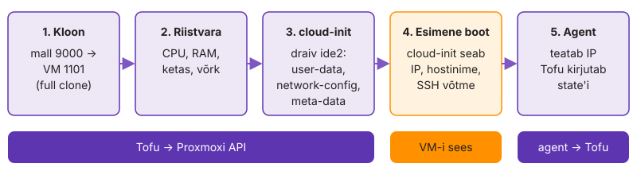

---
tags:
  - OpenTofu
  - Proxmox
  - cloud-init
---

# 1. Üks VM koodist

UI-s kloonitud VM-ist jääb järele ainult task-logi rida: kolmas "sama" masin erineb esimesest CPU tüübi, ketta või võrgu poolest ja keegi ei tea, milles ja miks. Proxmoxis on mall ja token, aga ühtki VM-i pole veel koodis kirjas. Kaustas `k04-tofu/01-alused/` loed malli data source'iga, lood VM-i `test01`, annad sellele cloud-init'iga IP ja võtme ning näed plaanis, millal VM muudetakse (`~`) ja millal tehakse uuesti (`-/+`). Iga muudatuse juures kordad sama tsüklit: kirjutad koodi, ennustad plaani, loed plaani, teed `apply` ja kontrollid tulemust teisest kohast kui Tofu ise.

Lõpuks on Gitis kood, mis loob ja kustutab ühe VM-i, ning `test01` on kustutatud, et selle RAM jääks viiele VM-ile.

**Kui teed seda tööl iga päev:** `ssh kasutaja@<IS1_NET>.19 hostname` vastab `test01`, mille lõid ühe `apply`-ga tabeli L4.1 ja etapi „Anna test01-le võrk ja võti“ argumentidega. Kui see on sul juba korras, mine otse etappi „[Tee VM uuesti](#tee-vm-uuesti)“.

## Lae token ja tee haru

Koolitaja pani control node'ile faili `~/.config/is1/proxmox.env`: API token ja sinu `IS1_*` väärtused. Provider loeb ühenduse keskkonnast, nii et token ei satu ühtegi faili. Token on ajutine: see kehtib 5. kohtumise eelõhtuni. Pärast seda ei saa sinu kood Proxmoxis midagi muuta, kood ja state jäävad alles.

Tokenil on sinu pool'is samad õigused kui sinu kasutajal ja Proxmoxi task-logis on selle töö kirjas kujul `kasutaja@pve!tokeni-nimi`.

1. Vaata õigusi ja lae muutujad.

    ```bash
    ls -l ~/.config/is1/proxmox.env
    source ~/.config/is1/proxmox.env
    env | grep -E '^IS1_' | sort
    tofu version
    ```

2. Kui `tofu` puudub või on vanem kui 1.10, paigalda see [ametliku skriptiga](https://opentofu.org/docs/intro/install/) deb-paketihoidlast. Loe skript enne käivitamist läbi.

    ```bash
    curl --proto '=https' --tlsv1.2 -fsSL https://get.opentofu.org/install-opentofu.sh -o install-opentofu.sh
    less install-opentofu.sh
    sudo bash install-opentofu.sh --install-method deb
    ```

3. Tee haru ja märkmete fail.

    ```bash
    cd ~/labori-seis && git switch main && git pull
    git switch -c k04-tofu
    mkdir -p k04-tofu/01-alused && touch k04-tofu/NOTES.md
    ```

Faili õigused peavad olema `-rw-------`.

> Tokenit ei kirjutata `.tf`- ega `.tfvars`-faili ega ekraanipildile. Automaatne hindaja otsib tokeni mustrit kõigist `k04-tofu/` failidest. Kui token jõuab GitHubi, tühistab koolitaja selle ja annab uue.

✅ **Edasi saad minna, kui** `tofu version` näitab 1.12.x, `echo $IS1_POOL` annab `is1-<github>` ja `git branch --show-current` annab `k04-tofu`.

## Loe mall data source'iga

Esimene kood ei loo midagi, ainult leiab malli tag'ide järgi. Nii proovid provider'i ja tokeni ära enne, kui midagi saab katki minna. Kui see samm õnnestub, on võrk, TLS, token ja õigused korras.

Malli ID kirjutamine koodi tundub lihtsam, aga sealt algab koodi ja tegelikkuse lahknemine. Kui koolitaja teeb uue malli ja kustutab vana, ebaõnnestub kõvakodeeritud ID järgmisel loomisel. Tag'iga otsing leiab uue.

Kirjuta `k04-tofu/01-alused/main.tf`:

- `terraform { required_providers { … } }`: `proxmox` allikaga [`bpg/proxmox`](https://search.opentofu.org/provider/bpg/proxmox/latest), versioon `~> 0.115.0`
- tühi `provider "proxmox" {}`: ühenduse andmed tulevad `PROXMOX_VE_ENDPOINT`, `PROXMOX_VE_API_TOKEN`, `PROXMOX_VE_INSECURE`-ist
- `data "proxmox_virtual_environment_vms" "ubuntu"`, mis otsib tag'idega `template` ja `ubuntu` ([argumendid](https://search.opentofu.org/provider/bpg/proxmox/latest/docs/datasources/virtual_environment_vms))
- `output "mall"`, mis näitab `vms[0]`

1. Proovi `validate` enne ja pärast `init`-i.

    ```bash
    cd ~/labori-seis/k04-tofu/01-alused
    tofu fmt && tofu validate
    tofu init && tofu validate
    ```

2. Käivita plaan ja `apply`, siis vaata, mis kausta tekkis.

    ```bash
    tofu plan && tofu apply
    ls -la && find .terraform -type f | head
    cat .terraform.lock.hcl
    ```

Esimene `validate` ebaõnnestub, sest provider on laadimata. Järjekord jääb kogu korraks samaks: `fmt → init → validate → plan → apply`.

`apply` ilma ühegi ressursita tundub tühi töö, aga see kirjutas state'i data source'i tulemuse ja tõestas, et token näeb malli. `.terraform/` kaustas on provider'i binaar, mille `init` alla laadis. `.terraform.lock.hcl` ütleb, milline täpne versioon ja räsi see oli. Kui kolleeg teeb sama lukufailiga `init`-i, saab ta täpselt sama provider'i.

> Kui output on `vms = []`, ei näe token malli: kas `source` on tehtud ja tag'id õigesti kirjutatud? Kui ikka tühi, puudub tokenil mallile `VM.Audit`, ütle koolitajale.

✅ **Edasi saad minna, kui** `apply` ütleb `0 added, 0 changed, 0 destroyed` ja output'is on `vm_id = 9000` ja `name = "tpl-ubuntu-2404"`.

## Loo test01

Nüüd lood esimese ressursi. Argumente on meelega vähe, kõik muu tuleb mallist. Nii näed, mida mall juba annab ja mida pead hiljem ise kirjutama.

Ennustuse kirjutamine enne plaani on tootmises kasulik harjumus. Kui sa ei tea, mida ootad, ei märka sa ka plaani rida, mis sinna ei kuulu.

Lisa ressurss [`proxmox_virtual_environment_vm`](https://search.opentofu.org/provider/bpg/proxmox/latest/docs/resources/virtual_environment_vm) nimega `test01`.

| Argument | Väärtus |
|---|---|
| `name` | `"test01"` |
| `vm_id` | sinu `IS1_VMID_BASE` + 9 (nt 1109) |
| `node_name` | `$IS1_NODE` |
| `pool_id` | `$IS1_POOL` |
| `clone` plokk | `vm_id` data source'ist (viide, mitte number), `full = true` |

*Tabel L4.1. `test01` esimese versiooni argumendid.*

1. Kirjuta `NOTES.md`-sse ennustus: mitu ressurssi lisatakse, kas midagi muudetakse või kustutatakse.
2. Käivita `tofu plan`, võrdle ennustusega, siis `tofu apply`.
3. Vaata UI-s, et `test01` on sinu pool'is ja töötab.
4. Käivita kohe uuesti `tofu plan`.

<!-- EKRAANIPILT: Proxmoxi veebiliides (https://<aadress>:8006), vasakul Server View, õppija pool is1-<github> lahti; näha control node ja äsja loodud test01 (töötab, roheline ikoon), paremal test01 Summary. Pärast 1.2 esimest tofu apply'd. Token ja IP-d peale tegelikke väärtusi pole vaja varjata, tokenit pildil ei ole.
<figure markdown="span">
  
  <figcaption>Joonis L4.1. <code>test01</code> sinu pool'is pärast esimest <code>apply</code>-d.</figcaption>
</figure>
-->

Teine `plan` kohe pärast `apply`-d kontrollib, kas provider loeb tagasi sama, mis kirjutati. "No changes" tähendab, et kood, state ja Proxmox ütlevad sama. Kui plaan näitab juba siin muudatust, loeb provider mõnda väärtust teisiti, kui sina selle kirjutasid, ja iga järgmine plaan on müra täis.

Sama koodi saab käivitada ka Terraformiga: [lisaülesanne 7. Sama kood Terraformiga](lisa.md#7-sama-kood-terraformiga).

> Kui teine `plan` näitab `tags`: lisasid tag'id, mis pole tähestiku järjekorras. Proxmox sorteerib need ise; kirjuta järjekorras või kasuta `sort([...])`.

✅ **Edasi saad minna, kui** `apply` ütles `1 added`, `test01` töötab UI-s ja teine `plan` ütleb "No changes".

## Leia Tofu töö Proxmoxi logist

Tofu ütleb, et lõi VM-i. Proxmox peab sama asja oma logis näitama, sest audit käib serveri poolel, mitte sinu terminalis.

Kui VM kaob või muutub öösel, otsitakse süüdlast kõigepealt Proxmoxi task-logist. Seepärast peaks igal tööriistal olema oma token: logis on siis kohe näha, kas muudatuse tegi inimene või automaatika.

1. UI-s: `test01` → **Task History**. Leia kloonimise ja käivitamise read ning vaata **User** veergu.
2. Ava kloonimise rida topeltklõpsuga ja vaata, kui kaua kloonimine võttis.
3. Kirjuta `NOTES.md`-sse kasutaja koos tokeni nimega ja mitu ülesannet üks `apply` tekitas.

Üks `apply` tekitab mitu ülesannet (kloon, seaded, käivitus), sest provider teeb API-s sama, mida sina teeksid UI-s mitme klõpsuga.

✅ **Edasi saad minna, kui** `NOTES.md`-s on Task History kasutaja koos tokeni nimega ja kloonimise kestus.

## Muuda kohapeal või asenda

Plaani kõige ohtlikum osa ütleb, kas muudatus tehakse olemasolevale VM-ile või tehakse VM uuesti. Tee kolm muudatust ükshaaval. Iga kord kirjuta enne ennustus `NOTES.md`-sse ja loe plaanist kõigepealt `destroy` read.

Tootmises tähendab `-/+` andmebaasi masinal kadunud andmeid. Plaan näitab seda ette, kuid ainult sellele, kes plaani loeb.

1. Lisa `memory { dedicated = 768 }`, siis `tofu plan` ja `tofu apply`.
2. Lisa `cpu { cores = 1, type = "x86-64-v2-AES" }` ja `agent { enabled = true, timeout = "3m" }`, siis `tofu plan` ja `tofu apply`.
3. Lisa teine data source tag'iga `alma` ja vaheta `clone` plokis mall AlmaLinuxiks. Käivita ainult `tofu plan`, `apply` mitte.
4. Võta muudatus 3 tagasi ja käivita `tofu plan`.

Rida `# forces replacement` näitab täpselt, milline argument asenduse põhjustas. Kui plaanis on mitu muudatust ja üks neist asendab, otsi just seda rida. Mälu ja CPU muutus võib VM-i taaskäivitada, aga ketas jääb samaks. Asendus annab uue ketta ja kõik, mis vanal oli, kaob.

✅ **Edasi saad minna, kui** muudatused 1 ja 2 olid `~ update in-place`, muudatus 3 oli `-/+ destroy and then create replacement` reaga `# forces replacement` ja pärast tagasivõtmist on plaan "No changes".

## Anna test01-le võrk ja võti

Mallist tulnud VM-il pole veel sinu IP-d ega võtit. Need annab cloud-init draiv, mille Proxmox ehitab argumentidest ja ühendab VM-ile CD-na.

Linuxi VM-il on draivi tüüp (`citype`) vaikimisi `nocloud` ja VM-i sees loeb cloud-init seda NoCloud andmeallikana.

Lisa `test01`-le `initialization` ja `network_device` plokk ([Proxmoxi cloud-init](https://pve.proxmox.com/wiki/Cloud-Init_Support)):

- `datastore_id` = `IS1_DATASTORE`
- `ip_config { ipv4 { address = "<IS1_NET>.19/<IS1_MASK>", gateway = "<IS1_GATEWAY>" } }` ja `dns { servers = ["<IS1_DNS>"] }`
- `user_account { username = "kasutaja", keys = [...] }`, võti failist `~/.ssh/id_ed25519.pub`; `file()` ei laienda `~`-i, vaata funktsiooni `pathexpand`
- `network_device { bridge = "<IS1_BRIDGE>" }`

1. Käivita `tofu plan` ja `tofu apply`.
2. Vaata UI-s VM-i Cloud-Init vahekaarti.
3. Proovi ühendust: `ssh -o ConnectTimeout=5 kasutaja@<IS1_NET>.19`

<!-- EKRAANIPILT: Proxmoxi UI, test01 → Cloud-Init vahekaart pärast 2.1 apply'd. Näha User = kasutaja, SSH public key (lühendatud), IP Config (net0) = ip=<IS1_NET>.19/<mask>,gw=<gateway>, DNS server.
<figure markdown="span">
  
  <figcaption>Joonis L4.2. Cloud-Init vahekaart: Tofu kirjutas draivi kasutaja, võtme ja IP.</figcaption>
</figure>
-->

`NOTES.md`-sse: miks ssh ei vasta? Vastus on lehe lõpus lõigus [Miks see nii töötab](#miks-see-nii-tootab).

Siin lähevad teade "Apply complete" ja masina tegelik olek esimest korda lahku. Tofu tegi oma töö õigesti: Proxmoxi seadistus muutus ja UI näitab seda. VM-i sees pole aga midagi juhtunud, sest keegi ei käivitanud cloud-init'i uuesti.

✅ **Edasi saad minna, kui** plaan oli `~ update in-place`, Cloud-Init vahekaardil on IP ja kasutaja ning `NOTES.md`-s on põhjus, miks ssh ei vasta.

## Tee VM uuesti

cloud-init seadistab masina esimesel käivitusel, nii et muudatus jõuab VM-i alles siis, kui masin tehakse uuesti.

Iga asendus annab samale IP-le uue host key. Et `ssh-keygen -R` ei muutuks pimesi kinnitamiseks, võrdled sõrmejälge kanalist, mis ei käi läbi sama võrgu.

1. Asenda VM teadlikult ja ühendu.

    ```bash
    tofu apply -replace=proxmox_virtual_environment_vm.test01
    ssh-keygen -R <IS1_NET>.19
    ssh kasutaja@<IS1_NET>.19 hostname
    ssh-keygen -l -F <IS1_NET>.19
    ```

2. Ava UI-s `test01` → **Console** ja keri käivituse väljundis plokini `BEGIN SSH HOST KEY FINGERPRINTS`. Võrdle ED25519 rida sammu 1 viimase käsu väljundiga.

`-replace` näitab asendust kohe plaanis; vana `taint` töötab ka, aga ei näita mõju enne.

Konsool tuleb Proxmoxi API kaudu, mitte VM-i võrgust. Sõrmejäljed väljastab sinna cloud-init'i moodul `keys_to_console` esimese käivituse lõpus.

<!-- EKRAANIPILT: Proxmoxi UI, AlmaLinuxi VM (nt ajutine test AlmaLinuxi mallist ilma cpu.type'ita) → Console (xterm.js/serial). Näha kerneli viga, et CPU ei toeta x86-64-v2 (nt "Fatal glibc error: CPU does not support x86-64-v2" või kernel panic). Tehakse ettevalmistusel, mitte õppija sammuna.
<figure markdown="span">
  
  <figcaption>Joonis L4.3. AlmaLinux 9 vaikimisi <code>qemu64</code> CPU-ga: boot katkeb, agent ei vasta kunagi.</figcaption>
</figure>
-->

> Kui `apply` ootab "waiting for QEMU agent" kuni timeout'ini ja ebaõnnestub, ava UI-s VM-i konsool ja vaata, kas masin käivitub. AlmaLinux vajab `cpu.type = "x86-64-v2-AES"`.

✅ **Edasi saad minna, kui** `ssh kasutaja@<IS1_NET>.19 hostname` vastab `test01` ilma parooli küsimata ja konsooli ED25519 sõrmejälg klapib `ssh-keygen -l -F` väljundiga.

## Vaata VM-i seest

Tofu näeb VM-i ainult väljast, API kaudu. Kui Ansible ei saa hiljem uue masinaga ühendust, otsid viga just neist failidest.

Kui uus masin ei vasta, on küsimus alati sama: kas viga on draivis (Tofu pool) või masinas (cloud-init pool). Need failid annavad vastuse minutiga, ilma VM-i uuesti tegemata.

Leia vastused ja kirjuta käsud koos vastustega `NOTES.md`-sse ([cloud-init dokumentatsioon](https://cloudinit.readthedocs.io/)).

| Küsimus | Kust vaatad |
|---|---|
| Kas cloud-init lõpetas ja kui kaua see võttis? | `cloud-init status --long`, `cloud-init analyze show` |
| Kust tuli IP? | `/etc/netplan/50-cloud-init.yaml` |
| Kes pani su võtme? | `~kasutaja/.ssh/authorized_keys`, `grep -i ssh /var/log/cloud-init.log` |
| Kust tuli hostinimi? | `hostnamectl`, `cloud-init query ds.meta_data` |
| Kas agent töötab? | `systemctl status qemu-guest-agent` |
| Kas `/etc/hosts`-i haldab cloud-init? | `cat /etc/cloud/cloud.cfg.d/99-labori-seis.cfg` |

*Tabel L4.2. Kust VM-i sees näed, mida cloud-init tegi.*

1. Ühendu `test01`-ga ja täida tabel.
2. Control node'il võrdle oma argumenti agendi atribuudiga.

    ```bash
    tofu state show proxmox_virtual_environment_vm.test01 | grep -A3 ipv4_addresses
    ```

`ip_config` aadress on see, mida sina soovisid. `ipv4_addresses` on see, mida agent VM-i seest teatas. Kui need klapivad, on ahel mall → draiv → cloud-init → netplan terve. Kui agent teatab teise aadressi või ei teata midagi, on viga masina sees, mitte koodis.

✅ **Edasi saad minna, kui** `cloud-init status --long` näitab `status: done`, IP on netplan'is, hostinimi on `test01`, agent on `active` ja väljund on `NOTES.md`-s.

## Koristus ja commit

VM kaob koodiga ja Giti läheb ainult see, mis sinna kuulub. Kood jääb alles, sest viis VM-i tulevad sama kujuga.

Unustatud test-VM kasutab pool'i RAM-i ja viie VM-i `apply` ebaõnnestub, sest kvoot saab täis. Giti sattunud `.terraform/` teeb repositooriumi suureks, state'iga lekivad masinate andmed.

1. Kustuta `test01`, data source jääb alles.

    ```bash
    tofu destroy
    tofu state list
    ```

2. Lisa repositooriumi juurkausta `.gitignore`-i read `k04-tofu/**/.terraform/` ja `k04-tofu/**/*.tfstate*`, siis commit.

    ```bash
    cd ~/labori-seis
    git add .gitignore k04-tofu/01-alused/main.tf k04-tofu/01-alused/.terraform.lock.hcl k04-tofu/NOTES.md
    git commit -m "k04: 01-alused, test01 mallist ja cloud-init"
    ```

`state list` näitab pärast `destroy`-d ainult data source'i. Tofu ei halda enam ühtki objekti, aga teab endiselt, kust malli leida. Kood ja state on nüüd kooskõlas tühja pool'iga.

✅ **Edasi saad minna, kui** `destroy` ütles `1 destroyed`, `tofu state list` näitab ainult `data.…` rida ja `git status --short` ei näita `.terraform/` ega `terraform.tfstate`-i.

📎 **Selle mooduli tõend:** commit `k04: 01-alused…`; `NOTES.md`-s kolm ennustust koos tegeliku plaaniga, Task History kasutaja, põhjus, miks ssh pärast in-place muudatust ei vastanud, ja `cloud-init status --long` väljund (ka issue `K4.1` kommentaaris).

## Miks see nii töötab

**Data source.** Data source ainult loeb olemasolevaid objekte ega muuda midagi; seda loetakse igal plaanil uuesti. AWS-is otsitakse samamoodi AMI ID-d nime või tag'i järgi, nii et ID-d koodi ei kirjutata.

**Sõltuvusgraaf.** Viide `clone.vm_id` data source'ile tekitab sõltuvuse, nii et Tofu loeb malli enne VM-i loomist. Sõltuvusgraaf on Tofu tööpõhimõte: Tofu ehitab viidetest graafi ja teeb omavahel sõltumatud toimingud paralleelselt, failide järjekord ei loe.

**Muutmine või asendus.** RAM-i saab olemasoleval VM-il muuta, malli mitte, sest teisest mallist kloonides tekib teine ketas. Provider märgib skeemis iga argumendi kohta, kas selle muutmine nõuab objekti asendamist (SDKv2 provider'is `ForceNew`, plugin framework'is `RequiresReplace`). Plaanis on see märge kujul `# forces replacement`.

**Full clone.** Full clone kopeerib malli ketta ja VM ei sõltu pärast loomist mallist. Linked clone oleks kiirem ja võtaks vähem ruumi, aga seob VM-i malliga: malli ei saa kustutada, kuni sellest tehtud VM-id on alles.

**Cloud-init ja `-replace`.** cloud-init saab seadistuse väikeselt virtuaalselt CD-lt, millel on `user-data`, `network-config` ja `meta-data` koos `instance-id`-ga. Kui `instance-id` on sama mis eelmisel käivitusel, peab cloud-init masinat juba seadistatuks ega seadista võrku ja kasutajaid uuesti. Seepärast jõuab cloud-init'i draivi muudatus VM-i alles pärast `-replace`-i, mis loob VM-i uuesti. Iga `-replace` annab VM-ile uue host key, nii et `known_hosts`-ist tuleb vana rida eemaldada.

**QEMU agent.** `qemu-guest-agent` suhtleb hüperviisoriga virtio-serial kanali kaudu (VM-is seade `/dev/virtio-ports/org.qemu.guest_agent.0`) ja annab Proxmoxile VM-i IP. Provider ootab agenti vaikimisi 15 minutit. Meil on timeout 3 minutit, et katkine boot annaks vea kiiresti.

<figure markdown="span">
  
  <figcaption>Joonis L4.4. Mis juhtub ühe VM-iga <code>tofu apply</code> ajal. Sammud 1–3 teeb Tofu API kaudu, samm 4 toimub VM-i sees, sammus 5 jõuab IP agendi kaudu state'i.</figcaption>
</figure>

**Provider kui protsess.** `tofu init` laeb provider'i kausta `.terraform/providers/…`. See on Go binaar, mille Tofu käivitab alamprotsessina ja millega ta suhtleb gRPC kaudu. Tofu ise ei tea Proxmoxist midagi, kogu API tundmine on provider'is.

**`.terraform/` ja lukufail.** Kaust `.terraform/` on uuesti allalaaditav ja provider'ite binaarfailide tõttu suur (`bpg/proxmox`-iga kümneid megabaite). `.terraform.lock.hcl` on mõne kilobaidi suurune ja määrab, millised täpsed provider'i versioonid ja kontrollsummad projekti kuuluvad. Seepärast läheb Giti ainult lukufail.

**Token keskkonnamuutujas.** `TF_VAR_proxmox_api_token` on tavaline keskkonnamuutuja. `cat /proc/$$/environ | tr '\0' '\n' | grep TF_VAR` näitab, et seda saavad lugeda kõik sinu kasutaja protsessid ja root. Seepärast on `proxmox.env` õigustega 600 ja control node'il pole teisi kasutajaid.

**`sensitive` ja state.** `sensitive` peidab väärtuse plaanist ja väljundist. State'i kirjutatakse aga lihttekstina kõik, mida ressurss või output sisaldab, kui state'i krüpteerimine pole sisse lülitatud (vt [krüpteeritud state](lisa.md#lisaprojekt-krupteeritud-state)). Saladuse kaitse algab seega sellest, et saladus ei jõua ühtegi ressurssi ega output'i.

**Plaan on ennustus.** `validate` ei pöördu Proxmoxi poole ja `plan` ei küsi, kas node on olemas: olematu `node_name` läbib mõlemad ja ebaõnnestub alles `apply`-s. Pipeline, mis kontrollib ainult `validate`-i ja `plan`-i, sellist viga ei leia. Seepärast on tootmise kõrval vaja dev-keskkonda, kus sama koodiga `apply` tehakse.

**`serial` ja `lineage`.** `serial` on state'i versiooninumber ja kasvab iga muutva `apply`-ga. `lineage` on state'i loomisel määratud püsiv unikaalne ID. Kaks faili sama `lineage`-iga on sama state'i eri versioonid, eri `lineage`-iga failid on eri state'id. State on ainus koht, kus on kirjas, et koodi `test01` on Proxmoxis kindel VM ID. Avaliku võtme hoidmine state'is on ohutu, aga samasse kohta jõuaks ka parool, kui see oleks ressursi argument.

**Provisioner.** Provisioner käivitub ainult ressursi loomisel ja Tofu ei salvesta selle tulemust state'i. Tofu ei tea, mida skript tegi, ega märka, et skript muutus: plaan ütleb "No changes". Masina sisu jääb Tofule nähtamatuks ja ainus viis seda uuendada on masin uuesti teha. Ansible kontrollib sama faili igal käivitusel ja näitab erinevust `changed`-ina. OpenTofu dokumentatsioon nimetab provisioner'eid viimaseks abinõuks ([provisioner'id](https://opentofu.org/docs/language/resources/provisioners/syntax/)): mis peab olema igas masinas, kuulub malli, esimese käivituse töö cloud-init'ile ja seadistus Ansible'ile.

Kui jõudsid kiiremini: [Lisaülesanded → 1. Validate'i ja plaani piirid](lisa.md#1-validatei-ja-plaani-piirid), tekitad igale kontrolli etapile vea, mida ainult see etapp leiab.
