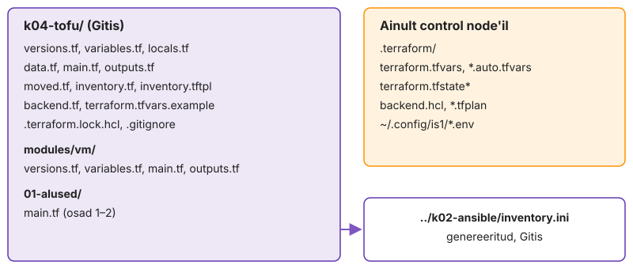
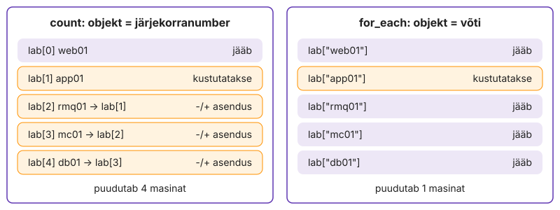
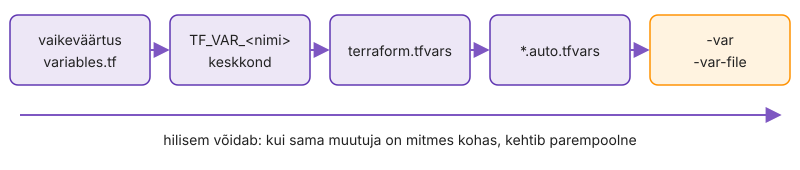

---
tags:
  - OpenTofu
  - Proxmox
---

# 2. Viis VM-i muutujatega

Viis kopeeritud VM-i plokki lähevad aja jooksul lahku: üks saab parandatud CPU tüübi, teised mitte, ja hostinime muutmine kustutab töötava masina, kui keegi plaani ei loe. `test01` koodis on iga väärtus otse koodis. Nüüd eraldad koodi ja andmed: kood ütleb, kuidas VM ehitatakse, `terraform.tfvars` ütleb, milliseid VM-e on vaja, ja üks `for_each` plokk teeb neist viis. Sama koodi kasutavad hiljem moodul, inventory ja dev-keskkond, ainult teiste andmetega.

Lõpuks on `k04-tofu/` juurkaustas kood, mis jääb alles kogu kursuseks, `validation` lükkab vigase sisendi tagasi ja `tofu test` kontrollib käitumist ilma Proxmoxita.

Joonisel L4.5 vales pooles olev fail tähendab leket või katkist klooni.

**Kui teed seda tööl iga päev:** `tofu state list` näitab viit `proxmox_virtual_environment_vm.lab[...]` aadressi, mille lõid `for_each`-i, `validation`-i ja salvestatud plaaniga etapi „Tee kõik viis salvestatud plaaniga“ nõuete järgi. Kui see on sul juba korras, mine otse etappi „[Kirjuta tofu test](#kirjuta-tofu-test)“.

<figure markdown="span">
  
  <figcaption>Joonis L4.5. <code>k04-tofu/</code> korra lõpus. Vasakul failid, mis lähevad Giti, paremal need, mis jäävad control node'ile.</figcaption>
</figure>

## Pane failid ja muutujad paika

Ükski ressurss ei muutu veel.

Tofu loeb kõik kausta `*.tf` failid üheks mooduliks ja failinimi tähendust ei kanna: jaotus on lugeja jaoks, `validate` ja `plan` näevad sama koodi.

Tee `k04-tofu/` juurde failid teema järgi: `versions.tf`, `variables.tf`, `locals.tf`, `data.tf`, `main.tf`, `outputs.tf`, `terraform.tfvars.example`, `.gitignore`. Alusta kahest esimesest:

- `versions.tf`: `required_version = ">= 1.10"`, `bpg/proxmox` `~> 0.115.0`, `hashicorp/local` `~> 2.5`; `provider "proxmox"` loeb `var.proxmox_endpoint`, `var.proxmox_api_token`, `var.proxmox_insecure`
- `variables.tf`: need kolm ja lisaks `node`, `pool`, `datastore`, `bridge`, `gateway`, `dns_servers`, `ssh_public_key`
- tokeni muutujal on `sensitive = true` ja **ei ole** vaikeväärtust; väärtus tuleb keskkonnast `TF_VAR_proxmox_api_token`
- `.gitignore`: kõik, mis `01-alused/` kaustas tekkis ja Giti ei tohi minna, lisaks plaanifailid (`*.tfplan`) ja `*.auto.tfvars`; `.terraform.lock.hcl` läheb Giti

1. Tee `terraform.tfvars` näidisest ja täida `IS1_*` väärtustega.

    ```bash
    cd ~/labori-seis/k04-tofu
    cp terraform.tfvars.example terraform.tfvars
    tofu init && tofu validate
    git status --short
    ```

Kui `validate` ütleb `Reference to undeclared input variable` ja pakub `Did you mean`, siis nimi koodis ja `variables.tf`-is ei klapi: paranda nimi, ära lisa teist muutujat.

Kui `git status` ei näita `terraform.tfvars`-i, töötab `.gitignore` enne esimest `git add`-i.

✅ **Edasi saad minna, kui** `validate` on OK ja `git status --short` ei näita `terraform.tfvars`-i ega `.terraform/`-i.

## Alusta ühest VM-ist

Nüüd kirjutad ressursi, mis teeb VM-i igast `vms` kirjest, aga annad sellele esialgu ainult ühe kirje. Kood on kohe viie masina jaoks valmis, andmed on ühe jaoks. Ühe masinaga on viga lihtsam leida kui viiega; ülejäänud neli on hiljem ainult read `terraform.tfvars`-is.

Tofu loob `for_each` eksemplarid paralleelselt (vaikimisi kümme korraga), nii et vigane muster jõuab kõigile viiele enne, kui esimene viga tagasi tuleb.

- `variables.tf`: muutuja `vms`, tüüp `map(object({...}))` väljadega `vm_id`, `ip`, `distro`, `cores`, `memory`, `disk = optional(number, 10)`, `group`
- `terraform.tfvars`: `vms`-is **ainult `web01`**
- `data.tf`: data source `for_each`-iga üle distrode, mida `vms` kasutab: `toset([for v in var.vms : v.distro])`
- `locals.tf`: `ssh_key` (faili sisu), `common_tags = ["labori-seis", "tofu"]`, `templates` (distro → malli `vm_id`)
- `main.tf`: `resource "proxmox_virtual_environment_vm" "lab"` `for_each = var.vms`-iga, kõik `test01` plokid, `tags = sort(concat(local.common_tags, [each.value.group]))`

```bash
tofu plan
```

Aadress `lab["web01"]` ütleb, et VM-i identiteet Tofu jaoks on võti `web01`, mitte järjekorranumber ega Proxmoxi ID. Data source loeb ainult Ubuntu malli, sest `vms`-is pole veel ühtki AlmaLinuxit. Nii ei sõltu plaan mallist, mida keegi ei kasuta.

> `vm_id ... already exists`: sinu vana VM samal ID-l on alles või `test01` jäi kustutamata, vaata UI-st. `403 Permission check failed (/storage/..., Datastore.AllocateSpace)`: kopeeri veateade täpselt koolitajale, ära proovi teist storage'it.

✅ **Edasi saad minna, kui** plaan ütleb `1 to add` ja aadress on `proxmox_virtual_environment_vm.lab["web01"]`.

## Püüa vead kinni plaanis

Paned muutujale reeglid, mis lükkavad vigase sisendi tagasi enne, kui Proxmoxi poole midagi läheb. Ilma `validation`-ita tuleb vale IP välja alles siis, kui masin on ilma võrguta käivitunud.

`validation` hinnatakse siis, kui muutuja väärtus on teada, enne ühtki provider'i kutset. Sama reegel kehtib igale väärtuse allikale: `tfvars`, `-var` ja `TF_VAR_`.

Lisa `vms`-ile `validation` plokid:

- `distro` on `ubuntu` või `alma`
- `ip` on maskiga: `can(cidrnetmask(v.ip))`
- IP-d ja `vm_id`-d on unikaalsed (`distinct` ja `length`)
- igal plokil on oma `error_message`, mis ütleb, mida parandada

1. Pane web01-le `ip = "10.10.<nr>.11"` (ilma maskita) ja käivita `tofu plan`.
2. Pane `distro = "debian"` ja käivita `tofu plan`.
3. Pane õiged väärtused tagasi.

Veateade nimetab sinu `error_message`-i, mitte provider'i või Proxmoxi viga. See tõestab, et kontroll toimus Tofu sees ja API-sse ei läinud ühtki päringut. Kui sinu teade ütleb, mida parandada, ei pea järgmine inimene koodi lugema.

✅ **Edasi saad minna, kui** sammudes 1 ja 2 tuli sinu enda veateade enne, kui Proxmoxi poole midagi läks, ja pärast parandust on plaan jälle `1 to add`.

## Tee kõik viis salvestatud plaaniga

Nüüd lisad ülejäänud neli masinat. Kood jääb samaks, muutub ainult `terraform.tfvars`. Seekord teed `apply` plaanifailist, mitte uuest plaanist: Tofu teeb täpselt selle, mida sa lugesid.

Tavaline `apply` arvutab plaani uuesti. Kui vahepeal muutis keegi midagi, teeb `apply` midagi muud kui see, mille üle sa otsustasid. Salvestatud plaan sulgeb selle akna ja hiljem ehitab `up.sh` sellele oma kaitse.

Nõuded:

- web01, app01, rmq01 on Ubuntu, mc01 ja db01 AlmaLinux; `group` on `web`, `app`, `queue`, `cache`, `db`
- `vm_id` = `IS1_VMID_BASE` + 1…5, IP lõpp `.11…15`
- RAM: web01 512, app01 1536, rmq01 1024, mc01 512, db01 1024; app01 ja db01 ketas 12 GB
- `apply` käib plaanifailist, mille enne läbi lugesid (`tofu plan -out=…`, `tofu apply <fail>`); plaanifail ei lähe Giti
- enne `apply`-d kirjuta `NOTES.md`-sse, mitu lisatakse ja kas midagi kustutatakse

```bash
tofu plan
tofu state list
git status --short
```

<!-- EKRAANIPILT: Proxmoxi UI, õppija pool is1-<github> pärast 3.5 apply'd: control node + web01, app01, rmq01, mc01, db01, kõik töötavad. Valitud nt db01, paremal Summary, kus näha Tags (db, labori-seis, tofu) tähestiku järjekorras.
<figure markdown="span">
  
  <figcaption>Joonis L4.6. Pool pärast viie VM-i loomist: control node ja viis koodist loodud VM-i, tag'id tähestiku järjekorras.</figcaption>
</figure>
-->

Data source loeb nüüd kaks malli, sest `vms`-is on mõlemad distrod. Teine `plan` pärast `apply`-d ütleb "No changes" ainult siis, kui tag'id, CPU ja ketas on kõigil viiel nii, nagu Proxmox need tagasi annab. Edaspidi on uus rida `tfvars`-is uus masin ja olemasolevad jäävad rahule.

> AlmaLinuxi masinad jäävad agenti ootama: CPU tüüp puudub (vt [Üks VM koodist](lab-1-uks-vm.md), "Tee VM uuesti").

✅ **Edasi saad minna, kui** UI-s töötavad viis VM-i, `tofu plan` ütleb "No changes", `state list` näitab viit `lab[...]` aadressi ja `git status` ei näita plaanifaili.

## Vaata, mis on VM-i identiteet

See etapp on katse, mida tootmises teha ei tahaks. Muudad ainult võtme nime ja vaatad, mida plaan selle peale näitab. `apply`-d ei tee.

Hostinime muutmine tundub kosmeetiline. Tofu jaoks on võti aga objekti aadress ja uus aadress tähendab uut objekti. Kes seda ei tea, kustutab ümbernimetamisel töötava masina.

1. Nimeta `terraform.tfvars`-is `web01` ümber `www01`-ks ja vaata plaani.

    ```bash
    tofu plan | grep -E '^\s+#|Plan:'
    ```

2. Kirjuta `NOTES.md`-sse, mida plaan tahab teha ja millise kahe aadressiga.
3. Pane nimi tagasi `web01`-ks ja kontrolli, et plaan on "No changes".

Plaan tahab `lab["www01"]` luua ja `lab["web01"]` kustutada, kuigi IP, `vm_id` ja kõik muu on samad. Tofu võrdleb objekte aadressi, mitte sisu järgi. Kui VM-i kirjeldus läheb moodulisse, näed, kuidas `moved` plokk ütleb, et uus aadress on sama objekt.

✅ **Edasi saad minna, kui** `NOTES.md`-s on plaan `1 to add, 1 to destroy` mõlema aadressiga ja pärast tagasivõtmist on plaan "No changes".

## Võrdle count'iga

Eelmine katse näitas, et `for_each` seob objekti võtmega. Siin teed sama katse `count`-iga, mis seob objekti järjekorranumbriga, ja vaatad, mida see listi keskelt kustutamisel teeb. Katse käib failidega ajutises kaustas, nii et ükski VM ei saa viga.

Vanemas koodis on `count` VM-ide jaoks tavaline. Kes selle koodi üle võtab ja listist ühe hosti eemaldab, asendab vaikides kõik järgmised masinad. VM-i asendus tähendab uut ketast ja kadunud andmeid.

1. Tee kaust `/tmp/count-proov/` ja sinna `main.tf`: `variable "nimed"` vaikeväärtusega `["a", "b", "c"]` ja `resource "local_file" "f"` `count = length(var.nimed)`-iga, `filename = "${path.module}/${var.nimed[count.index]}.txt"`, `content = var.nimed[count.index]`.
2. Loo failid, siis kustuta listi keskelt üks nimi.

    ```bash
    cd /tmp/count-proov && tofu init -input=false > /dev/null && tofu apply -auto-approve
    tofu plan -var 'nimed=["a","c"]' | grep -E '^\s+#|Plan:'
    ```

3. Vaheta ressursil `count` välja `for_each = toset(var.nimed)` (`each.key` kahes kohas), tee `tofu apply` ja korda sama plaani.
4. Kirjuta `NOTES.md`-sse mõlema plaani aadressid, siis `cd ~/labori-seis/k04-tofu && rm -rf /tmp/count-proov`.

`count`-iga tahab plaan asendada `f[1]`-e (`b.txt` → `c.txt`) ja kustutada `f[2]`, kuigi sina kustutasid ainult `b`. `for_each`-iga on plaanis ainult `f["b"]` kustutamine. Failide puhul on vahe kosmeetiline, VM-ide puhul tähendaks `count` app01 eemaldamisel rmq01, mc01 ja db01 asendust. `count` sobib ainult küsimusele "kas see üks asi on olemas", näiteks `count = var.enabled ? 1 : 0`.

✅ **Edasi saad minna, kui** `count`-i plaan asendas `f[1]`-e ja kustutas `f[2]`, `for_each`-i plaan kustutas ainult `f["b"]` ja mõlemad on `NOTES.md`-s.

## Anna tulemus output'iga välja

Output'i kaudu loevad teised tööriistad Tofu tulemust, näiteks Ansible'i inventory. Siin kirjutad väljundid, mida inventory hiljem vajab, ja proovid, kuidas Tofu saladust väljundis käsitleb.

Kui väljund tuleb sisendist, on see "õige" ka siis, kui VM-i polnud võimalik luua. Ansible saaks siis IP, mille taga pole midagi, ja viga paistaks võrguveana.

Kirjuta `outputs.tf`:

- `hosts`: nimi → IP ilma maskita (`split("/", …)[0]`)
- `vm_ids`: nimi → `vm_id`
- väärtused tulevad **ressursist** (`proxmox_virtual_environment_vm.lab[...]`), mitte `var.vms`-ist
- avaldis, mida on vaja kahes kohas, läheb `locals`-isse

```bash
tofu output
tofu output -json hosts | jq
echo 'proxmox_virtual_environment_vm.lab["db01"].ipv4_addresses' | tofu console
```

1. Lisa ajutiselt `output "token" { value = var.proxmox_api_token }` ja käivita `tofu plan`.
2. Lisa samale output'ile `sensitive = true` ja käivita uuesti `tofu plan`. `apply`-d ei tee.
3. Eemalda output ja kontrolli, et `tofu plan` on "No changes".

Esimene plaan keeldus, sest output viitab tundlikule väärtusele. `sensitive` levib: kõik, mis tuleb tundlikust muutujast, on samuti tundlik. Teine plaan näitas `(sensitive value)`, aga `apply` oleks kirjutanud tokeni state'i lihttekstina. `sensitive` peidab väärtuse ekraanilt, mitte state'ist.

✅ **Edasi saad minna, kui** `hosts` näitab viit IP-d ilma maskita, `vm_ids` viit ID-d, `NOTES.md`-s on mõlema token-output'i proovi tulemus ja `outputs.tf`-is tokeni output'i pole.

## Uuri avaldisi konsoolis

Enne testide kirjutamist proovid `tofu console`-is avaldisi, millest selle korra kood koosneb. Konsool loeb sinu muutujad, locals'id ja state'i, aga ei muuda midagi.

Vale avaldis `locals`-is ei ebaõnnestu alati. Sageli annab see lihtsalt vale tulemuse: tühja grupi, vale IP või puuduva hosti, ja viga tuleb välja alles Ansible'is.

Käivita `tofu console` ja proovi ridu ükshaaval. Kirjuta iga rea juurde `NOTES.md`-sse, mida ootasid ja mida said ([funktsioonid](https://opentofu.org/docs/language/functions/)).

1. `for` avaldised: list ja map, filtriga ja ilma.

    ```hcl
    [for k, v in var.vms : k if v.distro == "alma"]
    { for k, v in var.vms : k => v.memory }
    sum([for v in var.vms : v.memory])
    ```

2. Tingimus, `lookup`, `merge` ja `try`.

    ```hcl
    var.vms["db01"].memory >= 1024 ? "suur" : "väike"
    lookup(var.vms["web01"], "protection", false)
    merge({ a = 1, b = 2 }, { b = 3 })
    try(var.vms["www01"].ip, "pole sellist hosti")
    ```

3. Võrguavaldised, mida `validation` ja hiljem `precondition` kasutavad.

    ```hcl
    split("/", var.vms["web01"].ip)[0]
    cidrhost(var.vms["web01"].ip, 0)
    cidrhost(var.vms["web01"].ip, 1)
    cidrnetmask(var.vms["web01"].ip)
    ```

4. Agregaadid ja nimede normaliseerimine. Teine rida ebaõnnestub meelega: loe veateadet.

    ```hcl
    max([for v in var.vms : v.memory]...)
    max([for v in var.vms : v.memory])
    min([for v in var.vms : v.memory]...)
    lower(var.pool)
    upper(var.vms["db01"].group)
    ```

5. Genereeritud saladus. Ajutises kaustas `/tmp/k04-saladus` (mitte repositooriumis) tee `hashicorp/random` provider'iga `random_password`, mis annab rakenduse andmebaasi kasutajale parooli. Nõuded: 24 märki, vähemalt 2 suurtähte ja 2 numbrit, erimärgid ainult `_-.` (shellis ja URL-is ohutud), uus parool tuleb ainult muutuja `rotation` muutusest (`keepers`), output on `sensitive`. Kontroll:

    ```bash
    cd /tmp/k04-saladus && tofu init -input=false > /dev/null && tofu apply
    tofu output -raw db_app_password | wc -c                                  # 24
    jq -r '.resources[].instances[].attributes.result' terraform.tfstate      # parool lihttekstina
    tofu plan -var rotation=2026-11 | grep -E 'forces replacement|Plan:'
    tofu output -raw db_app_password | ansible-vault encrypt_string --stdin-name db_app_password
    cd ~/labori-seis/k04-tofu && rm -rf /tmp/k04-saladus
    ```

`merge` võtab sama võtme korral viimase väärtuse, nii et `b = 3`. `lookup` vaikeväärtusega ja `try` ei ebaõnnestu puuduva võtme või atribuudi peale: `protection` tuleb objekti alles db01 kaitsmisel ja `var.vms["www01"].ip` ilma `try`-ta ebaõnnestuks. `cidrhost(ip, 0)` annab võrgu aadressi ja `cidrhost(ip, 1)` võrgu esimese hosti, klassi võrgus tavaliselt lüüsi. Kui võrgu aadress on web01-l ja lüüsil sama, on need samas võrgus; just seda kontrollib hiljem `precondition`. Sama `sum`-avaldis on RAM-i kvoodi kontrolli alus, mille lisad koos kaitsetega.

`min` ja `max` võtavad arvud eraldi argumentidena, mitte listina: `...` laiendab listi argumentideks, ilma selleta tuleb `number required, but have tuple`. `lower` teeb segatähtedega GitHubi kasutajanimest pool'i nimes väiketähtedega kuju, mida nõuavad näiteks S3 bucketi nimed ja DNS-kirjed.

`random_password` ei vaja ühtki parooli käsitsi, aga tulemus on state'is lihttekstina. Seepärast läheb saladus Ansible'ile Vault'i krüpteerituna ja state'i tuleb kaitsta nagu paroolifaili ([krüpteeritud state](lisa.md#lisaprojekt-krupteeritud-state)). `keepers` teeb rotatsiooni koodis nähtavaks: plaan näitab `forces replacement`, mitte vaikset muutust. OpenTofu 1.11+ `ephemeral` ressurss hoiab sellise väärtuse state'ist üldse väljas, aga siis peab väärtust kasutav ressurss või provider selle samas käivituses kätte saama.

✅ **Edasi saad minna, kui** `NOTES.md`-s on kõigi viie sammu avaldised ja käsud koos tulemusega ja selgitus, miks `try` ja `lookup` ei ebaõnnestunud.

## Kirjuta tofu test

[`tofu test`](https://opentofu.org/docs/cli/commands/test/) võltsib `mock_provider`-iga provider'i vastused, plaani loogika jääb samaks. Nii kontrollid oma reegleid ja väljundeid sekunditega, ilma Proxmoxi ja ühegi VM-ita.

Ilma testita leiad vigase `validation`-i alles siis, kui see laseb vea läbi. Automaatne hindaja ja hilisem pipeline saavad sama testi käivitada ilma ligipääsuta sinu klassi Proxmoxile.

Kirjuta `tests/vms.tftest.hcl`:

- `mock_provider "proxmox"` ja selles `mock_data "proxmox_virtual_environment_vms"`, mille `defaults` annab ühe malli (`vms = [{ name, node_name, status, tags, template, vm_id = 9000 }]`)
- faili tasemel `variables` plokk kõigi kohustuslike muutujatega peale tokeni (see tuleb keskkonnast) ja kahe VM-iga; `ssh_public_key` osutab testi võtmefailile `tests/id_test.pub` (ainult avalik võti)
- `run "hosts"`: `command = plan`, `assert`, et `output.hosts["web01"]` on IP ilma maskita
- `run "ip_ilma_maskita"` ja `run "sama_vm_id"`: oma `variables` vigase `vms`-iga ja `expect_failures = [var.vms]`

```bash
tofu test
tofu validate
```

`pass` vigase sisendiga testis tähendab, et reegel keeldus nii, nagu pidi. Kui eemaldad ajutiselt ühe `validation` ploki ja käivitad `tofu test` uuesti, peab vastav test ebaõnnestuma. Test, mis ei ebaõnnestu kunagi, ei kontrolli midagi.

> `tofu validate` kontrollib ka testifaile. Vigane test nurjab automaatse hindaja `validate` kontrolli, nii et käivita mõlemad.

✅ **Edasi saad minna, kui** `tofu test` näitab kõiki `run` plokke `pass` ja `Success!`.

## Commit

Kood, lukufail ja testid lähevad nüüd GitHubi. Automaatse hindaja kaks kontrolli käivitad enne ise, et viga tuleks välja sinu terminalis, mitte PR-is.

Lukufailita commit tähendab, et järgmine `init` võib valida teise provider'i versiooni ja plaan muutub ilma koodi muutmata.

```bash
tofu fmt -recursive
cd ~/labori-seis
git add k04-tofu
git commit -m "k04: viis VM-i for_each'iga, validation, output, tofu test"
git push -u origin k04-tofu
```

`fmt` ja `secrets` `OK` tähendavad, et kood on ühes vormis ja ükski token ega privaatvõti pole Gitis.

✅ **Edasi saad minna, kui** `bash autograde/check.sh k04 fmt` ja `bash autograde/check.sh k04 secrets` annavad `OK` ja haru on GitHubis.

📎 **Selle mooduli tõend:** commit `k04: viis VM-i…` koos `.terraform.lock.hcl` ja `tests/`-iga; `NOTES.md`-s ümbernimetamise plaan, `count`/`for_each` võrdlus, konsooli avaldised ja token-output'i proov; `tofu state list` ja `tofu test` väljund issue `K4.2` kommentaaris.

## Miks see nii töötab

**`for_each`-i võti.** `for_each`-i võti on objekti identiteet. Kui võti muutub, on see Tofu jaoks teine objekt ja vana objekt kustutatakse. Seepärast vali võtmeks väärtus, mis ei muutu: hostinimi, mitte järjekorranumber või IP.

**`count` ja `for_each`.** `count` seob objekti järjekorranumbriga. Kui kustutad listi keskelt app01, nihkuvad järgmised indeksid ja Tofu tahab need asendada. `for_each` seob võtmega ja puudutab ainult app01-te.

<figure markdown="span">
  
  <figcaption>Joonis L4.7. app01 kustutamine: <code>count</code>-iga nihkuvad indeksid, <code>for_each</code>-iga kustub ainult app01.</figcaption>
</figure>

**Argument ja atribuut.** Argument on see, mille sina kirjutasid (`ip_config` aadress), atribuut see, mille ressurss tagasi andis (`ipv4_addresses` agendilt, `vm_id`). Muutujast tulev output on teada ka siis, kui VM-i veel pole. Ressursist tulev output tekitab sõltuvuse ja on teada alles pärast loomist; inventory jaoks tahame just seda, sest siis kirjutatakse fail alles pärast VM-ide loomist.

**`tofu console`.** `tofu console` hindab avaldisi samas kontekstis nagu plaan (muutujad, locals, state), aga ei arvuta muudatusi: `var.vms["db01"].ip`, `[for k, v in var.vms : k if v.distro == "alma"]`, `local.groups`. See hoiab state'i lukku kogu sessiooni ajal.

**`mock_provider`.** `mock_provider` annab ressursside arvutatud atribuutidele juhuslikud väärtused. Seepärast testi argumente (näiteks IP, mille andsid sina), mitte arvutatud atribuute (näiteks QEMU agendi teatatud IP). `command = apply` testis teeks VM-i ja kustutaks selle lõpus; see on aeglasem ja sobib öiseks pipeline'iks.

**Muutujate järjekord.** Sama muutuja väärtus võib tulla mitmest kohast. Järjekord on vaikeväärtus → `TF_VAR_<nimi>` → `terraform.tfvars` → `*.auto.tfvars` → `-var`/`-var-file`, hilisem võidab ([muutujad](https://opentofu.org/docs/language/values/variables/)). Token tuleb ainult keskkonnast. `locals` on mooduli sisemine avaldis, mida väljast üle kirjutada ei saa: ühised tag'id, malli ID-de kaart, Ansible'i gruppide arvutus.

<figure markdown="span">
  
  <figcaption>Joonis L4.8. Kui sama muutuja on mitmes kohas, kehtib parempoolne. Vasakul on see, mis on koodis kõigile sama, paremal see, mis on ühe käsu jaoks.</figcaption>
</figure>

**`*.auto.tfvars`.** `*.auto.tfvars` loetakse automaatselt ja see on eelistatud `terraform.tfvars`-i ees. Kausta unustatud fail kirjutab sinu väärtused hoiatuseta üle ja plaan muutub, ilma et ükski Gitis olev fail oleks muutunud. Seepärast on `*.auto.tfvars` `.gitignore`-is.

Kui jõudsid kiiremini: [Lisaülesanded → 3. Kust muutuja väärtuse saab](lisa.md#3-kust-muutuja-vaartuse-saab), proovid muutuja kõiki viit allikat ja leiad, milline neist võidab.
