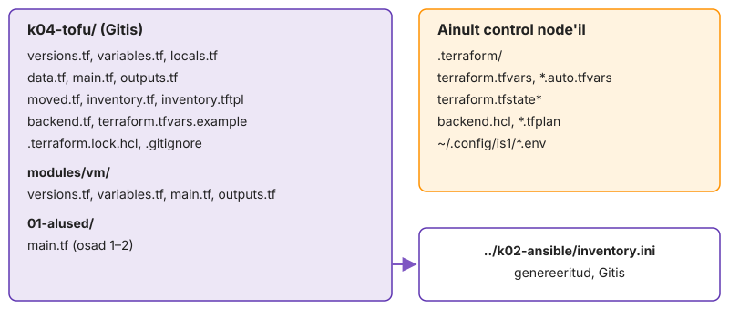
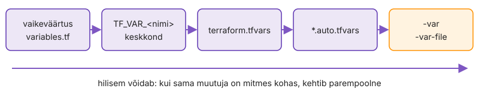

---
tags:
  - OpenTofu
  - Proxmox
---

# 2. Viis VM-i muutujatega

Viis kopeeritud VM-i plokki lähevad aja jooksul lahku: üks saab parandatud CPU tüübi, teised mitte, ja hostinime muutmine kustutab töötava masina, kui keegi plaani ei loe. `test01` koodis on iga väärtus otse koodis. Nüüd eraldad koodi ja andmed: kood ütleb, kuidas VM ehitatakse, `terraform.tfvars` ütleb, milliseid VM-e on vaja, ja üks `for_each` plokk teeb neist viis. Sama koodi kasutab järgmises osas inventory.

Lõpuks on `k04-tofu/` juurkaustas kood, mis loob viis VM-i ja annab nende IP-d output'iga välja.

Joonisel L4.5 vales pooles olev fail tähendab leket või katkist klooni.

**Kui teed seda tööl iga päev:** `tofu state list` näitab viit `proxmox_virtual_environment_vm.lab[...]` aadressi, mille lõid `for_each`-iga etapi „Tee kõik viis“ nõuete järgi. Kui see on sul juba korras, mine otse etappi „[Anna tulemus output'iga välja](#anna-tulemus-outputiga-valja)“.

<figure markdown="span">
  
  <figcaption>Joonis L4.5. <code>k04-tofu/</code> korra lõpus. Vasakul failid, mis lähevad Giti, paremal need, mis jäävad control node'ile.</figcaption>
</figure>

## Pane failid ja muutujad paika

Ükski ressurss ei muutu veel.

Tofu loeb kõik kausta `*.tf` failid üheks mooduliks ja failinimi tähendust ei kanna: jaotus on lugeja jaoks, `validate` ja `plan` näevad sama koodi.

Tee `k04-tofu/` juurde failid teema järgi: `versions.tf`, `variables.tf`, `locals.tf`, `data.tf`, `main.tf`, `outputs.tf`, `terraform.tfvars.example`, `.gitignore`. Alusta kahest esimesest:

- `versions.tf`: `required_version = ">= 1.10"`, `bpg/proxmox` `~> 0.115.0`, `hashicorp/local` `~> 2.5`; `provider "proxmox"` loeb `var.proxmox_endpoint`, `var.proxmox_api_token`, `var.proxmox_insecure`
- `variables.tf`: need kolm ja lisaks `node`, `pool`, `datastore`, `bridge`, `gateway`, `dns_servers`, `ssh_public_key`
- tokeni muutujal on `sensitive = true` ja **ei ole** vaikeväärtust; väärtus tuleb keskkonnast `TF_VAR_proxmox_api_token`
- `.gitignore`: kõik, mis `01-alused/` kaustas tekkis ja Giti ei tohi minna, lisaks plaanifailid (`*.tfplan`) ja `*.auto.tfvars`; `.terraform.lock.hcl` läheb Giti

1. Tee `terraform.tfvars` näidisest ja täida `IS1_*` väärtustega.

    ```bash
    cd ~/kursus/k04-tofu
    cp terraform.tfvars.example terraform.tfvars
    tofu init && tofu validate
    git status --short
    ```

Kui `validate` ütleb `Reference to undeclared input variable` ja pakub `Did you mean`, siis nimi koodis ja `variables.tf`-is ei klapi: paranda nimi, ära lisa teist muutujat.

Kui `git status` ei näita `terraform.tfvars`-i, töötab `.gitignore` enne esimest `git add`-i.

??? info "Kust muutuja väärtuse saab"

    Sama muutuja väärtus võib tulla mitmest kohast. Järjekord on vaikeväärtus → `TF_VAR_<nimi>` → `terraform.tfvars` → `*.auto.tfvars` → `-var`/`-var-file`, hilisem võidab ([muutujad](https://opentofu.org/docs/language/values/variables/)). Token tuleb ainult keskkonnast. `locals` on mooduli sisemine avaldis, mida väljast üle kirjutada ei saa: ühised tag'id, malli ID-de kaart, Ansible'i gruppide arvutus.

    <figure markdown="span">
      
      <figcaption>Joonis L4.8. Kui sama muutuja on mitmes kohas, kehtib parempoolne. Vasakul on see, mis on koodis kõigile sama, paremal see, mis on ühe käsu jaoks.</figcaption>
    </figure>

    `*.auto.tfvars` loetakse automaatselt ja see on eelistatud `terraform.tfvars`-i ees. Kausta unustatud fail kirjutab sinu väärtused hoiatuseta üle ja plaan muutub, ilma et ükski Gitis olev fail oleks muutunud. Seepärast on `*.auto.tfvars` `.gitignore`-is.

**Edasi saad minna, kui** `validate` on OK ja `git status --short` ei näita `terraform.tfvars`-i ega `.terraform/`-i.

## Alusta ühest VM-ist

Nüüd kirjutad ressursi, mis teeb VM-i igast `vms` kirjest, aga annad sellele esialgu ainult ühe kirje. Kood on kohe viie masina jaoks valmis, andmed on ühe jaoks. Ühe masinaga on viga lihtsam leida kui viiega; ülejäänud neli on hiljem ainult read `terraform.tfvars`-is.

Tofu loob `for_each` eksemplarid paralleelselt (vaikimisi kümme korraga), nii et vigane muster jõuab kõigile viiele enne, kui esimene viga tagasi tuleb.

- `variables.tf`: muutuja `vms`, tüüp `map(object({...}))` väljadega `vm_id`, `ip`, `distro`, `cores`, `memory`, `disk = optional(number, 10)`, `group`
- `terraform.tfvars`: `vms`-is **ainult `web01`**
- `data.tf`: data source `for_each`-iga üle distrode, mida `vms` kasutab: `toset([for v in var.vms : v.distro])`
- `locals.tf`: `ssh_key` (faili sisu), `common_tags = ["labori-seis", "tofu"]`, `templates` (distro → malli `vm_id`)
- `main.tf`: `resource "proxmox_virtual_environment_vm" "lab"` `for_each = var.vms`-iga, kõik `test01` plokid, `tags = sort(concat(local.common_tags, [each.value.group]))`

```bash
tofu plan
```

Aadress `lab["web01"]` ütleb, et VM-i identiteet Tofu jaoks on võti `web01`, mitte järjekorranumber ega Proxmoxi ID. Data source loeb ainult Ubuntu malli, sest `vms`-is pole veel ühtki AlmaLinuxit. Nii ei sõltu plaan mallist, mida keegi ei kasuta.

> `vm_id ... already exists`: sinu vana VM samal ID-l on alles või `test01` jäi kustutamata, vaata UI-st. `403 Permission check failed (/storage/..., Datastore.AllocateSpace)`: kopeeri veateade täpselt koolitajale, ära proovi teist storage'it.

**Edasi saad minna, kui** plaan ütleb `1 to add` ja aadress on `proxmox_virtual_environment_vm.lab["web01"]`.

## Tee kõik viis

Nüüd lisad ülejäänud neli masinat. Kood jääb samaks, muutub ainult `terraform.tfvars`.

Nõuded:

- web01, app01, rmq01 on Ubuntu, mc01 ja db01 AlmaLinux; `group` on `web`, `app`, `queue`, `cache`, `db`
- `vm_id` = `IS1_VMID_BASE` + 1…5, IP lõpp `.11…15`
- RAM: web01 512, app01 1536, rmq01 1024, mc01 512, db01 1024; app01 ja db01 ketas 12 GB
- `apply` teed alles pärast seda, kui oled plaani läbi lugenud
- enne `apply`-d ennusta, mitu VM-i lisatakse ja kas midagi kustutatakse

```bash
tofu plan
tofu apply
tofu plan
tofu state list
```

<!-- EKRAANIPILT: Proxmoxi UI, õppija pool is1-<github> pärast 3.5 apply'd: control node + web01, app01, rmq01, mc01, db01, kõik töötavad. Valitud nt db01, paremal Summary, kus näha Tags (db, labori-seis, tofu) tähestiku järjekorras.
<figure markdown="span">
  
  <figcaption>Joonis L4.6. Pool pärast viie VM-i loomist: control node ja viis koodist loodud VM-i, tag'id tähestiku järjekorras.</figcaption>
</figure>
-->

Data source loeb nüüd kaks malli, sest `vms`-is on mõlemad distrod. Teine `plan` pärast `apply`-d ütleb "No changes" ainult siis, kui tag'id, CPU ja ketas on kõigil viiel nii, nagu Proxmox need tagasi annab. Edaspidi on uus rida `tfvars`-is uus masin ja olemasolevad jäävad rahule.

> AlmaLinuxi masinad jäävad agenti ootama: CPU tüüp puudub (vt [Üks VM koodist](lab-1-uks-vm.md), "Tee VM uuesti").

**Edasi saad minna, kui** UI-s töötavad viis VM-i, `tofu plan` ütleb "No changes" ja `state list` näitab viit `lab[...]` aadressi.

## Anna tulemus output'iga välja

Output'i kaudu loevad teised tööriistad Tofu tulemust, näiteks Ansible'i inventory. Siin kirjutad väljundid, mida inventory hiljem vajab, ja proovid, kuidas Tofu saladust väljundis käsitleb.

Kui väljund tuleb sisendist, on see "õige" ka siis, kui VM-i polnud võimalik luua. Ansible saaks siis IP, mille taga pole midagi, ja viga paistaks võrguveana.

Kirjuta `outputs.tf`:

- `hosts`: nimi → IP ilma maskita (`split("/", …)[0]`)
- `vm_ids`: nimi → `vm_id`
- väärtused tulevad **ressursist** (`proxmox_virtual_environment_vm.lab[...]`), mitte `var.vms`-ist
- avaldis, mida on vaja kahes kohas, läheb `locals`-isse (näiteks `local.hosts`: sama avaldist kasutab järgmises osas inventory)

```bash
tofu output
tofu output -json hosts | jq
echo 'proxmox_virtual_environment_vm.lab["db01"].ipv4_addresses' | tofu console
```

1. Lisa ajutiselt `output "token" { value = var.proxmox_api_token }` ja käivita `tofu plan`.
2. Lisa samale output'ile `sensitive = true` ja käivita uuesti `tofu plan`. `apply`-d ei tee.
3. Eemalda output ja kontrolli, et `tofu plan` on "No changes".

Esimene plaan keeldus, sest output viitab tundlikule väärtusele. `sensitive` levib: kõik, mis tuleb tundlikust muutujast, on samuti tundlik. Teine plaan näitas `(sensitive value)`, aga `apply` oleks kirjutanud tokeni state'i lihttekstina. `sensitive` peidab väärtuse ekraanilt, mitte state'ist.

**Edasi saad minna, kui** `hosts` näitab viit IP-d ilma maskita, `vm_ids` viit ID-d, token-output'i proov on tehtud ja `outputs.tf`-is tokeni output'i pole.

## Commit

Kood ja lukufail lähevad nüüd GitHubi. Automaatse hindaja kaks kontrolli käivitad enne ise, et viga tuleks välja sinu terminalis, mitte PR-is.

Lukufailita commit tähendab, et järgmine `init` võib valida teise provider'i versiooni ja plaan muutub ilma koodi muutmata.

```bash
tofu fmt -recursive
cd ~/kursus
git add k04-tofu
git commit -m "k04: viis VM-i for_each'iga ja output"
git push -u origin k04-tofu
```

`fmt` ja `secrets` `OK` tähendavad, et kood on ühes vormis ja ükski token ega privaatvõti pole Gitis.

**Edasi saad minna, kui** `bash autograde/check.sh k04 fmt` ja `bash autograde/check.sh k04 secrets` annavad `OK` ja haru on GitHubis.

Kui jõudsid kiiremini: IS2 [süvenemise osa 2](https://hkhk-tk.github.io/is2-automatiseerimine/k04/syvenemine/#osa-2-viis-vm-i-lahemalt) lisab `validation`-i, salvestatud plaani, `count`-i ja `for_each`-i võrdluse, `tofu console`-i ja `tofu test`-i. [Lisaülesanne 3. Kust muutuja väärtuse saab](https://hkhk-tk.github.io/is2-automatiseerimine/k04/lisa/#3-kust-muutuja-vaartuse-saab) proovib muutuja kõiki viit allikat.
