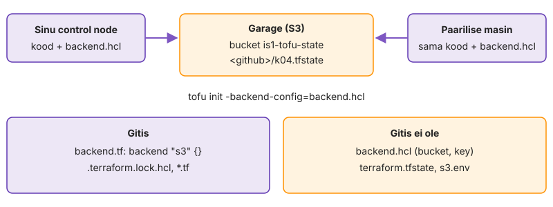

---
tags:
  - OpenTofu
  - state
---

# 3. Moodul, moved ja state

State, mis on ainult control node'i kettal, kaob koos kettaga, ja kaks inimest, kes käivitavad samal ajal `apply`, kirjutavad teineteise töö üle. Viie VM-i kirjeldust ei saa praegu ka teises kohas uuesti kasutada. Tõstad VM-i kirjelduse moodulisse `modules/vm`, viid state'i koolitaja S3 bucketisse ja lülitad sisse luku, mis ei lase kahel käivitusel korraga kirjutada. Mõlemad muudatused tehakse töötava taristu peal ja on õnnestunud ainult siis, kui ükski masin seda ei märganud: iga etapi lõpus on plaan "No changes".

Enne alustamist peab `tofu plan` kaustas `k04-tofu` ütlema "No changes".

**Kui teed seda tööl iga päev:** `tofu state list` näitab viit `module.vm[...]` aadressi, `jq -r .backend.type .terraform/terraform.tfstate` annab `s3`, `backend.hcl`-is on `use_lockfile = true` ja plaan on "No changes". Kui see on sul juba korras, mine otse etappi „[Vabasta mahajäänud lukk](#vabasta-mahajaanud-lukk)“.

## Tõsta VM moodulisse

Tõstad VM-i kirjelduse eraldi kausta, millel on sisendid ja väljundid. Sama kirjeldust on vaja ka järgmistel kordadel ja dev-keskkonnas, ning moodul on koht, kus see on kirjas ainult ühes eksemplaris. Lõpus vaatad plaani, mis näitab, mida see tõstmine ilma lisatööta teeks.

Refaktoreerimine, mis kustutab ja loob viis masinat, on tootmises katkestus kõigile teenustele korraga. Sama plaan tuleb ka siis, kui keegi tõstab koodi ümber ja plaani ei loe.

Nõuded:

- `k04-tofu/modules/vm/` failidega `versions.tf` (ainult `required_providers` `bpg/proxmox`, muidu otsib lapsmoodul `hashicorp/proxmox`-i), `variables.tf`, `main.tf`, `outputs.tf`
- ressurss on mooduli `main.tf`-is nimega `this`, `each.key`/`each.value.*` asemel mooduli muutujad (`var.name`, `var.ip`, …)
- väljundid `ip` (ressursi atribuudist), `vm_id`, `agent_ipv4`
- juurkausta `main.tf`-is on ainult `module "vm"` plokk `for_each = var.vms`-iga, `outputs.tf` viitab `module.vm[...]`-ile

```hcl
module "vm" {
  source   = "./modules/vm"
  for_each = var.vms
  # ... sisendid
}
```

1. Registreeri moodul ja vaata plaani.

    ```bash
    tofu init
    tofu plan | tail -3
    ```

Plaan tahab kustutada viis ja luua viis, kuigi VM-id, sisendid ja tulemus on samad. Põhjus on sama mis web01 ümbernimetamise katses: aadress muutus `lab["web01"]`-st `module.vm["web01"].proxmox_virtual_environment_vm.this`-ks. Tofu ei tea, et need on üks ja sama VM, kuni sa seda ei ütle.

> Ära `apply`-i: see plaan kustutaks kõik viis VM-i ja teeks need uuesti.

✅ **Edasi saad minna, kui** plaan näitab `5 to add, 5 to destroy` ja sa ei teinud `apply`-d.

## Ütle moved'iga, et see on sama VM

Nüüd kirjutad Toful aadressi muutuse kirja. `moved` plokk on koodis, mitte käsk, nii et sama ümbernimetamine toimub igas state'is, kus vana aadress on olemas: sinu, paarilise ja dev-keskkonna oma.

Käsitsi `tofu state mv` teeb sama ühes state'is ja ei jäta Giti jälge. Kolleeg, kes tõmbab sinu koodi, saab siis vana state'iga plaani, mis kustutab kõik.

1. Vaata vanu aadresse: `tofu state list`
2. Tee fail `moved.tf`, kus on iga VM-i kohta üks [`moved` plokk](https://opentofu.org/docs/language/modules/develop/refactoring/). Esimene on siin, ülejäänud neli kirjuta ise.

    ```hcl
    moved {
      from = proxmox_virtual_environment_vm.lab["web01"]
      to   = module.vm["web01"].proxmox_virtual_environment_vm.this
    }
    ```

3. Käivita plaan, siis `apply`.

    ```bash
    tofu plan | grep -E 'has moved|Plan:'
    tofu apply
    tofu state list
    ```

Plaan ütles `has moved to` ja `0 to add, 0 to change, 0 to destroy`. `apply` muutis ainult state'i, Proxmoxis ei juhtunud midagi; vaata UI Task History'st, et uusi ülesandeid ei tekkinud. `moved.tf` jääb koodi alles, sest dev või paariline võib veel vana aadressiga state'i kasutada.

> Kui plaan näitab ikka destroy't, ei klapi `from` vana state'iga täpselt. Tüüpiline viga: `lab["web01"]` vs `lab.web01`.

✅ **Edasi saad minna, kui** plaan näitas `has moved to` ja `0 to destroy`, `state list` näitab viit `module.vm[...]` aadressi ja `tofu plan` ütleb "No changes".

## Vii state bucketisse

State on praegu fail control node'i kettal. Kolid selle koolitaja S3-ühilduvasse bucketisse nii, et ükski aadress ega `serial` ei muutu. Koolitaja tegi Garage'is bucketi `is1-tofu-state` ja andis sulle võtmepaari, mis näeb ainult prefiksit `<github>/` ([S3 backend](https://opentofu.org/docs/language/settings/backends/s3/)). Võtmed on failis `~/.config/is1/s3.env`.

Control node'i ketas on üks koht, kus state võib kaduda või jääda ainult sinu kätte. Ilma state'ita ei tea Tofu, et viis VM-i on tema omad, ja järgmine plaan tahab need uuesti luua.

1. Lae võtmed ja kopeeri backendi failid.

    ```bash
    source ~/.config/is1/s3.env && env | grep -c '^AWS_'
    cp extras/backend-s3.tf.example backend.tf
    cp extras/backend.hcl.example backend.hcl
    git check-ignore backend.hcl
    ```

2. Pane `backend.hcl`-is `key = "<github>/k04.tfstate"` ja `workspace_key_prefix = "<github>/env"`. Rida `use_lockfile` jäta praegu kommentaariks.
3. Pane `serial` kirja ja migreeri. `init` küsib, kas kopeerida olemasolev state, vasta `yes`.

    ```bash
    tofu state pull | jq '.serial'
    tofu init -backend-config=backend.hcl -migrate-state
    ```

4. Vaata, kus state nüüd on.

    ```bash
    tofu plan && tofu state pull | jq '.serial'
    ls -l terraform.tfstate*
    jq '.backend.type, .backend.config.key' .terraform/terraform.tfstate
    ```

Gitis olev `backend.tf` ütleb ainult, et state on S3-s; kus täpselt ja millise võtmega, on failis, mis Giti ei lähe.

Sama `serial` enne ja pärast tähendab, et kolimine kopeeris state'i muutmata. `.terraform/terraform.tfstate` ei ole sinu state, vaid märge, millise backendiga see kaust on seotud. Kohalik `terraform.tfstate` on nüüd tühi või puudub. Kui see oleks alles ja täis, ei teaks järgmine lugeja, kumb on õige.

> `InvalidAccessKeyId` või `NoSuchBucket`: `s3.env` on laadimata või `key`-s on vale prefiks. `connection refused`: VPN või Garage on maas, ütle koolitajale ja jätka inventory ja `up.sh`-iga kohaliku state'iga (`backend.tf` ajutiselt ära).

✅ **Edasi saad minna, kui** plaan on "No changes", `serial` on sama mis enne, kohalik `terraform.tfstate` on tühi või puudub ja `.terraform/terraform.tfstate` näitab `"s3"` ning sinu võtit.

## Lülita lukk sisse ja proovi

Jagatud state vajab lukku. Lukk on `<key>.tflock` objekt bucketis ([state locking](https://opentofu.org/docs/language/state/locking/)). Siin lülitad selle sisse ja tekitad meelega olukorra, kus kaks käivitust tahavad sama state'i.

Ilma lukuta jääb state'i see, kes kirjutas viimasena. Teise käivituse loodud VM jääb Proxmoxi, aga state ei tea sellest, ja järgmine plaan teeb sama VM-i uuesti või ebaõnnestub ID konflikti peale.

1. Võta `backend.hcl`-is `use_lockfile = true` kommentaarist välja ja seadista backend uuesti.

    ```bash
    tofu init -backend-config=backend.hcl -reconfigure
    ```

2. Ava teine terminal samasse kausta (lae seal ka `proxmox.env` ja `s3.env`) ja käivita esimeses `tofu console`. Konsool hoiab lukku, kuni sellest väljud.
3. Teises terminalis proovi plaani.

    ```bash
    tofu plan -lock-timeout=0s
    ```

4. Kirjuta `NOTES.md`-sse luku ID, omanik ja aeg veateatest, siis välju esimeses konsoolist (`exit`) ja korda sammu 3.

Veateates on kirjas, kes lukku hoiab (kasutaja ja host) ja millest alates. See on info, millega meeskonnas küsitakse "kas sa ikka käivitad midagi?", mitte murtakse lukk lahti. Pärast konsoolist väljumist läks plaan läbi, sest korrektselt lõppenud protsess kustutab oma `.tflock` objekti.

> Kui teine `plan` läheb lukuveata läbi, ei toeta salvestus tingimuslikku kirjutust. Ütle koolitajale; seni tee sama proov kaustas `01-alused`, kus kohalik backend lukustab alati.

✅ **Edasi saad minna, kui** teine terminal sai `Error acquiring the state lock` luku ID-ga ja pärast konsoolist väljumist läks plaan läbi.

## Vabasta mahajäänud lukk

Eelmises etapis vabastas lukk end ise. Siin tapad lukku hoidva protsessi nii, et see ei jõua koristada, ja vabastad luku käsitsi. Nii jääb lukk maha ka siis, kui SSH-ühendus katkeb keset `apply`-d.

`force-unlock` on käsk, mida tehakse ainult siis, kui oled kindel, et keegi ei kirjuta. Kui murrad lahti töötava käivituse luku, on tulemuseks täpselt see üleskirjutamine, mille vastu lukk oli. Siin on see ohutu, sest lukku hoidis `tofu console`, mis state'i ei kirjuta. Tootmises, kus lukk jäi maha keset `apply`-d, tee enne `tofu state pull > varu.json` ja kontrolli, et fail on loetav.

1. Käivita esimeses terminalis `tofu console`. Teises terminalis tapa see.

    ```bash
    pkill -9 -f 'tofu console'
    tofu plan -lock-timeout=0s 2>&1 | grep -E 'ID:|Who:|Created:'
    ```

2. Kontrolli, et ükski `tofu` protsess ei tööta (`pgrep -a tofu`), siis vabasta lukk veateate ID-ga ja proovi uuesti.

    ```bash
    tofu force-unlock <ID>
    tofu plan -lock-timeout=0s | tail -1
    ```

`kill -9` ei anna protsessile võimalust koristada, nii et `.tflock` objekt jäi bucketisse. Tofu ei saa teada, kas lukuhoidja on surnud või lihtsalt aeglane; seda otsustab inimene. `pgrep` enne `force-unlock`-i on see otsus: sama kontroll tootmises tähendab kolleegile kirjutamist või pipeline'i vaatamist.

✅ **Edasi saad minna, kui** pärast `kill -9`-i andis plaan lukuvea, `force-unlock` õnnestus ja järgmine plaan ütleb "No changes". `NOTES.md`-s on kirjas, mida kontrollisid enne `force-unlock`-i.

## Commit

Commit'i läheb moodul, `moved.tf` ja `backend.tf`. `backend.hcl` ja state'i jäljed ei lähe, ja seda kontrollid enne `git add`-i.

`backend.hcl` Gitis annab igaühele, kes repositooriumi näeb, teada sinu bucketi ja võtme tee. Võtmepaari seal pole, aga see on esimene samm õige objekti leidmiseks.

```bash
cd ~/labori-seis
git ls-files k04-tofu | grep -E 'backend\.hcl|tfstate'
git add k04-tofu
git commit -m "k04: moodul vm, moved, state S3-s lukuga"
git push
```

Tühi `grep` väljund tähendab, et Giti ei läinud ei backendi aadress ega state. `module` kontroll `OK` tähendab, et automaatne hindaja leidis mooduli ja juurmooduli, mis kasutab selle väljundit.

✅ **Edasi saad minna, kui** `git ls-files … | grep` on tühi ja `bash autograde/check.sh k04 module` annab `OK`.

📎 **Selle mooduli tõend:** commit `k04: moodul vm…` koos `moved.tf` ja `backend.tf`-iga; issue `K4.3` kommentaaris plaan `0 to destroy`, `jq .backend.type` väljund, lukuvea read ja `force-unlock` käik.

## Miks see nii töötab

**`moved`.** `moved`-plokk muudab ainult objekti aadressi state'is. Ilma selleta tähendaks refaktoreerimine, et Tofu kustutab kõik masinad ja loob need uuesti.

**`moved`-plokk koodis.** Plokk jääb koodi, sest iga state, kus vana aadress veel on, vajab sama ümbernimetamist. Kui kõik state'id on kindlasti uuendatud, võib `moved`-ploki eemaldada. Seni kaitseb see väikese vaevaga juhusliku kustutamise eest.

**Mooduli versioon.** Kohalik moodul on lihtsalt kaust, mille `tofu init` kopeerib `.terraform/modules/` alla; seepärast tuleb pärast `module` ploki lisamist `init` uuesti teha. Registry moodulil fikseeri versioon (`version = "~> 5.0"`), muidu võib järgmine `init` tuua uue käitumise.

**`backend.tf` ja `backend.hcl`.** Bucketis on state lihtsalt objekt `<github>/k04.tfstate`, `apply` ajal on selle kõrval `<github>/k04.tfstate.tflock` ja workspace'id on all `<github>/env/dev/…`.

<figure markdown="span">
  
  <figcaption>Joonis L4.9. Remote backend. Gitis on ainult see, et state on S3-s, mitte kus täpselt ja millise võtmega.</figcaption>
</figure>

**S3 lukk.** S3 lukk on eraldi objekt `<key>.tflock`, mis luuakse tingimusliku päisega `If-None-Match: *`. Kui objekt on juba olemas, keeldub salvestus ja teine käivitus saab lukuvea. Lukk eeldab, et S3 teenus toetab tingimuslikku kirjutamist. OpenTofu 1.10 ja uuemad versioonid ei vaja S3 lukustuseks DynamoDB tabelit, mida vanemad juhendid nõuavad (seade `use_lockfile`).

**Luku omanik.** Lukk ei tea, kas selle võtnud protsess veel töötab. Seepärast salvestatakse lukku omaniku nimi, host ja aeg, et inimene saaks otsustada, ning `force-unlock` küsib kinnitust.

**Kaust on asendatav, state mitte.** Kõik, kes käivitavad sama koodi sama backendi ja võtmega, näevad sama state'i, ka kaust, kus pole ühtegi state-faili. Sama kehtib pipeline'i kohta: CI-masin on iga käivituse järel tühi, aga näeb sama taristut, sest backend on jagatud.

Kui jõudsid kiiremini: [Lisaülesanded → 4. Teine kaust, sama state](lisa.md#4-teine-kaust-sama-state), näitad teisest kaustast ilma ühegi state-failita, et bucketis olev state on kõigi jaoks sama.
