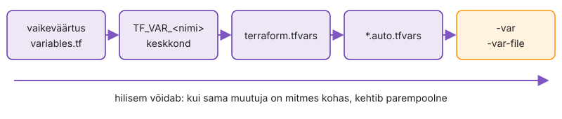

---
tags:
  - OpenTofu
  - Proxmox
  - IaC
  - Ansible
  - Praktikum
---

# Praktikum: OpenTofu Proxmoxis

Kolmel eelmisel kohtumisel seadistasid masinaid, mille loomine ei olnud koodina kirjeldatud. Täna kirjeldad koodina ka masinate loomist. Kõigepealt lood OpenTofuga ühe katsemasina ja vaatad plaanist, mida iga muudatus masinaga teeb. Seejärel loob sama kood muutujate põhjal viis masinat ja kirjutab neist Ansible'i inventory, mille järgi Ansible jõuab kõigi viieni.

Iga osa alguses on eesmärk ja kontroll. Kui oskad, tee osa eesmärgi järgi ise ja ava lahendused ainult kontrolliks. Töö tulemus on harus `k04-tofu` olev kood ja automaatkontroll kontrollib seda GitHubis.

**Edenemine:** laboritahvel <http://is126.kaaren.lab.hkhk.lan> (VPN-iga).

Küsimused: [Küsimused ja teated](https://github.com/hkhk-tk/is126-arutelu/discussions). Lisa küsimusele käsk ja kogu veateade tekstina. Enne saatmist eemalda paroolid ja tokenid.

??? tip "Algseis: mida saad valmis kujul ja mida teed ise"

    **Saad valmis kujul:** control'is on fail `~/.config/is1/proxmox.env`, kus on Proxmoxi aadress, sinu ajutine API token ja sinu väärtused: pool, sõlm ja VM-ide numbrite algus. Token kehtib 5. kohtumise eelõhtuni. Proxmoxis on kooli mallid Ubuntu 24.04 ja AlmaLinux 9. Repositooriumi `.gitignore` hoiab state'i, `terraform.tfvars`-i ja kausta `.terraform/` Gitist väljas. OpenTofu osas eelmiste kohtumiste masinaid ei kasutata ja alustad harust `main`. Osas 9 kirjutab Tofu inventory 2. kohtumise kausta `k02-ansible`. Kui seda kausta sinu repositooriumis pole, loob Tofu selle ise.

    **Teed ise:** kirjutad kausta `~/kursus/k04-tofu` OpenTofu koodi, mis loob kõigepealt ühe VM-i ja siis muutujate põhjal viis, kirjutad Tofu väljundist Ansible'i inventory ja esitad töö tag'iga `k04`. Proxmoxi veebiliideses `https://192.168.124.200:8006` näed oma kooli kontoga, mida kood lõi.

    **Kui koodifailis on viga:** `git restore <fail>` toob faili tagasi viimase commit'i kujul. See ei muuda Proxmoxi VM-e.

    **Kui VM-id on vaja uuesti luua:** `tofu destroy` kustutab selle kausta state'is olevad VM-id ja järgmine `tofu apply` loob need uuesti. Loe kustutamise plaan enne `yes`-i läbi. Sinu control'it ja eelmiste kohtumiste masinaid see ei puuduta, sest need ei ole selle kausta state'is.

??? abstract "Õpiväljundid"

    1. Kirjutad OpenTofu koodi, mis leiab malli data source'iga ja loob sellest VM-i koos cloud-init'i võrgu ja SSH-võtmega.
    2. Loed enne `apply`-d plaanist, kas VM muudetakse kohapeal (`~`) või tehakse uuesti (`-/+`).
    3. Kirjeldad viit VM-i muutujate ja `for_each`-iga ning annad nende IP-d output'iga välja.
    4. Genereerid Tofu väljundist Ansible'i inventory ja kontrollid Ansible'iga, et kõik viis masinat vastavad.
    5. Kontrollid töö automaatkontrolli testidega ja esitad selle.

??? info "Testitud versioonid"

    OpenTofu 1.13, `bpg/proxmox` 0.115, `hashicorp/local` 2.5, Proxmox VE 9, kooli mallid UbuntuServer-2610 ja Alma98-2610, ansible-core 2.16.

    Dokumentatsioon: [OpenTofu](https://opentofu.org/docs/), [bpg/proxmox provider](https://search.opentofu.org/provider/bpg/proxmox/latest), [Proxmoxi cloud-init](https://pve.proxmox.com/wiki/Cloud-Init_Support).

Iga osa käib sama rütmiga: kirjutad koodi, mõtled enne käsku läbi, mida plaan näitab, loed plaani, teed `apply` ja kontrollid tulemust mujalt kui Tofust: Proxmoxi veebiliidesest, `ssh`-ga või Ansible'iga.

## Osa 1 · Token ja haru

Tofu räägib Proxmoxiga API kaudu ja iga päring vajab tokenit. Token on failis `~/.config/is1/proxmox.env` keskkonnamuutujatena. Provider loeb ühenduse andmed keskkonnast, nii et token ei satu ühtegi faili, mis läheb Giti.

**Eesmärk:** muutujad on laaditud, `tofu` on paigaldatud ja töötad harus `k04-tofu`.  
**Kontroll:** `echo $IS1_POOL` näitab `is1-<perenimi>` ja `tofu version` näitab vähemalt 1.12.  
**Kus:** control, kaust `~/kursus`.

### 1.1 Lae muutujad

Käsk `source` loeb faili praegusesse shelli. Muutujad kehtivad ainult selles terminalis: uues terminalis tuleb `source` uuesti teha.

```bash
ls -l ~/.config/is1/proxmox.env
source ~/.config/is1/proxmox.env
env | grep -E '^IS1_' | sort
```

??? success "Oodatav tulemus"

    Faili õigused on `-rw-------`: faili saad lugeda ainult sina. `env` näitab viit rida: `IS1_BRIDGE=vmbr0`, `IS1_DATASTORE=local-zfs`, `IS1_NODE=SR630V3-1`, `IS1_POOL=is1-<perenimi>` ja `IS1_VMID_BASE=43x0`. Sinu VM-ide numbrid on `IS1_VMID_BASE` + 1 kuni 9.

??? warning "Kui faili ei ole"

    Kirjuta koolitajale. Tokenit ei saa ise teha, see luuakse sinu jaoks.

Et ei peaks iga uue terminali juures `source`-i meeles pidama, lisa see `~/.bashrc`-i lõppu:

```bash
echo 'source ~/.config/is1/proxmox.env' >> ~/.bashrc
```

!!! warning "Token jääb faili proxmox.env"

    Ära kopeeri tokenit `.tf`- ega `.tfvars`-faili, ekraanipildile ega küsimusse. Automaatkontroll otsib tokeni mustrit kõigist `k04-tofu/` failidest. Kui token jõuab GitHubi, tühistab koolitaja selle ja annab uue.

### 1.2 Paigalda OpenTofu

OpenTofu on üks programm, mis paigaldatakse deb-paketihoidlast. [Ametlik skript](https://opentofu.org/docs/intro/install/) lisab paketihoidla ja paigaldab paketi. Loe skript enne käivitamist läbi: käivitad selle `sudo`-ga.

```bash
tofu version || {
  curl --proto '=https' --tlsv1.2 -fsSL https://get.opentofu.org/install-opentofu.sh -o install-opentofu.sh
  less install-opentofu.sh
  sudo bash install-opentofu.sh --install-method deb
}
tofu version
```

??? success "Oodatav tulemus"

    `OpenTofu v1.13.x` ja `on linux_amd64`. Kui `tofu` oli juba olemas, näed versiooni kohe ja paigaldust ei tehta.

### 1.3 Tee haru

```bash
cd ~/kursus && git switch main && git pull
git switch -c k04-tofu
mkdir -p k04-tofu/01-alused
git branch --show-current
```

??? success "Oodatav tulemus"

    Viimane käsk näitab `k04-tofu`.

??? warning "Kui tuleb viga `a branch named 'k04-tofu' already exists`"

    Haru on sul juba olemas. Vaheta sellele käsuga `git switch k04-tofu`.

## Osa 2 · Mall data source'iga

Esimene kood ei loo midagi, ainult leiab malli. Nii proovid provider'i ja tokeni ära enne, kui midagi saab katki minna. Kui see osa õnnestub, töötab ühendus Proxmoxi API-ga ja token tohib malli andmeid lugeda. VM-i loomise õigust kontrollid järgmises osas.

**Mall** on VM, mida ei käivitata: sellest tehakse koopiaid. Malli numbri võiks kirjutada koodi otse, aga kui koolitaja teeb uue malli ja kustutab vana, ebaõnnestub järgmine loomine. **Data source** ehk plokk `data` otsib olemasolevat objekti tingimuste järgi ega loo midagi.

**Eesmärk:** Tofu leiab tokeniga kooli Ubuntu malli.  
**Kontroll:** output `mall` näitab `name = "UbuntuServer-2610"` ja `template = true`.  
**Kus:** control, kaust `~/kursus/k04-tofu/01-alused`.

### 2.1 Provider

Plokk `terraform` ütleb, millist provider'it kood vajab ja millist versiooni. Provider `bpg/proxmox` tõlgib Tofu ressursid Proxmoxi API päringuteks. Tühi plokk `provider "proxmox" {}` tähendab, et ühenduse andmed tulevad keskkonnamuutujatest `PROXMOX_VE_ENDPOINT`, `PROXMOX_VE_API_TOKEN` ja `PROXMOX_VE_INSECURE`, mille laadisid 1.1-s.

Tee fail `main.tf` ja lisa sinna provider.

??? example "Ülesanne: provider failis `main.tf`"

    ```hcl
    terraform {
      required_providers {
        proxmox = {
          source  = "bpg/proxmox"
          version = "~> 0.115.0"
        }
      }
    }

    provider "proxmox" {}
    ```

Proovi `validate` enne ja pärast `init`-i:

```bash
cd ~/kursus/k04-tofu/01-alused
tofu fmt && tofu validate
tofu init && tofu validate
```

??? success "Oodatav tulemus"

    Esimene `validate` ebaõnnestub teatega `Missing required provider`: provider on veel alla laadimata. `init` laadis selle kausta `.terraform/` ja kirjutas faili `.terraform.lock.hcl` täpse versiooni ja räsi. Teine `validate` ütleb `Success!`. Järjekord jääb kogu praktikumiks samaks: `fmt`, `init`, `validate`, `plan`, `apply`.

### 2.2 Data source

Kooli mallidel on tag, mis ütleb malli tüübi: Ubuntul `tem.ubuntuserver-1026`. Sama tag'i pärivad ka mallist tehtud kloonid, seepärast on otsingus teine tingimus: ainult mallid, `template = true`.

Data source'i argumendid on [provider'i dokumentatsioonis](https://search.opentofu.org/provider/bpg/proxmox/latest/docs/datasources/virtual_environment_vms). Lisa `main.tf`-i lõppu data source ja output, mis näitab tulemust.

??? example "Ülesanne: data source ja output"

    ```hcl
    data "proxmox_virtual_environment_vms" "ubuntu" {
      tags = ["tem.ubuntuserver-1026"]
      filter {
        name   = "template"
        values = [true]
      }
    }

    output "mall" {
      value = data.proxmox_virtual_environment_vms.ubuntu.vms[0]
    }
    ```

```bash
tofu plan
tofu apply
```

??? success "Oodatav tulemus"

    Plaan ütleb, et muudetakse ainult output'e. Pärast `apply`-d on output'is `name = "UbuntuServer-2610"`, `node_name = "SR630V3-1"`, `template = true` ja `vm_id = 1116`. `apply` ilma ressurssideta kirjutas state'i data source'i tulemuse ja tõestas, et token näeb malli.

??? warning "Kui tuleb `Invalid index` või tühi nimekiri"

    Token ei näe ühtegi malli. Kontrolli, et `source ~/.config/is1/proxmox.env` on selles terminalis tehtud ja tag on õigesti kirjutatud. Kui tulemus on ikka tühi, saada koolitajale veateade ja malli tag. Põhjus võib olla tokeni õigustes.

??? warning "Kui tuleb `401 authentication failure`"

    Muutujad on laadimata või token on aegunud. Tee `source ~/.config/is1/proxmox.env` ja proovi uuesti.

## Osa 3 · test01 mallist

Nüüd lood esimese ressursi. Argumente on meelega vähe: kõik muu tuleb mallist. Nii näed, mida mall juba annab ja mida pead hiljem ise kirjutama.

**Kloon** on malli koopia. Täielik kloon `full = true` kopeerib malli ketta ja võtab minuteid. Kui mitu inimest kloonib korraga, ootavad kloonid üksteise järel kettahoidla lukku ja osa neist aegub. **Lingitud kloon** `full = false` kasutab malli ketast alusena ja salvestab ainult erinevused, nii et VM valmib mõne sekundiga. Kursusel kasutad lingitud klooni.

**Eesmärk:** VM `test01` on Tofu koodist loodud ja töötab sinu pool'is.  
**Kontroll:** teine `tofu plan` kohe pärast `apply`-d ütleb `No changes`.  
**Kus:** control, sama kaust; Proxmoxi veebiliides.

### 3.1 Ressurss

Ressursi argumendid on [provider'i dokumentatsioonis](https://search.opentofu.org/provider/bpg/proxmox/latest/docs/resources/virtual_environment_vm). Väärtused võtad oma muutujatest: `echo $IS1_VMID_BASE $IS1_NODE $IS1_POOL`.

| Argument | Väärtus |
|---|---|
| `name` | `"test01"` |
| `vm_id` | sinu `IS1_VMID_BASE` + 9, näiteks `4309` |
| `node_name` | `IS1_NODE` väärtus |
| `pool_id` | `IS1_POOL` väärtus |
| `clone` plokk | `vm_id` data source'ist, `full = false` |

*Tabel L4.1. test01 argumendid.*

Malli number tuleb data source'ist viitena, mitte numbrina. Kui mall vahetub, leiab kood uue ise.

??? example "Ülesanne: ressurss test01"

    Asenda `4309` ja `is1-perenimi` oma väärtustega.

    ```hcl
    resource "proxmox_virtual_environment_vm" "test01" {
      name      = "test01"
      vm_id     = 4309
      node_name = "SR630V3-1"
      pool_id   = "is1-perenimi"

      clone {
        vm_id = data.proxmox_virtual_environment_vms.ubuntu.vms[0].vm_id
        full  = false
      }
    }
    ```

Enne käsku mõtle läbi: mitu ressurssi lisatakse ja kas midagi muudetakse või kustutatakse?

```bash
tofu plan
tofu apply
```

??? success "Oodatav tulemus"

    Plaan ütleb `Plan: 1 to add, 0 to change, 0 to destroy.` ja `apply` lõpeb reaga `Apply complete! Resources: 1 added`. Proxmoxi veebiliideses on sinu pool'is `test01` ja see töötab.

??? warning "Kui tuleb `vm_id ... already exists`"

    Sellel numbril on juba VM. Vaata veebiliidesest oma pool'i. Kui seal on sinu varasem `test01` sama numbriga, vali number, mis on sinu vahemikus ja vaba. Kui sa ei tea, kelle masin see on, küsi enne kustutamist koolitajalt.

### 3.2 Teine plaan

Teine `plan` kohe pärast `apply`-d kontrollib, kas provider loeb tagasi sama, mis kirjutati. `No changes` tähendab, et kood, state ja Proxmox ütlevad sama. Kui plaan näitab juba siin muudatust, loeb provider mõnda väärtust teisiti, kui sa selle kirjutasid, ja iga järgmine plaan näitab sama soovimatut muudatust uuesti.

```bash
tofu plan
```

??? success "Oodatav tulemus"

    `No changes. Your infrastructure matches the configuration.` Jätka järgmise osaga alles siis, kui plaan ütleb `No changes`.

## Osa 4 · Muuda kohapeal või asenda

Plaani kõige tähtsam osa ütleb, kas muudatus tehakse olemasolevale VM-ile, `~ update in-place`, või tehakse VM uuesti, `-/+ destroy and then create replacement`. Asendus annab uue ketta ja kõik, mis vanal kettal oli, kaob. Tootmises tähendab see andmebaasi masinal kadunud andmeid. Plaan näitab seda ette, kuid ainult sellele, kes plaani loeb.

**Eesmärk:** tead plaanist enne `apply`-d, kas VM muudetakse või asendatakse.  
**Kontroll:** mälu ja CPU muudatus on `~`, malli vahetus on `-/+` reaga `# forces replacement`.  
**Kus:** control, sama kaust.

### 4.1 Mälu ja CPU

Mallist tuleb 1 GB mälu ja 2 tuuma. Lisa `test01`-le mälu, CPU ja guest agent'i plokk. CPU tüüp `x86-64-v2-AES` on vajalik AlmaLinux 9-le, mis ei käivitu vaikimisi CPU tüübiga. **Guest agent** on VM-i sees töötav teenus, mis annab Proxmoxile VM-i IP-aadressi. Tofu ootab agenti kuni `timeout`-i.

??? example "Ülesanne: mälu, CPU ja agent"

    Lisa `test01` plokki pärast plokki `clone`:

    ```hcl
      memory {
        dedicated = 768
      }

      cpu {
        cores = 1
        type  = "x86-64-v2-AES"
      }

      agent {
        enabled = true
        timeout = "3m"
      }
    ```

Enne käsku mõtle läbi: kas VM muudetakse või asendatakse?

```bash
tofu plan
tofu apply
```

??? success "Oodatav tulemus"

    Plaan näitab `~ update in-place` ja `Plan: 0 to add, 1 to change, 0 to destroy.` Mälu ja CPU muutus vajab taaskäivitust ja provider teeb selle ise, aga ketas jääb samaks.

### 4.2 Malli vahetus

Lisa teine data source, mis otsib AlmaLinuxi malli tag'iga `tem.alma98-1026`, ja vaheta `clone` plokis `vm_id` selle vastu. Käivita ainult `plan`, mitte `apply`.

??? example "Ülesanne: AlmaLinuxi mall"

    ```hcl
    data "proxmox_virtual_environment_vms" "alma" {
      tags = ["tem.alma98-1026"]
      filter {
        name   = "template"
        values = [true]
      }
    }
    ```

    Plokis `clone`: `vm_id = data.proxmox_virtual_environment_vms.alma.vms[0].vm_id`

```bash
tofu plan
```

??? success "Oodatav tulemus"

    Plaan näitab `-/+ destroy and then create replacement` ja `clone` ploki juures rida `# forces replacement`. See rida näitab täpselt, milline argument asenduse põhjustas. Kui plaanis on mitu muudatust ja üks neist asendab, otsi just seda rida.

Võta muudatus tagasi: `clone` plokis jälle `ubuntu`. AlmaLinuxi data source võib jääda. Kontrolli:

```bash
tofu plan
```

??? success "Oodatav tulemus"

    `No changes`.

??? question "Mida veel teeb asendus?"

    Proovi plaanis ka `full = false` asemel `full = true`. Plaan näitab samuti `# forces replacement`: kloonimise viisi saab valida ainult VM-i loomisel. Võta muudatus tagasi.

## Osa 5 · Võrk ja SSH-võti cloud-init'iga

Mallist tulnud VM-is on kasutaja `kasutaja`, aga sinu SSH-võtit seal ei ole. Selle annab **cloud-init**: VM-i sees olev programm, mis loeb käivitusel väikeselt virtuaalselt CD-lt kasutaja, võtme ja võrgu seadistuse. Selle CD ehitab Proxmox Tofu plokist `initialization`.

Kooli võrgus jagab IP-aadresse DHCP, nii et IP-d sa ise ei vali: `address = "dhcp"`. VM saab aadressi võrgust ja agent annab selle Tofule.

**Eesmärk:** `ssh kasutaja@<IP>` töötab `test01`-sse ilma paroolita.  
**Kontroll:** `ssh kasutaja@$(tofu output -raw ip) hostname` vastab `test01`.  
**Kus:** control, sama kaust.

### 5.1 Enne võtit

Lisa output, mis näitab VM-i IP-d. Atribuut `ipv4_addresses` on iga võrguliidese aadresside nimekiri. Esimene liides on `lo` aadressiga 127.0.0.1, seega on VM-i IP teise liidese esimene aadress: `[1][0]`.

??? example "Ülesanne: output ip"

    ```hcl
    output "ip" {
      value = proxmox_virtual_environment_vm.test01.ipv4_addresses[1][0]
    }
    ```

```bash
tofu apply
ssh -o ConnectTimeout=5 kasutaja@$(tofu output -raw ip) hostname
```

??? success "Oodatav tulemus"

    `apply` lisab ainult output'i. `ssh` küsib kõigepealt, kas hostivõtit usaldada. Vasta `yes`. Seejärel annab `Permission denied (publickey,password)`: sinu võtit VM-is veel ei ole. Kui SSH küsib hoopis parooli, katkesta `Ctrl+C`-ga. Selles sammus ei peagi võtmega sisse saama.

### 5.2 Lisa võti

`file()` loeb faili sisu, aga ei laienda märki `~`: selleks on funktsioon `pathexpand`. `trimspace` eemaldab faili lõpust reavahetuse. `datastore_id` ütleb, kuhu Proxmox cloud-init'i CD salvestab.

??? example "Ülesanne: initialization ja network_device"

    Lisa `test01` plokki pärast plokki `agent`:

    ```hcl
      initialization {
        datastore_id = "local-zfs"

        ip_config {
          ipv4 {
            address = "dhcp"
          }
        }

        user_account {
          username = "kasutaja"
          keys     = [trimspace(file(pathexpand("~/.ssh/id_ed25519.pub")))]
        }
      }

      network_device {
        bridge = "vmbr0"
      }
    ```

```bash
tofu plan
tofu apply
ssh kasutaja@$(tofu output -raw ip) hostname
```

??? success "Oodatav tulemus"

    Plaan näitab `~ update in-place`. Provider kirjutas uue cloud-init'i CD ja taaskäivitas VM-i. Käivitusel nägi cloud-init uut seadistust ja lisas sinu võtme, nii et `ssh` vastab `test01` ilma paroolita.

??? warning "Kui `ssh` ei vasta või annab `REMOTE HOST IDENTIFICATION HAS CHANGED`"

    Taaskäivitus võtab kuni minuti. Proovi uuesti. Kui hoiatuses on juttu muutunud hostivõtmest, tegi cloud-init masinale uue võtme. Vana võtme kustutab `ssh-keygen -R $(tofu output -raw ip)`. Kui SSH ikka ei vasta, vaata VM-i konsooli veebiliideses. Jätka alles siis, kui ühendus töötab.

Vaata veebiliideses `test01` vahekaarti **Cloud-Init**: seal on kasutaja, võti ja `ip=dhcp`, mille Tofu kirjutas.

### 5.3 Tee VM uuesti

cloud-init teeb suurema osa tööd VM-i esimesel käivitusel. Kõige kindlam viis kontrollida, et kood kirjeldab VM-i täielikult, on teha VM koodist uuesti. Võti `-replace` asendab VM-i ka siis, kui koodis midagi ei muutunud, ja näitab asendust plaanis enne `apply`-d.

```bash
tofu apply -replace=proxmox_virtual_environment_vm.test01
tofu output ip
ssh kasutaja@$(tofu output -raw ip) hostname
```

??? success "Oodatav tulemus"

    Plaan näitab `-/+` ja `Plan: 1 to add, 0 to change, 1 to destroy.` Uus VM sai uue võrgukaardi MAC-aadressi, seega andis DHCP talle tõenäoliselt uue IP. `ssh` küsib jälle hostivõtme kinnitust: uus VM on uus masin ja sellel on uus hostivõti. Vastab `test01`.

??? warning "Kui tuleb `REMOTE HOST IDENTIFICATION HAS CHANGED`"

    DHCP andis uuele VM-ile sama IP, mis oli vanal, ja `known_hosts`-is on vana võti. Eemalda see käsuga `ssh-keygen -R <IP>` ja ühendu uuesti. Töökohas kontrolli enne eemaldamist, et VM tehti tõesti uuesti: sama teade tuleb ka siis, kui keegi teine on sinu ja serveri vahel.

??? warning "Kui `apply` ootab agenti kuni timeout'ini"

    Ava veebiliideses VM-i **Console** ja vaata, kas masin käivitub. Kui CPU tüüp puudub, ei käivitu AlmaLinux ja agent ei vasta kunagi.

## Osa 6 · Koristus ja commit

`test01` oli katse. Kood jääb alles, sest viis VM-i tulevad sama kujuga. VM kustutatakse koodiga ja Giti läheb ainult see, mis sinna kuulub: kood ja lukufail, mitte state ega `.terraform/`.

**Eesmärk:** `test01` on kustutatud ja kood on Gitis.  
**Kontroll:** `tofu state list` ei näita enam ressurssi `proxmox_virtual_environment_vm.test01` ja `git status --short` ei näita state'i ega `.terraform/`-i.  
**Kus:** control, sama kaust.

```bash
tofu destroy
tofu state list
cd ~/kursus
git check-ignore -v k04-tofu/01-alused/.terraform k04-tofu/01-alused/terraform.tfstate
git add k04-tofu/01-alused/main.tf k04-tofu/01-alused/.terraform.lock.hcl
git commit -m "k04: test01 mallist, cloud-init ja asendus"
```

??? success "Oodatav tulemus"

    `destroy` ütleb `Destroy complete! Resources: 1 destroyed.` `state list` ei näita enam `test01`. Tofu ei halda ühtki VM-i. `git check-ignore` näitab mõlema tee kohta `.gitignore`-i rida.

## Osa 7 · Viis VM-i muutujatega

Viis kopeeritud VM-i plokki lähevad aja jooksul lahku: üks saab parandatud CPU tüübi, teised mitte. Nüüd eraldad koodi ja andmed. Kood ütleb, kuidas VM ehitatakse. Fail `terraform.tfvars` ütleb, milliseid VM-e on vaja. Üks `for_each` plokk teeb igast kirjest VM-i.

Tofu loeb kõik kausta `*.tf` failid üheks tervikuks ja failinimi tähendust ei kanna. Failid on jagatud teema järgi lugeja jaoks.

**Eesmärk:** kaustas `k04-tofu/` on kood, mis loob viis VM-i.  
**Kontroll:** veebiliideses töötavad web01, app01, rmq01, mc01 ja db01 ning teine `tofu plan` ütleb `No changes`.  
**Kus:** control, kaust `~/kursus/k04-tofu`.

### 7.1 Versioonid ja muutujad

`versions.tf` on sama mis 2.1-s, lisaks provider `hashicorp/local`, mida vajad inventory kirjutamiseks. Provider'i ühenduse andmed tulevad nüüd muutujatest. Tokeni muutujal on `sensitive = true` ja vaikeväärtust ei ole: väärtus tuleb keskkonnamuutujast `TF_VAR_proxmox_api_token`, mille `proxmox.env` juba annab.

??? example "Ülesanne: `versions.tf`"

    ```hcl
    terraform {
      required_version = ">= 1.10"
      required_providers {
        proxmox = {
          source  = "bpg/proxmox"
          version = "~> 0.115.0"
        }
        local = {
          source  = "hashicorp/local"
          version = "~> 2.5"
        }
      }
    }

    provider "proxmox" {
      endpoint  = var.proxmox_endpoint
      api_token = var.proxmox_api_token
      insecure  = true
    }
    ```

Muutuja `vms` on kaart: võti on VM-i nimi, väärtus on objekt VM-i andmetega.

??? example "Ülesanne: `variables.tf`"

    ```hcl
    variable "proxmox_endpoint" {
      type = string
    }

    variable "proxmox_api_token" {
      type      = string
      sensitive = true
    }

    variable "node" {
      type = string
    }

    variable "pool" {
      type = string
    }

    variable "datastore" {
      type    = string
      default = "local-zfs"
    }

    variable "bridge" {
      type    = string
      default = "vmbr0"
    }

    variable "ssh_public_key_path" {
      type    = string
      default = "~/.ssh/id_ed25519.pub"
    }

    variable "vms" {
      type = map(object({
        vm_id  = number
        distro = string
        cores  = number
        memory = number
        group  = string
      }))
    }
    ```

`terraform.tfvars` sisaldab sinu väärtusi ja jääb Gitist välja. Giti läheb näidis `terraform.tfvars.example`, millest teine inimene teeb oma faili. Alusta ainult ühe VM-iga: ühe masinaga on viga lihtsam leida kui viiega.

??? example "Ülesanne: `terraform.tfvars.example`"

    ```hcl
    node = "SR630V3-1"
    pool = "is1-perenimi"

    vms = {
      web01 = { vm_id = 4301, distro = "ubuntu", cores = 1, memory = 768, group = "web" }
    }
    ```

```bash
cd ~/kursus/k04-tofu
cp terraform.tfvars.example terraform.tfvars
nano terraform.tfvars        # pool ja vm_id oma väärtustega
git status --short
```

??? success "Oodatav tulemus"

    `git status` näitab `versions.tf`, `variables.tf` ja `terraform.tfvars.example`, aga mitte `terraform.tfvars`-i.

??? info "Kust muutuja väärtuse saab"

    Sama muutuja väärtus võib tulla mitmest kohast: vaikeväärtus, `TF_VAR_<nimi>` keskkonnas, `terraform.tfvars`, `*.auto.tfvars`, `-var` või `-var-file` käsureal. Kui sama muutuja on mitmes kohas, kehtib hilisem ([muutujad](https://opentofu.org/docs/language/values/variables/)).

    <figure markdown="span">
      
      <figcaption>Joonis L4.1. Kui sama muutuja on mitmes kohas, kehtib parempoolne.</figcaption>
    </figure>

    `*.auto.tfvars` loetakse automaatselt ja see kirjutab `terraform.tfvars`-i üle. Kausta unustatud fail muudab plaani, ilma et ükski Gitis olev fail oleks muutunud. Seepärast on `*.auto.tfvars` `.gitignore`-is.

### 7.2 Mallid ja ühised väärtused

`locals` on koodi sisemised väärtused, mida väljast üle kirjutada ei saa. Siin on neis malli tag distro järgi, ühised tag'id ja SSH-võtme sisu.

Data source'il on nüüd `for_each`: üks otsing iga distro kohta, mida `vms` kasutab. Kui `vms`-is pole ühtegi AlmaLinuxit, ei otsita ka AlmaLinuxi malli.

??? example "Ülesanne: `locals.tf` ja `data.tf`"

    `locals.tf`:

    ```hcl
    locals {
      template_tags = {
        ubuntu = "tem.ubuntuserver-1026"
        alma   = "tem.alma98-1026"
      }
      common_tags = ["is1", "tofu"]
      ssh_key     = trimspace(file(pathexpand(var.ssh_public_key_path)))
    }
    ```

    `data.tf`:

    ```hcl
    data "proxmox_virtual_environment_vms" "template" {
      for_each = toset([for v in var.vms : v.distro])
      tags     = [local.template_tags[each.key]]
      filter {
        name   = "template"
        values = [true]
      }
    }
    ```

### 7.3 VM-i ressurss

Ressurss on sama mis `test01`, aga väärtused tulevad `each.value`-st: `each.key` on VM-i nimi ja `each.value` on selle objekt `vms`-ist. Proxmox salvestab tag'id tähestiku järjekorras. Kui sinu nimekiri on teises järjekorras, näitab iga plaan muudatust, seepärast on tag'id `sort()`-iga.

??? example "Ülesanne: `main.tf`"

    ```hcl
    resource "proxmox_virtual_environment_vm" "lab" {
      for_each = var.vms

      name      = each.key
      vm_id     = each.value.vm_id
      node_name = var.node
      pool_id   = var.pool
      tags      = sort(concat(local.common_tags, [each.value.group]))

      clone {
        vm_id = data.proxmox_virtual_environment_vms.template[each.value.distro].vms[0].vm_id
        full  = false
      }

      memory {
        dedicated = each.value.memory
      }

      cpu {
        cores = each.value.cores
        type  = "x86-64-v2-AES"
      }

      agent {
        enabled = true
        timeout = "4m"
      }

      initialization {
        datastore_id = var.datastore
        ip_config {
          ipv4 {
            address = "dhcp"
          }
        }
        user_account {
          username = "kasutaja"
          keys     = [local.ssh_key]
        }
      }

      network_device {
        bridge = var.bridge
      }
    }
    ```

```bash
tofu fmt
tofu init
tofu validate
tofu plan
tofu apply
tofu plan
```

??? success "Oodatav tulemus"

    Plaan ütleb `Plan: 1 to add` ja aadress on `proxmox_virtual_environment_vm.lab["web01"]`. Võti `web01` on VM-i identiteet Tofu jaoks, mitte järjekorranumber ega Proxmoxi number. Data source loeb ainult Ubuntu malli. Pärast `apply`-d on Proxmoxis `web01` ja teine plaan ütleb `No changes`. Ülejäänud neli masinat lisa alles pärast seda.

??? warning "Kui tuleb `Reference to undeclared input variable` ja `Did you mean`"

    Nimi koodis ja `variables.tf`-is ei klapi. Paranda nimi, ära lisa teist muutujat.

### 7.4 Kõik viis

Kood jääb samaks, muutub ainult `terraform.tfvars`. Lisa ülejäänud neli VM-i. web01, app01 ja rmq01 on Ubuntu, mc01 ja db01 AlmaLinux. Numbrid on sinu `IS1_VMID_BASE` + 1 kuni 5.

??? example "Ülesanne: viis VM-i failis `terraform.tfvars`"

    Asenda numbrid 4301–4305 oma vahemiku numbritega.

    ```hcl
    vms = {
      web01 = { vm_id = 4301, distro = "ubuntu", cores = 1, memory = 768, group = "web" }
      app01 = { vm_id = 4302, distro = "ubuntu", cores = 1, memory = 1536, group = "app" }
      rmq01 = { vm_id = 4303, distro = "ubuntu", cores = 1, memory = 1024, group = "queue" }
      mc01  = { vm_id = 4304, distro = "alma", cores = 1, memory = 1024, group = "cache" }
      db01  = { vm_id = 4305, distro = "alma", cores = 1, memory = 1024, group = "db" }
    }
    ```

Enne käsku mõtle läbi: mitu VM-i lisatakse ja kas web01-ga juhtub midagi?

```bash
tofu plan
tofu apply
tofu plan
tofu state list
```

??? success "Oodatav tulemus"

    Plaan ütleb `Plan: 4 to add, 0 to change, 0 to destroy.`: olemasolevat web01-t ei muudeta. Data source loeb nüüd ka AlmaLinuxi malli. Tofu loob neli VM-i korraga. Kestus sõltub Proxmoxi koormusest. Suurema osa ajast ootab Tofu, kuni agent teatab IP-aadressi. Teine `plan` ütleb `No changes` ja `state list` näitab viit `lab[...]` aadressi.

## Osa 8 · Tulemus output'iga välja

Output'i kaudu loevad teised tööriistad Tofu tulemust, näiteks Ansible'i inventory. Väärtused tulevad ressursist, mitte `var.vms`-ist: ressursi IP on see, mille agent tegelikult teatas, ja see on olemas ainult siis, kui VM tegelikult loodi.

**Eesmärk:** `tofu output` näitab viie VM-i nimesid ja IP-sid.  
**Kontroll:** `tofu output -json hosts` annab viis IP-d.  
**Kus:** control, kaust `~/kursus/k04-tofu`.

### 8.1 Output'id

Sama avaldist vajad ka inventory jaoks, seepärast läheb see `locals`-isse ja output kasutab seda.

??? example "Ülesanne: `outputs.tf` ja lisa `locals.tf`-i"

    Lisa `locals.tf` ploki `locals` sisse:

    ```hcl
      hosts = { for name, vm in proxmox_virtual_environment_vm.lab : name => vm.ipv4_addresses[1][0] }
    ```

    `outputs.tf`:

    ```hcl
    output "hosts" {
      value = local.hosts
    }

    output "vm_ids" {
      value = { for name, vm in proxmox_virtual_environment_vm.lab : name => vm.vm_id }
    }
    ```

```bash
tofu apply
tofu output
tofu output -json hosts
```

??? success "Oodatav tulemus"

    `apply` lisab ainult output'id. `hosts` näitab viit nime ja IP-d `192.168.125.x`, `vm_ids` viit numbrit.

### 8.2 Tundlik väärtus

Proovi, mida teeb Tofu, kui output viitab tokenile.

1. Lisa ajutiselt `output "token" { value = var.proxmox_api_token }` ja käivita `tofu plan`.
2. Lisa samale output'ile `sensitive = true` ja käivita uuesti `tofu plan`. `apply`-d ei tee.
3. Eemalda output ja kontrolli, et `tofu plan` ütleb `No changes`.

??? success "Oodatav tulemus"

    Esimene plaan keeldub teatega `Output refers to sensitive values`: kõik, mis tuleb tundlikust muutujast, on samuti tundlik. Teine plaan näitab `(sensitive value)`. `apply` oleks aga kirjutanud tokeni state'i lihttekstina: `sensitive` peidab väärtuse ekraanilt, mitte state'ist. Seepärast ei lähe state Giti.

## Osa 9 · Inventory Tofu väljundist

Tofu teab, millised masinad on olemas, Ansible teab, mis on nende sees. Seni oli nende vahel inimene, kes kopeeris IP-d käsitsi faili `inventory.ini`. Nüüd kirjutab Tofu inventory ise VM-ide andmetest ja kirjutab selle uuesti, kui mõni IP muutub.

**Eesmärk:** Ansible jõuab kõigi viie masinani faili järgi, mida keegi käsitsi ei kirjutanud.  
**Kontroll:** `ansible all -i inventory.ini -m ansible.builtin.ping -o` annab viis korda `SUCCESS`.  
**Kus:** control, kaustad `~/kursus/k04-tofu` ja `~/kursus/k02-ansible`.

### 9.1 Mall

Inventory mall kasutab Tofu malli süntaksit, mitte Jinjat: tsükkel on `%{ for … }` ja väärtus `${ … }`. Mall saab väärtused muutujast `groups`: iga grupi nime juures on selle grupi masinad ja nende IP-d.

??? example "Ülesanne: `inventory.tftpl`"

    ```text
    # Genereeritud OpenTofuga (k04-tofu/inventory.tf). Ära muuda käsitsi.
    %{ for group, hosts in groups ~}
    [${group}]
    %{ for name, ip in hosts ~}
    ${name} ansible_host=${ip}
    %{ endfor ~}

    %{ endfor ~}
    [all:vars]
    ansible_user=kasutaja
    ```

### 9.2 Grupid ja fail

Grupid tulevad VM-i väljast `group` ja distrost. Avaldis kasutab ressursist tulnud `local.hosts`-i, nii et inventory sõltub VM-idest: Tofu kirjutab selle alles siis, kui masinad on olemas. Avaldise võid võtta valmis kujul. Oluline on tulemus: iga masin on oma rolli grupis ja distributsiooni grupis, näiteks db01 gruppides `db` ja `alma`.

??? example "Ülesanne: grupid `locals.tf`-i ja fail `inventory.tf`"

    Lisa `locals.tf` ploki `locals` sisse:

    ```hcl
      groups = merge(
        { for g in distinct([for v in var.vms : v.group]) :
          g => { for name, v in var.vms : name => local.hosts[name] if v.group == g } },
        { for d in distinct([for v in var.vms : v.distro]) :
          d => { for name, v in var.vms : name => local.hosts[name] if v.distro == d } },
      )
    ```

    `inventory.tf`:

    ```hcl
    variable "inventory_path" {
      type    = string
      default = "../k02-ansible/inventory.ini"
    }

    resource "local_file" "inventory" {
      filename = "${path.module}/${var.inventory_path}"
      content  = templatefile("${path.module}/inventory.tftpl", { groups = local.groups })
    }
    ```

`apply` kirjutab faili `k02-ansible/inventory.ini` üle. 2. kohtumisel käsitsi kirjutatud fail on Gitis alles, seega ei pea seda eraldi varundama.

```bash
echo 'local.groups' | tofu console
tofu apply
head -8 ../k02-ansible/inventory.ini
```

??? success "Oodatav tulemus"

    Konsool näitab seitset gruppi: `alma`, `app`, `cache`, `db`, `queue`, `ubuntu` ja `web`. `apply` lisab ühe ressursi `local_file.inventory`. Faili esimene rida ütleb, et fail on genereeritud. Kui kaustas oli 2. kohtumise käsitsi kirjutatud `inventory.ini`, kirjutas Tofu selle üle.

### 9.3 Ansible

Uutel masinatel on uued hostivõtmed, mida `known_hosts`-is pole. `ANSIBLE_HOST_KEY_CHECKING=False` lubab esimese ühenduse ilma küsimata. See on laborierand: töökohas kontrolli hostivõtmeid.

```bash
cd ../k02-ansible
ANSIBLE_HOST_KEY_CHECKING=False ansible all -i inventory.ini -m ansible.builtin.ping -o
ansible-inventory -i inventory.ini --graph
```

??? success "Oodatav tulemus"

    Viis rida `SUCCESS`. `--graph` näitab seitset gruppi ja igas grupis õigeid hoste.

??? warning "Kui tuleb `Decryption failed` või `no vault secrets found`"

    Kaustas `k02-ansible` on 2. kohtumise Vaulti fail ja Ansible loeb selle iga käsuga, ka `ping`-iga. Fail `~/.config/is1/vault_pass` puudub või selles on teine parool. Paranda see nagu [2. kohtumise praktikumis](../k02/lab.md): kirjuta faili sama parool, millega `vault.yml` loodi.

??? warning "Kui tuleb `Host key verification failed`"

    Käivita käsk koos `ANSIBLE_HOST_KEY_CHECKING=False`-iga. Ära lisa seda seadet püsivalt faili `ansible.cfg`.

## Osa 10 · Esitamine

Automaatkontroll näeb ainult repositooriumi: failid, vormingu, `validate`-i, ressursid ja saladused. Proxmoxi VM-e see ei näe. Enne esitamist käivitad samad kontrollid ise.

**Eesmärk:** töö on `main`-is ja tag `k04` on käivitanud automaatkontrolli.  
**Kontroll:** viis kontrolli annavad `OK`.  
**Kus:** control, kaust `~/kursus`.

### 10.1 Kontrollid

`git ls-files | grep` otsib Gitist faile, mis ei tohi seal olla. Õige tulemus on tühi väljund.

```bash
cd ~/kursus
tofu -chdir=k04-tofu fmt -recursive
git add k04-tofu k02-ansible/inventory.ini
git ls-files | grep -E 'tfstate|\.tfvars$|tfplan|\.env$'
for t in files secrets fmt validate resources; do bash autograde/check.sh k04 "$t"; done
```

??? success "Oodatav tulemus"

    `grep` ei näita midagi ja kõik viis kontrolli annavad `OK`.

??? warning "Kui `validate` ütleb, et `init` kukkus `-lockfile=readonly`-ga"

    Lukufailis puudub mõni provider. Käivita `tofu -chdir=k04-tofu providers lock -platform=linux_amd64` ja lisa `.terraform.lock.hcl` uuesti.

### 10.2 Commit, PR ja tag

Genereeritud `inventory.ini` läheb samuti Giti: PR-is on siis näha, milline IP muutus.

```bash
git commit -m "k04: viis VM-i for_each'iga, output ja inventory Tofust"
git push -u origin k04-tofu
gh pr create --base main --head k04-tofu --title "K4 OpenTofu" --body "K4: OpenTofu"
gh pr merge --merge
git switch main && git pull
git tag k04 && git push origin k04
```

Tulemuse näed mõne minuti pärast Classroom 50-s. Automaatkontroll kontrollib ainult koodi. Masinate töötamist kontrollisid osas 9 käsuga `ping`.

??? warning "Kui pead pärast esitamist parandama"

    Tee uus commit `main`-i ja liiguta tag: `git tag -f k04 && git push -f origin k04`.

### 10.3 VM-id välja

Kooli Proxmoxis jagavad kõik õppijad sama mälu. Pärast esitamist lülita oma viis VM-i veebiliidesest välja: vali VM ja **Shutdown**. Kood ja state jäävad alles ja VM-id saad hiljem uuesti käivitada.

> 5. kohtumise eelõhtul token aegub ja `tofu plan` annab siis `401`. Kood ja state jäävad alles.

## Lisaülesanded

??? example "1 · Sama kood Terraformiga"

    Sama kood töötab ka Terraformiga: [IS2 lisaülesanne 7](https://hkhk-tk.github.io/is2-automatiseerimine/k04/lisa/#7-sama-kood-terraformiga).

??? example "2 · Validate'i ja plaani piirid"

    Tekita igale kontrolli etapile viga, mida ainult see etapp leiab: [IS2 lisaülesanne 1](https://hkhk-tk.github.io/is2-automatiseerimine/k04/lisa/#1-validatei-ja-plaani-piirid).

??? example "3 · Süvenemine"

    IS2 [süvenemise leht](https://hkhk-tk.github.io/is2-automatiseerimine/k04/syvenemine/) lisab `validation`-i, salvestatud plaani, `count`-i ja `for_each`-i võrdluse ning `tofu test`-i.

Veaotsing: [Abi](abi.md).
