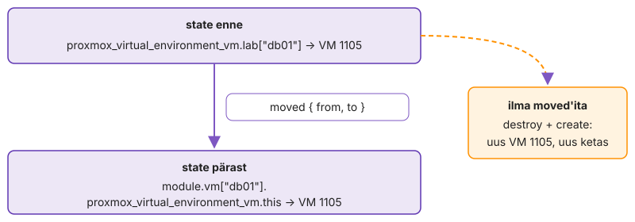
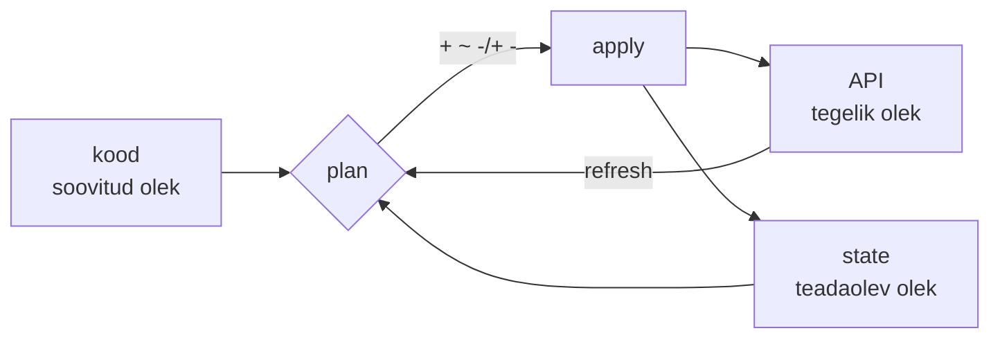

---
tags:
  - OpenTofu
  - Terraform
  - IaC
---

# 4. kohtumine · Taristu koodina: loeng

Eelmisel korral pakkisid teenused image'itesse ja käivitasid need Compose'iga, aga masinad, millel need töötasid, olid endiselt käsitsi loodud. Täna kirjeldad koodina ka masinate loomise. Taristu kood kirjeldab soovitud olekut, aga tööriist teab maailmast ainult seda, mis on tema [state'is](https://opentofu.org/docs/language/state/). Taristu koodina haldamisel tuleb seepärast kooskõlas hoida kolm asja: kood, state ja tegelik olek.

??? abstract "Õpiväljundid"

    Pärast seda loengut oskad:

    - selgitada, kuidas deklaratiivne tööriist arvutab plaani koodi, state'i ja tegeliku oleku põhjal;
    - kirjeldada, mida state sisaldab, miks tööriist seda vajab ja millised riskid sellega kaasnevad;
    - lugeda plaani enne muudatust ja põhjendada, kuidas poliitika koodina seda automaatselt kontrollib;
    - leida drift'i ja otsustada, kas muudatus läheb koodi või võetakse tagasi;
    - jagada töö OpenTofu ja Ansible'i vahel ning võrrelda OpenTofut ja Terraformi.

[Virtuaalse taristu haldus ja SDDC](../teemad/virtuaaltaristu.md) · [Provisioning](../teemad/provisioning.md) · [Taristu koodina ja poliitika koodina](../teemad/iac.md) · [IT-migratsioon ja pilve migratsioon](../teemad/migratsioon.md) · [Standard Operating Environment ja IT-süsteemi elutsükkel](../teemad/soe-ja-elutsukkel.md) · [Orkestreerimine ja automatiseerimine](../teemad/orkestreerimine.md)

## 1. Provisioning ja soovitud olek taristu tasemel

Tüüpiline kohapealne (on-prem) VM luuakse tiketi alusel: VMware'i või Proxmoxi template, käsitsi muudetud RAM ja ketas, IP tabelist ja runbook'i samm "lisa monitooringusse". Viie aasta pärast on masina tegelik kirjeldus ainult hüperviisoris ja sellist snowflake serverit ei saa samast allikast uuesti luua.

**Provisioning** on kõik, mis viib ressursi olematusest kasutatavaks: VM, ketas, võrk, IP, DNS-kirje, ligipääs ja esimene käivitus. 1. kohtumisel nägid cloud-init'i, mis teeb masina sees provisioning'u viimase sammu. Taristu koodina (IaC) viib selle kirjelduse Giti. [OpenTofu](https://opentofu.org/docs/) haldab hüperviisori või pilve API objekte: VM-e, kettaid, võrke, DNS-kirjeid. Mudel on **deklaratiivne**: kirjeldad soovitud lõppolekut ja tööriist arvutab ise, millised API kutsed mis järjekorras selleks vaja on.

Koodis on kolm põhimõistet. **Provider** on eraldi Go binaar, mille `tofu init` registry'st alla laeb. Kogu Proxmoxi, AWS-i või GitHubi tundmine on [provider'is](https://search.opentofu.org/provider/bpg/proxmox/latest). **Resource** on objekt, mille elutsüklit Tofu haldab. **Data source** ainult loeb, näiteks leiab malli tag'i järgi, et selle ID-d ei peaks koodi kirjutama.

```hcl
resource "proxmox_virtual_environment_vm" "web" {
  name      = "web01"
  node_name = "pve1"
  memory { dedicated = 2048 }
}
```

Tofu koostab plokkidest ja nende viidetest sõltuvusgraafi ning töötleb seda paralleelselt, vaikimisi kümme toimingut korraga (`-parallelism=10`). Kui VM on olemas ja ainult RAM erineb, muudab ta ainult RAM-i.

See kõik eeldab, et taristul on API. **Tarkvaraga määratletud andmekeskus** (SDDC, software-defined data center) tähendab, et arvutus, salvestus ja võrk on virtualiseeritud ja neid juhitakse ühe control plane'i API kaudu: vSphere koos vSAN-i ja NSX-iga, Proxmox VE koos Ceph'i ja [SDN-iga](https://pve.proxmox.com/wiki/Software-Defined_Network) või OpenStack. Siis on VLAN, VNet ja storage pool samasugused objektid nagu VM ning need läbivad sama koodi ja sama plaani. Hind on suurem blast radius. Token, millel on õigus `/` peal, on võti kogu andmekeskusele, ja Proxmoxi SDN-is jäävad muudatused ootele, kuni keegi teeb klastri tasemel Apply, ja see viib sisse ka teised ootel muudatused. Tokenid antakse seepärast pool'i ja tee kaupa.

Avalikus sektoris kohustuslik [E-ITS](https://eits.ria.ee/) nõuab, et süsteemide muudatused oleksid hallatud ja jälgitavad. Kui taristu on koodis, on vastus küsimusele "kes, millal ja miks muutis" Giti ajaloos ja PR-is, ning muudatuse kirjeldus on plaani väljund, mitte vabatekst tiketis.

### Provider ja lukufail

`tofu init` kirjutab valitud provider'ite versioonid ja kontrollsummad faili [`.terraform.lock.hcl`](https://opentofu.org/docs/language/files/dependency-lock/). Fail läheb Giti, nii et iga tööjaam ja pipeline kasutab sama binaari ning kontrollsumma erinevus peatab `init`-i. Provider'i uuendus on `tofu init -upgrade` ja lukufaili muudatus PR-is, mitte vaikne kõrvalmõju kellegi sülearvutis. Kui provider'i uus versioon muudab mõne argumendi vaikeväärtust või skeemi, ilmub järgmisse plaani muudatus, mida keegi koodis ei teinud. Provider'i protsess töötab ainult ühe käsu ajal. Tofu käivitab selle alamprotsessina, provider teatab käivitusel standardväljundis protokolli versiooni ja socket'i aadressi ning edasi käivad kõik kutsed gRPC kaudu. Provider'i viga või paanika katkestab seepärast kogu käsu, mitte ühte ressurssi.

Paralleelsus on omaette rikkekoht. Kümme samaaegset kloonimist samast mallist tähendab kümmet ketta kopeerimist samale salvestusele ning Proxmox lukustab kloonimise ajal VM-ide konfiguratsioonifaile. Veateate `can't lock file ... got timeout` korral vähendatakse `-parallelism` väärtust või luuakse masinad mitmes osas. Pilve API-del on päringulimiidid ja provider kordab throttling'u vastuseid ise, nii et suur plaan venib ja pipeline'i timeout peab sellega arvestama.

Iseseisvaks lugemiseks: [Virtuaalse taristu haldus ja SDDC](../teemad/virtuaaltaristu.md) · [Provisioning](../teemad/provisioning.md).

## 2. State kui tõe allikas

Koodis on kirjas `web01`, Proxmoxis on VM ID-ga 1101. Nimi ei sobi seose aluseks: kaks VM-i võivad kanda sama nime ja nime võib keegi UI-s muuta.

Seose hoiab **state**. See on JSON, kus iga koodi aadressi juures on API objekti ID ja kõik atribuudid, nagu provider neid viimati luges. Lisaks on seal `serial`, mis kasvab iga kirjutusega, ja `lineage`, mis antakse state'i loomisel ega muutu kunagi. State seob aadressi API objektiga, mäletab objekte, mille plokk on koodist kustutatud (need tuleb hävitada), ja hoiab sõltuvusi, et hävitamine käiks õiges järjekorras.

Rikked tulenevad sellest, et Tofu teab taristust ainult seda, mis on state'is. Kui state kaob, ei kao ükski VM, aga järgmine plaan tahab kõik uuesti luua ja ebaõnnestub ID konflikti peale või loob teise komplekti kõrvale. Kui protsess katkestatakse keset `apply`-d, võib API-s olla objekt, mis state'i ei jõudnud. Kui kaks käivitust kirjutavad ilma lukuta, jääb alles viimase kirjutaja state. Kõik atribuudid on lihttekstina, ka paroolid ja tokenid.

Meeskonnas on state seepärast **remote backendis** (S3, Azure Blob, GCS, PostgreSQL) koos **lukuga**. OpenTofu 1.10+ S3 backend lukustab tingimusliku kirjutusega: objekt `<key>.tflock` luuakse päisega `If-None-Match: *`. Vanemad juhendid kasutavad selleks DynamoDB tabelit. Lukk ei tea, kas selle omanik veel töötab, nii et `force-unlock` on alati inimese otsus. Gitis state'i ei hoita, sest JSON-i merge-konflikti ei lahenda keegi.

Suures keskkonnas tuleb otsustada, kui suur võib olla üks state. Iga plaan värskendab kõik oma objektid API-st. 50 hosti ja paarsada ressurssi tähendavad iga plaani juures sadu API kutseid ja üht [lukku](https://opentofu.org/docs/language/settings/backends/s3/) kõigile, kes seda koodi puudutavad. Seepärast jagatakse state keskkonna ja komponendi kaupa (võrk, andmebaasid, rakenduse VM-id): väiksem plaan, väiksem blast radius, eraldi õigused. Hind on see, et komponendid loevad teineteise väljundeid ja muudatus üle mitme state'i ei ole enam üks `apply`.

Keskkondade eraldamiseks on kaks tavalist teed. `tofu workspace` annab samale koodile mitu state'i samas backendis: kood on üks, keskkondade erinevus peab olema muutujates ja vale aktiivse workspace'iga `apply` läheb teise keskkonda. Eraldi kaustad keskkonna kaupa, mis kutsuvad sama moodulit kindla tag'iga, tähendavad rohkem faile, aga tootmise backend, token ja mooduli versioon on eraldi ning PR näitab, millist keskkonda muudatus puudutab. Kui tootmisele on eraldi õigused ja eraldi muudatuste kord, sobib teine tee paremini.

State'i aadress on objekti identiteet. Kui tõstad VM-ide koodi moodulisse, muutub aadress ja plaan on "5 kustutada, 5 luua".

<figure markdown="span">
  
  <figcaption>Joonis 4.1. Sama VM, uus aadress. <code>moved</code> plokk muudab ainult kirjet state'is. Ilma selleta kustutab tööriist VM-i ja teeb uue.</figcaption>
</figure>

`moved` plokk ütleb, et see on sama objekt uue aadressiga. Kuna plokk on koodis, kehtib see igas state'is, kus vana aadress veel on, erinevalt käsust `tofu state mv`, mis muudab ühte state'i ja ei jäta Giti jälge. State'i kaitstakse nagu andmebaasi (versioonid bucketis, piiratud ligipääs, varukoopia); HashiCorpi dokumentatsioon soovitab käsitleda kogu state'i tundliku andmena ([tundlikud andmed state'is](https://developer.hashicorp.com/terraform/language/state/sensitive-data)).

### Pooleli jäänud apply

`apply` uuendab state'i iga lõpetatud ressursi järel ja salvestab selle backendi käivituse ajal korduvalt, mitte ainult lõpus. Kui backend pole salvestamise hetkel kättesaadav, kirjutab tööriist state'i kohalikku faili `errored.tfstate`. Selle peab `tofu state push`-iga tagasi viima enne, kui keegi uue plaani teeb, muidu arvutatakse plaan vananenud state'i peal. Kui ressursi loomine algas, aga ei lõppenud (VM tekkis, provisioner või loomisjärgne kontroll ebaõnnestus), märgitakse objekt state'is **tainted**: see on olemas, aga järgmine plaan asendab selle. Pipeline'is tähendab see, et katkenud käivituse logi ja `errored.tfstate` peavad alles jääma ning lukk vabastatakse alles pärast seda, kui keegi on kontrollinud, et state ja API klapivad.

## 3. Plaan ja poliitika enne muudatust

28. veebruaril 2017 tahtis AWS-i insener eemaldada S3 arveldussüsteemist väikese hulga servereid. Ühe sisendi viga käsus eemaldas palju suurema hulga, sealhulgas kaks alamsüsteemi, millest sõltus kogu S3 us-east-1 regioonis. AWS-i [kokkuvõtte](https://aws.amazon.com/message/41926/) järgi muudeti tööriista nii, et see eemaldab võimsust aeglasemalt ja keeldub minemast alla alamsüsteemi miinimumi.

Deklaratiivse tööriista vastus sellele on **plaan**. `plan` loeb kõigepealt iga state'is oleva objekti API-st (refresh), võrdleb tulemust koodiga ja näitab muudatusi nelja märgiga: `+` luuakse, `~` muudetakse kohapeal, `-/+` kustutatakse ja tehakse uuesti, `-` kustutatakse. Kaks viimast kustutavad masina koos kettaga, nii et plaani lugemine algab nendest.

<figure markdown="span">



  <figcaption>Joonis 4.2. Plaan võrdleb kolme olekut. <code>apply</code> muudab tegelikku olekut ja kirjutab tulemuse state'i.</figcaption>
</figure>

Kas muudatus on `~` või `-/+`, otsustab provider'i skeem: iga argumendi juures on märge, kas selle muutus nõuab asendust (SDKv2 provider'is `ForceNew`, plugin framework'is `RequiresReplace`). VM-i RAM-i saab muuta, malli mitte, sest teisest mallist kloonides tekib teine ketas. Plaani ajal saadab Tofu provider'ile iga ressursi eelmise oleku ja koodis kirjeldatud oleku (`PlanResourceChange`) ning provider vastab, milline tuleb uus olek ja millised atribuudid nõuavad asendust. Plaan on seega provider'i arvutus ja provider'i viga jõuab plaani samamoodi nagu sinu enda muudatus.

```text
  # proxmox_virtual_environment_vm.web must be replaced
-/+ resource "proxmox_virtual_environment_vm" "web" {
      ~ clone { ~ vm_id = 9000 -> 9001 } # forces replacement
    }
Plan: 1 to add, 0 to change, 1 to destroy.
```

Plaan on ennustus. See põhineb refresh'i hetke API vastusel ja sellel, mida provider teab API reeglitest. Olematu node'i nimi läbib plaani ja ebaõnnestub alles `apply`-s. `-/+` korral kustutatakse vana enne uue loomist, nii et ebaõnnestunud loomine jätab sind ilma masinata. `apply` ei ole tehing: mis valmis sai, see jääb.

Salvestatud plaanifail (`plan -out`) tagab, et `apply` teeb täpselt selle, mis üle vaadati; kui state on vahepeal muutunud, keeldub `apply` vananenud plaanist. Pipeline'id teevad plaani PR-is ja pärast heakskiitu sama failiga `apply`. `-refresh=false` jätab drift'i nägemata ja `-target` jätab ülejäänu koodist lahku; dokumentatsioon nimetab viimast erandolukordade tööriistaks. `prevent_destroy` nurjab plaani, mis objekti kustutaks, aga ainult koodi kaudu. Proxmoxi `protection` lipp keelab kustutamise igast kanalist, ka UI-st, nii et andmebaasi masinale pannakse mõlemad.

Kahe rea koodimuudatus võib anda plaani, mis asendab viis masinat, ja 40. PR-i ülevaataja ei loe enam iga rida. **Poliitika koodina** (policy as code) tähendab, et reeglid on masinloetavad, Gitis ja testitud ning neid hinnatakse automaatselt enne `apply`-d. Tofu sees on kolm taset: `validation` kontrollib üht muutujat, [`precondition`](https://opentofu.org/docs/language/expressions/custom-conditions/) peatab ressursi muutmise, [`check`](https://opentofu.org/docs/language/checks/) ainult hoiatab. Need on mooduli autori reeglid. Organisatsiooni reeglid, mis kehtivad kõigile moodulitele ja meeskondadele, kirjutatakse eraldi: [Open Policy Agent](https://www.openpolicyagent.org/docs/latest/) hindab Rego keeles reegleid suvalise JSON-i peal ja [Conftest](https://www.conftest.dev/) käivitab need failide vastu, ka `tofu show -json` plaani vastu.

```rego
package main
import rego.v1
deny contains msg if {
  some rc in input.resource_changes
  "delete" in rc.change.actions; "db" in rc.change.before.tags
  msg := sprintf("%s: andmebaasi VM-i plaan ei kustuta", [rc.address])
}
```

Reegel näeb ainult seda, mida plaan teab. Väärtus, mis selgub alles `apply`-s, on JSON-is `after_unknown` all ja reegel, mis seda ei arvesta, laseb muudatuse vaikselt läbi. Seepärast annab teadmata väärtus keelu. Poliitikate repositoorium vajab ülevaatust ja erandite korda, muidu lülitatakse samm pipeline'ist välja. Sama mõte laieneb automaatikale endale (automation as code): moodulid, playbook'id, pipeline'i definitsioon ja AWX-i job template'id koos õigustega on Gitis. 1. kohtumisel nimetatud testitud tegevuste raamatukogu on IaC-s versioonitud moodulite kogu, mida meeskonnad kasutavad tag'i järgi (`?ref=v1.4.0`), mitte koodi kopeerides.

### Kui kontroll ise eksib

4. oktoobril 2021 anti Facebooki magistraalvõrgus tavahoolduse käigus käsk, mis pidi hindama magistraalvõrgu vaba võimsust, aga katkestas kõik ühendused andmekeskuste vahel. Facebooki [kokkuvõtte](https://engineering.fb.com/2021/10/05/networking-traffic/outage-details/) järgi pidi just sellised käsud peatama auditivahend, aga selle viga laskis käsu läbi. Teenused olid maas umbes kuus tundi ja taastamist aeglustas see, et ka sisemised tööriistad sõltusid samast võrgust.

Poliitika koodina on samasugune auditivahend ja sellel on samad rikked. Pärast tööriista uuendust ei vasta reegel enam plaani JSON-i kujule, väli on teise nimega või uut ressursitüüpi reeglis pole, ja reegel ei leia midagi keelata. Seepärast on poliitikal oma testid (`opa test`, `conftest verify`), mis käivitavad reegli teadaoleva hea ja halva plaani vastu, ning pipeline ebaõnnestub ka siis, kui poliitika samm ise ei käivitunud. Vaikimisi keelav seadistus (fail closed) tekitab rohkem erandipäringuid, aga vaikne läbilaskmine on just see rike, mille vastu auditivahend on.

Iseseisvaks lugemiseks: [Taristu koodina ja poliitika koodina](../teemad/iac.md).

## 4. Drift: kui tegelikkus läheb koodist lahku

Öösel jääb andmebaas aeglaseks ja valves olev admin tõstab UI-s db01 RAM-i 1024-lt 2048-le. Koodis on endiselt 1024. Nädal hiljem teeb kolleeg väikese muudatusega `apply`, plaanis on muu hulgas rida `~ dedicated = 2048 -> 1024`, keegi ei loe seda ja RAM läheb tööpäeva keskel tagasi.

**Drift** tekib igast muudatusest koodist mööda: UI, käsitsi API kutse, teine tööriist, pilveteenuse enda automaatika. Tavaline plaan näitab seda kujul "mida ma teen, et kood jälle kehtiks", segamini sinu enda muudatustega. `plan -refresh-only` näitab ainult väljaspool tehtud muudatusi ega paku midagi tagasi panna.

State ja tegelikkus lahknevad kolmel viisil. Objekt on state'is, aga kustutati: refresh eemaldab selle ja plaan tahab selle uuesti luua. Objekt on state'is, aga atribuut muutus: plaan tahab selle tagasi panna. Objekt on olemas, aga state ei tea sellest: plaan on tühi, sest tööriist küsib API-lt ainult oma objekte. Kolmanda leiab ainult pool'i võrdlus state'iga.

Leitud drift'iga on kaks otsust: muudatus läheb koodi või kood võtab selle tagasi. "Jätame nii" tähendab, et järgmine `apply` otsustab sinu eest. Öine RAM-i tõstmine on erakorraline muudatus (emergency change), mis registreeritakse tagantjärele, ja IaC-s on see registreerimine commit. Drift'i leidmiseks käivitatakse plaan ajastatult: `-detailed-exitcode` annab erinevuse korral koodi 2 ja selle peale tuleb teavitus.

Enne koodi tehtud objektid tuuakse koodi alla **[import](https://opentofu.org/docs/language/import/)**-iga. `import` plokk läbib plaani nagu iga teine muudatus ja muudab ainult state'i. `-generate-config-out` kirjutab koodi mustandi, aga selles on kõik vaikeväärtused ja puudub see, mida API-st lugeda ei saa, näiteks millisest mallist VM kunagi kloonitud oli. Pakett VM-i sees ei ole OpenTofu jaoks drift, sest API seda ei näita; see on Ansible'i ala.

### Pidev jõustamine või ajastatud plaan

Puppeti agent käivitub vaikimisi iga 30 minuti järel (seadistus `runinterval`) ja paneb masina sisu koodi järgi tagasi. Seal püsib drift kuni pool tundi ja öine käsitsi parandus kaob ilma, et keegi otsustaks. OpenTofu ja Ansible jõustavad soovitud olekut ainult siis, kui keegi need käivitab. Valik on teavituse ja automaatse parandamise vahel. Automaatne `apply` ajakava järgi hoiab tegeliku oleku koodiga kooskõlas, aga kustutab ka õigustatud hädaparanduse ja teeb `apply` koodiga, mille plaani keegi ei lugenud. Tavaline kompromiss on ajastatud plaan koos teavitusega taristu tasemel ning automaatne jõustamine ainult masina sisus, kus muudatus on kohapealne ja kergemini tagasi võetav.

Ühe hosti drift on nähtav siis, kui keegi seda otsib. 2012. aasta juuli lõpus paigaldas Knight Capitali tehnik uue kauplemistarkvara käsitsi kaheksast serverist seitsmele. Kaheksandas jäi alles vana kood ja 1. augustil käivitas uue koodi jaoks ümber kasutatud lipp seal ammu kasutusest maas oleva funktsiooni. [SEC-i otsuse](https://www.sec.gov/litigation/admin/2013/34-70694.pdf) järgi tegi süsteem umbes 45 minutiga üle 4 miljoni tehingu ja firma kaotas üle 460 miljoni dollari. Otsuses on puudusena nimetatud, et paigaldust ei vaadanud üle teine inimene ja puudus kord, mis kontrolliks, kas kõik serverid said sama versiooni. Kood ja võrdlus koodi vastu on see kontroll.

Iseseisvaks lugemiseks: [IT-migratsioon ja pilve migratsioon](../teemad/migratsioon.md).

## 5. Süsteemi elutsükkel: loomine, muutmine, mahavõtmine

Audit küsib serverite nimekirja ja pool'is on kolm VM-i, mida keegi ei tunne: vana OS, kirjed DNS-is, öine varundus käib. Projekt, mille jaoks need tehti, lõppes kaks aastat tagasi. Masin ilma omaniku ja lõppkuupäevata jääb paikamata.

**Elutsükli haldus** tähendab, et igal süsteemil on kirjeldatud tee loomisest (provisioning) muudatusteni (paigad, mälu, uus versioon) ja mahavõtmiseni (decommission), igal sammul on omanik ja jälg. IaC-s on loomine uus plokk, muutmine `~` või `-/+` plaanis ja mahavõtmine ploki kustutamine, mis annab plaanis `-` ning läbib sama ülevaatuse. Tag'id `owner` ja `expires` teevad ajastatud kontrolli võimalikuks: skript loeb state'ist või API-st aegunud masinad ja avab tiketi. Mahavõtmisel eemaldab Tofu ainult selle, mis on tema state'is. Monitooringu kirje, varundustöö, FreeIPA või AD arvutikonto ja CMDB rida jäävad alles, kui neid haldab mõni teine süsteem. Andmetel on oma säilitusnõue, nii et varukoopia peab VM-ist kauem elama ja andmehostil on `prevent_destroy` ning `protection`.

Muutmise faasis on paketi uuendamiseks kaks teed: paigaldada see töötavasse masinasse (mutable infrastructure, Ansible'i tee) või ehitada uus mall ja masin asendada (immutable infrastructure). VMware'i maailmas on teine tee tuttav template'i ja customization spec'i kujul. **Golden image'i** ehitab [Packer](https://developer.hashicorp.com/packer/docs): kloonib baasmalli, käivitab ajutise VM-i, paigaldab tarkvara, koristab masina identiteedi ja salvestab tulemuse uue mallina. Ilma koristuseta (machine-id, SSH host key'd, cloud-init'i olek) on kõigil kloonidel sama host key ja machine-id, systemd-networkd tuletab sellest DHCP DUID-i ja kloonid võivad saada sama aadressi.

| | Golden image ja asendus | Seadistus käivitusel |
|---|---|---|
| Uue masina käivitus | kiire, tarkvara on kettal | aeglasem, paigaldus igal loomisel |
| Kõik masinad samad | jah, sama mall | sõltub paketihoidla sisust sel hetkel |
| Paketihoidla rikke ajal | taastamine töötab | uus masin ei saa valmis |
| Turvapaik | uus ehitus ja kõigi masinate asendus | `apt upgrade` kohapeal |
| Rollback | eelmine mall, üks rida koodis | paketi vana versioon, kui see on alles |

*Tabel 4.1. Golden image ja seadistus cloud-init'i või Ansible'iga. Enamik meeskondi kasutab mõlemat: harva muutuv osa on mallis, rakenduse seadistus tuleb käivitusel.*

Uus mall jõuab VM-ile ainult uuesti kloonides, nii et iga malli vahetus on plaanis `-/+`. Pilves on tavaline `create_before_destroy`: uus masin luuakse enne vana kustutamist ja koormusjaotur vahetab liikluse. Kui igal VM-il on fikseeritud ID, nimi ja IP, nagu on-prem keskkonnas sageli, ei saa uus tekkida enne, kui vana on läinud, ja asendus tähendab katkestust. Seepärast viiakse uus mall esmalt ühele masinale ja päeva pärast ülejäänutele. Mall vananeb ka ise, nii et selle ehituse käivitab ajakava või turvauuendus, mitte kellegi mälu.

Mallil on oma elutsükkel. Iga ehitus annab uue malli, mille nimes on kuupäev või versioon, ja kood viitab mallile data source'i kaudu tag'i järgi, mitte ID-ga. Vana malli kustutamine on ohutu alles siis, kui ükski kood ega VM sellele ei viita. Proxmoxi linked clone kasutab malli ketast baasina, nii et malli ei saa kustutada enne, kui sellest tehtud kloonid on läinud. Malli sisu on turvaküsimus: selles olev haavatav pakett või unustatud võti jõuab igale masinale, mis sellest tehakse. Seepärast ehitatakse mall pipeline'is, mitte kellegi tööjaamas, ja ehituse logi ning paketiloend jäävad malli versiooni juurde.

Iseseisvaks lugemiseks: [Standard Operating Environment ja IT-süsteemi elutsükkel](../teemad/soe-ja-elutsukkel.md).

## 6. Orkestreerimine: Ansible ja OpenTofu koos

Uue veebihosti tellimus tähendab VM-i, DNS-kirjet, Ansible'i rolli, monitooringu kirjet, koormusjaoturi pool'i ja suletud tiketit. Iga samm võib olla automatiseeritud ja ikkagi käivitab admin neid käsitsi õiges järjekorras ning teab peast, et Ansible'i ei tasu käivitada enne, kui cloud-init on lõpetanud.

**Automatiseerimine** teeb ühe ülesande ilma inimeseta. **Orkestreerimine** seob mitu automatiseeritud ülesannet eri süsteemides üheks töövooks, kus on järjekord, sõltuvused, veakäsitlus ja üks tulemus. Tofu sõltuvusgraaf on orkestreerimine ühe state'i API kutsete sees. Tööriistade vahel teeb seda kõrgema taseme tööriist: pipeline või AWX-i workflow job template, konteinerite puhul Kubernetes. Pilves on sama vahe: öine snapshot on cloud automation, keskkond koos võrgu, tulemüürireeglite, VM-ide, andmebaasi ja DNS-iga õiges järjekorras on cloud orchestration.

| | OpenTofu / Terraform | Ansible |
|---|---|---|
| Haldab | API objektid: VM, ketas, võrk, DNS | masina sisu: paketid, failid, teenused, kasutajad |
| Mälu | state: teab, mida on loonud | puudub, küsib igal käivitusel |
| Koodist eemaldatud objekt | kustutatakse | jääb alles |
| Sobib kõige paremini | loomine, asendus, mahavõtmine | seadistus, paigad, järjestatud muudatus hostide kaupa |

*Tabel 4.2. Kumb tööriist millist tööd teeb.*

Mõlemad oskavad teise tööd osaliselt. Ansible loob VM-e (`community.general.proxmox_kvm`, `amazon.aws.ec2_instance`), aga ilma state'ita ei kustuta ta masinat, mis koodist kadus. Tofu provisioner käivitab skripti üks kord loomisel ega näe hiljem, mis masinas muutus. Tavaline jaotus on seepärast: Tofu loob ja annab väljundina inventory, Ansible seadistab. Üleandmise koht on inventory: Tofu kirjutab selle failina või Ansible'i dünaamiline inventory loeb Proxmoxi API-t. Hind on kaks tõe allikat. Kui Tofu asendab hosti, on uus masin seadistamata, kuni keegi playbook'i käivitab, ja käsitsi inventory'sse lisatud hostist ei tea Tofu midagi. Seepärast käivitab mõlemad sama pipeline.

### Osaline õnnestumine

Tööriistade vahel ei ole tehingut. Kui Tofu lõi kolm VM-i ja Ansible ebaõnnestus teise peal, on tulemus kolm olemasolevat masinat: üks seadistatud, üks pooleli ja üks puutumata. Töövoog peab seepärast olema korratav algusest. Tofu teine `apply` annab tühja plaani ja Ansible'i teine käivitus teeb ainult puuduva, nii et parandus on veakoha kõrvaldamine ja sama töövoo uus käivitus. Kompenseerivat sammu, näiteks masina kustutamist, kasutatakse harva, sest pooleli masinat on veaotsingul vaja.

Teine rikkekoht on ajastus. VM on API jaoks valmis enne, kui cloud-init on võtmed, kasutajad ja võrgu paika pannud. Siis esimene SSH-ühendus ebaõnnestub või jõuab kohale enne cloud-init'i lõppu ja kaks tööriista muudavad samal ajal samu faile. Töövoog ootab seepärast selget valmisoleku märki (`cloud-init status --wait`, Ansible'i `wait_for_connection`), mitte fikseeritud `sleep`-i. AWX-i workflow'is on igal node'il eraldi järgmine samm õnnestumise ja ebaõnnestumise korral, nii et ebaõnnestunud seadistus saab avada tiketi ja jätta hosti koormusjaoturi pool'ist välja.

Iseseisvaks lugemiseks: [Orkestreerimine ja automatiseerimine](../teemad/orkestreerimine.md).

## 7. OpenTofu, Terraform ja teised tööriistad

2023. aasta augustis vahetas HashiCorp Terraformi litsentsi MPL 2.0 pealt BSL 1.1 vastu ([HashiCorpi teade](https://www.hashicorp.com/blog/hashicorp-adopts-business-source-license)). Kogukond tegi viimasest MPL-versioonist fork'i, mida arendatakse nüüd OpenTofu nime all Linux Foundationi juures ([OpenTofu manifest](https://opentofu.org/manifesto/)). Keel, töövoog, alamkäsud ja failinimed (`terraform.tfstate`, `terraform.tfvars`) on samad, käsk on `tofu`.

| | OpenTofu | Terraform |
|---|---|---|
| Litsents | MPL 2.0, Linux Foundation | BSL 1.1 alates versioonist 1.6, HashiCorp (IBM) |
| Provider'ite registry | `registry.opentofu.org` | `registry.terraform.io` |
| State'i krüpteerimine | tööriistas endas (1.7+) | ainult backendi poolt, näiteks S3 krüpteerimine |
| Ainult ühes tööriistas | `-exclude`, provider'ite `for_each` (1.9) | HCP Terraformi teenused |
| State'i ühilduvus | loeb Terraform 1.5 state'i otse | ei loe OpenTofu krüpteeritud state'i |

*Tabel 4.3. OpenTofu ja Terraform. Sama kood annab mõlemast sama plaani, kuni kasutad ainult ühele omaseid võimalusi.*

Töökuulutustes on enamasti kirjas "Terraform". Oskus on sama: HCL, state, plaani lugemine, moodulid. BSL piirab Terraformi kasutamist HashiCorpiga konkureerivates toodetes, oma taristu haldamist see ei puuduta. Kursus kasutab OpenTofut, sest MPL ei vaja litsentsi ülevaatust ühelgi juhul. Kolimine ühelt tööriistalt teisele on üks commit, millele eelneb state'i varukoopia ([migreerimine](https://opentofu.org/docs/intro/migration/)).

Vendor lock-in tuleb sellest, mis on tööriista ümber. HCP Terraformi poliitikad võivad olla [Sentinelis](https://developer.hashicorp.com/sentinel/docs), mida väljaspool HashiCorpi tooteid ei käivitata, OPA reeglid aga töötavad mõlema tööriista plaani JSON-i peal. Kui hindad tööriista, vaata seepärast ka seda, kus asuvad state, poliitika, saladused ja käivitus, sest need on kolimisel suurem töö kui HCL.

Võõrast IaC koodi lugedes otsi kolme asja: kus on soovitud olek, kus on state ja mis näitab plaani enne muudatust.

| Tööriist | Soovitud olek | State | Plaan enne muudatust |
|---|---|---|---|
| Ansible | YAML, masina sisu | puudub, küsib igal käivitusel masinalt | `--check --diff`, mitte kõigi moodulitega |
| OpenTofu / Terraform | HCL, taristu objektid | fail backendis | `plan` |
| [Pulumi](https://www.pulumi.com/docs/) | Python, TypeScript, Go | Pulumi Cloud või oma backend | `pulumi preview` |
| [CloudFormation](https://docs.aws.amazon.com/cloudformation/) | YAML või JSON, ainult AWS | AWS hoiab ise | change set |

*Tabel 4.4. Tööriistad kõrvuti.*

Pulumi annab programmeerimiskeele tsüklid ja testid, aga lõppolekut on koodist raskem välja lugeda.

## Kokkuvõte

<div class="grid cards kokkuvote" markdown>

-   **Deklaratiivne mudel**

    Kirjelda koodis ressursi soovitud olekut ja lase Toful API kutsed sõltuvusgraafist arvutada. Anna tokenile õigus pool'i ja tee kaupa, sest SDDC-s on ka võrk ja salvestus API objektid.

-   **State**

    Hoia state remote backendis koos lukuga ja jaga see keskkonna ning komponendi kaupa. Kaitse seda nagu andmebaasi, sest saladused on seal lihttekstina.

-   **Aadress on identiteet**

    Lisa ümbernimetamisel või moodulisse tõstmisel `moved` plokk. Ilma selleta plaanib Tofu kustutamise ja uue loomise.

-   **Plaan ja poliitika**

    Loe plaanis esmalt `-/+` ja `-` read, sest `apply` ei ole tehing. Hinda organisatsiooni reegleid plaani JSON-i peal, testi neid ja keela teadmata väärtusega muudatus.

-   **Drift**

    Leia drift ajastatud `plan -refresh-only`-ga ja otsusta iga leiu üle: muudatus läheb koodi või võetakse tagasi. Pane otsus commit'i, muidu otsustab järgmine `apply`.

-   **Elutsükkel**

    Võta süsteem maha sama plaani kaudu, millega see loodi. Eemalda monitooring, varundus ja kontod eraldi, sest Tofu kustutab ainult state'is oleva. Fikseeritud ID ja IP korral tähendab asendus katkestust.

-   **Orkestreerimine**

    Lase Toful luua ja Ansible'il seadistada ning käivita mõlemad samast pipeline'ist. Hoia inventory Tofu väljundis, sest see on üleandmise koht.

-   **OpenTofu ja Terraform**

    Kasuta mõlemas sama HCL-i ja töövoogu. Arvesta, et ühe tööriista lisavõimalus, näiteks OpenTofu state'i krüpteerimine, seob sind selle tööriistaga.

</div>

<div class="kontrollkysimus" markdown>
**Kontrollküsimus:** Miks plaanib Tofu ressursi kustutamise ja uuesti loomise, kui nimetasid selle koodis ümber, ja kuidas seda vältida?
</div>

## Kontrolli ennast

??? question "Miks vajab OpenTofu state'i, kui Ansible saab ilma selleta hakkama?"
    Ansible küsib igal käivitusel masinalt, mis seal on, ega mäleta varasemat, nii et koodist eemaldatud objekt jääb alles. OpenTofu peab teadma, millise aadressi taga on milline objekt ka siis, kui aadress on koodist kadunud, ja millises järjekorras objekte kustutada.

??? question "Kolleeg kustutas kogemata kohaliku `terraform.tfstate` faili. Mis juhtub VM-idega ja mida näitab järgmine plaan?"
    VM-idega ei juhtu midagi. Plaan tahab kõik uuesti luua, sest state'is pole ühtki objekti, ja `apply` ebaõnnestuks `vm_id` konflikti peale. Kohalikul backendil on `terraform.tfstate.backup` eelmise state'iga; kui seda pole, tuleb objektid importida.

??? question "Kolleeg tõstis öösel UI-s db01 RAM-i 2048-le. Mida näitab `plan -refresh-only`, mida tavaline `plan` ja mida sa teed?"
    `-refresh-only` näitab muutust 1024 → 2048 väljaspool Tofut, tavaline `plan` tahab selle 1024-le tagasi panna. Kui muudatus oli õige, läheb 2048 koodi; kui ei, teed koodiga `apply`. Otsus läheb koos põhjusega commit'i.

??? question "Poliitika keelab andmebaasi VM-i kustutamise, kui `tags` sisaldab `db`. Millal laseb see kustutamise siiski läbi?"
    Kui tag'i väärtus pole plaani ajal teada (`after_unknown`), kui VM on märgistatud teisiti või kui kustutamine käib Tofust mööda, näiteks UI-st. Esimese vastu aitab reegel, mis keelab teadmata tag'iga muudatuse, viimase vastu ainult Proxmoxi `protection`.

??? question "Projekt lõpeb ja kolm VM-i tuleb maha võtta. Mida teeb ploki kustutamine koodist ja mida see ei tee?"
    Plaan näitab kolme `-` rida ja `apply` kustutab VM-id koos ketastega ning eemaldab need state'ist. Alles jäävad kõik, mida haldab teine süsteem: monitooringu kirjed, varundustööd, arvutikontod, CMDB read. Enne kustutamist kontrollid andmete säilitusnõuet ja seda, et viimane varukoopia on olemas.
