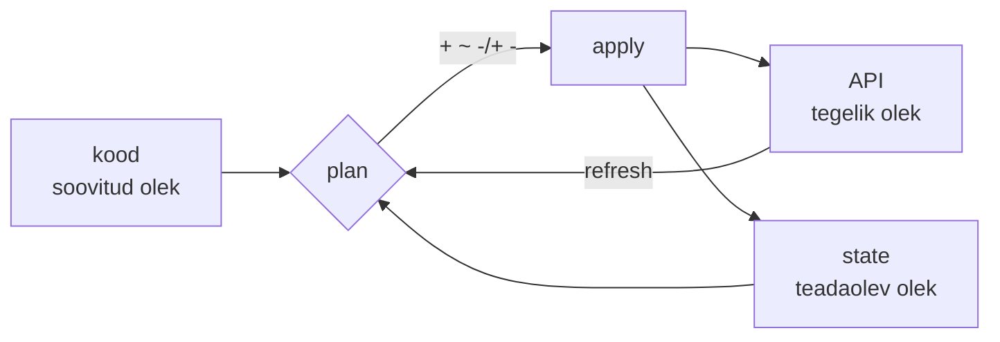

---
tags:
  - OpenTofu
  - Terraform
  - IaC
---

# Loeng: taristu koodina OpenTofuga

Eelmisel korral pakkisid teenused image'itesse ja käivitasid need Compose'iga, aga masinad, millel need töötasid, olid endiselt käsitsi loodud. Täna kirjeldad koodina ka masinate loomise. Taristu kood kirjeldab soovitud olekut, aga tööriist teab maailmast ainult seda, mis on tema [state'is](https://opentofu.org/docs/language/state/). Taristu koodina haldamisel tuleb seepärast kooskõlas hoida kolm asja: kood, state ja tegelik olek.

??? abstract "Õpiväljundid"

    Pärast seda loengut oskad:

    - selgitada, kuidas deklaratiivne tööriist arvutab plaani koodi, state'i ja tegeliku oleku põhjal;
    - kirjeldada, mida state sisaldab, miks tööriist seda vajab ja millised riskid sellega kaasnevad;
    - lugeda plaani enne muudatust ja eristada kohapealset muutmist (`~`) asendusest (`-/+`);
    - jagada töö OpenTofu ja Ansible'i vahel ning selgitada OpenTofu ja Terraformi seost.

[Virtuaalse taristu haldus ja SDDC](../teemad/virtuaaltaristu.md) · [Provisioning](../teemad/provisioning.md) · [Taristu koodina ja poliitika koodina](../teemad/iac.md) · [IT-migratsioon ja pilve migratsioon](../teemad/migratsioon.md) · [Standard Operating Environment ja IT-süsteemi elutsükkel](../teemad/soe-ja-elutsukkel.md) · [Orkestreerimine ja automatiseerimine](../teemad/orkestreerimine.md)

## 1. Provisioning ja soovitud olek taristu tasemel

Tüüpiline kohapealne (on-prem) VM luuakse tiketi alusel: VMware'i või Proxmoxi template, käsitsi muudetud RAM ja ketas, IP tabelist ja runbook'i samm "lisa monitooringusse". Viie aasta pärast on masina tegelik kirjeldus ainult hüperviisoris ja sellist snowflake serverit ei saa samast allikast uuesti luua.

**Provisioning** on kõik, mis viib ressursi olematusest kasutatavaks: VM, ketas, võrk, IP, DNS-kirje, ligipääs ja esimene käivitus. 1. kohtumisel nägid cloud-init'i, mis teeb masina sees provisioning'u viimase sammu. Taristu koodina (IaC) viib selle kirjelduse Giti. [OpenTofu](https://opentofu.org/docs/) haldab hüperviisori või pilve API objekte: VM-e, kettaid, võrke, DNS-kirjeid. Mudel on **deklaratiivne**: kirjeldad soovitud lõppolekut ja tööriist arvutab ise, millised API kutsed mis järjekorras selleks vaja on.

Koodis on kolm põhimõistet. **Provider** on eraldi Go binaar, mille `tofu init` registry'st alla laeb. Kogu Proxmoxi, AWS-i või GitHubi tundmine on [provider'is](https://search.opentofu.org/provider/bpg/proxmox/latest). **Resource** on objekt, mille elutsüklit Tofu haldab. **Data source** ainult loeb, näiteks leiab malli tag'i järgi, et selle ID-d ei peaks koodi kirjutama.

```hcl
resource "proxmox_virtual_environment_vm" "web" {
  name      = "web01"
  node_name = "pve1"
  memory { dedicated = 2048 }
}
```

Tofu koostab plokkidest ja nende viidetest sõltuvusgraafi ning töötleb seda paralleelselt, vaikimisi kümme toimingut korraga (`-parallelism=10`). Kui VM on olemas ja ainult RAM erineb, muudab ta ainult RAM-i.

See kõik eeldab, et taristul on API. **Tarkvaraga määratletud andmekeskus** (SDDC, software-defined data center) tähendab, et arvutus, salvestus ja võrk on virtualiseeritud ja neid juhitakse ühe control plane'i API kaudu: vSphere koos vSAN-i ja NSX-iga, Proxmox VE koos Ceph'i ja [SDN-iga](https://pve.proxmox.com/wiki/Software-Defined_Network) või OpenStack. Siis on VLAN, VNet ja storage pool samasugused objektid nagu VM ning need läbivad sama koodi ja sama plaani. Hind on suurem blast radius. Token, millel on õigus `/` peal, on võti kogu andmekeskusele, ja Proxmoxi SDN-is jäävad muudatused ootele, kuni keegi teeb klastri tasemel Apply, ja see viib sisse ka teised ootel muudatused. Tokenid antakse seepärast pool'i ja tee kaupa.

Avalikus sektoris kohustuslik [E-ITS](https://eits.ria.ee/) nõuab, et süsteemide muudatused oleksid hallatud ja jälgitavad. Kui taristu on koodis, on vastus küsimusele "kes, millal ja miks muutis" Giti ajaloos ja PR-is, ning muudatuse kirjeldus on plaani väljund, mitte vabatekst tiketis.

### Provider ja lukufail

`tofu init` kirjutab valitud provider'ite versioonid ja kontrollsummad faili [`.terraform.lock.hcl`](https://opentofu.org/docs/language/files/dependency-lock/). Fail läheb Giti, nii et iga tööjaam ja pipeline kasutab sama binaari ning kontrollsumma erinevus peatab `init`-i. Provider'i uuendus on `tofu init -upgrade` ja lukufaili muudatus PR-is, mitte vaikne kõrvalmõju kellegi sülearvutis.

Iseseisvaks lugemiseks: [Virtuaalse taristu haldus ja SDDC](../teemad/virtuaaltaristu.md) · [Provisioning](../teemad/provisioning.md).

## 2. State kui tõe allikas

Koodis on kirjas `web01`, Proxmoxis on VM ID-ga 1101. Nimi ei sobi seose aluseks: kaks VM-i võivad kanda sama nime ja nime võib keegi UI-s muuta.

Seose hoiab **state**. See on JSON, kus iga koodi aadressi juures on API objekti ID ja kõik atribuudid, nagu provider neid viimati luges. Lisaks on seal `serial`, mis kasvab iga kirjutusega, ja `lineage`, mis antakse state'i loomisel ega muutu kunagi. State seob aadressi API objektiga, mäletab objekte, mille plokk on koodist kustutatud (need tuleb hävitada), ja hoiab sõltuvusi, et hävitamine käiks õiges järjekorras.

Rikked tulenevad sellest, et Tofu teab taristust ainult seda, mis on state'is. Kui state kaob, ei kao ükski VM, aga järgmine plaan tahab kõik uuesti luua ja ebaõnnestub ID konflikti peale või loob teise komplekti kõrvale. Kui protsess katkestatakse keset `apply`-d, võib API-s olla objekt, mis state'i ei jõudnud. Kui kaks käivitust kirjutavad ilma lukuta, jääb alles viimase kirjutaja state. Kõik atribuudid on lihttekstina, ka paroolid ja tokenid.

Meeskonnas on state seepärast **remote backendis** (S3, Azure Blob, GCS, PostgreSQL) koos **lukuga**, mis ei lase kahel käivitusel korraga kirjutada. Gitis state'i ei hoita, sest JSON-i merge-konflikti ei lahenda keegi.

State'i aadress on objekti identiteet. Kui tõstad VM-ide koodi moodulisse, muutub aadress ja plaan on "5 kustutada, 5 luua". Seda väldib `moved` plokk ([IS2 loeng](https://hkhk-tk.github.io/is2-automatiseerimine/k04/loeng/#state-lahemalt)).

State'i kaitstakse nagu andmebaasi (versioonid bucketis, piiratud ligipääs, varukoopia); HashiCorpi dokumentatsioon soovitab käsitleda kogu state'i tundliku andmena ([tundlikud andmed state'is](https://developer.hashicorp.com/terraform/language/state/sensitive-data)).

## 3. Plaan enne muudatust

28. veebruaril 2017 tahtis AWS-i insener eemaldada S3 arveldussüsteemist väikese hulga servereid. Ühe sisendi viga käsus eemaldas palju suurema hulga, sealhulgas kaks alamsüsteemi, millest sõltus kogu S3 us-east-1 regioonis. AWS-i [kokkuvõtte](https://aws.amazon.com/message/41926/) järgi muudeti tööriista nii, et see eemaldab võimsust aeglasemalt ja keeldub minemast alla alamsüsteemi miinimumi.

Deklaratiivse tööriista vastus sellele on **plaan**. `plan` loeb kõigepealt iga state'is oleva objekti API-st (refresh), võrdleb tulemust koodiga ja näitab muudatusi nelja märgiga: `+` luuakse, `~` muudetakse kohapeal, `-/+` kustutatakse ja tehakse uuesti, `-` kustutatakse. Kaks viimast kustutavad masina koos kettaga, nii et plaani lugemine algab nendest.

<figure markdown="span">



  <figcaption>Joonis 4.2. Plaan võrdleb kolme olekut. <code>apply</code> muudab tegelikku olekut ja kirjutab tulemuse state'i.</figcaption>
</figure>

Kas muudatus on `~` või `-/+`, otsustab provider'i skeem: iga argumendi juures on märge, kas selle muutus nõuab asendust (SDKv2 provider'is `ForceNew`, plugin framework'is `RequiresReplace`). VM-i RAM-i saab muuta, malli mitte, sest teisest mallist kloonides tekib teine ketas.

```text
  # proxmox_virtual_environment_vm.web must be replaced
-/+ resource "proxmox_virtual_environment_vm" "web" {
      ~ clone { ~ vm_id = 9000 -> 9001 } # forces replacement
    }
Plan: 1 to add, 0 to change, 1 to destroy.
```

Plaan on ennustus. See põhineb refresh'i hetke API vastusel ja sellel, mida provider teab API reeglitest. Olematu node'i nimi läbib plaani ja ebaõnnestub alles `apply`-s. `-/+` korral kustutatakse vana enne uue loomist, nii et ebaõnnestunud loomine jätab sind ilma masinata. `apply` ei ole tehing: mis valmis sai, see jääb.

Iseseisvaks lugemiseks: [Taristu koodina ja poliitika koodina](../teemad/iac.md).

## 4. Süsteemi elutsükkel: loomine, muutmine, mahavõtmine

Audit küsib serverite nimekirja ja pool'is on kolm VM-i, mida keegi ei tunne: vana OS, kirjed DNS-is, öine varundus käib. Projekt, mille jaoks need tehti, lõppes kaks aastat tagasi. Masin ilma omaniku ja lõppkuupäevata jääb paikamata.

**Elutsükli haldus** tähendab, et igal süsteemil on kirjeldatud tee loomisest (provisioning) muudatusteni (paigad, mälu, uus versioon) ja mahavõtmiseni (decommission), igal sammul on omanik ja jälg. IaC-s on loomine uus plokk, muutmine `~` või `-/+` plaanis ja mahavõtmine ploki kustutamine, mis annab plaanis `-` ning läbib sama ülevaatuse. Tag'id `owner` ja `expires` teevad ajastatud kontrolli võimalikuks: skript loeb state'ist või API-st aegunud masinad ja avab tiketi. Mahavõtmisel eemaldab Tofu ainult selle, mis on tema state'is. Monitooringu kirje, varundustöö, FreeIPA või AD arvutikonto ja CMDB rida jäävad alles, kui neid haldab mõni teine süsteem. Andmetel on oma säilitusnõue, nii et varukoopia peab VM-ist kauem elama ja andmehostil on `prevent_destroy` ning `protection`.

Muutmise faasis on paketi uuendamiseks kaks teed: paigaldada see töötavasse masinasse (mutable infrastructure, Ansible'i tee) või ehitada uus mall ja masin asendada (immutable infrastructure). Malli ehitamine ja vahetamine on [IS2 loengus](https://hkhk-tk.github.io/is2-automatiseerimine/k04/loeng/#golden-image-ja-malli-elutsukkel).

Iseseisvaks lugemiseks: [Standard Operating Environment ja IT-süsteemi elutsükkel](../teemad/soe-ja-elutsukkel.md).

## 5. Orkestreerimine: Ansible ja OpenTofu koos

Uue veebihosti tellimus tähendab VM-i, DNS-kirjet, Ansible'i rolli, monitooringu kirjet, koormusjaoturi pool'i ja suletud tiketit. Iga samm võib olla automatiseeritud ja ikkagi käivitab admin neid käsitsi õiges järjekorras ning teab peast, et Ansible'i ei tasu käivitada enne, kui cloud-init on lõpetanud.

**Automatiseerimine** teeb ühe ülesande ilma inimeseta. **Orkestreerimine** seob mitu automatiseeritud ülesannet eri süsteemides üheks töövooks, kus on järjekord, sõltuvused, veakäsitlus ja üks tulemus. Tofu sõltuvusgraaf on orkestreerimine ühe state'i API kutsete sees. Tööriistade vahel teeb seda kõrgema taseme tööriist: pipeline või AWX-i workflow job template, konteinerite puhul Kubernetes. Pilves on sama vahe: öine snapshot on cloud automation, keskkond koos võrgu, tulemüürireeglite, VM-ide, andmebaasi ja DNS-iga õiges järjekorras on cloud orchestration.

| | OpenTofu / Terraform | Ansible |
|---|---|---|
| Haldab | API objektid: VM, ketas, võrk, DNS | masina sisu: paketid, failid, teenused, kasutajad |
| Mälu | state: teab, mida on loonud | puudub, küsib igal käivitusel |
| Koodist eemaldatud objekt | kustutatakse | jääb alles |
| Sobib kõige paremini | loomine, asendus, mahavõtmine | seadistus, paigad, järjestatud muudatus hostide kaupa |

*Tabel 4.2. Kumb tööriist millist tööd teeb.*

Mõlemad oskavad teise tööd osaliselt. Ansible loob VM-e (`community.general.proxmox_kvm`, `amazon.aws.ec2_instance`), aga ilma state'ita ei kustuta ta masinat, mis koodist kadus. Tofu provisioner käivitab skripti üks kord loomisel ega näe hiljem, mis masinas muutus. Tavaline jaotus on seepärast: Tofu loob ja annab väljundina inventory, Ansible seadistab. Üleandmise koht on inventory: Tofu kirjutab selle failina või Ansible'i dünaamiline inventory loeb Proxmoxi API-t. Hind on kaks tõe allikat. Kui Tofu asendab hosti, on uus masin seadistamata, kuni keegi playbook'i käivitab, ja käsitsi inventory'sse lisatud hostist ei tea Tofu midagi. Seepärast käivitab mõlemad sama pipeline.

Iseseisvaks lugemiseks: [Orkestreerimine ja automatiseerimine](../teemad/orkestreerimine.md).

## 6. OpenTofu ja Terraform

2023. aasta augustis vahetas HashiCorp Terraformi litsentsi MPL 2.0 pealt BSL 1.1 vastu ([HashiCorpi teade](https://www.hashicorp.com/blog/hashicorp-adopts-business-source-license)). Kogukond tegi viimasest MPL-versioonist fork'i, mida arendatakse nüüd OpenTofu nime all Linux Foundationi juures ([OpenTofu manifest](https://opentofu.org/manifesto/)). Keel, töövoog, alamkäsud ja failinimed (`terraform.tfstate`, `terraform.tfvars`) on samad, käsk on `tofu`. Töökuulutustes on enamasti kirjas „Terraform“. Oskus on sama: HCL, state, plaani lugemine, moodulid. OpenTofu ja Terraformi erinevused ning teised IaC tööriistad on [IS2 loengus](https://hkhk-tk.github.io/is2-automatiseerimine/k04/loeng/#opentofu-terraform-ja-teised-tooriistad).

## Kokkuvõte

<div class="grid cards kokkuvote" markdown>

-   **Deklaratiivne mudel**

    Kirjelda koodis ressursi soovitud olekut ja lase Toful API kutsed sõltuvusgraafist arvutada. Anna tokenile õigus pool'i ja tee kaupa, sest SDDC-s on ka võrk ja salvestus API objektid.

-   **State**

    Hoia state remote backendis koos lukuga. Kaitse seda nagu andmebaasi, sest saladused on seal lihttekstina.

-   **Plaan**

    Loe plaanis esmalt `-/+` ja `-` read, sest `apply` ei ole tehing.

-   **Elutsükkel**

    Võta süsteem maha sama plaani kaudu, millega see loodi. Eemalda monitooring, varundus ja kontod eraldi, sest Tofu kustutab ainult state'is oleva. Fikseeritud ID ja IP korral tähendab asendus katkestust.

-   **Orkestreerimine**

    Lase Toful luua ja Ansible'il seadistada ning käivita mõlemad samast pipeline'ist. Hoia inventory Tofu väljundis, sest see on üleandmise koht.

-   **OpenTofu ja Terraform**

    Kasuta mõlemas sama HCL-i ja töövoogu.

</div>

## Kontrolli ennast

??? question "Miks vajab OpenTofu state'i, kui Ansible saab ilma selleta hakkama?"
    Ansible küsib igal käivitusel masinalt, mis seal on, ega mäleta varasemat, nii et koodist eemaldatud objekt jääb alles. OpenTofu peab teadma, millise aadressi taga on milline objekt ka siis, kui aadress on koodist kadunud, ja millises järjekorras objekte kustutada.

??? question "Kolleeg kustutas kogemata kohaliku `terraform.tfstate` faili. Mis juhtub VM-idega ja mida näitab järgmine plaan?"
    VM-idega ei juhtu midagi. Plaan tahab kõik uuesti luua, sest state'is pole ühtki objekti, ja `apply` ebaõnnestuks `vm_id` konflikti peale. Kohalikul backendil on `terraform.tfstate.backup` eelmise state'iga; kui seda pole, tuleb objektid importida.

??? question "Projekt lõpeb ja kolm VM-i tuleb maha võtta. Mida teeb ploki kustutamine koodist ja mida see ei tee?"
    Plaan näitab kolme `-` rida ja `apply` kustutab VM-id koos ketastega ning eemaldab need state'ist. Alles jäävad kõik, mida haldab teine süsteem: monitooringu kirjed, varundustööd, arvutikontod, CMDB read. Enne kustutamist kontrollid andmete säilitusnõuet ja seda, et viimane varukoopia on olemas.
