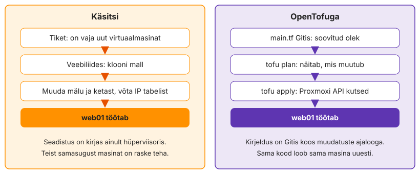
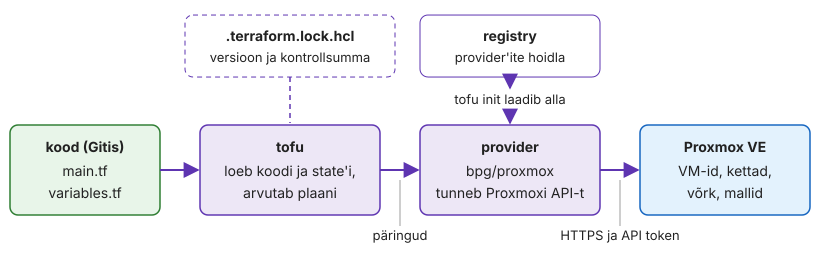
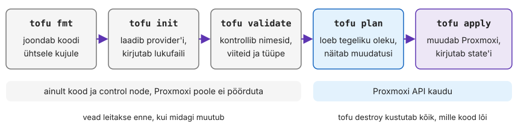
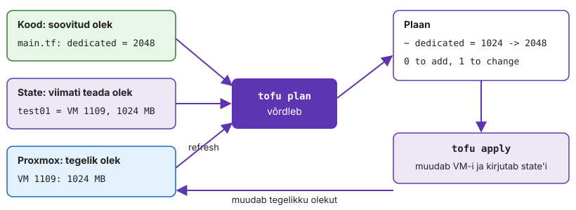
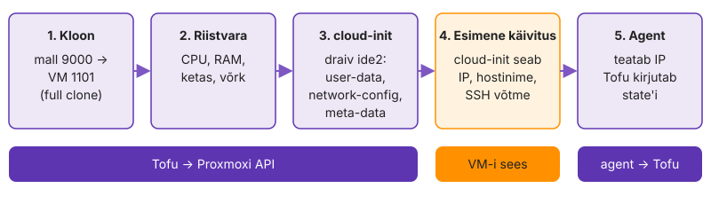
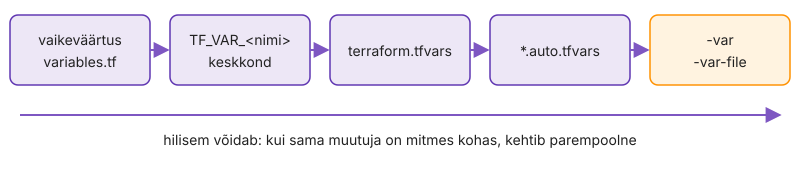
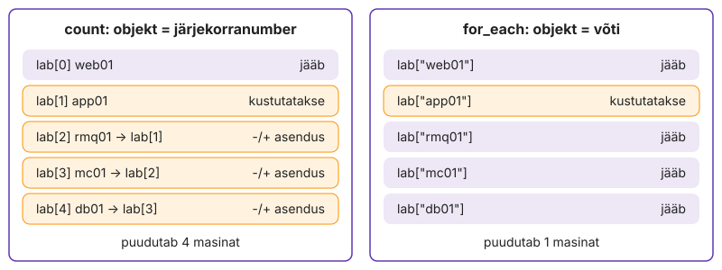
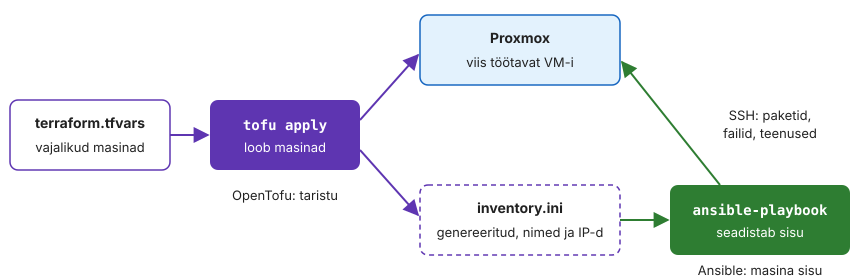

---
tags:
  - OpenTofu
  - Terraform
  - IaC
  - Loeng
---

# Loeng: taristu koodina OpenTofuga

3\. kohtumisel pakkisid teenused image'itesse ja käivitasid need Compose'iga, aga virtuaalmasinad, millel need töötasid, olid loodud käsitsi. Täna kirjeldad koodina ka masinate loomise: OpenTofu loob Proxmoxis muutujate põhjal viis virtuaalmasinat ja kirjutab neist Ansible'i inventory.

??? abstract "Õpiväljundid"

    Pärast loengut ja praktikumi oskad:

    - selgitada, mille poolest erineb masina loomine veebiliideses taristust koodina ja mida tähendab deklaratiivne tööriist;
    - lugeda OpenTofu koodi plokke (`provider`, `resource`, `data`, `variable`, `output`) ja selgitada, mida teeb `tofu init`;
    - lugeda plaani ja eristada loomist (`+`), kohapealset muutmist (`~`), asendust (`-/+`) ja kustutamist (`-`);
    - selgitada, mida hoiab state, miks see Giti ei lähe ja mis juhtub, kui kood, state ja tegelik olek lähevad lahku;
    - kirjeldada mitu sarnast masinat muutujate ja `for_each`-iga ning anda nende IP-aadressid väljundiga Ansible'ile;
    - jagada töö OpenTofu ja Ansible'i vahel ning selgitada OpenTofu ja Terraformi seost.

## 1. Masinad koodiks

### Kuidas virtuaalmasin tavaliselt tekib

Uus virtuaalmasin tehakse sageli tiketi alusel. Administraator kloonib Proxmoxi või VMware'i veebiliideses malli, muudab mälu ja ketta suurust, võtab IP-aadressi tabelist ja lisab masina monitooringusse. Iga samm on mõistlik, aga kirja jääb ainult tulemus hüperviisoris. Mõne aasta pärast ei tea keegi, miks masinal on 6 GB mälu ja millisest mallist see tehti.

Sellist masinat nimetatakse lumehelbeks (snowflake server): see on ainulaadne ja teist täpselt samasugust on raske teha. Kui masin katki läheb, tuleb selle seadistus vanadest tiketitest ja mälust kokku otsida.

**Provisioning** tähendab kõiki samme, mis viivad ressursi olematusest kasutatavaks: virtuaalmasin, ketas, võrk, IP-aadress, DNS-kirje, ligipääs ja esimene käivitus. 1. kohtumisel nägid cloud-init'i, mis teeb masina sees provisioning'u viimase sammu: seab hostinime, kasutaja ja SSH-võtme.

### Taristu koodina

**Taristu koodina** (IaC, infrastructure as code) tähendab, et masinate, ketaste ja võrkude kirjeldus on tekstifailides Gitis ning tööriist loob nende järgi tegeliku taristu. Mõte on tuttav Ansible'ist. Playbook kirjeldab, milline peab olema masina sisu, OpenTofu kood kirjeldab, millised masinad peavad olemas olema. Muudatus on commit ja ülevaatus, mitte klõps veebiliideses.

<figure markdown="span">
  
  <figcaption>Joonis 4.1. Sama masin käsitsi ja OpenTofuga. Paremal jääb kirjeldus Giti ja seda saab uuesti kasutada (Talvik, 2026).</figcaption>
</figure>

=== "Käsitsi"

    Administraator kloonib veebiliideses malli, kirjutab IP-aadressi tabelist ja kordab sama viis korda. Viies masin erineb esimesest, sest üks väli jäi muutmata. Kes ja millal masinat muutis, on näha ainult Proxmoxi tegevuslogis, kui seda veel hoitakse.

=== "OpenTofuga"

    Kood kirjeldab viit masinat ühe plokiga ja IP-aadressid on ühes failis. `tofu plan` näitab enne muudatust, mida tehakse, ja `tofu apply` teeb selle. Kes, millal ja miks muutis, on Giti ajaloos ja PR-is.

### Deklaratiivne ja imperatiivne

Skript on **imperatiivne**: see ütleb samm-sammult, mida teha. Proxmoxi käsurea tööriistaga `qm` näeb see välja nii:

```bash
# Imperatiivne: iga käivitus teeb samad sammud uuesti
qm clone 9000 1101 --name web01 --full
qm set 1101 --memory 2048
```

OpenTofu kood on **deklaratiivne**: see kirjeldab soovitud lõppolekut ja tööriist arvutab ise, milliseid samme selleks vaja on.

```hcl
# Deklaratiivne: kirjeldab tulemust
resource "proxmox_virtual_environment_vm" "web" {
  name      = "web01"
  vm_id     = 1101
  node_name = "pve1"
  clone  { vm_id = 9000 }
  memory { dedicated = 2048 }
}
```

Kui VM-i veel pole, loob OpenTofu selle. Kui VM on olemas ja ainult mälu erineb, muudab ta ainult mälu. Kui kõik klapib, ei tee ta midagi. Sama nägid Ansible'i juures: moodul `apt` koos `state: present` paigaldab paketi ainult siis, kui seda veel pole.

### API on eeldus

OpenTofu ei klõpsa veebiliideses. See kasutab **API-t** (application programming interface), masinatele mõeldud liidest, mille kaudu töötab ka veebiliides ise. API on olemas Proxmoxil, VMware vSphere'il ja pilveteenustel (AWS, Azure, Google Cloud). Kui süsteemil API-t pole, ei saa seda ka koodiga hallata.

??? info "Süvenemiseks: tarkvaraga määratletud andmekeskus ja muudatuste jälg"

    **Tarkvaraga määratletud andmekeskus** (SDDC, software-defined data center) tähendab, et arvutus, salvestus ja võrk on virtualiseeritud ja neid juhitakse ühe API kaudu: vSphere koos vSAN-i ja NSX-iga, Proxmox VE koos Ceph'i ja [SDN-iga](https://pve.proxmox.com/wiki/Software-Defined_Network) või OpenStack. Siis on ka VLAN ja salvestuskoht samasugused objektid nagu VM ning need läbivad sama koodi ja sama plaani.

    Hind on suurem kahju võimalus. Token, millel on õigus kogu Proxmoxile, on võti kogu andmekeskusele. Seepärast antakse tokenitele õigused ainult ühe pool'i (VM-ide rühma) või ühe tee kaupa.

    Avalikus sektoris kohustuslik [E-ITS](https://eits.ria.ee/) nõuab muudatuste haldust. Kui taristu on koodis, on vastus küsimusele „kes, millal ja miks muutis“ Giti ajaloos ja PR-is ning muudatuse kirjeldus on plaani väljund, mitte vaba tekst tiketis.

**Leia viga.** Skript `uus-vm.sh` lõi eile masina web01. Täna lisati skripti teisele reale suurem mälu (`--memory 4096`) ja skript käivitati uuesti. See lõppes veateatega, et VM 1101 on juba olemas, ja mälu ei muutunud. Mis on valesti?

??? success "Vastus"

    **Mida taheti:** suurendada olemasoleva masina mälu.

    **Mis oli:** skript kirjeldab samme, mitte tulemust. Esimene samm proovib masina uuesti kloonida ja ebaõnnestub, nii et mälu muutmiseni ei jõuta.

    **Õige:** kirjelda soovitud olekut (`memory { dedicated = 4096 }`) ja lase tööriistal arvutada, et vaja on ainult mälu muuta. Skriptis peaks iga samm enne tegutsemist kontrollima, kas töö on juba tehtud.

    **Miks:** imperatiivne skript ei tea, mis on juba olemas. Deklaratiivne tööriist võrdleb soovitud olekut tegelikuga ja teeb ainult vahe.

??? info "Loe juurde"

    [Virtuaalse taristu haldus ja SDDC](../teemad/virtuaaltaristu.md) · [Provisioning](../teemad/provisioning.md) · [Taristu koodina ja poliitika koodina](../teemad/iac.md)

## 2. OpenTofu kood ja provider

### OpenTofu ja Terraform

HashiCorp avaldas Terraformi 2014. aastal ja sellest sai kõige levinum taristu koodina tööriist. Litsents oli avatud lähtekoodiga MPL 2.0. 2023. aasta augustis vahetas HashiCorp litsentsi BSL 1.1 vastu ([HashiCorpi teade](https://www.hashicorp.com/blog/hashicorp-adopts-business-source-license)), mis piirab Terraformi kasutamist HashiCorpiga konkureerivates toodetes.

Kogukond tegi viimasest MPL-litsentsiga versioonist haru (fork), mida arendatakse OpenTofu nime all Linux Foundationi juures ([OpenTofu manifest](https://opentofu.org/manifesto/)). Keel, alamkäsud ja failinimed (`terraform.tfstate`, `terraform.tfvars`) on samad, käsk on `terraform` asemel `tofu`. Töökuulutustes on enamasti kirjas „Terraform“, aga oskus on sama: keel, state ja plaani lugemine.

??? note "Tabel 4.1. OpenTofu ja Terraform"

    | | OpenTofu | Terraform |
    |---|---|---|
    | Arendaja | kogukond, Linux Foundation | HashiCorp (alates 2025 IBM) |
    | Litsents | MPL 2.0 (avatud lähtekood) | BSL 1.1 alates versioonist 1.6 |
    | Käsk | `tofu` | `terraform` |
    | Provider'ite registry | `registry.opentofu.org` | `registry.terraform.io` |
    | Keel ja failid | HCL, `*.tf`, `terraform.tfvars`, `terraform.tfstate` | samad |

    BSL piirab Terraformi kasutamist HashiCorpiga konkureerivates toodetes, oma taristu haldamist see ei puuduta. Kursus kasutab OpenTofut, sest MPL ei vaja litsentsi ülevaatust ühelgi juhul. Erinevused, mis tekkisid pärast hargnemist, ja teised IaC tööriistad on kursuse IS2 [loengus](https://hkhk-tk.github.io/is2-automatiseerimine/k04/loeng/#opentofu-terraform-ja-teised-tooriistad).

### Keel ja plokid

Kood kirjutatakse keeles **HCL** (HashiCorp Configuration Language) failidesse laiendiga `.tf`. OpenTofu loeb kõik kausta `.tf` failid kokku üheks tervikuks ja failinimi tähendust ei kanna. Jaotus failidesse (`main.tf`, `variables.tf`, `outputs.tf`) on inimese jaoks. Ansible'i YAML-is näitab struktuuri taane, HCL-is looksulud.

Kood koosneb plokkidest. Ploki alguses on tüüp ja nimed, looksulgudes on argumendid kujul `nimi = väärtus`.

```hcl
terraform {
  required_providers {
    proxmox = {
      source  = "bpg/proxmox"   # kust provider laaditakse
      version = "~> 0.115.0"    # lubatud versioonid
    }
  }
}

provider "proxmox" {}           # ühenduse andmed tulevad keskkonnast

data "proxmox_virtual_environment_vms" "ubuntu" {
  tags = ["template", "ubuntu"]  # leia mall tag'ide järgi
}

resource "proxmox_virtual_environment_vm" "test01" {
  name      = "test01"
  vm_id     = 1109
  node_name = "pve1"
  clone {
    vm_id = data.proxmox_virtual_environment_vms.ubuntu.vms[0].vm_id
    full  = true
  }
}
```

Plokil `resource` on kaks nime: ressursi tüüp (`proxmox_virtual_environment_vm`) ja koodi kirjutaja antud nimi (`test01`). Koos annavad need **aadressi** `proxmox_virtual_environment_vm.test01`, millega koodis ja käskudes sellele objektile viidatakse. Viide `data.….vms[0].vm_id` loob ka **sõltuvuse**: OpenTofu loeb enne malli andmed ja loob VM-i alles siis.

??? note "Tabel 4.2. OpenTofu plokid"

    | Plokk | Mida teeb | Näide |
    |---|---|---|
    | `terraform` | tööriista ja provider'ite nõuded | `required_providers`, `required_version` |
    | `provider` | ühendus ühe süsteemiga | `provider "proxmox" {}` |
    | `resource` | objekt, mille OpenTofu loob, muudab ja kustutab | virtuaalmasin, fail |
    | `data` | loeb olemasolevat objekti, ei loo midagi | mall tag'i järgi |
    | `variable` | sisend, väärtus tuleb väljast | `var.vms`, `var.node` |
    | `locals` | koodi sees arvutatud väärtus | `local.common_tags` |
    | `output` | väljund teistele tööriistadele ja inimesele | masinate IP-aadressid |

### Provider: kuidas OpenTofu Proxmoxiga räägib

OpenTofu ise ei tea Proxmoxist midagi. **Provider** on eraldi programm (plugin), mis tunneb ühe süsteemi API-t: Proxmoxi, AWS-i, GitHubi või kohalikke faile. Kursusel on Proxmoxi jaoks provider [`bpg/proxmox`](https://search.opentofu.org/provider/bpg/proxmox/latest) ja failide kirjutamiseks `hashicorp/local`. Võrdlus Ansible'iga: kogu (collection) lisab Ansible'ile mooduleid, provider lisab OpenTofule ressursitüüpe.

<figure markdown="span">
  
  <figcaption>Joonis 4.2. OpenTofu, provider ja Proxmox. Provider tuleb registry'st ja lukufail hoiab selle versiooni (Talvik, 2026).</figcaption>
</figure>

`tofu init` laadib provider'i registry'st kausta `.terraform/` ja kirjutab valitud versiooni ning kontrollsumma faili [`.terraform.lock.hcl`](https://opentofu.org/docs/language/files/dependency-lock/). Lukufail läheb Giti, nii et iga arvuti ja iga automaatne kontroll kasutab sama provider'i versiooni. Kaust `.terraform/` Giti ei lähe, sest selles on allalaaditud programm, mille `init` saab alati uuesti laadida. Provider'i uuendus käib käsuga `tofu init -upgrade` ja lukufaili muudatus on PR-is näha.

Versioonipiirang `~> 0.115.0` lubab ainult versioone 0.115.x. Provider'i uus versioon võib muuta argumentide nimesid või vaikeväärtusi, ja piirang hoiab ära, et kood muutuks kellegi arvutis vaikselt teiseks.

### API token

Provider vajab Proxmoxi aadressi ja tõendit, et tal on õigus. **API token** on programmide jaoks mõeldud võti: sellel on oma õigused ja selle saab tühistada ilma kasutaja parooli muutmata. Proxmoxi tegevuslogis on tokeniga tehtud töö kirjas kujul `kasutaja@pve!tokeni-nimi`.

Provider `bpg/proxmox` loeb ühenduse andmed keskkonnamuutujatest `PROXMOX_VE_ENDPOINT` ja `PROXMOX_VE_API_TOKEN`. **Keskkonnamuutuja** on nimega väärtus, mille shell annab edasi igale käivitatud programmile. Käsk `source failinimi` loeb faili muutujad praegusesse shelli. Nii ei satu token ühtegi faili, mis Giti läheb.

=== "Token koodis"

    ```hcl
    provider "proxmox" {
      endpoint  = "https://pve.example:8006/"
      api_token = "kasutaja@pve!tofu=1f0c…"
    }
    ```

    Token läheb commit'iga Giti ja jääb Giti ajalukku ka siis, kui rea hiljem kustutad.

=== "Token keskkonnas"

    ```bash
    source ~/.config/is1/proxmox.env   # PROXMOX_VE_ENDPOINT, PROXMOX_VE_API_TOKEN
    tofu plan
    ```

    Koodis on tühi `provider "proxmox" {}`. Token on ainult control node'i failis, millel on õigused `-rw-------`.

### Data source

**Data source** (plokk `data`) loeb olemasolevat objekti ega loo midagi. Kursusel leiab data source malli tag'ide `template` ja `ubuntu` järgi. **Mall** (template) on virtuaalmasin, mida ei käivitata: sellest tehakse koopiaid. Malli ID võiks kirjutada koodi otse (`vm_id = 9000`), aga kui keegi teeb uue malli ja kustutab vana, ebaõnnestub järgmine loomine. Tag'i järgi otsing leiab uue malli.

**Leia viga.** Fail `main.tf` töötas ja kood läks GitHubi. Paar tundi hiljem tühistati token ja `tofu plan` annab veateate `401 authentication failure`.

```hcl
provider "proxmox" {
  endpoint  = "https://192.168.125.10:8006/"
  api_token = "mtamm@pve!tofu=1f0c5a2e-…"
  insecure  = true
}
```

??? success "Vastus"

    **Mida taheti:** anda provider'ile ühenduse andmed.

    **Mis oli:** token oli kirjas `.tf` failis ja jõudis commit'iga GitHubi. Token, mis on repositooriumis, tuleb lugeda lekkinuks, ja see tühistati.

    **Õige:** tühi `provider "proxmox" {}` ja token keskkonnamuutujas `PROXMOX_VE_API_TOKEN`. Kui token on juba Gitis, ei aita rea kustutamine: token tuleb tühistada ja uus teha.

    **Miks:** Git hoiab kõiki varasemaid versioone. Kõik, kellel on ligipääs repositooriumile, näevad ka vana commit'i sisu.

??? question "Kontrolli ennast"

    1. Miks ebaõnnestub `tofu validate` enne `tofu init`-i?
    2. Mis juhtub, kui `.terraform.lock.hcl` jääb Gitist välja ja keegi teeb kuu aja pärast `tofu init`-i?

    ??? success "Vastused"

        1. `validate` vajab provider'i kirjeldust (skeemi), et teada, millised argumendid ressursil on lubatud. Skeem on provider'i programmis, mille laadib alles `init`.
        2. `init` valib uusima versiooni, mida piirang lubab. Kui see erineb varem kasutatust, võib plaan näidata muudatusi, mida keegi koodis ei teinud.

## 3. Töövoog ja plaan

### Käsud järjekorras

OpenTofuga töötamine käib alati samas järjekorras. Kolm esimest käsku kontrollivad koodi ega pöördu Proxmoxi poole, kaks viimast räägivad Proxmoxiga.

<figure markdown="span">
  
  <figcaption>Joonis 4.3. OpenTofu töövoog. Mida varem viga leitakse, seda vähem on midagi muutunud (Talvik, 2026).</figcaption>
</figure>

- `tofu fmt` joondab koodi ühtsele kujule. Konveieris kontrollib sama käsk võtmega `-check`, kas kood on vormistatud.
- `tofu init` laadib provider'id ja kirjutab lukufaili. Seda on vaja kausta esimesel kasutamisel ja pärast provider'i muutmist.
- `tofu validate` kontrollib, kas nimed, viited ja väärtuste tüübid on õiged, näiteks et `tags` on loend, mitte tekst.
- `tofu plan` loeb Proxmoxist tegeliku oleku, võrdleb seda koodiga ja näitab, mida muudetakse. Plaan ei muuda midagi.
- `tofu apply` näitab plaani uuesti, küsib kinnitust (`yes`) ja teeb muudatused.
- `tofu destroy` näitab plaani, kus kõik on kustutamisel, ja kustutab pärast kinnitust kõik, mille see kood lõi.

### Plaani märgid

Plaan näitab iga ressursi ees märki, mis ütleb, mis sellega juhtub.

- `+` luuakse uus objekt.
- `~` muudetakse olemasolevat objekti kohapeal (update in-place). VM jääb samaks, ketas ja andmed jäävad alles.
- `-/+` kustutatakse vana objekt ja luuakse uus (replace). Uuel VM-il on uus ketas ja kõik, mis vanal oli, kaob.
- `-` kustutatakse.

Plaani lõpus on kokkuvõte, näiteks `Plan: 1 to add, 0 to change, 0 to destroy.` Kui kood ja tegelik olek klapivad, ütleb plaan `No changes`. Kaks viimast märki kustutavad masina koos kettaga, seepärast algab plaani lugemine nendest.

Mälu suurendamine annab kohapealse muudatuse:

```text
  # proxmox_virtual_environment_vm.test01 will be updated in-place
  ~ resource "proxmox_virtual_environment_vm" "test01" {
      ~ memory {
          ~ dedicated = 512 -> 768
        }
    }

Plan: 0 to add, 1 to change, 0 to destroy.
```

Malli vahetus annab asenduse:

```text
  # proxmox_virtual_environment_vm.test01 must be replaced
-/+ resource "proxmox_virtual_environment_vm" "test01" {
      ~ clone {
          ~ vm_id = 9000 -> 9001 # forces replacement
        }
    }

Plan: 1 to add, 0 to change, 1 to destroy.
```

### Miks mõni muudatus nõuab asendust

Kas muudatus on `~` või `-/+`, otsustab provider. Iga argumendi juures on provider'is kirjas, kas seda saab olemasoleval objektil muuta. VM-i mälu saab muuta, malli mitte, sest teisest mallist kloonimine annab teise ketta. Rida `# forces replacement` näitab täpselt, milline argument asenduse põhjustas.

=== "Plaani lugemata"

    `tofu apply` küsib kinnitust ja `yes` kirjutatakse harjumusest. Kui samas muudatuses oli ka malli vahetus, kustutatakse masin koos andmetega ja keegi ei märka seda enne, kui teenus ei vasta.

=== "Plaan enne muudatust"

    Enne `apply`-d loetakse plaanist esmalt read `must be replaced` ja `will be destroyed` ning kokkuvõtte arv `to destroy`. Kui seal on midagi ootamatut, vastatakse `no` ja muudatus jagatakse osadeks.

### Plaan on ennustus

Plaan põhineb sellel, mida provider teab Proxmoxi reeglitest. Kõike see ette ei näe. Olematu node'i nimi või puuduv õigus läbib plaani ja ebaõnnestub alles `apply` ajal. `apply` ei ole tehing: kui viiest masinast said valmis kolm, jäävad need alles ja järgmine `apply` teeb ülejäänud kaks.

??? info "Süvenemiseks: miks plaan on enne muudatust"

    28. veebruaril 2017 tahtis AWS-i insener eemaldada S3 arveldussüsteemist väikese hulga servereid. Ühe sisendi viga käsus eemaldas palju suurema hulga, sealhulgas kaks alamsüsteemi, millest sõltus kogu S3 us-east-1 regioonis. AWS-i [kokkuvõtte](https://aws.amazon.com/message/41926/) järgi muudeti tööriista nii, et see eemaldab võimsust aeglasemalt ja keeldub minemast alla alamsüsteemi miinimumi.

    Deklaratiivse tööriista vastus sellisele veale on plaan: enne muudatust on näha, mitu objekti kustutatakse. Plaani saab salvestada faili (`tofu plan -out`) ja rakendada täpselt seda, mis üle vaadati. Seda kasutavad konveierid, mis teevad plaani PR-is ja `apply` pärast heakskiitu (IS2 [loeng](https://hkhk-tk.github.io/is2-automatiseerimine/k04/loeng/#kuidas-provider-plaani-arvutab)).

### Masina mahavõtmine

Igal süsteemil on **elutsükkel**: loomine, muudatused (paigad, mälu, uus versioon) ja mahavõtmine. Koodis on loomine uus plokk, muudatus `~` või `-/+` ja mahavõtmine ploki kustutamine, mis annab plaanis `-`. Mahavõtmine läbib sama ülevaatuse nagu iga teine muudatus.

OpenTofu kustutab ainult selle, mille ta ise lõi. Monitooringu kirje, varundustöö, arvutikonto domeenis ja kirje varade nimekirjas jäävad alles, kui neid haldab mõni teine süsteem. Enne andmetega masina kustutamist kontrollitakse, et viimane varukoopia on olemas.

??? info "Süvenemiseks: masin, mida keegi ei tunne"

    Audit küsib serverite nimekirja ja pool'is on kolm VM-i, mida keegi ei tunne: vana operatsioonisüsteem, kirjed DNS-is, öine varundus käib. Projekt, mille jaoks need tehti, lõppes kaks aastat tagasi. Masin ilma omaniku ja lõppkuupäevata jääb paikamata.

    Tag'id `owner` ja `expires` teevad ajastatud kontrolli võimalikuks: skript loeb API-st aegunud masinad ja avab tiketi. Andmebaasi masinale pannakse lisaks kaitse, mis keelab kustutamise (`prevent_destroy` koodis ja `protection` Proxmoxis).

    Paketi uuendamiseks on kaks teed: paigaldada see töötavasse masinasse (mutable infrastructure, Ansible'i tee) või ehitada uus mall ja masin asendada (immutable infrastructure). Malli ehitamine ja vahetamine on kursuse IS2 [loengus](https://hkhk-tk.github.io/is2-automatiseerimine/k04/loeng/#golden-image-ja-malli-elutsukkel).

**Leia viga.** Eesmärk oli anda db01-le rohkem mälu. Plaan oli selline ja `apply` kinnitati vastusega `yes`. Pärast seda on andmebaas tühi. Mis läks valesti?

```text
  # proxmox_virtual_environment_vm.db01 must be replaced
-/+ resource "proxmox_virtual_environment_vm" "db01" {
      ~ clone {
          ~ vm_id = 9001 -> 9002 # forces replacement
        }
      ~ memory {
          ~ dedicated = 1024 -> 2048
        }
    }

Plan: 1 to add, 0 to change, 1 to destroy.
```

??? success "Vastus"

    **Mida taheti:** muuta db01 mälu 1024 MB pealt 2048 MB peale, mis on kohapealne muudatus (`~`).

    **Mis oli:** samas commit'is muutus ka mall. Plaan näitas `-/+`, rida `# forces replacement` ja kokkuvõttes `1 to destroy`. `apply` kustutas db01 koos kettaga ja lõi uue, tühja masina.

    **Õige:** loe plaanist enne `yes`-i read `must be replaced` ja kokkuvõtte arv `to destroy`. Mälu muudatus tee eraldi. Malli vahetus andmebaasi masinal on eraldi otsus koos varukoopiaga.

    **Miks:** malli ei saa olemasoleval VM-il vahetada, uus mall tähendab uut ketast. Plaan näitas seda ette, aga ainult sellele, kes selle läbi luges.

??? info "Loe juurde"

    [Standard Operating Environment ja IT-süsteemi elutsükkel](../teemad/soe-ja-elutsukkel.md)

## 4. State: mida OpenTofu mäletab

### Miks tööriist vajab mälu

Koodis on `test01`, Proxmoxis on VM ID-ga 1109. OpenTofu peab teadma, et need on sama objekt. Nimi ei sobi seose aluseks, sest kaks VM-i võivad kanda sama nime ja nime saab veebiliideses muuta.

Ansible ei vaja sellist mälu: see küsib igal käivitusel masinalt, mis seal on. Selle hind on, et koodist eemaldatud asi jääb masinasse alles, sest Ansible ei tea, et see kunagi olemas oli. OpenTofu peab koodist eemaldatud VM-i kustutama ja selleks peab ta meeles pidama, mida ta on loonud.

=== "Ansible: ilma state'ita"

    Playbook'ist kustutati ülesanne, mis paigaldas paketi `nginx`. Järgmine käivitus ei puutu paketti ja see jääb masinasse. Eemaldamiseks tuleb kirjutada ülesanne `state: absent`.

=== "OpenTofu: state'iga"

    Koodist kustutati plokk `test01`. State'is on see aadress veel olemas, nii et plaan näitab `- destroy` ja `apply` kustutab VM-i.

### Mis on state

**State** on JSON-fail `terraform.tfstate`, kus iga koodi aadressi juures on Proxmoxi objekti ID ja kõik selle atribuudid nii, nagu provider neid viimati luges. State'i abil teab OpenTofu, milline VM millisele plokile vastab, millised objektid on koodist kadunud ja millises järjekorras neid kustutada.

```json
{
  "serial": 7,
  "resources": [
    {
      "type": "proxmox_virtual_environment_vm",
      "name": "test01",
      "instances": [
        { "attributes": { "id": "1109", "name": "test01", "node_name": "pve1" } }
      ]
    }
  ]
}
```

*State lühendatult. Väli `serial` kasvab iga kirjutusega.*

Plaan võrdleb kolme asja: koodi (soovitud olek), state'i (viimati teada olek) ja Proxmoxi vastust (tegelik olek). Enne võrdlust loeb OpenTofu iga state'is oleva objekti API-st uuesti. Seda sammu nimetatakse **refresh**.

<figure markdown="span">
  
  <figcaption>Joonis 4.4. Plaan võrdleb koodi, state'i ja tegelikku olekut. <code>apply</code> muudab tegelikku olekut ja kirjutab tulemuse state'i (Talvik, 2026).</figcaption>
</figure>

State'i sisu näeb käskudega `tofu state list` (kõik aadressid) ja `tofu show` (kõik atribuudid).

### Triiv: tegelik olek läheb koodist lahku

**Triiv** (drift) tekib, kui keegi muudab objekti koodist mööda, näiteks veebiliideses. Öösel jääb andmebaas aeglaseks ja valves olev administraator tõstab veebiliideses db01 mälu 1024 pealt 2048 peale. Koodis on endiselt 1024. Järgmine `tofu plan` näitab rida `~ dedicated = 2048 -> 1024`, sest kood ütleb, et soovitud olek on 1024.

Leitud triivi kohta on kaks otsust: muudatus läheb koodi või kood võtab selle tagasi. Kui keegi ei otsusta, otsustab järgmine `apply`. Triivi otsimine ja olemasolevate objektide koodi alla toomine on kursuse IS2 [loengus](https://hkhk-tk.github.io/is2-automatiseerimine/k04/loeng/#drift-kui-tegelikkus-laheb-koodist-lahku).

### Miks state Giti ei lähe

State'is on kõik atribuudid lihttekstina, ka paroolid ja tokenid, kui mõni ressurss neid kasutab. Kaks inimest, kes muudavad state'i eri harudes, saavad JSON-i ühendamisel konflikti, mida keegi lahendada ei oska. Seepärast on `.gitignore`-is read `*.tfstate`, `*.tfstate.*` ja `.terraform/`.

Meeskonnas hoitakse state'i **remote backendis**, näiteks S3-ühilduvas objektihoidlas või PostgreSQL-is, koos **lukuga**, mis ei lase kahel käivitusel korraga kirjutada ([state](https://opentofu.org/docs/language/state/)). See on kursuse IS2 teema. Kursusel on state control node'i kaustas ja seda kaitstakse nagu andmebaasi: piiratud ligipääs ja varukoopia.

### Kui state kaob

Kui state'i fail kustutatakse, ei juhtu ühegi VM-iga midagi. OpenTofu aga ei tea enam, et need on olemas. Järgmine plaan tahab kõik uuesti luua ja `apply` ebaõnnestub, sest sama `vm_id`-ga VM on Proxmoxis juba olemas. Kohalik state jätab eelmise versiooni faili `terraform.tfstate.backup`. Kui ka seda pole, tuleb objektid koodi alla tagasi tuua käsuga `import` (IS2).

**Leia viga.** Öösel tõsteti veebiliideses db01 mälu 2048 MB peale. Nädal hiljem lisati koodi uus masin, plaanis oli `1 to add, 1 to change`, ja tehti `tofu apply`. Järgmisel hommikul on andmebaas jälle aeglane. Mis juhtus?

```text
  # proxmox_virtual_environment_vm.db01 will be updated in-place
  ~ resource "proxmox_virtual_environment_vm" "db01" {
      ~ memory {
          ~ dedicated = 2048 -> 1024
        }
    }
```

??? success "Vastus"

    **Mida taheti:** lisada üks uus masin.

    **Mis oli:** db01 mälu muudeti koodist mööda ja koodis oli endiselt 1024. Plaan näitas `1 to change` ja rida `2048 -> 1024`, aga oodati ainult `1 to add`. `apply` viis mälu tagasi koodi väärtusele.

    **Õige:** öise muudatuse järel pane uus väärtus koodi (`dedicated = 2048`) koos commit'i sõnumiga, miks see muutus. Enne `apply`-d võrdle plaani arve sellega, mida ootasid.

    **Miks:** OpenTofu peab soovitud olekuks ainult koodi. Muudatus, mis on ainult Proxmoxis, on tema jaoks viga, mille ta parandab.

??? question "Kontrolli ennast"

    1. Kood luuakse uude kausta ja selles tehakse `tofu plan`. Proxmoxis on juba viis sama nimega VM-i. Mida plaan näitab ja miks?
    2. Miks ei tasu state'i Giti panna isegi siis, kui repositoorium on privaatne?

    ??? success "Vastused"

        1. Plaan näitab viit `+` rida, sest uues kaustas on state tühi ja OpenTofu ei tea olemasolevatest VM-idest. `apply` ebaõnnestuks `vm_id` konflikti peale.
        2. State'is on saladused lihttekstina ja Giti ajalugu hoiab neid igavesti. Lisaks ei saa kahe haru state'i ühendada ilma, et üks neist kaduma läheks.

## 5. Masin mallist: kloon, cloud-init ja agent

### Mis juhtub, kui OpenTofu VM-i loob

Plokk `proxmox_virtual_environment_vm` näeb välja nagu üks objekt, aga selle loomine on mitu sammu kahes kohas. Proxmox kloonib malli, seab riistvara ja teeb cloud-init'i andmetega draivi. Seejärel käivitub masin ja cloud-init seadistab selle seest. Lõpuks teatab masinas töötav agent IP-aadressi ja OpenTofu kirjutab selle state'i.

<figure markdown="span">
  
  <figcaption>Joonis 4.5. VM-i loomine mallist. Kolm esimest sammu teeb Proxmox API kaudu, neljas samm käib VM-i sees (Talvik, 2026).</figcaption>
</figure>

**Kloon** on malli koopia. Täielik kloon (`full = true`) kopeerib malli ketta ja uus VM ei sõltu mallist. Lingitud kloon (linked clone) kasutab malli ketast alusena ja salvestab ainult erinevused: see on kiirem, aga malli ei saa kustutada, kuni kloonid on olemas.

### cloud-init: seadistus esimesel käivitusel

Mallist tehtud masinal on malli hostinimi, IP-aadressi pole ja SSH-võtit pole. Neid pole mõtet mallis hoida, sest igal masinal on need erinevad. Plokk `initialization` annab need väärtused ette: IP-aadress, lüüs, DNS, kasutaja ja avalik võti.

```hcl
initialization {
  ip_config {
    ipv4 {
      address = "192.168.125.19/24"
      gateway = "192.168.125.1"
    }
  }
  user_account {
    username = "kasutaja"
    keys     = [file(pathexpand("~/.ssh/id_ed25519.pub"))]
  }
}
```

Proxmox teeb neist väikese virtuaalse CD-draivi, millel on failid `user-data`, `network-config` ja `meta-data` ([Proxmoxi cloud-init](https://pve.proxmox.com/wiki/Cloud-Init_Support)). Masina käivitumisel loeb cloud-init draivi ja seadistab võrgu, kasutaja ja võtme. Käsitsi tähendaks sama sisselogimist konsooli kaudu ja võrgu seadistamist iga masina juures eraldi.

=== "Käsitsi pärast kloonimist"

    Administraator avab veebiliideses VM-i konsooli, logib malli parooliga sisse, muudab võrgu konfiguratsioonifaili, lisab võtme faili `authorized_keys` ja muudab hostinime. Viie masina juures on viis võimalust eksida.

=== "cloud-init'iga"

    IP-aadress ja võti on koodis. Masin tuleb käivitudes kohe õige aadressiga võrku ja SSH-ühendus töötab võtmega.

### Muudatus töötavas masinas

cloud-init töötab masina käivitumisel. Kui olemasoleva VM-i plokis `initialization` muuta IP-aadressi, näitab plaan `~` ja `apply` muudab Proxmoxi seadistust. Töötava masina sees ei muutu midagi, sest keegi ei käivitanud cloud-init'i uuesti. Teade `Apply complete!` tähendab, et Proxmoxi seadistus muutus, mitte et masin on uue aadressiga.

Kõige kindlam viis on teha masin uuesti: `tofu apply -replace=<aadress>` loob VM-i uuesti ja näitab asendust kohe plaanis. Uus masin loeb cloud-init'i andmed esimesel käivitusel nagu iga teine koodist loodud masin.

??? info "Süvenemiseks: millal cloud-init uuesti töötab"

    cloud-init eristab masinaid `meta-data` failis oleva `instance-id` järgi. Kui `instance-id` on sama mis eelmisel käivitusel, peab cloud-init masinat juba seadistatuks ja jätab esimese käivituse sammud vahele. Proxmox arvutab `instance-id` cloud-init'i seadistuse räsist ja kirjutab draivi uuesti VM-i käivitamisel. Seega jõuab muudatus masinasse alles pärast VM-i peatamist ja käivitamist ning cloud-init peab masinat siis uueks: seadistab selle uuesti ja teeb ka uued SSH host key'd. Vaata [cloud-init'i dokumentatsiooni](https://docs.cloud-init.io/en/latest/explanation/instancedata.html) ja Proxmoxi lehte [Cloud-Init Support](https://pve.proxmox.com/wiki/Cloud-Init_Support).

### Uus masin, uus host key

Iga uus masin teeb esimesel käivitusel endale uue SSH **host key** (masina võtme), mille järgi SSH-klient masina ära tunneb. Kui samal IP-aadressil on varem olnud teine masin, mäletab fail `~/.ssh/known_hosts` vana võtit ja SSH keeldub ühendusest teatega `REMOTE HOST IDENTIFICATION HAS CHANGED`. See hoiatus kaitseb olukorra eest, kus keegi teine esineb serverina.

`ssh-keygen -R <ip>` kustutab vana võtme. Enne uue võtme usaldamist võrreldakse selle **sõrmejälge** (fingerprint, võtme lühike räsi) kanalist, mis ei käi läbi sama võrgu. Proxmoxi veebiliidese konsool on selline kanal: cloud-init kirjutab esimese käivituse lõpus konsooli ploki `BEGIN SSH HOST KEY FINGERPRINTS`.

### Agent ja CPU tüüp

**QEMU guest agent** on väike programm VM-i sees, mis teatab Proxmoxile muu hulgas masina IP-aadressid. Kui ressursil on `agent { enabled = true }`, ootab provider pärast loomist, kuni agent IP-aadressi teatab. Kui masin ei käivitu, ei vasta ka agent ja `apply` ootab kuni ajapiiranguni (`timeout`).

Sage põhjus on CPU tüüp. AlmaLinux 9 vajab protsessori käsustikku x86-64-v2, aga provider'i vaikimisi CPU tüüp `qemu64` seda ei paku ja masina käivitus katkeb. Lahendus on `cpu { type = "x86-64-v2-AES" }`. Konsoolis on veateade näha, OpenTofu näitab ainult agendi ootamise ajapiirangut.

**Leia viga.** test01 IP-aadress muudeti koodis `.19` pealt `.29` peale. Plaan näitas `~ update in-place`, `apply` lõppes teatega `Apply complete! Resources: 0 added, 1 changed, 0 destroyed.` Ühendus `ssh kasutaja@192.168.125.29` ei vasta, vana aadress `.19` vastab. Mis on valesti?

??? success "Vastus"

    **Mida taheti:** anda masinale uus IP-aadress.

    **Mis oli:** `apply` muutis Proxmoxis cloud-init'i seadistust, aga töötav masin oli cloud-init'i juba käivitamisel läbi teinud ja kasutab edasi vana aadressi.

    **Õige:** `tofu apply -replace=proxmox_virtual_environment_vm.test01`. Masin tehakse uuesti ja loeb uue aadressi esimesel käivitusel. Pärast seda kustuta vana host key (`ssh-keygen -R`) ja võrdle uue võtme sõrmejälge konsoolis.

    **Miks:** cloud-init seadistab masina käivitumisel. OpenTofu muudab Proxmoxi objekti, mitte töötavat operatsioonisüsteemi.

## 6. Muutujad ja for_each: üks plokk, viis masinat

### Miks mitte viit koopiat

Viis kopeeritud VM-i plokki lähevad aja jooksul lahku. Üks saab parandatud CPU tüübi, teised mitte, ja keegi ei märka seda enne, kui AlmaLinuxi masin ei käivitu. Lahendus on eraldada kood ja andmed. Kood ütleb, kuidas VM ehitatakse. Andmefail ütleb, milliseid VM-e on vaja.

### Muutujad

**Muutuja** (plokk `variable`) on koodi sisend: väärtus tuleb väljast ja koodis viidatakse sellele kujul `var.nimi`. Muutujal on tüüp, kirjeldus ja vajadusel vaikeväärtus.

```hcl
variable "vms" {
  description = "Loodavad masinad: võti on hostinimi"
  type = map(object({
    vm_id  = number
    ip     = string
    distro = string
    memory = number
    disk   = optional(number, 10)
    group  = string
  }))
}

variable "proxmox_api_token" {
  type      = string
  sensitive = true
}
```

Tüüp `map(object({...}))` tähendab nimega kirjete kogumit, kus igal kirjel on samad väljad. `optional(number, 10)` lubab välja ära jätta ja annab siis väärtuse 10. Väärtused on failis `terraform.tfvars`, mille OpenTofu loeb automaatselt. See sarnaneb Ansible'i failidega `group_vars` ja `host_vars`: seal on väärtused ja playbook kasutab neid.

Fail `terraform.tfvars` sisaldab keskkonna andmeid ja jääb Gitist välja. Giti läheb näidis `terraform.tfvars.example`, millest igaüks teeb oma koopia. Tokeni muutujal on `sensitive = true` ja väärtus tuleb keskkonnamuutujast `TF_VAR_proxmox_api_token`: OpenTofu loeb iga keskkonnamuutuja kujul `TF_VAR_<nimi>` muutuja väärtuseks.

**Locals** (plokk `locals`) on koodi sees arvutatud väärtused, mida väljast üle kirjutada ei saa, näiteks kõigi masinate ühised tag'id. Koodis viidatakse neile kujul `local.nimi`.

??? info "Süvenemiseks: kust muutuja väärtuse saab"

    Sama muutuja väärtus võib tulla mitmest kohast. Järjekord on vaikeväärtus, `TF_VAR_<nimi>`, `terraform.tfvars`, `*.auto.tfvars`, käsurea `-var` ja `-var-file`, ning hilisem kirjutab varasema üle ([muutujad](https://opentofu.org/docs/language/values/variables/)).

    <figure markdown="span">
      
      <figcaption>Joonis 4.6. Kui sama muutuja on mitmes kohas, kehtib parempoolne (Talvik, 2026).</figcaption>
    </figure>

    `*.auto.tfvars` loetakse automaatselt ja see kirjutab `terraform.tfvars`-i üle. Kausta unustatud fail muudab plaani hoiatuseta, ilma et ükski Gitis olev fail oleks muutunud. Seepärast on `*.auto.tfvars` `.gitignore`-is.

### for_each: plokk iga kirje kohta

`for_each` teeb ühest plokist nii mitu objekti, kui on kirjeid. Ploki sees on `each.key` kirje võti (näiteks `web01`) ja `each.value` kirje väljad (`each.value.ip`, `each.value.memory`).

```hcl
resource "proxmox_virtual_environment_vm" "lab" {
  for_each = var.vms

  name   = each.key
  vm_id  = each.value.vm_id
  memory { dedicated = each.value.memory }
  # … clone, cpu, initialization nagu test01 juures
}
```

Iga objekti aadress on nüüd kujul `proxmox_virtual_environment_vm.lab["web01"]`. VM-i identiteet on OpenTofu jaoks võti `web01`, mitte järjekorranumber ega Proxmoxi ID. Uus rida `terraform.tfvars`-is on uus masin ja olemasolevad jäävad puutumata.

<figure markdown="span">
  ![terraform.tfvars-is on viis kirjet web01 kuni db01; main.tf-is on üks plokk for_each = var.vms; tulemuseks viis aadressi lab["web01"] kuni lab["db01"] ja VM-id 1101 kuni 1105](assets/k04_l_for_each.svg)
  <figcaption>Joonis 4.7. Andmed on failis <code>terraform.tfvars</code>, kood on üks plokk ja <code>for_each</code> teeb igast kirjest ühe VM-i (Talvik, 2026).</figcaption>
</figure>

OpenTofu loob objektid paralleelselt, vaikimisi kümme korraga (`-parallelism=10`). Seepärast jõuab vigane muster kõigile viiele masinale enne, kui esimene viga tagasi tuleb. Uut koodi proovitakse ühe kirjega ja ülejäänud lisatakse siis, kui üks töötab.

=== "Viis plokki"

    Iga masin on eraldi `resource` plokk, kokku umbes 150 rida. CPU tüübi parandus tuleb teha viies kohas ja üks jääb alati tegemata.

=== "Üks plokk ja for_each"

    Kood on üks plokk, masinate erinevused on viies reas failis `terraform.tfvars`. Parandus koodis jõuab kõigile masinatele korraga.

??? info "Süvenemiseks: count ja for_each"

    Teine viis mitme objekti tegemiseks on `count = 5`, kus objektid on nummerdatud `lab[0]` kuni `lab[4]`. Kui keskmine masin loendist eemaldada, nihkuvad järgmiste numbrid ja OpenTofu asendab kõik nende taga olevad masinad. `for_each` puhul on identiteet võti ja eemaldamine puudutab ainult üht masinat.

    <figure markdown="span">
      
      <figcaption>Joonis 4.8. app01 eemaldamine <code>count</code>-i ja <code>for_each</code>-iga (Talvik, 2026).</figcaption>
    </figure>

**Leia viga.** Hostinimed otsustati muuta loetavamaks ja `terraform.tfvars`-is nimetati võti `web01` ümber võtmeks `web-01`. Plaan näitab järgmist. Mis on valesti?

```text
  # proxmox_virtual_environment_vm.lab["web-01"] will be created
  + resource "proxmox_virtual_environment_vm" "lab" {
  ...
  # proxmox_virtual_environment_vm.lab["web01"] will be destroyed
  - resource "proxmox_virtual_environment_vm" "lab" {
  ...
Plan: 1 to add, 0 to change, 1 to destroy.
```

??? success "Vastus"

    **Mida taheti:** muuta ainult masina nime.

    **Mis oli:** võti on OpenTofu jaoks objekti identiteet. Uus võti tähendab uut aadressi, nii et plaan kustutab `lab["web01"]` koos kettaga ja loob tühja `lab["web-01"]`.

    **Õige:** võti jääb samaks. Kui nimi peab muutuma, lisatakse kirjele eraldi väli (näiteks `hostname`) ja koodis `name = each.value.hostname`. Nime muutmine on Proxmoxis kohapealne muudatus `~`. Kui aadress peab muutuma, ütleb plokk `moved`, et see on sama objekt (IS2 [loeng](https://hkhk-tk.github.io/is2-automatiseerimine/k04/loeng/#state-lahemalt)).

    **Miks:** state seob Proxmoxi VM-i aadressiga. Kui aadress kaob koodist, peab OpenTofu selle objekti kustutama.

## 7. OpenTofu ja Ansible koos

### Kumb tööriist mida teeb

Mõlemad tööriistad kirjeldavad soovitud olekut, aga eri tasemel. OpenTofu haldab objekte, mida hüperviisor või pilv API kaudu näitab: VM, ketas, võrk, DNS-kirje. Ansible haldab masina sisu: paketid, failid, teenused ja kasutajad.

??? note "Tabel 4.3. OpenTofu ja Ansible"

    | | OpenTofu | Ansible |
    |---|---|---|
    | Haldab | API objektid: VM, ketas, võrk, DNS | masina sisu: paketid, failid, teenused, kasutajad |
    | Mälu | state: teab, mida on loonud | puudub, küsib igal käivitusel masinalt |
    | Koodist eemaldatud objekt | kustutatakse | jääb alles |
    | Ühendus | hüperviisori või pilve API | SSH masinasse |
    | Sobib kõige paremini | loomine, asendus, mahavõtmine | seadistus, paigad, muudatused masinate kaupa |

Mõlemad oskavad teise tööd osaliselt. Ansible'il on moodulid VM-ide loomiseks, aga ilma state'ita ei kustuta see masinat, mis koodist kadus. OpenTofu saab pärast loomist käivitada skripti, aga ei näe hiljem, mis masinas muutus. Tavaline jaotus on seepärast: OpenTofu loob masinad, Ansible seadistab need.

### Väljund

**Väljund** (plokk `output`) annab koodi tulemuse välja inimesele ja teistele tööriistadele. Käsk `tofu output` näitab kõiki väljundeid ja `tofu output -json` sama masinloetaval kujul.

```hcl
output "hosts" {
  value = {
    for name, vm in proxmox_virtual_environment_vm.lab :
    name => split("/", vm.initialization[0].ip_config[0].ipv4[0].address)[0]
  }
}
```

Avaldis `for … : nimi => väärtus` teeb igast VM-ist kirje „nimi → IP“ ja `split("/", …)[0]` eemaldab aadressist võrgumaski. Väärtus tuleb ressursist, mitte muutujast `var.vms`. Nii on väljundis ainult masinad, mis on tegelikult loodud.

Kui väljund viitab tundlikule muutujale, keeldub OpenTofu plaanist, kuni väljundile pole lisatud `sensitive = true`. Tundlikkus levib: kõik, mis tuleb tundlikust väärtusest, on samuti tundlik. `sensitive` peidab väärtuse ekraanilt, aga state'is on see endiselt lihttekstina.

### Inventory OpenTofu väljundist

2\. kohtumisel kirjutati Ansible'i inventory käsitsi. Kui masinad tulevad koodist, on IP-aadressid juba failis `terraform.tfvars` ja käsitsi koopia läheb varem või hiljem lahku. Lahendus on lasta OpenToful inventory ise kirjutada.

Funktsioon `templatefile()` täidab malli muutujatega ja ressurss `local_file` (provider `hashicorp/local`) kirjutab tulemuse faili. Malli süntaks on OpenTofu oma: `${ … }` asendab väärtuse ja `%{ for … }` kordab ridu. Ansible'i Jinja2 mallides on samad asjad kujul `{{ … }}` ja ``.

```text
# Genereeritud OpenTofuga, ära muuda käsitsi
%{ for group, hosts in groups ~}
[${group}]
%{ for name, ip in hosts ~}
${name} ansible_host=${ip}
%{ endfor ~}

%{ endfor ~}
```

*Fail `inventory.tftpl`. Märk `~` eemaldab direktiivi järelt reavahetuse.*

```hcl
resource "local_file" "inventory" {
  filename = "${path.module}/../k02-ansible/inventory.ini"
  content  = templatefile("${path.module}/inventory.tftpl", { groups = local.groups })
}
```

`local.groups` arvutatakse VM-i ressursist. Seetõttu sõltub `local_file` kõigist viiest VM-ist: OpenTofu kirjutab inventory alles siis, kui masinad on olemas, ja kirjutab selle uuesti, kui mõni IP-aadress muutub. Genereeritud fail läheb Giti, siis on PR-is näha, milline aadress muutus.

<figure markdown="span">
  
  <figcaption>Joonis 4.9. OpenTofu loob masinad ja kirjutab inventory, Ansible seadistab masinad selle järgi (Talvik, 2026).</figcaption>
</figure>

Uutel masinatel on uued host key'd, mida `known_hosts` veel ei tunne. Ansible ei saa küsida, kas võtit usaldada, ja ühendus ebaõnnestub teatega `Host key verification failed`. Laborikeskkonnas lülitatakse kontroll välja (`ANSIBLE_HOST_KEY_CHECKING=False`). Tootmises kogutakse võtmed usaldusväärsest kanalist või kasutatakse SSH sertifikaate.

=== "IP-d käsitsi inventory's"

    Masin luuakse uuesti ja saab teise IP-aadressi. Inventory's on vana aadress ja Ansible annab `UNREACHABLE`. Viga paistab võrguveana, kuigi põhjus on vananenud fail.

=== "Inventory OpenTofu väljundist"

    IP-aadress on kirjas ainult failis `terraform.tfvars`. Sama `apply`, mis masina loob, kirjutab ka inventory ja Ansible kasutab alati õiget aadressi.

### Orkestreerimine

**Automatiseerimine** teeb ühe ülesande ilma inimeseta. **Orkestreerimine** seob mitu automatiseeritud ülesannet eri süsteemides üheks töövooks, kus on järjekord, sõltuvused ja veakäsitlus. OpenTofu sõltuvused on orkestreerimine ühe tööriista sees. Tööriistade vahel teeb seda konveier (pipeline), mis käivitab järjest `tofu apply` ja `ansible-playbook`, või AWX-i töövoog.

Tööriistade vahel ei ole tehingut. Kui OpenTofu lõi viis VM-i ja Ansible ebaõnnestus kolmanda peal, on tulemus kaks seadistatud, üks pooleli ja kaks puutumata masinat. Töövoog peab seepärast olema korratav algusest: teine `tofu apply` annab tühja plaani ja Ansible'i teine käivitus teeb ainult puuduva.

??? info "Süvenemiseks: millal masin on Ansible'i jaoks valmis"

    VM on API jaoks valmis enne, kui cloud-init on võrgu, kasutaja ja võtme paika pannud. Kui Ansible ühendub liiga vara, ebaõnnestub esimene ühendus või muudavad kaks tööriista samal ajal samu faile. Töövoog ootab seepärast selget märki: Ansible'i moodul `wait_for_connection` ootab, kuni SSH vastab, ja masinas käsk `cloud-init status --wait` ootab, kuni cloud-init on lõpetanud. Fikseeritud ooteaeg (`sleep 60`) on kord liiga lühike ja kord liiga pikk. Osalise õnnestumise ja ajastuse vigu käsitleb kursuse IS2 [loeng](https://hkhk-tk.github.io/is2-automatiseerimine/k04/loeng/#osaline-onnestumine).

**Leia viga.** Väljund ja inventory arvutati muutujast, mitte ressursist:

```hcl
locals {
  hosts = { for name, v in var.vms : name => v.ip }
}
```

db01 loomine ebaõnnestus, sest tokenil puudus õigus salvestuskohale. Inventory's on db01 siiski olemas ja `ansible all -m ansible.builtin.ping` annab db01 kohta `UNREACHABLE`. Mis on valesti?

??? success "Vastus"

    **Mida taheti:** anda Ansible'ile loodud masinate nimed ja aadressid.

    **Mis oli:** `local.hosts` tuli sisendist `var.vms`. Sisend on olemas ka siis, kui masinat luua ei õnnestunud, nii et inventory lubas masinat, mida pole. Viga paistis võrguveana.

    **Õige:** arvuta väärtus ressursist `proxmox_virtual_environment_vm.lab`. Siis on inventory's ainult loodud masinad ja `local_file` sõltub VM-idest.

    **Miks:** viide ressursile loob sõltuvuse ja väärtus tuleb Proxmoxi vastusest. Viide muutujale ei ütle midagi selle kohta, mis tegelikult juhtus.

??? info "Loe juurde"

    [Orkestreerimine ja automatiseerimine](../teemad/orkestreerimine.md) · [IT-migratsioon ja pilve migratsioon](../teemad/migratsioon.md)

??? abstract "Kokkuvõte"

    | Mõiste | Lühidalt |
    |---|---|
    | taristu koodina | masinate, ketaste ja võrkude kirjeldus on Gitis ja tööriist loob nende järgi taristu |
    | deklaratiivne | kood kirjeldab soovitud olekut, tööriist arvutab vajalikud sammud |
    | OpenTofu ja Terraform | sama keel ja töövoog; OpenTofu on Terraformi avatud litsentsiga haru, käsk `tofu` |
    | provider ja lukufail | provider tunneb ühe süsteemi API-t; `tofu init` laadib selle ja lukufail Gitis hoiab versiooni |
    | `resource` ja `data` | `resource` loob ja haldab objekti, `data` ainult loeb olemasolevat |
    | plaan | `+` loob, `~` muudab kohapeal, `-/+` asendab, `-` kustutab; loe esmalt `-/+` ja `-` |
    | state | seob koodi aadressi Proxmoxi objektiga; ei lähe Giti, saladused on seal lihttekstina |
    | triiv | muudatus koodist mööda; järgmine `apply` võtab selle tagasi, kui seda koodi ei pane |
    | cloud-init | seadistab masina käivitumisel; muudatus pärast loomist vajab `-replace`-i |
    | muutujad ja `for_each` | andmed failis `terraform.tfvars`, üks plokk teeb igast kirjest objekti, identiteet on võti |
    | väljund ja inventory | väärtus ressursist, `templatefile()` ja `local_file` kirjutavad Ansible'i inventory |
    | jaotus | OpenTofu loob masinad, Ansible seadistab nende sisu |
