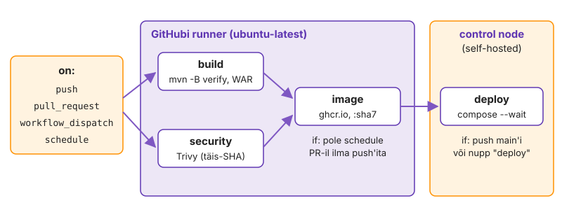

---
tags:
  - GitHub Actions
  - CI/CD
---

# 2. Esimene workflow

Kontroll, mida keegi peab käsitsi käivitama, jääb vahele just siis, kui on kiire: PR merge'itakse, sest muudatus on „ainult üks rida“, ja katkine build jõuab main'i. Seepärast peab sama `mvn -B verify`, mida seni käivitasid käsitsi, käivituma GitHub Actionsis iga push'i ja PR-i peal. Selleks kirjutad workflow faili: YAML-i, mida GitHub sündmuse peale tõlgendab ja millel on oma skeem, linter ja vead, mis tulevad välja alles käivitusel. Teed selle ühe korra teadlikult katki, et tunneksid vea ära, kui see tööl tuleb, ja salvestad WAR-i artefaktina. Lõpus on PR-il roheline kontroll.

Joonis L5.1 näitab valmis pipeline'i. Vasakul on sündmused (push, PR, nupp, ajakava), mis workflow'i käivitavad. Keskel on job'id GitHubi runner'il ja nooled näitavad, kes kelle järel ootab. Paremal on ainus job, mis töötab sinu control node'il. Praegu ehitad ainult esimese kasti, `build`.

<figure markdown="span">
  
  <figcaption>Joonis L5.1. Valmis pipeline: job'id, nende tingimused ja masinad, kus need töötavad.</figcaption>
</figure>

**Kui teed seda tööl iga päev:** kirjuta job `build` otse valmis (checkout, setup-java 21 `cache: maven`-iga, `mvn -B verify`, WAR artefaktina `if-no-files-found: error`-iga, triggerid `push` ja `pull_request`) ja `bash autograde/check.sh k05 build && bash autograde/check.sh k05 actionlint` annab kaks `OK`-d. Kui see on sul juba korras, mine edasi [Trivy ja õiguste](lab-3-trivy-matrix.md) juurde. Teavitus, ajapiir ja YAML-vea katse on IS2 süvenemises [Workflow lähemalt](https://hkhk-tk.github.io/is2-automatiseerimine/k05/syvenemine/#osa-2-workflow-lahemalt).

## Üks job, kolm sammu

Kirjutad esimese workflow: üks job, mis võtab koodi, paneb paika Java ja käivitab Maveni. Runner on iga kord uus tühi VM: ilma checkout'ita pole seal koodi, ilma setup-java'ta pole õiget JDK-d.

Kui eeldad, et runner'il on "midagi juba olemas", töötab pipeline ühel päeval ja järgmisel mitte, sest GitHub uuendab runner'i image'it regulaarselt. Iga eeldus tuleb workflow's välja kirjutada.

Workflow'i osad, mida selles failis kasutad:

| Osa | Mida tähendab | Selles failis |
|---|---|---|
| workflow | YAML-fail kaustas `.github/workflows/`, mille GitHub käivitab sündmuse peale | `ci.yml` |
| `on` | sündmused, mis workflow'i käivitavad | `push` harudele `main` ja `k05-actions` |
| job | sammude jada, mis töötab ühes runner'is | `build` |
| `runs-on` | runner: masin, kus job töötab | `ubuntu-latest`, GitHubi hallatud VM |
| step | job'i samm: kas action (`uses:`) või shelli käsk (`run:`) | checkout, setup-java, Maven |
| action | korduvkasutatav samm teisest repositooriumist, sisendid antakse `with:` all | `actions/checkout`, `actions/setup-java` |

*Tabel L5.1. Workflow'i osad.*

Iga osa kirjeldus on [workflow'i süntaksi juhendis](https://docs.github.com/actions/reference/workflows-and-actions/workflow-syntax), action'i sisendid on selle README-s. Faili süntaksit kontrollib käsurealt `actionlint` (selle osa kolmas samm).

1. Loo `.github/workflows/ci.yml` ([workflow süntaks](https://docs.github.com/actions/reference/workflows-and-actions/workflow-syntax)). Alusta sellest:

    ```yaml
    name: ci
    on:
      push:
        branches: [main, k05-actions]
    jobs:
      build:
    ```

2. Kirjuta job `build` ise ([setup-java README](https://github.com/actions/setup-java#usage) näitab sisendeid):
    - `runs-on: ubuntu-latest`
    - `actions/checkout@v5`
    - `actions/setup-java@v5`: `distribution: temurin`, `java-version: "21"`, `cache: maven`
    - samm, mis käivitab `mvn -B verify`

    ??? example "Lahendus: fail `ci.yml` job'iga `build`"

        ```yaml
        name: ci
        on:
          push:
            branches: [main, k05-actions]
        jobs:
          build:
            runs-on: ubuntu-latest
            steps:
              - uses: actions/checkout@v5
              - uses: actions/setup-java@v5
                with:
                  distribution: temurin
                  java-version: "21"
                  cache: maven
              - name: Maven
                run: mvn -B verify
        ```

3. Tee commit ja push, siis ava repo *Actions* vahekaart.

    ```bash
    git add .github/workflows/ci.yml && git commit -m "ci: build" && git push -u origin k05-actions
    gh run watch
    ```

4. Vaata logist runner'i image'it ja Java versiooni (*Set up job* ja setup-java samm). Kas need on samad mis control node'il?

<!-- EKRAANIPILT: GitHub repo → Actions → esimene roheline käivitus "ci" → job build avatud; näha sammud Set up job, Run actions/checkout@v5, Run actions/setup-java@v5, Maveni samm ja Post sammud. Pärast esimest rohelist käivitust.
<figure markdown="span">
  
  <figcaption>Joonis L5.2. Esimene roheline käivitus: build job'i sammud.</figcaption>
</figure>
-->

> Kui käivitust pole üldse, on fail vales kohas (täpselt `.github/workflows/`, laiend `.yml` või `.yaml`) või `branches:` ei vasta harule, kuhu push'isid.

Roheline käivitus tõestab, et build ei sõltu sinu masinast: täiesti uus VM sai sama tulemuse. *Post* sammud on action'ite koristus ja vahemälu salvestamine, sina neid ei kirjutanud. Kui Java versioon erineb control node'i omast patch-versiooni võrra, pole see probleem. Kui erineb major, on `java-version` valesti.

**Edasi saad minna, kui** käivitus `ci` on roheline ja logis on sammud *Set up job*, checkout, setup-java, sinu Maveni samm ja *Post* sammud.

## Tee see teadlikult katki

AI või vana blogipostitus soovitab vahel action'i versiooni, mida pole olemas. Teed selle vea teadlikult ja otsid logist, kus käivitus peatus. Kui tunned vea koha järgi ära, ei loe sa logi otsast lõpuni.

**Ennusta:** kas käivitus peatub enne või pärast seda, kui sinu Maveni samm käivitub?

1. Muuda `actions/checkout@v5` → `actions/checkout@v99`, tee push ja oota punast käivitust.
2. Leia käivituse esimene punane samm ja selle veateade.
3. Paranda tagasi, tee push ja kontrolli, et käivitus on jälle roheline.

Viga tuli enne, kui ükski sinu käsk käivitus. GitHub laadib *Set up job* sammus kõik action'id alla ja olematu versioon katkestab job'i kohe. Kui viga oleks sinu `run:` sammus, näiteks valesti kirjutatud käsk, oleks punane see samm ja logis oleks näha *Set up job* ja checkout.

**Edasi saad minna, kui** punane käivitus ebaõnnestus juba *Set up job* sammus (`Unable to resolve action actions/checkout@v99`) ja viimane käivitus on jälle roheline.

## Kontrolli faili actionlint'iga

Katkise YAML-iga faili GitHub ei käivita üldse ja käivituse lehel on siis ainult üks rida. [actionlint](https://github.com/rhysd/actionlint) leiab sama vea enne push'i ja automaatne hindaja kasutab sama tööriista.

1. Paigalda actionlint ja käivita see repo juurkaustas.

    ```bash
    mkdir -p ~/.local/bin
    curl -fsSL https://github.com/rhysd/actionlint/releases/download/v1.7.3/actionlint_1.7.3_linux_amd64.tar.gz \
      | tar -xz -C ~/.local/bin actionlint
    actionlint; echo $?
    ```

2. Kontrolli sama automaatse hindaja testiga.

    ```bash
    bash autograde/check.sh k05 actionlint
    ```

actionlint kontrollib ka seda, mida YAML-i parser ei näe, näiteks olematuid sisendeid ja vigaseid `${{ }}` avaldisi. Edaspidi käivita `actionlint` enne iga push'i: nii jääb vahele üks ring push'i, ootamise ja punase käivitusega.

**Edasi saad minna, kui** `actionlint` annab `0` ja `check.sh k05 actionlint` annab `OK`.

## Ka PR-il

Seni käivitus build ainult push'il. Lisad trigger'i, et sama kontroll käivituks PR-il ja oleks näha enne merge'i. CI mõte on leida viga enne, kui see jõuab main'i.

Kui kontroll käivitub alles pärast merge'i, on katkine kood juba kõigi teiste harude alus. Siis parandab viga see, kes järgmisena main'ist haru teeb, mitte see, kes vea tegi.

1. Lisa `on:` alla `pull_request:` haruga `main` ja tee push.

    ??? example "Lahendus: plokk `on:`"

        ```yaml
        on:
          push:
            branches: [main, k05-actions]
          pull_request:
            branches: [main]
        ```

2. Ava PR `k05-actions` → `main`, ära veel merge'i.

    ```bash
    gh pr create --fill --base main
    gh pr checks --watch
    ```

> PR-il töötab build merge-commit'i peal (`refs/pull/<nr>/merge`), mitte sinu haru viimase commit'i peal: see on main pärast sinu muudatust.

PR-i kontroll vastab küsimusele "kas main jääb pärast seda merge'i roheliseks". Seepärast võib PR olla punane ka siis, kui sinu haru push'i käivitus on roheline: keegi muutis vahepeal main'i. Kui näed PR-il kahte kontrolli (push ja pull_request), on see normaalne, sest mõlemad sündmused käivitasid sama workflow.

**Edasi saad minna, kui** PR-il on kontroll `ci / build` roheline ja `bash autograde/check.sh k05 build` annab `OK`.

## WAR artefaktina

Lisad sammu, mis salvestab ehitatud WAR-i käivituse juurde. Runner hävitatakse pärast job'i. Mis artefaktiks ei salvestatud, on kadunud.

Ilma artefaktita ei saa sa hiljem tõestada, mis fail täpselt testid läbis. Kui tootmises on viga, tahad sama faili alla laadida ja uurida, mitte uuesti ehitada ja loota, et tulemus on sama.

1. Lisa build job'i lõppu `actions/upload-artifact@v7` samm:
    - fail `target/labori-seis.war`, nimi `labori-seis-war`
    - `retention-days: 7`
    - `if-no-files-found: error`

    ??? example "Lahendus: samm build job'i lõpus"

        ```yaml
              - uses: actions/upload-artifact@v7
                with:
                  name: labori-seis-war
                  path: target/labori-seis.war
                  retention-days: 7
                  if-no-files-found: error
        ```

2. Tee push ja laadi artefakt alla, siis vaata selle sisu.

    ```bash
    gh run download --name labori-seis-war --dir /tmp/war
    ls -l /tmp/war
    unzip -l /tmp/war/labori-seis.war | head -5
    ```

3. Laadi sama artefakt alla ka käivituse lehelt brauseriga ja vaata `unzip -l labori-seis-war.zip`.

Brauser andis ZIP-i, mille sees on WAR, sest GitHub pakib artefakti alati. `gh` pakkis selle sinu eest lahti. `if-no-files-found: error` on oluline: vaikimisi oleks puuduv fail ainult hoiatus ja käivitus jääks roheliseks ilma artefaktita. Vaikimisi säilib artefakt 90 päeva ja läheb repo salvestusmahu arvesse. `retention-days: 7` piirab seda, sest iga push teeb uue mitmekümne megabaidise faili.

**Edasi saad minna, kui** käivituse kokkuvõttes on *Artifacts* all `labori-seis-war`, brauserist tuli ZIP, mille sees on WAR, ja `gh run download` andis otse WAR-i.

## Miks see nii töötab

??? info "Ava selgitused"

    **Samm *Set up job*.** Enne ühegi sinu käsu käivitamist laadib see samm alla kõik `uses:` action'id, mida job kasutab. Seetõttu ebaõnnestub olematu versiooniga action juba selles sammus ja logis ei ole veel ühtegi sinu sammu.

    **Action'i versioon.** GitHub eemaldas runner'itelt Node 20 ja selle peal töötavad vanad major-versioonid (näiteks `checkout@v4`) enam ei käivitu ([GitHub Changelog](https://github.blog/changelog/)). AI pakub nii olematuid kui ka vanu versioone, seega kontrolli versiooni action'i *Releases* lehelt.

    **Deklaratiivne workflow.** Workflow fail kirjeldab, mida runner'il teha, runner'i loob GitHub. GitHub loeb faili iga sündmuse korral sellest commit'ist, mille juures sündmus tekkis.

Kui jõudsid kiiremini: [Lisaülesanded → 5. Ruleset](https://hkhk-tk.github.io/is2-automatiseerimine/k05/lisa/#5-ruleset), muudad build'i ja security kontrolli kohustuslikuks, nii et main'i ei saa enam ilma rohelise workflow'ta muuta.
