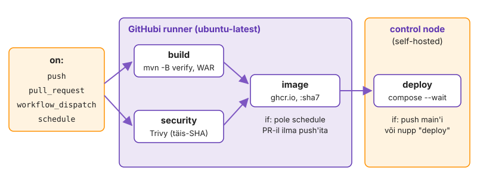

---
tags:
  - GitHub Actions
  - CI/CD
---

# 2. Esimene workflow

Kontroll, mida keegi peab käsitsi käivitama, jääb vahele just siis, kui on kiire: PR merge'itakse, sest muudatus on „ainult üks rida“, ja katkine build jõuab main'i. Seepärast peab sama `mvn -B verify`, mida seni käivitasid käsitsi, käivituma GitHub Actionsis iga push'i ja PR-i peal. Selleks kirjutad workflow faili: YAML-i, mida GitHub sündmuse peale tõlgendab ja millel on oma skeem, linter ja vead, mis tulevad välja alles käivitusel. Teed selle kaks korda teadlikult katki, et tunneksid vead ära, kui need tööl tulevad, ja salvestad WAR-i artefaktina. Lõpus on PR-il roheline kontroll.

Joonis L5.1 näitab valmis pipeline'i. Vasakul on sündmused (push, PR, nupp, ajakava), mis workflow'i käivitavad. Keskel on job'id GitHubi runner'il ja nooled näitavad, kes kelle järel ootab. Paremal on ainus job, mis töötab sinu control node'il. Praegu ehitad ainult esimese kasti, `build`.

<figure markdown="span">
  
  <figcaption>Joonis L5.1. Valmis pipeline: job'id, nende tingimused ja masinad, kus need töötavad.</figcaption>
</figure>

**Kui teed seda tööl iga päev:** kirjuta job `build` otse valmis (checkout, setup-java 21 `cache: maven`-iga, `mvn -B verify`, WAR artefaktina `if-no-files-found: error`-iga, triggerid `push` ja `pull_request`) ja `bash autograde/check.sh k05 build && bash autograde/check.sh k05 actionlint` annab kaks `OK`-d. Kui see on sul juba korras, mine otse etappi „[Käivitus numbritena: kus aeg kulub](#käivitus-numbritena-kus-aeg-kulub)“.

## Üks job, kolm sammu

Kirjutad esimese workflow: üks job, mis võtab koodi, paneb paika Java ja käivitab Maveni. Runner on iga kord uus tühi VM: ilma checkout'ita pole seal koodi, ilma setup-java'ta pole õiget JDK-d.

Kui eeldad, et runner'il on "midagi juba olemas", töötab pipeline ühel päeval ja järgmisel mitte, sest GitHub uuendab runner'i image'it regulaarselt. Iga eeldus tuleb workflow's välja kirjutada.

1. Loo `.github/workflows/ci.yml` ([workflow süntaks](https://docs.github.com/actions/reference/workflows-and-actions/workflow-syntax)). Alusta sellest:

    ```yaml
    name: ci
    on:
      push:
        branches: [main, k05-actions]
    jobs:
      build:
    ```

2. Kirjuta job `build` ise ([setup-java README](https://github.com/actions/setup-java#usage) näitab sisendeid):
    - `runs-on: ubuntu-latest`
    - `actions/checkout@v5`
    - `actions/setup-java@v5`: `distribution: temurin`, `java-version: "21"`, `cache: maven`
    - samm, mis käivitab `mvn -B verify`
3. Tee commit ja push, siis ava repo *Actions* vahekaart.

    ```bash
    git add .github/workflows/ci.yml && git commit -m "ci: build" && git push -u origin k05-actions
    gh run watch
    ```

4. Kirjuta märkmikku runner'i image ja Java versioon (*Set up job* ja setup-java samm). Kas see on sama mis control node'il?

<!-- EKRAANIPILT: GitHub repo → Actions → esimene roheline käivitus "ci" → job build avatud; näha sammud Set up job, Run actions/checkout@v5, Run actions/setup-java@v5, Maveni samm ja Post sammud. Pärast esimest rohelist käivitust.
<figure markdown="span">
  
  <figcaption>Joonis L5.2. Esimene roheline käivitus: build job'i sammud.</figcaption>
</figure>
-->

> Kui käivitust pole üldse, on fail vales kohas (täpselt `.github/workflows/`, laiend `.yml` või `.yaml`) või `branches:` ei vasta harule, kuhu push'isid.

Roheline käivitus tõestab, et build ei sõltu sinu masinast: täiesti uus VM sai sama tulemuse. *Post* sammud on action'ite koristus ja vahemälu salvestamine, sina neid ei kirjutanud. Kui Java versioon erineb control node'i omast patch-versiooni võrra, pole see probleem. Kui erineb major, on `java-version` valesti.

✅ **Edasi saad minna, kui** käivitus `ci` on roheline ja logis on sammud *Set up job*, checkout, setup-java, sinu Maveni samm ja *Post* sammud.

## Tee see teadlikult katki

Teed kaks viga, mis nurjavad käivituse eri kohas. AI või vana blogipostitus soovitab versiooni, mida pole, ja käsk, mis sinu masinas on aliasega olemas, puudub runner'il. Kui tunned vea koha järgi ära, ei loe sa logi otsast lõpuni.

1. Muuda `actions/checkout@v5` → `actions/checkout@v99`, tee push ja oota punast käivitust.
2. Paranda tagasi. Muuda Maveni sammus `mvn` → `maven`, tee push ja oota punast käivitust.
3. Paranda tagasi ja tee push.
4. Kirjuta märkmikku kahe punase käivituse lingid ja mõlema esimene punane samm.

Esimene viga tuli enne, kui ükski sinu käsk käivitus. GitHub laadib *Set up job* sammus kõik action'id alla ja olematu versioon katkestab job'i kohe. Teine viga tuli sinu sammus koodiga 127: Maven ei käivitunud üldse. Kood 1 oleks tähendanud, et Maven käivitus ja ebaõnnestus ise.

✅ **Edasi saad minna, kui** esimene käivitus ebaõnnestus juba *Set up job* sammus (`Unable to resolve action actions/checkout@v99`), teine Maveni sammus (`maven: command not found`, `exit code 127`) ja viimane käivitus on jälle roheline.

## YAML-viga: actionlint ja GitHub

Nüüd teed vea, mida GitHub ei oska üldse käivitada: katkise YAML-i. GitHubi käivituses pole sel juhul logi ega sammu, ainult üks rida. [actionlint](https://github.com/rhysd/actionlint) leiab sama vea enne push'i ja automaatne hindaja käivitab sama tööriista.

Linter enne push'i hoiab kokku ühe ringi: push, ootamine, punane, parandus. Meeskonnas tähendab katkine workflow main'is, et kellegi PR ei saa enam ühtegi kontrolli.

1. Paigalda actionlint ja käivita see repo juurkaustas.

    ```bash
    curl -fsSL https://github.com/rhysd/actionlint/releases/download/v1.7.3/actionlint_1.7.3_linux_amd64.tar.gz \
      | tar -xz -C ~/.local/bin actionlint
    actionlint; echo $?
    ```

2. Lükka üks rida `steps:` all kahe tühiku võrra valesse kohta ja käivita `actionlint` uuesti.
3. Push'i see katkine fail üks kord ja vaata *Actions* vahekaarti.
4. Taasta fail, tee push ja kontrolli.

    ```bash
    actionlint; echo $?
    bash autograde/check.sh k05 actionlint
    ```

actionlint andis rea ja veeru, GitHub ainult teate, et fail on vigane. Sellest järeldad: YAML-vea korral ei aita GitHubi logi, aitab ainult lokaalne kontroll. actionlint kontrollib ka seda, mida YAML-i parser ei näe, näiteks olematuid sisendeid ja vigaseid `${{ }}` avaldisi. Kui actionlint annab `0`, aga GitHub ütleb ikka `Invalid workflow file`, on actionlint'i versioon vanem kui süntaks, mida kasutad.

✅ **Edasi saad minna, kui** taandeveaga failil näitas actionlint rea ja veeru, GitHubis oli punane käivitus ilma job'ita teatega `Invalid workflow file` ja nüüd annab `check.sh k05 actionlint` `OK`.

## Ka PR-il

Seni käivitus build ainult push'il. Lisad trigger'i, et sama kontroll käivituks PR-il ja oleks näha enne merge'i. CI mõte on leida viga enne, kui see jõuab main'i.

Kui kontroll käivitub alles pärast merge'i, on katkine kood juba kõigi teiste harude alus. Siis parandab viga see, kes järgmisena main'ist haru teeb, mitte see, kes vea tegi.

1. Lisa `on:` alla `pull_request:` haruga `main` ja tee push.
2. Ava PR `k05-actions` → `main`, ära veel merge'i.

    ```bash
    gh pr create --fill --base main
    gh pr checks --watch
    ```

> PR-il töötab build merge-commit'i peal (`refs/pull/<nr>/merge`), mitte sinu haru viimase commit'i peal: see on main pärast sinu muudatust.

PR-i kontroll vastab küsimusele "kas main jääb pärast seda merge'i roheliseks". Seepärast võib PR olla punane ka siis, kui sinu haru push'i käivitus on roheline: keegi muutis vahepeal main'i. Kui näed PR-il kahte kontrolli (push ja pull_request), on see normaalne, sest mõlemad sündmused käivitasid sama workflow.

✅ **Edasi saad minna, kui** PR-il on kontroll `ci / build` roheline ja `bash autograde/check.sh k05 build` annab `OK`.

## WAR artefaktina

Lisad sammu, mis salvestab ehitatud WAR-i käivituse juurde. Runner hävitatakse pärast job'i. Mis artefaktiks ei salvestatud, on kadunud.

Ilma artefaktita ei saa sa hiljem tõestada, mis fail täpselt testid läbis. Kui tootmises on viga, tahad sama faili alla laadida ja uurida, mitte uuesti ehitada ja loota, et tulemus on sama.

1. Lisa build job'i lõppu `actions/upload-artifact@v7` samm:
    - fail `target/labori-seis.war`, nimi `labori-seis-war`
    - `retention-days: 7`
    - `if-no-files-found: error`
2. Tee push ja laadi artefakt alla, siis vaata selle sisu.

    ```bash
    gh run download --name labori-seis-war --dir /tmp/war
    ls -l /tmp/war
    unzip -l /tmp/war/labori-seis.war | head -5
    ```

3. Laadi sama artefakt alla ka käivituse lehelt brauseriga ja vaata `unzip -l labori-seis-war.zip`.

Brauser andis ZIP-i, mille sees on WAR, sest GitHub pakib artefakti alati. `gh` pakkis selle sinu eest lahti. `if-no-files-found: error` on oluline: vaikimisi oleks puuduv fail ainult hoiatus ja käivitus jääks roheliseks ilma artefaktita. Vaikimisi säilib artefakt 90 päeva ja läheb repo salvestusmahu arvesse. `retention-days: 7` piirab seda, sest iga push teeb uue mitmekümne megabaidise faili.

✅ **Edasi saad minna, kui** käivituse kokkuvõttes on *Artifacts* all `labori-seis-war`, brauserist tuli ZIP, mille sees on WAR, ja `gh run download` andis otse WAR-i.

## Teavitus, kui midagi ebaõnnestub

Lisad sammu, mis käivitub ainult siis, kui eelmine ebaõnnestus. `success()` on iga sammu vaikimisi tingimus, `failure()` ja `always()` muudavad seda. Job summary töötab ilma välise teenuseta.

Punane rist ilma selgituseta tähendab, et iga kord peab keegi logi avama. Lühike teade kokkuvõttes ütleb kohe, kust otsida, ja sama mustrit kasutad hiljem rollback'i teates.

1. Lisa build job'i lõppu samm `if: failure()`, mis kirjutab `$GITHUB_STEP_SUMMARY`-sse rea `### Build kukkus` ja väljastab `echo "::error::..."`.
2. Tee üks test katki (nt `ResultControllerTest`-is `isAccepted()` → `isOk()`) ja tee push.
3. Vaata käivituse lehte ja kokkuvõtet, siis võta katkine commit tagasi.

    ```bash
    gh run view --log-failed | tail -20
    git revert --no-edit HEAD && git push
    ```

Teavitus käivitus, kuigi Maveni samm ebaõnnestus, sest `failure()` tühistas vaikimisi tingimuse. Upload-samm jäi vahele, sest selle tingimus on endiselt `success()`. `::error::` rida tõusis käivituse lehe ülaossa annotatsiooniks: nii näeb viga ka see, kes logi ei ava. `--log-failed` näitab ainult ebaõnnestunud sammu logi, mis on pika käivituse puhul kiireim tee põhjuseni.

✅ **Edasi saad minna, kui** punase käivituse kokkuvõttes on sinu teade, käivituse lehe ülaosas on annotatsioon ja pärast taastamist on käivitus jälle roheline.

## Käivitus numbritena: kus aeg kulub

Lõpuks loed käivituse API-st nagu monitooringu andmeid: iga sammu kestuse sekundites. Nii näed, kas aeg läheb Maveni peale, allalaadimiste peale või GitHubi enda sammude peale.

Kui pipeline muutub aeglaseks, peab otsus "mida kiirendada" tuginema numbritele, mitte tundele. Runner'i minutid maksavad ja arendaja ootab iga minuti. Samad numbrid annavad ka job'i ajapiiri: vaikimisi on `timeout-minutes` 360 ja rippuv test (näiteks ühendus, mis ootab vastust lõputult) hoiab PR-i kontrolli kuus tundi kollasena, kulutab runner'i minuteid ja keegi ei saa merge'ida.

1. Loe viimase rohelise käivituse sammude kestus.

    ```bash
    run=$(gh run list -w ci -s success -L 1 --json databaseId --jq '.[0].databaseId')
    gh run view "$run" --json jobs \
      --jq '.jobs[].steps[] | [((.completedAt|fromdate)-(.startedAt|fromdate)), .name] | @tsv'
    ```

2. Võrdle Maveni sammu aega control node'iga: `time mvn -B -q verify`
3. Kirjuta märkmikku kolm kõige aeglasemat sammu ja nende kestus ning control node'i aeg.
4. Pane build job'ile ajapiir mõõtmise, mitte arvamise järgi:
    - loe samamoodi kuni kümne viimase rohelise käivituse build job'i kogukestus (`gh run list -L 10`, siis `gh run view --json jobs`, job'i `startedAt` ja `completedAt`)
    - `timeout-minutes` on umbes kolm korda pikim kestus, täisminutiteks üles ümardatud, aga vähemalt 5
    - väärtus ja selle arvutus on märkmikus
5. Proovi, et piir töötab: pane ajutiselt `timeout-minutes: 1` ja build job'i lõppu samm `run: sleep 120`, tee push ja vaata, kuidas job lõpeb. Siis taasta oma arvutatud väärtus ja eemalda samm.

    ```bash
    gh run watch; gh run view --log | grep -m1 'maximum execution time'
    ```

Tavaliselt on Maveni samm kõige pikem ja setup-java teine, sest see taastab vahemälu. Kui Maveni samm on runner'il palju aeglasem kui sinu masinas, laadib Maven tõenäoliselt teeke alla: vahemälu ei tööta, ja seda kontrollid, kui lisad matrix'i. Kui *Set up job* võtab kaua, ootad GitHubi runner'it, ja seda sina parandada ei saa. Ajapiiri ületanud job katkestatakse samamoodi nagu käsitsi tühistamine: töötavale sammule saadetakse signaal ja tulemus on `cancelled`, mitte `failure`. Seepärast ei käivitu pärast seda ka `if: failure()` samm, ja see on oluline, kui hiljem kirjutad rollback'i. Kolmekordne varu arvestab Maven Centrali aeglast päeva ja tühja vahemälu, aga rippuv test ei hoia runner'it kauem kui mõni minut.

✅ **Edasi saad minna, kui** märkmikus on kolm sammu sekunditega, control node'i aeg ja `timeout-minutes` väärtus koos arvutusega, proovikäivituse logis on rida `maximum execution time` ja viimane käivitus on jälle roheline arvutatud piiriga.

📎 **Selle mooduli tõend:** märkmikus runner'i image ja Java versioon, kahe teadliku vea ja katkise YAML-i käivituse lingid, `unzip -l` väljund, punase käivituse link, sammude kestused, `timeout-minutes` arvutus ja ajapiiri proovikäivituse link; PR-il kontroll roheline; `check.sh k05 actionlint` ja `k05 build` → `OK`.

## Miks see nii töötab

**Samm *Set up job*.** Enne ühegi sinu käsu käivitamist laadib see samm alla kõik `uses:` action'id, mida job kasutab. Seetõttu ebaõnnestub olematu versiooniga action juba selles sammus ja logis ei ole veel ühtegi sinu sammu.

**`run:` ja `bash -e`.** Ilma `shell:` võtmeta käivitab runner `run:` ploki kujul `bash -e {0}`. Esimene ebaõnnestunud käsk lõpetab sammu, aga `pipefail` pole sees: `mvn -B verify | tee build.log` on roheline ka siis, kui Maven ebaõnnestub. Selgesõnaline `shell: bash` annab `bash --noprofile --norc -eo pipefail {0}`.

**Action'i versioon.** GitHub eemaldas runner'itelt Node 20 ja selle peal töötavad vanad major-versioonid (näiteks `checkout@v4`) enam ei käivitu ([GitHub Changelog](https://github.blog/changelog/)). AI pakub nii olematuid kui ka vanu versioone, seega kontrolli versiooni action'i *Releases* lehelt.

**Deklaratiivne workflow.** Workflow fail kirjeldab, mida runner'il teha, runner'i loob GitHub. GitHub loeb faili iga sündmuse korral sellest commit'ist, mille juures sündmus tekkis.

**Workflow harus.** Seetõttu saab harus workflow'd muuta ilma main'i puudutamata. Samal põhjusel on see ka turvaküsimus: `push`- ja `pull_request`-sündmuse korral loeb GitHub faili haru enda commit'ist, nii et inimene, kes saab haru luua, saab muuta ka seda, mida runner käivitab. `pull_request_target` loeb faili sihtharust ja käitub selles mõttes teisiti.

**Sammude kestus.** Sammude kestus, mille esimese workflow juures API-st lugesid, on samasugune näitaja, mida monitooringus vaataksid teenuse kohta. Kui keskmine kestus hakkab kasvama, viitab see sageli vahemälu- või sõltuvusprobleemile juba enne, kui keegi aeglust märkab.

**Annotated tag ja SHA.** Annotated tag on Gitis eraldi objekt, millel on oma SHA. Rida `^{}` näitab commit'i, millele tag viitab, ja `uses:` vajab just commit'i SHA-d.

**Madal kloon.** `actions/checkout` laadib vaikimisi (`fetch-depth: 1`) ainult ühe commit'i, sest suure repo kogu ajalugu võib olla sadu megabaite. Kui mõni tööriist (versiooni arvutamine tag'idest, muudatuste logi, muudetud failide kontroll) annab CI-s teise tulemuse kui sinu masinas, kontrolli kõigepealt, kas põhjus on madalas kloonis. Sama põhimõte kehtib iga action'i kohta: enne kui kopeerid kellegi `with:`-ploki, loe README-st, mis on vaikeväärtus ja miks.

**Nõutud kontrolli nimi.** Ruleset'i nõutud kontrolli nimi peab täpselt vastama job'i nimele. Kui nimetad job'i hiljem ümber, jääb PR ootama kontrolli, mida enam ei tule, kuni ruleset'i parandad.

Kui jõudsid kiiremini: [Lisaülesanded → 5. Ruleset](lisa.md#5-ruleset), muudad build'i ja security kontrolli kohustuslikuks, nii et main'i ei saa enam ilma rohelise workflow'ta muuta.
