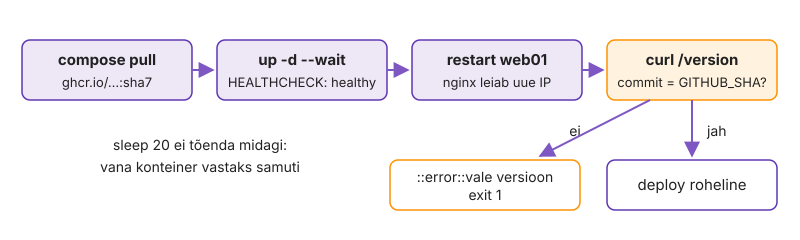

---
tags:
  - GitHub Actions
  - Docker
  - self-hosted runner
---

# 4. Image ja deploy

Käsitsi deploy'ga sõltub tulemus sellest, kes seda teeb, ja pärast ei tea keegi kindlalt, mis commit serveris töötab. Nüüd muutub pipeline CI-st CD-ks: main'i push ehitab image'i ghcr.io-sse, self-hosted runner deploy'b selle control node'il ja iga viga workflow's on viga tootmises.

Lõpus on image ghcr.io-s, runner on paigutatud nii, et võõras kood sinna ei jõua, ja deploy on roheline alles siis, kui `/version` näitab sama commit'i.

**Kui teed seda tööl iga päev:** job'id `image` ja `deploy` on sul juba kirjutatud, runner `labseis` on `online` ja pärast main'i deploy'd võrdub `curl -s http://localhost:8080/version` commit `git rev-parse origin/main`-iga. Kui see on sul juba korras, mine edasi [käsitsi käivituse ja saladuste](lab-5-saladused.md) juurde. Image'i käsitsi ehitamine, kihtide vahemälu ja runner'isse jäävad failid on IS2 süvenemises [Image ja runner lähemalt](https://hkhk-tk.github.io/is2-automatiseerimine/k05/syvenemine/#osa-4-image-ja-runner-lahemalt).

## Image ghcr.io-sse

Lisad job'i `image`, mis ehitab 3. kohtumise Dockerfile'i järgi rakenduse image'i GitHubi runner'il ja lükkab selle registry'sse. [ghcr.io](https://docs.github.com/packages/working-with-a-github-packages-registry/working-with-the-container-registry) võtab image'i vastu sama `GITHUB_TOKEN`-iga. PR-il image ehitatakse, aga ei lükata.

Registry on piir CI ja CD vahel: kõik, mis on registry's, on testitud ja deploy'ks valmis. Kui PR saaks image'i lükata, võiks registry'sse jõuda kood, mida keegi pole üle vaadanud.

1. Lisa workflow tasemele `env: IMAGE: ghcr.io/${{ github.repository }}` ja uus job `image`:
    - `needs: [build, security]`, õigused `contents: read` ja `packages: write`
    - samm `id: meta` kirjutab `$GITHUB_OUTPUT`-i `tags=` (`:${GITHUB_SHA::7}` alati, `:latest` ainult main'il) ja `ref=` (ainult sha7 tag); nimi väiketähtedega `repo="${IMAGE,,}"`
    - job'i `outputs: ref: ${{ steps.meta.outputs.ref }}` (deploy vajab seda)
2. Lisa sammud:
    - `docker/setup-buildx-action@v4`
    - `docker/login-action@v4` registry'sse `ghcr.io` ainult siis, kui see pole PR: `username: ${{ github.actor }}`, `password: ${{ secrets.GITHUB_TOKEN }}`
    - `docker/build-push-action@v7`: `context: .`, `file: k03-docker/app/Dockerfile`, `push: ${{ github.event_name != 'pull_request' }}`, `tags: ${{ steps.meta.outputs.tags }}`, `build-args: GIT_SHA=${{ github.sha }}`

    ??? example "Lahendus: job `image`"

        Workflow tasemel, ploki `permissions: {}` järel:

        ```yaml
        env:
          IMAGE: ghcr.io/${{ github.repository }}
        ```

        Ploki `jobs:` all:

        ```yaml
          image:
            needs: [build, security]
            runs-on: ubuntu-latest
            permissions:
              contents: read
              packages: write
            outputs:
              ref: ${{ steps.meta.outputs.ref }}
            steps:
              - uses: actions/checkout@v5
              - id: meta
                run: |
                  repo="${IMAGE,,}"
                  tags="$repo:${GITHUB_SHA::7}"
                  if [ "$GITHUB_REF" = refs/heads/main ]; then tags="$tags,$repo:latest"; fi
                  echo "tags=$tags" >> "$GITHUB_OUTPUT"
                  echo "ref=$repo:${GITHUB_SHA::7}" >> "$GITHUB_OUTPUT"
              - uses: docker/setup-buildx-action@v4
              - if: github.event_name != 'pull_request'
                uses: docker/login-action@v4
                with:
                  registry: ghcr.io
                  username: ${{ github.actor }}
                  password: ${{ secrets.GITHUB_TOKEN }}
              - uses: docker/build-push-action@v7
                with:
                  context: .
                  file: k03-docker/app/Dockerfile
                  push: ${{ github.event_name != 'pull_request' }}
                  tags: ${{ steps.meta.outputs.tags }}
                  build-args: GIT_SHA=${{ github.sha }}
        ```

3. Tee push, oota käivituse lõppu ja võrdle *Packages* all olevat tag'i commit'iga.

    ```bash
    actionlint && git commit -am "ci: image" && git push
    gh run watch
    git rev-parse --short=7 HEAD
    ```

> Image saab commit'i SHA build-arg'ina `GIT_SHA`. 3. kohtumise Dockerfile'i viimases stage'is peavad olema read `ARG GIT_SHA` ja `ENV GIT_SHA=${GIT_SHA}`, muidu näitab `/version` hiljem `unknown`. Kontrolli: `grep -n GIT_SHA k03-docker/app/Dockerfile`.

<!-- EKRAANIPILT: GitHub profiil/org → Packages → pakett repo nimega; näha tag'id sha7 ja latest ning sama digest. Pärast esimest main'i push'i.
<figure markdown="span">
  
  <figcaption>Joonis L5.6. Image ghcr.io-s: tag commit'i SHA järgi ja main'il <code>latest</code>.</figcaption>
</figure>
-->

`needs: [build, security]` tähendab, et image tehakse alles siis, kui testid ja skänn on läbi. Tag sha7 on see, mida deploy kasutab, `latest` on ainult inimesele mugavuseks. Kui deploy kasutaks `latest`-i, ei saaks sa kunagi kindel olla, mis versioon parasjagu töötab.

**Edasi saad minna, kui** *Packages* all on pakett sinu repo nimega ja tag'iga, mis võrdub `git rev-parse --short=7 HEAD`-iga (main'il on `latest` sama digest'iga) ja `bash autograde/check.sh k05 structure` annab `OK`.

## Runner control node'ile, ohutult

Paigaldad control node'ile GitHubi runner'i teenusena. GitHubi runner ei näe VPN-i taha, sinu control node näeb ([self-hosted runner'id](https://docs.github.com/actions/hosting-your-own-runners)). Runner käivitab iga koodi, mis workflow'sse jõuab, ja tema kasutaja on `docker` grupis ehk sisuliselt root.

Self-hosted runner avalikus repos on tuntud ründevektor: keegi teeb forgi, muudab workflow'd ja PR käivitab tema koodi sinu serveris. Seepärast kontrollid repo nähtavust enne paigaldust, mitte pärast.

1. Kontrolli enne paigaldust, et repo on privaatne ja forkide PR-id ei käivita workflow'sid.

    ```bash
    gh repo view --json visibility --jq .visibility
    ```

    *Settings → Actions → General → Fork pull request workflows*: kõik linnukesed maas.

2. Ava *Settings → Actions → Runners → New self-hosted runner → Linux x64* ja käivita lehel näidatud käsud kaustas `~/actions-runner`, aga `config.sh` juures lisa `--labels labseis --unattended`.
3. Paigalda runner teenuseks ja kontrolli.

    ```bash
    sudo ./svc.sh install "$USER" && sudo ./svc.sh start
    systemctl status 'actions.runner.*' --no-pager
    journalctl -u 'actions.runner.*' -n 20 --no-pager | grep -i 'listening'
    groups | grep -qw docker && echo "docker grupp OK"
    ```

4. Kontrolli GitHubist, mida runner endast teatab.

    ```bash
    gh api 'repos/{owner}/{repo}/actions/runners' --jq '.runners[] | [.name, .status, ([.labels[].name] | join(","))] | @tsv'
    ```

5. Loo `.github/actionlint.yaml`, mis ütleb actionlint'ile, et `labseis` on sinu runner'i label ([actionlint config](https://github.com/rhysd/actionlint/blob/main/docs/config.md), võti `self-hosted-runner.labels`).

    ??? example "Lahendus: fail `.github/actionlint.yaml`"

        ```yaml
        self-hosted-runner:
          labels:
            - labseis
        ```

<!-- EKRAANIPILT: repo Settings → Actions → Runners; näha sinu runner olekus Idle ja label'id self-hosted, Linux, X64, labseis. Pärast runner'i paigaldust.
<figure markdown="span">
  
  <figcaption>Joonis L5.7. Runner on registreeritud ja ootab tööd.</figcaption>
</figure>
-->

`Listening for Jobs` tähendab, et runner hoiab GitHubiga väljuvat HTTPS-ühendust ja ootab tööd. Sissetulevat porti ei avata, seega ei pea VPN-i ega tulemüüri muutma. Kui `gh api` näitab `offline`, kuigi teenus töötab, ei pääse masin `github.com`-i: vaata `journalctl` viimaseid ridu.

**Edasi saad minna, kui** repo on `PRIVATE`, logis on `Listening for Jobs`, `gh api` näitab olekut `online` ja label'eid `self-hosted,Linux,X64,labseis` ning `.github/actionlint.yaml` on repos.

## Deploy job

Lisad job'i, mis töötab sinu runner'il ja teeb need kolm käsku, mida tegid 3. kohtumisel käsitsi. `--wait` ootab, kuni HEALTHCHECK ütleb `healthy`; `sleep 20` oleks oletus.

`sleep` töötab seni, kuni rakendus käivitub alati 19 sekundiga. Esimene aeglane käivitus annab rohelise deploy, mille järel leht on maas, ja keegi ei saa sellest teada enne kasutajat.

1. Lisa job `deploy`:
    - `needs: image`, `runs-on: [self-hosted, linux, labseis]`, `timeout-minutes: 10`
    - õigused `contents: read` ja `packages: read`
    - `if: github.event_name == 'push' && github.ref == 'refs/heads/main'`: self-hosted job ei käivitu kunagi PR-il
    - kõik `run:` sammud kaustas `k03-docker` (`defaults.run.working-directory`)
2. Lisa sammud: checkout; login ghcr.io (sama mis image job'is, aga alati); `cp ~/k03.env .env` (hiljem asendad secret'itega); `docker compose pull app01` ja `docker compose up -d --no-build --wait --wait-timeout 180 app01` keskkonnamuutujaga `APP_IMAGE: ${{ needs.image.outputs.ref }}`; `docker compose restart web01`.

    ??? example "Lahendus: job `deploy`"

        ```yaml
          deploy:
            needs: image
            if: github.event_name == 'push' && github.ref == 'refs/heads/main'
            runs-on: [self-hosted, linux, labseis]
            timeout-minutes: 10
            permissions:
              contents: read
              packages: read
            defaults:
              run:
                working-directory: k03-docker
            steps:
              - uses: actions/checkout@v5
              - uses: docker/login-action@v4
                with:
                  registry: ghcr.io
                  username: ${{ github.actor }}
                  password: ${{ secrets.GITHUB_TOKEN }}
              - run: cp ~/k03.env .env
              - name: Deploy
                env:
                  APP_IMAGE: ${{ needs.image.outputs.ref }}
                run: |
                  docker compose pull app01
                  docker compose up -d --no-build --wait --wait-timeout 180 app01
                  docker compose restart web01
        ```

3. Kontrolli lokaalselt ja vii see main'i.

    ```bash
    actionlint && git commit -am "ci: deploy" && git push
    gh pr checks --watch && gh pr merge --merge
    ```

4. Kui deploy on roheline, vaata, mis image app01 käivitab.

    ```bash
    (cd k03-docker && docker compose ps)
    docker inspect --format '{{.Config.Image}}' "$(cd k03-docker && docker compose ps -q app01)"
    ```

> Ilma `--no-build`-ita või kui `APP_IMAGE` pole sammu `env:`-is, ehitab compose image'i lokaalselt ja `/version` näitab vana commit'i.

`docker inspect` näitab registry tag'i, mitte lokaalset nime: konteiner tuli image'ist, mille CI ehitas ja testis. PR-il oli deploy *skipped*, sest `if:` lubab ainult push'i main'i. Ilma selle reata töötaks iga PR-i kood sinu masinas. Kui deploy jääb kollaseks olekusse *Queued*, ei leia GitHub runner'it, mille label'id vastavad `runs-on`-ile. Self-hosted runner'it ootav job ebaõnnestub 24 tunni pärast.

**Edasi saad minna, kui** `deploy` lõpeb roheliselt, app01 image on `ghcr.io/…:<sha7>` ja PR-il oli deploy *skipped*.

## Tõenda commit

Lisad deploy'le viimase sammu, mis küsib rakenduselt, mis versioon töötab. HTTP 200 ütleb ainult, et midagi vastab; vana konteiner vastaks samuti. Commit'i võrdlus tõendab, et deploy toimus.

Roheline deploy, mille järel töötab vana versioon, on halvem kui punane deploy: kõik arvavad, et parandus on tootmises. Joonis L5.8 näitab deploy sammud järjekorras. Ainult viimane neist vastab küsimusele, kas töötab uus kood.

<figure markdown="span">
  
  <figcaption>Joonis L5.8. Deploy on roheline alles siis, kui <code>/version</code> näitab sama commit'i.</figcaption>
</figure>

1. Lisa deploy'le samm, mis ebaõnnestub, kui commit ei klapi.

    ```bash
    docker compose exec -T app01 curl -fsS http://localhost:8080/version | tee version.json
    grep -q "\"commit\":\"$GITHUB_SHA\"" version.json || { echo "::error::vale versioon"; exit 1; }
    ```

2. Vii see main'i uue PR-iga.

    ```bash
    git switch k05-actions && git merge main
    git commit -am "deploy: /version kontroll" && git push
    gh pr create --fill --base main && gh pr checks --watch && gh pr merge --merge
    ```

3. Võrdle tulemust main'iga.

    ```bash
    curl -s http://localhost:8080/version; echo
    git fetch && git rev-parse origin/main
    ```

Kaks sama SHA-d tähendavad, et merge-commit, image tag, konteiner ja rakenduse vastus viitavad samale koodile. Kontroll käivitub konteineri sees (`exec`), seega ei sõltu see nginx'ist ega VPN-ist. Kui `/version` näitaks eelmist commit'i ja deploy oleks ikka roheline, puuduks sul just see samm.

**Edasi saad minna, kui** deploy on roheline ja `/version` `commit` võrdub `git rev-parse origin/main`-iga.

## Miks see nii töötab

??? info "Ava selgitused"

    **Build PR-il, push main'is.** Ehitamine PR-il leiab katkise Dockerfile'i enne merge'i. Image'i lükkamine registry'sse nõuab aga kirjutusõigust. Seda õigust ei ole mõistlik anda PR-i käivitusele ja forgist tulnud PR-i token on vaikimisi niikuinii ainult lugemisõigusega.

    **Runner'i label'id.** Label'id määravad, millisele runner'ile job suunatakse. Ilma oma label'ita võiks `runs-on: self-hosted` job'i võtta mis tahes runner, mis on repole registreeritud või organisatsiooni tasemel repole lubatud.

    **web01 taaskäivitamine.** `restart web01` on vajalik, sest meie web01 konfiguratsioonis on `proxy_pass`-is staatiline nimi. nginx lahendab sellise nime ainult käivitumisel, uue konteineri IP-aadress on aga teine. Üldine põhimõte: kui teenus lahendab sõltuvuse nime ainult käivitumisel, tuleb see pärast sõltuvuse asendamist taaskäivitada. Muutujaga `proxy_pass` ja `resolver`-direktiiviga (3. kohtumisel) lahendaks nginx nime iga päringu ajal uuesti.

    **Pull-mudel.** Runner hoiab GitHubiga HTTPS long poll'i: ühendus on avatud 50 sekundit ja kui tööd ei tule, avatakse uus. VPN-i taga olev masin saab töid ilma ühegi avatud sissetuleva pordita. Sama ühenduse kaudu uuendab runner ennast: kui runner on uuendusest üle 30 päeva maas, ei anna GitHub talle tööd, ja runner, mis pole 14 päeva ühendust võtnud, eemaldatakse.

Kui jõudsid kiiremini: [Lisaülesanded → 10. Trivy poliitika](https://hkhk-tk.github.io/is2-automatiseerimine/k05/lisa/#10-trivy-poliitika), skännid image'i enne push'i ja lased kriitilise leiu korral job'i ebaõnnestuda.
