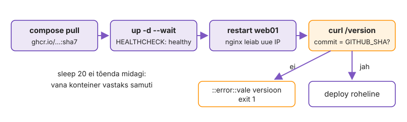

---
tags:
  - GitHub Actions
  - Docker
  - self-hosted runner
---

# 4. Image ja deploy

Käsitsi deploy'ga sõltub tulemus sellest, kes seda teeb, ja pärast ei tea keegi kindlalt, mis commit serveris töötab. Nüüd muutub pipeline CI-st CD-ks: main'i push ehitab image'i ghcr.io-sse, self-hosted runner deploy'b selle control node'il ja iga viga workflow's on viga tootmises.

Lõpus kasutab image'i build kihtide vahemälu, runner on paigutatud nii, et võõras kood sinna ei jõua, ja deploy on roheline alles siis, kui `/version` näitab sama commit'i.

**Kui teed seda tööl iga päev:** job'id `image` ja `deploy` on sul juba kirjutatud, runner `labseis` on `online` ja pärast main'i deploy'd võrdub `curl -s http://localhost:8080/version` commit `git rev-parse origin/main`-iga. Kui see on sul juba korras, mine otse etappi „[Mis jääb runner'isse maha](#mis-jaab-runnerisse-maha)“.

## Image kõigepealt control node'il

Ehitad image'i käsitsi täpselt nii, nagu CI seda hakkab tegema. Kui build ebaõnnestub lokaalselt, ebaõnnestub see ka CI-s, aga seal ootad viga minuteid. Build context on repo juur (`.`), sest Dockerfile vajab `pom.xml`-i ja `src/`-i.

Commit'i SHA image'i sees on ainus usaldusväärne viis hiljem öelda, mis kood konteineris töötab. Tag'i saab ümber panna, SHA keskkonnamuutujas jääb image'iga kaasa.

1. Ehita repo juurest sama image, mida CI hakkab ehitama, ja võrdle SHA-sid.

    ```bash
    docker build -f k03-docker/app/Dockerfile --build-arg GIT_SHA="$(git rev-parse HEAD)" -t labseis-app:k05test .
    docker run --rm labseis-app:k05test printenv GIT_SHA
    git rev-parse HEAD
    ```

> Kui `printenv` annab `unknown` või tühja, puudub 3. kohtumisel kirjutatud Dockerfile'i runtime stage'is `ARG GIT_SHA` ja `ENV GIT_SHA=${GIT_SHA}`. Lisa need viimaste ridade hulka, et muutuv väärtus ei tühistaks eelmisi kihte.

Sama SHA mõlemas väljundis tõestab, et build-arg jõuab runtime stage'i ja rakendus saab selle `/version` vastusesse panna. Multi-stage Dockerfile'is ei kandu `ARG` ühest stage'ist teise, seepärast tuleb see viimases stage'is uuesti öelda. Kui paned `ARG`-i faili algusesse, muutub see iga commit'iga ja Docker ehitab kõik järgmised kihid uuesti.

✅ **Edasi saad minna, kui** build õnnestub ja `printenv` annab sama 40-märgilise SHA mis `git rev-parse HEAD`.

## Image ghcr.io-sse kihtide vahemäluga

Lisad job'i `image`, mis ehitab sama image'i GitHubi runner'il ja lükkab selle registry'sse. [ghcr.io](https://docs.github.com/packages/working-with-a-github-packages-registry/working-with-the-container-registry) võtab image'i vastu sama `GITHUB_TOKEN`-iga. PR-il image ehitatakse, aga ei lükata.

Registry on piir CI ja CD vahel: kõik, mis on registry's, on testitud ja deploy'ks valmis. Kui PR saaks image'i lükata, võiks registry'sse jõuda kood, mida keegi pole üle vaadanud.

1. Lisa workflow tasemele `env: IMAGE: ghcr.io/${{ github.repository }}` ja uus job `image`:
    - `needs: [build, security]`, õigused `contents: read` ja `packages: write`
    - samm `id: meta` kirjutab `$GITHUB_OUTPUT`-i `tags=` (`:${GITHUB_SHA::7}` alati, `:latest` ainult main'il) ja `ref=` (ainult sha7 tag); nimi väiketähtedega `repo="${IMAGE,,}"`
    - job'i `outputs: ref: ${{ steps.meta.outputs.ref }}` (deploy vajab seda)
2. Lisa sammud, iga action SHA-ga kinnitatud nagu `build` ja `security` job'is:
    - `docker/setup-buildx-action@v4`
    - `docker/login-action@v4` registry'sse `ghcr.io` ainult siis, kui see pole PR: `username: ${{ github.actor }}`, `password: ${{ secrets.GITHUB_TOKEN }}`
    - `docker/build-push-action@v7`: `context: .`, `file: k03-docker/app/Dockerfile`, `push: ${{ github.event_name != 'pull_request' }}`, `tags: ${{ steps.meta.outputs.tags }}`, `build-args: GIT_SHA=${{ github.sha }}`
    - samas sammus [kihtide vahemälu](https://docs.docker.com/build/cache/backends/gha/): `cache-from: type=gha`, `cache-to: type=gha,mode=max`
3. Tee push kaks korda (teine kord näiteks tühja commit'iga) ja võrdle image job'i logi.

    ```bash
    git commit --allow-empty -m "ci: cache test" && git push
    gh run watch
    gh run view "$(gh run list -w ci -L 1 --json databaseId --jq '.[0].databaseId')" --log | grep -E 'go-offline|CACHED' | head
    git rev-parse --short=7 HEAD
    ```

<!-- EKRAANIPILT: GitHub profiil/org → Packages → pakett repo nimega; näha tag'id sha7 ja latest ning sama digest. Pärast esimest main'i push'i.
<figure markdown="span">
  
  <figcaption>Joonis L5.6. Image ghcr.io-s: tag commit'i SHA järgi ja main'il <code>latest</code>.</figcaption>
</figure>
-->

`needs: [build, security]` tähendab, et image tehakse alles siis, kui testid ja skänn on läbi. `CACHED` teises jooksus tõestab, et sõltuvuste allalaadimise kiht tuli vahemälust: tühi commit ei muutnud pom'i, seega polnud põhjust seda uuesti teha. Tag sha7 on see, mida deploy kasutab, `latest` on ainult inimesele mugavuseks. Kui deploy kasutaks `latest`-i, ei saaks sa kunagi kindel olla, mis versioon parasjagu töötab.

✅ **Edasi saad minna, kui** *Packages* all on pakett sinu repo nimega ja tag'iga, mis võrdub `git rev-parse --short=7 HEAD`-iga (main'il on `latest` sama digest'iga), teises jooksus on `dependency:go-offline` kiht `CACHED` ja `bash autograde/check.sh k05 structure` annab `OK`.

## Runner control node'ile, ohutult

Paigaldad control node'ile GitHubi runner'i teenusena. GitHubi runner ei näe VPN-i taha, sinu control node näeb ([self-hosted runner'id](https://docs.github.com/actions/hosting-your-own-runners)). Runner käivitab iga koodi, mis workflow'sse jõuab, ja tema kasutaja on `docker` grupis ehk sisuliselt root.

Self-hosted runner avalikus repos on tuntud ründevektor: keegi teeb forgi, muudab workflow'd ja PR käivitab tema koodi sinu serveris. Seepärast kontrollid repo nähtavust enne paigaldust, mitte pärast.

1. Kontrolli enne paigaldust, et repo on privaatne ja forkide PR-id ei käivita workflow'sid.

    ```bash
    gh repo view --json visibility --jq .visibility
    ```

    *Settings → Actions → General → Fork pull request workflows*: kõik linnukesed maas.

2. Ava *Settings → Actions → Runners → New self-hosted runner → Linux x64* ja käivita lehel näidatud käsud kaustas `~/actions-runner`, aga `config.sh` juures lisa `--labels labseis --unattended`.
3. Paigalda runner teenuseks ja kontrolli.

    ```bash
    sudo ./svc.sh install "$USER" && sudo ./svc.sh start
    systemctl status 'actions.runner.*' --no-pager
    journalctl -u 'actions.runner.*' -n 20 --no-pager | grep -i 'listening'
    groups | grep -qw docker && echo "docker grupp OK"
    ```

4. Kontrolli GitHubist, mida runner endast teatab.

    ```bash
    gh api 'repos/{owner}/{repo}/actions/runners' --jq '.runners[] | [.name, .status, ([.labels[].name] | join(","))] | @tsv'
    ```

5. Loo `.github/actionlint.yaml`, mis ütleb actionlint'ile, et `labseis` on sinu runner'i label ([actionlint config](https://github.com/rhysd/actionlint/blob/main/docs/config.md), võti `self-hosted-runner.labels`).

<!-- EKRAANIPILT: repo Settings → Actions → Runners; näha sinu runner olekus Idle ja label'id self-hosted, Linux, X64, labseis. Pärast runner'i paigaldust.
<figure markdown="span">
  
  <figcaption>Joonis L5.7. Runner on registreeritud ja ootab tööd.</figcaption>
</figure>
-->

`Listening for Jobs` tähendab, et runner hoiab GitHubiga väljuvat HTTPS-ühendust ja ootab tööd. Sissetulevat porti ei avata, seega ei pea VPN-i ega tulemüüri muutma. Kui `gh api` näitab `offline`, kuigi teenus töötab, ei pääse masin `github.com`-i: vaata `journalctl` viimaseid ridu.

✅ **Edasi saad minna, kui** repo on `PRIVATE`, logis on `Listening for Jobs`, `gh api` näitab olekut `online` ja label'eid `self-hosted,Linux,X64,labseis` ning `.github/actionlint.yaml` on repos.

## Deploy job

Lisad job'i, mis töötab sinu runner'il ja teeb need kolm käsku, mida tegid 3. kohtumisel käsitsi. `--wait` ootab, kuni HEALTHCHECK ütleb `healthy`; `sleep 20` oleks oletus.

`sleep` töötab seni, kuni rakendus käivitub alati 19 sekundiga. Esimene aeglane käivitus annab rohelise deploy, mille järel leht on maas, ja keegi ei saa sellest teada enne kasutajat.

1. Lisa job `deploy`:
    - `needs: image`, `runs-on: [self-hosted, linux, labseis]`, `timeout-minutes: 10`
    - õigused `contents: read` ja `packages: read`
    - `if: github.event_name == 'push' && github.ref == 'refs/heads/main'`: self-hosted job ei käivitu kunagi PR-il
    - kõik `run:` sammud kaustas `k03-docker` (`defaults.run.working-directory`)
2. Lisa sammud: checkout; login ghcr.io (sama mis image job'is, aga alati); `cp ~/k03.env .env` (hiljem asendad secret'itega); `docker compose pull app01` ja `docker compose up -d --no-build --wait --wait-timeout 180 app01` keskkonnamuutujaga `APP_IMAGE: ${{ needs.image.outputs.ref }}`; `docker compose restart web01`.
3. Kontrolli lokaalselt ja vii see main'i.

    ```bash
    actionlint && git commit -am "ci: deploy" && git push
    gh pr checks --watch && gh pr merge --merge
    ```

4. Kui deploy on roheline, vaata, mis image app01 käivitab.

    ```bash
    (cd k03-docker && docker compose ps)
    docker inspect --format '{{.Config.Image}}' "$(cd k03-docker && docker compose ps -q app01)"
    ```

> Ilma `--no-build`-ita või kui `APP_IMAGE` pole sammu `env:`-is, ehitab compose image'i lokaalselt ja `/version` näitab vana commit'i.

`docker inspect` näitab registry tag'i, mitte lokaalset nime: konteiner tuli image'ist, mille CI ehitas ja testis. PR-il oli deploy *skipped*, sest `if:` lubab ainult push'i main'i. Ilma selle reata töötaks iga PR-i kood sinu masinas. Kui deploy jääb kollaseks olekusse *Queued*, ei leia GitHub runner'it, mille label'id vastavad `runs-on`-ile. Self-hosted runner'it ootav job ebaõnnestub 24 tunni pärast.

✅ **Edasi saad minna, kui** `deploy` lõpeb roheliselt, app01 image on `ghcr.io/…:<sha7>` ja PR-il oli deploy *skipped*.

## Tõenda commit

Lisad deploy'le viimase sammu, mis küsib rakenduselt, mis versioon töötab. HTTP 200 ütleb ainult, et midagi vastab; vana konteiner vastaks samuti. Commit'i võrdlus tõendab, et deploy toimus.

Roheline deploy, mille järel töötab vana versioon, on halvem kui punane deploy: kõik arvavad, et parandus on tootmises. Joonis L5.8 näitab deploy sammud järjekorras. Ainult viimane neist vastab küsimusele, kas töötab uus kood.

<figure markdown="span">
  
  <figcaption>Joonis L5.8. Deploy on roheline alles siis, kui <code>/version</code> näitab sama commit'i.</figcaption>
</figure>

1. Lisa deploy'le samm, mis ebaõnnestub, kui commit ei klapi.

    ```bash
    docker compose exec -T app01 curl -fsS http://localhost:8080/version | tee version.json
    grep -q "\"commit\":\"$GITHUB_SHA\"" version.json || { echo "::error::vale versioon"; exit 1; }
    ```

2. Vii see main'i uue PR-iga.

    ```bash
    git switch k05-actions && git merge main
    git commit -am "deploy: /version kontroll" && git push
    gh pr create --fill --base main && gh pr checks --watch && gh pr merge --merge
    ```

3. Võrdle tulemust main'iga.

    ```bash
    curl -s http://localhost:8080/version; echo
    git fetch && git rev-parse origin/main
    ```

Kaks sama SHA-d tähendavad, et merge-commit, image tag, konteiner ja rakenduse vastus viitavad samale koodile. Kontroll käivitub konteineri sees (`exec`), seega ei sõltu see nginx'ist ega VPN-ist. Kui `/version` näitaks eelmist commit'i ja deploy oleks ikka roheline, puuduks sul just see samm.

✅ **Edasi saad minna, kui** deploy on roheline ja `/version` `commit` võrdub `git rev-parse origin/main`-iga.

## Mis jääb runner'isse maha

Vaatad, mida deploy job sinu control node'ile maha jättis. Runner ei ole tühi VM nagu GitHubi oma: kõik failid, image'id ja sisselogimised jäävad järgmise job'ini alles.

Päeva alguses tegid `.env`-ist koopia `~/k03.env` ja deploy kopeeris selle runner'i töökausta. Kui see seal püsib, on paroolid kettal kohas, mida keegi ei jälgi, kuni järgmise job'i checkout kausta tühjendab.

1. Leia runner'i töökaustast `.env` ja vaata selle õigusi.

    ```bash
    find ~/actions-runner/_work -name .env -path '*k03-docker*' -exec ls -l {} \;
    ```

2. Vaata, mitu rakenduse image'it on masinas ja kas ghcr.io sisselogimine jäi alles.

    ```bash
    docker image ls --filter 'reference=ghcr.io/*/*'
    grep -c 'ghcr.io' ~/.docker/config.json 2>/dev/null || echo 0
    ```

3. Kirjuta märkmikku: kas `.env` on töökaustas, mis õigustega, mitu image'it on masinas ja kas ghcr.io kirje on alles.

`.env` on töökaustas pärast job'i lõppu ja just selle parandab koristussamm, mille lisad koos environment'i secret'itega. Iga deploy jätab masinasse ühe image'i juurde, nii et mõne kuu pärast täidab see ketta: koristus on lisaülesanne [12. Vanad image'id registry's ja runner'is](lisa.md#12-vanad-imageid-registrys-ja-runneris). Ära kustuta neid praegu käsitsi, sest rollback vajab eelmist image'it. ghcr.io kirjet ei tohiks pärast job'i olla, sest login-action logib *Post* sammus välja. Kui see on alles, logisid sa kunagi käsitsi sisse ja see token on nüüd kettal.

✅ **Edasi saad minna, kui** märkmikus on neli vastust ja oskad öelda, milline neist on turvaprobleem.

## Muudatus haru kaudu tootmisse

Teed nähtava muudatuse eraldi harus, nagu tööl, ja viid selle PR-i kaudu tööle, ilma et käivitaksid control node'il ühtki deploy-käsku. Sinu ainus tegevus on Git ja PR, kõik muu teeb pipeline.

Kui pärast seda pead ikka serverisse logima, et midagi käsitsi teha, ei ole deploy automatiseeritud.

- haru `fix-pealkiri` tehakse värskest main'ist ja muudab ainult pealkirja failis `src/main/resources/templates/index.html`
- merge alles siis, kui PR-i kontrollid on rohelised
- pärast merge'i on haru kustutatud nii GitHubis kui lokaalselt
- lõpus jätkad harus `k05-actions`, mis sisaldab main'i viimast seisu (`git merge main`)

```bash
curl -s http://localhost:8080/ | grep -o '<title>[^<]*'
curl -s http://localhost:8080/version; echo
git fetch --prune && git branch -a | grep fix-pealkiri
```

Uus pealkiri brauseris ja õige `/version` tõestavad, et muudatus jõudis tootmisse ilma käsitsi sammuta. PR-il töötas image ilma push'ita: Dockerfile'i build kontrolliti enne merge'i, aga registry'sse ei jõudnud midagi ülevaatamata. Kui `grep fix-pealkiri` näitab veel midagi, on haru alles kas GitHubis või lokaalselt ja `--prune` või `git branch -d` jäi tegemata.

✅ **Edasi saad minna, kui** PR-il töötasid build, security, compat ja image (ilma push'ita), leht näitab uut pealkirja, `/version` võrdub `origin/main`-iga ja viimane `grep` on tühi.

📎 **Selle mooduli tõend:** sama SHA `printenv`-is ja `git rev-parse`-is, ghcr.io tag = sha7, `CACHED` rida, runner `online` label'iga `labseis`, `docker inspect` väljund, `/version` = `origin/main`, runner'i töökausta neli vastust; `check.sh k05 structure` → `OK`.

## Miks see nii töötab

**Registry ilma pikaajalise võtmeta.** Paljudes õpetustes lükatakse image Amazon ECR-i IAM-kasutaja juurdepääsuvõtmetega (access key), mis salvestatakse GitHubi secret'iteks ja millel on sageli vajalikust laiemad õigused. Meie workflow lükkab image'i registry'sse ghcr.io job'i enda `GITHUB_TOKEN`-iga, mis kehtib ainult käivituse ajal, nii et pikaajalist võtit ei ole vaja. ECR-i kasutad kodutöös.

**Build PR-il, push main'is.** Ehitamine PR-il leiab katkise Dockerfile'i enne merge'i. Image'i lükkamine registry'sse nõuab aga kirjutusõigust. Seda õigust ei ole mõistlik anda PR-i käivitusele ja forgist tulnud PR-i token on vaikimisi niikuinii ainult lugemisõigusega.

**`type=gha` vahemälu.** Vaikimisi `docker`-draiver klassikalise image store'iga (kursuse VM-i Docker 29 seadistus) ei toeta vahemälu tüüpi `type=gha`. Seetõttu loob `docker/setup-buildx-action` BuildKiti `docker-container`-draiveriga builderi ja vahemälu kasutatakse ainult selle builderi kaudu.

**Runner'i label'id.** Label'id määravad, millisele runner'ile job suunatakse. Ilma oma label'ita võiks `runs-on: self-hosted` job'i võtta mis tahes runner, mis on repole registreeritud või organisatsiooni tasemel repole lubatud.

**web01 taaskäivitamine.** `restart web01` on vajalik, sest meie web01 konfiguratsioonis on `proxy_pass`-is staatiline nimi. nginx lahendab sellise nime ainult käivitumisel, uue konteineri IP-aadress on aga teine. Üldine põhimõte: kui teenus lahendab sõltuvuse nime ainult käivitumisel, tuleb see pärast sõltuvuse asendamist taaskäivitada. Muutujaga `proxy_pass` ja `resolver`-direktiiviga (3. kohtumisel) lahendaks nginx nime iga päringu ajal uuesti.

**Kiirus ja koristus.** Alles jäänud image'i kihid teevad deploy kiireks, kuid iga job pärib ka eelmise job'i jäägid. Seetõttu on deploy job'il koristussamm ja lisaülesanne [15. Ühekordne runner](lisa.md#15-uhekordne-runner) näitab, kuidas iga job saab puhta keskkonna.

**Pull-mudel.** Runner hoiab GitHubiga HTTPS long poll'i: ühendus on avatud 50 sekundit ja kui tööd ei tule, avatakse uus. VPN-i taga olev masin saab töid ilma ühegi avatud sissetuleva pordita. Sama ühenduse kaudu uuendab runner ennast: kui runner on uuendusest üle 30 päeva maas, ei anna GitHub talle tööd, ja runner, mis pole 14 päeva ühendust võtnud, eemaldatakse.

**Ühekordse runner'i piir.** Just-in-time runner registreeritakse ühe job'i jaoks ja lahendab töökausta jääkide probleemi, kuid mitte kõike: Dockeri image'id ja kodukausta failid on endiselt jagatud, sest runner töötab samas masinas sama kasutajana. Täielik eraldatus tähendaks iga job'i jaoks uut VM-i või konteinerit. Nii töötavad GitHubi hallatud runner'id. Self-hosted runner on kompromiss: ligipääs VPN-i taha ühe masina hinnaga.

Kui jõudsid kiiremini: [Lisaülesanded → 10. Trivy poliitika](lisa.md#10-trivy-poliitika), skännid image'i enne push'i ja lased kriitilise leiu korral job'i ebaõnnestuda.
