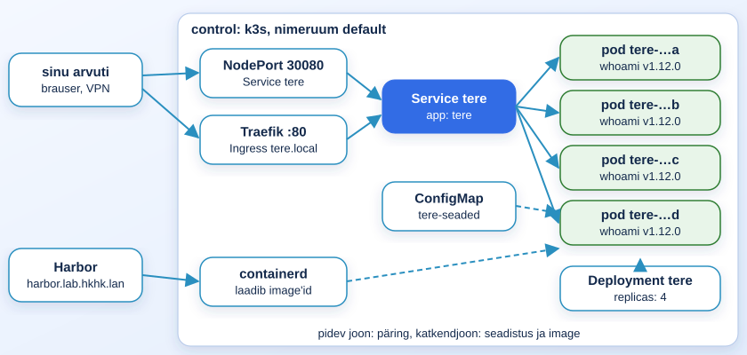
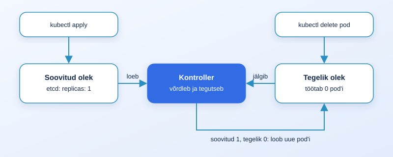
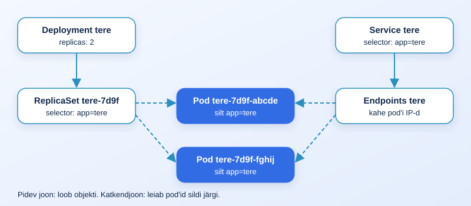
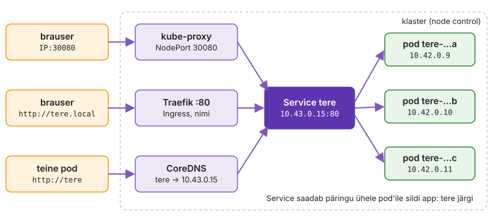
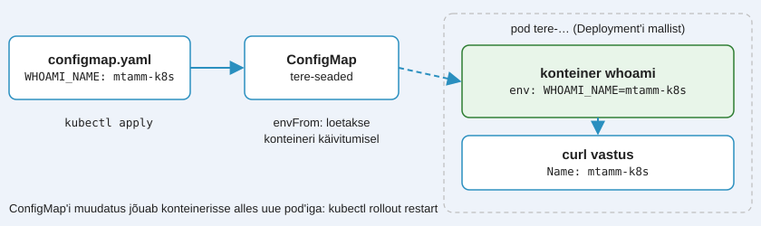
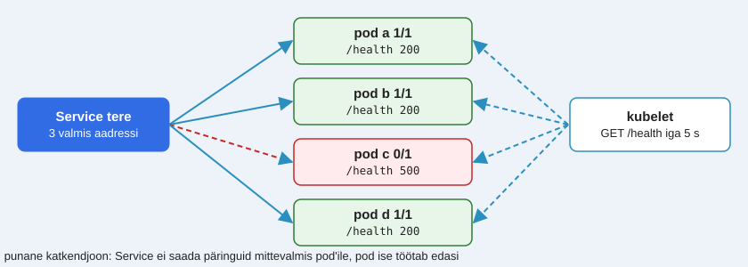
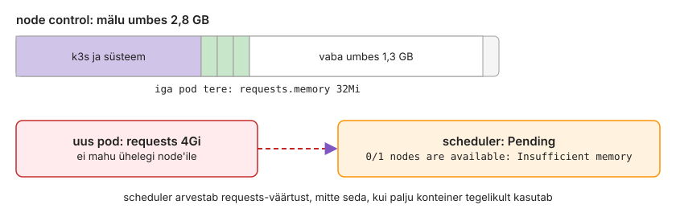
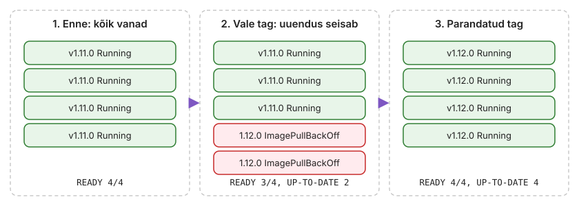

---
tags:
  - Kubernetes
  - k3s
  - Praktikum
---

# Praktikum: Kubernetes k3s-is

Eelmisel korral lõid OpenTofuga koodist viis virtuaalmasinat. Masinad tekivad nüüd ühe käsuga, aga rakendusi hoiad töös endiselt ise. 3. kohtumisel käivitasid Dockeriga konteinereid ühes masinas: kui konteiner kustutati või masin kadus, jäi rakendus seisma, kuni keegi selle taastas.

Täna paigaldad control'isse k3s-i, käivitad rakenduse kolme koopiana ja vaatad, kuidas Kubernetes kustutatud koopia ise asendab.

Seejärel kirjeldad rakenduse YAML-failides, teed selle brauseris kättesaadavaks ja parandad vea, mis takistab uue versiooni käivitumist.

Iga osa alguses on eesmärk ja kontroll. Proovi esmalt ise ja ava lahendus vajaduse korral.

**Edenemine:** laboritahvel <http://is126.kaaren.lab.hkhk.lan> (VPN-iga).

## Algseis ja tulemus

Olemas on control ja repositoorium `~/kursus`. Alustad harust `main`, varasemaid töid pole vaja.

Kooli Harborist saad Docker Hubi image'ite koopiad. Harbori CA-sertifikaat on failis `k03-docker/roles/docker/files/harbor-ca.crt`.

Sinu ülesanne:

- paigaldada k3s;
- luua harus `k05-k8s` failid `deployment.yaml`, `service.yaml`, `ingress.yaml` ja `configmap.yaml`;
- käivitada andmebaas Secret'i, ConfigMap'i ja Volume'iga ning veebiliides, mis räägib andmebaasiga;
- salvestada klastri olek kausta `k05-k8s/logid`;
- esitada töö tag'iga `k05`.

Faile kontrollib GitHubis automaatkontroll.

<figure markdown="span">
  
  <figcaption>Joonis L5.1. Praktikumi lõpuks töötab control'is see klaster (Talvik, 2026).</figcaption>
</figure>

??? abstract "Õpiväljundid"

    1. Paigaldad ühe masinaga Kubernetese klastri ja kontrollid, et see töötab.
    2. Käivitad Deployment'iga rakenduse kolm koopiat ja kontrollid, et Kubernetes asendab kustutatud koopia.
    3. Rakendad Deployment'i ja Service'i YAML-failid käsuga `kubectl apply`.
    4. Avad rakenduse Service'i kaudu brauseris ja kontrollid, kuidas päringud pod'ide vahel jagunevad.
    5. Teed rakenduse nime järgi kättesaadavaks Ingressiga.
    6. Annad rakendusele seadistuse ConfigMap'ist ja rakendad muudatuse uue rollout'iga.
    7. Lisad valmisoleku kontrolli ja ressursipiirid ning näed, kuidas Service mittevalmis pod'i vahele jätab.
    8. Leiad käivitusvea põhjuse käskudega `kubectl get` ja `kubectl describe`, parandad vea failis ja võtad vajaduse korral eelmise versiooni tagasi.
    9. Hoiad andmebaasi parooli Secret'is ja andmeid Volume'il ning näitad, et andmed jäävad pod'i kustutamisel alles.

Iga osa käib samamoodi: mõtle enne käsku läbi, mis juhtub, käivita käsk ja kontrolli tulemust käsuga `kubectl get`.

## Abi ja taastamine

Küsimused: [Küsimused ja teated](https://github.com/hkhk-tk/is126-arutelu/discussions). Lisa kasutatud käsk ja kogu veateade tekstina.

Failides kirjeldatud ressursid kustutad ja lood uuesti nii:

```bash
kubectl delete -f k05-k8s/
kubectl apply -f k05-k8s/
```

Kogu k3s-i eemaldad nii:

```bash
/usr/local/bin/k3s-uninstall.sh
```

??? info "Testitud versioonid"

    k3s `v1.36.6+k3s1`, `traefik/whoami:v1.11.0`, Ubuntu 24.04.

    Dokumentatsioon: [k3s](https://docs.k3s.io/), [Kubernetes](https://kubernetes.io/docs/home/), [kubectl](https://kubernetes.io/docs/reference/kubectl/quick-reference/).

## Osa 1 · k3s control'isse

**Kubernetes** on süsteem, mis käivitab konteinereid mitmes masinas ja hoiab neid töös. Sina kirjeldad soovitud olekut, näiteks „rakendusest töötab kolm koopiat“, ja Kubernetes võrdleb seda pidevalt tegeliku olekuga. **k3s** on Kubernetese jaotus, mis on pakitud ühte programmi ja paigaldub ühe käsuga. Käsud ja failid on samad mis suures klastris, nii et kõik siin õpitu kehtib ka pilves.

**Eesmärk:** control'is töötab k3s ja `kubectl` töötab ilma `sudo`-ta.  
**Kontroll:** `kubectl get nodes` näitab node'i `control` olekus `Ready`.  
**Kus:** control, kaust `~/kursus`.

### 1.1 Haru, kaust ja vaba mälu

```bash
cd ~/kursus && git switch main && git pull
git switch -c k05-k8s
mkdir -p k05-k8s/logid
git branch --show-current
```

??? success "Oodatav tulemus"

    Viimane käsk näitab `k05-k8s`.

??? warning "Kui tuleb viga `a branch named 'k05-k8s' already exists`"

    Haru on sul juba olemas. Vaheta sellele käsuga `git switch k05-k8s`.

control'is on umbes 2,8 GB mälu. Kui seal töötab veel 3. kohtumise Compose'i stack, võtab see suure osa mälust ja k3s jääb aeglaseks. Vaata, mis töötab, ja peata konteinerid. Andmed jäävad volume'ides alles.

```bash
free -h
docker ps --format '{{.Names}}'
docker stop $(docker ps -q)
free -h
```

??? success "Oodatav tulemus"

    Pärast peatamist näitab `free -h` veerus `available` vähemalt 1,5 GB. Kui `docker ps` ei näita ühtegi konteinerit või Dockerit ei ole, jäta `docker stop` vahele.

### 1.2 Image'id Harborist

Klastri enda osad, näiteks DNS ja Traefik, on samuti konteinerid ja nende image'id tulevad Docker Hubist. Docker Hub lubab ilma sisselogimiseta ühelt IP-aadressilt piiratud arvu tõmbeid ([piirangud](https://docs.docker.com/docker-hub/usage/pulls/)) ja kogu kool on interneti jaoks üks aadress. Fail `/etc/rancher/k3s/registries.yaml` ütleb k3s-ile, et Docker Hubi image'id tuleb küsida kooli Harborist. Harbor tõmbab image'i Docker Hubist üks kord ja annab selle siis kõigile.

Harboril on kooli enda CA sertifikaat. k3s usaldab Harborit, kui CA-fail on masinas olemas ja `registries.yaml` viitab sellele.

```bash
sudo cp ~/kursus/k03-docker/roles/docker/files/harbor-ca.crt /usr/local/share/ca-certificates/labori-ca.crt
sudo update-ca-certificates
sudo mkdir -p /etc/rancher/k3s
```

Tee fail `/etc/rancher/k3s/registries.yaml`, näiteks käsuga `sudo nano /etc/rancher/k3s/registries.yaml`. Rida `rewrite` lisab image'i nime ette Harbori projekti `dockerhub`: `traefik/whoami` muutub kujule `dockerhub/traefik/whoami`.

??? example "Ülesanne: fail `/etc/rancher/k3s/registries.yaml`"

    ```yaml
    mirrors:
      docker.io:
        endpoint:
          - "https://harbor.lab.hkhk.lan"
        rewrite:
          "^(.*)$": "dockerhub/$1"
    configs:
      "harbor.lab.hkhk.lan":
        tls:
          ca_file: /usr/local/share/ca-certificates/labori-ca.crt
    ```

??? info "Kui Harbor ei vasta"

    k3s loeb faili `registries.yaml` ainult käivitumisel. Kui muudad seda pärast paigaldust, käivita `sudo systemctl restart k3s`. Harbori vead on failis `/var/lib/rancher/k3s/agent/containerd/containerd.log`.

    k3s proovib kõigepealt Harborit ja kui see ei vasta, tõmbab image'i otse Docker Hubist. Fail ei tee seega midagi katki, ainult vähendab Docker Hubi tõmbeid. Vaata lähemalt [k3s-i dokumentatsioonist](https://docs.k3s.io/installation/private-registry).

### 1.3 Paigalda k3s

k3s-i paigaldab [ametlik skript](https://docs.k3s.io/quick-start). Skript laadib alla ühe programmi, teeb sellest systemd teenuse ja käivitab selle. Loe skript enne käivitamist läbi, sest see kasutab `sudo`-t. Muutuja `INSTALL_K3S_VERSION` hoiab versiooni sama, mis juhendis.

```bash
curl -sfL https://get.k3s.io -o install-k3s.sh
less install-k3s.sh
INSTALL_K3S_VERSION=v1.36.6+k3s1 sh install-k3s.sh
sudo k3s kubectl get nodes
```

??? success "Oodatav tulemus"

    Skript lõpeb reaga `[INFO]  systemd: Starting k3s`. Umbes poole minuti pärast näitab viimane käsk:

    ```text
    NAME      STATUS   ROLES           AGE   VERSION
    control   Ready    control-plane   40s   v1.36.6+k3s1
    ```

    Klastris on üks **node** ehk masin, kus konteinerid töötavad. See on sinu control. Suures klastris on node'e kümneid ja juhtimise osa, **control plane**, on eraldi masinates.

??? warning "Kui olek on `NotReady`"

    k3s käivitab veel oma osi. Oota minut ja käivita käsk uuesti. Kui olek ei muutu, vaata teenuse logi: `sudo journalctl -u k3s -n 50`.

### 1.4 kubectl ilma sudo-ta

**kubectl** on käsk, millega räägid klastriga. Klastri aadress ja sinu sertifikaat on failis, mille nimi on **kubeconfig**. k3s kirjutab selle faili `/etc/rancher/k3s/k3s.yaml`, mida saab lugeda ainult root. Kopeerid faili oma kodukausta, et `kubectl` töötaks ilma `sudo`-ta.

```bash
mkdir -p ~/.kube
sudo k3s kubectl config view --raw > ~/.kube/config
chmod 600 ~/.kube/config
echo 'export KUBECONFIG=~/.kube/config' >> ~/.bashrc
export KUBECONFIG=~/.kube/config
kubectl get nodes
```

??? success "Oodatav tulemus"

    Sama väljund mis 1.3-s, aga ilma `sudo`-ta. Failis on klastri administraatori sertifikaat, seepärast õigused `600`. See fail ei lähe Giti.

Vaata, mis klastris juba töötab. Enne käsku mõtle läbi: kas klastris on midagi, kuigi sa pole veel midagi käivitanud?

```bash
kubectl get pods -A
```

??? success "Oodatav tulemus"

    Nimeruumis `kube-system` töötavad klastri enda osad: `coredns` annab nimed, `local-path-provisioner` annab kettaruumi, `metrics-server` kogub mõõdikuid, `traefik` võtab vastu veebiliikluse ja `svclb-traefik` (ServiceLB) avab Traefiku pordid node'i IP-aadressil. Pod'id `helm-install-traefik` ja `helm-install-traefik-crd` on olekus `Completed`: k3s paigaldas Traefiku Helmiga ja see töö on lõppenud. Helmist on juttu lisaülesannetes.

    **Nimeruum** (namespace) jagab klastri osadeks. Sinu rakendus läheb nimeruumi `default`, mida `kubectl` kasutab, kui nimeruumi pole antud. Võti `-A` näitab kõiki nimeruume.

## Osa 2 · Esimene rakendus käsuga

**Pod** on Kubernetese väikseim üksus: üks või mitu konteinerit, millel on ühine IP-aadress. Pod'e otse ei looda. **Deployment** kirjeldab, mitu ühesugust pod'i peab töötama ja millisest image'ist, ning loob ja asendab need ise. Rakendus `traefik/whoami` on väike veebiserver, mis vastab pod'i nime ja IP-aadressiga. Nii näed, milline pod päringule vastas.

**Eesmärk:** Deployment `tere` töötab ja selle pod vastab.  
**Kontroll:** `kubectl get deployment tere` näitab `READY 1/1`.  
**Kus:** control.

### 2.1 Deployment

```bash
kubectl create deployment tere --image=traefik/whoami:v1.11.0
kubectl get deployment tere
kubectl get pods -o wide
```

??? success "Oodatav tulemus"

    Mõne sekundi pärast on Deployment'i real `READY 1/1`. Pod'i nimi algab `tere-` ja lõpeb juhusliku osaga, näiteks `tere-6d8c5b7f9c-x2kq4`. Veerus `IP` on pod'i aadress, näiteks `10.42.0.9`, ja veerus `NODE` on `control`.

??? warning "Kui olek jääb `ContainerCreating`"

    Image tuleb alla laadida. Oota pool minutit. Kui olek muutub `ErrImagePull`-iks, vaata 9. osa: seal on sama viga lahti seletatud.

### 2.2 Vaata pod'i sisse

`kubectl describe` näitab kõike, mida Kubernetes pod'i kohta teab, ja lõpus sündmusi (Events) loomise järjekorras. `kubectl logs` näitab konteineri väljundit nagu `docker logs`. Asenda `<pod>` oma pod'i nimega.

```bash
kubectl describe pod <pod> | tail -n 15
kubectl logs <pod>
curl http://<pod-ip>
```

??? success "Oodatav tulemus"

    Sündmuste all on järjest `Scheduled`, `Pulling`, `Pulled`, `Created` ja `Started`. `logs` näitab rida `Starting up on port 80`. `curl` vastab mitme reaga, mille esimene on `Hostname: tere-...`, sama nimi nagu pod'il.

??? tip "Pod'i nimi ilma kopeerimiseta"

    `kubectl get pods -l app=tere -o name` annab nime kujul `pod/tere-...`. Seda saab kasutada otse: `kubectl logs $(kubectl get pods -l app=tere -o name | head -1)`.

## Osa 3 · Kubernetes taastab soovitud oleku

Siin on Kubernetese põhimõte. Deployment'is on kirjas soovitud olek: mitu pod'i peab töötama. Kontroller võrdleb seda pidevalt tegeliku olekuga ja kui need erinevad, teeb vahe tasa. Sama mõtet nägid Ansible'is ja OpenTofus, aga seal käivitasid võrdluse sina. Kubernetes võrdleb kogu aeg ise.

<figure markdown="span">
  
  <figcaption>Joonis L5.2. Kustutamine muudab tegelikku olekut, soovitud olek jääb samaks (Talvik, 2026).</figcaption>
</figure>

**Eesmärk:** näed, et kustutatud pod asendatakse uuega.  
**Kontroll:** pärast kustutamist on jälle kolm pod'i ja üks neist on uue nimega.  
**Kus:** control.

### 3.1 Kolm koopiat

```bash
kubectl scale deployment tere --replicas=3
kubectl get pods -o wide
```

??? success "Oodatav tulemus"

    Kolm pod'i, kõigil olek `Running` ja igaühel oma IP.

### 3.2 Kustuta üks pod

Ava teine terminal ja jälgi seal pod'e. Võti `-w` jääb ootama ja näitab iga muutust.

```bash
kubectl get pods -w
```

Kustuta esimeses terminalis üks pod. Enne käsku mõtle läbi: mitu pod'i on minuti pärast ja kas kustutatud pod tuleb tagasi sama nimega?

```bash
kubectl delete pod <üks-pod>
kubectl get pods
```

??? success "Oodatav tulemus"

    Teises terminalis läheb kustutatud pod olekusse `Terminating` ja peaaegu samal ajal tekib uus pod uue nimega ja uue IP-ga. Minuti pärast töötab jälle kolm pod'i. Vana pod'i tagasi ei tule: Deployment ei taasta konkreetset pod'i, vaid hoiab õiget arvu.

    Dockeris jääks kustutatud konteiner kustunuks. Konteiner, mis ise kukub, käivitub Dockeris uuesti ainult siis, kui tal on `restart`-reegel, ja ainult samas masinas.

Sulge teises terminalis jälgimine klahvidega ++ctrl+c++.

??? question "Kontrolli ennast"

    Uuel pod'il on uus IP-aadress. Miks on see probleem, kui teine rakendus tahab selle pod'iga ühendust võtta?

    ??? success "Vastus"

        Teine rakendus ei tea uut aadressi. Iga kustutamise, uuenduse või node'i rikke järel muutuvad pod'ide aadressid. 5. osas lahendab selle Service, millel on püsiv nimi ja aadress.

## Osa 4 · Sama YAML-failina

Käsud `create` ja `scale` muutsid klastrit, aga kuskile kirja ei jäänud, milline olek on soovitud. Kui klaster homme kaob, ei tea keegi, mis seal töötas. Nii nagu playbook ja `.tf`-fail, läheb ka Kubernetese soovitud olek faili ja faili Giti. Fail tuleb klastrisse käsuga `kubectl apply`.

**Eesmärk:** Deployment `tere` on loodud failist `k05-k8s/deployment.yaml`.  
**Kontroll:** teine `kubectl apply` ütleb `unchanged`.  
**Kus:** control, kaust `~/kursus`.

### 4.1 Fail käsust

YAML-faili ei pea tühjalt lehelt kirjutama. Võti `--dry-run=client` ütleb, et `kubectl` ei saada midagi klastrisse, ja `-o yaml` trükib objekti, mille käsk oleks loonud. Nii saad õige kujuga faili, mida muudad edasi.

```bash
kubectl create deployment tere --image=traefik/whoami:v1.11.0 --replicas=3 \
  --dry-run=client -o yaml > k05-k8s/deployment.yaml
cat k05-k8s/deployment.yaml
```

??? success "Oodatav tulemus"

    Failis on umbes 25 rida. Read `creationTimestamp: null`, `resources: {}`, `strategy: {}` ja `status: {}` on tühjad väärtused. Kustuta rida `resources: {}`, sest 8. osas lisad sinna tegelikud väärtused. Teised võivad jääda või võid need kustutada.

Fail koosneb neljast osast, mis on igal Kubernetese objektil.

??? note "Tabel L5.1. Kubernetese objekti osad"

    | Väli | Tähendus |
    |---|---|
    | `apiVersion`, `kind` | Mis tüüpi objekt see on: `apps/v1` ja `Deployment` |
    | `metadata` | Nimi ja sildid (labels), mille järgi objekti leitakse |
    | `spec` | Soovitud olek: `replicas`, milliseid pod'e otsida (`selector`) ja millisest mallist (`template`) need teha |
    | `status` | Tegelik olek. Selle kirjutab Kubernetes, sina seda ei täida |

Kõige olulisem on siltide seos. `selector.matchLabels` ütleb, et Deployment'ile kuuluvad pod'id sildiga `app: tere`. `template.metadata.labels` annab sama sildi igale uuele pod'ile. Kui need ei klapi, ei leia Deployment oma pod'e üles ja Kubernetes keeldub faili vastu võtmast.

### 4.2 Kustuta käsuga tehtu ja loo failist

Kustutad käsuga loodud Deployment'i, et kogu soovitud olek tuleks nüüd failist.

```bash
kubectl delete deployment tere
kubectl apply -f k05-k8s/deployment.yaml
kubectl get deployment tere
```

??? success "Oodatav tulemus"

    `delete` kustutab Deployment'i ja koos sellega kõik kolm pod'i. `apply` vastab `deployment.apps/tere created` ja minuti pärast on `READY 3/3`.

Käivita `apply` teist korda. Enne käsku mõtle läbi: mida Kubernetes teeb, kui fail ja klaster on juba samad?

```bash
kubectl apply -f k05-k8s/deployment.yaml
```

??? success "Oodatav tulemus"

    `deployment.apps/tere unchanged`. See on sama mis Ansible'i `changed=0` ja OpenTofu `No changes`: kui soovitud ja tegelik olek on samad, ei muudeta midagi.

### 4.3 Muuda faili

Muuda failis `replicas: 3` väärtuseks `4`. Käsk `kubectl diff` näitab enne muutmist, mis klastris muutuks, nagu `tofu plan`.

```bash
kubectl diff -f k05-k8s/deployment.yaml
kubectl apply -f k05-k8s/deployment.yaml
kubectl get pods
```

??? success "Oodatav tulemus"

    `diff` näitab rida `-  replicas: 3` ja `+  replicas: 4`. Kui erinevus on olemas, lõpeb `diff` koodiga 1, nagu Linuxi käsk `diff`. See ei ole viga. `apply` vastab `configured` ja pod'e on neli.

Salvesta töö Giti:

```bash
git add k05-k8s/deployment.yaml
git commit -m "k05: Deployment tere failist"
```

## Osa 5 · Service

Pod'ide aadressid muutuvad. **Service** annab pod'ide grupile püsiva nime ja aadressi ning jagab päringud nende pod'ide vahel. Service leiab pod'id sama sildi järgi nagu Deployment: `app: tere`. Vaikimisi on Service tüüpi **ClusterIP** ja see on nähtav ainult klastri sees. Tüüp **NodePort** avab lisaks pordi node'il, nii et rakendust saab vaadata ka oma arvuti brauserist.

<figure markdown="span">
  
  <figcaption>Joonis L5.3. Service leiab pod'id sildi järgi, mitte nime järgi (Talvik, 2026).</figcaption>
</figure>

**Eesmärk:** rakendus on brauseris nähtav ja päringutele vastavad erinevad pod'id.  
**Kontroll:** `curl http://localhost:30080` vastab ja `Hostname` muutub päringust päringusse.  
**Kus:** control ja sinu arvuti brauser.

### 5.1 service.yaml

Pordid on Service'is kolmes kohas. `targetPort` on port konteineris, kus `whoami` kuulab. `port` on Service'i port klastri sees. `nodePort` on port node'il, mille kaudu tuleb liiklus väljast. NodePort peab olema vahemikus 30000–32767.

??? example "Ülesanne: fail `k05-k8s/service.yaml`"

    ```yaml
    apiVersion: v1
    kind: Service
    metadata:
      name: tere
    spec:
      type: NodePort
      selector:
        app: whoami
      ports:
        - port: 80
          targetPort: 80
          nodePort: 30080
    ```

```bash
kubectl apply -f k05-k8s/service.yaml
kubectl get service tere
kubectl get endpointslices -l kubernetes.io/service-name=tere
```

??? success "Oodatav tulemus"

    Service'i real on `TYPE NodePort` ja `PORT(S) 80:30080/TCP`.

Proovi, kas rakendus vastab:

```bash
curl -s -m 5 http://localhost:30080; echo "kood $?"
```

Vastust ei tule. Pod'id töötavad ja Service on olemas. Leia põhjus.

??? tip "Vihje"

    Vaata EndpointSlice'i väljundit eelmisest käsust: millised pod'id Service leidis? Seejärel vaata pod'ide silte: `kubectl get pods --show-labels`.

??? question "Leia põhjus"

    Miks Service ei saada päringuid pod'idele?

    ??? success "Vastus"

        EndpointSlice'is ei ole ühtegi aadressi: Service ei leidnud ühtegi pod'i. Service'i `selector` otsib silti `app: whoami`, aga pod'idel on silt `app: tere`. `whoami` on konteineri nimi, mitte silt. Service leiab pod'id ainult siltide järgi ja kui ükski pod ei klapi, ei lähe päring kuhugi.

Paranda failis `selector` väärtuseks `app: tere` ja rakenda uuesti:

```bash
kubectl apply -f k05-k8s/service.yaml
kubectl get endpointslices -l kubernetes.io/service-name=tere
```

??? success "Oodatav tulemus"

    `service/tere configured`. EndpointSlice näitab nüüd nelja pod'i IP-aadressi.

### 5.2 Päringud jagunevad

```bash
for i in 1 2 3 4 5 6; do curl -s http://localhost:30080 | grep Hostname; done
hostname -I
```

??? success "Oodatav tulemus"

    Kuus rida, kus `Hostname` on erinevate pod'ide nimed. Service jagab päringud pod'ide vahel. `hostname -I` näitab control'i IP-aadressi, näiteks `192.168.125.81`.

Ava oma arvuti brauseris `http://<control'i IP>:30080` ja värskenda lehte mitu korda.

??? success "Oodatav tulemus"

    Lehel on tekst, mis algab `Hostname: tere-...`, ja nimi muutub värskendamisel.

??? warning "Kui brauser ei vasta"

    Kontrolli, et VPN on ühendatud ja `curl` töötab control'is. Kui control'is on tulemüür sees (`sudo ufw status` näitab `active`), luba NodePort ning pod'ide ja Service'ite võrgud, nagu soovitab [k3s-i dokumentatsioon](https://docs.k3s.io/installation/requirements):

    ```bash
    sudo ufw allow 30080/tcp
    sudo ufw allow from 10.42.0.0/16 to any
    sudo ufw allow from 10.43.0.0/16 to any
    ```

Kustuta korraga kõik pod'id ja jälgi samal ajal brauserit. Enne käsku mõtle läbi: kas leht jääb pikaks ajaks kättesaamatuks?

```bash
kubectl delete pods -l app=tere
kubectl get pods
```

??? success "Oodatav tulemus"

    Mõne sekundi jooksul võib brauser veateate anda, siis vastab leht uuesti uute pod'ide nimedega. Service'i aadress ja port jäid samaks, muutusid ainult pod'id selle taga.

Salvesta töö Giti:

```bash
git add k05-k8s/service.yaml
git commit -m "k05: NodePort Service tere"
```

## Osa 6 · Ingress: rakendus nime järgi

Pordi number 30080 on kasutajale ebamugav ja iga rakendus vajaks oma porti. **Ingress** suunab päringu nime järgi õigesse Service'isse. k3s-is teeb seda Traefik, mis klastris juba töötab ja kuulab porte 80 ja 443. Traefik vaatab päringu päist `Host` ja leiab Ingressi reeglist, millisele Service'ile päring läheb.

<figure markdown="span">
  
  <figcaption>Joonis L5.4. NodePort ja Ingress viivad mõlemad sama Service'ini (Talvik, 2026).</figcaption>
</figure>

**Eesmärk:** rakendus vastab pordil 80 nimega `tere.local`.  
**Kontroll:** `curl -H 'Host: tere.local' http://localhost/` vastab reaga `Hostname: tere-...`.  
**Kus:** control, kaust `~/kursus`.

### 6.1 ingress.yaml

Tee fail `k05-k8s/ingress.yaml`. Võtmed `name` ja `port` viitavad Service'ile, mille tegid 5. osas.

??? example "Ülesanne: fail `k05-k8s/ingress.yaml`"

    ```yaml
    apiVersion: networking.k8s.io/v1
    kind: Ingress
    metadata:
      name: tere
    spec:
      rules:
        - host: tere.local
          http:
            paths:
              - path: /
                pathType: Prefix
                backend:
                  service:
                    name: tere
                    port:
                      number: 80
    ```

Enne käsku mõtle läbi: mis vastab, kui saadad päringu pordile 80 ilma päiseta `Host: tere.local`?

```bash
kubectl apply -f k05-k8s/ingress.yaml
kubectl get ingress tere
curl -s -H 'Host: tere.local' http://localhost/ | grep Hostname
curl -s -o /dev/null -w '%{http_code}\n' http://localhost/
```

??? success "Oodatav tulemus"

    `get ingress` näitab hosti `tere.local` ja aadressi, mis on control'i IP. Esimene `curl` vastab `Hostname: tere-...`. Teine `curl` vastab koodiga `404`: Traefik ei leidnud ühtegi reeglit, mis sobiks nimega `localhost`.

??? tip "Brauseris nimega tere.local"

    Brauser saadab päise `Host` aadressiribalt. Et nimi `tere.local` viiks control'i, lisa oma arvuti hosts-faili rida `<control'i IP> tere.local`. Windowsis on fail `C:\Windows\System32\drivers\etc\hosts` ja selle muutmiseks on vaja administraatori õigusi. Kui õigusi ei ole, piisab `curl`-ist.

```bash
git add k05-k8s/ingress.yaml
git commit -m "k05: Ingress tere.local"
```

## Osa 7 · ConfigMap: seadistus väljaspool image'it

Compose'is andsid konteinerile seadistuse võtmega `environment`. Kubernetesis hoitakse seadistust eraldi objektis **ConfigMap**. Sama image töötab nii testis kui ka toodangus, ainult ConfigMap on erinev. Rakendus `whoami` loeb muutujat `WHOAMI_NAME` ja näitab seda vastuse esimesel real `Name:`.

<figure markdown="span">
  
  <figcaption>Joonis L5.5. ConfigMap'i väärtus jõuab konteinerisse käivitumisel (Talvik, 2026).</figcaption>
</figure>

**Eesmärk:** rakendus näitab ConfigMap'ist tulnud nime ja näed, millal muudatus pod'ideni jõuab.  
**Kontroll:** `curl -s http://localhost:30080 | head -1` näitab rida `Name:` sinu ConfigMap'i väärtusega.  
**Kus:** control, kaust `~/kursus`.

### 7.1 configmap.yaml ja Deployment

Tee fail `k05-k8s/configmap.yaml` ja lisa Deployment'i konteinerile viide sellele. Võti `envFrom` teeb ConfigMap'i igast võtmest keskkonnamuutuja.

??? example "Ülesanne: fail `k05-k8s/configmap.yaml`"

    Asenda `<sinu-kasutajanimi>` oma kasutajanimega.

    ```yaml
    apiVersion: v1
    kind: ConfigMap
    metadata:
      name: tere-seaded
    data:
      WHOAMI_NAME: "<sinu-kasutajanimi>-k8s"
    ```

??? example "Ülesanne: lisa failis `k05-k8s/deployment.yaml` konteinerile `envFrom`"

    Lisa read konteineri `whoami` juurde, `image` rea järele, sama taandega nagu `image`.

    ```yaml
            envFrom:
              - configMapRef:
                  name: tere-seaded
    ```

Enne käsku mõtle läbi: Deployment'i mall muutub. Mis juhtub olemasolevate pod'idega?

```bash
kubectl apply -f k05-k8s/configmap.yaml -f k05-k8s/deployment.yaml
kubectl rollout status deployment tere
curl -s http://localhost:30080 | head -1
```

??? success "Oodatav tulemus"

    Mall muutus, seega tegi Deployment uue ReplicaSet'i ja vahetas kõik pod'id välja, nagu versiooni uuendamisel. `curl` näitab rida `Name: <sinu-kasutajanimi>-k8s`.

### 7.2 Muuda ConfigMap'i

Muuda failis `configmap.yaml` väärtust, näiteks lisa lõppu `-v2`. Enne käsku mõtle läbi: kas töötavad pod'id näevad uut väärtust?

```bash
kubectl apply -f k05-k8s/configmap.yaml
curl -s http://localhost:30080 | head -1
```

??? success "Oodatav tulemus"

    `configmap/tere-seaded configured`, aga `curl` näitab endiselt vana nime. Keskkonnamuutujad loetakse ainult konteineri käivitumisel. Deployment'i mall ei muutunud, seega Deployment pod'e ei vahetanud.

Käivita pod'id uuesti. `rollout restart` vahetab pod'id järk-järgult nagu uuendus, nii et rakendus vastab kogu aeg.

```bash
kubectl rollout restart deployment tere
kubectl rollout status deployment tere
curl -s http://localhost:30080 | head -1
```

??? success "Oodatav tulemus"

    Uued pod'id näitavad nime lõpuga `-v2`. Kui mõni päring näitab veel vana nime, vastas lõpetav vana pod. Oota mõni sekund ja proovi uuesti.

??? info "Paroolid: Secret"

    Paroole ConfigMap'i ei panda. Selleks on **Secret**, mis näeb välja samasugune, aga väärtused on base64-kujul ja lugemisõigusi saab anda eraldi. Base64 ei ole krüpteering, seepärast ei lähe ka Secret'i fail Giti. Vaata [Kubernetese dokumentatsioonist](https://kubernetes.io/docs/concepts/configuration/secret/).

```bash
git add k05-k8s/configmap.yaml k05-k8s/deployment.yaml
git commit -m "k05: ConfigMap tere-seaded"
```

## Osa 8 · Valmisolek ja ressursid

Kubernetes peab pod'i valmis olevaks kohe, kui konteiner käivitus. Rakendus võib aga vajada aega või minna katki nii, et protsess töötab edasi. **readinessProbe** kontrollib korrapäraselt, kas pod suudab päringuid vastu võtta. Kui kontroll ebaõnnestub, jätab Service selle pod'i vahele. Rakendusel `whoami` on aadress `/health`, mis vastab koodiga 200.

Väli **resources** ütleb, kui palju protsessorit ja mälu konteiner vajab. `requests` on osa, mille scheduler node'il pod'ile kinni paneb. `limits` on ülempiir.

<figure markdown="span">
  
  <figcaption>Joonis L5.6. Mittevalmis pod jääb Service'ist välja, aga töötab edasi (Talvik, 2026).</figcaption>
</figure>

**Eesmärk:** mittevalmis pod jääb Service'ist välja ja liiga suure ressursinõudega pod'i põhjus on leitud.  
**Kontroll:** `kubectl get pods` näitab nelja pod'i olekus `1/1 Running`.  
**Kus:** control, kaust `~/kursus`.

### 8.1 Lisa valmisoleku kontroll ja ressursid

??? example "Ülesanne: lisa failis `k05-k8s/deployment.yaml` konteinerile kontroll ja ressursid"

    Lisa read konteineri `whoami` juurde, `envFrom` plokile järele, sama taandega. Kui failis on veel rida `resources: {}`, kustuta see. Muidu on võti `resources` failis kaks korda ja kehtib ainult viimane: tühi `{}` kirjutab sinu väärtused vaikselt üle.

    ```yaml
            readinessProbe:
              httpGet:
                path: /health
                port: 80
              periodSeconds: 5
            resources:
              requests:
                cpu: 50m
                memory: 32Mi
              limits:
                memory: 64Mi
    ```

    `50m` tähendab 50 millituuma ehk 5% ühest protsessorituumast.

```bash
kubectl apply -f k05-k8s/deployment.yaml
kubectl rollout status deployment tere
kubectl get pods
```

??? success "Oodatav tulemus"

    Neli uut pod'i olekus `1/1 Running`. Veerus `READY` olev `1/1` tähendab nüüd, et ka valmisoleku kontroll õnnestus.

### 8.2 Tee üks pod mittevalmis

Rakenduse `whoami` aadressile `/health` saab saata POST-päringu, mis muudab vastuse koodi. Nii saad tekitada olukorra, kus protsess töötab, aga rakendus ei ole terve. Vali üks pod ja kasuta selle IP-aadressi.

```bash
kubectl get pods -o wide
curl -X POST -d 500 http://<pod-ip>/health
```

Oota 20 sekundit: kontroll käib iga 5 sekundi järel ja pod märgitakse mittevalmis alles pärast kolme järjestikust ebaõnnestumist. Enne käske mõtle läbi: kas pod kustutatakse? Kas Service saadab sellele päringuid?

```bash
kubectl get pods
kubectl get endpointslices -l kubernetes.io/service-name=tere \
  -o jsonpath='{range .items[*].endpoints[*]}{.addresses[0]} {.conditions.ready}{"\n"}{end}'
for i in $(seq 1 12); do curl -s http://localhost:30080 | grep Hostname; done | sort | uniq -c
```

??? success "Oodatav tulemus"

    Valitud pod on olekus `0/1 Running`: konteiner töötab, aga ei ole valmis. Pod'i ei kustutata, sest `readinessProbe` ainult eemaldab pod'i Service'ist. EndpointSlice'is on neli aadressi, neist üks märkega `false`, ja päringutele vastavad ainult kolm pod'i.

    Konteineri taaskäivitab **livenessProbe**, mida selles praktikumis ei kasutata. Mõlemast loe [dokumentatsioonist](https://kubernetes.io/docs/concepts/configuration/liveness-readiness-startup-probes/).

Tee pod uuesti terveks:

```bash
curl -X POST -d 200 http://<pod-ip>/health
kubectl get pods
```

??? success "Oodatav tulemus"

    Mõne sekundi pärast on pod jälle `1/1` ja vastab päringutele.

```bash
git add k05-k8s/deployment.yaml
git commit -m "k05: readinessProbe ja resources"
```

### 8.3 Leia viga: pod ei leia node'i

??? example "Ülesanne: muuda failis `k05-k8s/deployment.yaml` mälu nõuet"

    ```yaml
                memory: 4Gi
    ```

    Muuda nii `requests.memory` kui ka `limits.memory` väärtuseks `4Gi`.

```bash
kubectl apply -f k05-k8s/deployment.yaml
kubectl get pods
kubectl get deployment tere
```

Leia põhjus. Asenda `<pod>` pod'iga, mis ei ole `Running`.

```bash
kubectl describe pod <pod> | tail -n 5
kubectl describe node control | grep -A 8 'Allocated resources'
```

??? question "Leia põhjus"

    Mis olekus on uued pod'id ja mida ütleb sündmus? Miks töötab rakendus endiselt?

    ??? success "Vastus"

        Uued pod'id on olekus `Pending` ja sündmus ütleb `0/1 nodes are available: 1 Insufficient memory`. control'is on umbes 2,8 GB mälu ja scheduler ei leia node'i, kus oleks 4 GB vaba. Pod ei käivitunud kordagi, seega `logs` ei näita midagi.

        

        Rakendus töötab, sest rolling update jättis vanad pod'id alles. Sama viga tekib töökohas siis, kui `requests` on kopeeritud teisest projektist ja klastris pole nii suurt node'i.

Pane failis tagasi `memory: 32Mi` ja `memory: 64Mi` ning rakenda uuesti:

```bash
kubectl apply -f k05-k8s/deployment.yaml
kubectl rollout status deployment tere
```

??? success "Oodatav tulemus"

    `deployment "tere" successfully rolled out` ja neli pod'i `1/1 Running`.

## Osa 9 · Leia viga: uus versioon ei käivitu

Rakendusest on ilmunud uus versioon. Uuendad Deployment'is image'i ja vaatad, kas uuendus õnnestus. Kubernetes vahetab pod'e järk-järgult, seda nimetatakse **rolling update**'iks. Vaikimisi võib nelja koopia puhul korraga puududa üks valmis pod (`maxUnavailable` 25%).

**Eesmärk:** leiad, miks uus pod ei käivitu, ja parandad selle failis.  
**Kontroll:** `kubectl get deployment tere` näitab `READY 4/4` ja `UP-TO-DATE 4`.  
**Kus:** control, kaust `~/kursus`.

??? example "Ülesanne: uus image failis `k05-k8s/deployment.yaml`"

    Muuda real `- image:` ainult versiooni. Kriips ja võti jäävad alles:

    ```yaml
          - image: traefik/whoami:1.12.0
    ```

Enne käsku mõtle läbi: kas rakendus jääb brauseris kättesaadavaks, kui uus versioon ei käivitu?

```bash
kubectl apply -f k05-k8s/deployment.yaml
kubectl get pods
```

Oota minut ja vaata uuesti `kubectl get pods`. Leia põhjus järgmiste käskudega. Asenda `<pod>` pod'iga, mis ei ole `Running`.

```bash
kubectl get deployment tere
kubectl describe pod <pod> | tail -n 10
```

??? question "Leia põhjus"

    Mis olekus on uus pod? Mida ütleb `describe` sündmuste all rida `Failed`?

    ??? success "Vastus"

        Uus pod on olekus `ErrImagePull` ja seejärel `ImagePullBackOff`: image'i ei saa alla laadida ja Kubernetes proovib uuesti üha pikemate vahedega. Sündmus ütleb `failed to resolve reference "docker.io/traefik/whoami:1.12.0": ... not found`. Sellist tag'i ei ole: versiooni ees puudub `v`. Docker Hubis on tag'id kujul `v1.12.0`.

        Kolm vana pod'i töötavad edasi ja brauseris vastab leht endiselt. Nelja koopia puhul lubab rolling update ühel pod'il puududa, seepärast kustutati üks vana pod ja tehti kaks uut. Deployment'i real näed `READY 3/4` ja `UP-TO-DATE 2`: kaks pod'i on uue malli järgi tehtud, aga need ei tööta.

        

Paranda failis image'i rida kujule `traefik/whoami:v1.12.0` ja rakenda uuesti:

```bash
kubectl apply -f k05-k8s/deployment.yaml
kubectl rollout status deployment tere
kubectl get pods
```

??? success "Oodatav tulemus"

    `rollout status` ootab ja lõpeb reaga `deployment "tere" successfully rolled out`. Kõik neli pod'i on uute nimedega ja `Running`. `curl http://localhost:30080` vastab endiselt.

```bash
git add k05-k8s/deployment.yaml
git commit -m "k05: tere image v1.12.0"
```

### 9.1 Ajalugu ja tagasivõtt

Deployment hoiab varasemaid ReplicaSet'e alles, et saaks eelmise versiooni juurde tagasi minna. Iga muudatus mallis, ka ConfigMap'i lisamine ja `rollout restart`, on ajaloos eraldi versioon.

```bash
kubectl rollout history deployment tere
kubectl get replicasets
```

Enne käsku mõtle läbi: mis versioon töötab pärast `undo`-d ja mida näitab `kubectl diff` failiga võrreldes?

```bash
kubectl rollout undo deployment tere
kubectl get pods
kubectl get deployment tere -o jsonpath='{.spec.template.spec.containers[0].image}'; echo
kubectl diff -f k05-k8s/deployment.yaml
```

??? success "Oodatav tulemus"

    `undo` trükib hoiatuse `Rolling back will not update the kubectl.kubernetes.io/last-applied-configuration annotation`. See ütleb sama, mida see osa näitab: klaster ja fail lähevad lahku.

    `undo` viis klastri eelmise versiooni juurde, see on vigane tag `1.12.0`, ja pod'id ei käivitu jälle. `diff` näitab erinevust: failis on `v1.12.0`, klastris `1.12.0`. `undo` muudab klastrit, aga mitte faili. Töökohas on `undo` hädaabi, kui rakendus on katki ja parandus võtab aega. Püsiv parandus käib failis.

Vii klaster tagasi faili olekusse:

```bash
kubectl apply -f k05-k8s/deployment.yaml
kubectl rollout status deployment tere
kubectl diff -f k05-k8s/deployment.yaml && echo sama
```

??? success "Oodatav tulemus"

    `rollout status` lõpeb `successfully rolled out` ja viimane käsk trükib `sama`.

## Osa 10 · Andmebaas: Secret, ConfigMap ja Volume

Seni oli klastris üks rakendus ilma andmeteta. Nüüd lisad PostgreSQL-i andmebaasi ja Admineri veebiliidese, millega andmebaasi brauseris vaadata. Sama ülesehitus on loengus: rakendus ja andmebaas, parool Secret'is, seadistus ConfigMap'is ja andmed Volume'il.

**Eesmärk:** andmebaasi andmed jäävad alles ka siis, kui andmebaasi pod kustutatakse.  
**Kontroll:** pärast pod'i kustutamist näitab päring `select * from kursus;` sinu lisatud rida.  
**Kus:** control, kaust `~/kursus`.

??? info "Mis on Adminer"

    Adminer on väike veebirakendus, millega saab andmebaasi tabeleid vaadata ja muuta. See on samas rollis nagu loengu näites `my-app`: rakendus, mis räägib andmebaasiga Service'i nime kaudu.

### 10.1 Parool Secret'i ja seadistus ConfigMap'i

Andmebaasi parool ei tohi olla Deployment'i failis ega image'is. See läheb Secret'i. Kasutaja, andmebaasi nimi ja andmebaasi aadress lähevad ConfigMap'i. Võti `stringData` laseb Secret'i kirjutada lihttekstina, Kubernetes teeb sellest ise base64.

??? example "Ülesanne: fail `k05-k8s/andmebaas/seaded.yaml`"

    Pane parooliks oma parool. Kursusel läheb see fail sinu privaatsesse repositooriumi. Töökohas Secret'i faili Giti ei panda, paroolid tulevad saladuste haldurist, näiteks OpenBao või HashiCorp Vault.

    ```yaml
    apiVersion: v1
    kind: Secret
    metadata:
      name: andmebaas-saladus
    stringData:
      POSTGRES_PASSWORD: "<sinu-parool>"
    ---
    apiVersion: v1
    kind: ConfigMap
    metadata:
      name: andmebaas-seaded
    data:
      POSTGRES_USER: "tere"
      POSTGRES_DB: "tere"
      POSTGRES_HOST: "andmebaas"
    ```

```bash
mkdir -p k05-k8s/andmebaas
kubectl apply -f k05-k8s/andmebaas/seaded.yaml
kubectl get secret andmebaas-saladus -o jsonpath='{.data.POSTGRES_PASSWORD}'; echo
```

??? success "Oodatav tulemus"

    Viimane käsk näitab parooli base64-kujul, näiteks `TGFib3ItMjAyNg==`. Proovi `echo TGFib3ItMjAyNg== | base64 -d`: parool tuleb tagasi lihttekstina. Secret ei ole krüpteeritud, ainult kodeeritud.

### 10.2 Andmebaas ilma Volume'ita

Kõigepealt käivitad andmebaasi ilma Volume'ita, et näha, mis juhtub andmetega, kui pod kaob. Deployment võtab kasutaja ja andmebaasi nime ConfigMap'ist võtmega `envFrom` ja parooli Secret'ist võtmega `secretKeyRef`.

??? example "Ülesanne: fail `k05-k8s/andmebaas/postgres.yaml`"

    ```yaml
    apiVersion: apps/v1
    kind: Deployment
    metadata:
      name: andmebaas
    spec:
      replicas: 1
      selector:
        matchLabels:
          app: andmebaas
      template:
        metadata:
          labels:
            app: andmebaas
        spec:
          containers:
            - name: postgres
              image: postgres:16-alpine
              envFrom:
                - configMapRef:
                    name: andmebaas-seaded
              env:
                - name: POSTGRES_PASSWORD
                  valueFrom:
                    secretKeyRef:
                      name: andmebaas-saladus
                      key: POSTGRES_PASSWORD
              ports:
                - containerPort: 5432
    ---
    apiVersion: v1
    kind: Service
    metadata:
      name: andmebaas
    spec:
      selector:
        app: andmebaas
      ports:
        - port: 5432
          targetPort: 5432
    ```

    Service'il ei ole `type` rida, nii et see on sisemine, tüüp ClusterIP. Andmebaas ei ole väljast nähtav.

```bash
kubectl apply -f k05-k8s/andmebaas/postgres.yaml
kubectl rollout status deployment andmebaas
kubectl get pods,services
```

Oota umbes 15 sekundit, kuni andmebaas on käivitunud. Tee tabel ja lisa rida:

```bash
P=$(kubectl get pod -l app=andmebaas -o name)
echo "create table kursus(nimi text); insert into kursus values ('IS1-26');" | kubectl exec -i $P -- psql -U tere -d tere
echo "select * from kursus;" | kubectl exec -i $P -- psql -U tere -d tere
```

??? success "Oodatav tulemus"

    `CREATE TABLE`, `INSERT 0 1` ja päring näitab rida `IS1-26`.

Enne järgmist käsku mõtle läbi: Deployment loob kustutatud pod'i uuesti. Kas rida on alles?

```bash
kubectl delete pod -l app=andmebaas
kubectl rollout status deployment andmebaas
sleep 15
P=$(kubectl get pod -l app=andmebaas -o name)
echo "select * from kursus;" | kubectl exec -i $P -- psql -U tere -d tere
```

??? success "Oodatav tulemus"

    `ERROR: relation "kursus" does not exist`. Uus pod alustas tühja andmebaasiga. Pod on ajutine ja kõik, mis oli konteineri sees, kadus koos sellega.

### 10.3 Volume: andmed pod'ist välja

Andmed peavad olema kettal, mis on pod'ist eraldi. **PersistentVolumeClaim** küsib klastrilt ketast. k3s-is annab selle local-path: kaust node'i kettal. Deployment'is ühendad ketta andmebaasi kausta külge.

??? example "Ülesanne: lisa faili `k05-k8s/andmebaas/postgres.yaml` ketas"

    Lisa faili algusesse uus objekt ja selle järele `---`:

    ```yaml
    apiVersion: v1
    kind: PersistentVolumeClaim
    metadata:
      name: andmebaas-andmed
    spec:
      accessModes: ["ReadWriteOnce"]
      resources:
        requests:
          storage: 1Gi
    ---
    ```

    Lisa konteinerile `postgres` keskkonnamuutuja ja ketta ühendus, `env` alla:

    ```yaml
                - name: PGDATA
                  value: /var/lib/postgresql/data/pgdata
    ```

    ja `ports` ploki järele, sama taandega:

    ```yaml
              volumeMounts:
                - name: andmed
                  mountPath: /var/lib/postgresql/data
    ```

    ning `containers` loendi järele, `containers` võtmega sama taandega:

    ```yaml
          volumes:
            - name: andmed
              persistentVolumeClaim:
                claimName: andmebaas-andmed
    ```

```bash
kubectl apply -f k05-k8s/andmebaas/postgres.yaml
kubectl rollout status deployment andmebaas
kubectl get pvc
```

??? success "Oodatav tulemus"

    PVC `andmebaas-andmed` on olekus `Bound` ja selle StorageClass on `local-path`.

Korda 10.2 katset: tee tabel, lisa rida, kustuta pod ja vaata uuesti.

??? success "Oodatav tulemus"

    Pärast kustutamist näitab päring rida `IS1-26`. Uus pod ühendas sama ketta ja andmed olid seal alles.

??? warning "Kui pod jääb olekusse `CrashLoopBackOff`"

    Vaata `kubectl logs <pod> --previous`. Kui logis on `directory exists but is not empty`, puudub rida `PGDATA`. PostgreSQL ei taha kirjutada ketta juurkausta, kus on `lost+found`.

??? question "Kontrolli ennast"

    Mis juhtuks andmetega, kui kaoks terve node `control`?

    ??? success "Vastus"

        local-path hoiab andmeid node'i enda kettal, nii et need kaoksid koos node'iga. Mitme node'iga klastris kasutatakse võrgu- või pilvekettaid, näiteks Longhorni, ja varundamine on ikka administraatori töö. Kubernetes ise andmeid ei varunda.

```bash
git add k05-k8s/andmebaas
git commit -m "k05: andmebaas Secret'i, ConfigMap'i ja Volume'iga"
```

## Osa 11 · Rakendus räägib andmebaasiga

Nüüd lisad veebirakenduse Admineri, mis leiab andmebaasi Service'i nime järgi. Aadress tuleb ConfigMap'ist, mitte image'ist. Brauseris avad selle välise Service'i ehk NodePort'i kaudu.

**Eesmärk:** näed brauseris tabelit `kursus` ja selle rida.  
**Kontroll:** `curl -s -o /dev/null -w '%{http_code}' http://localhost:30081/` vastab `200`.  
**Kus:** control ja sinu arvuti brauser.

??? example "Ülesanne: fail `k05-k8s/andmebaas/adminer.yaml`"

    ```yaml
    apiVersion: apps/v1
    kind: Deployment
    metadata:
      name: adminer
    spec:
      replicas: 1
      selector:
        matchLabels:
          app: adminer
      template:
        metadata:
          labels:
            app: adminer
        spec:
          containers:
            - name: adminer
              image: adminer:4
              env:
                - name: ADMINER_DEFAULT_SERVER
                  valueFrom:
                    configMapKeyRef:
                      name: andmebaas-seaded
                      key: POSTGRES_HOST
              ports:
                - containerPort: 8080
    ---
    apiVersion: v1
    kind: Service
    metadata:
      name: adminer
    spec:
      type: NodePort
      selector:
        app: adminer
      ports:
        - port: 8080
          targetPort: 8080
          nodePort: 30081
    ```

```bash
kubectl apply -f k05-k8s/andmebaas/adminer.yaml
kubectl rollout status deployment adminer
curl -s -o /dev/null -w '%{http_code}\n' http://localhost:30081/
```

Ava brauseris `http://<control'i IP>:30081`. Vali **System: PostgreSQL**. Serveri väljal on juba `andmebaas`, kasutaja `tere`, parool sinu parool Secret'ist, andmebaas `tere`.

??? success "Oodatav tulemus"

    Adminer näitab tabelit `kursus`. Vali **Select data**: seal on rida `IS1-26`. Lisa brauseris veel üks rida, kustuta andmebaasi pod ja värskenda lehte: mõlemad read on alles.

??? question "Kontrolli ennast"

    Adminer leidis andmebaasi nime `andmebaas` järgi. Mis selle nime taga on ja miks ei kasutatud pod'i IP-d?

    ??? success "Vastus"

        Nime taga on sisemine Service `andmebaas`, mille aadressi annab CoreDNS. Pod'i IP muutub iga uue pod'iga, nagu sa 10.2-s nägid. Service'i nimi ja IP jäävad samaks.

??? info "Miks ei ole siin teist node'i"

    Loengus olid koopiad kahes node'is. Sinu web01 ja app01 masinates on liiga vähe mälu k3s-i agendi jaoks, seepärast on praktikumi klaster ühe node'iga. Käsud ja failid on mitme node'iga klastris samad, ainult scheduler jagab pod'id node'ide vahel. `kubectl get pods -o wide` näitab veerus `NODE`, kus pod töötab.

```bash
git add k05-k8s/andmebaas/adminer.yaml
git commit -m "k05: Adminer andmebaasi jaoks"
```

## Osa 12 · Esitamine

Automaatkontroll näeb ainult repositooriumi, sinu klastrit see ei näe. Seepärast salvestad klastri oleku faili kausta `k05-k8s/logid`. Automaatkontroll kontrollib failide olemasolu, Deployment'i ja Service'i sisu ning logifaili.

**Eesmärk:** töö on `main`-is ja tag `k05` on käivitanud automaatkontrolli.  
**Kontroll:** neli kontrolli annavad `OK`.  
**Kus:** control, kaust `~/kursus`.

### 12.1 Klastri olek faili

```bash
kubectl get nodes,deployments,pods,services,ingress,configmaps,pvc -o wide > k05-k8s/logid/klaster.txt
cat k05-k8s/logid/klaster.txt
for t in files manifest logid ingress; do bash autograde/check.sh k05 "$t"; done
```

??? success "Oodatav tulemus"

    Failis on node `control` olekus `Ready`, Deployment `tere` kujul `4/4`, neli `Running` pod'i ja Service `tere` pordiga `80:30080`. Kõik neli kontrolli annavad `OK`.

??? warning "Kui `check.sh` ütleb `tundmatu kohtumine k05`"

    Sinu repositooriumi kontrollskript on vana. Uuenda see: `curl -fsSL https://raw.githubusercontent.com/hkhk-tk/is1-starter/main/autograde/check.sh -o autograde/check.sh`.

### 12.2 Commit, main ja tag

```bash
git add k05-k8s autograde/check.sh
git commit -m "k05: klastri olek logis"
git push -u origin k05-k8s
git switch main
git merge k05-k8s
git push
git tag k05 && git push origin k05
```

Tulemuse näed mõne minuti pärast Classroom 50-s.

??? warning "Kui pead pärast esitamist parandama"

    Tee uus commit `main`-i ja liiguta tag: `git tag -f k05 && git push -f origin k05`.

## Lisaülesanded

??? example "1 · Helm: k3s paigaldas Traefiku chart'ina"

    **Helm** on Kubernetese paketihaldur nagu `apt` Ubuntus. Pakett on **chart**: mallide kogum, millest Helm teeb YAML-failid. k3s paigaldas Traefiku Helmiga ise:

    ```bash
    kubectl get helmcharts -n kube-system
    kubectl get pods -n kube-system | grep helm-install
    ```

    Paigalda Helmi käsurea tööriist `helm` ja vaata, mis release'id klastris on:

    ```bash
    curl -fsSL https://raw.githubusercontent.com/helm/helm/main/scripts/get-helm-3 -o get-helm.sh
    less get-helm.sh
    bash get-helm.sh
    helm list -A
    ```

    `helm list -A` näitab release'e `traefik` ja `traefik-crd`. Vaata lähemalt [k3s-i Helmi lehelt](https://docs.k3s.io/add-ons/helm).

Veaotsing: [Abi](abi.md).

--8<-- "includes/k05-sonastik.md"
