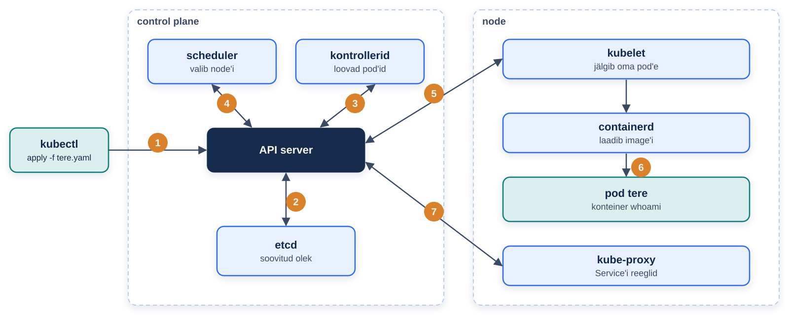

---
tags:
  - Kubernetes
  - k3s
---

# Loeng: Kubernetes

3\. kohtumisel käivitasid Dockeri ja Compose'iga konteinerid ühes masinas ning 4. kohtumisel lõid OpenTofuga masinad koodist. Täna vaatad, kuidas konteinereid hallatakse siis, kui masinaid on mitu ja rakendus peab töötama ka rikke ajal. Selleks on Kubernetes: sina kirjeldad soovitud olekut ja Kubernetes hoiab klastrit pidevalt selles olekus.

??? abstract "Õpiväljundid"

    Pärast loengut ja praktikumi oskad:

    - otsustada kahe põhjendusega, kas teenuse jaoks sobib Compose või Kubernetes;
    - selgitada soovitud ja tegeliku oleku abil, mida kontroller teeb, kui pod kustutatakse;
    - järjestada joonise 5.3 abil klastri osade sammud, mis järgnevad käsule `kubectl apply`;
    - märkida Deployment'i ja Service'i YAML-failis read, mis seovad need siltide kaudu;
    - kirjeldada joonise abil, mis teed pidi jõuab päring brauserist või teisest pod'ist pod'ini;
    - arvutada, mitu vana pod'i jääb rolling update'i ajal tööle, kui uus versioon ei käivitu;
    - leida käskudega `kubectl get`, `describe` ja `logs`, miks pod ei käivitu;
    - eristada käskude `kubectl apply`, `helm upgrade` ja Argo CD ülesannet rakenduse paigaldamisel.

## 1. Miks orkestreerimine

Compose'iga töötasid kõik konteinerid ühes masinas. Taaskäivitusreegel `restart: unless-stopped` käivitab seiskunud konteineri uuesti, aga ainult samas masinas. Kui masin ise läheb rikki või vajab hooldust, ei vii keegi konteinereid teise masinasse ja rakendus seisab.

Seda probleemi lahendab **orkestreerimine**. Orkestreerija on tarkvara, mis otsustab, millises masinas konteiner töötab, asendab rikkis koopiad uutega ja vahetab versioonid järk-järgult välja. Administraator kirjeldab, mis peab töötama ja mitu koopiat. Masina valib orkestreerija.

Kubernetese klastris on kolm põhimõistet, mida kohtad juba järgmisel joonisel. **Node** on klastri masin, kus konteinerid töötavad. **Pod** on üks konteiner või mitu konteinerit koos, väikseim üksus, mida Kubernetes käivitab. **Control plane** on klastri juhtimise osa, mis otsustab, millisel node'il pod töötab. Täpsemalt tulevad need jaotistes 4 ja 6.

<figure style="max-width:690px;margin:.8em auto" class="lx" markdown="0">
<svg viewBox="0 0 690 250" role="img" aria-label="Vasakul üks Docker-host, kus kõik neli teenust seisavad, kui host läheb rikki. Paremal klaster: control plane hoiab soovitud olekut, node 2 läks rikki ja app01 pod luuakse uuesti node 3-l." xmlns="http://www.w3.org/2000/svg">
<style>.lx svg{width:100%;height:auto;font-family:var(--md-text-font-family,sans-serif)}.lx .box{fill:var(--md-code-bg-color);stroke:var(--md-default-fg-color--lighter);stroke-width:1.2}.lx .hi{fill:var(--md-primary-fg-color);fill-opacity:.16;stroke:var(--md-primary-fg-color);stroke-width:1.5}.lx .ok{fill:#2e7d32;fill-opacity:.14;stroke:#2e7d32;stroke-width:1.3}.lx .bad{fill:#c62828;fill-opacity:.12;stroke:#c62828;stroke-width:1.3}.lx .zone{fill:none;stroke:var(--md-default-fg-color--lighter);stroke-width:1.2;stroke-dasharray:5 4}.lx .t{fill:var(--md-default-fg-color);font-size:15px;font-weight:700}.lx .b{fill:var(--md-default-fg-color);font-size:14.5px;font-weight:600}.lx .s{fill:var(--md-default-fg-color--light);font-size:13px}.lx .c{fill:var(--md-default-fg-color);font-size:13px;font-family:var(--md-code-font-family,monospace)}.lx .w{fill:#c62828;font-size:13.5px;font-weight:700}.lx .g{fill:#2e7d32;font-size:13.5px;font-weight:700}.lx .a{stroke:var(--md-default-fg-color--light);stroke-width:1.5;fill:none}.lx .d{stroke-dasharray:4 3}.lx .h{fill:var(--md-default-fg-color--light)}</style>
<defs><marker id="lxa" viewBox="0 0 10 10" refX="9" refY="5" markerWidth="6" markerHeight="6" orient="auto"><path class="h" d="M0,0 L10,5 L0,10 z"/></marker></defs>
<text class="t" x="165" y="22" text-anchor="middle">Compose: üks host</text>
<rect class="zone" x="10" y="34" width="310" height="210" rx="8"/>
<rect class="bad" x="40" y="58" width="250" height="110" rx="6"/><text class="b" x="165.0" y="100.0" text-anchor="middle">docker01</text><text class="s" x="165.0" y="118.0" text-anchor="middle">app01, db01, mc01, rmq01</text><text class="s" x="165.0" y="136.0" text-anchor="middle">host läks rikki</text>
<text class="w" x="165" y="200" text-anchor="middle">Teenused seisavad, kuni keegi</text>
<text class="w" x="165" y="220" text-anchor="middle">hosti parandab või uue teeb</text>
<text class="t" x="515" y="22" text-anchor="middle">Kubernetes: klaster</text>
<rect class="zone" x="360" y="34" width="320" height="210" rx="8"/>
<rect class="hi" x="380" y="48" width="280" height="44" rx="6"/><text class="b" x="520.0" y="66.0" text-anchor="middle">control plane</text><text class="s" x="520.0" y="84.0" text-anchor="middle">hoiab soovitud olekut: app01 × 2</text>
<rect class="box" x="380" y="120" width="84" height="70" rx="6"/><text class="b" x="422.0" y="151.0" text-anchor="middle">node 1</text><text class="s" x="422.0" y="169.0" text-anchor="middle">app01</text>
<rect class="bad" x="478" y="120" width="84" height="70" rx="6"/><text class="b" x="520.0" y="142.0" text-anchor="middle">node 2</text><text class="s" x="520.0" y="160.0" text-anchor="middle">app01</text><text class="s" x="520.0" y="178.0" text-anchor="middle">rikkis</text>
<rect class="ok" x="576" y="120" width="84" height="70" rx="6"/><text class="b" x="618.0" y="151.0" text-anchor="middle">node 3</text><text class="s" x="618.0" y="169.0" text-anchor="middle">app01 uus</text>
<path class="a d" d="M520,190 C520,222 618,222 618,193" marker-end="url(#lxa)"/>
<text class="g" x="520" y="236" text-anchor="middle">pod luuakse uuesti teisel node'il</text>
</svg>
<figcaption>Joonis 5.1. Ühe hosti rike peatab Compose'i stacki, klastris luuakse pod teisel node'il uuesti (Talvik, 2026).</figcaption>
</figure>

Virtuaalmasinatega töötanud administraator tunneb sama mõtet Proxmoxi kõrgkäideldavusest (HA): kui server kaob, käivitatakse VM teises serveris. Kubernetes teeb sama üksiku rakenduse tasemel ja palju kiiremini, sest konteineri käivitamiseks ei pea operatsioonisüsteemi laadima.

Kustutatud pod luuakse uuesti mõne sekundiga. Kui kaob terve node, läheb kauem: Kubernetes märgib node'i olekusse `NotReady` ja ootab vaikimisi umbes viis minutit, enne kui selle pod'id teistele node'idele viib. Nii ei käivitata pod'e üle lühikese võrgukatkestuse tõttu.

??? note "Tabel 5.1. Compose ja Kubernetes"

    | | Docker Compose | Kubernetes |
    |---|---|---|
    | Masinad | üks | mitu node'i |
    | Kui masin kaob | konteinerid seisavad, kuni masin on tagasi | pod'id luuakse teistel node'idel uuesti |
    | Koopiate arv | tavaliselt üks konteiner teenuse kohta | `replicas` ütleb, mitu koopiat töötab |
    | Kirjeldus | `compose.yaml` | YAML-failid, igas üks või mitu objekti |
    | Väljast ligipääs | masina port | Service ja Ingress |

**Millal Kubernetest ei ole vaja.** Klaster lisab tööd: seda tuleb uuendada, jälgida ja varundada ning meeskond peab õppima uue sõnavara. Kubernetesest ilmub [kolm versiooni aastas](https://kubernetes.io/releases/) ja iga versiooni toetatakse umbes aasta, nii et klastrit tuleb uuendada vähemalt kord aastas. Üks väike rakendus ühes serveris töötab hästi ka Compose'i või systemd teenusena. Kubernetes tasub ära siis, kui teenuseid ja masinaid on palju või kui rakendus peab rikke ajal töötama.

??? question "Kontrolli ennast"

    Väike meeskond haldab ühte veebirakendust ja andmebaasi ühes serveris. Hoolduse ajal on lubatud kuni 10 minutit seisakut. Kas valida Compose või Kubernetes?

    ??? success "Vastus"

        Compose. Teenuseid ja masinaid on vähe ning seisak on lubatud. Kubernetes lisaks klastri uuendamise, jälgimise ja varundamise töö, aga ei annaks siin midagi juurde.

        Otsus muutuks, kui teenuseid ja servereid oleks palju või kui rakendus ei tohiks hoolduse ajal seista. Siis kaalub automaatne pod'ide asendamine teisel node'il üles klastri haldamise lisatöö.

## 2. Kust Kubernetes tuli ja mis on k3s

**Mis see on.** Kubernetes on avatud lähtekoodiga orkestreerija. Nimi tuleb kreeka keelest ja tähendab tüürimeest. Lühend K8s tähendab, et K ja s vahel on kaheksa tähte.

**Mis oli enne.** Google käitas oma teenuseid konteinerites juba 2000. aastate keskel ja haldas neid sisemise süsteemiga Borg. Teised ettevõtted haldasid servereid ja nende teenuseid skriptidega ja käsitsi.

**Mis on praegu.** 2014. aastal avaldas Google Borgi kogemuse põhjal Kubernetese ja 2015. aastal anti see Cloud Native Computing Foundationile ([CNCF](https://www.cncf.io/)), nii et Kubernetes ei kuulu ühele ettevõttele. Kubernetes on konteinerite haldamise tegelik standard ja kõigil suurtel pilveteenuse pakkujatel on hallatud Kubernetese teenus: Amazon EKS, Azure AKS ja Google GKE.

**Kuhu see läheb.** Kubernetes muutub platvormiks, mille peale ehitatakse teisi tööriistu: paketihaldur Helm, GitOpsi tööriistad nagu Argo CD ja ettevõtete sisemised arendusplatvormid. Paljud meeskonnad ei halda klastrit ise, vaid kasutavad pilve hallatud klastrit ja tegelevad ainult rakendustega.

Kubernetes on avatud projekt, mille põhjal teevad mitu tootjat oma **jaotuse** ehk distributsiooni, nagu Linuxi tuumast tehakse Ubuntu ja AlmaLinux. Käsud ja YAML-failid on kõigis samad, erinevad paigaldus ja kaasa pandud lisad.

??? note "Tabel 5.2. Kubernetese jaotused"

    | Jaotus | Kellele | Märkus |
    |---|---|---|
    | **k3s** | väike klaster, servamasinad, õppimine | Rancher, 2019. Ühes programmis, kaasas Traefik, ServiceLB ja kohalik kettaruum (local-path). Kursusel kasutad seda |
    | **k0s** | väike klaster | Mirantis. Samuti üks programm, lisad paigaldad ise |
    | **minikube**, **kind**, **MicroK8s** | arendaja arvuti, MicroK8s ka väike server | ühe node'iga klaster virtuaalmasinas või Dockeris |
    | **EKS**, **AKS**, **GKE** | pilv | control plane'i haldab pilveteenuse pakkuja |
    | **OpenShift** | suured asutused | Red Hati Kubernetes koos lisatööriistade ja tasulise toega |

**k3s** paigaldub ühe käsuga ja vajab vähe mälu, sest kogu juhtimise osa on ühes programmis. Ühe masinaga klastris hoiab k3s andmeid SQLite'i andmebaasis. Täpsemalt: [k3s dokumentatsioon](https://docs.k3s.io/).

Kubernetes ei ole ainus orkestreerija. Väiksemaid süsteeme hallatakse sageli lihtsamate tööriistadega.

??? note "Tabel 5.3. Kubernetese alternatiivid"

    | Tööriist | Mis see on | Millal valitakse |
    |---|---|---|
    | **Docker Compose** | mitu konteinerit ühes masinas | üks server, väike rakendus |
    | **Podman ja systemd** | konteiner systemd teenusena (Quadlet) | üksikud teenused Red Hati põhistes serverites |
    | **Docker Swarm** | Dockeri sisseehitatud klaster, failid sarnased Compose'iga | väike klaster ilma uue sõnavarata |
    | **HashiCorp Nomad** | üks programm, käivitab konteinereid ja tavalisi programme | segakeskkond, HashiCorpi tööriistade kasutajad |
    | **Coolify**, **Dokku**, **CapRover** | oma serverisse paigaldatav platvorm: `git push` või veebiliides ehitab ja käivitab rakenduse, all on Docker või Swarm | väike meeskond tahab automaatset paigaldust ilma klastrita |
    | **AWS ECS**, **Google Cloud Run** | pilve enda konteineriteenus | ainult ühes pilves, klastrit ei halda keegi ise |

    Swarmi ja Nomadi kasutajaid on vähem ja töökuulutustes küsitakse peaaegu alati Kubernetest.

Nimi k3s tuli mõttest teha Kubernetes, mis vajab poole vähem mälu. K8s on kümnetäheline sõna, seega poole väiksem on viietäheline K3s.

## 3. Soovitud olek ja kontroller

`docker run` on **imperatiivne** käsk: see ütleb, mida teha. Kubernetese YAML-fail on **deklaratiivne** kirjeldus: see ütleb, milline olek peab olema, ja süsteem leiab ise, mida selleks teha. Sama mõtet kasutasid Ansible'is ja OpenTofus: `state: present` või `resource` kirjeldab tulemust.

Lihtne näide: **Deployment** on objekt, mis hoiab soovitud arvu ühesuguseid pod'e (täpsemalt jaotises 6). Deployment `tere` ütleb, et image'ist `traefik/whoami` peab töötama kolm pod'i. Kui klastris on kaks pod'i, luuakse kolmas. Kui neli, kustutatakse üks. Kui kolm, ei tehta midagi.

Kirjelduse täitmise eest vastutavad **kontrollerid**. Iga [kontroller](https://kubernetes.io/docs/concepts/architecture/controller/) töötab lõputus tsüklis: loeb soovitud olekut, vaatab tegelikku olekut ja teeb sammu, et vahe kaoks.

<figure markdown="span">
  
  <figcaption>Joonis 5.2. Kontroller võrdleb soovitud ja tegelikku olekut ning kõrvaldab vahe (Talvik, 2026).</figcaption>
</figure>

Kui pod kustutatakse, näeb kontroller vahet „soovitud 3, tegelik 2“ ja loob uue pod'i. Uus pod saab uue nime ja uue IP-aadressi. Seepärast ei tohi miski sõltuda pod'i nimest ega aadressist.

??? note "Tabel 5.4. Ansible ja Kubernetes"

    | | Ansible | Kubernetes |
    |---|---|---|
    | Soovitud olek | playbook ja muutujad | YAML-failid, salvestatud klastrisse |
    | Millal olekut kontrollitakse | siis, kui playbook'i käivitad | pidevalt |
    | Kui teenus seiskub | jääb seisma järgmise käivituseni | pod luuakse uuesti mõne sekundiga |
    | Mida hallatakse | masinad: paketid, failid, teenused | konteinerid, nende võrk ja seadistus |

Ansible ja Kubernetes ei välista teineteist. Ansible'iga paigaldatakse sageli klastri masinad ja k3s ise, Kubernetes hoiab seejärel rakendusi.

??? question "Kontrolli ennast"

    Administraator kustutab Deployment'i `tere` pod'i, et rakendus peatada. Minuti pärast töötab rakendus jälle. Miks?

    ??? success "Vastus"

        Pod'i kustutamine muutis ainult tegelikku olekut. Deployment'is on soovitud olek endiselt kolm pod'i ja kontroller lõi puuduva pod'i uuesti. Rakenduse peatamiseks tuleb muuta soovitud olekut: `replicas: 0` või kustutada Deployment ise.

## 4. Klastri osad ja kubectl

Klaster koosneb kahest osast. **Control plane** hoiab klastri kirjeldust ja otsustab, kus miski töötab. **Node**'idel töötavad pod'id. k3s-is võib sama masin olla korraga control plane ja node, nagu praktikumis masin `control`.

<figure markdown="span">
  
  <figcaption>Joonis 5.3. Mis juhtub pärast käsku kubectl apply. Kontrollerid, scheduler ja kubelet suhtlevad API serveri kaudu (Talvik, 2026).</figcaption>
</figure>

- **API server** võtab vastu kõik päringud ja kontrollib õigusi. Ta kuulab porti 6443.
- **etcd** (k3s-is ühe masina puhul SQLite) on andmebaas, kus on kogu soovitud olek.
- **Scheduler** valib igale uuele pod'ile node'i, kus on piisavalt vaba protsessorit ja mälu. Kui palju pod vajab, kirjutatakse Deployment'i konteineri juurde väljale `resources`: `requests` on see, mille scheduler pod'ile kinni paneb, ja `limits` on ülempiir, millest rohkem konteiner kasutada ei saa. Vaata lähemalt [dokumentatsioonist](https://kubernetes.io/docs/concepts/configuration/manage-resources-containers/).
- **Kontrollerid** hoiavad soovitud olekut, näiteks pod'ide arvu.
- **kubelet** töötab igal node'il ja käivitab sellele node'ile määratud pod'id.
- **containerd** laadib image'i ja käivitab konteineri, nagu Docker.
- **kube-proxy** töötab igal node'il ja seab võrgureeglid, mille abil Service'i aadressile saadetud päring jõuab mõne pod'ini.

Joonise 5.3 numbrid näitavad, mis juhtub pärast käsku `kubectl apply -f tere.yaml`:

1. kubectl saadab Deployment'i kirjelduse API serverile. API server kontrollib õigusi ja faili kuju.
2. API server salvestab soovitud oleku andmebaasi etcd.
3. Deployment'i kontroller näeb uut Deployment'i ja loob ReplicaSet'i. ReplicaSet'i kontroller loob pod'ide kirjed. Neil pod'idel ei ole veel node'i.
4. Scheduler näeb node'ita pod'i ja määrab sellele node'i.
5. Selle node'i kubelet näeb, et talle on määratud uus pod.
6. kubelet annab containerd'le käsu image alla laadida ja konteiner käivitada. Seejärel teatab kubelet pod'i oleku API serverile ja `kubectl get pods` näitab olekut `Running`.
7. Kui pod'i ees on Service, seab kube-proxy võrgureeglid, mis saadavad Service'i päringud uuele pod'ile.

Kontrollerid, scheduler ja kubelet ei anna üksteisele käske. Igaüks jälgib API serverit ja teeb oma osa, kui näeb muudatust.

??? question "Kontrolli ennast"

    Pod on olekus `Pending` ja `kubectl describe pod` näitab sündmust `Insufficient memory`. Millise joonise 5.3 sammu juures töö seisab?

    ??? success "Vastus"

        Sammu 4 juures. Scheduler ei leidnud node'i, kus on piisavalt vaba mälu. Pod'il ei ole node'i, seega ükski kubelet seda ei käivita.

Administraator ei logi node'idesse sisse ega käivita seal konteinereid. Kõik käsud lähevad API serverile käsuga **kubectl**. SSH leiab failist `~/.ssh/config`, kuhu ühenduda ja millise võtmega. kubectl leiab sama info failist `~/.kube/config`. Sellist faili nimetatakse lühidalt **kubeconfig**'iks. Seal on klastri aadress, sinu sertifikaat või token ja vaikimisi **nimeruum** (namespace). Nimeruum jagab klastri osadeks, näiteks iga meeskonna või keskkonna jaoks oma.

??? note "Tabel 5.5. Sagedasemad kubectl käsud"

    | Käsk | Mida teeb | Tuttav vaste |
    |---|---|---|
    | `kubectl get pods` | näitab pod'e ja nende olekut | `docker ps` |
    | `kubectl describe pod <nimi>` | näitab kõike pod'i kohta ja lõpus sündmusi | `docker inspect` |
    | `kubectl logs <nimi>` | näitab konteineri väljundit | `docker logs` |
    | `kubectl apply -f <fail>` | viib klastri failiga kooskõlla | `ansible-playbook`, `tofu apply` |
    | `kubectl diff -f <fail>` | näitab, mis muutuks | `--check --diff`, `tofu plan` |
    | `kubectl delete -f <fail>` | kustutab failis kirjeldatud objektid | `tofu destroy` |

    Käskude kõrval kasutatakse terminali kasutajaliidest [k9s](https://k9scli.io/), mis näitab klastri objekte tabelina ja värskendab vaadet pidevalt.

## 5. k3s paigaldus ja klastri enda osad

Praktikumis paigaldad k3s-i masinasse `control`. [Ametlik paigaldusskript](https://docs.k3s.io/quick-start) laadib alla ühe programmi `k3s`, teeb sellest systemd teenuse ja käivitab selle. Selles ühes programmis on API server, scheduler, kontrollerid, kubelet, containerd ja käsk `kubectl`. Suures klastris on need eraldi programmid ja sageli eraldi masinates.

Skript käivitatakse `sudo` õigustes. Seepärast laadid selle enne alla ja loed läbi. Muutuja `INSTALL_K3S_VERSION` määrab versiooni, et kõigil õppijatel oleks sama klaster. Sama põhimõte kehtis OpenTofu provider'i versiooni puhul.

```bash
curl -sfL https://get.k3s.io -o install-k3s.sh
less install-k3s.sh
INSTALL_K3S_VERSION=v1.36.6+k3s1 sh install-k3s.sh
```

??? note "Tabel 5.6. k3s-i failid ja kaustad"

    | Fail või kaust | Mis seal on |
    |---|---|
    | teenus `k3s` | haldad käsuga `systemctl`, logi näed käsuga `journalctl -u k3s` |
    | `/etc/rancher/k3s/k3s.yaml` | administraatori kubeconfig, loetav ainult root'ile |
    | `/etc/rancher/k3s/registries.yaml` | kust k3s image'id tõmbab, selle faili teed ise |
    | `/var/lib/rancher/k3s/` | klastri andmebaas, image'id ja pod'ide andmed |

**kubeconfig.** k3s kirjutab administraatori kubeconfig'i faili, mida saab lugeda ainult root. Praktikumis kopeerid selle oma kodukausta `~/.kube/config` õigustega `600`, et `kubectl` töötaks ilma `sudo`-ta. Selle failiga on klastrile täielik juurdepääs, seepärast ei panda seda Giti. Töökohas saab iga inimene oma kubeconfig'i piiratud õigustega. Õigusi jagab Kubernetes rollide kaupa (**RBAC**, role-based access control), näiteks „võib lugeda pod'e nimeruumis `test`“. Sama mõte oli Proxmoxi piiratud tokenil.

**Image'id Harborist.** Docker Hub lubab ühelt IP-aadressilt piiratud arvu tõmbeid tunnis. Kogu kool on interneti jaoks üks aadress, nii et 20 õppija klastrid ületaksid piiri kiiresti. Kooli Harbor töötab vahemäluna: tõmbab image'i Docker Hubist üks kord ja annab selle siis kõigile. Fail `registries.yaml` ütleb containerd'le, et Docker Hubi image'id tuleb küsida Harborist. Kui Harbor ei vasta, tõmbab k3s image'i otse Docker Hubist. Ettevõtted hoiavad oma registrit samal põhjusel ja ka selleks, et image'id enne kasutamist turvavigade suhtes kontrollida.

**Klastri enda osad.** Kohe pärast paigaldust näitab `kubectl get pods -A` mitut pod'i, kuigi sa ei ole veel midagi käivitanud. Need on klastri enda osad nimeruumis `kube-system`. Klastri lisad on samuti pod'id ja neid hallatakse samamoodi nagu sinu rakendust.

??? note "Tabel 5.7. Pod'id nimeruumis kube-system"

    | Pod | Mida teeb |
    |---|---|
    | `coredns` | annab Service'itele nimed, nii et pod leiab teise pod'i nime järgi |
    | `traefik` | võtab pordil 80 ja 443 vastu veebiliikluse ja suunab selle Ingressi reeglite järgi |
    | `svclb-traefik` | ServiceLB: avab Traefiku pordid node'i IP-aadressil |
    | `local-path-provisioner` | annab pod'idele kettaruumi node'i kaustast |
    | `metrics-server` | kogub pod'ide protsessori ja mälu kasutust käsule `kubectl top` |
    | `helm-install-traefik` | ühekordne töö, mis paigaldas Traefiku Helmiga, olek `Completed` |

??? question "Kontrolli ennast"

    `kubectl get pods` vastab `No resources found in default namespace`, aga `kubectl get pods -A` näitab seitset pod'i. Miks?

    ??? success "Vastus"

        Ilma võtmeta `-n` näitab `kubectl` ainult nimeruumi `default`, kus sinu rakendusi veel ei ole. Võti `-A` näitab kõiki nimeruume ja seal on klastri enda osad nimeruumis `kube-system`.

## 6. Pod, Deployment ja Service

**Pod** on väikseim üksus, mida Kubernetes käivitab: üks või mitu konteinerit, millel on ühine IP-aadress. Pod'e otse tavaliselt ei looda. **Deployment** kirjeldab, mitu ühesugust pod'i peab töötama ja millisest image'ist. Deployment teeb vahepealse objekti **ReplicaSet**, mis hoiab pod'ide arvu. Versiooni uuendamisel teeb Deployment uue ReplicaSet'i ja vahetab pod'id järk-järgult. Seda nimetatakse **rolling update**'iks.

Iga uus pod saab uue IP-aadressi. **Service** annab pod'ide grupile püsiva nime ja aadressi ning jagab päringud nende vahel. Compose'is lahendas selle ülesande teenuse nimi: konteiner leidis teise konteineri nime järgi.

Deployment ja Service ei tea pod'ide nimesid. Need leiavad pod'id **siltide** (labels) järgi. Silt on võti ja väärtus, näiteks `app: tere`. Deployment paneb sildi igale pod'ile, mille ta loob, ja Service saadab liikluse kõigile pod'idele, millel see silt on. Sama mõtet kasutasid Ansible'i inventory grupid.

<figure markdown="span">
  
  <figcaption>Joonis 5.4. Deployment, ReplicaSet, pod ja Service on seotud ainult siltide kaudu (Talvik, 2026).</figcaption>
</figure>

Igas Kubernetese YAML-failis on samad neli osa. `apiVersion` ja `kind` ütlevad, mis tüüpi objekt see on. `metadata` annab nime ja sildid. `spec` on soovitud olek, mille kirjutad sina. `status` on tegelik olek, mille kirjutab Kubernetes.

```yaml
apiVersion: apps/v1
kind: Deployment
metadata:
  name: tere
spec:
  replicas: 3                 # mitu pod'i peab töötama
  selector:
    matchLabels:
      app: tere               # Deployment'ile kuuluvad selle sildiga pod'id
  template:                   # mall, millest pod'id tehakse
    metadata:
      labels:
        app: tere             # sama silt igale uuele pod'ile
    spec:
      containers:
        - name: whoami
          image: traefik/whoami:v1.11.0
```

Service'i fail on lühem. Selle `selector` peab olema sama silt, mis Deployment'i mallis.

```yaml
apiVersion: v1
kind: Service
metadata:
  name: tere
spec:
  type: NodePort
  selector:
    app: tere                 # leiab pod'id, millel on see silt
  ports:
    - port: 80                # Service'i port klastri sees
      targetPort: 80          # konteineri port
      nodePort: 30080         # port igal node'il
```

??? question "Kontrolli ennast"

    Vaata ülal Deployment'i ja Service'i faili. Millised kolm rida peavad olema sama väärtusega, et päring jõuaks Service'ist pod'ini? Mida iga rida teeb?

    ??? success "Vastus"

        - Deployment'is `template.metadata.labels`: `app: tere` paneb sildi igale uuele pod'ile.
        - Deployment'is `selector.matchLabels`: `app: tere` ütleb, millised pod'id Deployment'ile kuuluvad. Kui see erineb mallist, keeldub API server Deployment'i vastu võtmast.
        - Service'is `selector`: `app: tere` ütleb, millistele pod'idele Service päringud saadab. Kui see erineb, võetakse fail vastu, aga Service'il ei ole ühtegi pod'i.

Kust Service on kättesaadav, ütleb selle tüüp `type`. Tüüpidest ja päringu teest tuleb juttu jaotises 8.

??? question "Kontrolli ennast"

    Service'i failis on `selector: app: tere`, aga Deployment'is on silt `app: Tere` nii `selector`-is kui ka mallis. Mis juhtub, kui teed mõlemale `kubectl apply`?

    ??? success "Vastus"

        Mõlemad failid võetakse vastu ja pod'id töötavad, aga Service ei leia ühtegi pod'i, sest sildid on tõstutundlikud. `kubectl get endpointslices` näitab, et Service'il pole aadresse, ja päringud ei jõua kuhugi.

## 7. Käsust failiks

Kubernetesele saab anda korraldusi kahel viisil. **Imperatiivne** käsk ütleb, mida teha: `kubectl create deployment`, `kubectl scale`, `kubectl delete pod`. **Deklaratiivne** fail kirjeldab soovitud olekut ja `kubectl apply` viib klastri sellega kooskõlla. Käsk sobib katsetamiseks, aga sellest ei jää kirja, milline olek on soovitud. Kui klaster kaob, ei tea keegi, mis seal töötas.

YAML-faili ei pea kirjutama tühjalt lehelt. Võti `--dry-run=client` ütleb, et `kubectl` ei saada midagi klastrisse. Võti `-o yaml` trükib objekti, mille käsk oleks loonud. Nii saad õige kujuga faili, mida muudad edasi ja hoiad Gitis.

```bash
kubectl create deployment tere --image=traefik/whoami:v1.11.0 --replicas=3 \
  --dry-run=client -o yaml > deployment.yaml
```

??? note "Tabel 5.8. Sama muudatus käsuga ja failiga"

    | Muudatus | Käsuga | Failiga |
    |---|---|---|
    | loo Deployment | `kubectl create deployment tere --image=…` | `kubectl apply -f deployment.yaml` |
    | muuda koopiate arvu | `kubectl scale deployment tere --replicas=4` | muuda failis `replicas`, siis `apply` |
    | muuda image'i | `kubectl set image deployment/tere whoami=…` | muuda failis `image`, siis `apply` |
    | kus soovitud olek on kirjas | ainult klastris | failis ja Gitis |

`kubectl apply` on idempotentne. Kui fail ja klaster on juba samad, vastab teine käivitus `unchanged`, nagu Ansible'i `changed=0` ja OpenTofu `No changes`. `kubectl diff -f deployment.yaml` näitab enne muudatust, mis klastris muutuks, nagu `tofu plan`.

Kui keegi muudab klastrit käsuga, erinevad fail ja klaster. Seda erinevust nimetatakse **triiviks** (drift). Järgmine `kubectl apply` viib klastri tagasi faili olekusse ja käsitsi tehtud muudatus kaob. Seepärast tehakse muudatus failis ja failist tuleb see klastrisse.

??? question "Kontrolli ennast"

    Failis on `replicas: 3`. Administraator teeb käsu `kubectl scale deployment tere --replicas=5`. Hiljem muudetakse failis image'i versiooni ja tehakse `kubectl apply`. Mitu pod'i on pärast seda?

    ??? success "Vastus"

        Kolm. `apply` viib klastri faili olekusse ja failis on `replicas: 3`. Kui viis koopiat oli vaja, pidi muudatus minema faili. Kui faili muudetakse, tuleb muudatus Giti, ja nii jääb kirja, kes ja miks muutis.

## 8. Kuidas päring pod'ini jõuab

Pod'i IP-aadress, näiteks `10.42.0.9`, on nähtav ainult klastri sees ja muutub iga uue pod'iga. Service saab püsiva aadressi teisest vahemikust, näiteks `10.43.0.15`, ja püsiva nime. Joonis 5.5 näitab kolme teed Service'ini.

<figure markdown="span">
  
  <figcaption>Joonis 5.5. Päring jõuab pod'ini alati Service'i kaudu (Talvik, 2026).</figcaption>
</figure>

**Klastri seest.** Teine pod kasutab aadressi `http://tere`. CoreDNS annab nimele `tere` Service'i aadressi. Sama tegi Compose'i võrgus Dockeri DNS: konteiner leidis teise teenuse nime järgi. Täisnimi on `tere.default.svc.cluster.local`, kus `default` on nimeruum. Teise nimeruumi Service'i poole pöördutakse nimega `tere.<nimeruum>`.

**NodePort.** Service'i tüüp `NodePort` avab pordi vahemikus 30000–32767 igal node'il. kube-proxy seab node'il võrgureeglid, mis saadavad sellele pordile tulnud päringu Service'ile. Port on avatud igal node'il, nii et brauseris sobib ükskõik millise node'i IP-aadress. Praktikumis kasutad porti `30080`.

**Ingress.** Traefik kuulab porte 80 ja 443 ning vaatab päringu päist `Host`. Ingressi reegel ütleb, et nimi `tere.local` läheb Service'ile `tere`. Nii saab ühe IP-aadressi ja pordi taga olla palju rakendusi, nagu nginx'i virtuaalhostid. Ingress ei ole Service'i tüüp, vaid eraldi objekt, mis viitab Service'ile.

```yaml
apiVersion: networking.k8s.io/v1
kind: Ingress
metadata:
  name: tere
spec:
  rules:
    - host: tere.local            # päise Host väärtus
      http:
        paths:
          - path: /
            pathType: Prefix
            backend:
              service:
                name: tere        # Service, kuhu päring läheb
                port:
                  number: 80
```

??? note "Tabel 5.9. Kuidas Service'i välja näidata"

    | Viis | Kust kättesaadav | Kus kasutatakse |
    |---|---|---|
    | `ClusterIP` | ainult klastri sees, nimega | andmebaas, sisemine teenus |
    | `NodePort` | iga node'i IP ja port 30000–32767 | katsetamine, praktikum |
    | `LoadBalancer` | eraldi väline IP-aadress | pilves loob pakkuja koormusjaoturi, k3s-is avab ServiceLB pordi node'il |
    | Ingress | nimi ja tee, pordid 80 ja 443 | veebirakendused |

Service jagab päringud oma pod'ide vahel. Praktikumis näed seda nii, et rakenduse vastuses muutub `Hostname` päringust päringusse.

??? question "Kontrolli ennast"

    Brauseris on avatud `http://<control'i IP>:30080`. Administraator kustutab korraga kõik kolm pod'i. Mis muutub ja mis jääb samaks?

    ??? success "Vastus"

        Deployment loob kolm uut pod'i uute nimede ja IP-aadressidega. Service'i aadress, nimi ja port `30080` jäävad samaks. Mõne sekundi jooksul võib brauser anda vea, siis vastab leht uute pod'ide nimedega.

## 9. Uus versioon ja tagasivõtt

Image'i tag määrab rakenduse versiooni. Kui failis muutub tag, teeb Deployment uue ReplicaSet'i ja vahetab pod'id järk-järgult välja. Seda nimetatakse **rolling update**'iks. Uus pod peab olema valmis, enne kui järgmine vana pod kustutatakse.

Kaks seadet ütlevad, kui kiiresti vahetus käib. `maxSurge` ütleb, mitu pod'i võib olla soovitud arvust rohkem. `maxUnavailable` ütleb, mitu pod'i võib soovitud arvust puududa. Mõlema vaikeväärtus on 25%. `maxSurge` ümardatakse üles ja `maxUnavailable` alla.

??? note "Tabel 5.10. Rolling update vaikeväärtustega"

    | `replicas` | `maxSurge` | `maxUnavailable` | Mis juhtub, kui uus versioon ei käivitu |
    |---|---|---|---|
    | 3 | 1 | 0 | 3 vana töötavad, 1 uus ei käivitu |
    | 4 | 1 | 1 | 3 vana töötavad, 2 uut ei käivitu |
    | 10 | 3 | 2 | 8 vana töötavad, 5 uut ei käivitu |

Uuendust jälgitakse käsuga `kubectl rollout`:

??? note "Tabel 5.11. Käsud uuenduse jälgimiseks"

    | Käsk | Mida teeb |
    |---|---|
    | `kubectl rollout status deployment tere` | ootab, kuni uuendus lõpeb, või näitab, et see seisab |
    | `kubectl rollout history deployment tere` | näitab varasemaid versioone |
    | `kubectl rollout undo deployment tere` | viib klastri eelmise versiooni juurde |
    | `kubectl get replicasets` | näitab vana ja uut ReplicaSet'i ning nende pod'ide arvu |

`kubectl rollout undo` muudab klastrit, aga mitte faili. Järgmine `apply` toob vigase versiooni tagasi. `undo` sobib hädaolukorraks, kui rakendus on katki ja parandus võtab aega. Seejärel parandatakse ka fail.

Kubernetes peab pod'i valmis olevaks siis, kui konteiner käivitus. Rakendus võib aga vajada käivitumiseks aega. **readinessProbe** ütleb, kuidas valmidust kontrollida, näiteks HTTP-päringuga aadressile `/health`. Kuni kontroll ei õnnestu, ei saada Service pod'ile päringuid ja rolling update ei kustuta järgmist vana pod'i. **livenessProbe** kontrollib samamoodi, kas töötav konteiner on veel terve. Kui see kontroll ebaõnnestub, käivitab kubelet konteineri uuesti. Mõlemad on kirjas [dokumentatsioonis](https://kubernetes.io/docs/concepts/configuration/liveness-readiness-startup-probes/).

**Ära kasuta tag'i `latest`.** Sama tag võib eri päevadel tähendada eri image'it. Siis ei tea keegi, milline versioon töötab, ja `rollout undo` ei pruugi viia tagasi eelmise versiooni juurde. Kasuta kindlat versiooni, näiteks `v1.12.0`.

??? question "Kontrolli ennast"

    Deployment'is on `replicas: 4`. Uues versioonis on image'i tag vale. Mitu pod'i on `Running` ja mitu `ImagePullBackOff`? Mida näitab `kubectl get deployment`?

    ??? success "Vastus"

        Kolm vana pod'i on `Running` ja kaks uut on `ImagePullBackOff`. Nelja koopia puhul lubab `maxUnavailable` ühel pod'il puududa, seepärast kustutati üks vana pod. `maxSurge` lubab viit pod'i korraga, seega tehti kaks uut. `kubectl get deployment` näitab `READY 3/4` ja `UP-TO-DATE 2`.

## 10. Kui pod ei käivitu

Pod'i olek ütleb, millises etapis see pidama jäi, ja põhjus on pod'i sündmustes. Kolm käsku leiavad enamiku vigu: `kubectl get pods` näitab olekut, `kubectl describe pod <nimi>` näitab lõpus sündmusi ja `kubectl logs <nimi>` näitab konteineri väljundit.

??? note "Tabel 5.12. Pod'i olekud ja kust põhjust otsida"

    | Olek | Mida tähendab | Kust otsida |
    |---|---|---|
    | `Pending` | pod'ile ei leitud node'i | `describe pod`: sündmused, näiteks `Insufficient memory` |
    | `ContainerCreating` | image laaditakse alla | oota, siis `describe pod` |
    | `ErrImagePull`, `ImagePullBackOff` | image'i ei saanud alla laadida | `describe pod`: `not found` tähendab vale nime või tag'i |
    | `CrashLoopBackOff` | konteineri protsess lõpetab kohe töö ja käivitatakse üha pikema ootega uuesti | `logs <pod> --previous` |
    | `Running`, aga `READY 0/1` | konteiner töötab, aga ei ole valmis päringuid vastu võtma | `describe pod`: `Readiness probe failed` |

Rolling update kaitseb vigase versiooni eest. Kui uus pod ei käivitu, jääb enamik vanu pod'e tööle ja rakendus vastab edasi. `kubectl get deployment` näitab siis, et `READY` on väiksem kui soovitud arv.

??? question "Leia viga"

    Administraator muudab Deployment'is image'i real `traefik/whoami:v1.11.0` väärtuseks `traefik/whoami:latest-amd`. Pärast `apply`-d näitab `kubectl get pods` üht pod'i olekus `ImagePullBackOff` ja kolme `Running`. Kas rakendus töötab? Kust põhjus leida ja kuidas parandada?

    ??? success "Vastus"

        Rakendus töötab, sest kolm vana pod'i jäid alles. `kubectl describe pod` näitab sündmust `not found`: Docker Hubis on tag `latest-amd64`, mitte `latest-amd`. Parandus käib failis: õige tag, seejärel `kubectl apply`. Tootmises ei kasutata tag'i `latest`, sest siis ei tea keegi, milline versioon töötab.

## 11. Compose'i stack Kubernetesesse

Compose'i failis on iga teenuse kohta image, pordid, muutujad, paroolid ja andmekaustad. Kubernetesis on igaühe jaoks oma objekt. Seepärast on Kubernetese failid pikemad, aga iga osa saab eraldi muuta ja õigusi jagada.

??? note "Tabel 5.13. Compose'i osad Kubernetesis"

    | Compose | Kubernetes |
    |---|---|
    | teenus, `image` | Deployment |
    | teenuse nimi võrgus | Service tüübiga `ClusterIP` |
    | `ports: "8080:80"` | Service tüübiga `NodePort` või Ingress |
    | `environment` | **ConfigMap**: seadistus võtme ja väärtusena |
    | paroolid failis `.env` | **Secret**: nagu ConfigMap, aga eraldi õigustega |
    | `volumes` andmete jaoks | **PersistentVolumeClaim**: kettaruumi taotlus, k3s-is annab selle local-path |
    | andmebaas | **StatefulSet**: igal pod'il püsiv nimi ja oma ketas |
    | `healthcheck`, `depends_on` | readinessProbe, käivitamise järjekorda Kubernetes ei taga |
    | `restart: unless-stopped` | Deployment'i kontroller teeb seda alati |

Secret ei ole krüpteeritud. Väärtus on base64-kujul ja selle saab tagasi lugeda igaüks, kellel on õigus Secret'eid lugeda. Seepärast ei panda Secret'i faili Giti. Töökohas hoitakse paroole välises saladuste halduris, näiteks OpenBaos, ja klastrisse tuuakse need eraldi tööriistaga.

Andmebaasi hoitakse sageli klastrist väljas, näiteks pilve hallatud andmebaasina. Klastris on lihtsam hoida rakendusi, mis ei hoia andmeid. Andmebaasi varundamine, uuendamine ja taastamine klastris vajab lisateadmisi. Selleks kasutatakse **Operator**'eid: kontrollereid, mis teavad, kuidas üht kindlat rakendust, näiteks PostgreSQL-i, hallata.

??? question "Kontrolli ennast"

    Compose'is oli andmebaasi parool failis `.env`, mis ei läinud Giti. Kuhu läheb parool Kubernetesis ja kas see on seal krüpteeritud?

    ??? success "Vastus"

        Parool läheb Secret'i. Vaikimisi ei ole see krüpteeritud, vaid ainult base64-kujul. Selle näeb igaüks, kellel on õigus Secret'eid lugeda. Secret'i fail ei lähe Giti, sama nagu `.env`.

## 12. Helm ja GitOps

Kui rakenduses on kümneid YAML-faile ja neid on vaja paigaldada mitmesse keskkonda, muutub failide käsitsi haldamine raskeks. Selleks on kaks tööriista, mida praktikumi lisaülesannetes proovid.

**Helm** on Kubernetese paketihaldur, nagu `apt` Ubuntus. Pakett on **chart**: YAML-failide mallid koos vaikeväärtustega. Käsk `helm install` teeb mallidest failid ja saadab need klastrisse, `helm upgrade` uuendab ja `helm rollback` viib eelmise versiooni juurde. k3s paigaldab Traefiku ise Helmi chart'ina. Enamik valmis tarkvara, näiteks Argo CD, Prometheus ja andmebaasid, paigaldatakse Kubernetesesse Helmiga. Teine levinud tööriist on [Kustomize](https://kustomize.io/), mis on `kubectl`-i sisse ehitatud (`kubectl apply -k`). See ei kasuta malle, vaid lisab tavalistele YAML-failidele keskkonna kaupa muudatusi, näiteks test- ja toodangukeskkonnas erineva koopiate arvu.

??? question "Kontrolli ennast"

    Mis vahe on käskudel `helm upgrade` ja `kubectl apply`?

    ??? success "Vastus"

        `kubectl apply` saadab klastrisse failid nii, nagu need on. `helm upgrade` teeb chart'i mallidest ja väärtustest failid ning salvestab paigalduse versiooni. Seepärast saab Helmiga minna käsuga `helm rollback` eelmise versiooni juurde.

**GitOps** tähendab, et soovitud olek on Gitis ja klastris töötav tööriist viib klastri sellega kooskõlla. **Argo CD** on selline tööriist, teine levinud on [Flux](https://fluxcd.io/). See on samasugune kontroller nagu Kubernetese enda omad, ainult soovitud olek tuleb Gitist. Kui keegi muudab klastris midagi käsitsi, märkab Argo CD erinevust Gitiga ehk **triivi** (drift) ja muudab klastri tagasi. Seda teeb Argo CD ainult siis, kui rakenduse seadistuses on sisse lülitatud `selfHeal`. Vaikimisi näitab Argo CD triivi, aga ei paranda seda.

<figure style="max-width:690px;margin:.8em auto" class="lx" markdown="0">
<svg viewBox="0 0 690 286" role="img" aria-label="Push-mudelis loeb CI runner Gitist ja käivitab kubectl apply, klastri võti on runneril. Pull-mudelis töötab Argo CD klastri sees, loeb Gitist soovitud oleku, rakendab selle ja pöörab käsitsi tehtud muudatused tagasi." xmlns="http://www.w3.org/2000/svg">
<style>.lx svg{width:100%;height:auto;font-family:var(--md-text-font-family,sans-serif)}.lx .box{fill:var(--md-code-bg-color);stroke:var(--md-default-fg-color--lighter);stroke-width:1.2}.lx .hi{fill:var(--md-primary-fg-color);fill-opacity:.16;stroke:var(--md-primary-fg-color);stroke-width:1.5}.lx .ok{fill:#2e7d32;fill-opacity:.14;stroke:#2e7d32;stroke-width:1.3}.lx .bad{fill:#c62828;fill-opacity:.12;stroke:#c62828;stroke-width:1.3}.lx .zone{fill:none;stroke:var(--md-default-fg-color--lighter);stroke-width:1.2;stroke-dasharray:5 4}.lx .t{fill:var(--md-default-fg-color);font-size:15px;font-weight:700}.lx .b{fill:var(--md-default-fg-color);font-size:14.5px;font-weight:600}.lx .s{fill:var(--md-default-fg-color--light);font-size:13px}.lx .c{fill:var(--md-default-fg-color);font-size:13px;font-family:var(--md-code-font-family,monospace)}.lx .w{fill:#c62828;font-size:13.5px;font-weight:700}.lx .g{fill:#2e7d32;font-size:13.5px;font-weight:700}.lx .a{stroke:var(--md-default-fg-color--light);stroke-width:1.5;fill:none}.lx .d{stroke-dasharray:4 3}.lx .h{fill:var(--md-default-fg-color--light)}</style>
<defs><marker id="lxb" viewBox="0 0 10 10" refX="9" refY="5" markerWidth="6" markerHeight="6" orient="auto"><path class="h" d="M0,0 L10,5 L0,10 z"/></marker></defs>
<text class="t" x="10" y="22" text-anchor="start">Push: CI teeb deploy</text>
<rect class="box" x="10" y="34" width="140" height="56" rx="6"/><text class="b" x="80.0" y="58.0" text-anchor="middle">Git</text><text class="s" x="80.0" y="76.0" text-anchor="middle">manifestid</text>
<rect class="bad" x="250" y="34" width="170" height="56" rx="6"/><text class="b" x="335.0" y="58.0" text-anchor="middle">CI runner</text><text class="s" x="335.0" y="76.0" text-anchor="middle">hoiab klastri võtit</text>
<rect class="box" x="520" y="34" width="160" height="56" rx="6"/><text class="b" x="600.0" y="67.0" text-anchor="middle">klaster</text>
<line class="a" x1="150" y1="62" x2="248" y2="62" marker-end="url(#lxb)"/><text class="s" x="199" y="54" text-anchor="middle">push</text>
<line class="a" x1="420" y1="62" x2="518" y2="62" marker-end="url(#lxb)"/><text class="s" x="469" y="54" text-anchor="middle">kubectl apply</text>
<text class="w" x="345" y="112" text-anchor="middle">Käsitsi tehtud muudatus klastris jääb märkamata kuni järgmise deploy'ni.</text>
<text class="t" x="10" y="150" text-anchor="start">Pull: GitOps</text>
<rect class="box" x="10" y="162" width="140" height="56" rx="6"/><text class="b" x="80.0" y="186.0" text-anchor="middle">Git</text><text class="s" x="80.0" y="204.0" text-anchor="middle">soovitud olek</text>
<rect class="zone" x="250" y="156" width="430" height="120" rx="8"/>
<text class="s" x="680" y="150" text-anchor="end">klaster</text>
<rect class="hi" x="265" y="162" width="160" height="56" rx="6"/><text class="b" x="345.0" y="186.0" text-anchor="middle">Argo CD</text><text class="s" x="345.0" y="204.0" text-anchor="middle">klastri sees</text>
<rect class="ok" x="520" y="162" width="145" height="56" rx="6"/><text class="b" x="592.5" y="186.0" text-anchor="middle">nimeruum default</text><text class="s" x="592.5" y="204.0" text-anchor="middle">tegelik olek</text>
<line class="a" x1="263" y1="182" x2="152" y2="182" marker-end="url(#lxb)"/><text class="s" x="208" y="174" text-anchor="middle">loeb</text>
<line class="a" x1="425" y1="182" x2="518" y2="182" marker-end="url(#lxb)"/><text class="s" x="471" y="174" text-anchor="middle">rakendab</text>
<path class="a d" d="M592,220 V244 H345 V222" marker-end="url(#lxb)"/>
<text class="s" x="470" y="258" text-anchor="middle">jälgib triivi, pöörab tagasi</text>
</svg>
<figcaption>Joonis 5.6. Push-mudelis saadab CI muudatuse klastrisse, pull-mudelis loeb klastris töötav agent selle Gitist (Talvik, 2026).</figcaption>
</figure>

Tavaline ahel töökohas on selline: konveier, näiteks GitHub Actions, ehitab ja testib image'i ning kirjutab selle uue tag'i Gitis olevasse YAML-faili. Argo CD näeb Gitis muudatust ja uuendab klastrit. Argo CD kontrollib Giti vaikimisi iga kolme minuti tagant, nii et muudatus ei jõua klastrisse kohe. Konveier ei vaja klastri võtit, klastrisse kirjutab ainult Argo CD. Nii töötavad ka Eesti ettevõtted. Näiteks on Entigo kirjutanud tag'i uuendamise sammu jaoks oma tööriista [entigo-k8s-gitops](https://github.com/entigolabs/entigo-k8s-gitops).

??? info "OpenTofu ja Helm"

    Helmi ja OpenTofut võrreldakse sageli, aga need töötavad eri tasemel. OpenTofu loob infrastruktuuri: võrgu, masinad ja klastri. Helm ja Argo CD paigaldavad rakendused juba olemasolevasse klastrisse. OpenTofus on olemas ka Helmi provider, aga klastri loomine ja rakenduste paigaldamine samas `apply`-s tekitab probleeme, sest provider vajab klastri aadressi juba enne, kui klaster on olemas. Seepärast hoitakse need tavaliselt eraldi.

??? question "Kontrolli ennast"

    Klastris on Argo CD, mille rakendusel on `selfHeal` sisse lülitatud. Gitis on `replicas: 3`. Administraator muudab käsuga `kubectl scale` koopiate arvu viieks. Mis juhtub?

    ??? success "Vastus"

        Argo CD märkab, et klaster erineb Gitist, ja viib koopiate arvu tagasi kolmele. Püsiv muudatus tuleb teha Gitis: muuda faili, tee commit ja push. Kui `selfHeal` on välja lülitatud, jääb klastrisse viis koopiat ja Argo CD näitab rakendust olekus `OutOfSync`.

??? abstract "Kokkuvõte"

    | Mõiste | Lühidalt |
    |---|---|
    | orkestreerimine | tarkvara valib konteinerile masina ja asendab rikkis koopiad |
    | k3s | ühes programmis Kubernetes, paigaldub ühe käsuga |
    | soovitud ja tegelik olek | kontroller võrdleb neid pidevalt ja kõrvaldab vahe |
    | control plane, node | juhtimise osa ja masinad, kus pod'id töötavad |
    | kubectl, kubeconfig | käsk klastriga rääkimiseks ja fail, kust see leiab aadressi ja sertifikaadi |
    | pod | üks või mitu konteinerit ühise IP-ga |
    | Deployment | hoiab soovitud arvu pod'e ja vahetab versioone järk-järgult |
    | Service | püsiv nimi ja aadress pod'ide grupile |
    | silt (label) | võti ja väärtus, mille järgi objektid üksteist leiavad |
    | nimeruum | klastri osa, `kube-system` klastri enda osadele, `default` rakendustele |
    | `kubectl apply`, triiv | viib klastri failiga kooskõlla; käsuga tehtud muudatus kaob järgmisel `apply`-l |
    | NodePort, Ingress | port igal node'il; nimi pordil 80 Traefiku kaudu |
    | rolling update | pod'id vahetatakse järk-järgult, vigane versioon ei peata rakendust |
    | ConfigMap, Secret | seadistus ja paroolid, Secret ei ole krüpteeritud |
    | Helm | paketihaldur, chart'id |
    | Argo CD | viib klastri Gitis kirjeldatud olekusse ja märkab triivi |
