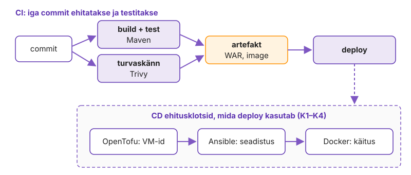
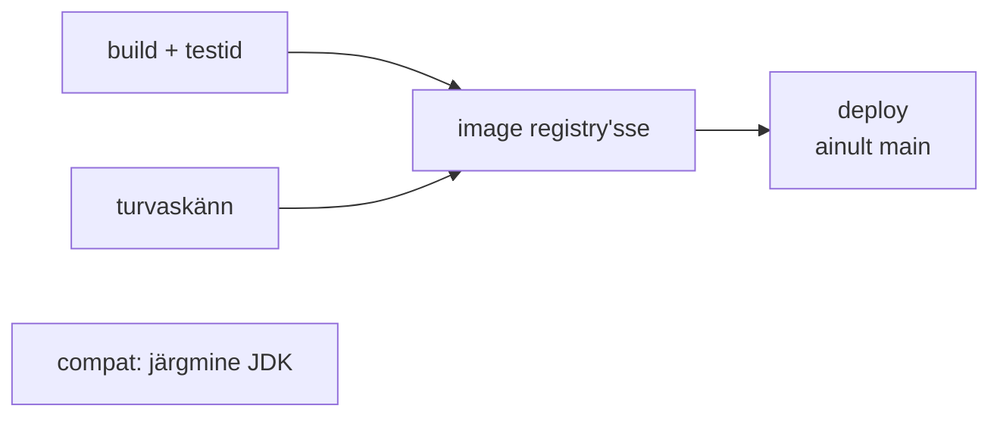
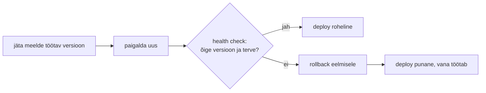
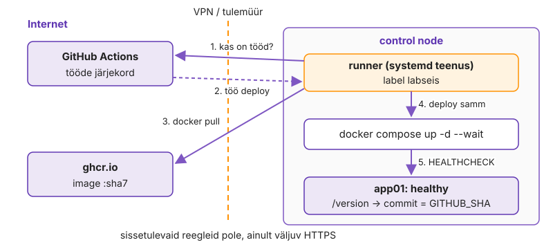

---
tags:
  - CI/CD
  - Maven
  - GitHub Actions
---

# 5. kohtumine · Pidev integratsioon ja tarne: loeng

3\. kohtumisest on rakendus image'ina olemas ja 4. kohtumisel lõid OpenTofu'ga taristu koodist. Seni on iga tööriist oodanud, et keegi selle käivitaks. Täna paneme ahela tööle ilma käsitsi käivitamiseta: commit'ist saab artefakt ja artefaktist töötav teenus. **Pipeline on tarneahel**: iga lüli selles, alates sõltuvusest ja action'ist kuni runner'i, deploy'ni ja muudatuse kirjeni, on otsus selle kohta, keda ja mida sa usaldad.

## Õpiväljundid

Päeva lõpuks oskad:

- selgitada, mis probleemi lahendab pidev integratsioon ja mille poolest erinevad pidev tarnimine ja pidev paigaldus;
- kirjeldada pipeline'i job'ide graafina ja põhjendada, milline kontroll peab pipeline'i peatama ja milline ainult hoiatama;
- põhjendada, miks artefakt ehitatakse üks kord, ja valida automaatsed turvakontrollid, mis peatavad ohtliku artefakti enne deploy'd;
- põhjendada, millal on deploy õnnestunud, ning kirjeldada automaatse rollback'i eeldusi ja piire;
- selgitada, miks deploy töötab self-hosted runner'il ja miks see sobib ainult privaatsesse reposse.

Turvakontrollid PR-is, allkirjastatud image, deploy strateegiad, muudatuste haldus ja runner'i turve on kursuse IS2 [loengus](https://hkhk-tk.github.io/is2-automatiseerimine/k05/loeng/).

[DevOps automation ja deployment automation](../teemad/devops-automaatika.md) · [Sündmuspõhine automaatika](../teemad/sundmuspohine-automaatika.md) · [Turvaautomaatika, compliance ja riskihaldus](../teemad/turvaautomaatika.md)

## 1. Pidev integratsioon ja DevOps automation

Kvartaalne väljalase käib paljudes asutustes ühtemoodi: neli meeskonda koguvad kuus nädalat muudatusi, CAB kinnitab paketi ja laupäevases hooldusaknas paigaldatakse see 40-sammulise runbook'i järgi. Kui midagi läheb katki, on põhjuse kandidaate sadu ja ainus tagasiminek on kogu paketi rollback.

**Pidev integratsioon** (CI) pöörab selle ümber: iga commit ehitatakse ja testitakse kohe, sama käsuga ja samas puhtas keskkonnas. Martin Fowler kirjeldab CI-d tavana, kus iga arendaja integreerib vähemalt kord päevas ja iga integratsiooni kontrollib automaatne build ([Continuous Integration](https://martinfowler.com/articles/continuousIntegration.html)). Määrav on tagasiside aeg: viga, mis leitakse kümne minuti pärast, on ühe commit'i suurune. Sama viga kuue nädala pärast on uurimistöö.

CI tulemus on **artefakt**: Java puhul WAR või JAR, meie ahelas lõpuks image. **Pidev tarnimine** (continuous delivery) tähendab, et iga roheline artefakt *võiks* minna tootmisse ja otsuse teeb inimene. **Pidev paigaldus** (continuous deployment) jätab selle otsuse ära ja iga roheline commit main'is jõuab ise serverisse. Mõlemat lühendatakse CD-ks.

<figure markdown="span">
  
  <figcaption>Joonis 5.1. CI toodab artefakti, CD paneb selle tööle. Taristu, seadistus ja konteinerid on eelmistest kordadest olemas.</figcaption>
</figure>

**DevOps automation** on sama mõte kogu tarne kohta: build, test, image, deploy ja kontroll on üks versioonihalduses ahel, mida arendaja ja admin muudavad samas repos. Deploy runbook'i sammud lähevad workflow'sse ja nende muutmine käib PR-iga. Hind on see, et pipeline'ist saab ise tootmissüsteem. Tal on tootmise credential'id, ta vajab monitooringut ja tema rike peatab kõigi meeskondade tarne.

CI-l on adminitöös eelkäija. Build-server, mille öine cron-skript käivitas `mvn package` ja kopeeris tulemuse NFS-kettale, tegi sama tööd kahe puudusega: see ei käivitunud iga muudatuse peale ja selle keskkonda muudeti aastate jooksul käsitsi. CI eeldab ka harumudelit. Kui meeskond hoiab nädalaid kestvaid feature-harusid, ehitab CI küll iga commit'i, aga integratsioon lükkub merge'i päeva ja konfliktid on sama suured kui varem. Seepärast käib CI-ga kaasas trunk-based arendus: haru on olemas päeva või kaks ja pooleli töö peidetakse feature flag'i taha, mitte harusse.

Iseseisvaks lugemiseks: [DevOps automation ja deployment automation](../teemad/devops-automaatika.md).

## 2. Pipeline kui graaf

Esimene workflow on tavaliselt üks pikk job. Kui turvaskänn võtab neli minutit ja testid kolm, ootad seitse, kuigi need ei sõltu teineteisest.

Pipeline on **suunatud atsükliline graaf** (DAG): job'id on tipud ja sõltuvused servad. GitHub Actionsis kirjutad servad `needs:` võtmega ja kõik, millel serva pole, käivitub paralleelselt. Iga job saab eraldi runner'i ja jagatud ketast job'ide vahel ei ole: andmed liiguvad ainult artefaktina (vaikimisi säilib 90 päeva) või job'i `outputs`-väärtusena. Igal job'il on tingimus `if:`, mille vaikeväärtus on `success()`. Teavitus ja rollback kasutavad `failure()`, koristus `always()`. GitHub katkestab job'i hallatud runner'il 6 tunni pärast. Oma `timeout-minutes` on vajalik, sest rippuv deploy hoiab kinni ka järgmisi.

<figure markdown="span">

  <figcaption>Joonis 5.2. Pipeline graafina. Nooled on sõltuvused, compat'il pole järglast.</figcaption>
</figure>

Graafi kuju on poliitika. Kui turvaskänn on image'i eeldus, peatab kriitiline CVE deploy. Kui skänn on kõrvalharu, annab ta ainult raporti. Kontrolli, mille ebaõnnestumine peatab pipeline'i, nimetatakse **quality gate**'iks. Joonise compat-job on teadlikult ilma järglaseta: varajane hoiatus, mitte quality gate. **Matrix** genereerib ühest job'i kirjeldusest job'i iga parameetrikombinatsiooni kohta, kuni 256 job'i käivituses. Vaikimisi `fail-fast` tühistab esimese ebaõnnestumise järel ülejäänud kombinatsioonid, compat-kontrollis lülitatakse see välja. Kiire ja odav kontroll (YAML-i süntaks, kompileerimine) tuleb enne aeglast ja kallist, sest pipeline'ist, mis annab vea kahekümne minuti pärast, hakatakse mööda hiilima.

Graafi käivitab sündmus: `push`, `pull_request`, ajakava või käsitsi nupp.

Iseseisvaks lugemiseks: [Sündmuspõhine automaatika](../teemad/sundmuspohine-automaatika.md).

## 3. Build kui korratav artefakt

"Minu masinas töötab" tähendab tavaliselt, et arendaja `~/.m2` kaustas on teek, mida kellelgi teisel pole, või et tema JDK on teine. Hallatud runner on vastupidi: iga job saab uue VM-i, mis kustutatakse pärast job'i lõppu.

Allikas on Gitis ja iga job kloonib selle uuesti, artefakt liigub job'ide vahel ja hiljem serverisse. **Vahemälu** (Maveni teegid, Dockeri kihid) on ainult optimeerimine: kui see kaob, peab build õnnestuma aeglasemalt. Google'i SRE raamat nimetab sellist build'i hermeetiliseks: tulemus ei sõltu sellest, mis build-masinasse juhtumisi paigaldatud on ([Release Engineering](https://sre.google/sre-book/release-engineering/)). GitHubi vahemälu on repo kohta vaikimisi 10 GB ja käivitus loeb ainult oma haru ja vaikeharu kirjeid, nii et PR-i haru ei saa main'i vahemälu mürgitada.

Maveni [elutsükkel](https://maven.apache.org/guides/introduction/introduction-to-the-lifecycle.html) on faaside jada ja iga faas käivitab kõik eelnevad.

Teine põhimõte on **build once, deploy many**. Image ehitatakse CI-s üks kord, tag'itakse commit'i SHA-ga ja sama image läheb testi ja tootmisse. Kui tootmisele ehitatakse uus image, ei ole testitud see, mis tootmises töötab. Samast põhjusest ei piisa tag'ist `latest`: see on liikuv tag ja kahe nädala pärast ei tea keegi, mis selle all töötas. SHA-tag ja rakenduse `/version` vastus, mis näitab sama commit'i, seovad töötava teenuse Giti ajalooga.

## 4. Tarneahela usaldus ja automaatsed turvakontrollid

2017. aastal selgus, et Infineoni kiibi teek genereeris nõrku RSA võtmeid ([ROCA, CVE-2017-15361](https://nvd.nist.gov/vuln/detail/CVE-2017-15361)). Eestis puudutas see umbes 750 000 ID-kaarti. Koodi ei kirjutanud ükski Eesti arendaja, aga see oli tarneahelas.

Sinu pipeline'i tarneahelas on kolm sellist osa: sõltuvused (Spring Boot, selle transitiivsed teegid, baas-image), action'id, mida `uses:` real kutsud, ja runner ise. Action on kolmanda osapoole kood, mis töötab sinu runner'il sinu tokeniga, ja lõks on Giti tag'is, sest tag on muudetav viide. 2025. aasta märtsis muutis ründaja action'i `tj-actions/changed-files` tag'id nii, et need osutasid commit'ile, mis kirjutas workflow'de saladused logisse ([CVE-2025-30066](https://nvd.nist.gov/vuln/detail/CVE-2025-30066)). Action'it kasutas üle 23 000 repo ja iga workflow, mis viitas `@v35`-le või muule tag'ile ning käivitus 12.–15. märtsil, käivitas ründaja koodi. Ründaja jõudis sinna teise action'i (`reviewdog/action-setup`) kaudu, mida tj-actions ise kasutas. Commit'i SHA aga muuta ei saa:

```yaml
uses: aquasecurity/trivy-action@ed142fd0673e97e23eac54620cfb913e5ce36c25  # v0.36.0
```

SHA-ga kinnitatud action ei uuene ise ja vananeb. Selle vastu on [Dependabot](https://docs.github.com/code-security/dependabot/working-with-dependabot/keeping-your-actions-up-to-date-with-dependabot), mis avab uuendusega PR-i. Uuendus läbib sama CI-d ja jõuab main'i alles siis, kui inimene selle merge'ib.

GitHub annab igale job'ile `GITHUB_TOKEN`-i, mis kehtib job'i lõpuni ja on nähtav igale sammule, ka kolmanda osapoole action'ile. Alates 2023. aasta veebruarist loodud repodes on vaikeõigus lugemine, vanemates repodes ja paljudes organisatsioonides kirjutamine. Seepärast algab workflow `permissions: {}`-ga ja iga job küsib ainult vajaliku: build lugemisõiguse, image'i job lisaks `packages: write`.

**Security automation** pipeline'is tähendab, et turvakontroll on job, mitte kvartaalne audit. [Trivy](https://trivy.dev/) andmebaas uueneb mitu korda päevas, nii et sama kood võib homme anda uue leiu ja skänn käib ka ajakava järgi.

Iseseisvaks lugemiseks: [Turvaautomaatika, compliance ja riskihaldus](../teemad/turvaautomaatika.md).

## 5. Deployment automation: risk ja rollback

**Deployment automation** tähendab, et deploy sammud (mis versioon, kuhu, mis järjekorras, millal on õnnestunud ja kuidas tagasi) on kood, mis käib igal korral samamoodi. Runbook'iga võrreldes kaob vahele jäetud samm, aga viga levib sama kiiresti kui parandus. Riski määravad kaks asja: kui suur on muudatus ja kui paljusid see korraga puudutab. CI vähendab esimest. Teist vähendab etapiviisiline levitamine: uus versioon läheb kõigepealt väheste masinateni.

Levinud viga on vale arusaam sellest, millal deploy õnnestus. Käsk `docker compose up -d` lõpetab siis, kui konteiner käivitati, mitte siis, kui rakendus vastab. `--wait` ootab HEALTHCHECK'i olekut `healthy`, aga vaikeväärtustega (intervall 30 s, 3 katset) jõuab katkine konteiner olekusse `unhealthy` alles umbes 90 sekundi pärast. `sleep 20` ja `curl` on roheline juhuslikult või siis, kui vana konteiner jäi tööle. Deploy on õnnestunud siis, kui **health check** näitab, et töötab *uus* versioon ja selle sõltuvused vastavad. Seepärast võrreldakse `/version` vastuse commit'i pipeline'i commit'iga.

<figure markdown="span">

  <figcaption>Joonis 5.3. Automaatne rollback vajab ühte teadmist: mis töötas enne deploy'd.</figcaption>
</figure>

**Rollback** on lihtne, kui artefakt on muutumatu ja tag'itud: paned eelmise image'i tagasi. Pipeline jääb ikkagi punaseks, sest main'is on commit, mis ei tööta, ja järgmine deploy proovib sama uuesti. Rollback peidab rikke kasutaja eest, aga ei paranda seda.

## 6. Runner'i turve

GitHubi hallatud runner on internetis ja ei näe sinu VPN-i taha. Selleks, et pipeline jõuaks sisevõrgu serverini, tuuakse runner sisevõrku.

**Self-hosted runner** on sama tarkvara sinu masinas ([self-hosted runner'id](https://docs.github.com/actions/hosting-your-own-runners)). See kasutab pull-mudelit: runner hoiab GitHubiga väljuvat HTTPS long poll'i, mis aegub 50 sekundi järel ja avatakse uuesti. Tulemüüris pole ühtegi sissetulevat reeglit. Runner, mis on 30 päeva uuendusest maas, tööd ei saa, ja job, mida ükski runner 24 tunni jooksul ei võta, ebaõnnestub. Internetist eraldatud tootmisvõrgus on valik sama, kas oma runner või Jenkinsi agent sisevõrgus (6. kohtumine).

<figure markdown="span">
  
  <figcaption>Joonis 5.4. Runner küsib tööd ise. GitHub ei ühendu kunagi VPN-i taha.</figcaption>
</figure>

Hind on see, et runner käivitab iga koodi, mis workflow'sse jõuab, sinu võrgus. Workflow fail loetakse haru enda commit'ist, seega saab iga inimene, kes võib haru luua, muuta ka seda, mida runner teeb. Avalikus repos on halvim juhtum forgist tulnud PR. Seepärast kehtib kolm reeglit: self-hosted runner ainult privaatses repos, ainult main'i või käsitsi käivitatud job'idele ja oma label'iga, et job ei satuks kogemata valele masinale.

Saladuste puhul aitab environment: environment'i secret antakse ainult job'ile, mis selle environment'i nimetab, ja ainult lubatud harust. Reeglid kontrollitakse enne, kui job runner'ile jõuab.

## Kokkuvõte

<div class="grid cards kokkuvote" markdown>

-   **Lühike tagasiside**

    Integreeri ja testi iga commit kohe puhtas keskkonnas. Siis leiad vea, kui see on ühe commit'i suurune.

-   **Pipeline graafina**

    Kirjelda sõltuvused `needs`-iga ja lase sõltumatutel job'idel paralleelselt töötada.

-   **Muutumatu artefakt**

    Ehita üks kord, tag'i commit'i SHA-ga ja paigalda sama artefakt igale poole. Ära lase build'il vahemälust sõltuda.

-   **SHA, mitte tag**

    Kinnita action'id täis-SHA-ga ja lase Dependabotil uuendused PR-ina tuua. Anna tokenile ainult need õigused, mida job vajab.

-   **Turvakontroll job'ina**

    Skänni sõltuvusi igal push'il eraldi job'is. Graafi kuju otsustab, kas leid peatab deploy.

-   **Õnnestunud deploy**

    Kontrolli health check'iga, et töötab uus versioon. Pärast rollback'i jäta pipeline punaseks, sest viga on main'is alles.

-   **Self-hosted runner**

    Kasuta seda ainult privaatses repos, main'i job'idele ja oma label'iga. Kaitse runner'it nagu tootmisserverit, sest püsiv olek ja `docker` grupp annavad sisuliselt root'i.

</div>

<div class="kontrollkysimus" markdown>
**Kontrollküsimus:** Miks ei tohi tootmise jaoks image'it uuesti ehitada, kui sama commit on testis juba roheline olnud?
</div>

## Kontrolli ennast

??? question "Turvaskänn leidis CRITICAL haavatavuse teegis, mida keegi ei ole kuu aega muutnud. Kuidas see võimalik on ja mida graafi kujus otsustad?"
    Haavatavuste andmebaas uueneb mitu korda päevas, nii et sama kood annab uue leiu ilma commit'ita. Skänn image'i job'i eeldusena peatab deploy, kõrvalharuna annab ainult raporti. See on poliitika otsus.

??? question "Workflow's on rida `uses: some/action@v2`, sest SHA on loetamatu. Miks on see risk?"
    Tag `v2` on muudetav viide, nagu näitas `tj-actions/changed-files`. SHA-ga kinnitatud action muutub ainult sinu merge'iga. Loetavuse annab kommentaar `# v2.1.0`, värskena hoiab Dependabot.

??? question "Deploy ebaõnnestus health check'is, rollback käivitus ja leht töötab. Miks on pipeline ikka punane ja kas see on õige?"
    On õige. Rollback peidab rikke kasutaja eest, aga main'is on ikka commit, mis ei tööta, ja järgmine deploy proovib sama uuesti. Punane pipeline ütleb, et keegi peab vea parandama või commit'i tagasi võtma.
