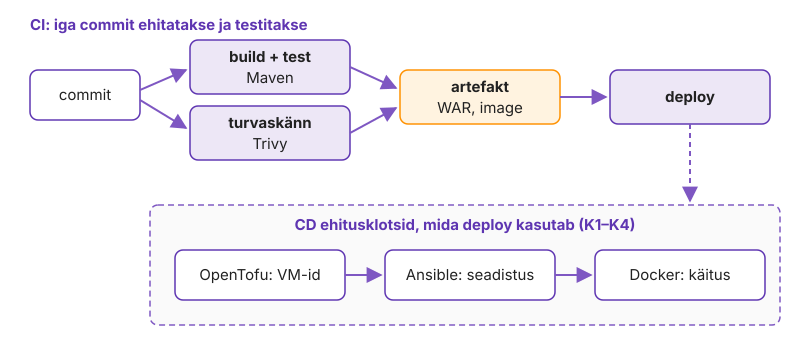
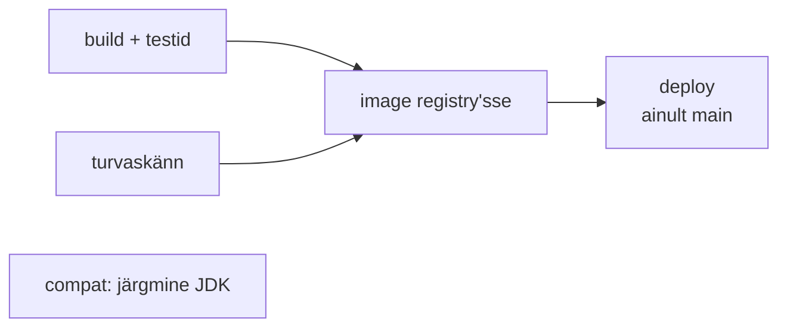
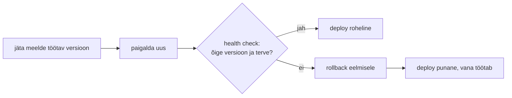
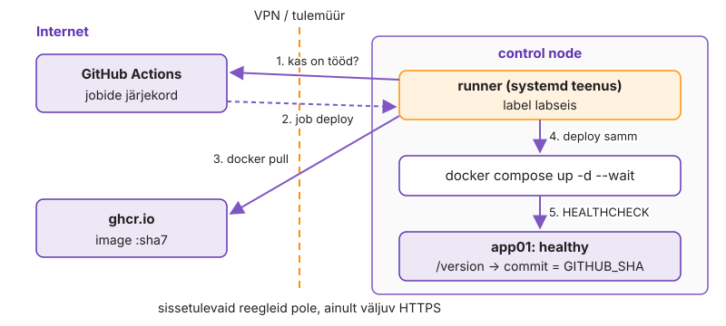

---
tags:
  - CI/CD
  - Maven
  - GitHub Actions
---

# 5. kohtumine · Pidev integratsioon ja tarne: loeng

**Eeldus:** 4. kohtumisel tõstsid OpenTofu'ga taristu koodist üles, 3. kohtumisest on rakendus image'ina olemas.

Seni on iga tööriist oodanud, et keegi selle käivitaks. Täna paneme ahela tööle ilma käsitsi käivitamiseta: commit'ist saab artefakt ja artefaktist töötav teenus. **Pipeline on tarneahel**: iga lüli selles, alates sõltuvusest ja action'ist kuni runner'i, deploy'ni ja muudatuse kirjeni, on otsus selle kohta, keda ja mida sa usaldad.

## 🎯 Õpiväljundid

- Selgitad, mis probleemi lahendab pidev integratsioon ja mille poolest erinevad pidev tarnimine ja pidev paigaldus.
- Kirjeldad pipeline'i sündmusest käivituva job'ide graafina ja põhjendad, milline kontroll peab pipeline'i peatama ja milline ainult hoiatama.
- Eristad artefakti, vahemälu ja allikakoodi ning põhjendad, miks ehitatakse üks kord ja sama artefakt liigub edasi.
- Hindad tarneahela riske ja valid automaatsed turvakontrollid (skänn, SBOM, allkiri), mis peatavad ohtliku artefakti enne deploy'd.
- Põhjendad, millal on deploy õnnestunud, ja kirjeldad automaatse rollback'i eeldusi ning piire.
- Seod pipeline'i ITSM-i muudatuste haldusega: standardmuudatus, kinnitus environment'iga ja automaatne tikett.
- Võrdled GitHubi hallatud ja self-hosted runner'it turvalisuse ja ligipääsu järgi.


[DevOps automation ja deployment automation](../teemad/devops-automaatika.md) · [Sündmuspõhine automaatika](../teemad/sundmuspohine-automaatika.md) · [Turvaautomaatika, compliance ja riskihaldus](../teemad/turvaautomaatika.md) · [IT-teenuste haldus (ITSM)](../teemad/itsm.md)

## 1. Pidev integratsioon ja DevOps automation

Kvartaalne väljalase käib paljudes asutustes ühtemoodi: neli meeskonda koguvad kuus nädalat muudatusi, CAB kinnitab paketi ja laupäevases hooldusaknas paigaldatakse see 40-sammulise runbook'i järgi. Kui midagi läheb katki, on põhjuse kandidaate sadu ja ainus tagasiminek on kogu paketi rollback.

**Pidev integratsioon** (CI) pöörab selle ümber: iga commit ehitatakse ja testitakse kohe, sama käsuga ja samas puhtas keskkonnas. Martin Fowler kirjeldab CI-d tavana, kus iga arendaja integreerib vähemalt kord päevas ja iga integratsiooni kontrollib automaatne build ([Continuous Integration](https://martinfowler.com/articles/continuousIntegration.html)). Muutuja on tagasiside aeg: viga, mis leitakse kümne minuti pärast, on ühe commit'i suurune. Sama viga kuue nädala pärast on uurimistöö.

CI tulemus on **artefakt**: Java puhul WAR või JAR, meie ahelas lõpuks image. **Pidev tarnimine** (continuous delivery) tähendab, et iga roheline artefakt *võiks* minna tootmisse ja otsuse teeb inimene. **Pidev paigaldus** (continuous deployment) jätab selle otsuse ära ja iga roheline commit main'is jõuab ise serverisse. Mõlemat lühendatakse CD-ks.

<figure markdown="span">
  
  <figcaption>Joonis 5.1. CI toodab artefakti, CD paneb selle tööle. Taristu, seadistus ja konteinerid on eelmistest kordadest olemas.</figcaption>
</figure>

**DevOps automation** on sama mõte kogu tarne kohta: build, test, image, deploy ja kontroll on üks versioonihalduses ahel, mida arendaja ja admin muudavad samas repos. Deploy runbook'i sammud lähevad workflow'sse ja nende muutmine käib PR-iga. Hind on see, et pipeline'ist saab ise tootmissüsteem. Tal on tootmise credential'id, ta vajab monitooringut ja tema rike peatab kõigi meeskondade tarne.

DORA mõõdab tarnimist viie näitajaga ([DORA metrics](https://dora.dev/guides/dora-metrics/)). Läbilaskevõimet näitavad aeg commit'ist tootmiseni, deploy'de sagedus ja taastumisaeg ebaõnnestunud deploy'st. Ebastabiilsust näitavad ebaõnnestunud muudatuste osakaal ja deploy'de ümbertöö osakaal: plaanimata deploy'd, mille tootmisintsident peale sundis. Algselt oli näitajaid neli. 2023. aastal asendati MTTR taastumisajaga just ebaõnnestunud deploy'st ja 2024. aastal lisati ümbertöö osakaal, sest uurijad oletasid, et ebaõnnestunud muudatuste osakaal mõõdab tegelikult ümbertööd, ja tahtsid seda eraldi kontrollida ([näitajate ajalugu](https://dora.dev/guides/dora-metrics/history/)). Küsitlusuuringud väidavad aastast aastasse, et sagedamini ja väiksemate muudatustega tarnivad meeskonnad ei maksa selle eest suurema rikete osakaaluga. See on korrelatsioon küsitlusandmetest, mitte tõestatud põhjuslik seos. Adminitöös on otsesem teine tagajärg: kui pipeline rakendab igal deploy'l koodis kirjeldatud soovitud oleku uuesti, kirjutab järgmine deploy käsitsi tehtud paranduse üle samamoodi nagu playbook.

CI-l on adminitöös eelkäija. Build-server, mille öine cron-skript käivitas `mvn package` ja kopeeris tulemuse NFS-kettale, tegi sama tööd kahe puudusega: see ei käivitunud iga muudatuse peale ja selle keskkonda muudeti aastate jooksul käsitsi. CI eeldab ka harumudelit. Kui meeskond hoiab nädalaid elavaid feature-harusid, ehitab CI küll iga commit'i, aga integratsioon lükkub merge'i päeva ja konfliktid on sama suured kui varem. Seepärast käib CI-ga kaasas trunk-based arendus: haru on olemas päeva või kaks ja pooleli töö peidetakse feature flag'i taha, mitte harusse.

Iseseisvaks lugemiseks: [DevOps automation ja deployment automation](../teemad/devops-automaatika.md).

## 2. Pipeline kui graaf

Esimene workflow on tavaliselt üks pikk job. Kui turvaskänn võtab neli minutit ja testid kolm, ootad seitse, kuigi need ei sõltu teineteisest.

Pipeline on **suunatud atsükliline graaf** (DAG): job'id on tipud ja sõltuvused servad. GitHub Actionsis kirjutad servad `needs:` võtmega ja kõik, millel serva pole, käivitub paralleelselt. Iga job saab eraldi runner'i ja jagatud ketast job'ide vahel ei ole: andmed liiguvad ainult artefaktina (vaikimisi säilib 90 päeva) või job'i `outputs`-väärtusena. Igal job'il on tingimus `if:`, mille vaikeväärtus on `success()`. Teavitus ja rollback kasutavad `failure()`, koristus `always()`. GitHub katkestab job'i hallatud runner'il 6 tunni pärast. Oma `timeout-minutes` on vajalik, sest rippuv deploy hoiab kinni ka järgmisi.

<figure markdown="span">

  <figcaption>Joonis 5.2. Pipeline graafina. Nooled on sõltuvused, compat'il pole järglast.</figcaption>
</figure>

Graafi kuju on poliitika. Kui turvaskänn on image'i eeldus, peatab kriitiline CVE deploy. Kui skänn on kõrvalharu, annab ta ainult raporti. Kontrolli, mille ebaõnnestumine peatab pipeline'i, nimetatakse **quality gate**'iks. Joonise compat-job on teadlikult ilma järglaseta: varajane hoiatus, mitte quality gate. **Matrix** genereerib ühest job'i kirjeldusest job'i iga parameetrikombinatsiooni kohta, kuni 256 job'i käivituses. Vaikimisi `fail-fast` tühistab esimese ebaõnnestumise järel ülejäänud kombinatsioonid, compat-kontrollis lülitatakse see välja. Kiire ja odav kontroll (YAML-i süntaks, kompileerimine) tuleb enne aeglast ja kallist, sest pipeline'ist, mis annab vea kahekümne minuti pärast, hakatakse mööda hiilima.

Graafi usaldusväärsuse määrab selle kõige ebakindlam tipp. Google'i andmetel andis umbes 1,5% kõigist testikäivitustest ebastabiilse tulemuse ja ligi 16% testidest ebaõnnestus vahel ilma koodi muutuseta ([Flaky Tests at Google](https://testing.googleblog.com/2016/05/flaky-tests-at-google-and-how-we.html)). Sadade testidega job'is ei tähenda punane tulemus siis enam viga ja meeskond hakkab vajutama „Re-run failed jobs“. Sellest hetkest on quality gate'i tulemus juhuslik. Ebastabiilne test pannakse karantiini ja määratakse omanikule, mitte ei korrata automaatselt, sest automaatne kordus peidab ka tegeliku race condition'i.

Graafi käivitab sündmus: `push`, `pull_request`, ajakava või käsitsi nupp. Väljaspool GitHubi, näiteks AWX-is, Semaphore'is, Jenkinsis või ITSM-süsteemis, jõuab sama sündmus kohale **webhook**'ina. GitHub saadab HTTP POST-i JSON-sisuga ja allkirjastab selle HMAC-SHA256-ga päisesse `X-Hub-Signature-256`. Vastuvõtja peab allkirja kontrollima ja vastama 10 sekundi jooksul, muidu on saatmine ebaõnnestunud ([webhookide head tavad](https://docs.github.com/webhooks/using-webhooks/best-practices-for-using-webhooks)). Ebaõnnestunud saatmist GitHub ise ei korda, käsitsi saab seda teha kolme päeva jooksul. Seepärast kinnitab vastuvõtja ainult kättesaamise, pikk töö läheb järjekorda ja ajastatud käivitus asendab kadunud sündmuse.

Iseseisvaks lugemiseks: [Sündmuspõhine automaatika](../teemad/sundmuspohine-automaatika.md).

## 3. Build kui korratav artefakt

"Minu masinas töötab" tähendab tavaliselt, et arendaja `~/.m2` kaustas on teek, mida kellelgi teisel pole, või et tema JDK on teine. Hallatud runner on vastupidi: iga job saab uue VM-i, mis kustutatakse pärast job'i lõppu.

Allikas on Gitis ja iga job kloonib selle uuesti, artefakt liigub job'ide vahel ja hiljem serverisse. **Vahemälu** (Maveni teegid, Dockeri kihid) on ainult optimeerimine: kui see kaob, peab build õnnestuma aeglasemalt. Google'i SRE raamat nimetab sellist build'i hermeetiliseks: tulemus ei sõltu sellest, mis build-masinasse juhtumisi paigaldatud on ([Release Engineering](https://sre.google/sre-book/release-engineering/)). GitHubi vahemälu on repo kohta vaikimisi 10 GB ja käivitus loeb ainult oma haru ja vaikeharu kirjeid, nii et PR-i haru ei saa main'i vahemälu mürgitada.

Maveni [elutsükkel](https://maven.apache.org/guides/introduction/introduction-to-the-lifecycle.html) on faaside jada ja iga faas käivitab kõik eelnevad. Korratavust murravad kaks Maveni omadust. Versioonikonflikti lahendab reegel „lähim võidab“: kui sama teek on puus kahel sügavusel, võetakse madalam, mitte uuem, ja uue otsese sõltuvuse lisamine võib transitiivse versiooni vaikselt alla viia. `-SNAPSHOT` on liikuv versioon, mis annab homme sama koordinaadi all teise faili, Maven Centrali release aga on muutumatu.

Teine põhimõte on **build once, deploy many**. Image ehitatakse CI-s üks kord, tag'itakse commit'i SHA-ga ja sama image läheb testi ja tootmisse. Kui tootmisele ehitatakse uus image, ei ole testitud see, mis tootmises töötab. Samast põhjusest ei piisa tag'ist `latest`: see on liikuv tag ja kahe nädala pärast ei tea keegi, mis selle all töötas. SHA-tag ja rakenduse `/version` vastus, mis näitab sama commit'i, seovad töötava teenuse Giti ajalooga.

Build once on vajalik ka seepärast, et sama allikas ei anna vaikimisi baidi täpsusega sama tulemust. JAR on ZIP-arhiiv, kuhu satuvad failide ajatemplid ja järjestus, nii et kaks build'i samast commit'ist annavad erineva räsi. Maveni [korratava build'i juhend](https://maven.apache.org/guides/mini/guide-reproducible-builds.html) fikseerib ajatemplid omadusega `project.build.outputTimestamp`. Konteineri puhul on sama roll digest'il: tag on viide, `sha256:` digest on image'i manifesti räsi. Deploy, mis tõmbab image'i digest'iga, saab täpselt selle, mida testiti, ka siis, kui keegi tag'i hiljem ümber suunab. Korratav build ja build once lahendavad eri probleemi. Esimene laseb kolmandal osapoolel kontrollida, et binaar tuli sellest allikast. Teine hoiab ära, et seda peaks iga deploy'ga uuesti kontrollima.

## 4. Tarneahela usaldus ja automaatsed turvakontrollid

2017. aastal selgus, et Infineoni kiibi teek genereeris nõrku RSA võtmeid ([ROCA, CVE-2017-15361](https://nvd.nist.gov/vuln/detail/CVE-2017-15361)). Eestis puudutas see umbes 750 000 ID-kaarti. Koodi ei kirjutanud ükski Eesti arendaja, aga see oli tarneahelas.

Sinu pipeline'i tarneahelas on kolm sellist osa: sõltuvused (Spring Boot, selle transitiivsed teegid, baas-image), action'id, mida `uses:` real kutsud, ja runner ise. Action on kolmanda osapoole kood, mis töötab sinu runner'il sinu tokeniga, ja lõks on Giti tag'is, sest tag on muudetav viide. 2025. aasta märtsis muutis ründaja action'i `tj-actions/changed-files` tag'id nii, et need osutasid commit'ile, mis kirjutas workflow'de saladused logisse ([CVE-2025-30066](https://nvd.nist.gov/vuln/detail/CVE-2025-30066)). Action'it kasutas üle 23 000 repo ja iga workflow, mis viitas `@v35`-le või muule tag'ile ning käivitus 12.–15. märtsil, käivitas ründaja koodi. Ründaja jõudis sinna teise action'i (`reviewdog/action-setup`) kaudu, mida tj-actions ise kasutas. Commit'i SHA aga muuta ei saa:

```yaml
uses: aquasecurity/trivy-action@ed142fd0673e97e23eac54620cfb913e5ce36c25  # v0.36.0
```

SHA-ga kinnitatud action ei uuene ise ja vananeb. Selle vastu on [Dependabot](https://docs.github.com/code-security/dependabot/working-with-dependabot/keeping-your-actions-up-to-date-with-dependabot), mis avab uuendusega PR-i. Uuendus läbib sama CI-d ja jõuab main'i alles siis, kui inimene selle merge'ib.

GitHub annab igale job'ile `GITHUB_TOKEN`-i, mis kehtib job'i lõpuni ja on nähtav igale sammule, ka kolmanda osapoole action'ile. Alates 2023. aasta veebruarist loodud repodes on vaikeõigus lugemine, vanemates repodes ja paljudes organisatsioonides kirjutamine. Seepärast algab workflow `permissions: {}`-ga ja iga job küsib ainult vajaliku: build lugemisõiguse, image'i job lisaks `packages: write`. Ohtlikuim muster on `pull_request_target`: see töötab sihtharu kontekstis koos secret'ite ja kirjutusõigusega tokeniga. Kui workflow teeb seal forgi koodi checkout'i ja ehitab selle, käivitub võõras kood sinu õigustega. Sama kehtib väärtuste kohta, mida kirjutab keegi teine: haru nimi, PR-i pealkiri, commit'i sõnum. Avaldis `${{ }}` asendatakse enne, kui shell skripti saab, nii et otse `run:` reale pandud haru nimi võib olla käsk. Väärtus peab shelli jõudma `env:` muutujana ([GitHubi turvajuhend](https://docs.github.com/actions/security-for-github-actions/security-guides/security-hardening-for-github-actions)).

**Security automation** pipeline'is tähendab, et turvakontroll on job, mitte kvartaalne audit. Shift-left viib kontrolli sinna, kus parandus on odavaim: PR-is käivad enne merge'i saladuste otsing (näiteks [gitleaks](https://github.com/gitleaks/gitleaks)), sõltuvuste skänn ja IaC-failide kontroll (`trivy config`). [Trivy](https://trivy.dev/) andmebaas uueneb mitu korda päevas, nii et sama kood võib homme anda uue leiu ja skänn käib ka ajakava järgi. Image'i job lisab kaks asja. SBOM-i, mida 3. kohtumisel käsitsi tegid, genereerib build ise ja see salvestatakse image'i kõrvale. Image allkirjastatakse [cosign](https://docs.sigstore.dev/cosign/signing/overview/)'iga ilma püsivõtmeta: job saab GitHubilt OIDC tokeni (`id-token: write`), Sigstore'i Fulcio annab selle järgi kümneminutilise sertifikaadi ja allkiri läheb avalikku transparency log'i Rekor. Sertifikaadis on kirjas, milline workflow ja milline haru image'i tootis. Allkiri on väärtus ainult siis, kui deploy seda enne `pull`-i kontrollib:

```bash
cosign verify "$IMAGE@$DIGEST" \
  --certificate-oidc-issuer https://token.actions.githubusercontent.com \
  --certificate-identity "https://github.com/$REPO/.github/workflows/ci.yml@refs/heads/main"
```

Kompromiss on müra ja sõltuvus. Skanner, mis annab igal PR-il kakskümmend HIGH leidu, õpetab meeskonna neid ignoreerima: lävi peab olema range uuele koodile ja erandid (`.trivyignore`) kirjas põhjuse ja aegumisega. Keyless allkiri sõltub Sigstore'i avalikust teenusest. Internetist eraldatud võrgus tähendab see oma Fulcio ja Rekori või võtmega allkirja koos võtme haldusega. [SLSA](https://slsa.dev/) kirjeldab sama mõtet tasemetena: kas sa saad tõendada, milline allikas, build-keskkond ja protsess artefakti tootis.

### Kui rünnatakse build'i ennast

Allkiri tõendab, kes artefakti tootis, aga mitte seda, et build oli puhas. SolarWindsi juhtumis 2020. aastal muutis ründaja ettevõtte build-serveris Orioni tarkvara build'i ajal ja pahavara SUNBURST jõudis klientideni ettevõtte enda allkirjaga ([CISA AA20-352A](https://www.cisa.gov/news-events/cybersecurity-advisories/aa20-352a)). Koodi ülevaatus ega allkirja kontroll seda ei näinud, sest muutus tekkis allika ja artefakti vahel. xz-utils'i tagauks 2024. aastal ([CVE-2024-3094](https://nvd.nist.gov/vuln/detail/CVE-2024-3094)) kasutas sama vahet teisest otsast: tagaukse aktiveeriv osa oli ainult väljalaske tarball'is, mitte Giti repos, mida inimesed lugesid. Mõlemast järeldub sama nõue. Build käib lühiajalises isoleeritud keskkonnas, sisend on Giti commit, mitte käsitsi üles laaditud arhiiv, ja provenance seob artefakti selle commit'i ja workflow'ga. Neid nõudeid kirjeldavad SLSA build-tasemed. Hallatud runner täidab neist esimese juba praegu, püsiv build-server mitte.

Iseseisvaks lugemiseks: [Turvaautomaatika, compliance ja riskihaldus](../teemad/turvaautomaatika.md).

## 5. Deployment automation: risk ja rollback

19. juulil 2024 saatis CrowdStrike kõigile Falcon-agentidele korraga sisu-uuenduse, mis pani Microsofti hinnangul umbes 8,5 miljonit Windowsi masinat sinisele ekraanile ([CrowdStrike PIR](https://www.crowdstrike.com/falcon-content-update-remediation-and-guidance-hub/)). Koodi väljalasked läksid välja etappide kaupa, sisu-uuendused mitte. PIR-i järeldus oli viia etappidesse ka need.

**Deployment automation** tähendab, et deploy sammud (mis versioon, kuhu, mis järjekorras, millal on õnnestunud ja kuidas tagasi) on kood, mis käib igal korral samamoodi. Runbook'iga võrreldes kaob vahele jäetud samm, aga viga levib sama kiiresti kui parandus. Riski määravad kaks asja: kui suur on muudatus ja kui paljusid see korraga puudutab. CI vähendab esimest. Teist vähendavad etapiviisiline levitamine, canary ja ühe serveri puhul vähemalt see, et korraga töötab ainult üks deploy. [`concurrency`](https://docs.github.com/actions/how-tos/write-workflows/choose-when-workflows-run/control-workflow-concurrency)-grupis on korraga üks töötav ja üks ootav töö ning uus ootaja tühistab vana. Viimane soov võidab ja vahepealset versiooni ei paigaldata kunagi.

Mitme serveri puhul lisandub rike, mida concurrency ei kata: osaline deploy. 2012. aasta juuli lõpus paigaldas Knight Capital uue kauplemiskoodi käsitsi kaheksale serverile ja üks server jäi uuendamata. 1. augustil kasutas uus versioon uuesti vana lippu, mis sellel serveril käivitas aastaid kasutamata koodi. 45 minutiga tekkis üle 460 miljoni dollari kahju ([SEC-i otsus](https://www.sec.gov/litigation/admin/2013/34-70694.pdf)). SEC-i järgi ei nõudnud ükski protseduur, et teine inimene deploy'd üle vaataks. Pipeline lahendab sellest kaks osa: kõik sihtmasinad saavad sama artefakti sama sammuga ja health check küsib versiooni igalt masinalt, mitte ühelt. Kolmandat osa ei näe ükski deploy-kontroll: lipp, mille tähendus muutub, ja kood, mida ei kustutatud.

Levinud viga on vale arusaam sellest, millal deploy õnnestus. Käsk `docker compose up -d` lõpetab siis, kui konteiner käivitati, mitte siis, kui rakendus vastab. `--wait` ootab HEALTHCHECK'i olekut `healthy`, aga vaikeväärtustega (intervall 30 s, 3 katset) jõuab katkine konteiner olekusse `unhealthy` alles umbes 90 sekundi pärast. `sleep 20` ja `curl` on roheline juhuslikult või siis, kui vana konteiner jäi tööle. Deploy on õnnestunud siis, kui **health check** näitab, et töötab *uus* versioon ja selle sõltuvused vastavad. Seepärast võrreldakse `/version` vastuse commit'i pipeline'i commit'iga.

<figure markdown="span">

  <figcaption>Joonis 5.3. Automaatne rollback vajab ühte teadmist: mis töötas enne deploy'd.</figcaption>
</figure>

**Rollback** on lihtne, kui artefakt on muutumatu ja tag'itud: paned eelmise image'i tagasi. Pipeline jääb ikkagi punaseks, sest main'is on commit, mis ei tööta, ja järgmine deploy proovib sama uuesti. Rollback peidab rikke kasutaja eest, aga ei paranda seda.

Rollback'il on üks oluline piir: andmed. Kui uus versioon muutis andmebaasi skeemi, ei pruugi vana versioon uute andmetega töötada. Tavaline lahendus on *expand/contract*: kõigepealt läheb välja skeem, mis sobib mõlemale versioonile, siis kood, mis uut skeemi kasutab, ja vana veerg eemaldatakse alles järgmises väljalaskes. "Kas saame tagasi minna?" on küsimus enne deploy'd, mitte pärast.

Suures skaalas sõltub strateegia valik sellest, mis on kallim: maht või aeg. Canary saab väikese osa liiklusest ja pipeline võrdleb selle veamäära ja latentsust vana versiooniga. Kui võrdlust teeb inimene graafikult, venib iga etapp tundideks. Blue-green paneb uue versiooni täies mahus kõrvale ja vahetab liikluse korraga. Rollback võtab siis sekundeid, aga vajab kahekordset mahtu ega aita skeemimuudatuse puhul. Feature flag eraldab deploy'i väljalaskest: kood on tootmises välja lülitatud ja lülitatakse sisse eraldi, nii et rollback on konfiguratsioonimuudatus. Hind on lippude elutsükkel, nagu Knighti juhtum näitas.

## 6. Muudatuste haldus pipeline'is

Audiitor küsib ühe tootmismuudatuse kohta kolme asja: kes kinnitas, mis täpselt muutus ja kus on tõend. Käsitsi deploy puhul on vastus ITSM-i tiketis (ServiceNow, Jira Service Management, avatud lähtekoodiga [GLPI](https://glpi-project.org/) või iTop) ja CAB-i protokollis. Pipeline'iga deploy puhul peab vastus olema sama, aga see peab tekkima ilma käsitööta.

ITIL 4 eristab kolme muudatuse tüüpi: standardmuudatus on madala riskiga eelnevalt kinnitatud protseduur, tavaline muudatus vajab hindamist ja kinnitust ning erakorraline muudatus registreeritakse tagantjärele. Pipeline teeb rakenduse deploy'st standardmuudatuse. Protseduur kinnitatakse üks kord, kui muudatuste haldur vaatab üle workflow ja selle kontrollid, ja iga deploy on selle protseduuri käivitus. Workflow muutmine on aga tavaline muudatus, sest muutub protseduur ise. Seepärast on `.github/workflows/` kaustal CODEOWNERS-i reegel ja nõutud ülevaataja.

Tavalise muudatuse kinnitus on GitHubis **[environment](https://docs.github.com/actions/how-tos/deploy/configure-and-manage-deployments/manage-environments)**'i protection rule. Deploy job, mis nimetab environment'i `production`, ootab, kuni nõutud ülevaataja (kuni 6) kinnitab, ja GitHub salvestab, kes ja millal. Ooteaeg võib olla kuni 30 päeva. Ülevaatajad on Free ja Team plaanil saadaval ainult avalikus repos, privaatses repos tehakse käsitsi kinnitus workflow sees. [Custom deployment protection rule](https://docs.github.com/actions/how-tos/deploy/configure-and-manage-deployments/create-custom-protection-rules) laseb GitHub Appil, näiteks ITSM-i integratsioonil, deploy'd kinnitada või tagasi lükata. Privaatses repos vajab see Enterprise plaani.

Tikett tekib pipeline'ist. Enne deploy'd teeb job ITSM-i REST API-sse päringu, mis avab muudatuse kirje: teenus, image'i digest, commit, PR ja käivituse URL. Pärast health check'i suleb sama job kirje tulemusega, ebaõnnestunud deploy avab intsidendi koos rollback'i infoga. Kirje viitab Gitile ja Gitis on link kirjele. DORA ebaõnnestunud muudatuste ja ümbertöö osakaal tulevad samadest kirjetest: intsidendi tõttu tehtud erakorraline muudatus on ümbertöö.

Kompromiss tuleb otsustada enne, kui ITSM-i API esimest korda ei vasta. Kui deploy siis peatub (fail-closed), on ITSM kõigi tarne üksik rikkepunkt. Kui deploy jätkub (fail-open), tekib muudatus ilma kirjeta ja see tuleb hiljem järele teha. Tavaline valik on standardmuudatusel jätkata ja kirje hiljem luua, tavalisel muudatusel peatuda. Teine lõks on topeltkinnitus: kui PR-i review ja CAB kinnitavad sama asja, hakatakse ühte neist formaalselt tegema.

DORA uuringus ei olnud välise heakskiidu, näiteks CAB-i, nõue seotud väiksema ebaõnnestunud muudatuste osakaaluga, küll aga aeglasema tarne ja suuremate pakettidega ([Streamlining change approval](https://dora.dev/capabilities/streamlining-change-approval/)). Pangas või riigiasutuses ei kao CAB sellest kuhugi, kui regulatsioon nõuab tõendatud kontrolli. Muutub CAB-i töö sisu. Üksikute deploy'de kinnitamise asemel kinnitab ta protseduure, peab standardmuudatuste nimekirja ja analüüsib ebaõnnestunud muudatusi pipeline'i kirjete põhjal. PR-i review ja automaatne kontroll annavad audiitorile tõendi iga muudatuse kohta, mitte valimi kohta.

Iseseisvaks lugemiseks: [IT-teenuste haldus (ITSM)](../teemad/itsm.md).

## 7. Runner'i turve

GitHubi hallatud runner on internetis ja ei näe sinu VPN-i taha. Selleks, et pipeline jõuaks sisevõrgu serverini, tuuakse runner sisevõrku.

**Self-hosted runner** on sama tarkvara sinu masinas ([self-hosted runner'id](https://docs.github.com/actions/hosting-your-own-runners)). See kasutab pull-mudelit: runner hoiab GitHubiga väljuvat HTTPS long poll'i, mis aegub 50 sekundi järel ja avatakse uuesti. Tulemüüris pole ühtegi sissetulevat reeglit. Runner, mis on 30 päeva uuendusest maas, tööd ei saa, ja job, mida ükski runner 24 tunni jooksul ei võta, ebaõnnestub. Internetist eraldatud tootmisvõrgus on valik sama, kas oma runner või Jenkinsi agent sisevõrgus (6. kohtumine).

<figure markdown="span">
  
  <figcaption>Joonis 5.4. Runner küsib tööd ise. GitHub ei ühendu kunagi VPN-i taha.</figcaption>
</figure>

Hind on see, et runner käivitab iga koodi, mis workflow'sse jõuab, sinu võrgus. Workflow fail loetakse haru enda commit'ist, seega saab iga inimene, kes võib haru luua, muuta ka seda, mida runner teeb. Avalikus repos on halvim juhtum forgist tulnud PR. Seepärast kehtib kolm reeglit: self-hosted runner ainult privaatses repos, ainult main'i või käsitsi käivitatud job'idele ja oma label'iga, et job ei satuks kogemata valele masinale.

Teine risk on püsiv olek. Hallatud runner kustutatakse pärast job'i, self-hosted runner mitte. Töökaust, Dockeri image'id ja kodukausta failid jäävad järgmisele job'ile. Runner'i kasutaja on `docker` grupis ehk sisuliselt root. Ühekordne (`--ephemeral` või just-in-time) runner võtab ühe job'i ja kaob, kuid jagab endiselt hosti Dockerit. Täieliku eraldatuse annab iga job'i jaoks uus VM, nagu hallatud runner'id töötavad.

PyTorchi juhtumis olid mõlemad riskid koos. 2024. aasta jaanuaris näitasid turvauurijad, et PyTorchi avaliku repo self-hosted runner'id käivitasid forgist tulnud PR-i koodi, sest varasemate kaastöötajate workflow'd ei vajanud kinnitust. Uurijad paigaldasid runner'i masinasse oma runner'i püsivaks ligipääsuks ja leidsid sealt AWS-i võtmed ning GitHubi PAT-id, millega oleks saanud avaldada pahatahtliku väljalaske ([SecurityWeek](https://www.securityweek.com/new-class-of-ci-cd-attacks-could-have-led-to-pytorch-supply-chain-compromise/)). Suures skaalas hallatakse self-hosted runner'eid seepärast Kubernetesis [Actions Runner Controller](https://docs.github.com/en/actions/concepts/runners/actions-runner-controller)'iga: iga job saab uue pod'i, mis pärast job'i kustutatakse, ja runner'ite arv järgib ootel job'ide arvu. See lahendab püsiva oleku, aga lisab klastri, mida keegi peab haldama, ja image'i ehitamine pod'is vajab kas privilegeeritud konteinerit või rootless-ehitajat.

Saladuste puhul aitab environment: environment'i secret antakse ainult job'ile, mis selle environment'i nimetab, ja ainult lubatud harust. Reeglid kontrollitakse enne, kui job runner'ile jõuab. Logi maskeerimine on tekstiasendus: base64-kujul väärtust GitHub ära ei tunne ja selline secret on lekkinud. Kõige selle hind on lock-in: workflow süntaks, action'ite ökosüsteem ja tokeni mudel ei kandu GitLab CI-sse ega Jenkinsi, kantav on ainult see, mis on skriptides ja build-tööriistas.

## Kokkuvõte

<div class="grid cards kokkuvote" markdown>

-   **Lühike tagasiside**

    Integreeri ja testi iga commit kohe puhtas keskkonnas. Siis leiad vea, kui see on ühe commit'i suurune.

-   **Pipeline graafina**

    Kirjelda sõltuvused `needs`-iga ja lase sõltumatutel job'idel paralleelselt töötada. Kontrolli webhook'i allkirja ja kata kadunud sündmus ajastatud käivitusega.

-   **Muutumatu artefakt**

    Ehita üks kord, tag'i commit'i SHA-ga ja paigalda sama artefakt igale poole. Ära lase build'il vahemälust sõltuda.

-   **SHA, mitte tag**

    Kinnita action'id täis-SHA-ga ja lase Dependabotil uuendused PR-ina tuua. Anna tokenile ainult need õigused, mida job vajab.

-   **Turvakontroll job'ina**

    Kontrolli saladusi, sõltuvusi ja IaC-d juba PR-is ning lisa image'ile SBOM ja allkiri. Kontrolli allkirja deploy'l, muidu see ei kaitse midagi.

-   **Õnnestunud deploy**

    Kontrolli health check'iga, et töötab uus versioon. Pärast rollback'i jäta pipeline punaseks, sest viga on main'is alles.

-   **Deploy standardmuudatusena**

    Kinnita protseduur üks kord ja lase igal käivitusel jälg jätta. Pane tavalise muudatuse kinnitus environment'i reeglisse ja loo tikett pipeline'ist.

-   **Self-hosted runner**

    Kasuta seda ainult privaatses repos, main'i job'idele ja oma label'iga. Kaitse runner'it nagu tootmisserverit, sest püsiv olek ja `docker` grupp annavad sisuliselt root'i.

</div>

<div class="kontrollkysimus" markdown>
**Kontrollküsimus:** Miks ei tohi tootmise jaoks image'it uuesti ehitada, kui sama commit on testis juba roheline olnud?
</div>

## Kontrolli ennast

??? question "Turvaskänn leidis CRITICAL haavatavuse teegis, mida keegi ei ole kuu aega muutnud. Kuidas see võimalik on ja mida graafi kujus otsustad?"
    Haavatavuste andmebaas uueneb mitu korda päevas, nii et sama kood annab uue leiu ilma commit'ita. Skänn image'i job'i eeldusena peatab deploy, kõrvalharuna annab ainult raporti. See on poliitika otsus.

??? question "Kolleeg kirjutab `uses: some/action@v2`, sest SHA on loetamatu. Mida vastad?"
    Tag `v2` on muudetav viide, nagu näitas `tj-actions/changed-files`. SHA-ga kinnitatud action muutub ainult sinu merge'iga. Loetavuse annab kommentaar `# v2.1.0`, värskena hoiab Dependabot.

??? question "Image on allkirjastatud, aga deploy job allkirja ei kontrolli. Mida allkiri sel juhul kaitseb?"
    Deploy hetkel mitte midagi. Ründaja, kes saab registry's tag'i ümber suunata, paneb tootmisse allkirjata image'i. Kontroll peab olema deploy'l enne `pull`-i ja siduma image'i digest'i kaudu, mitte tag'i kaudu, õige repo, workflow ja haruga.

??? question "Deploy ebaõnnestus health check'is, rollback käivitus ja leht töötab. Miks on pipeline ikka punane ja kas see on õige?"
    On õige. Rollback peidab rikke kasutaja eest, aga main'is on ikka commit, mis ei tööta, ja järgmine deploy proovib sama uuesti. Punane pipeline ütleb, et keegi peab vea parandama või commit'i tagasi võtma.

??? question "ITSM-i API ei vasta ja pipeline peaks avama muudatuse kirje. Kas deploy jätkub?"
    See on otsus, mis tehakse enne. Standardmuudatusel jätkatakse tavaliselt ja kirje luuakse hiljem (fail-open), sest muidu peatab ITSM-i rike kogu tarne. Tavalisel muudatusel, mis vajab kinnitust, deploy peatub (fail-closed). Mõlemal juhul jääb käivituse logisse märge, et kirje puudub.
