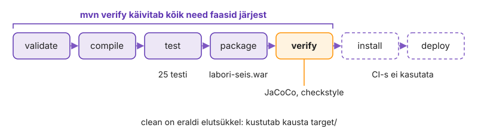
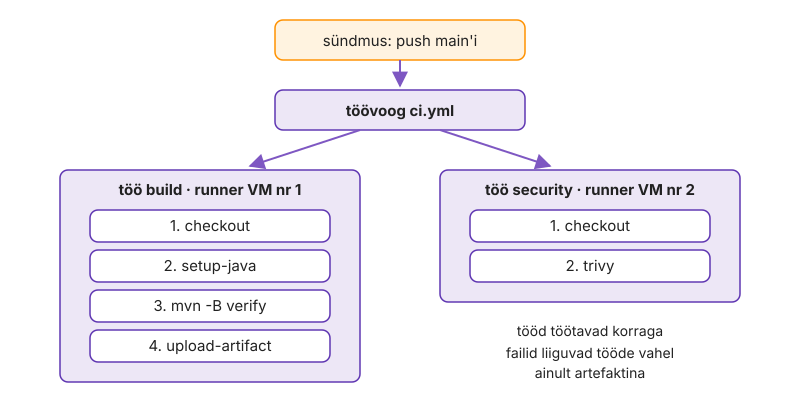
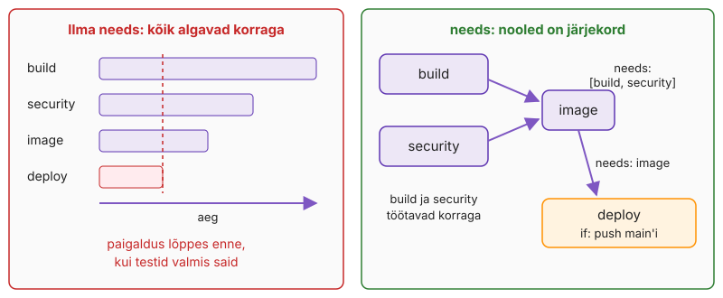
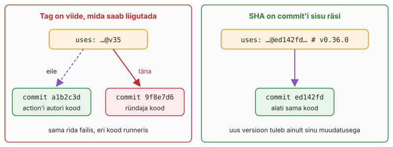
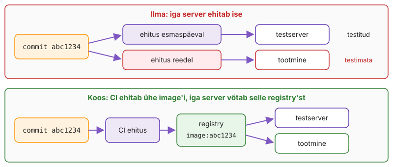
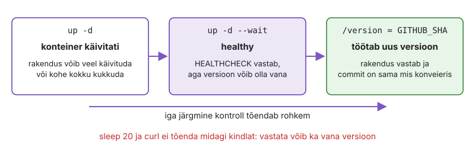

---
tags:
  - CI/CD
  - Maven
  - GitHub Actions
  - Loeng
---

# Loeng: pidev integratsioon ja tarne GitHub Actionsiga

3\. kohtumisel pakkisid Labori seisu rakenduse image'isse ja käivitasid stacki Compose'iga, 4. kohtumisel lõid masinad OpenTofu'ga. Iga sammu käivitas seni inimene: ehitas image'i, kontrollis tulemust ja käivitas stacki uuesti. Täna kirjeldad need sammud failina, mille GitHub käivitab iga muudatuse järel ise. Kood ehitatakse ja testitakse, turvakontroll vaatab sõltuvused üle, image läheb registry'sse ja sealt control node'i stacki, ning lõpuks kontrollitakse, et töötab just see commit.

??? abstract "Õpiväljundid"

    Pärast loengut ja praktikumi oskad:

    - selgitada, mis probleemi lahendab pidev integratsioon (CI) ning mille poolest erinevad pidev tarnimine ja pidev paigaldus (CD);
    - lugeda GitHub Actionsi töövoogu: sündmus, töö, runner, samm ja action;
    - kirjeldada konveierit tööde graafina (`needs`, `if`) ja selgitada, kuidas failid tööde vahel liiguvad;
    - põhjendada, miks action kinnitatakse commit'i SHA-ga ja miks igal tööl on ainult vajalikud tokeni õigused;
    - selgitada, miks image ehitatakse üks kord, miks paigaldus käib self-hosted runneriga ja millal on paigaldus õnnestunud;
    - hoida paroolid GitHubi saladustes ja selgitada, kuidas need töövoos runnerisse jõuavad.

    Testide ebastabiilsus, korratav build, allkirjastatud image, paigaldusstrateegiad, muudatuste haldus ja runneri turve on kursuse IS2 [loengus](https://hkhk-tk.github.io/is2-automatiseerimine/k05/loeng/).

## 1. Pidev integratsioon ja tarne

Kui mitu inimest muudab sama rakendust, tuleb nende muudatused ühte koodi kokku panna. Seda nimetatakse **integratsiooniks**. Kui muudatusi kogutakse nädalaid ja pannakse kokku korraga, tekib palju konflikte ning viga võib olla ükskõik millises sajast muudatusest. Mida harvem integreeritakse, seda raskem on leida, milline muudatus asja katki tegi.

**Pidev integratsioon** (continuous integration, CI) tähendab, et iga muudatus ehitatakse ja testitakse kohe pärast seda, kui see repositooriumisse jõuab. Ehitus käib alati sama käsuga ja puhtas keskkonnas, mitte arendaja arvutis. Martin Fowler kirjeldab CI-d tavana, kus iga arendaja integreerib oma töö vähemalt kord päevas ja iga integratsiooni kontrollib automaatne ehitus ([Continuous Integration](https://martinfowler.com/articles/continuousIntegration.html)). Viga, mis leitakse kümne minuti pärast, puudutab ühte commit'i. Sama viga kuu aja pärast on uurimistöö.

??? info "Süvenemiseks: CI ajalugu ja tööriistad"

    Mõistet *continuous integration* kasutas Grady Booch 1991. aastal. Tavaks muutis selle 1990. aastate lõpus Extreme Programming, kus kood pandi kokku mitu korda päevas. Üks esimesi CI-servereid oli ThoughtWorksi CruiseControl (2001). Kohsuke Kawaguchi tegi Sunis Hudsoni (esimene väljalase 2005), mis nimetati 2011. aastal ümber Jenkinsiks; Jenkins on 6. kohtumise teema. Samal aastal alustas Travis CI, mis ehitas GitHubi repositooriume pilves. GitHub Actions tõi CI/CD otse GitHubi 2019. aasta novembris ja GitLabis on samaks otstarbeks GitLab CI.

    Enne CI-servereid oli levinud öine ehitus: cron käivitas kell 2 öösel `mvn package` ja kopeeris tulemuse võrgukettale. See tegi sama tööd kahe puudusega: tulemus tuli järgmisel hommikul kõigi päeva muudatuste kohta korraga ja ehitusmasina keskkonda muudeti aastate jooksul käsitsi.

CI tulemus on **artefakt**: fail, mille ehitus tootis ja mida saab edasi anda. Java rakenduse puhul on see WAR-fail, Labori seisus lõpuks image. **Pidev tarnimine** (continuous delivery) tähendab, et iga roheline artefakt on valmis tootmisse minema ja otsuse teeb inimene. **Pidev paigaldus** (continuous deployment) jätab inimese otsuse ära: iga roheline muudatus harus `main` jõuab ise serverisse. Mõlemat lühendatakse CD-ks. Kõiki automaatseid samme koos nimetatakse **konveieriks** (pipeline).

<figure markdown="span">
  
  <figcaption>Joonis 5.1. CI toodab artefakti, CD paneb selle tööle. Taristu, seadistus ja konteinerid on eelmistest kohtumistest olemas (Talvik, 2026).</figcaption>
</figure>

Mõte on sama, mis 1. kohtumisel Ansible'iga: käsitsi tehtud sammud kirjutatakse koodiks, mida saab üle vaadata ja mis käib iga kord ühtemoodi. Ansible'i playbook kirjeldab serveri olekut, konveier kirjeldab teekonda koodist töötava teenuseni.

=== "Käsitsi"

    Arendaja ehitab rakenduse oma arvutis ja saadab WAR-faili administraatorile. Administraator kopeerib selle serverisse, taaskäivitab teenuse ja vaatab brauserist, kas leht avaneb. Testid jäid käivitamata, sest muudatus oli „ainult üks rida“. Kahe nädala pärast ei tea keegi, milline versioon serveris töötab.

=== "Konveieriga"

    Arendaja teeb push'i. GitHub ehitab ja testib rakenduse uues virtuaalmasinas, kontrollib sõltuvusi, ehitab image'i ja paigaldab selle. Iga sammu logi jääb alles. Serveris töötava rakenduse vastusest saab lugeda commit'i, millest see ehitati.

Konveieril on ka hind. See vajab ligipääsu registry'le ja tootmisserverile, seega tuleb seda kaitsta nagu tootmissüsteemi. Kui konveier on katki, ei jõua ükski muudatus tootmisse.

**Leia viga.** Meeskond tahab CI-d ja seadistas ehitusserveris järgmise cron-rea. Ehitus käib igal ööl ja logi läheb faili, mida keegi ei ava. Miks see ei ole pidev integratsioon?

```text
0 2 * * * cd /srv/labseis && git pull && mvn package > /var/log/build.log
```

??? success "Vastus"

    **Mida taheti:** iga muudatus kontrollitakse kohe ja viga leitakse siis, kui see puudutab üht commit'i.

    **Mis oli valesti:** ehitus käib kord ööpäevas kõigi päeva muudatuste kohta korraga. Tulemus jõuab inimeseni alles siis, kui keegi logi avab. `mvn package` jätab lisaks vahele kontrollid, mis on seotud faasiga `verify`.

    **Õige:** ehitus ja testid käivituvad iga push'i ja PR-i järel ning tulemus (roheline või punane) on näha commit'i ja PR-i juures.

    **Miks:** CI väärtus on lühike tagasiside. Öine ehitus leiab sama vea, aga põhjuse otsimine algab kümnete muudatuste seast.

??? question "Kontrolli ennast"

    1. Mis vahe on pideval tarnimisel ja pideval paigaldusel? Kumb sobib pangale, kus iga tootmismuudatuse peab keegi kinnitama?
    2. Miks peab CI ehitus käima puhtas keskkonnas, mitte arendaja arvutis?

## 2. Rakenduse ehitamine Maveniga

Enne kui midagi automatiseerida, tehakse see üks kord käsitsi. Labori seisu rakendus on kirjutatud Javas ja see tuleb enne käivitamist **ehitada** (build): lähtekood kompileeritakse, testid käivitatakse ja tulemus pakitakse üheks failiks. Javas teeb seda tavaliselt **Maven**.

Mavenit on lihtne võrrelda apt-iga. apt laadib paketi ja selle sõltuvused alla Ubuntu repositooriumist, Maven laadib rakenduse teegid alla Maven Centralist. Mida rakendus vajab, on kirjas failis `pom.xml` (Project Object Model). Allalaaditud teegid jäävad kausta `~/.m2/repository`, et järgmine ehitus neid uuesti alla ei laadiks. Rakenduse enda koodis on ainult Labori seisu klassid, aga valmis WAR-failis on lisaks kümneid teeke, mille on kirjutanud teised.

Maveni käsule antakse **elutsükli faas**, näiteks `test` või `verify`. Iga faas käivitab ka kõik eelnevad faasid ([Introduction to the Build Lifecycle](https://maven.apache.org/guides/introduction/introduction-to-the-lifecycle.html)). Käsk `mvn verify` teeb seega järjest läbi `validate`, `compile`, `test`, `package` ja `verify`.

<figure markdown="span">
  
  <figcaption>Joonis 5.2. <code>mvn verify</code> käivitab kõik faasid kuni <code>verify</code>-ni (Talvik, 2026).</figcaption>
</figure>

Lihtne näide control node'il, repositooriumi juurkaustas:

```bash
mvn -B verify
echo $?            # 0 = õnnestus, 1 = ebaõnnestus
ls target/         # classes, surefire-reports, labori-seis.war, site/jacoco
```

Lipp `-B` (batch) lülitab välja interaktiivse väljundi ja allalaadimise edenemisribad, mis teeksid logifaili raskesti loetavaks. Kaust `target/` on ehituse väljund: `surefire-reports` sisaldab testide tulemusi ja `labori-seis.war` on artefakt. **WAR** (Web Application Archive) on ZIP-fail, milles on rakenduse klassid ja teegid ning mille Tomcat käivitab.

Kõige tähtsam rida on `echo $?`. Iga Linuxi käsk lõpeb **väljumiskoodiga**: 0 tähendab õnnestumist, iga teine number viga. Maven annab koodi 1, kui mõni test ebaõnnestub või kompileerimine katkeb. CI vaatab ainult seda koodi, logi teksti see ei loe. Kui käsk lõpeb nulliga, on samm roheline.

??? info "Süvenemiseks: JDK versioon ja „minu arvutis töötab“"

    `java -version` näitab Java't, mis on `PATH`-is esimene. `mvn -v` rida `Java home:` näitab Java't, mida Maven tegelikult kasutab: Maven eelistab muutujat `JAVA_HOME` ja ainult selle puudumisel otsib `PATH`-ist. Kui arendaja arvutis on Java 21 ja CI-s Java 17, võib sama kood ühes kohas õnnestuda ja teises mitte. Seepärast kirjutatakse Java versioon töövoogu välja ja kontrollitakse logist.

    Testid ei vaja andmebaasi, RabbitMQ-d ega Memcachedit, sest need teenused asendatakse testides Mockitoga. Seetõttu saab sama `mvn -B verify` käivitada ka GitHubi virtuaalmasinas, kus neid teenuseid ei ole. Faasid `install` (artefakt kohalikku hoidlasse `~/.m2`) ja `deploy` (artefakt kaughoidlasse, näiteks Nexusesse) on 6. kohtumise teema.

**Leia viga.** Töövoos on ehituse samm kirjutatud nii. Arendaja muutis koodi ja kolm testi ebaõnnestusid, aga GitHub näitab rohelist linnukest. Miks?

```yaml
- name: Maven
  run: mvn -B verify || true
```

??? success "Vastus"

    **Mida taheti:** ebaõnnestunud test peatab konveieri.

    **Mis oli valesti:** `|| true` tähendab „kui eelmine käsk ebaõnnestus, käivita `true`“. Käsk `true` lõpeb alati koodiga 0, nii et kogu rida lõpeb nulliga ja GitHub loeb sammu õnnestunuks.

    **Õige:**

    ```yaml
    - name: Maven
      run: mvn -B verify
    ```

    **Miks:** GitHub otsustab sammu tulemuse ainult väljumiskoodi järgi. Kõik, mis väljumiskoodi peidab, peidab ka vea.

??? question "Kontrolli ennast"

    1. Miks ei piisa CI-s käsust `mvn package`, kui kvaliteedikontrollid on seotud faasiga `verify`?
    2. Testid õnnestuvad sinu arvutis, aga CI-s mitte. Milliseid kahte versiooni võrdled kõigepealt?

## 3. GitHub Actions: töövoog, töö ja samm

Kontroll, mida peab käsitsi käivitama, jääb vahele just siis, kui on kiire. Seepärast peab sama `mvn -B verify` käivituma iga push'i ja PR-i järel ilma kellegi meeldetuletuseta. GitHubis teeb seda **GitHub Actions**.

GitHub Actionsi põhimõisted on järgmised.

- **Töövoog** (workflow) on YAML-fail kaustas `.github/workflows/`. Ühes repositooriumis võib olla mitu töövoogu.
- **Sündmus** (võti `on:`) ütleb, millal töövoog käivitub: push, PR, nupuvajutus või ajakava.
- **Töö** (job, võti `jobs:`) on sammude jada, mis töötab ühes masinas. Töövoos võib olla mitu tööd.
- **Runner** (võti `runs-on:`) on masin, kus töö töötab. `ubuntu-latest` tähendab GitHubi hallatud virtuaalmasinat.
- **Samm** (step) on kas shelli käsk (`run:`) või **action** (`uses:`): valmis kirjutatud samm teisest repositooriumist, mille sisendid antakse võtme `with:` all.

Kui oled kirjutanud Ansible'i playbook'i, on ülesehitus tuttav.

??? note "Tabel 5.1. Ansible'i playbook ja GitHub Actionsi töövoog"

    | Ansible | GitHub Actions | Mida tähendab |
    |---|---|---|
    | playbook `site.yml` | töövoog `.github/workflows/ci.yml` | YAML-fail, mis kirjeldab tööd |
    | käsk `ansible-playbook` | sündmus `on: push` | mis töö käivitab |
    | play | töö (`jobs.build`) | sammude rühm |
    | `hosts: web` | `runs-on: ubuntu-latest` | kus töö töötab |
    | ülesanne (task) | samm (step) | üks tegevus |
    | moodul (`ansible.builtin.apt`) | action (`actions/setup-java`) | valmis kirjutatud tegevus, sisendid all |
    | `shell:` | `run:` | suvaline käsk |
    | ülesande parameetrid | `with:` | mooduli või action'i sisendid |

Lihtsaim töövoog, mis ehitab ja testib rakenduse iga push'i järel:

```yaml
name: ci
on:
  push:
    branches: [main]
  pull_request:
    branches: [main]
jobs:
  build:
    runs-on: ubuntu-latest
    steps:
      - uses: actions/checkout@v5          # kood runnerisse
      - uses: actions/setup-java@v5        # õige Java
        with:
          distribution: temurin
          java-version: "21"
          cache: maven                     # ~/.m2 sisu järgmiseks korraks
      - name: Maven
        run: mvn -B verify
```

Joonis näitab, mis juhtub pärast push'i. GitHub leiab töövoofaili sellest commit'ist, mille push tõi, loob iga töö jaoks uue virtuaalmasina ja käivitab sammud järjest. Pärast tööd masin kustutatakse.

<figure markdown="span">
  
  <figcaption>Joonis 5.3. Töövoo käivitus: igal tööl on oma uus virtuaalmasin (Talvik, 2026).</figcaption>
</figure>

Hallatud runner on iga kord tühi. Selles on operatsioonisüsteem ja levinud tööriistad, aga sinu koodi ega Maveni teeke seal ei ole. Ilma `actions/checkout`-ita ei ole masinas koodi, ilma `setup-java`-ta ei ole kindlat Java versiooni. Iga eeldus tuleb töövoos välja kirjutada, sest GitHub uuendab runneri image'it regulaarselt.

Esimene samm logis on alati *Set up job*. Selles laadib GitHub alla kõik action'id, mida töö kasutab. Rida `uses: actions/checkout@v5` tähendab repositooriumit `actions/checkout` ja selle versiooni `v5`. Kui versiooni ei ole olemas, katkeb töö juba selles sammus, enne kui ükski sinu käsk käivitub. Kui viga on sinu `run:` käsus, on punane just see samm ja eelmised sammud on rohelised.

Sündmus `pull_request` käivitab töövoo PR-i avamisel ja iga uue commit'i järel PR-i harus. Ehitatakse koodi, mis tekiks pärast merge'i: GitHub teeb ajutise merge-commit'i (`refs/pull/<nr>/merge`). PR-i kontroll vastab seega küsimusele, kas `main` jääb pärast merge'i roheliseks. Sündmus `workflow_dispatch` lisab Actionsi vahekaardile nupu **Run workflow**, millega saab töövoo käivitada ilma commit'ita.

??? info "Süvenemiseks: avaldised `${{ }}` ja keskkonnamuutujad"

    Töövoos on kaks moodi väärtusi kasutada. Avaldise `${{ github.sha }}` asendab GitHub enne, kui samm runnerisse jõuab, ja see töötab ka võtmetes `if:`, `with:` ja `env:`. Keskkonnamuutuja `$GITHUB_SHA` on olemas runneri shellis ja töötab ainult `run:` käskudes. Mõlemad annavad sama commit'i SHA.

    Kasulikumad väärtused: `github.sha` (commit), `github.ref` (haru, näiteks `refs/heads/main`), `github.event_name` (`push`, `pull_request`, `workflow_dispatch`), `github.repository` (`omanik/repo`). Täielik loetelu on dokumentatsioonis [Contexts reference](https://docs.github.com/actions/reference/workflows-and-actions/contexts).

    Töövoofaili kontrollib enne push'i [actionlint](https://github.com/rhysd/actionlint). See leiab YAML-i vead, olematud sisendid ja vigased `${{ }}` avaldised, mida tavaline YAML-i kontroll ei näe. Kui fail on vigane, ei käivita GitHub seda üldse ja käivituse lehel on ainult üks veateade.

**Leia viga.** Töövoog käivitus, aga Maveni samm ebaõnnestus kohe. Logis on rida `The goal you specified requires a project to execute but there is no POM in this directory`. Mis on valesti?

```yaml
jobs:
  build:
    runs-on: ubuntu-latest
    steps:
      - uses: actions/setup-java@v5
        with:
          distribution: temurin
          java-version: "21"
      - run: mvn -B verify
```

??? success "Vastus"

    **Mida taheti:** runner ehitab repositooriumis oleva rakenduse.

    **Mis oli valesti:** töös puudub samm `actions/checkout`. Runner on uus tühi masin ja ilma checkout'ita ei ole seal faili `pom.xml` ega ühtegi teist repositooriumi faili.

    **Õige:** esimene samm on `- uses: actions/checkout@v5`, seejärel setup-java ja Maven.

    **Miks:** GitHub ei kopeeri koodi runnerisse ise. Iga töö alustab tühjast masinast ja kõik, mida töö vajab, tuleb sammuna kirja panna.

??? question "Kontrolli ennast"

    1. Push'i järel ei ilmunud Actionsi vahekaardile ühtegi käivitust. Millised kaks asja kontrollid failis ja selle asukohas?
    2. Miks võib PR-i kontroll olla punane, kuigi sama haru push'i käivitus oli roheline?

## 4. Konveier graafina: `needs`, `if` ja artefaktid

Kui kõik sammud on ühes töös, ootab iga samm eelmist ka siis, kui need ei sõltu teineteisest. Turvaskänn ei vaja Maveni tulemust ja võib töötada ehitusega samal ajal. Seepärast jagatakse konveier mitmeks tööks.

Iga töö saab oma runneri. Tööd, millel pole sõltuvusi, käivituvad korraga. Võtmega **`needs:`** kirjutatakse, millise töö järel teine algab. Seda on lihtne võrrelda Compose'i `depends_on`-iga 3. kohtumiselt: app01 ootas, kuni db01 on `healthy`; töö `image` ootab, kuni `build` ja `security` on õnnestunud.

<figure markdown="span">
  
  <figcaption>Joonis 5.4. Kaks tööd kahes eraldi virtuaalmasinas (Talvik, 2026).</figcaption>
</figure>

Kuna igal tööl on oma masin, ei ole tööde vahel jagatud ketast. Fail liigub ühest tööst teise ainult **artefaktina**: üks töö laadib selle üles (`actions/upload-artifact`), teine või inimene laadib alla. Artefakt jääb käivituse juurde ka pärast runneri kustutamist. Vaikimisi säilib see 90 päeva, `retention-days` lühendab seda. Väikese väärtuse, näiteks image'i nime, annab töö edasi **väljundina** (`outputs`): samm kirjutab rea faili `$GITHUB_OUTPUT` ja järgmine töö loeb seda avaldisega `needs.image.outputs.ref`.

Kõik sõltuvused koos moodustavad graafi: tööd on kastid ja `needs:` on nooled. Ringe selles olla ei saa, sest töö ei saa oodata iseennast.

<figure markdown="span">
  
  <figcaption>Joonis 5.5. Ilma <code>needs</code>-ita ja <code>needs</code>-iga: nooled määravad järjekorra (Talvik, 2026).</figcaption>
</figure>

Võti **`if:`** ütleb, millal töö või samm üldse käivitub. Vaikimisi käivitub töö ainult siis, kui kõik `needs:` tööd õnnestusid. `if: github.ref == 'refs/heads/main'` piirab töö haruga `main`. `if: always()` käivitab sammu ka siis, kui eelmine samm ebaõnnestus: nii kirjutatakse raport või koristatakse ajutised failid ka vea korral. Töö, mille tingimus ei kehti, on graafis hall (*skipped*).

Kontrolli, mille ebaõnnestumine peatab konveieri, nimetatakse **quality gate**'iks. Graafi kuju on otsus: kui turvaskänn on image'i töö eeldus, peatab ohtlik leid paigalduse. Kui skännil ei ole järglast, annab see ainult raporti. Kiire kontroll (süntaks, kompileerimine) pannakse aeglase ette, sest konveierist, mis annab vea alles kahekümne minuti pärast, hakatakse mööda hiilima.

??? info "Süvenemiseks: ajapiir ja käivituse kokkuvõte"

    GitHub katkestab hallatud runneri töö 6 tunni pärast. Paigaldusele pannakse oma piir (`timeout-minutes: 10`), sest rippuv töö hoiab runnerit kinni ja järgmised paigaldused ootavad. Fail `$GITHUB_STEP_SUMMARY` on samuti GitHubi loodud: mis sinna kirjutatakse, ilmub käivituse lehele **Summary** alla. Nii on näiteks turvaskänni tabel näha ilma logi avamata.

**Leia viga.** Konveieris on kolm tööd. Ühel päeval olid testid punased, aga uus image oli registry's ja paigaldus käivitus. Mis on valesti?

```yaml
jobs:
  build:
    runs-on: ubuntu-latest
    steps: [...]          # mvn -B verify
  image:
    runs-on: ubuntu-latest
    steps: [...]          # docker build ja push
  deploy:
    needs: image
    runs-on: [self-hosted, linux, labseis]
    steps: [...]
```

??? success "Vastus"

    **Mida taheti:** image ehitatakse ja paigaldatakse ainult koodist, mille testid õnnestusid.

    **Mis oli valesti:** töös `image` puudub `needs: build`. Tööd `build` ja `image` alustasid korraga, image jõudis registry'sse enne testide lõppu ja `deploy` ootas ainult image'it.

    **Õige:**

    ```yaml
      image:
        needs: [build]
    ```

    **Miks:** ilma `needs`-ita ei ole tööde vahel järjekorda. Punane töö peatab ainult need tööd, mis temast `needs:` kaudu sõltuvad.

??? question "Kontrolli ennast"

    1. Töö `build` ehitas WAR-faili. Kuidas saab töö `image` selle faili kätte?
    2. Miks on raporti üleslaadimise sammul `if: always()`?

## 5. Tarneahel: turvaskänn, SHA ja tokeni õigused

Rakenduse WAR-failis on kümneid teeke, mille on kirjutanud teised. Igaüks neist on **sõltuvus**. Lisaks otse `pom.xml`-is kirjas olevatele sõltuvustele tulevad kaasa nende enda sõltuvused (**transitiivsed sõltuvused**). Kõike, millest artefakt koosneb ja mis seda ehitab, nimetatakse **tarneahelaks**.

Tarneahelas olev viga jõuab sinu süsteemi ka siis, kui sinu koodis viga ei ole. 2017. aastal selgus, et Infineoni kiibi teek genereeris nõrku RSA võtmeid ([ROCA, CVE-2017-15361](https://nvd.nist.gov/vuln/detail/CVE-2017-15361)). Eestis puudutas see umbes 750 000 ID-kaarti, kuigi koodi ei kirjutanud ükski Eesti arendaja.

### Turvaskänn

Teadaolevad haavatavused on avalikes andmebaasides. Igaüks saab tunnuse **CVE** (Common Vulnerabilities and Exposures), näiteks `CVE-2017-15361`, ja raskusastme (LOW, MEDIUM, HIGH, CRITICAL). [Trivy](https://trivy.dev/) võrdleb projekti sõltuvusi selle andmebaasiga. Failisüsteemi skännimisel (`scan-type: fs`) loeb Trivy `pom.xml`-i, leiab ka transitiivsed sõltuvused ja annab tabeli: teek, CVE, raskusaste ja versioon, kus viga on parandatud.

Turvakontroll on konveieris eraldi töö, mis käib igal push'il. Sisend `exit-code: "0"` jätab töö roheliseks ka leidude korral ja skänn annab ainult raporti. `exit-code: "1"` muudab skänni quality gate'iks: kriitiline leid peatab konveieri. Trivy andmebaasi uuendatakse mitu korda päevas, seega võib sama kood homme anda leiu, mida täna ei olnud.

### Action'i versioon: tag ja SHA

Action on kolmanda osapoole kood, mis töötab sinu runneris koos sinu tokeni ja saladustega. Rida `uses: tj-actions/changed-files@v35` viitab Giti **tag**'ile. Tag on nimi, mille repositooriumi omanik võib ümber suunata teisele commit'ile. Sama kehtis Dockeri image'i tag'i kohta 3. kohtumisel: tag on viide, digest on sisu räsi.

2025. aasta märtsis muutis ründaja action'i `tj-actions/changed-files` tag'id nii, et need osutasid commit'ile, mis kirjutas töövoo saladused logisse ([CVE-2025-30066](https://nvd.nist.gov/vuln/detail/CVE-2025-30066)). Action'it kasutas üle 23 000 repositooriumi. Iga töövoog, mis viitas tag'ile ja käivitus nendel päevadel, käivitas ründaja koodi ilma ühtegi faili muutmata.

<figure markdown="span">
  
  <figcaption>Joonis 5.6. Tag'i saab ümber suunata, commit'i SHA osutab alati samale koodile (Talvik, 2026).</figcaption>
</figure>

Commit'i **SHA** on commit'i sisust arvutatud 40-märgiline räsi ja seda muuta ei saa. Action, mis on kinnitatud täis-SHA-ga, muutub ainult siis, kui sina töövoofaili muudad. Kommentaar rea lõpus näitab inimesele versiooni:

```yaml
uses: aquasecurity/trivy-action@ed142fd0673e97e23eac54620cfb913e5ce36c25  # v0.36.0
```

Sama juhtus hiljem ka action'iga `aquasecurity/trivy-action`: selle vanad tag'id suunati pahatahtlikele commit'idele ([GHSA-69fq-xp46-6x23](https://github.com/aquasecurity/trivy-action/security/advisories)). SHA-ga kinnitatud töövoogusid see ei mõjutanud.

### Tokeni õigused

GitHub annab igale tööle ajutise tokeni **`GITHUB_TOKEN`**. Sellega teeb checkout koodi koopia ja image'i töö logib registry'sse. Token kehtib töö lõpuni ja on kättesaadav igale sammule, ka võõrale action'ile. Kui tokenil on kirjutusõigus, võib kompromiteeritud action muuta koodi, väljalaskeid või pakette.

Seepärast võetakse kõik õigused töövoo tasemel ära ja iga töö küsib ainult vajaliku. Mõte on sama mis `sudo` puhul: tavakasutaja saab root'i õiguse ainult konkreetse käsu jaoks.

```yaml
permissions: {}            # töövoo tase: mitte midagi
jobs:
  build:
    permissions:
      contents: read       # koodi lugemine
  image:
    permissions:
      contents: read
      packages: write      # image'i push ghcr.io-sse
```

Alates 2023. aasta veebruarist loodud repositooriumites on tokeni vaikeõigus lugemine, vanemates sageli kirjutamine. Töö tasemel `permissions:` asendab töövoo taseme täielikult, nii et ilma `contents: read`-ita ei saa checkout privaatset repositooriumit lugeda.

??? info "Süvenemiseks: kuidas tj-actions'i ründaja sinna jõudis"

    Ründaja ei murdnud otse `tj-actions/changed-files` repositooriumisse. Ta kompromiteeris kõigepealt teise action'i, `reviewdog/action-setup`, mida tj-actions'i enda töövoog kasutas. Selle kaudu sai ta tokeni, millega sai tj-actions'i tag'e muuta. Tarneahela rünnak liigub seega mööda sama ahelat nagu tavaline sõltuvus. SHA-ga kinnitamise kõrval kasutatakse tööriista, mis avab action'i uuendusega PR-i, et kinnitatud versioon ei vananeks; see on kursuse IS2 teema.

**Leia viga.** Turvaskänni töö on kirjutatud nii, et see kasutaks alati Trivy kõige uuemat versiooni. Miks on see tarneahela risk?

```yaml
security:
  runs-on: ubuntu-latest
  steps:
    - uses: actions/checkout@v5
    - uses: aquasecurity/trivy-action@master
```

??? success "Vastus"

    **Mida taheti:** turvaskänn kasutab kontrollitud Trivy versiooni.

    **Mis oli valesti:** `@master` on haru. Haru liigub iga uue commit'iga, seega käivitab töö igal korral koodi, mida keegi ei ole üle vaadanud. Kui action'i repositoorium kompromiteeritakse, jõuab ründaja kood järgmisel käivitusel sinu runnerisse.

    **Õige:**

    ```yaml
        - uses: aquasecurity/trivy-action@ed142fd0673e97e23eac54620cfb913e5ce36c25  # v0.36.0
    ```

    **Miks:** haru ja tag on viited, mida saab muuta. SHA osutab ühele kindlale commit'ile ja versioon muutub ainult sinu commit'iga.

??? question "Kontrolli ennast"

    1. Turvaskänn leidis CRITICAL leiu teegis, mida keegi pole kuu aega muutnud. Kuidas see võimalik on?
    2. Kirjuta töövoo tasemele `permissions: {}`. Mis juhtub töös `build`, kui jätad selle töö `permissions:` ploki kirjutamata?

## 6. Image registry'sse: ehita üks kord, paigalda mitu korda

Kui testserver ja tootmine ehitavad image'i kumbki ise, ei ole tootmises see, mida testiti. Ehituste vahel võib olla uus baas-image, uus teegi versioon Maven Centralis või teine Java. Seepärast kehtib põhimõte **ehita üks kord, paigalda mitu korda** (build once, deploy many): CI ehitab image'i ühe korra ja iga server võtab sama image'i registry'st.

<figure markdown="span">
  
  <figcaption>Joonis 5.7. Üks image, mitu keskkonda (Talvik, 2026).</figcaption>
</figure>

**Registry** on 3. kohtumiselt tuttav: server, kus image'eid hoitakse. GitHubil on oma registry **ghcr.io** (GitHub Container Registry). Image'i nimi on `ghcr.io/<omanik>/<repo>` väiketähtedega. Konveier logib sinna sama `GITHUB_TOKEN`-iga, kui tööl on õigus `packages: write`. Registry on piir CI ja CD vahel: mis on registry's, on testitud ja paigalduseks valmis. Seepärast ehitatakse image ka PR-il, et katkine Dockerfile leitaks enne merge'i, aga registry'sse lükatakse see ainult harust `main`.

Image saab **tag**'i commit'i järgi: `ghcr.io/maasikas/labseis:abc1234`, kus `abc1234` on commit'i SHA esimesed seitse märki. Tag `latest` on liikuv nimi, mis osutab alati viimasele image'ile. See on inimesele mugav, aga kahe nädala pärast ei tea keegi, mis selle all töötas. Paigaldus kasutab SHA-tag'i.

Image'i ehitamisel antakse sellele kaasa ka commit'i SHA (`build-args: GIT_SHA=${{ github.sha }}`). Dockerfile salvestab selle keskkonnamuutujasse ja rakendus näitab seda aadressil `/version`. Nii saab töötavalt teenuselt küsida, millisest commit'ist see ehitati.

```text
$ curl -s http://localhost:8080/version
{… "commit":"abc1234e5f6…" …}
```

??? info "Süvenemiseks: ehitus GitHubi runneris"

    Image'i töö kasutab kolme Dockeri action'it. `docker/setup-buildx-action` valmistab ette ehitustööriista Buildx, `docker/login-action` logib registry'sse ja `docker/build-push-action` ehitab image'i ning lükkab selle registry'sse. Sisend `push: ${{ github.event_name != 'pull_request' }}` ehitab image'i igal käivitusel, aga lükkab selle registry'sse ainult siis, kui käivitus ei ole PR. Image'i nimi tuleb väiketähtedega, sest registry ei luba suurtähti, aga GitHubi kasutajanimes võivad need olla. Bash'is teeb seda `${IMAGE,,}`.

**Leia viga.** Konveier lükkab image'i registry'sse ainult tag'iga `latest` ja paigaldus käivitab `ghcr.io/maasikas/labseis:latest`. Pärast uut versiooni on rakendus katki ja eelmine versioon tuleb tagasi panna. Mis takistab?

```yaml
- uses: docker/build-push-action@v7
  with:
    push: true
    tags: ghcr.io/maasikas/labseis:latest
```

??? success "Vastus"

    **Mida taheti:** iga image on seotud commit'iga ja eelmise versiooni saab kiiresti tagasi panna.

    **Mis oli valesti:** tag `latest` kirjutatakse igal push'il üle. Eelmine image on registry's olemas, aga sellel pole enam nime, mille järgi seda leida, ja keegi ei tea, milline commit enne töötas.

    **Õige:** tag commit'i SHA järgi, `latest` võib olla lisaks.

    ```yaml
        tags: ghcr.io/maasikas/labseis:${{ github.sha }}
    ```

    **Miks:** muutumatu tag seob töötava teenuse Giti ajalooga. Tagasiminek tähendab eelmise SHA-tag'iga image'i käivitamist.

??? question "Kontrolli ennast"

    1. Miks ei tohi tootmise jaoks image'it uuesti ehitada, kui sama commit on testis juba roheline olnud?
    2. Miks ehitatakse image PR-il, aga ei lükata seda registry'sse?

## 7. Runner sinu võrgus

GitHubi hallatud runner töötab internetis. Control node on laborivõrgus VPN-i taga ja hallatud runner selleni ei jõua. Paigalduse jaoks paigaldatakse runner sinu enda masinasse.

**Self-hosted runner** on sama runneri tarkvara sinu masinas ([About self-hosted runners](https://docs.github.com/actions/hosting-your-own-runners)). Control node'il töötab see systemd teenusena. Runnerile antakse **silt** (label), näiteks `labseis`. Töö valib runneri siltide järgi: `runs-on: [self-hosted, linux, labseis]` tähendab runnerit, millel on kõik kolm silti. Ilma oma sildita võiks töö võtta suvaline sama repositooriumi runner.

Runner kasutab **pull-mudelit**: runner küsib GitHubilt ise, kas tööd on. See erineb Ansible'ist, mis 1. kohtumisel ühendus SSH-ga ise igasse masinasse (push-mudel). Runner hoiab GitHubiga väljuvat HTTPS-ühendust, mis ootab kuni 50 sekundit ja avatakse siis uuesti. Kui töö tuleb, saab runner selle sama ühenduse kaudu. Tulemüüris ei ole vaja ühtegi sissetulevat reeglit.

<figure markdown="span">
  
  <figcaption>Joonis 5.8. Runner küsib tööd ise. GitHub ei ühendu kunagi VPN-i taha (Talvik, 2026).</figcaption>
</figure>

Hind on see, et runner käivitab sinu võrgus iga koodi, mis töövoogu jõuab. Töövoofail loetakse haru enda commit'ist, nii et igaüks, kes saab haru teha, saab muuta ka seda, mida runner teeb. Runneri kasutaja on grupis `docker`, mis on 3. kohtumiselt teada kui root'i õigus. Seepärast kehtivad kolm reeglit:

- self-hosted runner ainult **privaatses** repositooriumis, sest avalikus repositooriumis võib PR tulla võõrast forgist;
- runner võtab ainult haru `main` või käsitsi käivitatud töid (`if:` paigalduse töös);
- runneril on oma silt, et töö ei satuks kogemata teise masinasse.

??? info "Süvenemiseks: runneri elutsükkel"

    Runner uuendab ennast ise sama ühenduse kaudu. Runner, mis on uuendusest üle 30 päeva maas, tööd ei saa. Töö, mida ükski sobiva sildiga runner 24 tunni jooksul ei võta, ebaõnnestub; seni on töö olekus *Queued*. Kui runner pole 14 päeva ühendust võtnud, eemaldab GitHub selle. actionlint ei tea sinu enda silte ja annab hoiatuse, kuni silt on kirjas failis `.github/actionlint.yaml` võtme `self-hosted-runner.labels` all.

    Hallatud runner kustutatakse pärast tööd, self-hosted runner jääb alles. Runneri töökaust, Dockeri image'id ja kodukausta failid jäävad järgmisele tööle. Kuidas runnereid suures ettevõttes eraldatakse, on kursuse IS2 teema.

**Leia viga.** Repositoorium on avalik ja paigalduse töö on kirjutatud nii. Mis võib juhtuda, kui keegi avab PR-i?

```yaml
deploy:
  needs: image
  runs-on: [self-hosted, linux, labseis]
  steps:
    - uses: actions/checkout@v5
    - run: docker compose up -d
```

??? success "Vastus"

    **Mida taheti:** control node'il käivitub ainult `main` harusse jõudnud ja üle vaadatud kood.

    **Mis oli valesti:** tööl puudub tingimus `if:` ja repositoorium on avalik. Töö käivitub ka PR-il, ja PR-i harus võib keegi muuta nii töövoogu kui ka `compose.yaml`-i. Tema kood töötab sinu masinas `docker` grupi õigustega.

    **Õige:** repositoorium on privaatne ja tööl on tingimus.

    ```yaml
      deploy:
        needs: image
        if: github.event_name == 'push' && github.ref == 'refs/heads/main'
    ```

    **Miks:** self-hosted runner on sinu võrgus ja sinu õigustega. PR-il tohib töötada ainult hallatud runner, mis pärast tööd kustutatakse.

??? question "Kontrolli ennast"

    1. Miks ei pea tulemüüris avama ühtegi porti, et GitHub saaks control node'ile tööd anda?
    2. Paigalduse töö on mitu minutit kollases olekus *Queued*. Mida kontrollid?

## 8. Paigaldus ja kontroll

**Paigaldus** (deploy) on hetk, mil uus versioon hakkab serveris tööle. Käsitsi tähendas see 3. kohtumisel käsku `docker compose up -d`. Konveieris teeb sama töö `deploy` self-hosted runneris. Serveris image'it uuesti ei ehitata, see tõmmatakse registry'st:

```bash
docker compose pull app01
docker compose up -d --no-build --wait --wait-timeout 180 app01
```

Keskkonnamuutuja `APP_IMAGE` ütleb Compose'ile, milline SHA-tag'iga image käivitada. `--no-build` keelab ehitamise serveris, nii et kui image'it ei leita, ebaõnnestub käsk ja vale image'it ei käivitata.

Sageli eksitakse selles, millal paigaldus õnnestus. `docker compose up -d` lõpetab siis, kui konteiner käivitati, mitte siis, kui rakendus vastab. Võti `--wait` ootab, kuni Dockerfile'i `HEALTHCHECK` annab oleku `healthy`. Aga ka `healthy` ütleb ainult, et mingi rakendus vastab: kui image jäi vahetamata, vastab vana versioon. Paigaldus on õnnestunud siis, kui uus versioon töötab ja selle sõltuvused vastavad.

<figure markdown="span">
  
  <figcaption>Joonis 5.9. Mida iga kontroll tõendab (Talvik, 2026).</figcaption>
</figure>

Seepärast on paigalduse viimane samm versiooni kontroll. Samm küsib rakenduselt `/version` ja võrdleb vastuse commit'i konveieri commit'iga. Kui need ei klapi, lõpeb samm koodiga 1 ja paigaldus on punane. Väljundirea, mis algab `::error::`-ga, kuvab GitHub käivituse lehel veateatena.

```bash
docker compose exec -T app01 curl -fsS http://localhost:8080/version | tee version.json
grep -q "\"commit\":\"$GITHUB_SHA\"" version.json || { echo "::error::vale versioon"; exit 1; }
```

**Tagasipööramine** (rollback) tähendab eelmise töötava versiooni tagasipanekut. Kui image'id on SHA-tag'iga registry's, tähendab see eelmise tag'iga image'i käivitamist. Tagasipööramine peidab rikke kasutaja eest, aga ei paranda seda: harus `main` on endiselt commit, mis ei tööta, ja järgmine paigaldus proovib sama uuesti. Seepärast jääb konveier pärast tagasipööramist punaseks.

??? info "Süvenemiseks: miks web01 tuleb taaskäivitada"

    Pärast app01 asendamist käivitatakse ka web01 uuesti (`docker compose restart web01`). Nginx lahendab `proxy_pass` real oleva staatilise nime IP-aadressiks ainult käivitumisel, uuel app01 konteineril on aga teine aadress. Üldine põhimõte: kui teenus lahendab sõltuvuse nime ainult käivitumisel, tuleb see pärast sõltuvuse asendamist taaskäivitada. HEALTHCHECK'i vaikeväärtustega (intervall 30 sekundit, 3 katset) jõuab katkine konteiner olekusse `unhealthy` alles umbes poolteise minuti pärast, seetõttu on `--wait-timeout` ja töö `timeout-minutes` pikemad.

**Leia viga.** Paigalduse samm ootab 20 sekundit ja kontrollib, et rakendus vastab. Paigaldus oli roheline, aga uus funktsioon lehel ei ilmunud. Miks ei leidnud kontroll viga?

```bash
docker compose up -d app01
sleep 20
curl -fsS http://localhost:8080/health
```

??? success "Vastus"

    **Mida taheti:** paigaldus on roheline ainult siis, kui töötab uus versioon.

    **Mis oli valesti:** `/health` ja `sleep 20` kontrollivad ainult, et mingi rakendus vastab. Uus image jäi tõmbamata, Compose ei muutnud midagi ja vastas vana konteiner. Kui uus versioon käivituks 21 sekundiga, oleks tulemus juhuslik.

    **Õige:** tõmba image registry'st, oota tervisekontrolli ja võrdle versiooni.

    ```bash
    docker compose pull app01
    docker compose up -d --no-build --wait --wait-timeout 180 app01
    docker compose exec -T app01 curl -fsS http://localhost:8080/version | grep -q "$GITHUB_SHA"
    ```

    **Miks:** `sleep` on oletus ja `/health` ei tea versioonist midagi. Commit'i võrdlus tõendab, et töötab just see kood, mida konveier ehitas.

??? question "Kontrolli ennast"

    1. Paigaldus ebaõnnestus, tagasipööramine käivitus ja leht töötab. Miks on konveier ikka punane ja kas see on õige?
    2. Mille poolest erineb `docker compose up -d` ja `docker compose up -d --wait` tulemus?

## 9. Saladused, muutujad ja käsitsi käivitus

Rakendus vajab paroole: andmebaasi, RabbitMQ ja õpetaja tokeni oma. 3. kohtumisel olid need failis `.env`. Kui paigaldus kasutab sama faili, on paroolid control node'i kodukaustas, runneri töökaustas ja kõigis varukoopiates. 2. kohtumisel hoidsid paroole Ansible Vaultis krüpteeritult repositooriumis. GitHubis on sama otstarbega **saladused** (secrets).

Saladus on krüpteeritud väärtus, mida saab GitHubi kirjutada, aga mitte välja lugeda. Töövoos kasutatakse seda avaldisega `${{ secrets.DB_PASSWORD }}`. Kui väärtus satub logisse, asendab GitHub selle tärnidega `***`. **Muutuja** (`vars`) on tavaline seadistus, mis ei ole saladus, näiteks registry nimi või lüliti `DEPLOY_ENABLED`. Muutujat saab muuta ilma commit'ita.

Saladusi saab hoida kahel tasemel. Repositooriumi tasemel saladus on kättesaadav igale töövoole igas harus. **Keskkond** (environment) on GitHubi objekt, millel on oma saladused ja reeglid ([Managing environments](https://docs.github.com/actions/how-tos/deploy/configure-and-manage-deployments/manage-environments)). Keskkonna saladused antakse ainult tööle, mis keskkonda nimetab (`environment: proxmox`), ja ainult lubatud harust. Reegel kontrollitakse enne, kui töö runnerisse jõuab.

<figure markdown="span">
  
  <figcaption>Joonis 5.10. Kust paigalduse töö saab muutujad ja saladused (Talvik, 2026).</figcaption>
</figure>

Saladus peab jõudma käsuni keskkonnamuutujana. Avaldise `${{ }}` asendab GitHub enne, kui samm runnerisse jõuab. Kui saladus on otse `run:` real, kirjutatakse väärtus skripti teksti sisse ja skript salvestatakse runneri ajutisse faili. Kui väärtus antakse sammu `env:` kaudu, on skriptis ainult muutuja nimi:

```yaml
- name: .env saladustest
  env:
    DB_PASSWORD: ${{ secrets.DB_PASSWORD }}
  run: |
    umask 077                                   # fail ainult omanikule loetav
    printf 'DB_PASSWORD=%s\n' "$DB_PASSWORD" > .env
- name: Koristus
  if: always()                                  # ka siis, kui paigaldus ebaõnnestus
  run: rm -f .env
```

Saladus pannakse GitHubi käsurealt ja väärtus loetakse failist. `gh secret set` loeb väärtuse standardsisendist, nii et see ei jää shelli ajalukku:

```bash
grep '^DB_PASSWORD=' ~/k03.env | cut -d= -f2- | gh secret set DB_PASSWORD --env proxmox
gh secret list --env proxmox        # näitab ainult nimesid
```

Käsitsi käivitus `workflow_dispatch` võib küsida **sisendit**. Sisend `deploy`, mille väärtus peab olema sõna `deploy`, on lihtne kinnitus: töö käivitub ainult siis, kui inimene kirjutab sõna välja. Juhuslik klõps nupule ehitab ja testib, aga ei paigalda. Nupp ilmub Actionsi vahekaardile alles siis, kui `workflow_dispatch` on vaikeharu töövoos.

```yaml
on:
  workflow_dispatch:
    inputs:
      deploy:
        description: "Kirjuta deploy, et paigaldada"
        type: string
        default: ""
```

??? info "Süvenemiseks: forgid, Dependabot ja keskkonna reeglid"

    Forgist tulnud PR-i ja Dependaboti käivitused tavalisi saladusi ei saa ning nende `GITHUB_TOKEN` on ainult lugemisõigusega. Seetõttu ei saa võõras PR-is töövoogu muutes paroole kätte. Keskkonnal võivad olla veel reeglid: nõutud ülevaatajad (kuni 6) ja ooteaeg (kuni 30 päeva). Privaatses repositooriumis vajavad keskkonnad tasulist plaani (GitHub Pro, Team või Enterprise) ja ülevaatajate reegel Enterprise plaani. Keskkonnas võib olla kuni 100 saladust ja üks saladus võib olla kuni 48 KB.

**Leia viga.** Paigalduse töö kirjutab paroolid faili nii. Logis on parool tärnidega peidetud, aga turvaaudit leidis kaks probleemi. Millised?

```yaml
- name: .env
  run: echo "DB_PASSWORD=${{ secrets.DB_PASSWORD }}" >> .env
- name: Deploy
  run: docker compose up -d --no-build --wait app01
```

??? success "Vastus"

    **Mida taheti:** parool jõuab ainult faili `.env`, mida loeb ainult omanik ja mis kustutatakse pärast paigaldust.

    **Mis oli valesti:** esiteks pani GitHub parooli väärtuse skripti teksti sisse, sest `${{ }}` asendatakse enne shelli. Skript salvestatakse runneri ajutisse faili. Teiseks jääb `.env` runneri töökausta järgmise tööni ja `>>` lisab igal paigaldusel uue rea. Faili õigused on vaikimisi kõigile loetavad.

    **Õige:** väärtus `env:` kaudu, `umask 077`, `>` ja koristus `if: always()` sammus.

    ```yaml
    - name: .env
      env:
        DB_PASSWORD: ${{ secrets.DB_PASSWORD }}
      run: |
        umask 077
        printf 'DB_PASSWORD=%s\n' "$DB_PASSWORD" > .env
    - name: Deploy
      run: docker compose up -d --no-build --wait app01
    - name: Koristus
      if: always()
      run: rm -f .env
    ```

    **Miks:** logi maskeerimine peidab väärtuse ainult logist. Kõik teised kohad, kuhu parool satub, tuleb ise kinni panna.

??? question "Kontrolli ennast"

    1. Mis vahe on repositooriumi saladusel ja keskkonna `proxmox` saladusel? Milline töö saab kumbagi?
    2. Miks on `DEPLOY_ENABLED` muutuja ja mitte saladus?

??? abstract "Kokkuvõte"

    | Mõiste | Lühidalt |
    |---|---|
    | pidev integratsioon (CI) | iga muudatus ehitatakse ja testitakse kohe puhtas keskkonnas |
    | pidev tarnimine ja paigaldus (CD) | roheline artefakt on valmis tootmiseks; paigalduse puhul jõuab see sinna ise |
    | konveier | kõik automaatsed sammud koodist töötava teenuseni |
    | artefakt | ehituse tulemus (WAR, image), mida antakse edasi, mitte ei ehitata uuesti |
    | Maveni faas | `mvn verify` käivitab kõik faasid kuni `verify`-ni; väljumiskood 0 = õnnestus |
    | töövoog, töö, samm | YAML-fail `.github/workflows/`-s; tööd töötavad eraldi runnerites, sammud järjest |
    | runner | masin, kus töö töötab: hallatud VM kustutatakse, self-hosted jääb alles |
    | `needs`, `if` | järjekord ja tingimus; ilma `needs`-ita algavad tööd korraga |
    | quality gate | kontroll, mille ebaõnnestumine peatab konveieri |
    | SHA-ga kinnitatud action | `uses: …@<40 märki>` ei muutu ilma sinu commit'ita |
    | `permissions` | igale tööle ainult vajalikud `GITHUB_TOKEN`-i õigused |
    | ehita üks kord | image commit'i SHA tag'iga registry's, iga server võtab sama image'i |
    | self-hosted runner | küsib tööd ise; ainult privaatses repositooriumis, `main`-ile ja oma sildiga |
    | õnnestunud paigaldus | `--wait` ja `/version` vastus sama commit'iga |
    | saladus ja keskkond | krüpteeritud väärtus; keskkonna saladus ainult lubatud harule ja tööle |

??? question "Kontrolli ennast: kogu loeng"

    1. Mis on CI ja mis probleemi see lahendab?
    2. Mis vahe on töövool, tööl ja sammul? Kus töötab iga töö?
    3. Kuidas otsustab GitHub, kas samm on roheline või punane?
    4. Kuidas liigub fail ühest tööst teise?
    5. Miks kinnitatakse action SHA-ga, mitte tag'iga?
    6. Miks ehitatakse image üks kord ja kuidas tead, milline commit serveris töötab?
    7. Miks on paigaldus self-hosted runneris ja millised kolm reeglit kehtivad?
    8. Millal on paigaldus õnnestunud?
    9. Kuidas jõuab saladus GitHubist faili `.env` nii, et see ei jää skripti teksti ega pärast paigaldust kettale?

??? info "Loe juurde"

    [DevOps automation ja deployment automation](../teemad/devops-automaatika.md) · [Sündmuspõhine automaatika](../teemad/sundmuspohine-automaatika.md) · [Turvaautomaatika, compliance ja riskihaldus](../teemad/turvaautomaatika.md) · [GitHub Actionsi dokumentatsioon](https://docs.github.com/actions)
