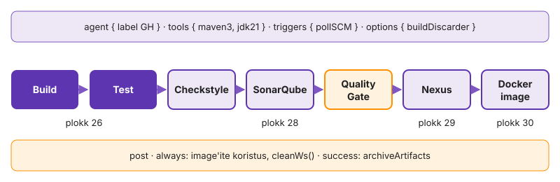

---
tags:
  - Jenkins
  - CI/CD
---

# 1. Agent ja esimene pipeline

Kui buildid töötavad controlleris või ühisel agendil, jagavad kõik jobid sama kasutajat, ketast, `~/.m2`-te ja credential'eid ning ühe meeskonna Maven võtab teise mälu. Seepärast on klassi Jenkinsis controlleris 0 executorit ja ükski sinu build ei käivitu enne, kui sinu control node on agendina ühendatud. Agendi seadistad nagu iga teise Linuxi teenuse: oma kasutaja, saladus failis, systemd unit ja logi. Seejärel kirjutad Jenkinsfile'i, mis ütleb, kus build töötab, kust kood tuleb ja mis etappidest töö koosneb. Lõpuks ehitab ja testib Jenkins Labori seisu sinu masinas kasutajana `jenkins`.

**Kui teed seda tööl iga päev:** agent ühendub `jenkins-agent.sh`-ga esimesel katsel (`journalctl -u jenkins-agent -n 5` näitab `Connected`) ja executorite mõju buildi järjekorrale on sulle tuttav. Kui see on sul juba korras, mine otse etappi [„Katkesta agent ja vaata, kuidas see taastub“](#katkesta-agent-ja-vaata-kuidas-see-taastub).

## Valmista töökoht ette

Töö käib eraldi harul, et `main` jääks GitHub Actionsi korra seisu. Abiskriptid on värskes `main`-is olemas.

Control node'il on 4 GB RAM. Täna töötavad seal Maven, Sonari skanner, `docker build` ja hiljem sinu oma sandbox-Jenkins. Kui 3. kohtumise stack jääb tööle, saab Maven buildi keskel `OutOfMemoryError`-i, mis näeb välja nagu koodiviga.

1. Loo töö haru.

    ```bash
    git switch main && git pull
    git switch -c k06-jenkins
    ls k06-jenkins/
    ```

2. Kui `jenkins-agent.sh`, `trigger-jenkins.sh`, `intsident.sh` või `klass-jenkins.yaml` puudub, võta see avalikust rakenduse repost.

    ```bash
    base=https://raw.githubusercontent.com/hkhk-tk/labori-seis/main/deploy/ci
    for f in jenkins-agent.sh trigger-jenkins.sh intsident.sh; do curl -fsSL -o "k06-jenkins/$f" "$base/$f"; done
    curl -fsSL -o k06-jenkins/klass-jenkins.yaml "$base/casc/klass-jenkins.yaml"
    chmod +x k06-jenkins/*.sh
    ```

3. Peata Labori seisu Compose stack, vaata vaba mälu ja proovi VPN-i.

    ```bash
    docker compose -f k03-docker/compose.yaml stop
    free -m | head -2
    curl -sI http://jenkins.lab.hkhk.ee:8080/login | head -1
    ```

> `curl` ei anna `200`: VPN on maas. Kui GitHub Actionsi deploy käivitas stacki mujalt, näitab `docker ps` projekti nime.

`HTTP/1.1 200` tähendab, et sinu masin jõuab controllerini ja kõik edasised ühendused saavad alata sinu poolt. Kui `free -m` näitab vaba mälu alla 2 GB ka pärast stacki peatamist, otsi `docker ps` ja `ps aux --sort=-rss | head` abil, mis veel mälu hoiab.

✅ **Edasi saad minna, kui** `git branch --show-current` on `k06-jenkins`, `curl` annab `HTTP/1.1 200` ja `docker ps` ei näita Labori seisu konteinereid.

## Logi klassi Jenkinsisse

Sul on klassis tavakasutaja konto ja Role-based Authorization Strategy näitab sulle ainult oma folderit, nagu mitme meeskonnaga Jenkinsis. Liiga lai roll näitaks ka naabri buildide logisid ja credential'ite ID-sid. Jenkins maskeerib logis ainult neid saladusi, mis tulid `withCredentials` kaudu, nii et muul teel väljastatud token jääb lugemisõigusega kasutajale näha.

1. Ava `http://jenkins.lab.hkhk.ee:8080` ja logi sisse kasutajaga `<gh>`.
2. Vaata avalehte. Rollid lubavad sulle ainult mustri `<gh>(/.*)?`, naabri foldereid sa ei näe.

<!-- EKRAANIPILT: jenkins.lab.hkhk.ee:8080 avaleht õppijana sisse logituna (testkasutaja, nt mari-tamm); näha ainult folder mari-tamm ja selle sees job labori-seis. Pärast sammu 26.1.
<figure markdown="span">
  
  <figcaption>Joonis L6.1. Õppija näeb avalehel ainult oma folderit.</figcaption>
</figure>
-->

Kui avalehel on ainult sinu folder, töötab rolli regex nii, nagu loengu joonis 6.5 näitab. Kui näed rohkem, on muster liiga lai ja sellest tuleb koolitajale kohe öelda, sest naabri folderit proovides testid just seda piiri.

✅ **Edasi saad minna, kui** näed ainult folderit `<gh>` ja selles jobi `labori-seis`.

## Ühenda oma agent

Agent on `agent.jar` Java protsess, mis avab controlleriga WebSocketi kaudu Remoting-kanali ja täidab sellel saadetud käske. Ühendus algab agendist, nii et controller ei pea sinu VM-i IP-d teadma ega sinna SSH-ga sisse saama.

Ava [**Manage Jenkins → Nodes**](https://www.jenkins.io/doc/book/managing/nodes/) **→ `<gh>`**. Node on olemas, aga punane: controlleris on 0 executorit ja kuni agent pole ühendunud, jääb iga build järjekorda. Lehel on käsk, mille `-secret` järel on 64 märgi pikkune saladus, sama said koolitajalt.

<!-- EKRAANIPILT: Manage Jenkins → Nodes → mari-tamm enne agendi ühendamist: punane/offline olek ja ühenduskäsk koos -secret väärtusega; saladus hägustada. Sammu 26.2 alguses.
<figure markdown="span">
  
  <figcaption>Joonis L6.2. Node'i lehel on agendi ühenduskäsk. Saladus on pildil hägustatud.</figcaption>
</figure>
-->

Saladus on node'i identiteet. Kes saladust teab, saab sinu nime all agendi ühendada ja sinu jobid hakkavad töötama tema masinas koos sinu credential'itega.

1. Loe `k06-jenkins/jenkins-agent.sh` läbi ja kirjuta PR-i kirjeldusse kolm vastust: mis kasutaja luuakse, kuhu saladus salvestatakse ja mis käsk jääb systemd teenusesse.
2. Käivita skript.

    ```bash
    sudo JENKINS_SECRET=<saladus> k06-jenkins/jenkins-agent.sh <gh>
    ```

3. Vaata teenuse olekut ja logi.

    ```bash
    systemctl status jenkins-agent --no-pager
    journalctl -u jenkins-agent -n 5 --no-pager
    ```

> `Failed to connect` või 403: saladus on vale või node'i nimi ei kattu (`<gh>` väiketähtedega, täpselt nagu Nodes all). `Connection refused`: VPN.

Logirida `Connected` ütleb, et WebSocketi ühendus on püsti ja controller tunneb sinu node'i ära. Roheline node ja kaks vaba executorit tähendavad, et Jenkins võib nüüd sinu masinasse korraga kaks buildi saata. Kui teenus on `active`, aga node punane, töötab protsess, aga ühendus ei õnnestu: vastus on siis journal'is, mitte Jenkinsi lehel.

✅ **Edasi saad minna, kui** skript ütles `OK: agent <gh> ühendus controlleriga olemas`, Nodes all on agent roheline ja all on kaks vaba executorit.

## Vaata, kes ja kus ehitab

Enne pipeline'i teed Freestyle jobi, mis ainult kirjeldab oma keskkonda: mis kasutajana ja kus build töötab ning mitu buildi korraga mahub. Jenkinsfile'i muutja käivitab koodi selle kasutaja õigustes, nii et agendi kasutaja õigused on sama hästi kui iga arendaja õigused sellel masinal.

1. Folderis `<gh>`: **New Item → `kes-olen` → Freestyle project**.
2. *Restrict where this project can be run*: label `<gh>`.
3. *Build Steps → Execute shell*:

    ```bash
    whoami; id; pwd; df -h .; ls -la
    sleep 30
    ```

4. Vajuta **Build Now** kolm korda järjest ja vaata vasakult *Build Executor Status*'t.
5. Ava esimese buildi **Console Output** ja kirjuta PR-i neli vastust: kasutaja, kaust, vaba ruum, mitu buildi töötas korraga.

<!-- EKRAANIPILT: folderi mari-tamm vaade, vasakul Build Executor Status ja Build Queue ajal, kui kes-olen kolm buildi on käivitatud (sleep 30): kaks töötamas, üks "Waiting for next available executor". Sammu 26.3 keskel.
<figure markdown="span">
  
  <figcaption>Joonis L6.3. Kaks executorit on hõivatud, kolmas build ootab.</figcaption>
</figure>
-->

Konsool näitab, et build on lihtsalt protsess kasutaja `jenkins` all kaustas `/opt/jenkins/workspace/...`. Executorite arv on node'i mahupiir: kolmas build ei saa kohta ja ootab, isegi kui masinal oleks CPU-d üle. Executorite arvu seab koolitaja node'i seadistuses. Kui see oleks suurem, töötaksid kõik kolm korraga ja 5. moodulis, kui kõrval töötab sandbox-Jenkins, saaks 4 GB mälu kiiresti otsa.

✅ **Edasi saad minna, kui** kaks buildi töötasid korraga ja kolmas ootas ("Waiting for next available executor"), konsoolis on kasutaja `jenkins`, kaust `/opt/jenkins/workspace/<gh>/kes-olen` ja `sudo` puudub.

## Katkesta agent ja vaata, kuidas see taastub

Nüüd katkestad agendi keset buildi, nagu teeks uuenduse järel taaskäivitus või OOM killer, ja vaatad, mis juhtub buildiga ja kas teenus tuleb ise tagasi.

1. Vaata, millise käsuga agent töötab ja kas saladus paistab protsessiloendis.

    ```bash
    ps -o user,pid,rss,args -u jenkins | cut -c1-160
    ```

2. Vajuta jobis `kes-olen` **Build Now** ja peata agent selle ajal, kui `sleep 30` käib. Kui jätsid eelmise etapi vahele, tee job enne: Freestyle, label `<gh>`, samm `sleep 30`.

    ```bash
    sudo systemctl stop jenkins-agent
    ```

3. Vaata buildi konsooli lõppu ja Nodes lehte. Siis käivita agent uuesti: `sudo systemctl start jenkins-agent`.
4. Tapa agendi protsess nii, nagu OOM killer seda teeks, ja vaata, kas systemd toob selle tagasi.

    ```bash
    sudo pkill -9 -u jenkins -f agent.jar
    sleep 15; systemctl status jenkins-agent --no-pager | head -5
    journalctl -u jenkins-agent --since "-1min" --no-pager | grep -E 'Connected|Main process'
    ```

`ps` väljundis on `-secret @/opt/jenkins/secret`: Remoting loeb väärtuse failist. Freestyle'i samm on agendi protsessi alamprotsess ja katkeb koos sellega. Pipeline'i `sh` käivitub durable-task wrapperiga, mis kirjutab väljundi ja väljumiskoodi faili, ning pipeline ootab agendi tagasitulekut. Kas skript ise ellu jääb, sõltub sellest, kas systemd tapab peatamisel kogu cgroup'i (`KillMode`). `kill -9` järel tõi agendi tagasi `Restart=on-failure`.

✅ **Edasi saad minna, kui** katkestatud build lõppes punasena (FAILURE või ABORTED) ja konsoolis on teade ühenduse kadumise kohta, pärast `pkill -9` oli agent 15 sekundi pärast uuesti `active` ja Nodes all roheline ning PR-i kirjelduses on kaks lauset: mis juhtus buildiga ja miks systemd agendi tagasi tõi.

## Anna Jenkinsile lugemisõigus repole

Job `<gh>/labori-seis` loeb sinu repost faili `k06-jenkins/Jenkinsfile` harult `k06-jenkins` (*Pipeline script from SCM*). Repo on privaatne, nii et Jenkins vajab lugemisõigust.

Klassikaline token annaks igale job'ile, mis folderis credential'it kasutab, kirjutusõiguse kõigisse sinu repodesse. Fine-grained token piirab selle ühe repo lugemisega.

1. GitHubis **Settings → Developer settings → Fine-grained tokens → Generate**: ainult sinu kursuse repo, *Contents: Read-only*, aegumine kursuse lõpus (kuupäeva annab koolitaja).
2. Jenkinsis: folder `<gh>` → **Credentials → (folder) → Add Credentials**.
3. *Username with password*, kasutaja `<gh>`, parool = token, **ID = `github`**. See ID on jobi seadistuses juba kirjas.

Folderi tasemel credential on nähtav ainult selle folderi jobidele. Globaalne credential oleks kättesaadav igale jobile kogu Jenkinsis, ka naabri omale. Credentials leht näitab ID-d ja kirjeldust, aga mitte väärtust: kord sisestatud saladust ei saa veebiliidesest enam välja lugeda.

✅ **Edasi saad minna, kui** credential `github` on folderi all, mitte globaalne, ja Credentials leht näitab ID-d, aga mitte saladust.

## Kirjuta Jenkinsfile: Build

Deklaratiivse Jenkinsfile'i ülaosas on direktiivid, mis kehtivad kogu pipeline'ile (`agent`, `tools`, `options`), all on etapid, mida Graph View eraldi näitab.

Kohtumise lõpuks on Jenkinsfile'is need etapid (joonis L6.4) ja Nexus ning Docker image töötavad paralleelselt. Joonist loe ülevalt alla: ülemised plokid kehtivad kogu pipeline'ile, keskel olevad etapid käivituvad järjest ja `post` käivitub alati lõpus, sõltumata tulemusest.

<figure markdown="span">
  
  <figcaption>Joonis L6.4. Jenkinsfile'i etapid ja plokid, kus iga etapp lisandub.</figcaption>
</figure>

1. Loo `k06-jenkins/Jenkinsfile` ([deklaratiivne süntaks](https://www.jenkins.io/doc/book/pipeline/syntax/)). Faili algus:

    ```groovy
    def GH = env.JOB_NAME.split('/')[0].toLowerCase()
    pipeline {
        agent { label "${GH}" }
        tools {
            maven 'maven3'
            jdk 'jdk21'
    ```

2. Faili lõpp ja esimene etapp:

    ```groovy
        }
        stages {
            stage('Build') { steps { sh 'mvn -B -DskipTests package' } }
        }
    }
    ```

3. Commit ja push harule `k06-jenkins`, siis Jenkinsis **Build Now**.

`GH` tuleb jobi nimest (`<gh>/labori-seis`), nii et sama fail töötab iga õppija jaoks ilma muutmata. Tööriistade nimed peavad klappima klassi omadega: `maven3` ja `jdk21`. Need on administraatori seadistatud nimed, mitte versioonid: kui administraator vahetab Maveni versiooni, sinu fail ei muutu.

<!-- EKRAANIPILT: job mari-tamm/labori-seis → viimane build → Pipeline Graph View; esimesel kujul ainult roheline Build. Pärast sammu 26.5 esimest Build Now'd. (Proovijooksul võib teha ka valmis pipeline'ist kõigi seitsme etapiga.)
<figure markdown="span">
  
  <figcaption>Joonis L6.5. Pipeline Graph View näitab etappe ja nende aega.</figcaption>
</figure>
-->

Rida `Unpacking .../apache-maven-3.9.16-bin.zip` näitab, et sinu agendil polnud Mavenit ja Jenkins paigaldas selle esimesel kasutusel kausta `/opt/jenkins/tools`. Teisel buildil seda rida enam pole. Kui build käivitus mõnes muus kaustas kui `/opt/jenkins/workspace/<gh>/labori-seis`, töötas see mõnel teisel node'il ja `agent` plokk on vale.

✅ **Edasi saad minna, kui** etapp Build on roheline, logi alguses on esimesel korral `Unpacking https://.../apache-maven-3.9.16-bin.zip` ja build töötas kaustas `/opt/jenkins/workspace/<gh>/labori-seis`.

## Lisa Test etapp ja testiraport

Teine etapp käivitab testid ja annab Jenkinsile Surefire'i XML-i. Ilma selleta on punane build üks rida logis. Raportiga näed jobi lehel, mitu testi viiekümnest ebaõnnestus, millised on ebastabiilsed ja kas keegi lülitas testid vaikselt välja.

Teise etapi kirjutad ise. Nõuded:

- etapi nimi `Test`, käsk `mvn -B verify -Dcheckstyle.failOnViolation=false`
- etapil oma `post { always { … } }`, selles `junit allowEmptyResults: true, testResults: 'target/surefire-reports/*.xml'`
- süntaksi leiad jobi menüüst **Pipeline Syntax → Snippet Generator** või [sammude viitest](https://www.jenkins.io/doc/pipeline/steps/)

`verify` käivitab testid ja teeb JaCoCo raporti, mida Sonar hiljem koodi katvuse jaoks vajab. `junit` teeb Surefire'i XML-ist Jenkinsi testiraporti ja trendi. `post { always }` on etapi sees, sest raport peab tulema ka siis, kui testid ebaõnnestuvad.

```bash
bash autograde/check.sh k06 stages
bash autograde/check.sh k06 agent
git add k06-jenkins/Jenkinsfile && git commit -m "k06: Jenkinsfile build + test" && git push
```

> `Tool type "maven" does not have an install of "MAVEN3.9"`: nimi on kopeeritud mujalt. Build ootab "Waiting for next available executor on '<gh>'": agent on offline.

Testitulemuste graafik ilmub alles teise buildi järel, sest trend vajab vähemalt kahte punkti. Kaks `OK`-i tähendavad, et automaatne hindaja näeb failis etappe, testiraportit, labeliga agenti ja tööriistu. Automaatne hindaja ei näe, kas build roheline oli: seda tõestab sinu ekraanipilt.

✅ **Edasi saad minna, kui** Build ja Test on rohelised, jobi lehel on testitulemuste graafik ja mõlemad kontrollid annavad `OK`.

📎 **Selle mooduli tõend:** commit `k06: Jenkinsfile build + test`; PR-i kirjelduses avalehe ekraanipilt, agendi `systemctl` ja `journalctl` väljund, kolm vastust `jenkins-agent.sh` kohta, neli vastust `kes-olen` jobist, kaks lauset agendi katkestuse kohta, Credentials lehe ja Graph View ekraanipilt, `stages` ja `agent` `OK`.

## Miks see nii töötab

**Agent ühendub ise.** WebSocketi režiimis piisab tulemüüris väljuvast ühendusest controlleri HTTP-pordile (klassis 8080).

**WebSocket.** WebSocketi režiim (`-webSocket`, Jenkinsis alates 2.217) kasutab sama HTTP-porti nagu veebiliides, nii et eraldi TCP agendiporti (vaikimisi 50000) ei ole vaja avada. Proksi peab laskma läbi HTTP `Upgrade`-päringu ja hoidma pikaajalist ühendust.

**Jenkins teenusena.** Ubuntu paketis on `JENKINS_HOME` kaust `/var/lib/jenkins`, ametlikus konteineris volume `/var/jenkins_home`. Paketi versioonist 2.335 alates seadistab Jenkinsit systemd unit ja `/etc/default/jenkins` enam ei loeta: `JAVA_OPTS` ja port lähevad `systemctl edit jenkins` abil override'i. Ilma `-Xmx`-ita võtab JVM heap'iks veerandi masina või cgroup'i mälust.

**Viisard ja Jenkinsi URL.** Esimesel käivitusel küsib seadistusviisard algparooli failist `secrets/initialAdminPassword`, pakub pluginaid ja küsib Jenkinsi URL-i. URL läheb muutujasse `BUILD_URL`, e-kirjadesse, agentide ühenduslinkidesse ja GitHubi commit-staatuste linkidesse ning on salvestatud failis `jenkins.model.JenkinsLocationConfiguration.xml`.

**Pipeline script job'is.** Pipeline'i skripti võib kirjutada ka otse job'i seadistusse (*Pipeline script*). Siis on see job'i `config.xml`-is, mitte repos, ja haru ehitab selle hetke skriptiga, mitte sellega, mis oli harul.

Lisaülesanne [4. Jenkinsfile'i kontroll enne push'i](lisa.md#4-jenkinsfilei-kontroll-enne-pushi): kontrollid Jenkinsfile'i süntaksit API kaudu.
