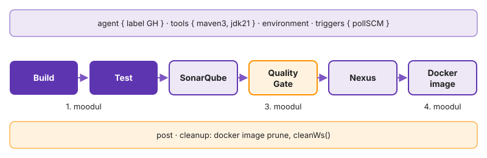

---
tags:
  - Jenkins
  - CI/CD
---

# 1. Agent ja esimene pipeline

Kui buildid töötavad controlleris või ühisel agendil, jagavad kõik jobid sama kasutajat, ketast, `~/.m2`-te ja credential'eid ning ühe meeskonna Maven võtab teise mälu. Seepärast on klassi Jenkinsis controlleris 0 executorit ja ükski sinu build ei käivitu enne, kui sinu control node on agendina ühendatud. Agendi seadistad nagu iga teise Linuxi teenuse: oma kasutaja, saladus failis, systemd unit ja logi. Seejärel kirjutad Jenkinsfile'i, mis ütleb, kus build töötab, kust kood tuleb ja mis etappidest töö koosneb. Lõpuks ehitab ja testib Jenkins Labori seisu sinu masinas kasutajana `jenkins`.

## Valmista control node ette

Töö käib eraldi harul, et `main` jääks samaks. Agendi paigaldusskript `k06-jenkins/jenkins-agent.sh` on starteri `main`-is olemas.

Control node'il on 4 GB RAM. Täna töötavad seal Maven, Sonari skanner ja `docker build`. Kui 3. kohtumise stack töötab, saab Maven buildi keskel `OutOfMemoryError`-i, mis näeb välja nagu koodiviga.

1. Loo töö haru.

    ```bash
    git switch main && git pull
    git switch -c k06-jenkins
    ls k06-jenkins/
    ```

2. Kui `jenkins-agent.sh` puudub, võta see avalikust rakenduse repositooriumist.

    ```bash
    curl -fsSL -o k06-jenkins/jenkins-agent.sh https://raw.githubusercontent.com/hkhk-tk/labori-seis/main/deploy/ci/jenkins-agent.sh
    chmod +x k06-jenkins/jenkins-agent.sh
    ```

3. Kui 3. kohtumise Compose stack töötab, peata see. Seejärel vaata vaba mälu ja proovi VPN-i.

    ```bash
    docker ps --format '{{.Names}}'
    [ -f k03-docker/compose.yaml ] && docker compose -f k03-docker/compose.yaml stop
    free -m | head -2
    curl -sI http://jenkins.lab.hkhk.ee:8080/login | head -1
    ```

??? success "Oodatav tulemus"

    `curl` annab `HTTP/1.1 200`: sinu masin jõuab controllerini ja kõik edasised ühendused saavad alata sinu poolt. `docker ps` ei näita Labori seisu konteinereid ja `free -m` näitab vaba mälu vähemalt 2 GB.

??? warning "Kui `curl` ei vasta või mälu on vähe"

    Kui `curl` ei anna vastust `200`, ei ole VPN-ühendus aktiivne. Kui `free -m` näitab vaba mälu alla 2 GB, otsi `docker ps` ja `ps aux --sort=-rss | head` abil, mis veel mälu hoiab. Kui GitHub Actionsi deploy käivitas stacki mujalt, näitab `docker ps` projekti nime.

## Logi klassi Jenkinsisse

Sul on klassis tavakasutaja konto ja Role-based Authorization Strategy näitab sulle ainult oma folderit, nagu mitme meeskonnaga Jenkinsis. Liiga lai roll näitaks ka naabri buildide logisid ja credential'ite ID-sid. Jenkins maskeerib logis ainult neid saladusi, mis tulid `withCredentials` kaudu, nii et muul teel väljastatud token jääb lugemisõigusega kasutajale näha.

1. Ava `http://jenkins.lab.hkhk.ee:8080` ja logi sisse kasutajaga `<gh>`.
2. Vaata avalehte. Rollid lubavad sulle ainult mustri `<gh>(/.*)?`, naabri foldereid sa ei näe.

<!-- EKRAANIPILT: jenkins.lab.hkhk.ee:8080 avaleht õppijana sisse logituna (testkasutaja, nt mari-tamm); näha ainult folder mari-tamm ja selle sees job labori-seis. Pärast sammu 26.1.
<figure markdown="span">
  
  <figcaption>Joonis L6.1. Õppija näeb avalehel ainult oma folderit.</figcaption>
</figure>
-->

Kui avalehel on ainult sinu folder, töötab rolli muster õigesti. Kui näed rohkem, on muster liiga lai ja sellest tuleb koolitajale kohe öelda.

**Edasi saad minna, kui** näed ainult folderit `<gh>` ja selles jobi `labori-seis`.

## Ühenda oma agent

Agent on `agent.jar` Java protsess, mis avab controlleriga WebSocketi kaudu Remoting-kanali ja täidab sellel saadetud käske. Ühendus algab agendist, nii et controller ei pea sinu VM-i IP-d teadma ega sinna SSH-ga sisse saama.

Ava [**Manage Jenkins → Nodes**](https://www.jenkins.io/doc/book/managing/nodes/) **→ `<gh>`**. Node on olemas, aga punane: controlleris on 0 executorit ja kuni agent pole ühendunud, jääb iga build järjekorda. Lehel on käsk, mille `-secret` järel on 64 märgi pikkune saladus, sama said koolitajalt.

<!-- EKRAANIPILT: Manage Jenkins → Nodes → mari-tamm enne agendi ühendamist: punane/offline olek ja ühenduskäsk koos -secret väärtusega; saladus hägustada. Sammu 26.2 alguses.
<figure markdown="span">
  
  <figcaption>Joonis L6.2. Node'i lehel on agendi ühenduskäsk. Saladus on pildil hägustatud.</figcaption>
</figure>
-->

Saladus on node'i identiteet. Kes saladust teab, saab sinu nime all agendi ühendada ja sinu jobid hakkavad töötama tema masinas koos sinu credential'itega.

1. Loe `k06-jenkins/jenkins-agent.sh` läbi.
2. Käivita skript.

    ```bash
    sudo JENKINS_SECRET=<saladus> k06-jenkins/jenkins-agent.sh <gh>
    ```

3. Vaata teenuse olekut ja logi.

    ```bash
    systemctl status jenkins-agent --no-pager
    journalctl -u jenkins-agent -n 5 --no-pager
    ```

??? question "Mis kasutaja skript loob, kuhu saladus salvestatakse ja mis käsk jääb systemd teenusesse?"

    Skript loob süsteemikasutaja `jenkins` kodukaustaga `/opt/jenkins`. Saladus läheb faili `/opt/jenkins/secret` õigustega ainult omanikule. Teenus `jenkins-agent` käivitab `java -jar /opt/jenkins/agent.jar -url … -name <gh> -secret @/opt/jenkins/secret -webSocket`, nii et saladus ei paista protsessiloendis.

> Kui logis on `Failed to connect` või 403, on saladus vale või node'i nimi ei kattu (`<gh>` väiketähtedega, täpselt nagu Nodes all). `Connection refused` tähendab, et VPN-ühendus puudub.

Logirida `Connected` ütleb, et WebSocketi ühendus on loodud ja controller tunneb sinu node'i ära. Roheline node ja kaks vaba executorit tähendavad, et Jenkins võib nüüd sinu masinasse korraga kaks buildi saata. Kui teenus on `active`, aga node punane, töötab protsess, aga ühendus ei õnnestu: vastus on siis journal'is, mitte Jenkinsi lehel.

**Edasi saad minna, kui** skript ütles `OK: agent <gh> ühendus controlleriga olemas`, Nodes all on agent roheline ja all on kaks vaba executorit.

## Vaata, kes ja kus ehitab

Enne pipeline'i teed ühe buildi käsitsi lihtsas Freestyle jobis, mis ainult kirjeldab oma keskkonda: mis kasutajana ja kus build töötab. Jenkinsfile'i muutja käivitab koodi selle kasutaja õigustes, nii et agendi kasutaja õigused on sisuliselt iga arendaja õigused sellel masinal.

1. Folderis `<gh>`: **New Item → `kes-olen` → Freestyle project**.
2. *Restrict where this project can be run*: label `<gh>`.
3. *Build Steps → Execute shell*:

    ```bash
    whoami; id; pwd; df -h .
    ```

4. Vajuta **Build Now** ja ava buildi **Console Output**.

??? success "Oodatav tulemus"

    Konsoolis on kasutaja `jenkins`, kaust `/opt/jenkins/workspace/<gh>/kes-olen` ja `id` väljundis pole gruppi `sudo`. Build on lihtsalt protsess kasutaja `jenkins` all sinu masinas.

## Anna Jenkinsile lugemisõigus repositooriumile

Job `<gh>/labori-seis` loeb sinu repositooriumist faili `k06-jenkins/Jenkinsfile` harult `k06-jenkins` (*Pipeline script from SCM*). Repositoorium on privaatne, nii et Jenkins vajab lugemisõigust.

Klassikaline token annaks igale job'ile, mis folderis credential'it kasutab, kirjutusõiguse kõigisse sinu repositooriumidesse. Fine-grained token piirab selle ühe repositooriumi lugemisega.

1. GitHubis **Settings → Developer settings → Fine-grained tokens → Generate**: ainult sinu kursuse repositoorium, *Contents: Read-only*, aegumine kursuse lõpus (kuupäeva annab koolitaja).
2. Jenkinsis: folder `<gh>` → **Credentials → (folder) → Add Credentials**.
3. *Username with password*, kasutaja `<gh>`, parool = token, **ID = `github`**. See ID on jobi seadistuses juba kirjas.

Folderi tasemel credential on nähtav ainult selle folderi jobidele. Globaalne credential oleks kättesaadav igale jobile kogu Jenkinsis, ka naabri omale. Credentials leht näitab ID-d ja kirjeldust, aga mitte väärtust: kord sisestatud saladust ei saa veebiliidesest enam välja lugeda.

**Edasi saad minna, kui** credential `github` on folderi all, mitte globaalne, ja Credentials leht näitab ID-d, aga mitte saladust.

## Kirjuta Jenkinsfile: Build

Deklaratiivse Jenkinsfile'i ülaosas on direktiivid, mis kehtivad kogu pipeline'ile (`agent`, `tools`, `options`), all on etapid, mida Graph View eraldi näitab.

Kohtumise lõpuks on Jenkinsfile'is need etapid (joonis L6.4). Joonist loe ülevalt alla: ülemised plokid kehtivad kogu pipeline'ile, keskel olevad etapid käivituvad järjest ja `post` käivitub alati lõpus, sõltumata tulemusest.

<figure markdown="span">
  
  <figcaption>Joonis L6.4. Jenkinsfile'i etapid ja moodulid, kus iga etapp lisandub (Talvik, 2026).</figcaption>
</figure>

1. Loo `k06-jenkins/Jenkinsfile` ([deklaratiivne süntaks](https://www.jenkins.io/doc/book/pipeline/syntax/)). Faili algus:

    ```groovy
    def GH = env.JOB_NAME.split('/')[0].toLowerCase()
    pipeline {
        agent { label "${GH}" }
        tools {
            maven 'maven3'
            jdk 'jdk21'
    ```

2. Faili lõpp ja esimene etapp:

    ```groovy
        }
        stages {
            stage('Build') { steps { sh 'mvn -B -DskipTests package' } }
        }
    }
    ```

3. Commit ja push harule `k06-jenkins`, siis Jenkinsis **Build Now**.

`GH` tuleb jobi nimest (`<gh>/labori-seis`), nii et sama fail töötab iga õppija jaoks ilma muutmata. Tööriistade nimed peavad klappima klassi omadega: `maven3` ja `jdk21`. Need on administraatori seadistatud nimed, mitte versioonid: kui administraator vahetab Maveni versiooni, sinu fail ei muutu.

<!-- EKRAANIPILT: job mari-tamm/labori-seis → viimane build → Pipeline Graph View; esimesel kujul ainult roheline Build. Pärast sammu 26.5 esimest Build Now'd. (Proovijooksul võib teha ka valmis pipeline'ist kõigi seitsme etapiga.)
<figure markdown="span">
  
  <figcaption>Joonis L6.5. Pipeline Graph View näitab etappe ja nende aega.</figcaption>
</figure>
-->

Rida `Unpacking .../apache-maven-3.9.16-bin.zip` näitab, et sinu agendil polnud Mavenit ja Jenkins paigaldas selle esimesel kasutusel kausta `/opt/jenkins/tools`. Teisel buildil seda rida enam pole. Kui build käivitus mõnes muus kaustas kui `/opt/jenkins/workspace/<gh>/labori-seis`, töötas see mõnel teisel node'il ja `agent` plokk on vale.

**Edasi saad minna, kui** etapp Build on roheline, logi alguses on esimesel korral `Unpacking https://.../apache-maven-3.9.16-bin.zip` ja build töötas kaustas `/opt/jenkins/workspace/<gh>/labori-seis`.

## Lisa Test etapp ja testiraport

Teine etapp käivitab testid ja annab Jenkinsile Surefire'i XML-i. Ilma selleta on punane build üks rida logis. Raportiga näed jobi lehel, mitu testi viiekümnest ebaõnnestus, millised on ebastabiilsed ja kas keegi lülitas testid vaikselt välja.

Teise etapi kirjutad ise. Nõuded:

- etapi nimi `Test`, käsk `mvn -B verify -Dcheckstyle.failOnViolation=false`
- etapil oma `post { always { … } }`, selles `junit allowEmptyResults: true, testResults: 'target/surefire-reports/*.xml'`
- süntaksi leiad jobi menüüst **Pipeline Syntax → Snippet Generator** või [sammude viitest](https://www.jenkins.io/doc/pipeline/steps/)

??? example "Lahendus: etapp Test"

    Etapp tuleb plokki `stages` etapi Build järele.

    ```groovy
            stage('Test') {
                steps { sh 'mvn -B verify -Dcheckstyle.failOnViolation=false' }
                post { always { junit allowEmptyResults: true, testResults: 'target/surefire-reports/*.xml' } }
            }
    ```

`verify` käivitab testid ja teeb JaCoCo raporti, mida Sonar hiljem koodi katvuse jaoks vajab. `junit` teeb Surefire'i XML-ist Jenkinsi testiraporti ja trendi. `post { always }` on etapi sees, sest raport peab tulema ka siis, kui testid ebaõnnestuvad.

Kontrolli faili automaatse hindaja testidega ja salvesta Jenkinsfile repositooriumi:

```bash
bash autograde/check.sh k06 stages
bash autograde/check.sh k06 agent
git add k06-jenkins/Jenkinsfile && git commit -m "k06: Jenkinsfile build + test" && git push
```

> Teade `Tool type "maven" does not have an install of "MAVEN3.9"` tähendab, et tööriista nimi on kopeeritud mujalt. Kui build ootab teatega "Waiting for next available executor on '<gh>'", on agent offline.

Testitulemuste graafik ilmub alles teise buildi järel, sest trend vajab vähemalt kahte punkti. Kaks `OK`-i tähendavad, et automaatne hindaja näeb failis etappe, testiraportit, labeliga agenti ja tööriistu. Automaatne hindaja ei näe, kas build oli roheline: seda näed Jenkinsis.

**Edasi saad minna, kui** Build ja Test on rohelised, jobi lehel on testitulemuste graafik ja mõlemad kontrollid annavad `OK`.
