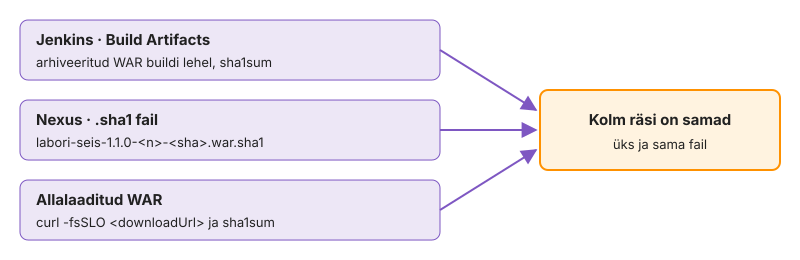

---
tags:
  - SonarQube
  - Nexus
  - CI/CD
---

# 3. Quality gate ja Nexus

Kui tootmises on vigane fail, on esimesed küsimused, kes selle läbi lasi ja milline täpselt see fail oli. Praegu ei oska su pipeline kumbagi öelda: roheline build tähendab ainult, et testid läbisid, ja WAR on ainult workspace'is. Sonar analüüsib iga buildi ja quality gate peatab halva koodi enne, kui WAR Nexusesse jõuab. Maven laeb sõltuvused kooli Nexusest ja pipeline laeb sinna versioonitud WAR-i, mille räsi klapib Jenkinsi omaga.

**Kui teed seda tööl iga päev:** `withSonarQubeEnv` ja `waitForQualityGate` on sul mõnes pipeline'is juba kasutusel. Kui see on sul juba korras, mine otse etappi [„Lae WAR Nexusesse“](#lae-war-nexusesse).

## Loo Sonari token ja credential

Jenkins peab Sonarisse kirjutama ja selleks vajab ta tokenit. Teed tokeni, mis kehtib ainult sinu projektile, ja paned selle Jenkinsi folderisse, kust pipeline seda ID järgi küsib. Jenkinsfile'i jõuab ainult ID `sonar`, mitte väärtus.

Kasutaja token kehtiks kõigile sinu õigustega projektidele. Kui see lekib buildi logist, saab keegi kirjutada üle ka teiste projektide analüüse.

1. Kontrolli, et Sonar on üleval: `curl -s http://sonar.lab.hkhk.ee:9000/api/system/status` peab andma `"status":"UP"`.
2. Ava `http://sonar.lab.hkhk.ee:9000`, logi sisse `<gh>` ja koolitaja antud parooliga. Sinu projekt `labori-seis-<gh>` on olemas ja tühi.
3. **My Account → Security → Generate Token**: tüüp *Project Analysis Token*, projekt `labori-seis-<gh>`.
4. Jenkinsis folder `<gh>` → Credentials → *Secret text*, **ID = `sonar`**.

Kui token aegub kursuse ajal, näed seda buildis veana `Not authorized` ja parandus on uus token sama ID alla.

✅ **Edasi saad minna, kui** Jenkinsi folderis on credential `sonar` ja Sonaris on token aegumiskuupäevaga.

## Analüüsi koodi Sonaris

Nüüd lisad kaks etappi. Checkstyle teeb stiiliraporti ja Sonar loeb selle koos testide katvusega ning oma reeglitega. Sonari skanner töötab Maveni pluginana sinu agendil ja saadab tulemuse serverisse, kus see töödeldakse.

Ilma JaCoCo raportita on katvus 0 % või puudub ja katvuse tingimus kas nurjab iga buildi või, kui tingimust pole, laseb läbi muudatuse, mida ükski test ei puuduta.

1. Lisa Jenkinsfile'i `environment` plokk ([SonarScanner for Maven](https://docs.sonarsource.com/sonarqube-server/analyzing-source-code/scanners/sonarscanner-for-maven)):

    ```groovy
        environment {
            SONAR_KEY = "labori-seis-${GH}"
        }
    ```

2. Lisa pärast Test'i etapp Checkstyle. `checkstyle:checkstyle` teeb raporti buildi nurjamata.

    ```groovy
            stage('Checkstyle') { steps { sh 'mvn -B checkstyle:checkstyle' } }
    ```

3. Lisa selle järel etapp SonarQube.

    ```groovy
            stage('SonarQube') {
                steps { withSonarQubeEnv(installationName: 'sonar', credentialsId: 'sonar') {
                    sh 'mvn -B sonar:sonar -Dsonar.projectKey=$SONAR_KEY -Dsonar.java.checkstyle.reportPaths=target/checkstyle-result.xml'
                } }
            }
    ```

4. Push ja oota buildi.

Katvus tuleb Test etapi JaCoCo XML-ist (`target/site/jacoco/jacoco.xml`), seega peab Sonar käivituma pärast Test'i samas workspace'is. `withSonarQubeEnv` annab Mavenile serveri aadressi ja tokeni keskkonnamuutujatena, nii et need ei paista käsureal ega logis.

<!-- EKRAANIPILT: sonar.lab.hkhk.ee:9000/dashboard?id=labori-seis-mari-tamm pärast esimest edukat analüüsi: Quality Gate Passed, Reliability/Security/Maintainability hinded, Coverage > 0 %. Pärast sammu 28.3.
<figure markdown="span">
  
  <figcaption>Joonis L6.7. Sonari projekti ülevaade: kolm mõõdet, katvus ja quality gate'i olek.</figcaption>
</figure>
-->

> Katvus on 0 %: Sonar käivitus enne `verify`-d või workspace tühjendati vahepeal. Lisa ajutiselt `sh 'ls target/site/jacoco'`.

`ANALYSIS SUCCESSFUL` tähendab ainult, et raport jõudis serverisse. Otsust selles veel pole: server töötleb raportit taustal ja hinnang tekib mõne sekundi või minuti pärast. Seepärast on järgmine etapp eraldi.

✅ **Edasi saad minna, kui** logi lõpus on `ANALYSIS SUCCESSFUL, you can find the results at: http://sonar.lab.hkhk.ee:9000/dashboard?id=labori-seis-<gh>`, Sonaris on katvus üle 0 % ja Checkstyle'i leiud on välise raportina näha.

## Lisa quality gate

Quality gate on Sonari serveris kirjas olevate tingimuste kogum, näiteks "uue koodi reliability hinne peab olema A". Pipeline ootab, kuni server on analüüsi töödelnud, küsib tulemuse ja katkestab buildi, kui tingimus ei täitu.

`withSonarQubeEnv` loeb pärast skanneri lõppu taski ID failist `target/sonar/report-task.txt` ja jätab selle buildi juurde. `waitForQualityGate` küsib selle ID järgi API-lt korra, kas töötlus on juba valmis, ja jääb muidu webhooki ootama.

1. Ava Sonaris **Quality Gates → IS1** ja kirjuta PR-i kirjeldusse tingimused (meetrika, võrdlus, lävi).
2. Kirjuta etapp ise. Nõuded:
    - etapi nimi on täpselt `Quality Gate` ja see tuleb pärast SonarQube'i
    - samm `waitForQualityGate`, mille ERROR katkestab kogu pipeline'i ja järgmised etapid jäävad tegemata
    - ootamine on piiratud 15 minutiga (`timeout`), sest Sonar töötleb klassi raporteid ükshaaval
    - uut credential'it pole vaja: Sonar teatab tulemuse webhookiga (loengu joonis 6.3)
3. Süntaksi annab **Pipeline Syntax → Snippet Generator → `waitForQualityGate`**, linnuke *Abort pipeline*.
4. Push ja oota buildi.

```bash
bash autograde/check.sh k06 quality
```

> Etapp ootab kuni timeout'ini: webhook ei jõudnud kohale. See pole sinu Jenkinsfile'i viga, koolitaja vaatab Sonari *Webhooks → Recent deliveries*.

`Quality gate is OK` tuli Jenkinsi tänu Sonari webhookile, mitte sellele, et Jenkins pidevalt küsiks. Kui etapp läks roheliseks mõne sekundiga, töötavad analüüs, taustatöötlus, webhook ja ootav samm. Kui see võttis minuteid, oli Sonaris järjekord, sest naabrid analüüsisid samal ajal.

✅ **Edasi saad minna, kui** etapp läks roheliseks, logis on `Quality gate is OK` ja kontroll annab `OK`.

## Lase quality gate'il halb kood peatada

Roheline quality gate tõestab ainult, et hea kood pääseb läbi. Tingimus võib olla seatud kogu koodile, vale meetrikale või puududa, ja see tuleb välja alles siis, kui halb kood läbi läheb. Lisad koodi rea, mis kompileerub ja läbib testid, aga on ilmselgelt vale.

1. Ava `src/main/java/ee/hkhk/laboriseis/api/VersionController.java` ja lisa ajutiselt konstruktorisse rea `this.info = ...` ette:

    ```java
    if (gitSha == gitSha) { gitSha = gitSha.trim(); }
    ```

2. Push ja oota buildi. Vaata buildi logi ja Sonari projekti.
3. Eemalda rida, push ja oota buildi.

Halva koodiga build peatus etapis Quality Gate ja järgmised etapid jäid tegemata. See tähendab, et vigane versioon ei saanud kunagi numbrit Nexuses. Sonari leid näitab reeglit, faili ja rida: sama info, mille järgi otsid intsidendiülesandes riket.

✅ **Edasi saad minna, kui** halva koodiga build oli FAILURE logireaga `Pipeline aborted due to quality gate failure: ERROR`, Sonaris oli uus reliability leid ja hinne polnud A ning pärast parandust on build jälle roheline.

## Lae sõltuvused Nexusest

Maven laeb igal puhtal buildil alla kümneid sõltuvusi. Kooli Nexus on cache: `maven-public` on group, mille taga on `maven-central` proxy. Esimene õppija laeb sõltuvused internetist, ülejäänud kohtvõrgust.

Proxy-repo on ühtlasi nimekiri kõigist sõltuvustest, mida organisatsioon kasutab: kui tuleb teade haavatava teegi kohta, näitab Nexuse otsing, kas see on kunagi alla laaditud.

1. Kontrolli Nexust: `curl -s -o /dev/null -w '%{http_code}\n' http://nexus.lab.hkhk.ee:8081/service/rest/v1/status` peab andma `200`.
2. Loo `k06-jenkins/settings.xml`, kus on üks `<mirror>`. Nõuded:
    - id `kooli-nexus`, `<mirrorOf>*</mirrorOf>`
    - url `http://nexus.lab.hkhk.ee:8081/repository/maven-public/`
    - paroole pole, lugemine on anonüümne
3. Lisa `environment` plokki `MVN = 'mvn -B -s k06-jenkins/settings.xml'` ja asenda kõigis etappides `mvn -B` → `$MVN`.
4. Push ja oota kaks buildi. Võrdle Build etapi aega Pipeline Graph View's.

`<mirrorOf>*</mirrorOf>` tähendab, et Maven ei küsi enam ühtegi teist repot otse, ka siis, kui mõni pom seda nõuaks. Teine build on lühem kahel põhjusel: sõltuvused tulevad kohtvõrgust ja osa neist on juba agendi `~/.m2` all. Kui logis on endiselt `Downloading from central`, on mõni `mvn` käsk jäänud ilma `-s`-ta.

✅ **Edasi saad minna, kui** logis on `Downloading from kooli-nexus: http://nexus.lab.hkhk.ee:8081/repository/maven-public/...` ja teine build on Build etapis lühem kui esimene.

## Lae WAR Nexusesse

Nüüd teed pipeline'ist väljundi, mida saab hiljem täpselt üles leida. Igale buildile antakse versioon, mis on unikaalne ja ütleb, millisest commit'ist fail tehti. Selle versiooniga läheb WAR Nexuse hosted repo'sse.

Release-repo ei luba sama versiooni üle kirjutada. Versioon `<pom.version>-<BUILD_NUMBER>-<commit'i 7 märki>` on unikaalne ka siis, kui job luuakse uuesti ja `BUILD_NUMBER` algab 1-st.

1. Folder `<gh>` → Credentials → *Username with password*, kasutaja `<gh>`, Nexuse parool, **ID = `nexus`**.
2. Lisa `environment` plokki:

    ```groovy
            NEXUS_HOST  = 'nexus.lab.hkhk.ee:8081'
            NEXUS_REPO  = 'labori-seis'
            NEXUS_GROUP = "ee.hkhk.${GH}"
    ```

3. Arvuta versioon etapi Build alguses `script {}` plokis. Seda vajavad hiljem kaks paralleelset etappi (Nexus ja image), seepärast mitte Nexuse etapis. Nõuded:
    - pom loetakse sammuga `readMavenPom file: 'pom.xml'`
    - `env.ART_VERSION` on kujul `<pom.version>-<BUILD_NUMBER>-<GIT_COMMIT 7 esimest märki>`
    - `currentBuild.displayName` näitab versiooni, nii et buildi ajaloos on see kohe näha
4. Lisa pärast Quality Gate'i etapp `Nexus`, mis kutsub `nexusArtifactUploader`-it (Snippet Generatoris olemas): `nexusVersion: 'nexus3'`, `protocol: 'http'`, `nexusUrl`, `repository`, `groupId`, `version`, `credentialsId: 'nexus'` ja üks artefakt `labori-seis`, fail `target/labori-seis.war`, tüüp `war`.
5. Push ja oota buildi.

```bash
bash autograde/check.sh k06 nexus
bash autograde/check.sh k06 secrets
```

> 400: sama versioon on juba olemas. 403: groupId pole `ee.hkhk.<gh>` või credential on vale. 401: parool.

Logirida `Uploaded:` näitab täielikku teed ja tee ise kirjeldab artefakti: repo, groupId kaustadena, artifactId ja versioon. Kui buildi nimi ajaloos ja versioon teel on samad, saad igast buildist ühe klikiga õige faili juurde. `secrets` `OK` tähendab, et parool on Jenkinsis ja failis on ainult ID.

✅ **Edasi saad minna, kui** logis on `Uploaded: http://nexus.lab.hkhk.ee:8081/repository/labori-seis/ee/hkhk/<gh>/labori-seis/1.1.0-<n>-<sha>/...war`, buildi nimi näitab sama versiooni ja mõlemad kontrollid annavad `OK`.

## Tõesta, et fail on sama

Võrdled kolme koopiat: Jenkinsi arhiveeritud WAR, Nexuse vastuvõtul arvutatud `.sha1` ja eraldi alla laaditud fail (joonis L6.8). Nexus arvutab `.sha1` ise, nii et see ei tõenda midagi, kui fail muudeti enne üleslaadimist: seepärast on vaja ka Jenkinsi poolt arhiveeritud koopiat.

1. Ava Nexuse UI-s **Browse** ja kirjuta üles, mis tüüpi on `maven-central`, `maven-public` ja `labori-seis`.
2. Küsi [REST API-lt](https://help.sonatype.com/en/rest-apis.html) oma versioonid.

    ```bash
    curl -s "http://nexus.lab.hkhk.ee:8081/service/rest/v1/search?repository=labori-seis&group=ee.hkhk.<gh>" | grep '"version"'
    ```

3. Laadi viimane WAR alla (`curl -fsSLO <downloadUrl>`) ja võrdle `sha1sum`-i kolmest allikast: Jenkinsi arhiveeritud WAR (buildi lehel *Build Artifacts*, fingerprint), Nexuse `.sha1` fail ja allalaaditud WAR.

<figure markdown="span">
  
  <figcaption>Joonis L6.8. Kolm allikat, üks räsi.</figcaption>
</figure>

<!-- EKRAANIPILT: nexus.lab.hkhk.ee:8081 → Browse → labori-seis, avatud puu ee/hkhk/mari-tamm/labori-seis/1.1.0-<n>-<sha>/ ning valitud .war (paremal paneelis Path ja sha1). Pärast sammu 29.2.
<figure markdown="span">
  
  <figcaption>Joonis L6.9. Sinu WAR Nexuses: tee tuleb groupId-st, artifactId-st ja versioonist.</figcaption>
</figure>
-->

```bash
git add k06-jenkins/ && git commit -m "k06: sonar + quality gate + nexus" && git push
```

Kolm võrdset räsi tõestavad, et Nexuses on täpselt see WAR, mis läbis quality gate'i. Kui räsi erineb, võrdled tavaliselt eri buildi faile: vaata buildi numbrit ja versiooni. Kui need klapivad ja räsi ikka erineb, on fail teel muutunud ja seda ei tohi paigaldada.

✅ **Edasi saad minna, kui** REST API näitab sinu versioone, kolm räsi on samad ja commit on GitHubis.

## Proovi sama versiooni üle kirjutada

Viimaseks kontrollid ise reeglit, millele kogu versioonimine toetub: Nexus ei luba sama versiooni teist korda. Laed allalaaditud WAR-i käsitsi sama versiooni alla tagasi, nagu teeks kolleeg, kes "parandab" tootmises olevat faili.

Kui hosted repo lubaks redeploy'd, saaks iga credential'i omanik vaikselt asendada tootmises oleva faili ja konteineri räsi kontroll näitaks juba uut, võltsitud faili.

1. Võta versioon buildi nimest ja proovi sama faili sama teele üles laadida. Parool läheb `curl`-ile standardsisendist.

    ```bash
    read -rs NEXUS_PASS; v=<versioon>
    u=http://nexus.lab.hkhk.ee:8081/repository/labori-seis/ee/hkhk/<gh>/labori-seis/$v/labori-seis-$v.war
    printf 'user = "<gh>:%s"\n' "$NEXUS_PASS" | curl -sS -K- -o /dev/null -w '%{http_code}\n' \
        --upload-file "labori-seis-$v.war" "$u"
    unset NEXUS_PASS
    ```

2. Kirjuta PR-i kirjeldusse vastuse kood ja üks lause: mida see tähendab buildile, mis kogemata sama versiooni teist korda arvutab.

Vastus `400` ilma ühegi muutuseta Nexuses tõestab, et repo poliitika on *Disable redeploy*. Sama koodi annab ka pipeline, kui versiooni arvutus kaotab `BUILD_NUMBER`-i või räsi: intsidendiülesandes tuleb see vastu.

✅ **Edasi saad minna, kui** käsk andis `400`, Nexuse Browse näitab sama faili muutmata kuupäevaga ja PR-i kirjelduses on lause vastuse tähenduse kohta.

📎 **Selle mooduli tõend:** commit `k06: sonar + quality gate + nexus`; PR-i kirjelduses Credentials leht (`sonar`, `nexus`), Sonari projekti ekraanipilt, quality gate'i tingimused ja `Quality gate is OK`, ebaõnnestunud tingimus halva koodiga, Nexuse logirida ja kahe buildi Build etapi aeg, kolm `sha1sum` rida, Nexus Browse ekraanipilt, redeploy katse vastuse kood; `quality`, `nexus`, `secrets` `OK`.

## Miks see nii töötab

**Sonari tokenid ja harud.** Projektitoken lubab analüüsida ainult ühte projekti, kasutaja token kõiki selle kasutaja projekte. SonarQube Community Build (selles laboris versioon 26.9) ei toeta ilma kolmanda osapoole pluginata haruanalüüsi: proovi-haru build kirjutab sama projekti analüüsi üle.

**Sonar ja `vm.max_map_count`.** SonarQube'i sisemine Elasticsearch hoiab indekseid `mmap`-iga ja nõuab vähemalt `vm.max_map_count=524288`, `fs.file-max=131072` ning protsessile vähemalt 131072 avatud faili ja 8192 lõime. Linuxi vaikeväärtusega 65530 Sonar ei käivitu. Koolitaja masinas on failis `/etc/sysctl.d/99-sonarqube.conf` väärtus 524288, laaditud käsuga `sysctl --system`. Vastus **502 Bad Gateway** tähendab, et Sonari ees olev Nginx on üleval, aga Sonar veel mitte: `curl -s localhost:9000/api/system/status` näitab `STARTING` või `UP`.

**Checkstyle: raport, mitte nurjamine.** GitHub Actionsis nurjas `checkstyle:check` esimese hoiatuse peale kogu workflow'. Siin teeb `checkstyle:checkstyle` ainult raporti ja annab selle Sonarile, otsuse teeb quality gate. Mõlemad mustrid on õiged: ühes on stiil reegel, teises üks sisend otsusele.

**Uus kood quality gate'is.** Quality gate'i tingimused kehtivad tavaliselt uue koodi kohta, mitte kogu koodi kohta. Nii saab ka tehnilise võlaga projekt quality gate'i kasutusele võtta: uus kood peab vastama nõuetele, vana koodi parandatakse järk-järgult.

**Sonari webhook.** Sonari webhook saadab Jenkinsile analüüsi tulemuse ja allkirjastab selle saladusega (HMAC). Jenkins kontrollib allkirja credential'i `sonar-webhook` abil, nii et ilma saladuseta ei saa keegi saata võltsitud teadet „quality gate OK“.

**Webhooki saladus ja ajapiir.** Seetõttu on see saladus `SYSTEM`-tasemel: job'id ei vaja seda ega tohi seda näha. Kui webhook ei jõua kohale ja analüüs ei olnud sammu alguses veel valmis, ei saa Jenkins tulemust teada ja `waitForQualityGate` ootab kuni `timeout`-väärtuseni.

**Üleslaadimine HTTP PUT-iga.** `nexusArtifactUploader` saadab faili HTTP PUT-päringuga õigele teele. Sama tulemuse annab `curl -u kasutaja:parool --upload-file labori-seis.war <url>`.

**Nexuse otsing.** REST API `search` tagastab vastuse lehekülgede kaupa (`continuationToken`), nii et skript, mis loeb ainult esimest lehte, näeb suures repos ainult osa versioonidest.

**Blob store.** Nexus hoiab faile blob store'is (`/nexus-data/blobs`) ja metaandmeid andmebaasis. Kustutamine märgib bloobi ainult kustutatuks: kettaruum vabaneb alles ülesandega „Compact blob store“.

**Jenkinsi muutujad.** Jenkins annab igale buildile muutujad `BUILD_NUMBER`, `JOB_NAME`, `WORKSPACE` ning Git'i pluginast `GIT_COMMIT` ja `GIT_BRANCH`. Shellis loed neid kujul `$BUILD_NUMBER`, Groovys `env.BUILD_NUMBER`. `sh "...${SALADUS}"` topeltjutumärkides asendab Groovy väärtuse enne shelli ja see jõuab protsessiloendisse; Jenkins hoiatab siis logis `A secret was passed to "sh" using Groovy String interpolation`. Ühekordsed jutumärgid jätavad asendamise shellile. Täielik loend on job'i menüüs *Pipeline Syntax → Global Variables Reference*. Kellaaeg või käsitsi antud number teeb versiooni unikaalseks, aga ei ütle, mis kood pakis on. Commit'i räsi ütleb.

**Disable redeploy.** Nexus CE 3.96.4-s annab hosted-repo poliitika *Disable redeploy* sama versiooni uuesti üleslaadimise katsel vastuse koodiga `400`.

Lisaülesanne [6. `mvn deploy` ilma pluginata](lisa.md#6-mvn-deploy-ilma-pluginata): laed WAR-i Nexusesse Maveni enda vahenditega, ilma Jenkinsi pluginata.
