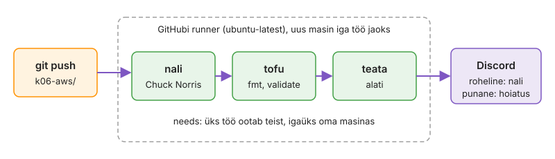

---
tags:
  - AWS
  - OpenTofu
  - GitHub Actions
  - Praktikum
---

# Praktikum: AWS OpenTofuga ja GitHub Actions

4\. kohtumisel lõi OpenTofu masinad kooli Proxmoxis. Täna teed sama AWS-is: kõigepealt ühe masina AWS CLI käskudega, siis sama masina OpenTofuga, mis paneb kohe üles lehe „Tere pilvest!“. Lõpuks paned GitHub Actionsi sinu OpenTofu koodi iga push'i järel kontrollima.

Iga osa alguses on eesmärk ja kontroll. Kui oskad, tee osa eesmärgi järgi ise ja ava lahendused ainult kontrolliks. Töö tulemus on harus `k06-aws` olevad failid ja automaatkontroll kontrollib neid GitHubis.

**Edenemine:** laboritahvel <http://is126.kaaren.lab.hkhk.lan> (VPN-iga).

Küsimused: [Küsimused ja teated](https://github.com/hkhk-tk/is126-arutelu/discussions). Lisa küsimusele käsk ja kogu veateade tekstina. Enne saatmist eemalda konto ID, võtmed ja paroolid.

!!! warning "Konto tee enne tundi"

    Osa 1 tee kodus enne kohtumist [AWS-i konto juhendi](aws-konto.md) järgi. Konto kinnitamine võib võtta tunde ja kahe-etapiline sisselogimine vajab telefoni. Kui sul on varem olnud AWS-i konto, loe juhendi viimast lõiku.

??? tip "Algseis: mida saad valmis kujul ja mida teed ise"

    **Saad valmis kujul:** control'i, repositooriumi `~/kursus` ja selles koristuse kontrolli `cloud/aws-leftovers.sh`. Control'is on OpenTofu 4. kohtumisest. Kui seda pole, paigalda see [4. kohtumise praktikumi sammu 1.2](../k04/lab.md#12-paigalda-opentofu) järgi.

    **Teed ise:** lood AWS-i konto, seadistad control'is AWS CLI, lood EC2 masina käsitsi ja OpenTofuga, kustutad kõik, kirjutad GitHub Actionsi töövoo ja esitad töö tag'iga `k06`.

    **Kulu:** üks t3.micro masin koos avaliku IP-aadressiga maksab umbes 2 senti tunnis ja see võetakse Free plani krediidist. Free planil kaardilt raha ei võeta. Reeglid ja hinnad on lehel [AWS-i reeglid](../kodutood/aws-reeglid.md).

??? abstract "Õpiväljundid"

    1. Seadistad AWS-i konto nii, et igapäevane töö ei käi root-kasutajaga ja kulu on jälgitav.
    2. Logid AWS CLI-ga sisse ajutise sessiooniga, ilma et võtmed jääksid kettale.
    3. Lood ja kustutad EC2 masina AWS CLI käskudega.
    4. Kirjutad sama masina OpenTofu koodi, mis paneb masinasse veebilehe.
    5. Kustutad kõik loodud ressursid ja kontrollid, et midagi tasulist ei jäänud.
    6. Kirjutad GitHub Actionsi töövoo, mis kontrollib OpenTofu koodi iga push'i järel.

??? info "Testitud versioonid"

    AWS CLI 2.32, OpenTofu 1.13, `hashicorp/aws` 6.x, Ubuntu 24.04 AMI, regioon eu-north-1 (Stockholm), GitHub Actions `ubuntu-latest`, `actions/checkout@v5`, `opentofu/setup-opentofu@v1`.

    Dokumentatsioon: [AWS CLI](https://docs.aws.amazon.com/cli/latest/userguide/), [EC2](https://docs.aws.amazon.com/ec2/), [OpenTofu AWS provider](https://search.opentofu.org/provider/hashicorp/aws/latest).

## Osa 1 · Konto ja kulude kontroll

AWS-i konto loomisel tekib **root-kasutaja**: sinu e-posti aadress ja parool. Root saab kontoga teha kõike, sealhulgas konto kustutada, ja tema õigusi ei saa piirata. Seepärast kaitsed rooti kahe-etapilise sisselogimisega (MFA) ja teed igapäevaseks tööks eraldi **IAM-kasutaja**. Eelarvehäired saadavad e-kirja, kui midagi hakkab raha maksma.

**Eesmärk:** kontol on Free plan, root on MFA-ga kaitstud ja töötad IAM-kasutajana.  
**Kontroll:** CloudShellis näitab `aws sts get-caller-identity` Arn'i, mis lõpeb `:user/admin`.  
**Kus:** sinu arvuti brauser, AWS-i konsool.

### 1.1 Konto Free planiga

Registreeru lehel [aws.amazon.com/free](https://aws.amazon.com/free/) ja vali plaanide võrdlusest **Free plan**. Enamik uusi kasutajaid ei pea makseviisi andma. Kui AWS seda kontrolliks küsib, ei võeta Free planil kaardilt raha.

??? success "Oodatav tulemus"

    Konsooli avalehel ja lehel **Billing and Cost Management** on kaart **Free plan** krediidi ja päevade jäägiga.

!!! warning "Ära vajuta Upgrade plan"

    Free plan lõpeb kuue kuu pärast või kui krediit saab otsa ja konto suletakse ise. **Upgrade plan** ja AWS Organizationsiga liitumine muudavad konto tasuliseks.

### 1.2 Root-kasutaja kaitse ja IAM-kasutaja

1. Lisa root-kasutajale MFA: paremast ülanurgast konto nimi, **Security credentials**, **Assign MFA device**. Sobib telefoni autentimisrakendus.
2. Root-kasutajale juurdepääsuvõtmeid (access key) ära loo.
3. Ava **IAM**, **Users**, **Create user**. Nimi `admin`, märgi **Provide user access to the AWS Management Console**, õiguste juures **Attach policies directly** ja vali `AdministratorAccess`. Lisa ka sellele kasutajale MFA.
4. Logi välja ja logi sisse IAM-kasutajana: konto ID, kasutajanimi `admin` ja parool.

Juhend piltidega on AWS-i dokumentatsioonis: [IAM-kasutaja loomine](https://docs.aws.amazon.com/IAM/latest/UserGuide/id_users_create.html).

??? success "Oodatav tulemus"

    Konsooli paremas ülanurgas on `admin @ <konto ID>`.

??? question "Kontrolli ennast"

    IAM-kasutajal on samuti `AdministratorAccess`. Miks on see siis parem kui root?

    ??? success "Vastus"

        IAM-kasutaja õigusi saab hiljem piirata, kasutaja saab blokeerida või kustutada ja tema tegevus on logis eraldi nimega. Root-kasutajaga seda teha ei saa. Kui IAM-kasutaja parool lekib, kustutad kasutaja. Kui root'i parool lekib, on kogu konto ohus.

### 1.3 Eelarvehäired

Ava **Billing and Cost Management**, **Budgets**, **Create budget**.

1. Vali mall **Zero spend budget** ja lisa oma e-posti aadress.
2. Tee teine eelarve: **Monthly cost budget**, summa **10** dollarit.

??? success "Oodatav tulemus"

    Budgetsi loendis on kaks eelarvet. Zero spend budget teatab esimesest tasulisest kasutusest ka siis, kui krediit selle katab. Esimene kiri võib tulla juba samal päeval.

### 1.4 Regioon ja CloudShell

AWS-il on andmekeskused mitmes regioonis ja iga regiooni ressursid on eraldi. Kursusel kasutad regiooni **Europe (Stockholm) eu-north-1**. Vali see konsooli paremast ülanurgast. **CloudShell** on brauseris töötav terminal, kus `aws` käsk on juba sinu kasutajaga sisse logitud. Ava see ülariba ikoonist.

```bash
aws sts get-caller-identity
aws configure get region
```

??? success "Oodatav tulemus"

    `Arn` lõpeb `:user/admin` ja regioon on `eu-north-1`.

## Osa 2 · AWS CLI control'is

CloudShell sobib proovimiseks, aga OpenTofu töötab control'is. Seal on vaja AWS CLI-d ja sisselogimist. Käsk `aws login` logib sisse brauseri kaudu ja annab ajutise sessiooni, mis aegub ise. Võtmeid kettale ei jää ja kui control'i ketas lekib, ei saa keegi sinu kontole.

**Eesmärk:** control'is töötab `aws` sinu IAM-kasutajana.  
**Kontroll:** `aws sts get-caller-identity` näitab sama Arn'i mis CloudShellis ja faili `~/.aws/credentials` pole.  
**Kus:** control, kaust `~/kursus`.

### 2.1 Haru ja kaust

```bash
cd ~/kursus && git switch main && git pull
git switch -c k06-aws
mkdir -p k06-aws/logid
```

### 2.2 Paigalda AWS CLI

Käsk `aws login` on AWS CLI versioonis 2.32 ja uuemates. Ubuntu `apt` pakett on vanem, seepärast paigaldad CLI [AWS-i juhendi](https://docs.aws.amazon.com/cli/latest/userguide/getting-started-install.html) järgi zip-failist.

```bash
cd /tmp
curl -fsSL "https://awscli.amazonaws.com/awscli-exe-linux-x86_64.zip" -o awscliv2.zip
unzip -q awscliv2.zip
sudo ./aws/install --update
aws --version
cd ~/kursus
```

??? success "Oodatav tulemus"

    `aws-cli/2.32` või uuem.

??? warning "Kui `unzip: command not found`"

    Paigalda see: `sudo apt-get install -y unzip`.

### 2.3 Logi sisse

Control'is pole brauserit. Võti `--remote` trükib aadressi, mille avad oma arvuti brauseris, ja küsib seejärel koodi, mille brauser annab.

```bash
aws login --remote --profile labseis-login
```

OpenTofu ei oska `aws login` sessiooni ise lugeda. Teine profiil `labseis` küsib ajutised võtmed sessioonist iga kord, kui neid vaja on. Lisa see faili `~/.aws/config`.

??? example "Ülesanne: profiil failis `~/.aws/config`"

    Lisa faili lõppu:

    ```ini
    [profile labseis]
    region = eu-north-1
    credential_process = aws configure export-credentials --profile labseis-login --format process
    ```

```bash
echo 'export AWS_PROFILE=labseis' >> ~/.bashrc
export AWS_PROFILE=labseis
aws sts get-caller-identity
ls ~/.aws/
```

??? success "Oodatav tulemus"

    Sama `Arn` mis CloudShellis. Kaustas `~/.aws/` on `config` ja sessiooni vahemälu, aga faili `credentials` ei ole.

??? warning "Kui `Unknown options: --remote` või `Invalid choice: 'login'`"

    Käivitub vana CLI. `which -a aws` näitab, kus need on. Uus on `/usr/local/bin/aws`.

??? warning "Kui hiljem tuleb `ExpiredToken` või `Unable to locate credentials`"

    Sessioon aegus. Käivita uuesti `aws login --remote --profile labseis-login`.

### 2.4 Kontrolli, et võti on ajutine

Ajutisel võtmel on aegumise aeg. Kui võti lekib, ei saa seda mõne tunni pärast enam kasutada. Püsivat võtit hoitakse failis `~/.aws/credentials` ja seda faili control'is olla ei tohi.

```bash
aws configure export-credentials --profile labseis --format env-no-export | grep EXPIRATION
ls ~/.aws/credentials
```

??? success "Oodatav tulemus"

    Esimene käsk näitab rida `AWS_CREDENTIAL_EXPIRATION=` koos kuupäeva ja kellaajaga mõne tunni pärast. Teine käsk ütleb `No such file or directory`: püsivat võtit kettal pole.

??? warning "Kui fail `~/.aws/credentials` on olemas"

    Keegi on teinud `aws configure` püsiva võtmega. Kustuta võti AWS-i konsoolis (**IAM**, kasutaja, **Security credentials**, **Access keys**) ja seejärel fail: `rm ~/.aws/credentials`.

## Osa 3 · EC2 masin käsitsi

**EC2** on AWS-i virtuaalmasinate teenus ja üks masin on **instance**. Masina loomiseks on vaja nelja asja: tulemüüri reegleid (**security group**), SSH-võtit, operatsioonisüsteemi malli (**AMI**) ja masina suurust (**instance type**). Kõigepealt teed seda käsitsi, et näha, mis on vaja ja kui palju käske see võtab.

**Eesmärk:** EC2 masin töötab, sinna saab SSH-ga sisse ja pärast kontrolli on see kustutatud.  
**Kontroll:** `ssh ubuntu@<avalik IP> hostname` vastab ja lõpus näitab `aws ec2 describe-instances` olekut `terminated`.  
**Kus:** control.

### 3.1 Security group

Security group on masina tulemüür. Vaikimisi on kõik sissetulev liiklus keelatud. Lubad pordi 22 ainult oma avalikult IP-aadressilt, sest kui port on avatud kogu internetile, algavad võõrad sisselogimiskatsed juba mõne minuti pärast. Kõik kooli masinad on internetis ühe aadressi taga, `checkip` näitab seda.

```bash
MYIP=$(curl -s https://checkip.amazonaws.com)/32
echo $MYIP
aws ec2 create-security-group --group-name k06-kasitsi --description "K6 kasitsi"
aws ec2 authorize-security-group-ingress --group-name k06-kasitsi --protocol tcp --port 22 --cidr "$MYIP"
```

??? success "Oodatav tulemus"

    `create-security-group` väljastab `GroupId`, näiteks `sg-0abc...`. Teine käsk väljastab reegli, kus `FromPort` on 22 ja `CidrIpv4` on sinu aadress.

### 3.2 Võti ja masin

AWS-ile annad ainult avaliku võtme. Privaatvõti jääb control'i. AMI-i numbrid on igas regioonis erinevad ja muutuvad iga uuendusega, seepärast küsid Ubuntu uusima AMI-i AWS-i parameetrite teenusest (SSM).

```bash
aws ec2 import-key-pair --key-name control --public-key-material fileb://~/.ssh/id_ed25519.pub
AMI=$(aws ssm get-parameter \
  --name /aws/service/canonical/ubuntu/server/24.04/stable/current/amd64/hvm/ebs-gp3/ami-id \
  --query Parameter.Value --output text)
echo $AMI
aws ec2 run-instances --image-id "$AMI" --instance-type t3.micro \
  --key-name control --security-groups k06-kasitsi \
  --tag-specifications 'ResourceType=instance,Tags=[{Key=Name,Value=k06-kasitsi},{Key=Project,Value=labseis}]' \
  --query 'Instances[0].InstanceId' --output text
```

??? success "Oodatav tulemus"

    AMI on kujul `ami-0...` ja viimane käsk väljastab masina ID, näiteks `i-0abc...`. Kirjuta see üles.

### 3.3 Kontrolli ja kustuta

Masin käivitub umbes minutiga. Võti `--query` valib väljundist ainult vajalikud väljad.

```bash
aws ec2 describe-instances --filters Name=tag:Name,Values=k06-kasitsi \
  --query 'Reservations[].Instances[].[InstanceId,State.Name,PublicIpAddress]' --output table
ssh -o StrictHostKeyChecking=accept-new ubuntu@<avalik IP> hostname
```

??? success "Oodatav tulemus"

    Tabelis on olek `running` ja avalik IP. `ssh` vastab hostinimega kujul `ip-172-31-...`. EC2 Ubuntu kasutaja on `ubuntu`, mitte `kasutaja`.

Kustuta kõigepealt security group ja seejärel masin. Enne käsku mõtle läbi: kas AWS lubab kustutada tulemüüri, mida töötav masin kasutab?

```bash
aws ec2 delete-security-group --group-name k06-kasitsi
```

??? question "Leia põhjus"

    Mida ütleb veateade ja mida see tähendab?

    ??? success "Vastus"

        `An error occurred (DependencyViolation) ... resource sg-... has a dependent object`. Security groupi kasutab masin ja AWS ei kustuta ressurssi, millest midagi sõltub. Käsitsi pead ise teadma, mis millest sõltub, ja kustutama vastupidises järjekorras: kõigepealt masin, siis security group.

Kustuta õiges järjekorras. Käsk `wait` ootab, kuni masin on täielikult kustunud:

```bash
aws ec2 terminate-instances --instance-ids <masina ID>
aws ec2 wait instance-terminated --instance-ids <masina ID>
aws ec2 delete-security-group --group-name k06-kasitsi
```

??? question "Kontrolli ennast"

    Mitu käsku kulus ühe masina loomiseks ja kustutamiseks? Mis juhtub, kui unustad masina ID või kustutamise?

    ??? success "Vastus"

        Umbes kümme käsku ja ID-d tuli käsitsi meeles pidada. Unustatud masin töötab edasi ja kulutab krediiti. Järgmises osas kirjutad sama koodina: OpenTofu mäletab state'is, mida ta lõi, ja `tofu destroy` kustutab kõik.

## Osa 4 · Sama masin OpenTofuga

<figure markdown="span">
  
  <figcaption>Joonis 6.1. OpenTofu loob AWS-i security groupi ja masina, masin kulutab krediiti, kuni `destroy` selle kustutab (Talvik, 2026).</figcaption>
</figure>

OpenTofu kood on sama ülesehitusega nagu 4. kohtumisel. Vahetub ainult provider: `bpg/proxmox` asemel `hashicorp/aws`. Provider loeb sisselogimise muutujast `AWS_PROFILE`, nii et koodis ei ole ühtegi võtit.

**Eesmärk:** `tofu apply` loob security groupi, võtme ja masina, masin paneb üles lehe ja OpenTofu annab välja masina IP.  
**Kontroll:** teine `tofu plan` ütleb `No changes` ja `curl http://$(tofu output -raw ip)` näitab rida `Tere pilvest!`.  
**Kus:** control, kaust `~/kursus/k06-aws`.

### 4.1 Provider ja muutuja

`default_tags` lisab sildid igale ressursile, mille kood loob. Silt `Project = "labseis"` aitab koristusskriptil kõik üles leida. Muutuja `my_ip` hoiab sinu IP-aadressi, mis läheb tulemüüri reeglisse. Muutuja `ssh_public_key` ütleb, kus on control'i avalik võti.

??? example "Ülesanne: fail `k06-aws/main.tf`, provider ja muutuja"

    ```hcl
    terraform {
      required_providers {
        aws = {
          source  = "hashicorp/aws"
          version = "~> 6.0"
        }
      }
    }

    provider "aws" {
      region = "eu-north-1"
      default_tags {
        tags = {
          Project = "labseis"
        }
      }
    }

    variable "my_ip" {
      description = "Sinu avalik IP-aadress kujul 1.2.3.4/32"
      type        = string
    }

    variable "ssh_public_key" {
      description = "Control'i avaliku SSH-võtme fail"
      type        = string
      default     = "~/.ssh/id_ed25519.pub"
    }
    ```

Väärtus läheb faili `terraform.tfvars`, mis on `.gitignore`-is, sest IP-aadress ei pea Giti minema.

```bash
cd ~/kursus/k06-aws
echo "my_ip = \"$(curl -s https://checkip.amazonaws.com)/32\"" > terraform.tfvars
tofu init
tofu validate
```

??? success "Oodatav tulemus"

    `init` laadib provider'i `hashicorp/aws` ja `validate` ütleb `Success!`.

Koodis pole ühtegi võtit. Proovi, mis juhtub, kui OpenTofu ei tea, millist profiili kasutada:

```bash
unset AWS_PROFILE
tofu plan
```

??? question "Leia põhjus"

    Mida ütleb veateade ja kuidas OpenTofu sinu sisselogimise üles leiab?

    ??? success "Vastus"

        `No valid credential sources found`: provider otsis volitusi koodist, keskkonnamuutujatest ja vaikimisi profiilist ega leidnud midagi. Muutuja `AWS_PROFILE` ütleb providerile, et volitused tulevad profiilist `labseis`, ja profiil küsib need `aws login` sessioonist.

```bash
export AWS_PROFILE=labseis
tofu plan
```

### 4.2 Security group, võti ja masin

Iga osa käsitsi tehtud tööst on nüüd üks plokk. Security group'i reeglid on eraldi ressursid: üks lubab SSH, teine HTTP sinu aadressilt ja kolmas lubab masinal internetti minna. Kui security group luuakse konsoolis, lisab AWS väljamineva reegli ise. OpenTofu provider selle reegli eemaldab, nii et koodis peab kõik lubatu kirjas olema. Ressursi argumendid leiad [provider'i dokumentatsioonist](https://search.opentofu.org/provider/hashicorp/aws/latest/docs/resources/instance).

??? example "Ülesanne: security group ja reeglid `main.tf`-i lõppu"

    ```hcl
    resource "aws_security_group" "web" {
      name        = "k06-web"
      description = "K6 veebiserver"
    }

    resource "aws_vpc_security_group_ingress_rule" "ssh" {
      security_group_id = aws_security_group.web.id
      cidr_ipv4         = var.my_ip
      ip_protocol       = "tcp"
      from_port         = 22
      to_port           = 22
    }

    resource "aws_vpc_security_group_ingress_rule" "http" {
      security_group_id = aws_security_group.web.id
      cidr_ipv4         = var.my_ip
      ip_protocol       = "tcp"
      from_port         = 80
      to_port           = 80
    }

    resource "aws_vpc_security_group_egress_rule" "valja" {
      security_group_id = aws_security_group.web.id
      cidr_ipv4         = "0.0.0.0/0"
      ip_protocol       = "-1"
    }
    ```

AMI-i leiab data source samast SSM-i parameetrist nagu käsk 3.2-s. **`user_data`** on skript, mille masin käivitab esimesel käivitusel: see paigaldab nginxi ja kirjutab lehe. Nii on masin kohe veebiserver ja Ansible'it pole vaja. `user_data_replace_on_change` ütleb, et skripti muutmisel tehakse uus masin, sest töötav masin seda skripti uuesti ei käivita.

??? example "Ülesanne: AMI, võti ja masin `main.tf`-i lõppu"

    ```hcl
    data "aws_ssm_parameter" "ubuntu" {
      name = "/aws/service/canonical/ubuntu/server/24.04/stable/current/amd64/hvm/ebs-gp3/ami-id"
    }

    resource "aws_key_pair" "control" {
      key_name   = "k06-control"
      public_key = file(pathexpand(var.ssh_public_key))
    }

    resource "aws_instance" "web" {
      ami                         = data.aws_ssm_parameter.ubuntu.value
      instance_type               = "t3.mirco"
      key_name                    = aws_key_pair.control.key_name
      vpc_security_group_ids      = [aws_security_group.web.id]
      user_data_replace_on_change = true
      user_data                   = <<-EOT
        #!/bin/bash
        apt-get update
        apt-get install -y nginx
        echo "<h1>Tere pilvest!</h1><p>See server maksab umbes 2 senti tunnis. Ära unusta tofu destroy.</p>" > /var/www/html/index.html
      EOT

      tags = {
        Name = "k06-web"
      }
    }

    output "ip" {
      value = aws_instance.web.public_ip
    }
    ```

Enne käsku mõtle läbi: mitu ressurssi plaan lisab?

```bash
tofu fmt
tofu plan
tofu apply
```

Plaan ütleb `Plan: 6 to add, 0 to change, 0 to destroy.`: security group, kolm reeglit, võti ja masin. Data source ei ole ressurss. `apply` aga ebaõnnestub. Loe veateadet.

??? question "Leia põhjus"

    Mida ütleb veateade? Mitu ressurssi jõuti luua?

    ??? success "Vastus"

        `InvalidParameterValue: Invalid value 't3.mirco' for InstanceType`: masina tüübi nimes on kirjaviga, õige on `t3.micro`. `plan` ei leidnud viga, sest provider ei tea kõiki AWS-i masinatüüpe ette. Viga tuli AWS-ist alles loomise ajal. Security group, reeglid ja võti jõuti luua ja need on state'is.

Paranda failis `t3.mirco` kujule `t3.micro` ja käivita uuesti. Enne käsku mõtle läbi: mitu ressurssi plaan nüüd lisab?

```bash
tofu apply
```

??? success "Oodatav tulemus"

    `Plan: 1 to add, 0 to change, 0 to destroy.`: ainult masin, sest teised ressursid on juba olemas. Pärast `apply`-d näitab output `ip` masina avalikku IP-aadressi.

??? warning "Kui tuleb `InvalidKeyPair.Duplicate`"

    Sama nimega võti on juba olemas. Kustuta see: `aws ec2 delete-key-pair --key-name k06-control`.

### 4.3 Teine plaan, SSH ja leht

```bash
tofu plan
ssh -o StrictHostKeyChecking=accept-new ubuntu@$(tofu output -raw ip) hostname
curl http://$(tofu output -raw ip)
```

??? success "Oodatav tulemus"

    `No changes. Your infrastructure matches the configuration.`, `ssh` vastab hostinimega `ip-172-31-...` ja `curl` näitab `<h1>Tere pilvest!</h1>` ning hoiatust kulu kohta.

??? warning "Kui `curl` ütleb `Connection refused`"

    Masin töötab, aga `user_data` paigaldab nginxi veel. Oota minut ja proovi uuesti. Skripti logi näed masinas: `ssh ubuntu@$(tofu output -raw ip) sudo tail /var/log/cloud-init-output.log`.

??? warning "Kui `ssh` aegub"

    Masin alles käivitub, oota minut. Kui ikka aegub, on sinu IP muutunud: tee `terraform.tfvars` uuesti ja `tofu apply`.

Salvesta töö Giti. Failid `terraform.tfvars` ja `terraform.tfstate` ning kaust `.terraform/` Giti ei lähe, sest need on repositooriumi `.gitignore`-is.

```bash
cd ~/kursus
git add k06-aws
git status
git commit -m "k06: EC2 OpenTofuga, leht user_data'ga"
```

??? success "Oodatav tulemus"

    `git status` näitab `k06-aws/main.tf` ja `k06-aws/.terraform.lock.hcl`. Faile `terraform.tfvars`, `terraform.tfstate` ja kausta `.terraform/` seal ei ole.

## Osa 5 · Koristus

Masin kulutab krediiti iga tunni eest, mil see töötab. Seepärast kustutad selle kohe, kui leht on nähtud. Kõik, mille OpenTofu lõi, on tema state'is. `tofu destroy` kustutab need vastupidises järjekorras: kõigepealt masina, siis reeglid ja security groupi. Koristusskript kontrollib seejärel kogu kontot, sest käsitsi tehtud või unustatud ressurssi OpenTofu ei tea.

**Eesmärk:** kontol ei ole midagi, mis kulutab krediiti.  
**Kontroll:** `aws-leftovers.sh` lõpeb reaga `TULEMUS: tasulisi jääke pole`.  
**Kus:** control, kaust `~/kursus`.

Enne käsku mõtle läbi: mitu ressurssi kustutatakse?

```bash
tofu -chdir=k06-aws destroy
aws ec2 delete-key-pair --key-name control
bash cloud/aws-leftovers.sh | tee k06-aws/logid/koristus.txt
```

??? success "Oodatav tulemus"

    `Destroy complete! Resources: 6 destroyed.`: security group, kolm reeglit, võti ja masin. 3. osa võti `control` kustutatakse eraldi, sest selle lõid käsitsi. Koristusskripti viimane rida on `TULEMUS: tasulisi jääke pole`.

??? warning "Kui koristusskript näitab `KULU` rida"

    Midagi jäi alles, tõenäoliselt 3. osa masin või security group. Rida ütleb ressursi tüübi, ID ja regiooni. Kustuta see konsoolist või CLI-ga ja käivita skript uuesti.

## Osa 6 · GitHub Actions kontrollib koodi

Masin on kustutatud, aga kood jäi Giti. Nüüd paned GitHubi seda koodi iga push'i järel kontrollima. **GitHub Actions** käivitab töövoo GitHubi masinas (**runner**): push on **sündmus**, töövoos on **tööd** (job) ja igas töös **sammud** (step). Iga töö saab uue puhta masina.

<figure markdown="span">
  
  <figcaption>Joonis 6.2. Töövoos on kolm tööd, `needs` paneb need järjest ja `teata` saadab tulemuse Discordi (Talvik, 2026).</figcaption>
</figure>

**Eesmärk:** töövoog kontrollib iga push'i järel OpenTofu koodi ja annab tulemuse teada.  
**Kontroll:** repositooriumi vahekaardil **Actions** on töövoo **K6 CI** viimane käivitus roheline.  
**Kus:** control, kaust `~/kursus`.

??? info "Kui tahad enne vaadata videot"
    [TechWorld with Nana: GitHub Actions Tutorial](https://www.youtube.com/watch?v=R8_veQiYBjI): mõisted algusest kuni 9:50, runner ja `needs` alates 20:46. VS Code'is näitab laiendus [GitHub Actions](https://marketplace.visualstudio.com/items?itemName=GitHub.vscode-github-actions) töövoo vigu enne push'i.

### 6.1 Esimene töö: nali

Töövoofail on kaustas `.github/workflows/` repositooriumi juures, mitte kaustas `k06-aws`. Võti `on.push.paths` ütleb, et töövoog käivitub ainult siis, kui muutub K6 kood või töövoofail ise.

??? example "Ülesanne: fail `.github/workflows/k06-ci.yml`"
    ```yaml
    name: K6 CI

    on:
      push:
        paths:
          - "k06-aws/**"
          - ".github/workflows/k06-ci.yml"

    jobs:
      nali:
        runs-on: ubuntu-latest
        steps:
          - name: Chuck Norris
            run: curl -sf https://api.chucknorris.io/jokes/random | jq -r .value
    ```

```bash
mkdir -p .github/workflows
nano .github/workflows/k06-ci.yml
git add .github/workflows/k06-ci.yml
git commit -m "k06: töövoog"
git push -u origin k06-aws
```

Ava GitHubis repositooriumi vahekaart **Actions**, siis käivitus **K6 CI**, töö `nali` ja samm **Chuck Norris**.

??? success "Oodatav tulemus"
    Käivitus on roheline ja sammu logis on üks Chuck Norrise nali inglise keeles, näiteks `Chuck Norris bowls overhand.`

### 6.2 Teine töö: OpenTofu koodi kontroll

Runner on tühi masin: seal pole sinu koodi ega OpenTofut. `actions/checkout` toob koodi ja `opentofu/setup-opentofu` paigaldab OpenTofu. Võti `needs` paneb töö ootama, kuni `nali` on läbi.

??? example "Ülesanne: lisa `jobs:` alla töö `tofu`"
    ```yaml
      tofu:
        needs: nali
        runs-on: ubuntu-latest
        steps:
          - uses: actions/checkout@v5
          - uses: opentofu/setup-opentofu@v1
          - name: Vorming
            run: tofu -chdir=k06-aws fmt -check
          - name: Init
            run: tofu -chdir=k06-aws init -backend=false -input=false
          - name: Validate
            run: tofu -chdir=k06-aws validate
    ```

`validate` ei vaja AWS-i sisselogimist: see kontrollib, et kood on õige, aga ei küsi AWS-ilt midagi. `init -backend=false` ei otsi state'i.

```bash
git commit -am "k06: töövoog kontrollib OpenTofut"
git push
```

??? success "Oodatav tulemus"
    Käivituses on kaks tööd, mis on omavahel noolega ühendatud. Mõlemad on rohelised.

Nüüd tee meelega viga. Lisa failis `k06-aws/main.tf` reale `region` tühikuid, näiteks `region     =    "eu-north-1"`, ja saada see GitHubi.

**Ennusta:** milline töö läheb punaseks ja millise sammu juures?

```bash
git commit -am "k06: vormindamata rida"
git push
```

??? success "Vastus"
    `nali` on roheline, `tofu` on punane sammu **Vorming** juures ja logis on failinimi `main.tf`: `fmt -check` leidis vormindamata rea. `Init` ja `Validate` jäid vahele.

Paranda vorming ja saada parandus GitHubi:

```bash
tofu -chdir=k06-aws fmt
git commit -am "k06: vorming korras"
git push
```

### 6.3 Kolmas töö: teade Discordi

Koolitaja annab tunnis Discordi kanali aadressi (**webhook**). See on saladus: kes seda teab, saab kanalisse kirjutada. Saladus läheb GitHubi seadetesse, mitte faili. Ava repositooriumis **Settings → Secrets and variables → Actions → New repository secret**, nimi `DISCORD_WEBHOOK` ja väärtus koolitaja antud aadress.

Töö `teata` käivitub alati (`if: always()`), ka siis, kui `tofu` kukkus. Kui saladust pole, jätab samm end vahele.

??? example "Ülesanne: lisa `jobs:` alla töö `teata`"
    ```yaml
      teata:
        needs: tofu
        if: always()
        runs-on: ubuntu-latest
        env:
          DISCORD_WEBHOOK: ${{ secrets.DISCORD_WEBHOOK }}
          TULEMUS: ${{ needs.tofu.result }}
        steps:
          - name: Teade Discordi
            if: env.DISCORD_WEBHOOK != ''
            run: |
              if [ "$TULEMUS" = success ]; then
                TEKST="$GITHUB_ACTOR: OpenTofu kood on korras. $(curl -sf https://api.chucknorris.io/jokes/random | jq -r .value)"
              else
                TEKST="$GITHUB_ACTOR: konveier on punane. Chuck Norris ei vaja CI-d. Sina vajad."
              fi
              jq -n --arg t "$TEKST" '{content: $t}' | curl -sf -H "Content-Type: application/json" -d @- "$DISCORD_WEBHOOK"
    ```

```bash
git commit -am "k06: teade Discordi"
git push
```

??? success "Oodatav tulemus"
    Käivituses on kolm tööd ja kõik on rohelised. Kursuse Discordi kanalis on sinu nimi ja Chuck Norrise nali.

??? question "Kontrolli ennast"
    Miks ei kirjutata webhook'i aadressi otse töövoofaili?

    ??? success "Vastus"
        Töövoofail on Gitis ja kõik, kes repositooriumi näevad, näevad ka faili. Saladus on GitHubi seadetes: logis näitab GitHub selle asemel `***`.

## Osa 7 · Esitamine

Automaatkontroll näeb ainult repositooriumi. See kontrollib failide olemasolu, OpenTofu vormingut ja `validate`-i, et Gitis pole saladusi ega state'i, töövoofaili ja koristuse logi.

**Eesmärk:** töö on `main`-is ja tag `k06` on käivitanud automaatkontrolli.  
**Kontroll:** seitse kontrolli annavad `OK`.  
**Kus:** control, kaust `~/kursus`.

```bash
for t in files fmt validate secrets resources ci logid; do bash autograde/check.sh k06 "$t"; done
git add k06-aws .github/workflows/k06-ci.yml autograde/check.sh
git commit -m "k06: koristuse tulemus"
git push
gh pr create --base main --head k06-aws --title "K6 AWS" --body "K6: AWS käsurealt"
gh pr merge --merge
git switch main && git pull
git tag k06 && git push origin k06
```

??? warning "Kui `check.sh` ütleb `tundmatu kohtumine k06`"

    Sinu repositooriumi kontrollskript on vana. Uuenda see: `curl -fsSL https://raw.githubusercontent.com/hkhk-tk/is1-starter/main/autograde/check.sh -o autograde/check.sh`.

Tulemuse näed mõne minuti pärast Classroom 50-s.

## Lisaülesanded

??? example "1 · Ansible seadistab masina"

    `user_data` käivitub ainult masina esimesel käivitusel. Kui lehte on vaja hiljem muuta, teeb seda Ansible. OpenTofu kirjutab inventory faili ressursiga `local_file` (provider `hashicorp/local`, pärast lisamist tee `tofu init`):

    ```hcl
    resource "local_file" "inventory" {
      filename = "${path.module}/inventory.ini"
      content  = <<-EOT
        [aws]
        k06-web ansible_host=${aws_instance.web.public_ip} ansible_user=ubuntu
      EOT
    }
    ```

    Playbook `web.yml` muudab lehe teksti:

    ```yaml
    - name: Veebileht AWS-is
      hosts: aws
      become: true
      tasks:
        - name: Avaleht
          ansible.builtin.copy:
            dest: /var/www/html/index.html
            content: "Tere AWS-ist, masin {{ inventory_hostname }}\n"
            mode: "0644"
    ```

    ```bash
    tofu apply
    ansible-playbook -i inventory.ini web.yml
    curl http://$(tofu output -raw ip)
    ```

    Lisa `inventory.ini` faili `.gitignore`, sest selles on ajutine IP-aadress. Lõpus tee `tofu destroy`.

??? example "2 · Kaks masinat for_each'iga"

    Tee 4. kohtumise eeskujul muutuja `vms` ja ressurss `aws_instance` `for_each`-iga, nii et sama kood loob kaks masinat: `web01` ja `app01`. Väljund `ip` peab andma mõlema masina aadressi. Pärast proovimist tee `tofu destroy`.

??? example "3 · Võrk koodiga ja triiv"

    Kood kasutas AWS-i vaikimisi võrku. IS2 [4. kohtumise kodutöö](https://hkhk-tk.github.io/is2-automatiseerimine/kodutood/k04-aws/) loob võrgu mooduliga, teeb viis masinat ja näitab, mida `tofu plan` käsitsi tehtud muudatustest näeb ja mida ei näe.

??? example "4 · State S3-s"

    State on praegu control'i kettal. Kui control kaob, ei tea OpenTofu enam, mida ta lõi. Tee S3 bucket ja vii state sinna: [OpenTofu S3 backend](https://opentofu.org/docs/language/settings/backends/s3/). Bucket'i hoidmine on peaaegu tasuta.

??? example "5 · Kubernetes AWS-is"

    5. kohtumise YAML-failid töötavad ka AWS-i Kubernetese teenuses EKS: [HashiCorpi EKS-i õpetus](https://developer.hashicorp.com/terraform/tutorials/kubernetes/eks). EKS-i juhtimise osa maksab umbes 10 senti tunnis ka tühjana ja õpetuse võrk teeb tasulise NAT gateway. Kustuta kõik kohe pärast proovimist ja käivita koristusskript.
