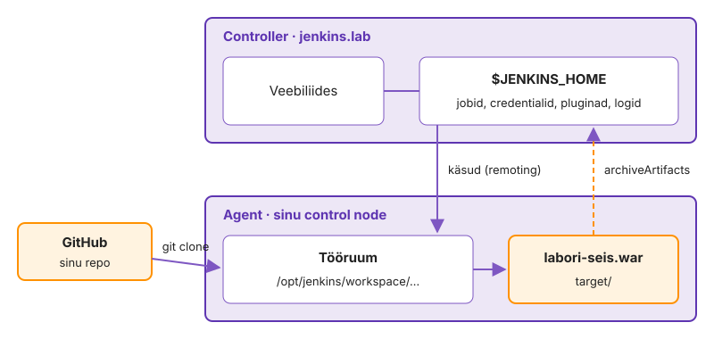
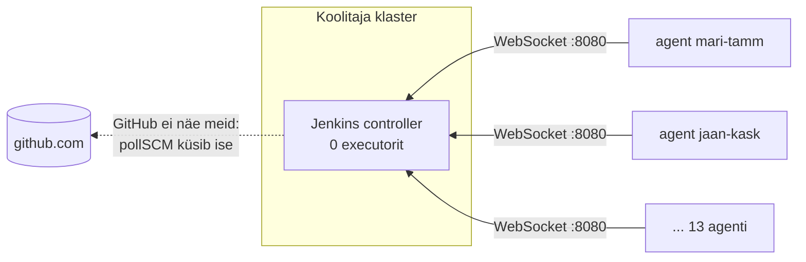
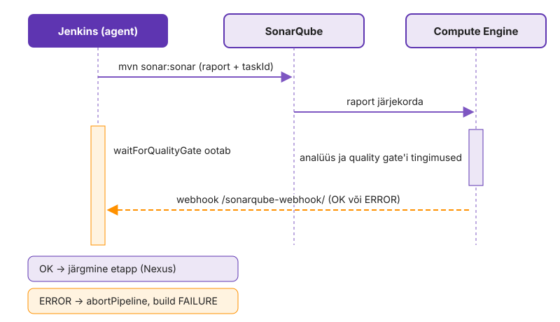
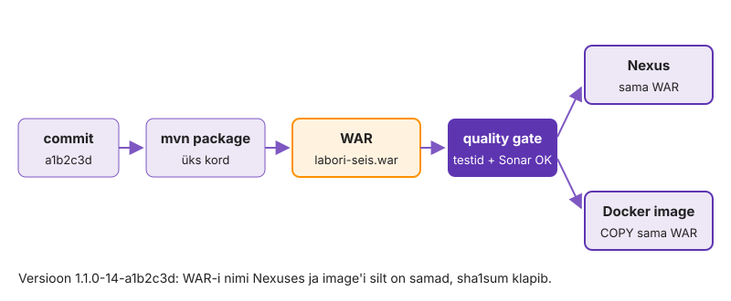

---
tags:
  - Jenkins
  - SonarQube
  - Nexus
  - CI/CD
---

# 6. kohtumine · CI server kui teenus: loeng

Eelmisel korral ehitasid GitHub Actionsiga pipeline'i, mis teeb Labori seisust WAR-i ja image'i.

GitHub Actionsis andis runner'i keegi teine: GitHub hoidis saladusi ja kustutas masina pärast tööd. Jenkins on CI server, mille paigaldad ja haldad ise. Kõik, mida Actions peitis, on nüüd sinu otsus: kus kood töötab, kes näeb saladusi, kes kinnitab ja kuidas server pärast riket taastatakse. CI server on tootmisteenus nagu andmebaas või Nginx ja tal on samad nõuded: turve, varukoopia, uuendused ja korratav seadistus.

## Õpiväljundid

Pärast kohtumist oskad:

- selgitada controlleri, agendi ja executori rolli ning põhjendada, miks controller ise koodi ei ehita;
- põhjendada, miks pipeline'i kirjeldus peab olema repositooriumis koodi kõrval, ja kirjeldada, milliseid piiranguid see lisaks sammudele sisaldab;
- eristada testi ja staatilist analüüsi ning selgitada, kuidas quality gate muudab mõõtmistulemuse otsuseks;
- selgitada põhimõtet *build once, deploy many* ja põhjendada, miks release-versioon peab olema muutumatu ja commit'ini jälgitav;
- võrrelda Jenkinsit GitHub Actionsiga admini vaatest.

[DevOps automation ja deployment automation](../teemad/devops-automaatika.md)

## 1. Controller ja agent: kes otsustab, kes ehitab

Viisteist kasutajat push'ivad samal tunnil. Kui buildid töötaksid masinas, kus on seadistus ja saladused, jagaks iga Maveni protsess seda masinat ja neid saladusi kõigi teistega.

**Controller** on Java teenus, mis hoiab veebiliidest, seadistust, pluginaid, credential'e ja buildide ajalugu kaustas `$JENKINS_HOME`. **Agent** on protsess `agent.jar`, mis hoiab controlleriga Remoting-kanalit ja täidab selle kaudu saadetud käske. Agendil on üks või mitu **executorit**: executor on koht, kus töötab korraga üks build. Iga job saab agendil **workspace'i**, kuhu kood kloonitakse. Workspace on ajutine, nii et kõik, mis peab buildist alles jääma, tuleb sealt ära viia.

<figure markdown="span">
  
  <figcaption>Joonis 6.1. Controller hoiab seadistust ja ajalugu, agent teeb töö.</figcaption>
</figure>

Controller ise ei ehita, sest Jenkinsfile on suvaline kood ja controlleris kasutajana `jenkins` saaks see lugeda kausta `$JENKINS_HOME` koos kõigi projektide credential'itega. Dokumentatsioon soovitab seepärast [controlleris buildi mitte käivitada](https://www.jenkins.io/doc/book/security/controller-isolation/) ja Jenkins hoiatab ise, kui sisseehitatud node'il on executorid.

Teine otsus on ühenduse suund. SSH-agendi puhul logib controller agendi masinasse sisse, nii et controller peab agenti võrgus nägema ja hoidma tema privaatvõtit. [Inbound agent](https://www.jenkins.io/doc/book/managing/nodes/) avab ühenduse ise: kas eraldi TCP-pordile (tavaliselt 50000) või alates Jenkinsi versioonist 2.217 [WebSocketina](https://www.jenkins.io/blog/2020/02/02/web-socket/) sama HTTP-pordi kaudu mis veebiliides. Siis piisab väljuvast ühendusest ja agent võib olla NAT-i või VPN-i taga, kui vahepealne proksi laseb HTTP `Upgrade`-päringu läbi.

<figure markdown="span">

  <figcaption>Joonis 6.2. Kõik ühendused algavad agendist. Jenkins küsib GitHubist muudatusi ise.</figcaption>
</figure>

Sama võrguküsimus otsustab, kuidas build käivitub. **Webhook** on kiireim, aga GitHub peab Jenkinsini jõudma. GitHub avaldab webhookide lähteaadressid [meta-API](https://docs.github.com/en/rest/meta/meta) loendis `hooks`, nii et tulemüüris saab avada ainult need. Kui Jenkins jääb täielikult sisevõrku, jääb üle **polling**: Jenkins teeb iga intervalli järel `git ls-remote`-i ja võrdleb haru otsa viimati ehitatuga. 500 job'i ühe minuti intervalliga teeb Giti serverile 30 000 päringut tunnis. Cron'i `H` jagab need ajas laiali, aga ei vähenda arvu.

## 2. Pipeline kui kood

Freestyle job'i seadistus on veebivormis muudetav `$JENKINS_HOME/jobs/<nimi>/config.xml`. Ajalugu on ainult Job Config History pluginaga ja koos serveriga kaob teadmine, kuidas tarkvara ehitati.

**Pipeline** job loeb kirjelduse repositooriumis olevast failist `Jenkinsfile` (*pipeline as code*). Muudatus pipeline'is läbib sama PR-i nagu muudatus koodis ja vana haru ehitatakse sama pipeline'iga, millega see kunagi ehitati. [Deklaratiivse süntaksi](https://www.jenkins.io/doc/book/pipeline/syntax/) parsib Jenkins enne käivitamist mudeliks ja kontrollib selle üle. Skriptitud süntaks on vaba Groovy. Mõlemad töötavad aeglases CPS-interpretaatoris. Seepärast juhib Jenkinsfile ainult tööde järjekorda ja töö ise tehakse shelli ja Maveni käskudega.

Jenkinsfile kirjeldab sammude kõrval ka buildi piiranguid.

```groovy
options {
    timeout(time: 30, unit: 'MINUTES')
    buildDiscarder(logRotator(numToKeepStr: '10'))
    disableConcurrentBuilds()
}
```

Jenkinsi vaikeväärtused on siin ohtlikud: job'il pole ajapiiri ja buildide ajalugu hoitakse igavesti. Rippuv build hoiab executorit tunde kinni ja `jobs/*/builds/` kasvab, kuni controlleri ketas on täis. Samaaegne teine build saab küll eraldi kausta `workspace@2`, aga mitte eraldi testkeskkonda: kaks deploy'd kirjutavad sama konteineri üle. Bashis lahendasid sama probleemi `flock`-iga. Samasse rühma kuulub `post`, mis käivitub buildi lõpus ka siis, kui build ebaõnnestus. `post` tingimustel on kindel järjekord ja koristus käib viimasesse plokki `cleanup`, et see ei kustutaks faile enne arhiveerimist.

Build käivitub kolmel viisil: Giti serveri webhooki peale, pollimisega või API kaudu. Webhook vajab, et Giti server jõuaks Jenkinsini. Laboris on Jenkins VPN-i taga ja GitHub ei jõua selleni, seepärast kasutab praktikum pollimist: `triggers { pollSCM('H/2 * * * *') }` küsib iga kahe minuti järel, kas harul on uus commit. `H` valib minuti jobi nime järgi, nii et sada jobi ei küsi Giti serverilt samal sekundil. Iga buildi põhjus (`UserIdCause`, `SCMTriggerCause`) on API-s näha ja etapi tingimus `triggeredBy` kasutab seda.

Etapid käivituvad järjest. Plokk `parallel` käivitab mitu etappi korraga samas workspace'is ja samal executoril. See on ohutu ainult siis, kui harud workspace'i ei kirjuta, näiteks kui üks laadib WAR-i Nexusesse ja teine ehitab samast WAR-ist image'i.

Etappide tingimused kirjeldavad, millal etapp on ohutu. `when` laseb näiteks avaldamise käivituda ainult põhiharul. `input` peatab pipeline'i inimese kinnituseni ja hoiab seni executorit kinni, seepärast käib see alati koos ajapiiriga.

## 3. Kvaliteet mõõdetavaks: quality gate

Testid on rohelised, aga koodis on tühi `catch`-plokk, mis neelab andmebaasivea alla, või võrreldakse stringe `==`-iga, mis Javas töötab testis juhuslikult ja tootmises mitte.

**Staatiline analüüs** loeb koodi seda käivitamata. SonarQube jagab leiud kolme rühma: **reliability** (vead), **security** (haavatavused) ja **maintainability** (code smell'id). Katvuse loeb ta testide JaCoCo raportist, ise ta teste ei käivita.

[**Quality gate**](https://docs.sonarsource.com/sonarqube-community-build/quality-standards-administration/managing-quality-gates/introduction-to-quality-gates) teeb mõõtmistest otsuse OK või ERROR. Sonari vaikimisi gate *Sonar way* kehtib ainult **uuele koodile**: uue koodi katvus vähemalt 80 %, dubleeritud ridu kuni 3 %, kõik security hotspot'id üle vaadatud ja lisaks tingimus uute leidude kohta. Uus kood tähendab vaikimisi kõike, mis on muutunud pärast eelmist versiooni. Tingimus "null viga kogu koodis" peataks vana koodiga projektis iga buildi, uue koodi reegel keelab ainult halvenemise.

Analüüs ja otsus toimuvad eri ajal. Skanner kirjutab taski ID faili `target/sonar/report-task.txt`, saadab raporti serverile ja lõpetab. Serveri Compute Engine töötleb raporteid järjekorras. Community Buildil on üks töötaja, nii et viisteist samaaegset analüüsi läbivad selle ükshaaval. Tulemuse saadab server webhookiga Jenkinsile, kus `waitForQualityGate` ootab sama taski ID-ga teadet.

<figure markdown="span">
  
  <figcaption>Joonis 6.3. Analüüs ja otsus on eraldi. Ilma webhookita jääb Jenkins ootama, kuni timeout katkestab.</figcaption>
</figure>

Kui webhook ei jõua kohale, ootab pipeline ajapiirini ja ebaõnnestub, kuigi kood oli korras. Quality gate on seega ka võrguühendus kahe teenuse vahel, millel on oma HMAC-saladus ja oma tulemüürireegel. Sonar katkestab webhooki saatmise 10 sekundi järel ja näitab iga saatmise tulemust lehel *Recent deliveries*. Rippuva quality gate'i põhjust otsi kõigepealt sealt.

Sonari väljaanne otsustab, mida gate näeb. [Haruanalüüs](https://docs.sonarsource.com/sonarqube-server/10.8/analyzing-source-code/branch-analysis/introduction) ja PR-analüüs algavad Developer Edition'ist, Community Build analüüsib ainult põhiharu. Tasuta versiooniga mõõdab gate seega koodi pärast merge'i, kui viga on juba põhiharus. Meeskonnad lahendavad selle kahel viisil: maksavad litsentsi eest, mille hind sõltub analüüsitud koodiridade arvust, või käivitavad PR-is kiiremad kontrollid, nagu linter ja Semgrep, ning jätavad Sonari põhiharule. Teine kompromiss on Compute Engine'i järjekord. Üks töötaja tähendab, et suure monorepo analüüs hoiab teisi kinni, ja töötajate arvu saab tõsta alles Enterprise-väljaandes.

## 4. Artefakt ja versioon: build once, deploy many

Tootmises on viga: millisest commit'ist see pakk tuli ja kas sama pakk läbis testid? Kui Eesti pank peab pärast intsidenti Finantsinspektsioonile selgitama, mis versioon tootmises töötas, peab see vastus tulema süsteemist, mitte kellegi mälust.

**Artefakt** on buildi tulemus, mis jääb alles: WAR, jar või image. `archiveArtifacts` kopeerib selle controlleri kettale buildi kausta, kus see kustub koos buildiga ja võtab ruumi samalt kettalt, kus on `$JENKINS_HOME`. **Artifact repository** (meil Nexus) hoiab pakke kindlatel aadressidel, kust teised süsteemid neid nime ja versiooni järgi küsivad. Nexuses on [kolme tüüpi reposid](https://help.sonatype.com/en/repository-types.html). **Hosted** hoiab sinu enda pakke. **Proxy** on cache välise repositooriumi ees, nii et Maven Centralist laaditakse iga jar ainult esimesel korral. **Group** koondab mitu repositooriumi ühe aadressi taha. Proxy jätab meelde ka vastuse 404 (negative cache, aeg on proxy-repositooriumi seadetes): äsja avaldatud sõltuvus võib Nexuse kaudu puududa, kuni see aeg möödub või keegi cache'i tühjendab.

Release-repositoorium reegel on **muutumatus**: sama versiooni ei saa teist korda üles laadida. Muidu võiks eilne `1.1.0` olla täna teine fail. Seepärast peab versioon olema unikaalne ja ütlema, kust pakk tuli. Pelgalt buildi numbrist ei piisa, sest uuesti loodud job alustab jälle 1-st. Hea skeem seob kokku kolm asja: rakenduse versiooni, buildi numbri ja commit'i lühikese räsi, näiteks `1.1.0-42-a3f9c1e`.

Teine põhimõte on **build once, deploy many**. Pakk ehitatakse üks kord ja edasi liigub sama fail: Nexusesse, image'isse ja serverisse. Kui Dockerfile kompileeriks koodi uuesti, võiks image'isse tulla uuem sõltuvus samast versioonivahemikust ja roheline pipeline ei tõendaks enam midagi selle kohta, mis töötab.

<figure markdown="span">
  
  <figcaption>Joonis 6.4. Build once: üks WAR läbib quality gate'i ja sama fail läheb Nexusesse ja image'isse.</figcaption>
</figure>

Kontrollsumma tõestab siis, et tootmises olev fail on sama, mis läbis kontrollid, ja rollback on eelmise versiooni uuesti paigaldamine, mitte vana koodi uuesti ehitamine.

Iseseisvaks lugemiseks: [DevOps automation ja deployment automation](../teemad/devops-automaatika.md).

## 5. Jenkins või GitHub Actions

Eelmisel korral kirjutasid sama pipeline'i GitHub Actionsis. Mõisted on samad, muutub vastutus.

| | GitHub Actions | Jenkins |
|---|---|---|
| kus build töötab | GitHubi runner või self-hosted runner | sinu agendid |
| kus kirjeldus on | `.github/workflows/*.yml` | `Jenkinsfile` |
| server ja uuendused | haldab GitHub | haldad ise |
| võrk | GitHub-hosted runner ei jõua sisevõrku, self-hosted runner jõuab | võib olla täielikult sisevõrgus |
| laiendused | action'id repositooriumi kaupa, SHA-ga kinnitatud | pluginad kogu serverile |
| saladused | repositoorium, environment'i ja organisatsiooni tasemel | credential'id folderi ja süsteemi tasemel |

*Tabel 6.1. Samad mõisted, erinev vastutus.*

Actions sobib, kui kood on GitHubis ja pipeline ei pea jõudma sisevõrku: serverit pole vaja hallata ja iga build saab puhta masina. Jenkins sobib, kui build peab töötama sisevõrgus, kood ei tohi asutusest välja minna või sama server peab teenindama mitut Giti teenust. Admini töös asendab Jenkins tavaliselt cron'i build-skripte ja käsitsi runbook'e, mitte Ansible'it: playbook jääb paigaldajaks ja Jenkins otsustab, millal ja millise artefaktiga see käivitub.

Valik pole püsiv: mida rohkem loogikat on shelli ja Maveni käskudes ning mida vähem plugina sammudes, seda lihtsam on hiljem kolida.

## Kokkuvõte

<div class="grid cards kokkuvote" markdown>

-   **Controller ei ehita**

    Hoia controlleril null executorit ja lase agendil samme täita. Controlleris loeks Jenkinsfile kogu `$JENKINS_HOME`-i koos kõigi credential'itega.

-   **Võrgu suund**

    Vali ühenduse suund enne paigaldust. Inbound agent ja polling töötavad sisevõrgus, webhook nõuab, et Giti server jõuaks Jenkinsini.

-   **Pipeline on kood**

    Kirjuta Jenkinsfile'i ka piirangud: ajapiir, ajaloo piir ja samaaegsuse keeld. Jenkinsi vaikeväärtustes neid ei ole.

-   **Quality gate on otsus**

    Kasuta ranget reeglit uue koodi jaoks, mitte kogu koodi jaoks. Kontrolli webhooki, kui `waitForQualityGate` jääb ootama.

-   **Build once, deploy many**

    Ehita pakk üks kord ja liiguta sama faili edasi. Anna release'ile muutumatu versioon, mis viib commit'ini.

</div>

<div class="kontrollkysimus" markdown>
**Kontrollküsimus:** Miks ei saa GitHub selles klastris buildi ise käivitada ja mida see ütleb Jenkinsi ja GitHub Actionsi valiku kohta?
</div>

## Kontrolli ennast

??? question "Arendaja küsib, miks ta ei saa controlleris buildi käivitada, kui agendid on hõivatud. Mida vastad?"
    Jenkinsfile on suvaline kood, mis töötab kasutajana `jenkins`. Controlleris saaks see lugeda kausta `$JENKINS_HOME` koos kõigi projektide credential'itega. Hõivatud agentide vastu aitab agentide või executorite lisamine, mitte controlleri avamine.

??? question "Etapp Nexus ebaõnnestub HTTP 400-ga, kuigi eelmine build oli roheline ja kood ei muutunud. Mida see ütleb versioonimise kohta?"
    Sama versioon on juba repositooriumis ja release-repositoorium ei luba seda üle kirjutada. Versioon ei sõltu buildist: tõenäoliselt on sellest kadunud buildi number või commit'i räsi. Parandus on versiooni skeemis, mitte Nexuses.

??? info "Loe juurde"

    Pipeline'i olek controlleris, püsiv ja ajutine agent, shared library, multibranch, rünnatud build-masin, CI serveri turve ja haldus ning deploy kinnitus ja auditi jälg on kursuse IS2 loengus [Jenkins lähemalt](https://hkhk-tk.github.io/is2-automatiseerimine/k06/loeng/).
