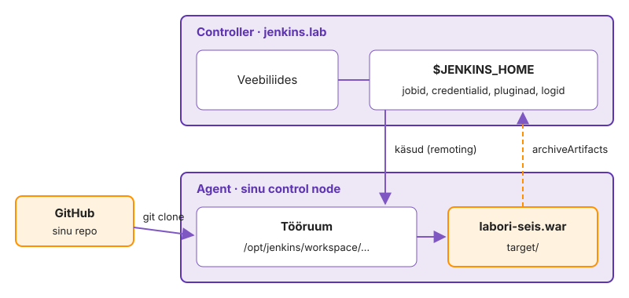
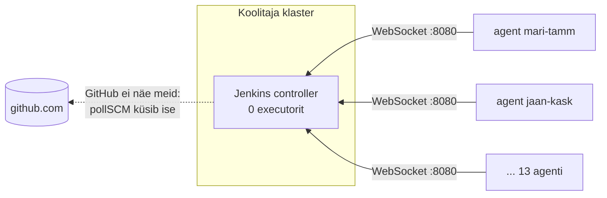
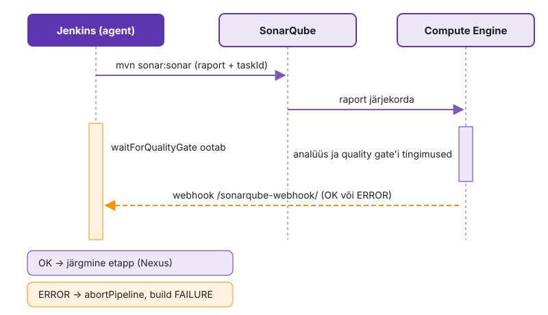
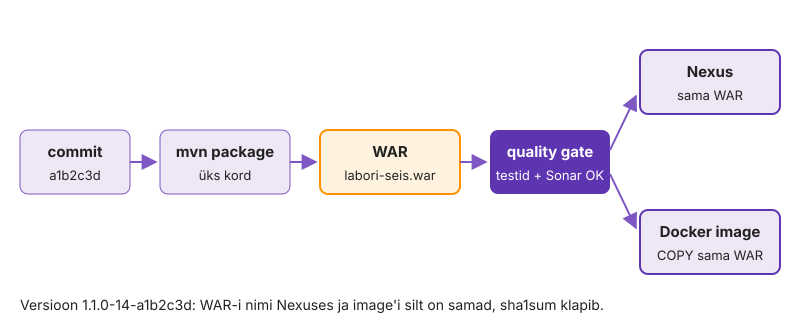
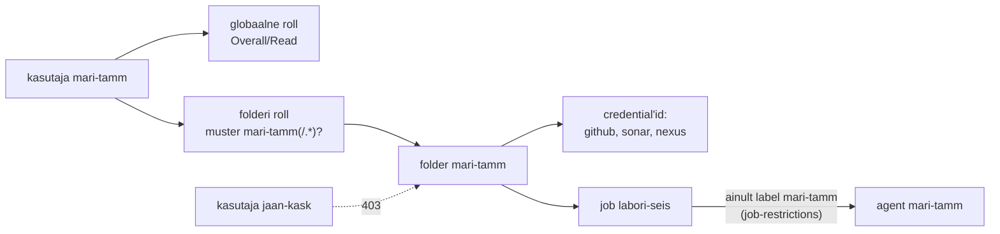

---
tags:
  - Jenkins
  - SonarQube
  - Nexus
  - CI/CD
---

# 6. kohtumine · CI server kui teenus: loeng

**Eeldus:** eelmisel korral ehitasid GitHub Actionsiga pipeline'i, mis teeb Labori seisust WAR-i ja image'i.

GitHub Actionsis andis runner'i keegi teine: GitHub hoidis saladusi ja kustutas masina pärast tööd. Jenkins on CI server, mille paigaldad ja haldad ise. Kõik, mida Actions peitis, on nüüd sinu otsus: kus kood töötab, kes näeb saladusi, kes kinnitab ja kuidas server pärast riket taastatakse. CI server on tootmisteenus nagu andmebaas või Nginx ja tal on samad nõuded: turve, varukoopia, uuendused ja korratav seadistus.

## Õpiväljundid

Pärast kohtumist oskad:

- selgitada controlleri, agendi ja executori rolli ning põhjendada, miks controller ise koodi ei ehita;
- põhjendada, miks pipeline'i kirjeldus peab olema repositooriumis koodi kõrval, ja kirjeldada, milliseid piiranguid see lisaks sammudele sisaldab;
- eristada testi ja staatilist analüüsi ning selgitada, kuidas quality gate muudab mõõtmistulemuse otsuseks;
- selgitada põhimõtet *build once, deploy many* ja põhjendada, miks release-versioon peab olema muutumatu ja commit'ini jälgitav;
- hinnata CI serveri turvariske: saladused, käivitatav kood, pluginad ja Dockeri socket;
- kirjeldada, mis teeb Jenkinsi taastatavaks, ja võrrelda Jenkinsit GitHub Actionsiga admini vaatest;
- kavandada deploy kinnituse ja auditi jälje: change ticket, nelja silma kontroll, õiguste piir ja logi väljaspool Jenkinsit, ning põhjendada, miks RPA ei ole infra automatiseerimise vahend.

[DevOps automation ja deployment automation](../teemad/devops-automaatika.md) · [RBAC ja ligipääsu kontroll](../teemad/rbac.md) · [IT-teenuste haldus (ITSM)](../teemad/itsm.md) · [RPA, äriprotsessid ja IT-automatiseerimine](../teemad/rpa-ja-aeriprotsessid.md)

## 1. Controller ja agent: kes otsustab, kes ehitab

Viisteist kasutajat push'ivad samal tunnil. Kui buildid töötaksid masinas, kus on seadistus ja saladused, jagaks iga Maveni protsess seda masinat ja neid saladusi kõigi teistega.

**Controller** on Java teenus, mis hoiab veebiliidest, seadistust, pluginaid, credential'e ja buildide ajalugu kaustas `$JENKINS_HOME`. **Agent** on protsess `agent.jar`, mis hoiab controlleriga Remoting-kanalit ja täidab selle kaudu saadetud käske. Agendil on üks või mitu **executorit**: executor on koht, kus töötab korraga üks build. Iga job saab agendil **workspace'i**, kuhu kood kloonitakse. Workspace on ajutine, nii et kõik, mis peab buildist alles jääma, tuleb sealt ära viia.

<figure markdown="span">
  
  <figcaption>Joonis 6.1. Controller hoiab seadistust ja ajalugu, agent teeb töö.</figcaption>
</figure>

Pipeline'i Groovy loogika töötab controlleris CPS-interpretaatoris, mis salvestab programmi oleku pärast iga sammu buildi kausta. Agendile lähevad ainult sammud nagu `sh`, `junit` või `archiveArtifacts`. Vaikimisi [durability-seadega](https://www.jenkins.io/doc/book/pipeline/scaling-pipeline/) jätkab pipeline pärast controlleri taaskäivitust salvestatud kohast. Lisaks koormab Groovy tsükkel controllerit, mitte agenti, seepärast kuulub arvutus `sh`-sammu.

Controller ise ei ehita, sest Jenkinsfile on suvaline kood ja controlleris kasutajana `jenkins` saaks see lugeda kausta `$JENKINS_HOME` koos kõigi projektide credential'itega. Dokumentatsioon soovitab seepärast [controlleris buildi mitte käivitada](https://www.jenkins.io/doc/book/security/controller-isolation/) ja Jenkins hoiatab ise, kui sisseehitatud node'il on executorid.

Teine otsus on ühenduse suund. SSH-agendi puhul logib controller agendi masinasse sisse, nii et controller peab agenti võrgus nägema ja hoidma tema privaatvõtit. [Inbound agent](https://www.jenkins.io/doc/book/managing/nodes/) avab ühenduse ise: kas eraldi TCP-pordile (tavaliselt 50000) või alates Jenkinsi versioonist 2.217 [WebSocketina](https://www.jenkins.io/blog/2020/02/02/web-socket/) sama HTTP-pordi kaudu mis veebiliides. Siis piisab väljuvast ühendusest ja agent võib olla NAT-i või VPN-i taga, kui vahepealne proksi laseb HTTP `Upgrade`-päringu läbi.

<figure markdown="span">

  <figcaption>Joonis 6.2. Kõik ühendused algavad agendist. Jenkins küsib GitHubist muudatusi ise.</figcaption>
</figure>

Sama võrguküsimus otsustab, kuidas build käivitub. **Webhook** on kiireim, aga GitHub peab Jenkinsini jõudma. GitHub avaldab webhookide lähteaadressid [meta-API](https://docs.github.com/en/rest/meta/meta) loendis `hooks`, nii et tulemüüris saab avada ainult need. Kui Jenkins jääb täielikult sisevõrku, jääb üle **polling**: Jenkins teeb iga intervalli järel `git ls-remote`-i ja võrdleb haru otsa viimati ehitatuga. 500 job'i ühe minuti intervalliga teeb Giti serverile 30 000 päringut tunnis. Cron'i `H` jagab need ajas laiali, aga ei vähenda arvu.

### Püsiv ja ajutine agent

Püsiv agent on VM, mis töötab kuude kaupa. Selle kettale kogunevad workspace'id, Maveni `~/.m2` cache ja Dockeri image'id ning iga build pärib eelmise jäägid. Kui test läheb roheliseks ainult sellepärast, et eelmise buildi fail jäi workspace'i, ei õnnestu sama build puhtal masinal. See on sama triiv (drift), mida tunned käsitsi hallatud serveritest: masina tegelik olek ja selle kirjeldus lähevad lahku.

Ajutine agent tekib buildi jaoks ja kaob pärast seda. [Kubernetese plugin](https://plugins.jenkins.io/kubernetes/) loob iga agendi jaoks pod'i, mille konteineris `jnlp` töötab agendi protsess, ja peatab pod'i pärast buildi. Teised konteinerid samas pod'is, näiteks Maven ja Docker CLI, jagavad sama workspace'i. Nii saab iga build puhta keskkonna nagu GitHubi hostitud runner'il, aga sinu klastris. Hind on aeg ja cache: pod'i käivitus ja sõltuvuste allalaadimine lisavad igale buildile sekundeid kuni minuteid, kui Nexuse proxy-repositoorium ei ole lähedal. Valik `idleMinutes` hoiab pod'i korduvkasutuseks alles, aga toob tagasi osa püsiva agendi probleemist.

Suures mahus muutub kitsaskohaks controller. Iga agent hoiab Remoting-kanalit, iga töötav pipeline hoiab controlleris oma CPS-olekut ja iga build kirjutab logi kausta `$JENKINS_HOME`. Kui sajad buildid töötavad korraga, ei aita agentide lisamine, sest kitsaskoht on ühe controlleri JVM ja ketas. Siis jagatakse töö meeskondade või toodete kaupa mitme controlleri vahel, mitte ei ehitata üht suuremat.

## 2. Pipeline kui kood

Freestyle job'i seadistus on veebivormis muudetav `$JENKINS_HOME/jobs/<nimi>/config.xml`. Ajalugu on ainult Job Config History pluginaga ja koos serveriga kaob teadmine, kuidas tarkvara ehitati.

**Pipeline** job loeb kirjelduse repositooriumis olevast failist `Jenkinsfile` (*pipeline as code*). Muudatus pipeline'is läbib sama PR-i nagu muudatus koodis ja vana haru ehitatakse sama pipeline'iga, millega see kunagi ehitati. [Deklaratiivse süntaksi](https://www.jenkins.io/doc/book/pipeline/syntax/) parsib Jenkins enne käivitamist mudeliks ja kontrollib selle üle. Skriptitud süntaks on vaba Groovy. Mõlemad töötavad aeglases CPS-interpretaatoris. Seepärast juhib Jenkinsfile ainult tööde järjekorda ja töö ise tehakse shelli ja Maveni käskudega.

Jenkinsfile kirjeldab sammude kõrval ka buildi piiranguid.

```groovy
options {
    timeout(time: 30, unit: 'MINUTES')
    buildDiscarder(logRotator(numToKeepStr: '10'))
    disableConcurrentBuilds()
}
```

Jenkinsi vaikeväärtused on siin ohtlikud: job'il pole ajapiiri ja buildide ajalugu hoitakse igavesti. Rippuv build hoiab executorit tunde kinni ja `jobs/*/builds/` kasvab, kuni controlleri ketas on täis. Samaaegne teine build saab küll eraldi kausta `workspace@2`, aga mitte eraldi testkeskkonda: kaks deploy'd kirjutavad sama konteineri üle. Bashis lahendasid sama probleemi `flock`-iga. Samasse rühma kuulub `post`, mis käivitub buildi lõpus ka siis, kui build ebaõnnestus. `post` tingimustel on kindel järjekord ja koristus käib viimasesse plokki `cleanup`, et see ei kustutaks faile enne arhiveerimist.

Build käivitub kolmel viisil: Giti serveri webhooki peale, pollimisega või API kaudu. Webhook vajab, et Giti server jõuaks Jenkinsini. Laboris on Jenkins VPN-i taga ja GitHub ei jõua selleni, seepärast kasutab praktikum pollimist: `triggers { pollSCM('H/2 * * * *') }` küsib iga kahe minuti järel, kas harul on uus commit. `H` valib minuti jobi nime järgi, nii et sada jobi ei küsi Giti serverilt samal sekundil. Iga buildi põhjus (`UserIdCause`, `SCMTriggerCause`) on API-s näha ja etapi tingimus `triggeredBy` kasutab seda.

Etapid käivituvad järjest. Plokk `parallel` käivitab mitu etappi korraga samas workspace'is ja samal executoril. See on ohutu ainult siis, kui harud workspace'i ei kirjuta, näiteks kui üks laadib WAR-i Nexusesse ja teine ehitab samast WAR-ist image'i.

Etappide tingimused kirjeldavad, millal etapp on ohutu. `when` laseb näiteks avaldamise käivituda ainult põhiharul. `input` peatab pipeline'i inimese kinnituseni ja hoiab seni executorit kinni, seepärast käib see alati koos ajapiiriga. Korduv loogika viiakse **shared library**'sse: Giti repositoorium, mille `vars/*.groovy` failid muutuvad pipeline'i sammudeks. Globaalne teek töötab väljaspool Groovy sandboxi, nii et selle repositooriumi kirjutusõigus võrdub controlleri administraatori õigusega, ja `@main` muudab ühe commit'iga kõigi meeskondade pipeline'e. Tootmises kinnitatakse teek tag'iga.

### Multibranch ja haru avastamine

Ühe haru job ei sobi PR-idega tööks. **Multibranch pipeline** skannib repositooriumi, loob igale harule ja PR-ile, milles on Jenkinsfile, oma alamjob'i ja kustutab selle, kui haru kaob. Organization folder teeb sama tervele GitHubi organisatsioonile. Skannimine käib GitHubi REST API kaudu ja sellel on piir: kasutaja token saab [5000 päringut tunnis](https://docs.github.com/en/rest/using-the-rest-api/rate-limits-for-the-rest-api) sõltumata repositooriumide arvust. Kui sadu repositooriume ja tuhandeid harusid skannitakse sama tokeniga, jõuab Jenkins piirini, jääb ootama limiidi taastumist ja webhooki järel algav build hilineb. GitHub App'i limiit kasvab organisatsiooni suurusega kuni 12 500 päringuni tunnis, seepärast [soovitab Jenkins](https://jenkins.io/blog/2020/04/16/github-app-authentication/) multibranch'i jaoks GitHub App'i. Teine eelis on see, et App ei ole seotud inimese kontoga, mis suletakse, kui inimene lahkub.

Multibranch muudab ka turvapiiri. PR-i Jenkinsfile on kood, mida keegi pole veel üle vaadanud. Kui forkist tulnud PR-i *Trust* seade on *From users with Admin or Write permission* ja PR-i autoril kirjutusõigust pole, laadib Jenkins Jenkinsfile'i sihtharust, mitte PR-ist. Nii ei saa võõras PR muuta seda, mida pipeline teeb ja milliseid credential'e see loeb. Sama küsimus oli eelmisel korral Actionsis `pull_request_target`-i juures.

## 3. Kvaliteet mõõdetavaks: quality gate

Testid on rohelised, aga koodis on tühi `catch`-plokk, mis neelab andmebaasivea alla, või võrreldakse stringe `==`-iga, mis Javas töötab testis juhuslikult ja tootmises mitte.

**Staatiline analüüs** loeb koodi seda käivitamata. SonarQube jagab leiud kolme rühma: **reliability** (vead), **security** (haavatavused) ja **maintainability** (code smell'id). Katvuse loeb ta testide JaCoCo raportist, ise ta teste ei käivita.

[**Quality gate**](https://docs.sonarsource.com/sonarqube-community-build/quality-standards-administration/managing-quality-gates/introduction-to-quality-gates) teeb mõõtmistest otsuse OK või ERROR. Sonari vaikimisi gate *Sonar way* kehtib ainult **uuele koodile**: uue koodi katvus vähemalt 80 %, dubleeritud ridu kuni 3 %, kõik security hotspot'id üle vaadatud ja lisaks tingimus uute leidude kohta. Uus kood tähendab vaikimisi kõike, mis on muutunud pärast eelmist versiooni. Tingimus "null viga kogu koodis" peataks vana koodiga projektis iga buildi, uue koodi reegel keelab ainult halvenemise.

Analüüs ja otsus toimuvad eri ajal. Skanner kirjutab taski ID faili `target/sonar/report-task.txt`, saadab raporti serverile ja lõpetab. Serveri Compute Engine töötleb raporteid järjekorras. Community Buildil on üks töötaja, nii et viisteist samaaegset analüüsi läbivad selle ükshaaval. Tulemuse saadab server webhookiga Jenkinsile, kus `waitForQualityGate` ootab sama taski ID-ga teadet.

<figure markdown="span">
  
  <figcaption>Joonis 6.3. Analüüs ja otsus on eraldi. Ilma webhookita jääb Jenkins ootama, kuni timeout katkestab.</figcaption>
</figure>

Kui webhook ei jõua kohale, ootab pipeline ajapiirini ja ebaõnnestub, kuigi kood oli korras. Quality gate on seega ka võrguühendus kahe teenuse vahel, millel on oma HMAC-saladus ja oma tulemüürireegel. Sonar katkestab webhooki saatmise 10 sekundi järel ja näitab iga saatmise tulemust lehel *Recent deliveries*. Rippuva quality gate'i põhjust otsi kõigepealt sealt.

Sonari väljaanne otsustab, mida gate näeb. [Haruanalüüs](https://docs.sonarsource.com/sonarqube-server/10.8/analyzing-source-code/branch-analysis/introduction) ja PR-analüüs algavad Developer Edition'ist, Community Build analüüsib ainult põhiharu. Tasuta versiooniga mõõdab gate seega koodi pärast merge'i, kui viga on juba põhiharus. Meeskonnad lahendavad selle kahel viisil: maksavad litsentsi eest, mille hind sõltub analüüsitud koodiridade arvust, või käivitavad PR-is kiiremad kontrollid, nagu linter ja Semgrep, ning jätavad Sonari põhiharule. Teine kompromiss on Compute Engine'i järjekord. Üks töötaja tähendab, et suure monorepo analüüs hoiab teisi kinni, ja töötajate arvu saab tõsta alles Enterprise-väljaandes.

## 4. Artefakt ja versioon: build once, deploy many

Tootmises on viga: millisest commit'ist see pakk tuli ja kas sama pakk läbis testid? Kui Eesti pank peab pärast intsidenti Finantsinspektsioonile selgitama, mis versioon tootmises töötas, peab see vastus tulema süsteemist, mitte kellegi mälust.

**Artefakt** on buildi tulemus, mis jääb alles: WAR, jar või image. `archiveArtifacts` kopeerib selle controlleri kettale buildi kausta, kus see kustub koos buildiga ja võtab ruumi samalt kettalt, kus on `$JENKINS_HOME`. **Artifact repository** (meil Nexus) hoiab pakke kindlatel aadressidel, kust teised süsteemid neid nime ja versiooni järgi küsivad. Nexuses on [kolme tüüpi reposid](https://help.sonatype.com/en/repository-types.html). **Hosted** hoiab sinu enda pakke. **Proxy** on cache välise repositooriumi ees, nii et Maven Centralist laaditakse iga jar ainult esimesel korral. **Group** koondab mitu repositooriumi ühe aadressi taha. Proxy jätab meelde ka vastuse 404 (negative cache, aeg on proxy-repositooriumi seadetes): äsja avaldatud sõltuvus võib Nexuse kaudu puududa, kuni see aeg möödub või keegi cache'i tühjendab.

Release-repositoorium reegel on **muutumatus**: sama versiooni ei saa teist korda üles laadida. Muidu võiks eilne `1.1.0` olla täna teine fail. Seepärast peab versioon olema unikaalne ja ütlema, kust pakk tuli. Pelgalt buildi numbrist ei piisa, sest uuesti loodud job alustab jälle 1-st. Hea skeem seob kokku kolm asja: rakenduse versiooni, buildi numbri ja commit'i lühikese räsi, näiteks `1.1.0-42-a3f9c1e`.

Teine põhimõte on **build once, deploy many**. Pakk ehitatakse üks kord ja edasi liigub sama fail: Nexusesse, image'isse ja serverisse. Kui Dockerfile kompileeriks koodi uuesti, võiks image'isse tulla uuem sõltuvus samast versioonivahemikust ja roheline pipeline ei tõendaks enam midagi selle kohta, mis töötab.

<figure markdown="span">
  
  <figcaption>Joonis 6.4. Build once: üks WAR läbib quality gate'i ja sama fail läheb Nexusesse ja image'isse.</figcaption>
</figure>

Kontrollsumma tõestab siis, et tootmises olev fail on sama, mis läbis kontrollid, ja rollback on eelmise versiooni uuesti paigaldamine, mitte vana koodi uuesti ehitamine.

### Kui build-masin on rünnatud

2020. aasta detsembris selgus, et SolarWinds Orioni allkirjastatud uuendustes oli tagauks. CrowdStrike'i [analüüsi](https://crowdstrike.com/blog/sunspot-malware-technical-analysis/) järgi kontrollis build-serveris töötanud SUNSPOT iga sekund, kas käivitub `MsBuild.exe`, vahetas kompileerimise ajaks ühe lähtefaili tagauksega versiooni vastu ja taastas pärast buildi originaali. Repos oli kood puhas, review ei näinud midagi ja pakk oli õige võtmega allkirjastatud.

Build once ei kaitse selle eest. See tagab, et testitud fail ja tootmises olev fail on samad, aga mitte seda, et fail vastab commit'ile. Seepärast käsitletakse build-masinat tootmise osana. Ajutine agent piirab ründaja püsivust, sest igal buildil on uus masin. Reprodutseeritav build lubab teisel, sõltumatul masinal sama commit'i ehitada ja kontrollsummasid võrrelda. Build provenance ([SLSA](https://slsa.dev/spec/v1.0/levels)) lisab artefaktile allkirjastatud kirje, mis ütleb, millisest commit'ist, millisel platvormil ja milliste buildi sammudega pakk tehti.

### Säilitamise hind

Muutumatuse hind on kettaruum. Kui iga commit annab release-versiooni, kogub Nexus aastaga kümneid tuhandeid WAR-e ja image'eid. [Cleanup policy](https://help.sonatype.com/en/cleanup-policies.html) kustutab komponente vanuse või viimase allalaadimise järgi, aga failipõhises blob store'is märgib kustutamine faili ainult kustutatuks ja ketas vabaneb alles ülesande *Compact blob store* järel. Reegel peab arvestama rollback'iga: tootmises töötav versioon ja vähemalt eelmine peavad alles jääma, olenemata sellest, millal neid viimati alla laaditi. Sama otsuse teed varunduse säilitusaja puhul.

Iseseisvaks lugemiseks: [DevOps automation ja deployment automation](../teemad/devops-automaatika.md).

## 5. CI serveri turve ja haldus

2021. aasta aprillis teatas Codecov, et ründaja oli muutnud nende Bashi üleslaadimisskripti, mida paljud CI pipeline'id käivitasid. Muudetud skript saatis pipeline'i keskkonnamuutujad, sh tokenid ja võtmed, ründaja serverisse ([Codecovi teade](https://about.codecov.io/security-update/)). CI serveris on saladused ja seal töötab kood, mida keegi rida-realt ei loe.

Esimene teema on õigused. Jenkinsis on need kaks eraldi seadet: *security realm* ütleb, kust kasutajad tulevad (oma andmebaas, LDAP, SSO), ja *authorization strategy* seda, mida nad tohivad. Valik "Logged-in users can do anything" teeb igast sisselogijast administraatori. Administraator saab *Script Console*'is käivitada controlleris suvalist Groovyt ja sealt kõik credential'id lahti dekrüpteerida. Mitme meeskonnaga Jenkinsis antakse õigused rollide ja folderite kaupa ([Role-based Authorization Strategy](https://plugins.jenkins.io/role-strategy/)) ja job'id piiratakse oma agentidele.

<figure markdown="span">

  <figcaption>Joonis 6.5. Iga õppija näeb ainult oma folderit ja tema job käivitub ainult tema agendil (<a href="https://plugins.jenkins.io/job-restrictions/">Job Restrictions</a>).</figcaption>
</figure>

Credential'idel on sama loogika: folderi credential'it näevad ainult selle folderi job'id ja süsteemi credential'it (näiteks Sonari webhooki saladust) ainult Jenkins ise. Jenkinsfile'i Groovy töötab controlleris **Groovy sandboxis**: lubatud on ainult Script Security plugina valge nimekirja meetodid ja kõik muu läheb administraatori [kinnitusjärjekorda](https://www.jenkins.io/doc/book/managing/script-approval/). Üks kinnitatud meetod on lubatud kõigile pipeline'idele, mitte ainult sellele, mis seda küsis. Eraldi risk on Docker agendil: `/var/run/docker.sock`-i kirjutusõigus on [sisuliselt root](https://docs.docker.com/engine/security/#docker-daemon-attack-surface). Agendil on see teadlik otsus, controlleris kõigi kasutajate ühine root.

Teine teema on pluginad. Igal pluginal on oma sõltuvused, minimaalne Jenkinsi versioon ja turvateated. 2024. aasta jaanuaris avaldas Jenkins haavatavuse [CVE-2024-23897](https://www.jenkins.io/security/advisory/2024-01-24/). CLI parser asendas argumendi `@failinimi` faili sisuga, nii et autentimata kasutaja sai lugeda controlleri failide esimesi ridu ja *Overall/Read* õigusega kasutaja terveid faile, sh võtmeid, mille kaudu jõudis koodi käivitamiseni. Parandus tuli versioonidega 2.442 ja LTS 2.426.3. Sama aasta augustis oli see CISA [aktiivselt ära kasutatavate haavatavuste](https://www.cisa.gov/known-exploited-vulnerabilities-catalog) nimekirjas.

Pluginate arv on omaette risk. Iga plugin töötab controlleri JVM-is samade õigustega kui Jenkins ja uuendus toob kaasa oma sõltuvused, mis võivad nõuda uuemat Jenkinsit. Kui sõltuvus jääb rahuldamata, jätab Jenkins plugina laadimata ja iga job, mis selle samme kasutab, ebaõnnestub käivitamisel. Pluginale, mida keegi ei hoolda, ei tule ka turvaparandust, ja [pluginate kataloog](https://plugins.jenkins.io/) märgib sellise plugina hoiatusega *up for adoption*. Seepärast hoitakse nimekiri lühike: iga plugina kohta on teada, milline job seda vajab, ja kasutamata plugin eemaldatakse samamoodi nagu serverist pakk, mida keegi ei kasuta.

Kolmas teema on taastatavus. [Configuration as Code](https://www.jenkins.io/projects/jcasc/) (JCasC) kirjeldab süsteemi seadistuse YAML-failis: turvamudel, tööriistad, ühendused teiste teenustega. Saladused tulevad käivitamisel keskkonnast. Pluginate nimekiri on samuti fail, kus on üks plugin koos versiooniga rea kohta, ja [`jenkins-plugin-cli`](https://github.com/jenkinsci/plugin-installation-manager-tool) paigaldab ja kontrollib selle järgi. Veebiliideses tehtud muudatuse kirjutab järgmine reload üle, nagu Ansible'i korduv käivitus parandab triivi.

Kõike koodist taastada ei saa. Buildide ajalugu ja credential'id jäävad kausta `$JENKINS_HOME` ja need vajavad [varukoopiat](https://www.jenkins.io/doc/book/system-administration/backing-up/). Kaustas `secrets/` olev `master.key` krüpteerib võtme `hudson.util.Secret`, mis omakorda krüpteerib credential'id. Ilma selleta on taastatud Jenkinsis kõik saladused loetamatud ja seepärast on varukoopia ise saladus. [LTS-liinis](https://www.jenkins.io/download/lts/) valitakse uus baasversioon iga 12 nädala järel ja Java nõue on viimastel aastatel kolm korda tõusnud: Java 11 versioonist 2.361.1, Java 17 versioonist 2.479.1 ja Java 21 versioonist 2.555.1 ([Java tugi](https://www.jenkins.io/doc/book/platform-information/support-policy-java/)). Uuendus käib seepärast samas järjekorras: varukoopia, pluginate ühilduvuse kontroll, uuendus, proovibuild. Varukoopia kehtib alles siis, kui uus Jenkins sellest käivitub ja credential on loetav.

Iseseisvaks lugemiseks: [RBAC ja ligipääsu kontroll](../teemad/rbac.md).

## 6. Juhtimine: kes kinnitab ja kus on logi

Pärast öist katkestust küsib turvajuht kolme asja: kes lubas versiooni `1.1.0-42-a3f9c1e` tootmisse panna, kes deploy käivitas ja kas need olid eri inimesed. Jenkinsis oli vastus buildi lehel, aga seda buildi enam ei ole, sest `buildDiscarder` hoiab kümmet viimast.

Muudatuse kirje on ITSM-süsteemis (ServiceNow, Jira Service Management): change ticket ütleb, mis muutub, mis on risk, kes kinnitas ja mis aknas see tehakse. Kui deploy käib Jenkinsist, avab pipeline ticket'i ise ITSM-i REST API kaudu, paneb sinna versiooni, commit'i ja buildi URL-i ning ootab kinnitust, kui tegu pole standardmuudatusega. Pärast deploy'd sulgeb pipeline ticket'i tulemusega. Hind on sõltuvus: kui ITSM-i API ei vasta, ei liigu ka parandus. Seepärast on kirjas, kuidas erakorraline muudatus läheb ilma ticket'ita ja registreeritakse tagantjärele.

Jenkinsis teeb kinnituse samm [`input`](https://www.jenkins.io/doc/pipeline/steps/pipeline-input-step/). `submitter` piirab kinnitajad kasutajate või gruppidega ja `submitterParameter` salvestab kinnitaja ID muutujasse. Kaks asja jäävad sinu teha. *Overall/Administer* õigusega kasutaja saab kinnitada sõltumata `submitter`-ist, ja Jenkins ei kontrolli, kas kinnitaja on sama inimene, kes buildi käivitas. Nelja silma põhimõte tuleb seega kirjutada pipeline'i: kinnitaja ID-d võrreldakse buildi põhjuse `UserIdCause` kasutajaga ja kokkulangevuse korral build peatub.

Õiguste piir on CI serveris laiem kui Jenkinsi maatriks. *Job/Build* ja *Job/Configure* on eri õigused, aga pipeline job'i tegelik seadistus on repositooriumis olev Jenkinsfile. Kes saab haru push'ida, see muudab ka seda, mida job teeb ja milliseid credential'e see loeb. Tootmise deploy piir koosneb seega kolmest osast: tootmise folder koos oma credential'itega, job, mis ehitab ainult kaitstud harust, ja haru kaitse, mis nõuab teise inimese review'd.

Buildi logi ei ole auditilogi. See asub controlleri kettal, kustub koos buildiga ja administraator saab seda muuta. Jenkinsi enda sündmused (sisselogimine, seadistuse muudatus, job'i loomine ja kustutamine) kirjutab [Audit Trail](https://plugins.jenkins.io/audit-trail/) plugin faili või syslogi ja Job Config History hoiab `config.xml` versioone. Auditi jaoks saadetakse need Jenkinsist välja, näiteks SIEM-i, kus Jenkinsi administraator neid kustutada ei saa. Finantssektoris nõuab [DORA](https://eur-lex.europa.eu/eli/reg/2022/2554/oj) alates 2025. aasta jaanuarist dokumenteeritud IKT muudatuste halduse protseduuri ja kontrolle. Audiitor küsib seal tõendit, et kontrolli ei saanud vahele jätta.

Kokku vastab see automatiseerimise juhtimise kolmele põhinõudele: tegevus on testitud ja kinnitatud (Jenkinsfile kaitstud harus), piirid on paigas enne käivitamist (folder, credential, agendi label, `submitter`) ja tegevusest jääb jälg (logi väljaspool Jenkinsit). Kompromiss on kiirus. Kui ainus kinnitaja on puhkusel, kinnitab administraator ise. Kinnitajaks pannakse seepärast grupp ja inimese kinnitust nõutakse ainult riskantsele muudatusele.

Iseseisvaks lugemiseks: [IT-teenuste haldus (ITSM)](../teemad/itsm.md).

## 7. Jenkins või GitHub Actions

Eelmisel korral kirjutasid sama pipeline'i GitHub Actionsis. Mõisted on samad, muutub vastutus.

| | GitHub Actions | Jenkins |
|---|---|---|
| kus build töötab | GitHubi runner või self-hosted runner | sinu agendid |
| kus kirjeldus on | `.github/workflows/*.yml` | `Jenkinsfile` |
| server ja uuendused | haldab GitHub | haldad ise |
| võrk | GitHub-hosted runner ei jõua sisevõrku, self-hosted runner jõuab | võib olla täielikult sisevõrgus |
| laiendused | action'id repositooriumi kaupa, SHA-ga kinnitatud | pluginad kogu serverile |
| saladused | repositoorium, environment'i ja organisatsiooni tasemel | credential'id folderi ja süsteemi tasemel |

*Tabel 6.1. Samad mõisted, erinev vastutus.*

Actions sobib, kui kood on GitHubis ja pipeline ei pea jõudma sisevõrku: serverit pole vaja hallata ja iga build saab puhta masina. Jenkins sobib, kui build peab töötama sisevõrgus, kood ei tohi asutusest välja minna või sama server peab teenindama mitut Giti teenust. Admini töös asendab Jenkins tavaliselt cron'i build-skripte ja käsitsi runbook'e, mitte Ansible'it: playbook jääb paigaldajaks ja Jenkins otsustab, millal ja millise artefaktiga see käivitub.

Self-hosted runner tundub kompromiss: GitHub haldab serverit, sina masinat sisevõrgus. Siis tulevad sisevõrku ka riskid, mida Jenkinsis piirasid folderi ja agendi label'iga. GitHub [soovitab](https://docs.github.com/en/actions/how-tos/manage-runners/self-hosted-runners/add-runners) self-hosted runner'it kasutada ainult privaatsete repositooriumidega, sest avaliku repositooriumi forkist tulnud PR võib käivitada runner'il suvalist koodi. Püsiv runner jätab töö jäägid ka järgmisele job'ile, nii et püsiva ja ajutise masina valik tuleb tagasi ka Actionsis.

Valik pole püsiv: mida rohkem loogikat on shelli ja Maveni käskudes ning mida vähem plugina sammudes, seda lihtsam on hiljem kolida.

Vahel pakutakse kolmandaks valikuks RPA-d (*robotic process automation*). RPA robot klikib graafilises liideses kasutaja kontoga (UiPath, avatud lähtekoodiga Robot Framework). Infra jaoks on see vale tööriist. Robot ei tea soovitud olekut, ta kordab klikke ja liidese muudatus pärast uuendust lõhub töö vaikselt. Dry-run'i ega idempotentsust ei ole ja auditilogis on inimese nimi, mitte automaatika oma. Serveritel, võrguseadmetel ja pilvel on SSH, API või NETCONF, ja seal töötavad Ansible, OpenTofu ja pipeline. RPA-l on koht seal, kus vanal rakendusel API puudub, ja ka siis ainult ajutise sillana.

Iseseisvaks lugemiseks: [RPA, äriprotsessid ja IT-automatiseerimine](../teemad/rpa-ja-aeriprotsessid.md).

## Kokkuvõte

<div class="grid cards kokkuvote" markdown>

-   **Controller ei ehita**

    Hoia controlleril null executorit ja lase agendil samme täita. Controlleris loeks Jenkinsfile kogu `$JENKINS_HOME`-i koos kõigi credential'itega.

-   **Võrgu suund**

    Vali ühenduse suund enne paigaldust. Inbound agent ja polling töötavad sisevõrgus, webhook nõuab, et Giti server jõuaks Jenkinsini.

-   **Pipeline on kood**

    Kirjuta Jenkinsfile'i ka piirangud: ajapiir, ajaloo piir ja samaaegsuse keeld. Jenkinsi vaikeväärtustes neid ei ole.

-   **Quality gate on otsus**

    Kasuta ranget reeglit uue koodi jaoks, mitte kogu koodi jaoks. Kontrolli webhooki, kui `waitForQualityGate` jääb ootama.

-   **Build once, deploy many**

    Ehita pakk üks kord ja liiguta sama faili edasi. Anna release'ile muutumatu versioon, mis viib commit'ini.

-   **CI server on ründepind**

    Jaga õigused folderite kaupa, kinnita Groovy meetodeid kitsalt ja uuenda pluginaid kohe pärast turvateadet.

-   **Taastatav Jenkins**

    Hoia JCasC ja `plugins.txt` Gitis. Varunda `$JENKINS_HOME` koos `master.key`-ga ja proovi taastet, sest ilma võtmeta credential'id ei dekrüpteeru.

-   **Kinnitus ja jälg**

    Lase pipeline'il change ticket avada ja sulgeda. Kontrolli nelja silma põhimõtet pipeline'i koodis, sest administraator möödub `submitter`-ist, ja saada auditilogi Jenkinsist välja.

</div>

<div class="kontrollkysimus" markdown>
**Kontrollküsimus:** Miks ei saa GitHub selles klastris buildi ise käivitada ja mida see ütleb Jenkinsi ja GitHub Actionsi valiku kohta?
</div>

## Kontrolli ennast

??? question "Arendaja küsib, miks ta ei saa controlleris buildi käivitada, kui agendid on hõivatud. Mida vastad?"
    Jenkinsfile on suvaline kood, mis töötab kasutajana `jenkins`. Controlleris saaks see lugeda kausta `$JENKINS_HOME` koos kõigi projektide credential'itega. Hõivatud agentide vastu aitab agentide või executorite lisamine, mitte controlleri avamine.

??? question "Etapp Nexus ebaõnnestub HTTP 400-ga, kuigi eelmine build oli roheline ja kood ei muutunud. Mida see ütleb versioonimise kohta?"
    Sama versioon on juba repositooriumis ja release-repositoorium ei luba seda üle kirjutada. Versioon ei sõltu buildist: tõenäoliselt on sellest kadunud buildi number või commit'i räsi. Parandus on versiooni skeemis, mitte Nexuses.

??? question "Controller taaskäivitati öösel uuenduse pärast. Pipeline'i build jätkus, Freestyle'i build mitte. Miks?"
    Pipeline'i Groovy olek salvestatakse pärast iga sammu buildi kausta ja agendil töötav `sh` ei sõltu controlleri protsessist. Freestyle'i samm on ühe protsessi osa ja sellel pole salvestatud olekut, millest jätkata.

??? question "Audiitor leiab, et tootmise deploy käivitas ja kinnitas sama administraator, kuigi `input`-il oli `submitter 'release-kinnitajad'`. Kuidas see juhtus ja mida muudad?"
    Administraator saab `input`-i kinnitada sõltumata `submitter`-ist ja Jenkins ei võrdle kinnitajat käivitajaga. Pipeline peab ise võrdlema `submitterParameter`-i väärtust buildi `UserIdCause` kasutajaga ja kokkulangevuse korral peatuma. Igapäevane deploy ei käi administraatori kontoga.

??? question "Taastasid Jenkinsi varukoopiast, job'id on alles, aga iga build ebaõnnestub, sest credential'id ei dekrüpteeru. Mis jäi varukoopiast välja ja mida see ütleb varukoopia hoidmise kohta?"
    Kaust `secrets/` koos `master.key`-ga. Sama fail teeb varukoopia saladuseks, nii et seda hoitakse krüpteeritult või võtit eraldi.
