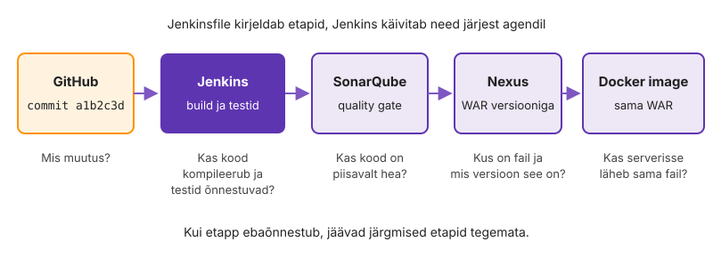
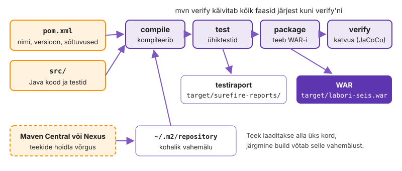
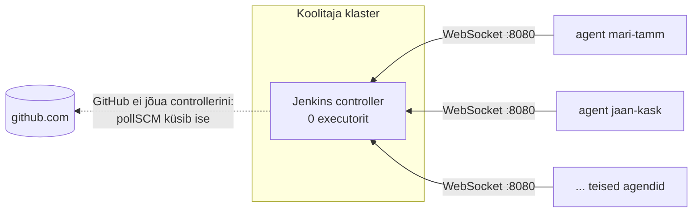
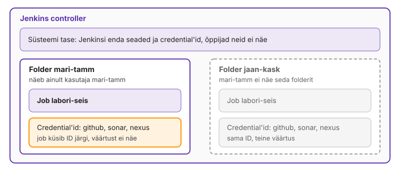
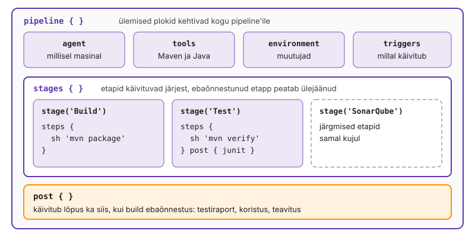
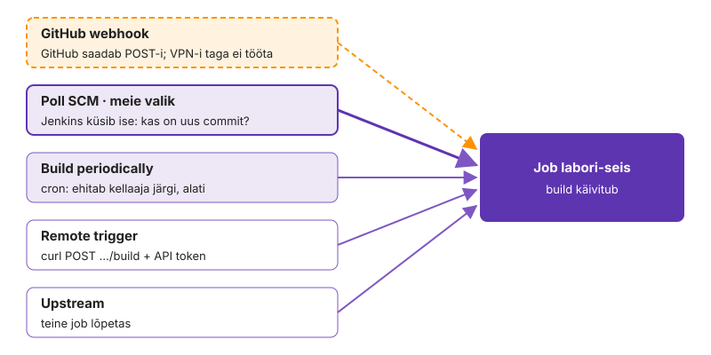
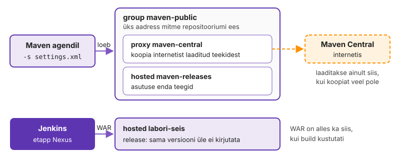
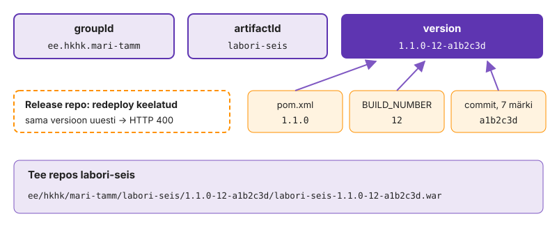

---
tags:
  - Jenkins
  - SonarQube
  - Nexus
  - CI/CD
  - Loeng
---

# Loeng: Jenkins, SonarQube ja Nexus

5\. kohtumisel ehitas GitHub Actions Labori seisust WAR-i ja image'i GitHubi masinas. Täna teeb sama töö kolm tööriista, mille asutus paigaldab ja haldab ise: Jenkins käivitab sammud, SonarQube hindab koodi kvaliteeti ja Nexus hoiab valmis faile.

??? abstract "Õpiväljundid"

    Pärast loengut ja praktikumi oskad:

    - selgitada, mida teevad Maven, Jenkins, SonarQube ja Nexus ning kuidas need ühes ahelas järjest töötavad;
    - selgitada controlleri, agendi, executori ja workspace'i rolli ning põhjendada, miks controller ise koodi ei ehita;
    - hoida saladusi Jenkinsi credential'ites ja viidata neile Jenkinsfile'is ainult ID-ga;
    - lugeda ja kirjutada deklaratiivset Jenkinsfile'i etappide, tööriistade, triggerite ja `post` plokiga;
    - eristada testi ja staatilist analüüsi ning selgitada, kuidas quality gate muudab mõõtmistulemuse otsuseks;
    - selgitada Nexuse repositooriumitüüpe ja põhimõtet *build once, deploy many* ning põhjendada, miks release-versioon on muutumatu ja commit'ini jälgitav.

## 1. Kolm tööriista ühes ahelas

Rakenduse uus versioon peab enne serverisse jõudmist läbima mitu kontrolli: kood kompileerub, testid õnnestuvad, kood on piisavalt hea ja valmis fail on kindlas kohas alles. Kui neid samme teeb inimene, jääb mõni neist kiire parandusega vahele. **CI server** on teenus, mis teeb samad sammud iga commit'i järel automaatselt ja alati samas järjekorras. CI tähendab pidevat integratsiooni (*continuous integration*): iga muudatus ehitatakse ja testitakse kohe, mitte nädalate pärast.

Selles ahelas on kolm tööriista ja igaüks vastab ühele küsimusele.

- **Jenkins** on CI server. See võtab GitHubist uue commit'i, käivitab buildi ja testid ning kutsub järgmisi tööriistu.
- **SonarQube** (lühidalt Sonar) teeb **staatilist analüüsi**: loeb koodi seda käivitamata ja otsib vigu, turvaprobleeme ning raskesti hooldatavat koodi.
- **Nexus** on **artefaktihoidla**: server, kus valmis failid (WAR, jar, teegid) on alles kindla nime ja versiooniga.

<figure markdown="span">
  
  <figcaption>Joonis 6.1. Ahel commit'ist image'ini: iga etapp vastab ühele küsimusele (Talvik, 2026).</figcaption>
</figure>

Kõiki samme kirjeldab üks fail, **Jenkinsfile**, mis on rakenduse koodiga samas repositooriumis. Etapid käivituvad järjest ja ebaõnnestunud etapp peatab ülejäänud, nii et vigane versioon ei jõua Nexusesse ega image'isse.

=== "Käsitsi"

    Arendaja käivitab oma arvutis `mvn package` ja kopeerib WAR-i serverisse. Testid käivitas ta eile, koodi kvaliteeti keegi ei mõõtnud. Kui tootmises on viga, ei ole teada, millisest commit'ist fail tehti ja kas see oli sama fail, mis testidest läbi tuli.

=== "CI serveriga"

    Iga commit käivitab samad etapid samas järjekorras. Buildi ajaloos on näha, kes muudatuse tegi, mis etappides see oli ja kus see peatus. Valmis fail on Nexuses versiooniga, mis viib tagasi commit'ini.

**Leia viga.** Rakendus töötab arendaja arvutis. Ta ehitab WAR-i oma arvutis, testid jätab vahele, sest need võtavad viis minutit, ja kopeerib faili `scp`-ga serverisse. Pärast seda annab rakendus vea. Mis selles töökäigus valesti läks?

??? success "Vastus"

    **Mida taheti:** uus versioon serverisse kiiresti.

    **Mis oli:** fail tehti ühes arvutis, testimata ja ilma jäljeta selle kohta, millisest koodist see tuli.

    **Õige:** commit läheb repositooriumi, CI server ehitab ja testib selle ning serverisse läheb Nexusest versiooniga fail.

    **Miks:** arendaja arvutis võib olla teegi teine versioon või commit'imata muudatus. Kui testid jäetakse vahele, jõuab viga kasutajani, ja ilma versioonita ei ole teada, millisele koodile tagasi minna.

## 2. Maven ja build

Java rakendus koosneb lähtekoodist ja kümnetest teekidest (*library*), mida keegi teine on kirjutanud. **Maven** on Java ehitustööriist: see laadib alla vajalikud teegid, kompileerib koodi, käivitab testid ja paneb tulemuse üheks failiks kokku. Kõik, mida Maven vajab, on kirjas failis `pom.xml`: rakenduse nimi, versioon (Labori seisus `1.1.0`) ja sõltuvuste loend.

Võrdlus tuttavaga: `apt install` laadib paketi koos sõltuvustega Ubuntu repositooriumist. Maven teeb Java teekidega sama: teegid tulevad avalikust hoidlast **Maven Central**, mis on Java teekide suurim avalik hoidla. Allalaaditud teegid jäävad kausta `~/.m2/repository`, nii et järgmine build võtab need vahemälust.

Labori seisu tulemus on **WAR** (*web application archive*): ZIP-fail, milles on kompileeritud kood ja teegid ning mille Tomcat käivitab. Maven paneb selle kausta `target/`.

<figure markdown="span">
  
  <figcaption>Joonis 6.2. Maveni faasid ja nende tulemused kaustas target/ (Talvik, 2026).</figcaption>
</figure>

Maven töötab **faaside** kaupa. Faas on ehituse samm ja käsk `mvn <faas>` käivitab kõik eelnevad faasid samuti. `mvn package` kompileerib, käivitab testid ja teeb WAR-i. `mvn verify` teeb sama ning lisaks kõik, mis on seotud faasiga `verify`. Labori seisus on see koodi katvuse raport: tööriist **JaCoCo** mõõdab, millised koodiread testide ajal käivitusid.

```bash
mvn -B -DskipTests package                          # ainult WAR, testideta
mvn -B verify -Dcheckstyle.failOnViolation=false    # testid, raportid ja WAR
```

Võti `-B` (*batch mode*) lülitab välja interaktiivsed küsimused ja edenemisriba, mis CI logis oleks ainult müra. `-DskipTests` jätab testid vahele ja `-D` annab Mavenile seadistuse väärtuse. Ühiktestid käivitab Maveni plugin **Surefire**, mis kirjutab tulemused XML-failidena kausta `target/surefire-reports/`. Seda XML-i loeb hiljem Jenkins, kui ta näitab testide tulemust graafikuna.

=== "Ilma Mavenita"

    Teegid laaditakse käsitsi alla ja kopeeritakse kausta. Igas arvutis võib olla teegi teine versioon ja keegi ei tea täpselt, millised teegid rakendus vajab.

=== "Maveniga"

    Sõltuvused on kirjas `pom.xml`-is ja iga arvuti saab samad versioonid samast hoidlast. Sama käsk annab igas masinas sama tulemuse.

??? info "Süvenemiseks: Checkstyle ja seadistus `settings.xml`"

    Labori seisu `pom.xml`-is on ka plugin **Checkstyle**, mis kontrollib koodi vormistust (taandeid, nimesid, ridade pikkust). Seadistus `-Dcheckstyle.failOnViolation=false` jätab vormistusvead raportisse, aga ei peata nende pärast buildi. Kasutaja ja masina Maveni seadistus on failis `settings.xml`. Võtmega `-s <fail>` saab anda Mavenile teise seadistusfaili, näiteks sellise, mis suunab kõik allalaadimised asutuse Nexusesse ([Maveni elutsükkel](https://maven.apache.org/guides/introduction/introduction-to-the-lifecycle.html)).

**Leia viga.** Jenkinsfile'i esimeses etapis on `sh 'mvn -B compile'`. Järgmine etapp ehitab Docker image'i ja selle Dockerfile kopeerib faili `target/labori-seis.war`. Docker annab vea `COPY failed: file not found`. Mis on valesti?

??? success "Vastus"

    **Mida taheti:** WAR kausta `target/`, et Dockerfile saaks selle image'isse kopeerida.

    **Mis oli:** faas `compile` ainult kompileerib klassid, WAR-i ei tehta.

    **Õige:** `mvn -B package` (või `verify`, kui on vaja ka teste ja raporteid).

    **Miks:** Maven käivitab faasid kuni nimetatud faasini. WAR tekib faasis `package`, mis on pärast `compile`'i ja `test`'i.

## 3. Jenkins: CI server, mida asutus haldab ise

Jenkins on avatud lähtekoodiga CI server, mis on kirjutatud Javas. See sai alguse 2000. aastate keskel Sun Microsystemsis nime all Hudson. Pärast seda, kui Oracle ostis Suni ja nõudis nime Hudson endale, jätkasid arendajad 2011. aastal sama projekti nime all Jenkins. Jenkins on üks vanimaid CI servereid ja seda kohtab paljudes asutustes, eriti seal, kus kood ega buildid ei tohi asutuse võrgust välja minna.

Võrdlus tuttavaga: GitHub Actionsis andis buildi masina (runneri) GitHub, hoidis saladusi ja kustutas masina pärast tööd. Jenkinsis teeb asutus need otsused ise: kus build töötab, kes saladusi näeb, kuidas server uuendatakse ja kuidas see pärast riket taastatakse. CI server on tootmisteenus nagu andmebaas või Nginx.

Jenkinsi põhisõnad on lihtsad. **Job** on töö kirjeldus: mida teha ja millal (näiteks job `labori-seis`). **Build** on üks jobi käivitus. Igal buildil on number (`#1`, `#2`, …), olek (roheline SUCCESS, punane FAILURE) ja logi **Console Output**, kus on kõik käskude väljundid. Nupp **Build Now** käivitab buildi käsitsi.

Lihtsaim job on **Freestyle** job, kus käsud kirjutatakse veebivormi. Näiteks job, mis näitab ainult, mis kasutajana ja kus build töötab:

```bash
whoami; id; pwd; df -h .
```

Väljund näitab, et build on tavaline protsess kasutaja `jenkins` all. Sellel kasutajal ei ole `sudo` õigusi ja töö käib kaustas, mille Jenkins jobile andis.

=== "Cron ja skript"

    Buildi skript käivitub öösel cron'iga ühes serveris. Logi on failis, mida keegi ei vaata, ja kui skript ebaõnnestub, ei saa sellest keegi teada. Ei ole näha, millist commit'i ehitati ega kes muudatuse tegi.

=== "Jenkinsi job"

    Iga build on veebiliideses nähtav: number, olek, logi, käivitaja ja commit. Punane build on kohe näha ja selle logi on ühe klikiga avatav.

Jenkinsi võimalused tulevad **pluginatest**. Plugin on lisamoodul, mis lisab Jenkinsile uusi samme, näiteks `withSonarQubeEnv` (SonarQube Scanner plugin), `nexusArtifactUploader` (Nexus Artifact Uploader), `readMavenPom` (Pipeline Utility Steps) või `cleanWs` (Workspace Cleanup). Plugina paigaldab administraator ja see kehtib kogu serverile.

Maveni ja Java versioonid seab administraator lehel **Manage Jenkins → Tools** ning annab neile nimed, näiteks `maven3` ja `jdk21`. Jenkinsfile viitab nimele, mitte versioonile. Kui agendil tööriista veel pole, laadib Jenkins selle esimesel kasutusel alla ([Tools](https://www.jenkins.io/doc/book/managing/tools/)).

??? info "Süvenemiseks: miks pluginate arv on risk"

    Iga plugin töötab Jenkinsi protsessis samade õigustega kui Jenkins ise ja toob kaasa oma sõltuvused. Plugina uuendus võib nõuda uuemat Jenkinsit ja hooldamata pluginale ei tule turvaparandusi. Seepärast hoitakse pluginate nimekiri lühike. Pluginate haldus, turvateated ja Jenkinsi taastamine on kursuse IS2 loengus [Jenkins lähemalt](https://hkhk-tk.github.io/is2-automatiseerimine/k06/loeng/#ci-serveri-turve-ja-haldus).

**Leia viga.** Jenkinsfile'is on `tools { maven 'maven-3.9.16' }` ja build annab kohe alguses vea `Tool type "maven" does not have an install of "maven-3.9.16"`. Mis on valesti?

??? success "Vastus"

    **Mida taheti:** kasutada Maveni versiooni 3.9.16.

    **Mis oli:** Jenkinsfile'is on versiooninumber, aga Jenkins otsib tööriista nime järgi.

    **Õige:** `maven 'maven3'`, sest see on nimi, mille administraator lehel **Tools** andis.

    **Miks:** nimi eraldab Jenkinsfile'i konkreetsest versioonist. Kui administraator vahetab Maveni versiooni, ei pea ühtegi Jenkinsfile'i muutma.

## 4. Controller ja agent: kes otsustab, kes ehitab

Jenkins koosneb kahest osast. **Controller** on Jenkinsi põhiserver: seal on veebiliides, jobide seadistus, pluginad, saladused ja buildide ajalugu kaustas `$JENKINS_HOME`. **Agent** on masin, kus build tegelikult töötab. Agendis töötab Java protsess `agent.jar`, mis hoiab controlleriga ühendust ja käivitab käske, mille controller saadab.

Võrdlus tuttavaga: Ansible'is käivitad playbook'i control node'ist ja käsud töötavad hallatavates masinates. Jenkinsis on controller juhtimiskoht ja agendid on masinad, kus töö tehakse.

<figure markdown="span">
  
  <figcaption>Joonis 6.3. Controller hoiab seadistust ja ajalugu, agent teeb töö (Talvik, 2026).</figcaption>
</figure>

Agendi juures on veel kolm mõistet.

- **Node** on Jenkinsi kirje ühe agendi kohta. Node'il on nimi ja **label** (silt), mille järgi job valib, millisel masinal ta töötab.
- **Executor** on koht, kus töötab korraga üks build. Kahe executoriga agent saab korraga teha kaks buildi, kolmas build ootab järjekorras.
- **Workspace** on kaust agendil, kuhu Jenkins buildi jaoks koodi kloonib, näiteks `/opt/jenkins/workspace/mari-tamm/labori-seis`. Workspace on ajutine ja kõik, mis peab alles jääma, viiakse sealt ära.

Controller ise koodi ei ehita. Jenkinsfile on suvaline kood ja kui see töötaks controlleris, saaks see lugeda kausta `$JENKINS_HOME` koos kõigi projektide saladustega. Seepärast on controlleris 0 executorit ja Jenkinsi dokumentatsioon soovitab [controlleris buildi mitte käivitada](https://www.jenkins.io/doc/book/security/controller-isolation/).

=== "Build controlleris"

    Kõik jobid jagavad sama masinat, kasutajat ja ketast. Ühe õppija Maven võtab teise mälu ja iga Jenkinsfile saab lugeda kõigi projektide saladusi.

=== "Build agendil"

    Iga õppija build töötab tema enda agendil. Controller jagab ainult tööd ja hoiab tulemusi, saladused jäävad controllerisse.

Ühenduse suund on oluline. Klassi Jenkins on VPN-i taga ja õppija masinal on oma aadress, mida controller ei tea. Seepärast avab ühenduse agent: protsess `agent.jar` võtab controlleriga ühendust samal HTTP-pordil, kus on veebiliides (**WebSocket**). Controller ei pea agendi IP-d teadma ega sinna sisse logima.

<figure markdown="span">

  <figcaption>Joonis 6.4. Kõik ühendused algavad agendist. Jenkins küsib GitHubist muudatusi ise (Talvik, 2026).</figcaption>
</figure>

Agendi ühendamiseks on vaja node'i nime ja **saladust** (*secret*), mille Jenkins node'i jaoks lõi. Saladus on node'i identiteet: kes selle teab, saab sama nime all agendi ühendada ja jobid hakkavad tööle tema masinas. Agendi protsess on tavaline Linuxi teenus. Sellel on oma kasutaja `jenkins`, saladus failis õigustega ainult omanikule ja systemd unit, nii et seda saab vaadata käskudega `systemctl status` ja `journalctl`.

??? info "Süvenemiseks: SSH-agent ja inbound agent"

    Jenkinsil on agendi ühendamiseks kaks viisi. SSH-agendi puhul logib controller agendi masinasse SSH-ga sisse, nii et controller peab agenti võrgus nägema ja hoidma tema privaatvõtit. [Inbound agent](https://www.jenkins.io/doc/book/managing/nodes/) avab ühenduse ise, kas eraldi TCP-pordile (tavaliselt 50000) või alates Jenkinsi versioonist 2.217 [WebSocketina](https://www.jenkins.io/blog/2020/02/02/web-socket/) sama HTTP-pordi kaudu nagu veebiliides. Siis piisab väljuvast ühendusest ja agent võib olla NAT-i või VPN-i taga. Püsiv ja ajutine agent ning controlleri koormus on kursuse IS2 loengus [Jenkins lähemalt](https://hkhk-tk.github.io/is2-automatiseerimine/k06/loeng/#controller-ja-agent-lahemalt).

**Leia viga.** Job on seadistatud töötama labeliga `mari-tamm`. Build ei alga ja jääb lehele teatega `Waiting for next available executor on 'mari-tamm'`. Teenus `jenkins-agent` on õppija masinas olekus `active`, aga logis on `Failed to connect` ja 403. Mis on valesti?

??? success "Vastus"

    **Mida taheti:** build õppija agendil.

    **Mis oli:** agendi protsess töötab, aga controller ei tunne seda ära, nii et node on punane ja jobil pole kuhugi minna.

    **Õige:** saladus ja node'i nimi peavad kattuma lehel **Manage Jenkins → Nodes** olevatega (nimi väiketähtedega). Pärast parandust `sudo systemctl restart jenkins-agent`.

    **Miks:** label lubab jobil töötada ainult sellel node'il. Kui node on offline, ootab build järjekorras ja controller ise seda ei käivita, sest tal on 0 executorit.

## 5. Kaustad, õigused ja credential'id

Ühes Jenkinsis töötab sageli mitu meeskonda või, nagu klassis, mitu õppijat. Igaüks peab nägema oma jobe ja saladusi, aga mitte teiste omi. Selleks on Jenkinsis kaustad ja rollid.

**Folder** on Jenkinsi kaust, kus on jobid ja saladused. Klassi Jenkinsis on igal õppijal oma folder ja roll lubab tal näha ainult seda. Kui roll oleks liiga lai, näeks õppija ka teiste buildide logisid.

**Credential** on Jenkinsis hoitav saladus: parool, token või võti. Igal credential'il on **ID**, näiteks `github`, `sonar` või `nexus`, ja Jenkinsfile viitab ainult ID-le. Väärtus on krüpteeritult controlleris ja veebiliides seda enam välja ei näita. Võrdlus tuttavaga: GitHub Actionsis oli sama roll repositooriumi saladustel (**Settings → Secrets**).

<figure markdown="span">
  
  <figcaption>Joonis 6.5. Folderi credential'it näevad ainult sama folderi jobid (Talvik, 2026).</figcaption>
</figure>

Credential'i saab panna kolmele tasemele. Folderi credential on nähtav ainult selle folderi jobidele. Globaalne credential on nähtav kõigile jobidele kogu Jenkinsis. Süsteemi credential'it kasutab ainult Jenkins ise, näiteks ühenduseks teise teenusega. Õppija saladused on seepärast folderis.

Saladuse tüüp sõltub sellest, mida teenus ootab. *Username with password* sobib GitHubi ja Nexuse jaoks, *Secret text* üksiku tokeni jaoks (näiteks Sonari token). Tokeni õigused tasub hoida kitsad: GitHubi **fine-grained token** võib lubada ainult ühe repositooriumi lugemise (*Contents: Read-only*), klassikaline token annaks ligipääsu kõigile kasutaja repositooriumidele.

=== "Parool Jenkinsfile'is"

    ```groovy
    sh 'curl -u mari-tamm:Suvi2026 --upload-file target/labori-seis.war http://nexus...'
    ```

    Parool on Gitis ja jääb sinna ka pärast faili parandamist, sest Giti ajalugu hoiab vana versiooni alles. Parool on näha ka buildi logis.

=== "Credential'i ID"

    ```groovy
    nexusArtifactUploader(credentialsId: 'nexus', ...)
    ```

    Jenkinsfile'is on ainult ID. Väärtus tuleb buildi ajal controllerist ega jõua kunagi Giti.

Jenkins varjab logis neid saladusi, mis tulid credential'i kaudu (näiteks sammuga `withCredentials`). Kui sama token jõuab logisse muul teel, näiteks `echo` käsuga, ei tea Jenkins, et see on saladus.

**Leia viga.** Õppija loob credential'i ID-ga `Github` ja job annab vea `Could not find credentials entry with ID 'github'`. Credential on olemas ja parool on õige. Mis on valesti?

??? success "Vastus"

    **Mida taheti:** job loeb GitHubi tokeni credential'ist `github`.

    **Mis oli:** credential'i ID on `Github`, suure algustähega.

    **Õige:** ID täpselt nii, nagu jobi seadistuses ja Jenkinsfile'is, `github`.

    **Miks:** Jenkins otsib credential'i ID järgi jobi folderist ja ülemistest tasemetest. Teise kirjapildiga ID on teine credential.

## 6. Pipeline kui kood: Jenkinsfile

Freestyle jobi käsud on veebivormis ja need hoitakse Jenkinsi serveris failis `config.xml`. Kui keegi muudab vormi, ei ole näha, kes ja miks muutis, ning koos serveriga kaob ka teadmine, kuidas tarkvara ehitati.

**Pipeline** (eesti keeles ka konveier) on kõik automaatsed sammud alates commit'ist kuni valmis failini. Jenkinsi Pipeline job loeb sammud failist `Jenkinsfile`, mis on rakenduse koodiga samas repositooriumis. Seda nimetatakse *pipeline as code*. GitHub Actionsis oli sama mõte töövoofailil `.github/workflows/*.yml`.

=== "Freestyle job"

    Sammud on veebivormis. Muudatus ei läbi review'd, ajalugu ei ole ja serveri kadumisel kaob ka seadistus.

=== "Pipeline job ja Jenkinsfile"

    Sammud on Gitis koodi kõrval. Muudatus läbib sama pull request'i nagu kood, ajalugu on `git log`-is ja vana haru ehitatakse sama Jenkinsfile'iga, millega see kunagi ehitati.

Jenkinsfile'i kirjutatakse **deklaratiivses süntaksis**: plokid kirjeldavad, mis peab olema, ja Jenkins kontrollib faili ülesehituse enne käivitamist üle ([Pipeline syntax](https://www.jenkins.io/doc/book/pipeline/syntax/)). Fail algab plokiga `pipeline { }`. Selle ülaosas on plokid, mis kehtivad kogu pipeline'ile, ja allpool on etapid.

<figure markdown="span">
  
  <figcaption>Joonis 6.6. Deklaratiivse Jenkinsfile'i osad (Talvik, 2026).</figcaption>
</figure>

Lihtne Jenkinsfile kahe etapiga:

```groovy
pipeline {
    agent { label 'mari-tamm' }
    tools {
        maven 'maven3'
        jdk 'jdk21'
    }
    stages {
        stage('Build') {
            steps { sh 'mvn -B -DskipTests package' }
        }
        stage('Test') {
            steps { sh 'mvn -B verify' }
            post { always { junit 'target/surefire-reports/*.xml' } }
        }
    }
}
```

Plokkide tähendus:

- `agent` ütleb, millisel node'il build töötab. `label 'mari-tamm'` lubab ainult selle labeliga agenti.
- `tools` lisab buildi ajaks muutujasse `PATH` administraatori seadistatud Maveni ja Java, nii et käsk `mvn` on olemas.
- `stages` sisaldab etappe ja iga `stage('Nimi')` on üks etapp, mida Jenkins näitab graafikul eraldi.
- `steps` on etapi sammud. Samm `sh` käivitab shelli käsu agendil.
- `post` käivitub etapi või kogu pipeline'i lõpus. Tingimus `always` käivitub alati, `success` ainult õnnestumisel, `failure` ainult ebaõnnestumisel ja `cleanup` kõige viimasena.
- Samm `junit` loeb Surefire'i XML-i ja teeb sellest Jenkinsi testiraporti ja trendigraafiku.

Lisaks on plokk `environment`, kus on kogu pipeline'i muutujad, ja plokk `triggers`, mis ütleb, millal build ise käivitub (osa 7). Jenkins annab igale buildile ka valmis muutujad.

??? note "Tabel 6.1. Jenkinsi muutujad, mida Jenkinsfile sageli kasutab"

    | Muutuja | Näide | Tähendus |
    |---|---|---|
    | `JOB_NAME` | `mari-tamm/labori-seis` | jobi täisnimi koos folderiga |
    | `BUILD_NUMBER` | `14` | buildi järjekorranumber jobis |
    | `GIT_COMMIT` | `a1b2c3d4e5…` | commit, mida build ehitab |
    | `WORKSPACE` | `/opt/jenkins/workspace/mari-tamm/labori-seis` | buildi kaust agendil |

    Kogu nimekiri on Jenkinsis lehel **Pipeline Syntax → Global Variables Reference**.

Mõni väärtus tuleb arvutada, näiteks versioon `pom.xml`-ist. Selleks on deklaratiivses süntaksis plokk `script { }`, kus võib kirjutada Groovy keeles: `env.ART_VERSION = "..."` paneb väärtuse muutujasse, mida järgmised etapid näevad. Jenkinsfile'i keel Groovy on Java-sarnane skriptikeel.

Sammu õiget kuju ei pea peast teadma. Jobi menüüs on **Pipeline Syntax → Snippet Generator**: vali samm, täida vorm ja Jenkins annab valmis rea, mille saab Jenkinsfile'i kopeerida. Iga etapi aja ja oleku näitab buildi lehel **Pipeline Graph View**.

??? info "Süvenemiseks: buildi piirangud `options` plokis ja Groovy sandbox"

    Jenkinsi vaikeväärtustes ei ole jobil ajapiiri ja buildide ajalugu hoitakse igavesti. Plokk `options` paneb piirid Jenkinsfile'i:

    ```groovy
    options {
        timeout(time: 30, unit: 'MINUTES')
        buildDiscarder(logRotator(numToKeepStr: '10'))
        disableConcurrentBuilds()
    }
    ```

    Rippuv build hoiab muidu executorit tunde kinni ja kaust `jobs/*/builds/` kasvab, kuni controlleri ketas on täis. Jenkinsfile'i Groovy osa töötab controlleris piiratud režiimis (*Groovy sandbox*): lubatud on ainult turvaliseks tunnistatud meetodid. Teade `Scripts not permitted to use method …` tähendab, et sama töö tuleb teha sammuga `sh` või lubatud sammuga. Multibranch, shared library ja pipeline'i oleku salvestamine on kursuse IS2 loengus [Jenkins lähemalt](https://hkhk-tk.github.io/is2-automatiseerimine/k06/loeng/#pipeline-kui-kood-lahemalt).

**Leia viga.** Etapp Test on kirjutatud nii:

```groovy
stage('Test') {
    steps {
        sh 'mvn -B verify'
        junit 'target/surefire-reports/*.xml'
    }
}
```

Kui testid on rohelised, on jobi lehel testiraport. Kui üks test ebaõnnestub, on build punane, aga raportit ei ole ja ei ole näha, milline test ebaõnnestus. Miks?

??? success "Vastus"

    **Mida taheti:** testiraport igal buildil, eriti siis, kui testid ebaõnnestuvad.

    **Mis oli:** `junit` on samas `steps` plokis pärast `sh`-d. Ebaõnnestunud test annab `mvn`-ile nullist erineva väljumiskoodi, samm `sh` ebaõnnestub ja järgmisi samme selles etapis ei käivitata.

    **Õige:** `junit` etapi `post { always { … } }` plokki.

    **Miks:** `post { always }` käivitub ka pärast ebaõnnestunud sammu. Raportit on vaja just siis, kui midagi läks valesti.

## 7. Triggerid: millal build käivitub

Build, mille keegi peab nupust käivitama, jääb tegemata just siis, kui seda kõige rohkem vaja on. **Trigger** on reegel, mille järgi build käivitub ise.

<figure markdown="span">
  
  <figcaption>Joonis 6.7. Buildi käivitamise viisid. VPN-i taga olev Jenkins kasutab pollimist (Talvik, 2026).</figcaption>
</figure>

Kõige kiirem on **webhook**: GitHub saadab iga push'i järel Jenkinsile HTTP-päringu. Selleks peab GitHub Jenkinsini jõudma. Kui Jenkins on asutuse sisevõrgus või VPN-i taga, ei jõua GitHubi serverid selleni ja jääb üle **pollimine**: Jenkins küsib ise ajakava järgi, kas harul on uus commit, ja käivitab buildi ainult siis, kui on.

```groovy
triggers {
    pollSCM('H/2 * * * *')
}
```

Ajakava on cron'i kujul, viis välja: minut, tund, kuupäev, kuu ja nädalapäev. `*` tähendab „iga“ ja `*/2` „iga teine“. Jenkinsi eriline märk `H` valib minuti jobi nime põhjal. `H/2` tähendab seega „iga kahe minuti järel, aga igal jobil oma minutinihkega“, nii et sada jobi ei küsi Giti serverilt samal sekundil.

??? note "Tabel 6.2. Ajakava näited"

    | Ajakava | Tähendus |
    |---|---|
    | `H/2 * * * *` | iga kahe minuti järel, minutinihe jobi nime järgi |
    | `H 2 * * *` | iga öö kell 2, minut jobi nime järgi |
    | `H 8 * * 1-5` | tööpäeviti kell 8, minut jobi nime järgi |
    | `*/2 * * * *` | iga kahe minuti järel, kõik jobid samal hetkel |

    `pollSCM` käivitab buildi ainult siis, kui harul on uus commit. `cron` (Jenkinsi vormis **Build periodically**) käivitab buildi alati, ka siis, kui midagi ei muutunud ([Pipeline syntax: triggers](https://www.jenkins.io/doc/book/pipeline/syntax/#triggers)).

=== "Ilma triggerita"

    Pärast iga push'i peab keegi Jenkinsis vajutama **Build Now**. Kui seda unustatakse, ei tea keegi, kas uus commit töötab.

=== "pollSCM-iga"

    Jenkins leiab uue commit'i kahe minuti jooksul ja käivitab buildi ise. Buildi lehel on põhjus „Started by an SCM change“ ja jobi menüüs **Git Polling Log** näitab, millise commit'i Jenkins leidis.

??? info "Süvenemiseks: webhooki tulemüür ja pollimise koormus"

    GitHub avaldab aadressid, kust webhookid tulevad, [meta-API](https://docs.github.com/en/rest/meta/meta) loendis `hooks`. Tulemüüris saab avada Jenkinsi ainult nendele aadressidele. Pollimine teeb iga intervalli järel päringu `git ls-remote` ja võrdleb haru viimast commit'i viimati ehitatuga. 500 jobi ühe minuti intervalliga teeb Giti serverile 30 000 päringut tunnis. `H` jagab need ajas laiali, aga ei vähenda nende arvu.

**Leia viga.** Õppija lisab Jenkinsfile'i ploki `triggers { pollSCM('H/2 * * * *') }`, teeb commit'i ja push'i ning ootab kümme minutit. Ükski build ei käivitu ise. Mis on valesti?

??? success "Vastus"

    **Mida taheti:** commit käivitab buildi ise.

    **Mis oli:** `triggers` on Jenkinsfile'is ja Jenkins loeb Jenkinsfile'i alles buildi ajal. Ühtegi buildi pärast ploki lisamist ei olnud, nii et Jenkins ei tea veel ajakavast.

    **Õige:** üks kord **Build Now**. Pärast seda on ajakava registreeritud ja järgmine commit käivitab buildi ise.

    **Miks:** Pipeline jobi seadistus tuleb failist repositooriumis. Muudatus failis jõustub alles siis, kui Jenkins faili loeb.

## 8. SonarQube: staatiline analüüs ja quality gate

Testid kontrollivad, kas kood teeb seda, mida test ootab. Need ei näe tühja `catch`-plokki, mis neelab andmebaasivea alla, tingimust, mis on alati tõene, ega koodi, mida ükski test ei käivita. Selliseid vigu leiab **staatiline analüüs**: tööriist loeb koodi seda käivitamata ja võrdleb seda reeglitega.

Võrdlus tuttavaga: `ansible-lint` loeb playbook'i ja annab hoiatuse, kui moodulil puudub täisnimi või käsk muudab masinat igal käivitusel. SonarQube teeb sama Java ja paljude teiste keelte koodiga ning hoiab tulemused serveris, kus on näha, kuidas kvaliteet aja jooksul muutub. SonarQube'i arendab ettevõte SonarSource. Tasuta väljaanne on **Community Build** ja tasulised väljaanded lisavad näiteks harude ja pull request'ide analüüsi.

Sonar jagab leiud kolme rühma:

- **reliability** (töökindlus): vead, mis võivad tootmises anda vale tulemuse või krahhi;
- **security** (turvalisus): haavatavused ja kohad, mis vajavad turvaülevaatust (*security hotspot*);
- **maintainability** (hooldatavus): kood, mis töötab, aga mida on raske lugeda või muuta (*code smell*).

Lisaks näitab Sonar **katvust** (*coverage*): mitu protsenti koodiridadest testid käivitasid. Sonar ise teste ei käivita. Katvuse loeb ta JaCoCo raportist, mille Maven tegi faasis `verify`.

**Quality gate** on tingimuste kogum, mis teeb mõõtmistest otsuse OK või ERROR, näiteks „uue koodi reliability hinne on A“ või „uue koodi katvus on vähemalt 80 %“. Tingimused kehtivad tavaliselt **uuele koodile**, st koodile, mis muutus pärast eelmist versiooni. Vana koodiga projektis peataks tingimus „null viga kogu koodis“ iga buildi. Uue koodi tingimus keelab ainult olukorra halvenemise ([Quality gates](https://docs.sonarsource.com/sonarqube-community-build/quality-standards-administration/managing-quality-gates/introduction-to-quality-gates)).

Jenkinsfile'is on Sonari jaoks kaks etappi, sest analüüs ja otsus tehakse eri ajal.

```groovy
stage('SonarQube') {
    steps {
        withSonarQubeEnv(installationName: 'sonar', credentialsId: 'sonar') {
            sh 'mvn -B sonar:sonar -Dsonar.projectKey=labori-seis-mari-tamm'
        }
    }
}
stage('Quality Gate') {
    steps {
        timeout(time: 15, unit: 'MINUTES') {
            waitForQualityGate abortPipeline: true
        }
    }
}
```

`withSonarQubeEnv` annab Mavenile Sonari aadressi ja tokeni keskkonnamuutujatena, nii et need ei paista käsureal. Skanner töötab agendil, saadab raporti Sonari serverile ja lõpetab. Server töötleb raportit taustal ja saadab tulemuse **webhookiga** tagasi Jenkinsile. Samm `waitForQualityGate` ootab seda teadet ja `abortPipeline: true` peatab pipeline'i, kui tulemus on ERROR.

<figure markdown="span">
  
  <figcaption>Joonis 6.8. Analüüs ja otsus on eraldi. Ilma webhookita jääb Jenkins ootama, kuni ajapiir katkestab (Talvik, 2026).</figcaption>
</figure>

Sonar vajab Jenkinsilt tokenit, et analüüsi tulemust serverisse kirjutada. **Project Analysis Token** kehtib ainult ühele projektile. Kui see lekib, saab sellega kirjutada ainult selle projekti analüüse. Kasutaja token kehtiks kõigile projektidele, kuhu kasutajal on õigus.

=== "Ainult testid"

    Build on roheline, kui testid õnnestuvad. Kood, mida ükski test ei puuduta, ja alati tõene tingimus jõuavad tootmisse.

=== "Testid ja quality gate"

    Uus viga, mida testid ei näinud, peatab buildi etapis Quality Gate. Nexusesse ja image'isse jõuab ainult kood, mis täitis gate'i tingimused, ja Sonari leid näitab reeglit, faili ja rida.

??? info "Süvenemiseks: Sonari töötlusjärjekord ja väljaanded"

    Sonari serveris töötleb raporteid **Compute Engine**. Community Buildil on üks töötaja, nii et viisteist samaaegset analüüsi töödeldakse ükshaaval ja Quality Gate'i etapp võib oodata minuteid. Seepärast on `waitForQualityGate` ümber `timeout`. Sonar katkestab webhooki saatmise 10 sekundi järel ja näitab iga saatmise tulemust lehel **Administration → Configuration → Webhooks** (*Recent deliveries*). Rippuva quality gate'i põhjust otsitakse kõigepealt sealt.

    Sonari vaikimisi gate *Sonar way* nõuab uuelt koodilt katvust vähemalt 80 %, dubleeritud ridu kuni 3 %, kõigi security hotspot'ide ülevaatust ja tingimust uute leidude kohta. [Haruanalüüs](https://docs.sonarsource.com/sonarqube-server/10.8/analyzing-source-code/branch-analysis/introduction) ja pull request'i analüüs algavad väljaandest Developer Edition. Community Build analüüsib ainult põhiharu, nii et tasuta versiooniga mõõdab gate koodi alles pärast merge'i.

**Leia viga.** Jenkinsfile'is on etapid järjekorras Build (`mvn -B -DskipTests package`), SonarQube ja alles siis Test (`mvn -B verify`). Sonari projektis on katvus 0 % ja quality gate on ERROR, kuigi testid õnnestuvad. Mis on valesti?

??? success "Vastus"

    **Mida taheti:** Sonar näitab, mitu protsenti koodist testid katavad.

    **Mis oli:** Sonar käivitus enne Test etappi. Sel hetkel ei olnud kaustas `target/` JaCoCo raportit, sest testid polnud veel käivitunud.

    **Õige:** järjekord Build, Test, SonarQube, Quality Gate, nii et Sonar käivitub pärast `verify`'d samas workspace'is.

    **Miks:** Sonar ei käivita teste. Ta loeb katvust ainult olemasolevast JaCoCo XML-ist ja kui seda pole, on katvus 0 %.

## 9. Nexus: artefaktihoidla

**Artefakt** on buildi tulemus, mis peab alles jääma: WAR, jar või image. Workspace on ajutine ja selle kustutab järgmine koristus. Jenkins oskab faili salvestada ka buildi juurde (`archiveArtifacts`), aga siis on fail controlleri kettal ja kustub koos buildiga. Teised süsteemid ei leia seda sealt nime ja versiooni järgi.

**Artifact repository** (artefaktihoidla) on server, kus failid on kindlatel aadressidel ja kust teised süsteemid neid nime ja versiooni järgi küsivad. Võrdlus tuttavaga: 3. kohtumisel hoidis Harbor Docker image'eid. Nexus teeb sama Maveni teekide ja WAR-failidega ning oskab hoida ka image'eid ja teisi pakivorminguid. Nexust arendab Sonatype, sama ettevõte, mis haldab Maven Centralit. Teised levinud artefaktihoidlad on JFrog Artifactory ja GitHub Packages.

Nexuses on kolme tüüpi repositooriume ([repository types](https://help.sonatype.com/en/repository-types.html)).

- **Hosted** hoiab asutuse enda faile. Sinna laadib pipeline valmis WAR-i.
- **Proxy** on vahemälu välise hoidla ees. Maven Centralist laaditakse iga teek ainult esimesel korral, järgmised küsijad saavad selle kohtvõrgust.
- **Group** koondab mitu repositooriumi ühe aadressi taha, nii et Maven küsib kõike ühest kohast.

<figure markdown="span">
  
  <figcaption>Joonis 6.9. Nexuse repositooriumid: lugemine group'i kaudu, kirjutamine hosted repositooriumisse (Talvik, 2026).</figcaption>
</figure>

Maven saab Nexusest lugeda failis `settings.xml` oleva **mirror**'i kaudu. `<mirrorOf>*</mirrorOf>` tähendab, et kõik allalaadimised lähevad sellele aadressile ja Maven ei küsi otse ühtegi teist hoidlat ([Maveni mirror](https://maven.apache.org/guides/mini/guide-mirror-settings.html)).

```xml
<settings>
  <mirrors>
    <mirror>
      <id>kooli-nexus</id>
      <mirrorOf>*</mirrorOf>
      <url>http://nexus.lab.hkhk.ee:8081/repository/maven-public/</url>
    </mirror>
  </mirrors>
</settings>
```

Maven kasutab seda faili ainult siis, kui käsul on võti `-s`: `mvn -B -s settings.xml package`. Logis on siis read `Downloading from kooli-nexus`.

=== "Otse internetist"

    Iga puhas build laadib kümned teegid Maven Centralist. Kui internet on aeglane või Central ei vasta, ei saa keegi buildi teha, ja ei ole ülevaadet, milliseid teeke asutus kasutab.

=== "Nexuse kaudu"

    Esimene build laadib teegid internetist, järgmised kohtvõrgust. Proxy-repositoorium on ühtlasi nimekiri kõigist teekidest, mida asutus on kasutanud: kui avaldatakse teade haavatava teegi kohta, näitab Nexuse otsing, kas seda on kunagi alla laaditud.

Faili asukoha Nexuses määravad kolm **Maveni koordinaati**: **groupId** (kellele fail kuulub, näiteks `ee.hkhk.mari-tamm`), **artifactId** (mis rakendus, `labori-seis`) ja **version**. Nendest tekib failitee repositooriumis.

<figure markdown="span">
  
  <figcaption>Joonis 6.10. Maveni koordinaadid ja versioon määravad faili tee Nexuses (Talvik, 2026).</figcaption>
</figure>

??? info "Süvenemiseks: SNAPSHOT ja proxy negatiivne vahemälu"

    Maveni versioon, mis lõpeb `-SNAPSHOT`-iga, on arendusversioon ja snapshot-repositoorium lubab seda üle kirjutada. Release-repositoorium ei luba. Proxy-repositoorium jätab meelde ka vastuse „teeki ei leitud“ (*negative cache*). Äsja Maven Centralis avaldatud teek võib Nexuse kaudu mõnda aega puududa, kuni see aeg möödub või administraator vahemälu tühjendab. Artefaktide säilitamise hind ja koristusreeglid on kursuse IS2 loengus [Jenkins lähemalt](https://hkhk-tk.github.io/is2-automatiseerimine/k06/loeng/#artefakt-ja-versioon-lahemalt).

**Leia viga.** `settings.xml` on õige ja Build etapi logis on `Downloading from kooli-nexus`. Test etapi logis on aga read `Downloading from central: https://repo.maven.apache.org/...`. Mis on valesti?

??? success "Vastus"

    **Mida taheti:** kõik Maveni käsud laadivad teegid Nexusest.

    **Mis oli:** Test etapi käsk on `mvn -B verify` ilma võtmeta `-s`.

    **Õige:** igas etapis sama käsk, näiteks muutujana `MVN = 'mvn -B -s k06-jenkins/settings.xml'` plokis `environment` ja etappides `sh '$MVN verify'`.

    **Miks:** iga `mvn` käsk loeb seadistuse eraldi. Ilma `-s`-ta kasutab Maven vaikimisi seadistust ja läheb otse Maven Centralisse.

## 10. Artefakt ja versioon: build once, deploy many

Kui tootmises on viga, on esimesed küsimused: millisest commit'ist see fail tehti ja kas just see fail läbis testid. Vastus peab tulema süsteemist, mitte kellegi mälust.

Release-repositooriumi reegel on **muutumatus**: sama versiooni ei saa teist korda üles laadida. Muidu võiks eilne `1.1.0` olla täna teine fail. Nexus vastab sellisele katsele veaga `400 Bad Request`. Seepärast peab igal buildil olema uus versioon, mis ütleb, kust fail tuli. Ainult buildi numbrist ei piisa, sest uuesti loodud job alustab jälle 1-st. Hea skeem seob kokku rakenduse versiooni `pom.xml`-ist, buildi numbri ja commit'i seitse esimest märki, näiteks `1.1.0-14-a1b2c3d`.

```groovy
script {
    def pom = readMavenPom file: 'pom.xml'
    env.ART_VERSION = "${pom.version}-${env.BUILD_NUMBER}-${env.GIT_COMMIT.substring(0, 7)}"
    currentBuild.displayName = env.ART_VERSION
}
```

`currentBuild.displayName` paneb versiooni ka buildi nimeks, nii et Jenkinsi buildi ajaloos ja Nexuses on sama tekst.

Teine põhimõte on **build once, deploy many**: fail ehitatakse üks kord ja edasi liigub sama fail. WAR, mis läbis testid ja quality gate'i, läheb Nexusesse ja sama WAR kopeeritakse Docker image'isse. Image'i tag on sama versioon.

<figure markdown="span">
  
  <figcaption>Joonis 6.11. Build once: üks WAR läbib quality gate'i ja sama fail läheb Nexusesse ja image'isse (Talvik, 2026).</figcaption>
</figure>

=== "Mitmeastmeline Dockerfile"

    3\. kohtumise Dockerfile kompileeris koodi image'i ehitamise ajal uuesti. Teine kompileerimine võib saada teegi teise versiooni või teise JDK ja siis testiti üht faili, aga serverisse läheb teine.

=== "Build once Dockerfile"

    ```dockerfile
    FROM tomcat:10.1-jre21-temurin
    COPY labori-seis.war /usr/local/tomcat/webapps/ROOT.war
    ```

    Dockerfile ei kompileeri midagi ja kopeerib image'isse faili, mis juba läbis kontrollid. Kontrollsumma tõestab, et tootmises on sama fail, mis on Nexuses.

Image'i ehitab pipeline agendil käsuga `docker build`, nii et kasutaja `jenkins` peab olema grupis `docker`. 3. kohtumisest on teada, et grupp `docker` annab masinas root'i õigused. Kes saab Jenkinsfile'i muuta, saab seega selles masinas root'i õigused. Ühe õppija oma agendil on see teadlik valik, jagatud masinas või controlleris oleks see risk kõigile.

Muutumatu versioon teeb ka tagasipööramise (*rollback*) lihtsaks. Tagasipööramine tähendab eelmise versiooni uuesti paigaldamist Nexusest, mitte vana koodi uuesti ehitamist.

**Leia viga.** Versioon on `"${pom.version}-${env.BUILD_NUMBER}"`. Administraator kustutas jobi ja lõi selle uuesti. Esimene build ebaõnnestub etapis Nexus vastusega `400`, kuigi kood on korras. Mis on valesti?

??? success "Vastus"

    **Mida taheti:** iga build laadib Nexusesse uue versiooni.

    **Mis oli:** uus job alustas buildi numbrit 1-st ja versioon `1.1.0-1` on Nexuses juba olemas.

    **Õige:** versioonis on ka commit'i räsi: `1.1.0-1-a1b2c3d`.

    **Miks:** release-repositoorium ei luba sama versiooni üle kirjutada. Commit'i räsi teeb versiooni unikaalseks ka siis, kui buildi number kordub, ja viib failist tagasi koodini.

## 11. Jenkins või GitHub Actions

Mõisted on mõlemas samad: pipeline, etapid, saladused ja artefaktid. Erinev on see, kes vastutab serveri, võrgu ja masinate eest.

??? note "Tabel 6.3. GitHub Actions ja Jenkins"

    | | GitHub Actions | Jenkins |
    |---|---|---|
    | kus build töötab | GitHubi runner või self-hosted runner | asutuse agendid |
    | kus kirjeldus on | `.github/workflows/*.yml` | `Jenkinsfile` |
    | server ja uuendused | haldab GitHub | haldab asutus |
    | võrk | GitHubi runner ei jõua sisevõrku, self-hosted runner jõuab | võib olla täielikult sisevõrgus |
    | laiendused | action'id iga repositooriumi töövoos | pluginad kogu serverile |
    | saladused | repositooriumi, keskkonna ja organisatsiooni tasemel | credential'id folderi ja süsteemi tasemel |

GitHub Actions sobib, kui kood on GitHubis ja pipeline ei pea jõudma sisevõrku: serverit ei ole vaja hallata ja iga build saab puhta masina. Jenkins sobib, kui build peab töötama sisevõrgus, kood ei tohi asutusest välja minna või sama server teenindab mitut Giti teenust. GitLabi kasutavas asutuses on sama roll GitLab CI-l, mille kirjeldus on failis `.gitlab-ci.yml`.

Jenkins ei asenda Ansible'it. Playbook jääb paigaldajaks ja Jenkins otsustab, millal ja millise artefaktiga see käivitub. Mida rohkem loogikat on shelli ja Maveni käskudes ning mida vähem plugina sammudes, seda lihtsam on hiljem teise CI serverisse kolida.

**Leia viga.** Asutus tahab GitHub Actionsiga paigaldada uue versiooni serverisse, mis on ainult sisevõrgus. Töövoos on `runs-on: ubuntu-latest` ja samm `ssh deploy@10.0.5.20 ...` ebaõnnestub ajapiiriga. Mis on valesti?

??? success "Vastus"

    **Mida taheti:** pipeline paigaldab versiooni sisevõrgu serverisse.

    **Mis oli:** `ubuntu-latest` on GitHubi masin internetis ja see ei jõua asutuse sisevõrgu aadressini `10.0.5.20`.

    **Õige:** self-hosted runner asutuse võrgus või CI server sisevõrgus, näiteks Jenkins oma agentidega.

    **Miks:** pipeline'i samm töötab seal, kus töötab runner või agent. Võrguühendus algab sellest masinast, mitte GitHubist ega Jenkinsi veebiliidesest.

??? abstract "Kokkuvõte"

    | Mõiste | Lühidalt |
    |---|---|
    | Maven ja WAR | `pom.xml` kirjeldab sõltuvused, `mvn package` teeb kausta `target/` WAR-i, `verify` lisab katvuse raporti |
    | controller ja agent | controller hoiab seadistust, saladusi ja ajalugu, build töötab agendil; controlleris on 0 executorit |
    | credential | saladus on Jenkinsis, Jenkinsfile viitab ainult ID-le; folderi credential'it näevad ainult sama folderi jobid |
    | Jenkinsfile | `agent`, `tools`, `environment`, `triggers`, `stages` ja `post` on Gitis koodi kõrval |
    | pollSCM | Jenkins küsib ise uut commit'i, kui GitHub Jenkinsini ei jõua; `H` hajutab päringud ajas |
    | quality gate | Sonari tingimused uuele koodile muudavad analüüsi otsuseks OK või ERROR ja ERROR peatab pipeline'i |
    | Nexus | proxy hoiab välisteekide koopiat, hosted asutuse faile, group koondab need ühe aadressi taha |
    | build once | üks WAR läbib kontrollid ja sama fail läheb Nexusesse ja image'isse, versioon viib commit'ini |

??? question "Kontrolli ennast"

    1. Agendid on hõivatud ja keegi küsib, miks ei võiks buildi käivitada controlleris. Mida vastad?
    2. Etapp Nexus ebaõnnestub vastusega 400, kuigi eelmine build oli roheline ja kood ei muutunud. Mida see ütleb versiooni kohta?
    3. Quality Gate'i etapp ootab 15 minutit ja katkeb, kuigi Sonari projektis on gate OK. Kust otsid põhjust?

    ??? success "Vastused"

        1. Jenkinsfile on suvaline kood ja controlleris saaks see lugeda kausta `$JENKINS_HOME` koos kõigi projektide saladustega. Hõivatud agentide vastu aitab agentide või executorite lisamine.
        2. Sama versioon on juba Nexuses ja release-repositoorium ei luba seda üle kirjutada. Versioonist puudub tõenäoliselt buildi number või commit'i räsi. Parandus on versiooni skeemis, mitte Nexuses.
        3. Analüüs jõudis Sonarisse, aga tulemus ei jõudnud Jenkinsisse. Sonari lehel **Webhooks → Recent deliveries** on näha, kas webhooki saatmine ebaõnnestus.

??? info "Loe juurde"

    Pipeline'i olek controlleris, püsiv ja ajutine agent, shared library, multibranch, rünnatud build-masin, CI serveri turve ja haldus ning deploy kinnitus ja auditi jälg on kursuse IS2 loengus [Jenkins lähemalt](https://hkhk-tk.github.io/is2-automatiseerimine/k06/loeng/). Laiem taust: [DevOps automation ja deployment automation](../teemad/devops-automaatika.md).
