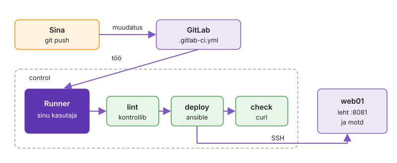
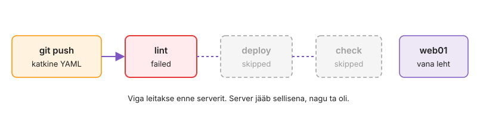

---
tags:
  - GitLab CI
  - Ansible
  - Praktikum
---

# Praktikum: server muutub ainult push'iga

Täna paned GitLabi konveieri web01 seadistama: sina muudad koodi ja teed push'i, konveier kontrollib koodi ja käivitab Ansible'i.

**Edenemine:** laboritahvel <http://192.168.125.187:8093/> (VPN-iga).

??? abstract "Õpiväljundid"
    1. Oskad teha GitLabis projektist oma koopia ja klooni selle control'i.
    2. Oskad paigaldada GitLab Runneri ja registreerida selle oma projektile.
    3. Oskad kirjutada `.gitlab-ci.yml` faili, milles on kolm stage'i: lint, deploy ja check.
    4. Oskad muuta serverit ainult push'iga ja näed, kuidas konveier vea enne serverit kinni peab.

<figure markdown="span">
  
  <figcaption>Joonis 7.1. Push käivitab konveieri, runner control'is teeb kolm sammu ja deploy seadistab web01 (Talvik, 2026).</figcaption>
</figure>

1\. kohtumisel tegid sama asja käsitsi, 2. kohtumisel Ansible'iga. Täna käivitab Ansible'i konveier: serverisse ei logi keegi käsitsi sisse, muudatus jõuab sinna ainult Giti kaudu.

Rida **Ennusta** tähendab, et enne käsku mõtled läbi, mis juhtub. Vastus on kokkuvolditud plokis.

## Osa 1 · Oma koopia ja esimene käsitsi käivitus

Kõigepealt käivitad playbook'i ise. Siis tead, mida konveier hiljem sinu eest teeb.

**Eesmärk:** projekt `k07-starter` on sinu GitLabi kontol ja control'is ning `ansible-playbook veeb.yml` paneb web01-le lehe.  
**Kontroll:** `curl http://<web01 IP>:8081` näitab rida `Kohv on olemas.`.  
**Kus:** brauser ja control, kaust `~/kursus/k07-gitlab`.

### 1.1 Loo GitLabi konto

Kursuse GitLab töötab kooli sisevõrgus. Konto teed ise.

1. Ava <https://gitlab.lab.hkhk.lan> ja vajuta **Register now**.
2. Kasutajanimeks kirjuta sama nimi nagu GitHubis. E-postiks kirjuta oma kooli aadress `…@hkhk.edu.ee`, sest teiste aadressidega kontot luua ei saa.
3. Vali parool ja vajuta **Register**. GitLab võib küsida rolli ja eesmärki: vali sobiv ja jätka.

??? success "Oodatav tulemus"
    Oled sisse logitud ja paremal üleval on sinu kasutajanimi.

??? warning "Kui aadress ei avane"
    VPN-iga sülearvuti ei pruugi nime `gitlab.lab.hkhk.lan` leida. Ava <https://192.168.100.56> ja nõustu sertifikaadi hoiatusega. Control'is töötab nimi alati.

### 1.2 Tee oma koopia

Koopia (**fork**) on projekt sinu kontol, mida saad vabalt muuta. Ava projekt **is126-automatiseerimine / k07-starter** ja vajuta paremal üleval **Fork**. Nimeruumiks vali oma kasutajanimi ja vajuta **Fork project**.

??? success "Oodatav tulemus"
    Aadress on `https://gitlab.lab.hkhk.lan/<kasutaja>/k07-starter` ja failide nimekirjas on `veeb.yml`, `inventory.ini`, `ansible.cfg` ja kaust `templates`.

### 1.3 Klooni control'i

Vajuta projekti lehel **Code** ja kopeeri **Clone with HTTPS** aadress. Git küsib kasutajanime ja parooli. Käsk `credential.helper` hoiab need neli tundi meeles, et neid iga push'i ajal uuesti ei küsitaks.

```bash
git config --global credential.helper 'cache --timeout=14400'
cd ~/kursus
git clone https://gitlab.lab.hkhk.lan/<kasutaja>/k07-starter.git k07-gitlab
cd k07-gitlab
ls
```

??? success "Oodatav tulemus"
    `ls` näitab faile `README.md`, `ansible.cfg`, `inventory.ini`, `templates` ja `veeb.yml`.

### 1.4 Pane inventory'sse oma web01

Starteris on web01 aadress `192.168.125.X`. Sinu web01 aadress on 2. kohtumise inventory's.

```bash
grep web01 ~/kursus/k02-ansible/inventory.ini
nano inventory.ini
```

??? example "Ülesanne: fail `inventory.ini`"
    ```ini
    [web]
    web01 ansible_host=192.168.125.<sinu web01>
    ```

### 1.5 Käivita playbook ise

Playbook paigaldab nginxi, paneb pordile 8081 lehe ja kirjutab SSH tervitusteksti (**motd**). 2. kohtumise leht pordil 80 jääb puutumata.

```bash
ansible-playbook veeb.yml
curl http://<web01 IP>:8081
```

??? success "Oodatav tulemus"
    Playbook lõpeb reaga `failed=0` ja `curl` näitab `<h1>Kohv on olemas.</h1>`.

**Ennusta:** mida näitab teine `ansible-playbook veeb.yml`?

??? success "Vastus"
    `changed=0`. Ansible võrdleb soovitud olekut tegelikuga ja kõik on juba õige.

Tee see muudatus commit'iks ja saada GitLabi:

```bash
git add inventory.ini
git commit -m "Minu web01"
git push
```

## Osa 2 · Runner control'is

GitLab ise käske ei käivita. Töö teeb **runner**: programm, mis küsib GitLabilt tööd ja käivitab selle oma masinas. Sinu runner töötab control'is sinu kasutajana, sest just sellel kasutajal on SSH-võti web01 jaoks.

**Eesmärk:** projekti runner on GitLabis roheline.  
**Kontroll:** **Settings → CI/CD → Runners** all on sinu runner olekuga **Online**.  
**Kus:** control ja brauser.

### 2.1 Paigalda runner ja kontrollitööriistad

```bash
curl -fsSL https://packages.gitlab.com/install/repositories/runner/gitlab-runner/script.deb.sh | sudo bash
sudo apt-get install -y gitlab-runner yamllint ansible-lint
gitlab-runner --version
```

??? success "Oodatav tulemus"
    `gitlab-runner --version` näitab versiooni, näiteks `Version: 19.5.3`.

### 2.2 Loo runner GitLabis

Ava oma projektis **Settings → CI/CD → Runners** ja vajuta **New project runner**. Väljale **Tags** kirjuta `control` ja vajuta **Create runner**. GitLab näitab käsku `gitlab-runner register` koos tokeniga. Token on salajane: ära pane seda faili ega ekraanipildile.

Käivita control'is GitLabi näidatud käsk koos `sudo`-ga. Kui käsk küsib:

- **GitLab instance URL**: vajuta Enter (`https://gitlab.lab.hkhk.lan`);
- **name for the runner**: `control-<kasutaja>`;
- **executor**: `shell`.

??? success "Oodatav tulemus"
    `Runner registered successfully.`

### 2.3 Käivita runner oma kasutajana

Vaikimisi töötab runner kasutajana `gitlab-runner`, kellel pole SSH-võtit. Teenus paigaldatakse uuesti nii, et see töötab sinu kasutajana. Töökaust peab olema enne olemas.

```bash
mkdir -p ~/gitlab-runner
sudo gitlab-runner uninstall
sudo gitlab-runner install --user $USER --working-directory $HOME/gitlab-runner
sudo systemctl daemon-reload
sudo systemctl restart gitlab-runner
systemctl is-active gitlab-runner
```

??? success "Oodatav tulemus"
    `active`. GitLabis on runner **Online** (vajadusel värskenda lehte).

??? warning "Kui teenus ei käivitu: `chdir /home/... no such file or directory`"
    Töökaust puudub. Käivita `mkdir -p ~/gitlab-runner` ja `sudo systemctl restart gitlab-runner`.

Ubuntu fail `~/.bash_logout` puhastab väljalogimisel ekraani. Runneri shell'is see ebaõnnestub ja iga töö kukub veaga `prepare environment: exit status 1`. Tõsta fail kõrvale:

```bash
mv ~/.bash_logout ~/.bash_logout.vana
```

## Osa 3 · Konveier

Konveier on fail `.gitlab-ci.yml` projekti juurkaustas. **Stage** on konveieri etapp ja **job** on töö, mis etapis käivitub. Etapid käivituvad järjest: kui üks kukub, järgmisi ei käivitata.

**Eesmärk:** konveieris on kolm etappi ja kõik on rohelised.  
**Kontroll:** projektis **Build → Pipelines** on viimane konveier **Passed**.  
**Kus:** control, kaust `~/kursus/k07-gitlab`.

### 3.1 Esimene etapp: lint

`yamllint` kontrollib YAML-i süntaksit ja `ansible-lint` Ansible'i häid tavasid. Rida `tags: [control]` ütleb, et töö läheb sinu runnerile.

??? example "Ülesanne: fail `.gitlab-ci.yml`"
    ```yaml
    ---
    stages: [lint]

    default:
      tags: [control]

    lint:
      stage: lint
      script:
        - yamllint .
        - ansible-lint veeb.yml
    ```

```bash
git add .gitlab-ci.yml
git commit -m "Konveier: lint"
git push
```

Ava **Build → Pipelines** ja vajuta konveierile, seejärel tööle `lint`. Logis näed käske ja nende väljundit.

??? success "Oodatav tulemus"
    Konveier on **Passed** ja töö `lint` logi lõpus on `Job succeeded`.

??? warning "Kui konveier jääb olekusse `pending`"
    Ükski runner ei võta tööd. Kontrolli, et runneril on GitLabis silt `control` ja olek **Online** ning control'is `systemctl is-active gitlab-runner` on `active`.

### 3.2 Teine ja kolmas etapp: deploy ja check

Deploy käivitab sama playbook'i, mille osas 1 ise käivitasid. Check kontrollib, et leht vastab. `curl -f` lõpetab veaga, kui leht ei vasta, ja siis on töö punane.

??? example "Ülesanne: `.gitlab-ci.yml` uus sisu"
    ```yaml
    ---
    stages: [lint, deploy, check]

    default:
      tags: [control]

    lint:
      stage: lint
      script:
        - yamllint .
        - ansible-lint veeb.yml

    deploy:
      stage: deploy
      script:
        - ansible-playbook veeb.yml

    check:
      stage: check
      script:
        - curl -fsS http://<web01 IP>:8081/ | grep -i "kohv"
    ```

**Ennusta:** mitu muudatust (`changed`) teeb deploy, kui sa playbook'i midagi ei muutnud?

```bash
git add .gitlab-ci.yml
git commit -m "Konveier: deploy ja check"
git push
```

??? success "Oodatav tulemus"
    Kõik kolm etappi on rohelised. Töö `deploy` logis on `changed=0`, sest web01 oli juba õiges olekus.

## Osa 4 · Muudatus jõuab serverisse push'iga

Nüüd muudad serverit ilma sinna sisse logimata. Lehe tekst tuleb muutujast `teade` failis `veeb.yml`.

```bash
nano veeb.yml
```

??? example "Ülesanne: muuda rida failis `veeb.yml`"
    ```yaml
        teade: "Kohv on otsas. Teatas Ansible."
    ```

```bash
git commit -am "Kohv otsas"
git push
```

Oota, kuni konveier on roheline, ja vaata tulemust:

```bash
curl http://<web01 IP>:8081
ssh <web01 IP> cat /etc/motd
```

??? success "Oodatav tulemus"
    Leht näitab `Kohv on otsas. Teatas Ansible.` ja tervitustekst ütleb, et serverit seadistab konveier ja käsitsi muudatusi on 0.

??? question "Kontrolli ennast"
    Kus on kirjas, mis tekst web01-l on, ja kes selle sinna pani?

    ??? success "Vastus"
        Tekst on Gitis failis `veeb.yml`. Sinna pani selle konveier, mis käivitas Ansible'i. Giti ajaloost näed, kes ja millal teksti muutis.

## Osa 5 · Viga, mille konveier kinni peab

<figure markdown="span">
  
  <figcaption>Joonis 7.2. Kui lint kukub, deploy'd ei tehta ja server jääb puutumata (Talvik, 2026).</figcaption>
</figure>

Tee meelega viga: lisa failis `veeb.yml` muutuja `teade` järele rida, mille sulg jääb kinni panemata.

??? example "Ülesanne: vigane rida failis `veeb.yml`"
    ```yaml
        teade: "Katki"
        vale: [
    ```

**Ennusta:** milline etapp läheb punaseks ja mis tekst on pärast seda web01 lehel?

```bash
git commit -am "Katkine YAML"
git push
```

??? success "Vastus"
    `lint` on punane ja `deploy` ning `check` on **skipped**. Leht näitab endiselt `Kohv on otsas. Teatas Ansible.`: vigane kood serverisse ei jõudnud.

??? question "Leia põhjus"
    Ava töö `lint` logi. Mis fail ja mis rida on vigane?

    ??? success "Vastus"
        `yamllint` näitab faili `veeb.yml` ja rida, kus sulg jäi kinni panemata, näiteks `syntax error: expected ',' or ']'`.

Eemalda vigane rida, tee commit ja push. Konveier on jälle roheline.

## Töö esitamine

Projekti viimane konveier harus `main` on roheline ja web01 lehel on sinu teade.

```bash
git status
git log --oneline -3
```

Tulemuse näeb koolitaja GitLabis sinu projekti all **Build → Pipelines**.

## Lisaülesanded

??? example "1 · Deploy ainult harust `main`"
    Lisa töödele `deploy` ja `check` reegel, mis lubab neid ainult harus `main`. Tee uus haru, muuda seal teksti ja tee push: käivitub ainult lint.

    ```yaml
    deploy:
      stage: deploy
      rules:
        - if: $CI_COMMIT_BRANCH == "main"
      script:
        - ansible-playbook veeb.yml
    ```

    Dokumentatsioon: [rules](https://docs.gitlab.com/ci/yaml/#rules).

??? example "2 · Teade GitLabi muutujast"
    Ava **Settings → CI/CD → Variables** ja lisa muutuja `TEADE`. Anna see playbook'ile käsurealt:

    ```yaml
        - ansible-playbook veeb.yml -e "teade=$TEADE"
    ```

    Muuda muutuja väärtust GitLabis ja käivita konveier nupuga **Build → Pipelines → New pipeline**, ilma koodi muutmata.

??? example "3 · Konveieri märk README-s"
    Ava **Settings → CI/CD → General pipelines → Pipeline status** ja kopeeri Markdowni rida README algusesse. Märk näitab, kas viimane konveier õnnestus.

??? info "Loe juurde"
    - [GitLab CI/CD sissejuhatus](https://docs.gitlab.com/ci/): konveieri, etapi ja töö mõisted.
    - [`.gitlab-ci.yml` võtmed](https://docs.gitlab.com/ci/yaml/).
    - [GitLab Runneri shell executor](https://docs.gitlab.com/runner/executors/shell/).
