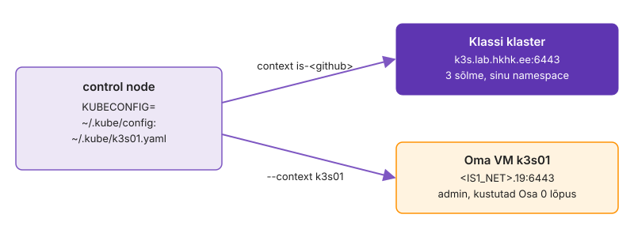

---
tags:
  - Kubernetes
  - k3s
  - OpenTofu
---

# 1. Oma klaster

Kui klastris läheb midagi katki ja sul on ainult API vastus, otsid viga pimesi: `Running` ei ütle, mis node'il tegelikult juhtub, ja klassi klastris oled ühe namespace'i kasutaja. Oma VM-il oled admin: paigaldad ühe node'iga k3s-i, ühendad mõlemad klastrid sama kubectl'iga ja vaatad Linuxi tööriistadega, millest pod, Service ja PVC node'il koosnevad. Lõpuks on control node'il kaks context'i, oled näinud pod'e töötamas ka peatatud k3s-iga ja VM on välja lülitatud.

**Kui teed seda tööl iga päev:** haldad k3s-i või kubeadm'i klastrit ja `KUBECONFIG=a:b kubectl config get-contexts` ning `crictl pods` on sulle tavalised. Kui see on sul juba korras, tee VM ja k3s ära ilma selgitusi lugemata ja mine otse etappi „[Control plane seiskub, workload töötab edasi](#control-plane-seiskub-workload-tootab-edasi)“.

Joonisel on vasakul control node, kus töötab üks kubectl. Paremal on kaks klastrit. Kumma klastriga kubectl parajasti suhtleb, otsustab kubeconfig'i context, mitte käsk ise.

<figure markdown="span">
  
  <figcaption>Joonis L7.2. Üks kubectl, kaks kubeconfig-faili ja kaks klastrit.</figcaption>
</figure>

## Haru ja klassi kubeconfig

Lood haru, kopeerid starteri ja paned paika koolitajalt saadud kubeconfig'i. kubectl peab jõudma koolitaja klastrisse enne, kui oma klastri lisad, muidu ei tea sa hiljem, kumb fail on vigane.

kubeconfig'is on kliendisertifikaat või token, millega API server sind tuvastab. Kubernetes ei toeta kliendisertifikaatide tühistamist (CRL-i ega OCSP-d pole): lekkinud sertifikaat kehtib aegumiseni, kui koolitaja ei vaheta CA-d. ServiceAccount'i tokeni saab tühistada, kustutades ServiceAccount'i või token-Secret'i.

1. Loo haru ja kopeeri starter (kui `k07-k8s/` on tühi):

    ```bash
    git switch main && git pull && git switch -c k07-k8s
    cp -r ~/<kursuse materjalid>/k07/starter/k07-k8s/. k07-k8s/
    ```

2. Võta koolitajalt fail `<github>.kubeconfig` isiklikult. See ei lähe Giti.
3. Pane fail paika ja paigalda [kubectl](https://kubernetes.io/docs/reference/kubectl/quick-reference/), kui seda pole:

    ```bash
    mkdir -p ~/.kube && cp ~/Downloads/<github>.kubeconfig ~/.kube/config && chmod 600 ~/.kube/config
    command -v kubectl || { curl -fsSLO "https://dl.k8s.io/release/v1.35.0/bin/linux/amd64/kubectl" && sudo install kubectl /usr/local/bin/; }
    echo 'source <(kubectl completion bash); alias k=kubectl; complete -o default -F __start_kubectl k' >> ~/.bashrc && source ~/.bashrc
    ```

4. Proovi ühendust:

    ```bash
    kubectl get pods
    kubectl config view --minify | grep server
    ```

5. Vaata, mis failis on. Kolm osa on alati olemas: klaster (aadress ja CA), kasutaja (tunnus) ja context, mis need kaks seob:

    ```bash
    kubectl config view --minify -o jsonpath='{.clusters[0].name} {.users[0].name} {.contexts[0].context.namespace}'; echo
    ls -l ~/.kube/config
    ```

> Kui näed `connection refused` või `x509`, kontrolli, kas VPN-ühendus on aktiivne. Kui serveri real on `127.0.0.1`, said vale faili.

Vastus `No resources found` tõestab kolme asja korraga: võrk jõudis API serverini, sertifikaat klappis ja sinu kasutaja tohib selles namespace'is pod'e lugeda. `Forbidden` oleks tähendanud, et ühendus on korras, aga õigused mitte. Helm hoiatab hiljem, kui fail on grupile või teistele loetav, seepärast `chmod 600`.

**Edasi saad minna, kui** `kubectl get pods` vastab ilma veata (`No resources found` sobib), server on `https://k3s.lab.hkhk.ee:6443` ja context'i namespace on `is-<github>`.

## Käivita VM k3s01

Koolitaja on teinud sinu pool'i VM-i `k3s01`: Ubuntu 24.04, 2 tuuma, 2 GB mälu, IP `<IS1_NET>.23`. Seni on see välja lülitatud, sest klassi Proxmoxi mälu jagavad kõik õppijad. Käivitad selle ja kontrollid seestpoolt, et VM on nii suur, nagu k3s vajab.

k3s server vajab vähemalt 2 GB mälu. Liiga väikese mäluga VM käivitub, aga k3s jääb kinni või kernel hakkab protsesse tapma. Siis otsid viga Kubernetesest, kuigi põhjus on VM-i suuruses.

1. Vali Proxmoxi veebiliideses oma pool, seejärel `k3s01` ja vajuta **Start**.
2. Oota cloud-init'i lõppu ja vaata VM-i suurust:

    ```bash
    ssh -o StrictHostKeyChecking=accept-new kasutaja@<IS1_NET>.23 \
        'cloud-init status --wait; hostname; nproc; free -m | awk "/Mem/ {print \$2}"'
    ```

<!-- EKRAANIPILT: Proxmoxi veebiliides, vasakul puus sinu pool'i all VM k3s01 olekus running; paremal Summary vaade, kus on näha 2 GB mälu ja 2 tuuma; pärast Start'i
<figure markdown="span">
  
  <figcaption>Joonis L7.1. VM k3s01 Proxmoxis pärast käivitamist.</figcaption>
</figure>
-->

> Kui VM ei käivitu mälu tõttu, vaata Proxmoxis, kas mõni 4. kohtumise VM (web01…db01) töötab veel. Selle korra töö neid ei kasuta: lülita need välja (Shutdown).

`status: done` tähendab, et cloud-init lõpetas töö: kasutaja, võti ja võrk on paigas. `free` näitab veidi alla 2048 MB, sest osa mälust võtab kernel enne, kui see kasutajale näha on.

**Edasi saad minna, kui** ssh vastab `k3s01`, `nproc` annab `2` ja `free` üle 1800 MB.

## k3s ja kaks klastrit ühes kubectl'is

Paigaldad k3s-i ja tood selle admin-faili control node'ile. Fail ei tööta kohe, sest k3s kirjutab selle enda jaoks: server on `127.0.0.1`, ja kubectl ühendub täpselt sellega, mis failis kirjas on. Parandad aadressi ja nimed ning liidad kaks faili üheks vaateks.

kubectl ei küsi kinnitust ega näita väljundis, millisesse klastrisse käsk läks. Valesse klastrisse läinud `apply` või `delete` vastu aitavad ainult selge context'i nimi, context promptis (näiteks kube-ps1) või eraldi `KUBECONFIG` iga terminali kohta.

1. Paigalda k3s [Quick-Start juhendi](https://docs.k3s.io/quick-start) järgi ja kopeeri admin-fail control node'ile:

    ```bash
    ssh kasutaja@<IS1_NET>.23 'curl -sfL https://get.k3s.io | INSTALL_K3S_VERSION=v1.35.9+k3s1 sh - && sudo k3s kubectl get nodes'
    ssh kasutaja@<IS1_NET>.23 sudo cat /etc/rancher/k3s/k3s.yaml > ~/.kube/k3s01.yaml && chmod 600 ~/.kube/k3s01.yaml
    kubectl --kubeconfig ~/.kube/k3s01.yaml get nodes
    ```

    VM-is on node `k3s01 Ready control-plane`, control node'ilt annab viimane käsk `connection refused … 127.0.0.1:6443`.

2. Paranda server ja nimed. k3s nimetab klastri, kasutaja ja context'i `default` ning need läheksid klassi failiga segamini. [`KUBECONFIG` liidab failid](https://kubernetes.io/docs/concepts/configuration/organize-cluster-access-kubeconfig/):

    ```bash
    sed -i -e 's/127\.0\.0\.1/<IS1_NET>.23/' -e 's/\bdefault$/k3s01/' ~/.kube/k3s01.yaml
    export KUBECONFIG=~/.kube/config:~/.kube/k3s01.yaml
    ```

3. Vaata mõlemat klastrit. Selles moodulis lisad igale käsule `--context k3s01`, et klassi klastrit kogemata ei muudaks:

    ```bash
    kubectl config get-contexts
    kubectl --context k3s01 get nodes -o wide
    ```

4. Võrdle kahe klastri volitusi. Oma klastris oled admin, klassis tavaline kasutaja:

    ```bash
    kubectl --context k3s01 auth whoami
    kubectl --context k3s01 auth can-i '*' '*'
    kubectl auth can-i '*' '*'
    ```

> Kui näed `x509: certificate is valid for … not …`, kasuta nime asemel IP-aadressi, sest k3s lisab sertifikaati node'i IP. Kui näed `i/o timeout`, blokeerib ühendust VM-i tulemüür: `sudo ufw allow 6443/tcp`.

Tärn `get-contexts` väljundis näitab context'i, mida kubectl kasutab, kui sa `--context`-i ei anna. See jääb klassi omaks, sest `KUBECONFIG`-i esimese faili `current-context` võidab. `can-i '*' '*'` annab oma klastris `yes` ja klassis `no`: sama kubectl, kaks väga erinevat volitust. Just seepärast paned oma klastri käskudele context'i alati kirja.

**Edasi saad minna, kui** `get-contexts` näitab kahte context'i (`*` klassi omal, `k3s01` teine), `get nodes -o wide` näitab VM-i IP-d ja `containerd://2.2` ning `can-i '*' '*'` vastab oma klastris `yes` ja klassis `no`.

## Mis node'il tegelikult töötab

Lood oma klastrisse paar objekti ja vaatad neid node'i seest. Pod on protsessid ühises network namespace'is, Service on NAT-reegel ja PVC on node'il tavaline kaust. Klassi klastris sa seda ei näe, sest node'idele sul ligipääsu pole.

Kui tead, et Service on kerneli reegel, ei otsi sa rikke korral "Service'i protsessi", mida pole olemas. Kui tead, et PVC on node'i kaust, mõistad, miks local-path'i andmed kaovad koos node'iga ja miks see ei sobi andmebaasile, mis peab node'i rikke üle elama.

1. Loo oma klastris Deployment, Service, PVC ja seda kasutav pod:

    ```bash
    kubectl --context k3s01 create deployment web --image=nginx:1.30-alpine --replicas=2
    kubectl --context k3s01 expose deployment web --port=80
    kubectl --context k3s01 apply -f ~/<kursuse materjalid>/k07/starter/katse/kirjutaja.yaml
    kubectl --context k3s01 get pods,svc,pvc -o wide
    ```

2. Logi node'ile ja vaata pod'e, `pause`-protsesse ja network namespace'e:

    ```bash
    ssh kasutaja@<IS1_NET>.23
    sudo k3s crictl pods | head -5
    ps -eo pid,cmd | grep [p]ause | head -5
    sudo lsns -t net | head -5
    ```

    Iga pod on `crictl pods`-is üks rida ja igal pod'il on üks `pause`-protsess, mis on network namespace'i omanik.

3. Vaata samas node'il Service'i NAT-reeglit, PVC kausta ja k3s-i logi, siis välju:

    ```bash
    sudo iptables -t nat -S KUBE-SERVICES | grep default/web
    sudo find /var/lib/rancher/k3s/storage -name tere.txt -exec cat {} \;
    journalctl -u k3s --since '-10 min' --no-pager | tail -3
    exit
    ```

4. Vaata, kui palju node'ist on reserveeritud. Selle arvu järgi otsustab scheduler, kas uus pod node'ile mahub:

    ```bash
    kubectl --context k3s01 describe node | grep -A8 'Allocated resources'
    kubectl --context k3s01 get pods -A -o custom-columns=POD:.metadata.name,MEM:.spec.containers[*].resources.requests.memory
    ```

> Kui `iptables` väljund on tühi, võib kube-proxy uuemas k3s-is kasutada nftables'it. Sel juhul kasuta käsku `sudo nft list ruleset | grep -A3 default/web`.

Kaks `web`-pod'i on node'il kaks `pause`-protsessi ja kaks network namespace'i. ClusterIP ei ole ühegi võrguliidese aadress: see on olemas ainult NAT-tabelis, mis suunab paketi ühe pod'i IP-le. `tere.txt` kuupäev tõestab, et PVC on node'i kaust, kuhu konteiner kirjutas. `Allocated resources` näitab, mida pod'id küsisid, mitte seda, mida nad kasutavad: node võib olla "täis" ja samal ajal peaaegu jõude.

**Edasi saad minna, kui** iptables'is on rida `default/web` ClusterIP-ga, local-path kaustas `pvc-…_default_katse` on fail kuupäevaga ja `Allocated resources` näitab requests'ide summat protsendina node'i mahust.

## Control plane seiskub, workload töötab edasi

Peatad k3s teenuse ajal, kui pod'id töötavad. API server, scheduler ja kontrollerid ehk control plane kaovad. Vaatad, kas nginx teenindab edasi ja mida näeb sel ajal kubectl.

Tootmisklastris juhtub see uuenduse, aegunud sertifikaadi või etcd rikke ajal. Kui tead, et workload töötab edasi, ei hakka sa paanikas pod'e taaskäivitama. Samas ei paranda sel ajal keegi ka ühtegi pod'i, mis ebaõnnestub.

**Ennusta:** kui k3s on peatatud, kas nginx vastab ClusterIP-l ja mida näitab `kubectl get pods`?

1. Jäta ClusterIP meelde ja peata node'il k3s:

    ```bash
    IP=$(kubectl --context k3s01 get svc web -o jsonpath='{.spec.clusterIP}'); echo $IP
    ssh kasutaja@<IS1_NET>.23 sudo systemctl stop k3s
    kubectl --context k3s01 get pods
    ```

2. Vaata node'il, kas nginx'i protsessid ja Service'i NAT-reegel töötavad:

    ```bash
    ssh kasutaja@<IS1_NET>.23 "ps -eo cmd | grep -c '[n]ginx: master'; curl -sI http://$IP | head -1"
    ```

3. Käivita k3s uuesti ja võrdle pod'e enne ja pärast:

    ```bash
    ssh kasutaja@<IS1_NET>.23 sudo systemctl start k3s && sleep 20
    kubectl --context k3s01 get pods -o wide
    ```

> `systemctl stop k3s` jätab konteinerid meelega käima. Kõik pod'id peatab skript `k3s-killall.sh`, mida kasutatakse enne node'i hooldust.

Kui k3s oli maas, sai kubectl `connection refused`, aga node'il oli kaks nginx'i master-protsessi ja ClusterIP vastas `HTTP/1.1 200 OK`. See tõestab, et data plane (konteinerid ja NAT-reeglid) ei vaja töötamiseks API serverit. Pärast taaskäivitust on pod'idel samad nimed ja RESTARTS on 0, seega neid ei loodud uuesti. Kui RESTARTS oleks kasvanud, oleks k3s peatamisel tapnud ka konteinerid.

**Edasi saad minna, kui** k3s peatatuna andis kubectl vea, curl ClusterIP-le andis `200` ja pärast taaskäivitust on pod'id samade nimedega ja RESTARTS 0.

## Koristus

Klassi klastri töö VM-ist ei sõltu. Eemaldad tema kubeconfig'i, kontrollid, et kubectl vaatab jälle ainult klassi klastrit, ja lülitad VM-i välja. Välja lülitatud VM mälu ei võta ja k3s jääb sinna alles.

Unustatud `KUBECONFIG` jätab alles context'i, mis osutab välja lülitatud masinale, ja järgmisel päeval saad vea, mille põhjust enam ei mäleta.

1. Eemalda kubeconfig, vaata context'i ja lülita VM välja:

    ```bash
    rm ~/.kube/k3s01.yaml && unset KUBECONFIG
    kubectl config current-context
    ssh kasutaja@<IS1_NET>.23 sudo poweroff
    ```

> Admini vaade (teine namespace, NodePort, LoadBalancer, `cordon`, `kubectl debug node/…`) ja PodDisruptionBudget'i katse on lehel [Lisaülesanded → 11. Oma klastri admini vaade](lisa.md#11-oma-klastri-admini-vaade). Sama VM-i vajavad ka [21. Saladus Gitis: Sealed Secrets ja võtme taaste](lisa.md#21-saladus-gitis-sealed-secrets-ja-votme-taaste) ja võrguinseneri ülesanne [22. vorgukogu CronJob'ina](lisa.md#22-vorgukogu-cronjobina). Nende jaoks käivitad VM-i uuesti ja kopeerid admin-faili nagu etapis „k3s ja kaks klastrit ühes kubectl'is“. Kui oled valmis, lülita VM jälle välja.

`current-context` näitab nüüd klassi context'i, sest alles jäi ainult `~/.kube/config`. Kui see näitab `k3s01`, on `KUBECONFIG` mõnes teises terminalis või `.bashrc`-is alles.

**Edasi saad minna, kui** `kubectl config current-context` näitab klassi context'i ja `k3s01` on Proxmoxis olekus *stopped*.

**Selle osa tõend:** issue `K7.1` kommentaaris `kubectl config get-contexts` väljund, üks `pause` rida, iptables'i rida `default/web`, `Allocated resources` plokk ja katse "k3s maas" kolm rida: kubectl'i viga, curl'i `200` ja pod'id pärast taaskäivitust.

## Miks see nii töötab

**`KUBECONFIG`-failide liitmine.** [`KUBECONFIG` liidab mitu faili](https://kubernetes.io/docs/concepts/configuration/organize-cluster-access-kubeconfig/) ja kehtima jääb esimese faili `current-context`, nii et `--context k3s01` jätab klassi klastri puutumata. Sama nimega kirjete puhul kehtib esimese faili kirje. Seetõttu tuli `default` ümber nimetada: muidu oleks k3s-i kasutaja kirje märkamatult välja jäänud ja kubectl oleks saatnud sinu VM-ile klassi klastri sertifikaadi.

**Pod node'il.** Node'il näitab `sudo k3s crictl pods` pod'e ja `crictl ps` nende konteinereid.

**`pause`-protsess.** Iga pod'i juures töötab `pause`-protsess, mis hoiab alles pod'i network namespace'i. Pod'i rakenduskonteinerid liituvad sellega. `sudo lsns -t net` näitab neid namespace'e koos protsessidega. Kui rakenduse konteiner lõpetab töö ja taaskäivitatakse, jääb `pause`-protsess alles ja koos sellega ka pod'i IP-aadress.

**k3s systemd teenusena.** k3s on üks systemd teenus ja selle logi näitab käsk `journalctl -u k3s -f`. Teenus käivitab containerd ja kõik control plane'i komponendid ühes protsessis.

**Miks pod'id jäid tööle.** Konteinerid töötavad oma shim-protsessides, mitte k3s-i protsessi sees. Selles praktikumis kasutatava k3s-i (v1.35.9+k3s1) paigaldusskripti loodud systemd unit'is on `KillMode=process`, nii et `systemctl stop k3s` lõpetas ainult põhiprotsessi. Teistsuguse unit'i seadistusega peatuksid ka konteinerid.

**DaemonSet.** DaemonSet hoiab igal node'il ühte pod'i (näiteks logikogujad, võrgu- ja salvestusagendid). Kui klastrisse lisatakse node, luuakse sellele automaatselt DaemonSet'i pod.

**Cordon.** `kubectl cordon` märgib node'i olekusse unschedulable (uusi pod'e sinna ei paigutata). Olemasolevad pod'id jäävad tööle ja uued pod'id jäävad olekusse `Pending`, kui klastris ei ole teist sobivat node'i.

**Taint ja toleration.** Tehniliselt on cordon taint `node.kubernetes.io/unschedulable:NoSchedule`. Taint hoiab pod'id node'ist eemal, pod'i spec'is olev toleration lubab pod'i sellele node'ile paigutada.

**Drain.** `kubectl drain` teeb cordon'i ja tõstab enne hooldust olemasolevad pod'id node'ilt ära, arvestades PodDisruptionBudget'it.

Kui jõudsid kiiremini: [Lisaülesanded → 6. Oma klaster edasi](lisa.md#6-oma-klaster-edasi), paned oma klastris DaemonSet'i käivituma igal node'il ja proovid taint'i ning toleration'it.
