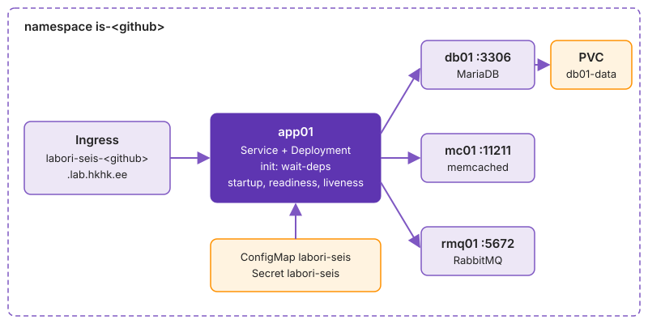

---
tags:
  - Kubernetes
  - Labori seis
  - NetworkPolicy
---

# 4. Labori seis klastris

Kui stack viiakse klastrisse ühe suure `apply`-ga ja midagi ei tööta, ei tea keegi, kas viga on Secret'is, PVC-s, Service'i nimes või NetworkPolicy's. Compose'iga tõusis Labori seis ühe käsuga ühel hostil, klastris ehitad selle teenus teenuse haaval ja testid iga sammu järel: db01 → mc01 → rmq01 → app01. Lõpus on rakendus Ingress'i kaudu väljast kättesaadav, andmebaasi juurde pääseb ainult app01 ja rolling update on läbi proovitud.

Töötad repos kaustas `k07-k8s/`. Vaja on faili `k03-docker/.env` (Compose'i paroolid) ja GitHub Actionsi ehitatud app01 image'it GHCR-is.

**Kui teed seda tööl iga päev:** kirjutad Deployment'i probe'ide, PVC ja NetworkPolicy'ga ilma näiteta. Kui see on sul juba korras, ehita neli teenust etappide ✅ ridade järgi ilma selgitusi lugemata ja mine otse etappi „[Rolling update ja rollback](#rolling-update-ja-rollback)“.

Joonis näitab lõpptulemust. Loe seda väljast sisse: kasutaja päring tuleb Ingress'i kaudu app01 Service'ile, app01 räägib kolme taustateenusega nende Service'i nimede kaudu, db01 hoiab andmeid PVC-l. ConfigMap ja Secret on kõrval, sest need ei ole liikluse teel, vaid annavad pod'idele seadistuse.

<figure markdown="span">
  
  <figcaption>Joonis L7.3. Labori seis sinu namespace'is mooduli lõpus.</figcaption>
</figure>

## Secret ja andmebaasi init

Teed valmis kaks asja, mida teenused käivitumiseks vajavad: paroolid ja andmebaasi algseisu. Paroolid lähevad Secret'i, mille lood käsurealt. Andmebaasi skeem ja algandmed lähevad ConfigMap'i, mille genereerid skriptiga ja mis läheb Giti.

Argo CD, kellele selle seisu hiljem üle annad, loob ainult seda, mis on Gitis. Seepärast on init ConfigMap Gitis, Secret mitte.

1. Loo Secret. Paroolid on samad mis `k03-docker/.env`-is ja jäävad sinu terminali:

    ```bash
    E=k03-docker/.env; v() { grep "^$1=" "$E" | cut -d= -f2-; }
    kubectl create secret generic labori-seis \
      --from-literal=DB_PASSWORD="$(v DB_PASSWORD)" --from-literal=RABBITMQ_PASSWORD="$(v RABBITMQ_PASSWORD)" \
      --from-literal=TEACHER_TOKEN="$(v TEACHER_TOKEN)" --from-literal=MARIADB_ROOT_PASSWORD="$(openssl rand -hex 12)"
    ```

2. Genereeri andmebaasi init ja vaata Secret'i võtmeid:

    ```bash
    bash k07-k8s/gen-db-init.sh
    head -5 k07-k8s/05-db-init.yaml
    kubectl get secret labori-seis -o jsonpath='{.data}' | tr ',' '\n' | cut -d: -f1
    ```

> `.env`-i pole? Tee uued paroolid. Tähtis on ainult see, et MariaDB ja app01 saavad sama väärtuse.

Secret'i võtmete nimekiri ilma väärtusteta on hea tõend: näed, et kõik neli on olemas, aga ükski parool ei satu issue'sse. Root-parool on juhuslik ja kuskile kirja ei lähe, sest Labori seis seda ei vaja. Kui tahad seda kunagi teada, loed selle Secret'ist.

✅ **Edasi saad minna, kui** Secret'is on neli võtit ning `05-db-init.yaml` on ConfigMap `labori-seis-db` võtmetega `01-schema.sql` ja `02-seed.sql`.

## db01

Paned üles andmebaasi: PVC, Deployment ja Service. Lisad faili korraga ühe objekti ja vaatad iga kord, mis klastris tekkis. Nii näed, et PVC ootab pod'i ja pod ootab PVC-d.

local-path loob kausta alles siis, kui teab, millisele node'ile pod läks (WaitForFirstConsumer). Sama kausta nägid oma klastri node'il. Andmebaasi Deployment kasutab strateegiat `Recreate`, sest kaks MariaDB-d sama andmekausta peal rikuks andmed.

1. Täida `k07-k8s/10-db.yaml` starteri TODO-de järgi. Lisa korraga üks objekt.
2. Tee init'ile ja db01-le `kubectl apply` ning jälgi:

    ```bash
    kubectl apply -f k07-k8s/05-db-init.yaml -f k07-k8s/10-db.yaml
    kubectl get pvc db01-data
    kubectl get pods -l app=db01 -w
    ```

3. Vaata, kas algandmed on sees:

    ```bash
    PW=$(kubectl get secret labori-seis -o jsonpath='{.data.DB_PASSWORD}' | base64 -d)
    kubectl exec deploy/db01 -- mariadb -ulabseis -p"$PW" labseis -e 'SELECT code FROM lab'
    ```

> Hoiatus `would violate PodSecurity "restricted:latest"` on teadlik: namespace jõustab `baseline`-i ja hoiatab `restricted`-i eest. Pod käivitub.

Read `lab-01` … `lab-07` tõestavad kolme asja: init ConfigMap jõudis pod'i, MariaDB käivitas skriptid esimesel käivitusel ja kasutaja `labseis` sai parooli Secret'ist. Kui ridu poleks, aga ühendus töötaks, oleks andmekaust juba varasemast katsest täis ja init jäeti vahele.

✅ **Edasi saad minna, kui** PVC läks `Pending` → `Bound`, pod on `Running 1/1` ja päring näitab ridu `lab-01` … `lab-07`.

## Andmed püsivad üle pod'i

Kontrollid, et andmed on PVC-l, mitte konteineris. Lisad tabelisse ühe rea, kustutad db01 pod'i ja vaatad, kas rida on uues pod'is alles.

Kui `mountPath` ei ole MariaDB andmekataloog `/var/lib/mysql`, kirjutab server konteineri kirjutatavasse kihti. Kõik töötab kuni esimese pod'i vahetuseni ja siis on andmebaas tühi. Seda on parem näha praegu kui pärast esimest node'i hooldust.

1. Lisa rida ja kustuta pod:

    ```bash
    SQL="kubectl exec deploy/db01 -- mariadb -ulabseis -p$PW labseis -e"
    $SQL "INSERT INTO lab (course_id, code, title, day) VALUES (1, 'lab-99', 'püsivuse katse', 7)"
    kubectl delete pod -l app=db01 && kubectl rollout status deploy/db01
    ```

2. Vaata, kas rida on alles, ja kustuta see:

    ```bash
    $SQL "SELECT code, title FROM lab WHERE code='lab-99'"
    $SQL "DELETE FROM lab WHERE code='lab-99'"
    kubectl get pv -o custom-columns=PV:.metadata.name,CLAIM:.spec.claimRef.name,NODE:.spec.nodeAffinity.required.nodeSelectorTerms[0].matchExpressions[0].values[0]
    ```

Uus pod luges sama kausta ja rida `lab-99` oli alles. PV veerg NODE näitab node'i, millega local-path ketta sidus: db01 saab käivituda ainult seal. Kui see node kaob, jääb db01 `Pending`-uks, sest teist koopiat andmetest pole. Pilves lahendab selle võrguketas, mis liigub node'ide vahel.

✅ **Edasi saad minna, kui** rida `lab-99` oli pärast pod'i vahetust alles, see on nüüd kustutatud ja tead, millise node'iga sinu PV on seotud.

## mc01 ja rmq01

Kaks järgmist teenust on lihtsamad: pole PVC-d ega init-skripte. Ülesehitus on sama mis db01-l, muutuvad image, port ja muutujad. Kirjutad failid `k07-k8s/20-mc.yaml` ja `k07-k8s/30-rmq.yaml` ise, nõuete järgi.

Ilma readiness probe'ita loetakse pod Ready'ks kohe, kui konteiner käivitus, ja EndpointSlice'i kontroller paneb ta Service'i taha enne, kui memcached või RabbitMQ porti kuulab. app01 saab siis juhuslikke ühendusvigu.

- kummaski Deployment ja Service, image'id, pordid ja muutujad on starteri kommentaarides
- konteineripordil on nimi (`name: memcache`, `name: amqp`) ja Service'i `targetPort` viitab nimele, mitte numbrile
- rmq01 parool tuleb Secret'ist `labori-seis` (võti `RABBITMQ_PASSWORD`), mitte failist
- igal konteineril on `resources.requests`, `resources.limits.memory` ja readiness probe

1. Tee mõlemale `kubectl apply` ja proovi porte ajutisest pod'ist:

    ```bash
    kubectl apply -f k07-k8s/20-mc.yaml -f k07-k8s/30-rmq.yaml
    kubectl get endpoints mc01 rmq01
    kubectl run nc --rm -it --image=busybox:1.37 --restart=Never -- nc -zv rmq01 5672
    ```

2. Vaata, kas RabbitMQ kasutaja tekkis Secret'i parooliga:

    ```bash
    kubectl exec deploy/rmq01 -- rabbitmqctl list_users
    ```

> Nimega port tähendab, et Service ei sõltu numbrist: konteineri porti muudad ühes kohas.

Endpoints'is on kummalgi üks IP õige pordiga. See tähendab, et pod on Ready ja Service'i `targetPort` leidis nimega pordi. `nc` vastus `open` tuleb teisest pod'ist, nii et ka DNS ja klastri võrk töötavad. `list_users` näitab kasutajat `labseis`, mille RabbitMQ lõi esimesel käivitusel. Kui seal oleks ainult `guest`, puudub failis `RABBITMQ_DEFAULT_USER` ja app01 ei saaks järjekorraga ühendust.

✅ **Edasi saad minna, kui** mõlemad pod'id on 1/1, Endpoints näitab kummalgi üht IP-d pordiga 11211 / 5672, `nc -zv rmq01 5672` annab `open` ja `list_users` näitab `labseis`.

## app01

app01 sõltub kõigist kolmest teenusest. Kubernetesel pole Compose'i `depends_on`-it, seega kirjutad ootamise ise init-konteinerisse. Init-konteiner hoiab app01 käivitamata, kuni sõltuvused vastavad. [Startup-probe](https://kubernetes.io/docs/tasks/configure-pod-container/configure-liveness-readiness-startup-probes/) annab JVM-ile aega ja readiness laseb liikluse ligi alles siis, kui andmebaas ja järjekord vastavad.

Kolm probe'i vastavad kolmele eri küsimusele. Kui need segi ajada, taaskäivitab Kubernetes rakendust, mis lihtsalt ootab andmebaasi, ja aeglaselt käivituv JVM ei jõua kunagi lõpuni. See on klassikaline restarditsükkel, mis näeb välja nagu rakenduse viga.

1. Täida `40-app.yaml`:
    - ConfigMap, Deployment, Service
    - image on sinu app01 image GHCR-ist konkreetse tag'iga
    - [init-konteiner](https://kubernetes.io/docs/concepts/workloads/pods/init-containers/) `wait-deps`: image `mariadb:11.4`, `envFrom` samast ConfigMap'ist, tsükkel ootab TCP-ühendust `$DB_HOST:3306` ja `$RABBITMQ_HOST:5672`
    - kolm probe'i ja `resources` starteri kommentaari järgi
2. Leia oma tag ja tee `kubectl apply`:

    ```bash
    gh api /orgs/hkhk-tk/packages/container/<sinu-repo>/versions --jq '.[0:3][].metadata.container.tags'
    kubectl apply -f k07-k8s/40-app.yaml
    kubectl rollout status deploy/app01 --timeout=5m
    kubectl logs deploy/app01 -c wait-deps
    ```

3. Proovi rakendust:

    ```bash
    kubectl port-forward svc/app01 8080:8080 &
    curl -s localhost:8080/health; echo; curl -s localhost:8080/version; echo
    kill %1
    ```

> `ImagePullBackOff` ja Events ütleb `unauthorized`: pakett on privaatne. Koolitaja on lisanud sinu default ServiceAccount'ile secret'i `ghcr-pull` (`kubectl get sa default -o yaml`). Kui seda pole, vt `k07-k8s/examples/secret.example.yaml`.

`wait-deps` logi näitab, mida pod ootas ja millal oote lõppes. `/health` vastus, kus kõik neli on `UP`, tõestab, et app01 jõudis kõigi kolme teenuseni nende nimede kaudu ja paroolid klapivad. `/version` SHA seob töötava pod'i kindla commit'iga. Seda seost kasutad, kui CI hakkab tag'i Argo CD jaoks ise kirjutama.

✅ **Edasi saad minna, kui** `rollout status` lõpeb reaga `successfully rolled out`, `wait-deps` logis on `db01:3306 vastab` ja `rmq01:5672 vastab`, `/health` annab `{"status":"UP","db":"UP","queue":"UP","cache":"UP"}` ja `/version` näitab sinu commit'i SHA-d.

## Ingress

Lisad Ingress'i, et rakendus oleks väljast kättesaadav. Traefik kuulab igal node'il porti 80 ja valib Service'i Host-päise järgi. `-H 'Host: …'` testib ilma DNS-ita.

Ingress on koht, kus mitu rakendust jagavad üht IP-d ja porti. Kui kaks õppijat kirjutaks sama hosti, võitleks nende reeglid sama nime eest ja üks näeks teise lehte. Seepärast kontrollib automaatne hindaja, et host sisaldab sinu GitHubi nime.

1. Lisa `40-app.yaml`-i Ingress:
    - `ingressClassName: traefik`
    - host `labori-seis-<github>.lab.hkhk.ee`
    - path `/` (`pathType: Prefix`), backend `app01` port `http`
2. Tee `kubectl apply` ja proovi:

    ```bash
    kubectl apply -f k07-k8s/40-app.yaml
    kubectl get ingress
    curl -s -H 'Host: labori-seis-<github>.lab.hkhk.ee' http://k3s.lab.hkhk.ee/health; echo
    ```

3. Proovi vale hostiga ja ilma hostita. Nii näed, mida Traefik teeb päringuga, millele reeglit pole:

    ```bash
    curl -s -o /dev/null -w '%{http_code}\n' -H 'Host: olematu.lab.hkhk.ee' http://k3s.lab.hkhk.ee/health
    curl -s -o /dev/null -w '%{http_code}\n' http://k3s.lab.hkhk.ee/health
    ```

<!-- EKRAANIPILT: brauser aadressil http://labori-seis-<github>.lab.hkhk.ee/ pärast Ingress'i lisamist; Labori seisu leht koos stiiliga, aadressiribal on näha Ingress'i host
<figure markdown="span">
  
  <figcaption>Joonis L7.4. Labori seis klastrist Ingress'i kaudu.</figcaption>
</figure>
-->

> `404 page not found`: Traefik ei leia sellele hostile reeglit (kirjaviga, `ingressClassName` puudub või Host-päis jäi ära). `503` või `no available server`: reegel on olemas, aga Service'il pole Ready pod'e.

Õige hostiga tuli `UP`, vale hostiga ja ilma hostita `404`. See tähendab, et Traefik töötab ja sinu reegel on ainus, mis sinu hostile vastab. Rikkeotsingul aitab see vahe: `404` on Ingress'i probleem, `503` Service'i või pod'i oma.

✅ **Edasi saad minna, kui** Ingress'i ADDRESS veerus on node'ide IP-d, curl annab `UP`, vale hostiga tuleb `404` ja brauseris avaneb `http://labori-seis-<github>.lab.hkhk.ee/` Labori seisu leht.

## Andmebaas kaob

Peatad db01 ja vaatad, kuidas app01 käitub. Readiness `/health` eemaldab töötava pod'i liiklusest, liveness `/health/live` ei sõltu andmebaasist. Uus pod ei jõua init-konteinerist kaugemale.

Kui liveness sõltuks andmebaasist, taaskäivitaks kubelet vaikeväärtustega (`periodSeconds: 10`, `failureThreshold: 3`) iga app01 konteineri umbes 30 sekundiga ja CrashLoopBackOff'i ooteaeg kasvaks 10 sekundist 5 minutini. Andmebaasi naastes ootaksid pod'id veel backoff'i lõppu ja kõik JVM-id käivituksid korraga.

1. Peata db01 ja vaata, mis juhtub app01-ga:

    ```bash
    kubectl scale deploy/db01 --replicas=0
    kubectl get pods -w
    kubectl get endpoints app01
    curl -s -o /dev/null -w '%{http_code}\n' -H 'Host: labori-seis-<github>.lab.hkhk.ee' http://k3s.lab.hkhk.ee/
    ```

2. Kontrolli nime ja käivita uus app01 pod:

    ```bash
    kubectl run dns --rm -it --image=busybox:1.37 --restart=Never -- nslookup db01
    kubectl delete pod -l app=app01
    kubectl get pods -l app=app01; kubectl logs -l app=app01 -c wait-deps --tail=3
    ```

3. Too db01 tagasi ja jälgi, kuidas uus pod läbib `Init:0/1` → `PodInitializing` → `Running 0/1` → `1/1`:

    ```bash
    kubectl scale deploy/db01 --replicas=1
    kubectl get pods -l app=app01 -w
    ```

Töötav app01 läks `0/1`, aga RESTARTS ei kasvanud: readiness võttis ta liiklusest välja, liveness jättis ta ellu. Endpoints jäi tühjaks ja Traefik vastas `503`. `nslookup db01` andis ClusterIP ka ajal, kui db01-l polnud ühtegi pod'i. Seepärast ei saa init-konteiner oodata nime, vaid peab ootama avatud porti.

✅ **Edasi saad minna, kui** db01 puudumisel oli app01 `0/1` ilma restartideta, Endpoints tühi ja curl `503`, `nslookup db01` andis ClusterIP, uus pod kordas `ootan db01:3306` ja pärast db01 tagasitulekut on app01 1/1.

## Ainult app01 tohib andmebaasi

Seni sai db01:3306-ga ühenduse iga pod sinu namespace'is. Nüüd piirad seda. [NetworkPolicy](https://kubernetes.io/docs/concepts/services-networking/network-policies/) valib pod'id label'i järgi nagu Service ja lubab sissetuleva liikluse ainult neilt, keda reegel nimetab. k3s jõustab seda sisseehitatud kontrolleriga.

Klastri võrk on vaikimisi lame: iga pod jõuab iga pod'ini, ka teisest namespace'ist. NetworkPolicy valib allika ja sihi label'i, mitte IP järgi, ja CNI tõlgib selle iga pod'i IP muutumisel uuesti node'i reegliteks.

1. Proovi enne poliitikat ajutisest pod'ist:

    ```bash
    kubectl run nc --rm -it --image=busybox:1.37 --restart=Never -- nc -zv -w 3 db01 3306
    ```

2. Kirjuta `k07-k8s/15-db-netpol.yaml` ise:
    - NetworkPolicy `db01`, `podSelector` valib pod'id label'iga `app: db01`
    - `policyTypes: [Ingress]`
    - lubatud ainult pod'id label'iga `app: app01`, port 3306/TCP
    - `namespace:` rida puudub
3. Tee `kubectl apply` ja proovi uuesti ajutisest pod'ist ning app01 seest:

    ```bash
    kubectl apply -f k07-k8s/15-db-netpol.yaml
    kubectl run nc --rm -it --image=busybox:1.37 --restart=Never -- nc -zv -w 3 db01 3306
    kubectl exec deploy/app01 -c labori-seis -- bash -c '</dev/tcp/db01/3306 && echo avatud'
    curl -s -H 'Host: labori-seis-<github>.lab.hkhk.ee' http://k3s.lab.hkhk.ee/health; echo
    ```

4. Proovi sama ajutisest pod'ist, millel on app01 label. Nii näed, et poliitika usaldab label'it, mitte pod'i päritolu:

    ```bash
    kubectl run nc2 --rm -it --image=busybox:1.37 --restart=Never --labels=app=app01 -- nc -zv -w 3 db01 3306
    ```

> Kui ajutine pod saab ka pärast poliitikat `open`, ei jõusta klaster NetworkPolicy'd. Kirjuta see issue'sse ja jäta fail alles.

Ajutine pod sai `timed out`, mitte `connection refused`: poliitika hülgab paketi vaikselt. app01 sai ühenduse ja `/health` jäi `UP`-iks. Pod label'iga `app=app01` sai samuti `open`. See tähendab, et iga kasutaja, kes tohib sinu namespace'is pod'e luua, saab poliitikast mööda. Label on piir ainult koos õigustega, kes pod'e luua tohib.

✅ **Edasi saad minna, kui** ajutine pod saab pärast poliitikat `timed out`, app01 seest tuleb `avatud`, `/health` näitab `"db":"UP"` ja issue'sse on kirjas, mida näitas `nc2` katse.

## Rolling update ja rollback

Vahetad app01 image'i ja vaatad, kuidas Kubernetes vana ja uue versiooni vahetab ilma katkestuseta. Siis teed rollback'i ja vaatad, mis juhtub failiga.

`maxUnavailable: 0` hoiab vana pod'i alles, kuni uus on Ready. `undo` ei kustuta ajalugu, vaid kopeerib vana template'i uueks revisjoniks, ja fail ei tea sellest midagi. Just see "fail ei tea" on probleem, mille GitOps lahendab.

Joonis näitab kahte ReplicaSet'i ajas. Uus kasvab ühe pod'i kaupa, vana kahaneb alles siis, kui uus pod on Ready. Kui uus pod Ready'ks ei saa, jääb pilt poolele teele: vana teenindab edasi ja rollout seisab.

<figure markdown="span">
  
  <figcaption>Joonis L7.5. Rolling update kahe ReplicaSet'i vahel.</figcaption>
</figure>

1. Vali oma GHCR-ist teine tag (eelmine commit). Muuda failis `image` ja `kubernetes.io/change-cause` ning pane ajutiselt `replicas: 2`.
2. Tootmises ei tohi kasutaja vahetust näha. Käivita teises terminalis kasutaja vaate logi ja jäta see tööle kuni 5. sammu lõpuni:

    ```bash
    H='Host: labori-seis-<github>.lab.hkhk.ee'
    while sleep 1; do echo "$(date +%T) $(curl -s -o /dev/null -m 3 -w '%{http_code}' -H "$H" http://k3s.lab.hkhk.ee/health)"; done | tee ~/k07-katse/rolling.log
    ```

3. Tee `kubectl apply` ja jälgi kolmandas aknas ReplicaSet'e:

    ```bash
    kubectl apply -f k07-k8s/40-app.yaml
    kubectl get rs -l app=app01 -w
    ```

4. Vaata tulemust:

    ```bash
    kubectl rollout status deploy/app01
    kubectl rollout history deploy/app01
    curl -s -H 'Host: labori-seis-<github>.lab.hkhk.ee' http://k3s.lab.hkhk.ee/version; echo
    ```

5. Tee rollback ja võrdle faili klastriga. `diff` näitab miinusega klastri vana tag'i ja plussiga faili uut:

    ```bash
    kubectl rollout undo deploy/app01
    kubectl rollout history deploy/app01
    kubectl diff -f k07-k8s/40-app.yaml
    ```

6. Mine tagasi uuele tag'ile: `kubectl rollout undo deploy/app01 --to-revision=<uue tagi revisjon>`, siis `kubectl diff -f k07-k8s/40-app.yaml` on image'i osas tühi. Peata logi ja loe, mitu vastust polnud `200`: `grep -vc ' 200$' ~/k07-katse/rolling.log`.
7. Pane failis tagasi `replicas: 1` ja õige tag ning käivita `kubectl apply -f k07-k8s/40-app.yaml`.

> CHANGE-CAUSE on `<none>`: annotatsioon peab olema Deployment'i `metadata.annotations`-is, mitte pod'i template'is.
>
> Logis on üksikud `502` või `000`: vana pod sai SIGTERM-i ajal, kui Traefik talle veel päringuid saatis. Endpoints'i uuendus jõuab Traefikuni hiljem kui SIGTERM pod'ini. Tavaline parandus on `lifecycle.preStop` lühikese `sleep`-iga ja `terminationGracePeriodSeconds` sellest pikem; kirjuta issue'sse, mida nägid ja kas parandus aitas.

`rollout history` revisjonide numbrid ainult kasvavad. Pärast `undo`-d ei läinud number tagasi, vaid tekkis uus, mille template on sama mis vanal. `kubectl diff` näitas, et klaster ja fail lahknesid kohe pärast `undo`-d. Kui keegi teine oleks samal ajal faili `apply`-ga saatnud, oleks sinu rollback kadunud ilma, et keegi märkaks.

✅ **Edasi saad minna, kui** uus ReplicaSet kasvas 0 → 2 ja vana kahanes 2 → 0, `grep -vc ' 200$' ~/k07-katse/rolling.log` annab 0 (või issue's on põhjus ja parandus), `rollout history` näitab vähemalt kolme revisjoni koos CHANGE-CAUSE'iga ja pärast `undo`-d tekkis uus revisjoni number.

## Commit

Kontrollid automaatse hindaja testid kohapeal ja lükkad haru üles. PR-i teed alles pärast nelja rikke parandamist, sest koolitaja teeb rikked klastris, mitte Gitis, ja Git peab jääma õigeks võrdluspunktiks.

Kohalik kontroll säästab sind tag'i ja Releases'i ootamisest. `grep` teeb sama, mida `hygiene` test: otsib manifestidest `namespace:` ridu ja Secret'eid, mis ei tohi Giti minna.

```bash
for t in files kubeconform objects hygiene; do bash autograde/check.sh k07 $t; done
grep -rn 'namespace:\|kind: Secret' k07-k8s/*.yaml
git add k07-k8s && git commit -m "K7.4 Labori seis klastris (closes #<nr>)" && git push -u origin k07-k8s
```

Neli `OK`-d tähendavad, et failid on olemas, skeemi järgi korrektsed, igal Deployment'il on probe ja ressursid ning saladusi ega namespace'i ridu pole. Tühi `grep` kinnitab sama käsitsi.

✅ **Edasi saad minna, kui** kõik neli testi annavad `OK`, `grep` on tühi ja haru on GitHubis.

📎 **Selle mooduli tõend:** issue `K7.4` kommentaaris Secret'i neli võtit, `lab-01` … `lab-07`, `lab-99` pärast pod'i vahetust, `/version`, `curl` + `kubectl get ingress`, üks lause "Compose vs klaster" andmebaasi kadumise kohta, `nc` enne ja pärast NetworkPolicy't koos `nc2` katsega, `rollout history` ning `grep -vc ' 200$' ~/k07-katse/rolling.log` tulemus.

## Miks see nii töötab

**`/dev/tcp`.** `bash -c '< /dev/tcp/db01/3306'` ei ava faili. `/dev/tcp/<host>/<port>` on tee, mida tõlgendab bash ise: ümbersuunamine avab TCP-ühenduse ja väljumiskood näitab, kas ühendus õnnestus.

**Miks `wait-deps` kasutab MariaDB image'it.** `/dev/tcp` töötab bashis, mitte `sh`-s. Seetõttu kasutab `wait-deps` image'it `mariadb:11.4`: see on db01 jaoks node'il juba olemas ja selles on bash.

**MariaDB esimene käivitus.** MariaDB ametliku image'i käivitusskript (entrypoint) käivitab esimesel korral serveri võtmega `--skip-networking`, käivitab kausta `/docker-entrypoint-initdb.d/` skriptid ja alles seejärel käivitab serveri võrguühendusega. Seetõttu tähendab avatud port ka seda, et skeem ja algandmed on loodud.

**`lost+found` pilvekettal.** Pilvekettal (EBS, Longhorn) on uues ext4-failisüsteemis kaust `lost+found`, mis võib andmebaasi algseadistamist häirida: MySQL keeldub mittetühjast andmekataloogist ja MariaDB võib kuvada kausta andmebaasina. local-path annab tavalise kausta ja seda probleemi ei teki. Tavaline lahendus on mount'ida andmed alamkausta (`subPath`).

**local-path ja node.** local-path'i PV on seotud ühe node'iga `nodeAffinity` kaudu, mida nägid `get pv` väljundis. Kui node kaob, jääb andmebaasi pod olekusse `Pending` ja andmed jäävad selle node'i kettale. Pilves oleks PVC taga EBS-ketas, mida saab ühendada uue pod'iga sama availability zone'i piires.

**Service ja kube-proxy.** Service'il ei ole oma protsessi: kube-proxy kirjutab igale node'ile NAT-reeglid (iptables- või nftables-režiimis; IPVS-režiimis on mehhanism teistsugune). Nimi `db01` lahendatakse, sest pod'i failis `/etc/resolv.conf` on otsingudomeen `search is-<github>.svc.cluster.local`.

**NetworkPolicy reeglid.** NetworkPolicy reeglid liituvad. Kui pod'i valib vähemalt üks Ingress-tüüpi poliitika, on lubatud ainult see liiklus, mida mõni poliitika lubab. Väljuvat liiklust (egress) me ei piira, sest muidu tuleks eraldi lubada ka DNS (UDP ja TCP port 53 namespace'is `kube-system`).

**PodSecurity hoiatus.** Hoiatus `PodSecurity "restricted:latest"` tähendab, et sinu namespace'i label'ite järgi jõustatakse taset `baseline` ja rangema taseme rikkumise kohta antakse hoiatus.

**Rollout'i ajalugu.** Annotatsioon `kubernetes.io/change-cause` kuvatakse käsu `kubectl rollout history` veerus.

**Rolling update'i vaikeväärtused.** Deployment'i strateegia on vaikimisi `RollingUpdate` väärtustega `maxSurge: 25%` ja `maxUnavailable: 25%`. Protsent ümardatakse lisapod'ide puhul üles ja puuduvate puhul alla, nii et ühe kuni kolme koopiaga tähendab see ühte lisapod'i (`maxSurge: 1`) ja mitte ühtegi puuduvat (`maxUnavailable: 0`). Seetõttu ei ole meie manifestis `strategy` plokki vaja.

**Failide järjekord.** Workload'ide puhul failide järjekord tavaliselt tähtis ei ole. `kubectl apply -f k07-k8s/` saadab failid tähestiku järjekorras üksteise järel, kontrollerid ei oota üksteist ja käivitusjärjekorra tagab `wait-deps`. Erand on objekt, mis peab enne olemas olema, näiteks namespace või CRD: kui see on hilisemas failis, ebaõnnestub esimene `apply` ja alles teine õnnestub.

**Puuduv sõltuvus.** Labori seis talub ka sõltuvuse puudumist: Hikari connection pool ei katkesta rakenduse käivitust, kui andmebaas ei vasta, ja readiness-probe hoiab pod'i liiklusest eemal. Compose'iga nägid siis lehte „Andmebaas ei vasta“. Klastris vastab Traefik koodiga 503, sest Service'il ei ole ühtegi Ready-olekus pod'i. See on teadlik valik.

**Probe'i ajapiir.** Probe'i vaikimisi `timeoutSeconds` on 1 sekund. `rabbitmq-diagnostics ping` käivitab Erlangi VM-i ja võtab sageli kauem, seetõttu on rmq01 probe tüübiga `tcpSocket` pordile 5672. app01 startup-probe lubab kuni 36 × 5 s, sest jagatud klastris teeb sama toimingu korraga 15 inimest.

**Ingress ja DNS.** Pilves loodaks Ingress-kontrolleri LoadBalancer-tüüpi Service'i jaoks pilveteenuse load balancer välise aadressiga ja DNS-is oleks selle aadressi jaoks CNAME-kirje. Klassis täidab sama ülesannet wildcard-kirje `*.lab.hkhk.ee`.

Kui jõudsid kiiremini: [Lisaülesanded → 12. Kogu namespace'i võrk kinni](lisa.md#12-kogu-namespacei-vork-kinni), keelad kogu sissetuleva liikluse ja lubad iga ühenduse eraldi NetworkPolicy'ga.
