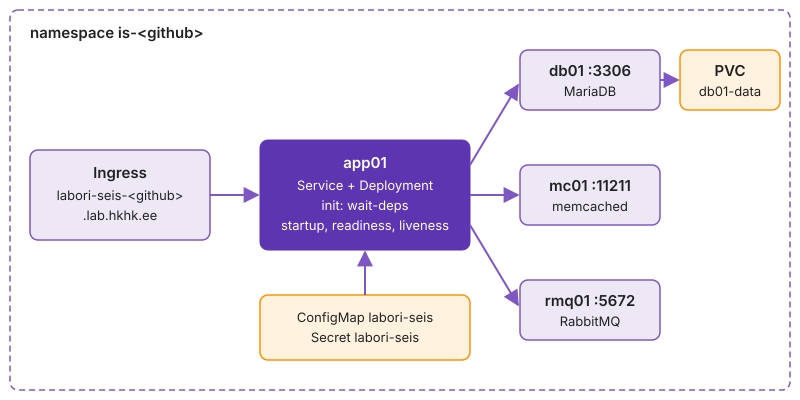

---
tags:
  - Kubernetes
  - k3s
  - Argo CD
  - GitOps
  - Praktikum
---

# Praktikum: Labori seis Kubernetese klastris

6\. kohtumisel jõudis testitud image registry'sse. Täna viid Labori seisu koolitaja Kubernetese klastrisse oma namespace'i ja annad selle oleku hoidmise Argo CD-le. Kohtumise lõpuks töötab Labori seis neljas Deployment'is, andmebaas on püsikettal, rakendus avaneb Ingress'i kaudu brauseris ja Argo CD pöörab käsitsi tehtud muudatuse tagasi.

**Edenemine:** laboritahvel <http://is126.kaaren.lab.hkhk.lan> (VPN-iga).

Küsimused: [Küsimused ja teated](https://github.com/hkhk-tk/is126-arutelu/discussions). Lisa küsimusele käsk ja kogu veateade tekstina. Enne saatmist eemalda paroolid ja tokenid.

??? tip "Algseis: mida saad valmis kujul ja mida teed ise"

    **Saad valmis kujul:** starteris kausta `k07-k8s` manifestide mallide ja skriptiga `gen-db-init.sh`, koolitajalt faili `<github>.kubeconfig` oma namespace'iga `is-<github>`, koolitaja klastri koos Traefiku, kettaruumi ja Argo CD-ga ning valmis app01 image'i registry's. Manifestide sisu on juhendis kokkuvolditud plokkides. Varasemate kohtumiste tööd see praktikum ei vaja: paroolid teed uued ja app01 image'i annab koolitaja.

    **Teed ise:** ühendad kubectl'i klastriga, proovid ühe Deployment'iga, kuidas Kubernetes soovitud olekut hoiab, paned Labori seisu teenus teenuse haaval klastrisse, leiad, miks app01 ei käivitu, annad oleku Argo CD-le ja esitad töö tag'iga `k07`. Kodutöö [Kubernetes valvab ise](../kodutood/monitooring.md#7-kohtumine-kubernetes-valvab-ise) on boonus.

    **Kui midagi läks katki:** `git restore <fail>` toob faili tagasi viimase commit'i kujul. `kubectl delete -f k07-k8s/<fail>` kustutab faili objektid ja `kubectl apply -f k07-k8s/<fail>` loob need uuesti. Andmebaas alustab algandmetest, kui kustutad ka PVC: `kubectl delete pvc db01-data`.

??? abstract "Õpiväljundid"

    1. Ühendad kubectl'i klastriga ning lood Deployment'i ja Service'i YAML-failist.
    2. Paigaldad Labori seisu neli teenust oma namespace'i nii, et rakendus on Ingress'i kaudu kättesaadav ja andmed jäävad PVC-le.
    3. Leiad `describe`, `logs` ja Events'i abil, miks pod ei käivitu või liiklust ei saa.
    4. Annad oleku hoidmise Argo CD-le ja muudad soovitud olekut Giti kaudu.
    5. Kontrollid töö automaatkontrolli testidega ja esitad selle.

??? info "Testitud versioonid"

    k3s `v1.35.9+k3s1` (Traefik 3.7, containerd 2.2), kubectl `v1.35.0`, Argo CD `v3.5.2`, `mariadb:11.4`, `memcached:1.6-alpine`, `rabbitmq:4.1-management-alpine`, `nginx:1.30-alpine`, `busybox:1.37`.

    Dokumentatsioon: [kubectl](https://kubernetes.io/docs/reference/kubectl/quick-reference/), [Deployment](https://kubernetes.io/docs/concepts/workloads/controllers/deployment/), [Service](https://kubernetes.io/docs/concepts/services-networking/service/), [Ingress](https://kubernetes.io/docs/concepts/services-networking/ingress/), [Argo CD automaatne sync](https://argo-cd.readthedocs.io/en/stable/user-guide/auto_sync/).

## Osa 1 · Klaster ja esimene Deployment

Ühendad control'i kubectl'i koolitaja klastriga ja proovid ühe lihtsa Deployment'iga, kuidas Kubernetes soovitud olekut hoiab. Samadest objektidest koosneb 2. osas Labori seis.

**Eesmärk:** kubectl töötab sinu namespace'is ning Deployment `web` on Service'i taga kättesaadav.  
**Kontroll:** `curl` port-forward'i kaudu annab `HTTP/1.1 200 OK`.  
**Kus:** control, repositoorium `~/kursus`, katsefailid kaustas `~/k07-katse`.

### 1.1 Haru ja kubeconfig

Iga kohtumise töö käib eraldi harus. Käsk `git pull` toob repositooriumi uued failid, ka kausta `k07-k8s` algfailid.

```bash
cd ~/kursus
git switch main
git pull
git switch -c k07-k8s
ls k07-k8s k07-k8s/argocd
```

kubectl leiab klastri failist `~/.kube/config` (**kubeconfig**). Failis on kolm osa: klaster (aadress ja CA), kasutaja (sertifikaat või token, millega API server sind tuvastab) ja context, mis seob need kaks ja määrab vaikimisi namespace'i. Võta koolitajalt fail `<github>.kubeconfig` isiklikult. See ei lähe Giti.

Pane fail paika ja paigalda [kubectl](https://kubernetes.io/docs/reference/kubectl/quick-reference/), kui seda pole:

```bash
mkdir -p ~/.kube && cp ~/Downloads/<github>.kubeconfig ~/.kube/config && chmod 600 ~/.kube/config
command -v kubectl || { curl -fsSLO "https://dl.k8s.io/release/v1.35.0/bin/linux/amd64/kubectl" && sudo install kubectl /usr/local/bin/; }
echo 'source <(kubectl completion bash); alias k=kubectl; complete -o default -F __start_kubectl k' >> ~/.bashrc && source ~/.bashrc
```

Proovi ühendust ja vaata, mis failis on:

```bash
kubectl get pods
kubectl config view --minify | grep server
kubectl config view --minify -o jsonpath='{.clusters[0].name} {.users[0].name} {.contexts[0].context.namespace}'; echo
```

??? success "Oodatav tulemus"

    `kubectl get pods` vastab `No resources found`, server on `https://k3s.lab.hkhk.ee:6443` ja context'i namespace on `is-<github>`. Vastus `No resources found` tõestab kolme asja korraga: võrk jõudis API serverini, sertifikaat klappis ja sinu kasutaja tohib selles namespace'is pod'e lugeda. `Forbidden` oleks tähendanud, et ühendus on korras, aga õigused mitte.

??? warning "Kui näed `connection refused` või `x509`"

    Kontrolli, kas VPN-ühendus on aktiivne. Kui serveri real on `127.0.0.1`, said vale faili.

Manifestides namespace'i ei ole, see tuleb context'ist. Sinu õigused kehtivad ainult oma namespace'is: workload'e ja Secret'eid tohid luua, aga namespace'e ega õigusi mitte. Kontrolli:

```bash
kubectl auth can-i create deployments
kubectl auth can-i create namespaces
kubectl describe resourcequota
```

??? success "Oodatav tulemus"

    Deployment'ide kohta `yes`, namespace'ide kohta `no`. Kvoot piirab sinu namespace'i requests'e (1 CPU ja 2 Gi), pod'ide arvu (15) ja keelab LoadBalancer-tüüpi Service'id. Kvoot kaitseb jagatud klastris teisi õppijaid sinu vigade eest.

### 1.2 Deployment failist

YAML-i ei kirjutata nullist. Lased kubectl'il manifesti genereerida, loed läbi, mis tuli, ja lisad requests'id, sest sinu namespace'i kvoot nõuab neid. Peast kirjutatud YAML-is on taandevead ja valesti kirjutatud väljanimed, mida API server osaliselt vaikselt eirab.

```bash
mkdir -p ~/k07-katse && cd ~/k07-katse
kubectl create deployment web --image=nginx:1.30-alpine --port=80 --dry-run=client -o yaml > web.yaml
```

Kustuta failist read `creationTimestamp: null`, `strategy: {}`, `resources: {}` ja `status: {}`. Lisa konteinerile requests'id:

??? example "Lisatav plokk `web.yaml`-is (konteineri `ports` järel)"

    ```yaml
            resources:
              requests:
                cpu: 20m
                memory: 32Mi
    ```

`--dry-run=server` saadab faili API serverile kontrolliks, aga ei salvesta seda. Nii leiad kvoodi ja skeemi vead enne, kui klastris midagi muutub. Seejärel rakenda fail ja vaata, mis tekkis:

```bash
kubectl apply -f web.yaml --dry-run=server
kubectl apply -f web.yaml
kubectl get deploy,rs,pods -l app=web
```

??? success "Oodatav tulemus"

    `--dry-run=server` vastab `(server dry run)`. Klastris on üks Deployment, üks ReplicaSet ja üks pod olekus `READY 1/1`. Nimedest näed omandiahelat: pod `web-<räsi>-<juhuslik>` kuulub ReplicaSet'ile `web-<räsi>`, ReplicaSet Deployment'ile.

??? warning "Kui näed `must specify requests`"

    Kvoot nõuab igal konteineril requests'e. Kontrolli taanet: `resources` peab olema samal tasemel nagu `image` ja `ports`.

### 1.3 Kustutatud pod tuleb tagasi

ReplicaSet'i kontroller võrdleb pidevalt soovitud ja tegelikku olekut. Kui pod kaob, näeb ta vahet „soovitud 1, tegelik 0“ ja loob uue pod'i. Klassikalises serveris taastab seiskunud teenuse systemd samal masinal, siin on uus pod uue nime ja IP-ga ning võib-olla teisel node'il.

**Ennusta:** mis nimega ja mis IP-ga on pod pärast kustutamist ning kes selle loob?

Jälgi pod'e teises terminalis ja kustuta esimeses pod:

```bash
kubectl get pods -l app=web -w -o wide
```

```bash
kubectl delete pod -l app=web
kubectl get events --field-selector involvedObject.kind=ReplicaSet --sort-by=.lastTimestamp | tail -3
```

??? success "Oodatav tulemus"

    Jälgimisaknas tekkis uus pod enne, kui vana oli lõplikult kadunud: kontroller ei oota koristust, vaid täidab puuduva koha kohe. Nimi ja IP on uued. Sündmustes on `SuccessfulCreate` ReplicaSet'i nimel, mitte sinu nimel, sest pod'i lõi kontroller. Seepärast ei tohi miski sõltuda pod'i nimest ega IP-st, ainult Service'ist ja label'itest.

Muuda failis `replicas: 2` ja rakenda see uuesti käsuga `kubectl apply -f web.yaml`. Jälgimisaknas tekib teine pod. Peata jälgimine klahvidega ++ctrl+c++.

### 1.4 Service ja port-forward

Service valib pod'id label'i järgi ning annab neile ühe püsiva nime ja ClusterIP. ClusterIP töötab ainult klastri sees. `port-forward` teeb API serveri kaudu tunneli control'i, et saaksid teenust proovida ilma Ingress'ita.

```bash
kubectl expose deployment web --port=80 --dry-run=client -o yaml > web-svc.yaml
kubectl apply -f web-svc.yaml
kubectl get endpoints web
kubectl get pods -l app=web -o wide
kubectl port-forward svc/web 8080:80 &
curl -sI http://localhost:8080 | head -1
kill %1
```

??? success "Oodatav tulemus"

    Endpoints'i IP-d on samad mis pod'ide IP-d: selector leidis pod'id ja need on Ready. `curl` annab `HTTP/1.1 200 OK`.

??? warning "Kui Endpoints on `<none>`"

    Service'i `selector` ei vasta pod'i label'ile. Service on olemas ja DNS-nimi laheneb, aga liiklus ei jõua kuhugi. Võrdle `kubectl get svc web -o yaml | grep -A2 selector` ja `kubectl get pods --show-labels`.

Katse on tehtud. Kustuta `web`, et kvoodis jääks ruumi Labori seisule:

```bash
kubectl delete -f web-svc.yaml -f web.yaml
cd ~/kursus
```

## Osa 2 · Labori seis klastris

Compose'iga käivitus Labori seis ühe käsuga ühel hostil. Klastris paned selle üles teenus teenuse haaval ja kontrollid iga sammu järel: db01, mc01, rmq01 ja app01. Kui stack viiakse klastrisse ühe suure `apply`-ga ja midagi ei tööta, ei tea keegi, kas viga on Secret'is, PVC-s, Service'i nimes või Ingress'is.

Joonis näitab lõpptulemust. Kasutaja päring tuleb Ingress'i kaudu app01 Service'ile, app01 ühendub kolme taustateenusega nende Service'i nimede kaudu ja db01 hoiab andmeid PVC-l. ConfigMap ja Secret annavad pod'idele seadistuse.

<figure markdown="span">
  
  <figcaption>Joonis 7.1. Labori seis sinu namespace'is osa lõpus.</figcaption>
</figure>

**Eesmärk:** neli teenust töötavad sinu namespace'is ja Labori seis avaneb brauseris.  
**Kontroll:** `/health` Ingress'i kaudu annab `"status":"UP"`.  
**Kus:** control, kaust `~/kursus`, failid `k07-k8s/*.yaml`.

### 2.1 Secret ja andmebaasi init

Teenused vajavad käivitumiseks paroole ja andmebaasi algseisu. Paroolid lähevad Secret'i, mille lood käsurealt, ja Giti see ei lähe. Andmebaasi skeem ja algandmed lähevad ConfigMap'i, mille genereerid skriptiga ja mis läheb Giti. Argo CD, kellele selle oleku 3. osas üle annad, loob ainult seda, mis on Gitis.

```bash
kubectl create secret generic labori-seis \
  --from-literal=DB_PASSWORD="$(openssl rand -hex 12)" \
  --from-literal=RABBITMQ_PASSWORD="$(openssl rand -hex 12)" \
  --from-literal=TEACHER_TOKEN="$(openssl rand -hex 12)" \
  --from-literal=MARIADB_ROOT_PASSWORD="$(openssl rand -hex 12)"
bash k07-k8s/gen-db-init.sh
head -5 k07-k8s/05-db-init.yaml
kubectl get secret labori-seis -o jsonpath='{.data}' | tr ',' '\n' | cut -d: -f1
```

??? success "Oodatav tulemus"

    Secret'is on neli võtit ja ükski parool ei jõudnud ekraanile. `05-db-init.yaml` on ConfigMap `labori-seis-db` võtmetega `01-schema.sql` ja `02-seed.sql`. Secret on ainult base64-kodeeritud: kes tohib Secret'it lugeda, näeb parooli käsuga `kubectl get secret labori-seis -o jsonpath='{.data.DB_PASSWORD}' | base64 -d`.

!!! warning "Ära loo Secret'it hiljem uute paroolidega"

    MariaDB loeb parooli ainult esimesel käivitusel, kui andmekaust on tühi. Kui teed Secret'i hiljem uuesti, kustuta ka PVC `db01-data`, muidu ei saa app01 andmebaasiga ühendust.

### 2.2 db01

Andmebaas vajab kolme objekti. **PersistentVolumeClaim** küsib kettaruumi, mis jääb alles ka siis, kui pod asendatakse. Deployment käivitab MariaDB ja ühendab PVC andmekausta `/var/lib/mysql` ning init ConfigMap'i kausta `/docker-entrypoint-initdb.d`. Service annab andmebaasile nime `db01`. Andmebaasi Deployment kasutab strateegiat `Recreate`, sest kaks MariaDB-d sama andmekausta peal rikuks andmed.

Readiness-probe kasutab MariaDB image'i skripti `healthcheck.sh`, sama mida kasutas Compose'i healthcheck. Probe'i vaikimisi ajapiir on 1 sekund, seepärast on `timeoutSeconds` kirjas.

??? example "Fail `k07-k8s/10-db.yaml`"

    ```yaml
    apiVersion: v1
    kind: PersistentVolumeClaim
    metadata:
      name: db01-data
    spec:
      accessModes: [ReadWriteOnce]
      resources:
        requests:
          storage: 1Gi
    ---
    apiVersion: apps/v1
    kind: Deployment
    metadata:
      name: db01
    spec:
      replicas: 1
      strategy:
        type: Recreate
      selector:
        matchLabels:
          app: db01
      template:
        metadata:
          labels:
            app: db01
        spec:
          containers:
            - name: mariadb
              image: mariadb:11.4
              ports:
                - name: mysql
                  containerPort: 3306
              env:
                - name: MARIADB_DATABASE
                  value: labseis
                - name: MARIADB_USER
                  value: labseis
                - name: MARIADB_PASSWORD
                  valueFrom:
                    secretKeyRef:
                      name: labori-seis
                      key: DB_PASSWORD
                - name: MARIADB_ROOT_PASSWORD
                  valueFrom:
                    secretKeyRef:
                      name: labori-seis
                      key: MARIADB_ROOT_PASSWORD
              readinessProbe:
                exec:
                  command: ["healthcheck.sh", "--connect", "--innodb_initialized"]
                periodSeconds: 10
                timeoutSeconds: 5
              resources:
                requests:
                  cpu: 100m
                  memory: 256Mi
                limits:
                  memory: 512Mi
              volumeMounts:
                - name: data
                  mountPath: /var/lib/mysql
                - name: init
                  mountPath: /docker-entrypoint-initdb.d
          volumes:
            - name: data
              persistentVolumeClaim:
                claimName: db01-data
            - name: init
              configMap:
                name: labori-seis-db
    ---
    apiVersion: v1
    kind: Service
    metadata:
      name: db01
    spec:
      selector:
        app: db01
      ports:
        - port: 3306
          targetPort: mysql
    ```

    Failis ei ole rida `namespace:`. Namespace tuleb context'ist ja 3. osas Argo CD Application'ist. `storageClassName` puudub, nii et klaster kasutab vaikimisi kettaruumi.

Kirjuta fail, rakenda see koos init'iga ja jälgi, kuidas PVC ja pod teineteist ootavad:

```bash
kubectl apply -f k07-k8s/05-db-init.yaml -f k07-k8s/10-db.yaml
kubectl get pvc db01-data
kubectl get pods -l app=db01 -w
```

Kui pod on `1/1`, peata jälgimine ja vaata, kas algandmed on sees:

```bash
PW=$(kubectl get secret labori-seis -o jsonpath='{.data.DB_PASSWORD}' | base64 -d)
kubectl exec deploy/db01 -- mariadb -ulabseis -p"$PW" labseis -e 'SELECT code FROM lab'
```

??? success "Oodatav tulemus"

    PVC läks `Pending` olekust `Bound` olekusse alles siis, kui pod sai node'i. Pod on `Running 1/1` ja päring näitab ridu `lab-01` … `lab-07`. Read tõestavad, et init ConfigMap jõudis pod'i, MariaDB käivitas skriptid esimesel käivitusel ja kasutaja `labseis` sai parooli Secret'ist.

??? warning "Kui näed hoiatust `would violate PodSecurity \"restricted:latest\"`"

    Hoiatus on teadlik: namespace jõustab taset `baseline` ja hoiatab rangema taseme eest. Pod käivitub.

### 2.3 mc01 ja rmq01

Kaks järgmist teenust on lihtsamad: pole PVC-d ega init-skripte. Ülesehitus on sama mis db01-l, muutuvad image, port ja muutujad. Konteineripordil on nimi (`memcache`, `amqp`) ja Service'i `targetPort` viitab nimele. Nii muudad pordi numbrit ainult ühes kohas.

Ilma readiness-probe'ita loetakse pod Ready'ks kohe, kui konteiner käivitus, ja Service saadab sinna liiklust enne, kui memcached või RabbitMQ porti kuulab. Mõlemal on probe tüübiga `tcpSocket`. RabbitMQ oma käsk `rabbitmq-diagnostics ping` võtab sageli kauem kui probe'i ajapiir.

??? example "Fail `k07-k8s/20-mc.yaml`"

    ```yaml
    apiVersion: apps/v1
    kind: Deployment
    metadata:
      name: mc01
    spec:
      replicas: 1
      selector:
        matchLabels:
          app: mc01
      template:
        metadata:
          labels:
            app: mc01
        spec:
          containers:
            - name: memcached
              image: memcached:1.6-alpine
              args: ["-m", "64"]
              ports:
                - name: memcache
                  containerPort: 11211
              readinessProbe:
                tcpSocket:
                  port: memcache
                periodSeconds: 10
              resources:
                requests:
                  cpu: 20m
                  memory: 64Mi
                limits:
                  memory: 128Mi
    ---
    apiVersion: v1
    kind: Service
    metadata:
      name: mc01
    spec:
      selector:
        app: mc01
      ports:
        - port: 11211
          targetPort: memcache
    ```

??? example "Fail `k07-k8s/30-rmq.yaml`"

    ```yaml
    apiVersion: apps/v1
    kind: Deployment
    metadata:
      name: rmq01
    spec:
      replicas: 1
      selector:
        matchLabels:
          app: rmq01
      template:
        metadata:
          labels:
            app: rmq01
        spec:
          containers:
            - name: rabbitmq
              image: rabbitmq:4.1-management-alpine
              ports:
                - name: amqp
                  containerPort: 5672
              env:
                - name: RABBITMQ_DEFAULT_USER
                  value: labseis
                - name: RABBITMQ_DEFAULT_PASS
                  valueFrom:
                    secretKeyRef:
                      name: labori-seis
                      key: RABBITMQ_PASSWORD
              readinessProbe:
                tcpSocket:
                  port: amqp
                initialDelaySeconds: 10
                periodSeconds: 10
              resources:
                requests:
                  cpu: 100m
                  memory: 256Mi
                limits:
                  memory: 512Mi
    ---
    apiVersion: v1
    kind: Service
    metadata:
      name: rmq01
    spec:
      selector:
        app: rmq01
      ports:
        - port: 5672
          targetPort: amqp
    ```

Kirjuta mõlemad failid, rakenda need ja proovi porti ajutisest pod'ist:

```bash
kubectl apply -f k07-k8s/20-mc.yaml -f k07-k8s/30-rmq.yaml
kubectl get pods
kubectl get endpoints mc01 rmq01
kubectl run nc --rm -it --image=busybox:1.37 --restart=Never -- nc -zv rmq01 5672
```

??? success "Oodatav tulemus"

    Mõlemad pod'id on `1/1` ja Endpoints'is on kummalgi üks IP pordiga 11211 või 5672. `nc` vastus `open` tuleb teisest pod'ist, nii et ka Service'i nimi ja klastri võrk töötavad.

### 2.4 app01

app01 sõltub kõigist kolmest teenusest. Compose'i `depends_on`-i Kubernetesis ei ole, seepärast ootab pod sõltuvusi **init-konteineris** `wait-deps`. See proovib TCP-ühendust andmebaasi ja järjekorra pordiga ning lõpetab alles siis, kui mõlemad vastavad. Seejärel käivitub rakenduse konteiner.

Rakendusel on kolm probe'i ja igaüks vastab eri küsimusele. Startup-probe annab JVM-ile käivitumiseks kuni 3 minutit. Readiness kontrollib `/health`-i, mis vaatab ka andmebaasi ja järjekorda: kui need ei vasta, ei saa pod liiklust. Liveness kontrollib `/health/live`-i, mis vaatab ainult protsessi ennast, nii et andmebaasi katkestus ei käivita rakendust uuesti.

Hostinimed lähevad ConfigMap'i `labori-seis`, paroolid tulevad Secret'ist. Image'i annab koolitaja. Asenda failis `<tag>` koolitaja antud tag'iga. Tag peab olema kindel versioon: `:latest` ei muutu Gitis kunagi ja automaatkontroll seda ei luba.

??? example "Fail `k07-k8s/40-app.yaml`"

    ```yaml
    apiVersion: v1
    kind: ConfigMap
    metadata:
      name: labori-seis
    data:
      DB_HOST: db01
      MEMCACHED_HOST: mc01
      RABBITMQ_HOST: rmq01
    ---
    apiVersion: apps/v1
    kind: Deployment
    metadata:
      name: app01
    spec:
      replicas: 1
      selector:
        matchLabels:
          app: app01
      template:
        metadata:
          labels:
            app: app01
        spec:
          initContainers:
            - name: wait-deps
              image: mariadb:11.4
              envFrom:
                - configMapRef:
                    name: labori-seis
              command:
                - bash
                - -c
                - |
                  for hp in "$DB_HOST:3306" "$RABBITMQ_HOST:5672"; do
                    until timeout 2 bash -c "</dev/tcp/${hp%:*}/${hp#*:}"; do echo "ootan $hp"; sleep 3; done
                    echo "$hp vastab"
                  done
              resources:
                requests:
                  cpu: 10m
                  memory: 32Mi
                limits:
                  memory: 64Mi
          containers:
            - name: labori-seis
              image: ghcr.io/hkhk-tk/labori-seis-app:<tag>
              ports:
                - name: http
                  containerPort: 8080
              envFrom:
                - configMapRef:
                    name: labori-seis
              env:
                - name: DB_PASSWORD
                  valueFrom:
                    secretKeyRef:
                      name: labori-seis
                      key: DB_PASSWORD
                - name: RABBITMQ_PASSWORD
                  valueFrom:
                    secretKeyRef:
                      name: labori-seis
                      key: RABBITMQ_PASSWORD
                - name: TEACHER_TOKEN
                  valueFrom:
                    secretKeyRef:
                      name: labori-seis
                      key: TEACHER_TOKEN
              startupProbe:
                httpGet:
                  path: /health/live
                  port: http
                periodSeconds: 5
                failureThreshold: 36
              readinessProbe:
                httpGet:
                  path: /health
                  port: http
                periodSeconds: 10
                timeoutSeconds: 3
              livenessProbe:
                httpGet:
                  path: /health/live
                  port: http
                periodSeconds: 10
                timeoutSeconds: 3
              resources:
                requests:
                  cpu: 250m
                  memory: 384Mi
                limits:
                  memory: 768Mi
    ---
    apiVersion: v1
    kind: Service
    metadata:
      name: app01
    spec:
      selector:
        app: app01
      ports:
        - name: http
          port: 8080
          targetPort: http
    ```

    `/dev/tcp/<host>/<port>` ei ole fail: bash avab sellise ümbersuunamise korral TCP-ühenduse ja väljumiskood näitab, kas ühendus õnnestus. Seepärast kasutab `wait-deps` image'it `mariadb:11.4`, milles on bash ja mis on node'il db01 jaoks juba olemas.

Rakenda fail, oota rollout'i lõppu ja proovi rakendust port-forward'i kaudu:

```bash
kubectl apply -f k07-k8s/40-app.yaml
kubectl rollout status deploy/app01 --timeout=5m
kubectl logs deploy/app01 -c wait-deps
kubectl port-forward svc/app01 8080:8080 &
curl -s localhost:8080/health; echo
kill %1
```

??? success "Oodatav tulemus"

    `rollout status` lõpeb reaga `successfully rolled out`. `wait-deps` logis on `db01:3306 vastab` ja `rmq01:5672 vastab`. `/health` annab `{"status":"UP","db":"UP","queue":"UP","cache":"UP"}`: app01 jõudis kõigi kolme teenuseni nende nimede kaudu ja paroolid klapivad.

??? warning "Kui pod on olekus `ImagePullBackOff`"

    `kubectl describe pod -l app=app01` näitab Events'is põhjust. `not found` tähendab, et image'i nimes või tag'is on viga (kas `<tag>` on asendatud?). `unauthorized` tähendab, et pakett on privaatne: ütle koolitajale.

### 2.5 Ingress

Ingress teeb rakenduse klastrist väljaspool kättesaadavaks. Traefik kuulab igal node'il porti 80 ja valib Service'i HTTP `Host`-päise järgi. Kõik õppijad jagavad sama IP-d ja porti, seepärast sisaldab host sinu GitHubi nime. Automaatkontroll kontrollib seda.

??? example "Lisa `k07-k8s/40-app.yaml` lõppu"

    ```yaml
    ---
    apiVersion: networking.k8s.io/v1
    kind: Ingress
    metadata:
      name: app01
    spec:
      ingressClassName: traefik
      rules:
        - host: labori-seis-<github>.lab.hkhk.ee
          http:
            paths:
              - path: /
                pathType: Prefix
                backend:
                  service:
                    name: app01
                    port:
                      name: http
    ```

    Asenda `<github>` oma GitHubi kasutajanimega väikeste tähtedega.

Rakenda fail ja proovi õige hostiga ning olematu hostiga. Võti `-H 'Host: …'` proovib Ingress'i ilma DNS-ita:

```bash
kubectl apply -f k07-k8s/40-app.yaml
kubectl get ingress
curl -s -H 'Host: labori-seis-<github>.lab.hkhk.ee' http://k3s.lab.hkhk.ee/health; echo
curl -s -o /dev/null -w '%{http_code}\n' -H 'Host: olematu.lab.hkhk.ee' http://k3s.lab.hkhk.ee/health
```

??? success "Oodatav tulemus"

    Õige hostiga tuleb `"status":"UP"`, olematu hostiga `404`. Brauseris avaneb `http://labori-seis-<github>.lab.hkhk.ee/` Labori seisu leht. `404` tähendab, et Traefik ei leidnud hostile reeglit. `503` tähendab, et reegel on olemas, aga Service'il pole ühtegi Ready pod'i.

??? warning "Kui õige hostiga tuleb `404 page not found`"

    Traefik ei leia sellele hostile reeglit: hostis on kirjaviga, `ingressClassName` puudub või Host-päis jäi käsust ära.

### 2.6 Leia viga: app01 ei käivitu

Seni käivitus kõik järjekorras. Nüüd peatad andmebaasi ja vaatad, mida näeb kasutaja ning mida näitavad pod'id. Seejärel leiad käskudega, miks uus app01 pod ei käivitu.

**Ennusta:** kas töötav app01 pod taaskäivitub, kui andmebaas kaob, ja mida saab kasutaja?

Peata db01 ja vaata app01 olekut, Endpoints'e ja kasutaja vastust:

```bash
kubectl scale deploy/db01 --replicas=0
sleep 30
kubectl get pods -l app=app01
kubectl get endpoints app01
curl -s -o /dev/null -w '%{http_code}\n' -H 'Host: labori-seis-<github>.lab.hkhk.ee' http://k3s.lab.hkhk.ee/
```

??? success "Oodatav tulemus"

    app01 on `0/1`, aga RESTARTS ei kasvanud: readiness võttis pod'i liiklusest välja, liveness jättis ta ellu. Endpoints on tühi ja Traefik vastab `503`.

Kustuta app01 pod. Deployment loob uue, aga see ei jõua käivituda. Leia põhjus `describe` ja `logs` abil:

```bash
kubectl delete pod -l app=app01
kubectl get pods -l app=app01
kubectl describe pod -l app=app01 | grep -A3 'Init Containers'
kubectl logs -l app=app01 -c wait-deps --tail=3
```

??? question "Leia põhjus"

    Uus pod on olekus `Init:0/1`: rakenduse konteiner ei ole veel käivitunud, sest init-konteiner `wait-deps` töötab. Logi kordab `ootan db01:3306`. Service `db01` on olemas, aga sellel pole ühtegi pod'i, nii et port ei vasta. Init-konteiner ootab avatud porti ja mitte nime, sest Service'i nimi laheneb ka siis, kui pod'e pole.

Too db01 tagasi ja jälgi, kuidas uus pod läbib olekud `Init:0/1`, `PodInitializing`, `Running 0/1` ja `1/1`:

```bash
kubectl scale deploy/db01 --replicas=1
kubectl get pods -l app=app01 -w
```

??? success "Oodatav tulemus"

    Paari minuti pärast on app01 `1/1` ja `/health` Ingress'i kaudu jälle `UP`. Andmebaasi andmed on alles, sest need olid PVC-l, mitte konteineris.

### 2.7 Commit ja pull request

Automaatkontroll vaatab ainult repositooriumi. Käivita samad testid enne commit'i ise ja kontrolli, et manifestides pole Secret'it ega `namespace:` ridu:

```bash
for t in files objects hygiene; do bash autograde/check.sh k07 $t; done
grep -rn 'namespace:\|kind: Secret' k07-k8s/*.yaml
git add k07-k8s && git commit -m "k07: Labori seis klastris"
git push -u origin k07-k8s
gh pr create --base main --head k07-k8s --title "K7 Kubernetes" --body "7. kohtumise praktikum"
```

??? success "Oodatav tulemus"

    Kolm testi annavad `OK` ja `grep` on tühi. Testi `kubeconform` käivitab GitHubi automaatkontroll, kus tööriist on olemas. Kui `kubeconform` on control'is paigaldatud, käivita ka `bash autograde/check.sh k07 kubeconform`.

Vaata pull request GitHubis üle ja ühenda see (**Merge pull request**). Argo CD loeb 3. osas haru `main`.

## Osa 3 · Argo CD hoiab soovitud olekut

Seni rakendasid manifestid käsitsi käsuga `kubectl apply`. Kui keegi muudab klastris midagi käsitsi, lähevad klaster ja Git lahku ja keegi ei märka seda enne, kui vaatab. Argo CD loeb soovitud olekut Gitist ja viib klastri sellega kooskõlla. Argo CD töötab koolitaja klastris valmis kujul. Sina kirjeldad **Application**'i: millist repositooriumi, haru ja kausta jälgida ning kuhu tulemus panna.

**Eesmärk:** Argo CD haldab Labori seisu ja käsitsi muudatus pööratakse tagasi.  
**Kontroll:** `kubectl get application labori-seis` näitab `Synced` ja `Healthy`.  
**Kus:** control, kaust `~/kursus`, haru `main`.

### 3.1 Application

Application on alamkaustas `k07-k8s/argocd/`. `kubectl apply -f k07-k8s/` ega Argo CD ei loe alamkausta, nii et Application ei halda iseennast. Kui Application oleks kaustas, mida ta ise jälgib, kustutaks vale commit ka Application'i ja koos sellega kogu järelevalve.

`syncPolicy.automated` rakendab iga uue commit'i ise. `prune: true` kustutab objektid, mis Gitist kadusid, ja `selfHeal: true` pöörab käsitsi muudatused tagasi.

??? example "Fail `k07-k8s/argocd/application.yaml`"

    ```yaml
    apiVersion: argoproj.io/v1alpha1
    kind: Application
    metadata:
      name: labori-seis
    spec:
      project: is-<github>
      source:
        repoURL: https://github.com/hkhk-tk/<repo>.git
        targetRevision: main
        path: k07-k8s
      destination:
        server: https://kubernetes.default.svc
        namespace: is-<github>
      syncPolicy:
        automated:
          prune: true
          selfHeal: true
    ```

    Asenda `<github>` oma GitHubi kasutajanimega ja `<repo>` oma repositooriumi nimega. Repositooriumi nime näed käsuga `git remote get-url origin`.

Kirjuta fail harus `main`, kontrolli seda testiga ja rakenda see:

```bash
git switch main && git pull
bash autograde/check.sh k07 gitops
git add k07-k8s/argocd/application.yaml && git commit -m "k07: Argo CD Application" && git push
kubectl apply -f k07-k8s/argocd/application.yaml
kubectl get application labori-seis -w
```

??? success "Oodatav tulemus"

    Mõne sekundi pärast on olek `Synced` ja `Healthy`. Argo ei loonud midagi uuesti, ta võttis olemasolevad objektid üle, sest klastris oli juba täpselt see, mis Gitis. Secret'it `labori-seis` Argo ei halda, sest seda pole Gitis.

??? warning "Kui olek on `OutOfSync` või `Unknown`"

    Vaata põhjust: `kubectl get application labori-seis -o jsonpath='{.status.conditions[*].message}'; echo`. `repository not accessible` tähendab kirjaviga `repoURL`-is. `destination … is not permitted in project` tähendab, et namespace ei ole sinu oma. `OutOfSync` ilma veata tähendab, et klastris on midagi, mida Gitis pole: kas pull request jäi ühendamata?

Sync status ja health status on kaks eri asja. **Synced** tähendab, et klaster vastab Gitile. **Healthy** tähendab, et objektid töötavad: Deployment'idel on Ready pod'id.

### 3.2 Soovitud olek Gitis

Nüüd muudad soovitud olekut ainult Gitis ja ei käivita ise ühtegi `kubectl apply`-d. Argo CD loeb Giti iga 60 sekundi järel. Refresh-annotatsioon paneb selle kohe uuesti lugema.

Muuda failis `k07-k8s/40-app.yaml` app01 Deployment'il `replicas: 2` ja lükka muudatus üles:

```bash
git commit -am "k07: app01 kaks koopiat" && git push
kubectl annotate application labori-seis argocd.argoproj.io/refresh=normal --overwrite
kubectl get deploy app01 -w
```

??? success "Oodatav tulemus"

    Deployment läheb `1/1` olekust `2/2` olekusse, kuigi sa ei käivitanud `kubectl apply`-d. Klastri muutmiseks piisas commit'ist. `kubectl get application labori-seis -o jsonpath='{.status.sync.revision}'` näitab sinu commit'i SHA-d, sama mis `git rev-parse HEAD`.

### 3.3 Käsitsi muudatus ja selfHeal

Teed klastris käsitsi muudatuse, nagu admin intsidendi ajal teeb, ja vaatad, mida Argo teeb. `selfHeal` jälgib klastrit pidevalt Kubernetese API kaudu, mitte ainult Giti lugemisel.

**Ennusta:** kui kaua käsitsi tehtud muudatus klastris püsib?

```bash
kubectl scale deploy/app01 --replicas=1
kubectl get deploy app01 -w
```

Peata jälgimine ja muuda ka ConfigMap'i:

```bash
kubectl patch configmap labori-seis -p '{"data":{"MEMCACHED_HOST":"mc99"}}'
kubectl get configmap labori-seis -o jsonpath='{.data.MEMCACHED_HOST}'; echo
sleep 5; kubectl get configmap labori-seis -o jsonpath='{.data.MEMCACHED_HOST}'; echo
```

??? success "Oodatav tulemus"

    Koopiaid oli hetkeks 1 ja siis jälle 2, ConfigMap'i väärtus tuli mõne sekundiga tagasi `mc01`-ks. Käsitsi muudatus kestis sekundeid. Kui muudatust on vaja, tuleb see teha Gitis.

Pane failis tagasi `replicas: 1`, sest jagatud klastris on ruumi vähe, ja lükka muudatus üles:

```bash
git commit -am "k07: app01 üks koopia" && git push
kubectl annotate application labori-seis argocd.argoproj.io/refresh=normal --overwrite
kubectl get application labori-seis
```

??? success "Oodatav tulemus"

    App01-l on jälle üks pod ja Application on `Synced` ja `Healthy`.

## Töö esitamine

Kõik muudatused on harus `main`. Kontrolli enne tag'i, et saladusi Gitis pole ja klaster vastab Gitile, ning käivita testid:

```bash
for t in files objects hygiene gitops; do bash autograde/check.sh k07 $t; done
git ls-files | grep -E '(^|/)\.env$|kubeconfig'
kubectl get application labori-seis
git status --short
```

??? success "Oodatav tulemus"

    Neli testi annavad `OK`, `grep` ja `git status` on tühjad ning Application on `Synced` ja `Healthy`.

Pane tag ja lükka see üles:

```bash
git tag k07
git push origin k07
```

Tulemuse näed Classroom 50-s.

??? warning "K7 tulemus on 0, kuigi töö on tehtud"

    Tag osutab siis commit'ile, kus manifeste veel pole, sest pull request jäi ühendamata. Ühenda pull request ja tõsta tag uuele commit'ile:

    ```bash
    git switch main && git pull
    git tag -f k07 && git push -f origin k07
    ```

??? info "Test `cibump`"

    Test kontrollib töövoogu, mis kirjutab uue image'i tag'i Giti ja jätab klastri muutmise Argo CD-le. Selle töövoo kirjutad kursusel IS2.

Oma ühe node'iga k3s klaster, õigused ja seadistus lähemalt, NetworkPolicy, rolling update, Argo CD UI, CI kirjutatav image'i tag ja Argo CD erijuhud on kursuse [IT-infrastruktuuri automatiseerimine II](https://hkhk-tk.github.io/is2-automatiseerimine/k07/syvenemine/) süvenemises. Seal on ka lisapraktikumid [Ressursid ja rikkeotsing](https://hkhk-tk.github.io/is2-automatiseerimine/k07/lab-3-ressursid/), [Neli riket](https://hkhk-tk.github.io/is2-automatiseerimine/k07/lab-5-neli-riket/), [Helm alused](https://hkhk-tk.github.io/is2-automatiseerimine/k07/lab-6-helm/), [22 lisaülesannet](https://hkhk-tk.github.io/is2-automatiseerimine/k07/lisa/), [veaotsingu tabel](https://hkhk-tk.github.io/is2-automatiseerimine/k07/abi/) ja AWS-i [kodutöö](https://hkhk-tk.github.io/is2-automatiseerimine/kodutood/k07-aws/).
