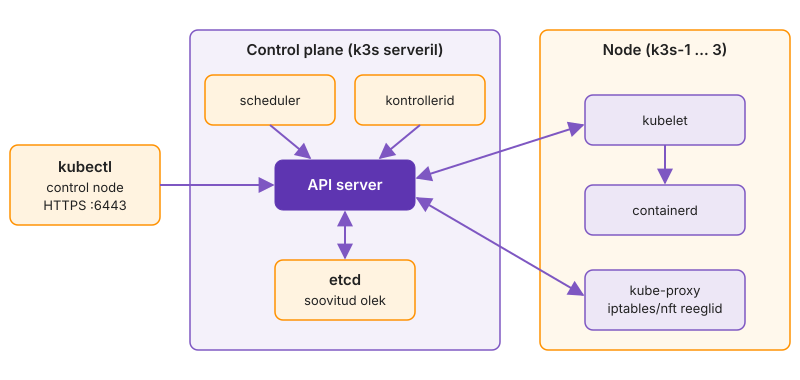
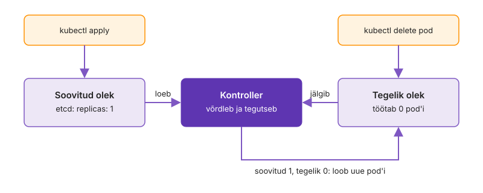
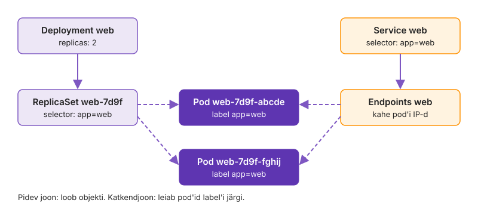
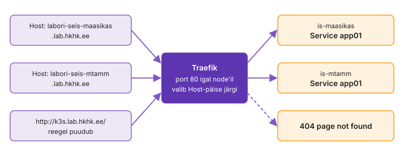

---
tags:
  - Kubernetes
  - k3s
  - Argo CD
  - GitOps
  - Loeng
---

# Loeng: Kubernetes ja GitOps

6\. kohtumisel ehitasid tarneahela, mille lõpus on testitud image registry's. Nüüd viid sama Labori seisu Kubernetese klastrisse. Kubernetes hoiab soovitud olekut pidevalt: kontrollerid võrdlevad kirjeldust tegeliku olekuga ja kõrvaldavad vahe. Sama mõte kandub GitOpsi, kus soovitud olek on kirjas Gitis.

??? abstract "Õpiväljundid"

    Pärast kohtumist oskad:

    - selgitada control loop'i abil, miks Kubernetes taastab kustutatud pod'i ise;
    - nimetada Labori seisu jaoks vajalikud objektid ja selgitada, kuidas need label'ite kaudu seotud on;
    - eristada readiness- ja liveness-probe'i ülesandeid;
    - võrrelda push- ja pull-tüüpi deploy'd ning selgitada Argo CD sync policy't.

??? info "Mida see loeng ei käsitle"

    Requests'ide ja limits'ide valik, katkestuseta uuendus, NetworkPolicy, Helm ja Kustomize, GitOpsi riskid, klastri versiooniuuendus, SRE ja sündmuspõhine automaatika on kursuse IS2 [loengus](https://hkhk-tk.github.io/is2-automatiseerimine/k07/loeng/).

## 1. Soovitud olek ja control loop

Compose'iga töötas Labori seis ühel Docker-hostil. Compose taaskäivitab seiskunud konteineri, aga kui host läheb rikki, ei vii keegi teenuseid teise masinasse. VM-ide maailmas teeb seda VMware HA või Pacemaker terve masina tasemel, Kubernetes teeb seda iga workload'i tasemel. Seda nimetatakse **orkestreerimiseks**: orkestreerija otsustab, kuhu workload läheb, mis järjekorras vanad koopiad asendatakse ja mis rikke korral juhtub.

Kubernetese klastris on mitu node'i ja **control plane**: API server, etcd, scheduler ja kontrollerid. API serverisse salvestatakse kirjeldus, näiteks „app01-st peab töötama kaks koopiat“, ja sobiva node'i valib scheduler.

<figure markdown="span">
  
  <figcaption>Joonis 7.1. Kõik komponendid suhtlevad ainult API serveriga.</figcaption>
</figure>

API server on ainus komponent, mis kirjutab etcd-sse. Teised komponendid ei suhtle omavahel otse, vaid jälgivad API serverit ja kirjutavad sinna oma tulemuse. Deployment'i kontroller loob ReplicaSet'i, ReplicaSet'i kontroller loob pod'id, scheduler kirjutab pod'ile node'i nime ja selle node'i kubelet käivitab konteineri.

Iga [kontroller](https://kubernetes.io/docs/concepts/architecture/controller/) on tsükkel: loe soovitud olekut, kontrolli tegelikku olekut ja tee väike samm, et vahe kaoks. Kontroller ei mäleta, mida ta eelmisel korral tegi, vaid arvutab vahe iga kord uuesti. Kui pod kustub, näeb ReplicaSet'i kontroller „peaks olema 2, on 1“ ja loob uue. Kui node kaob, paigutatakse uus pod teisele node'ile.

<figure markdown="span">
  
  <figcaption>Joonis 7.2. Kontroller võrdleb soovitud ja tegelikku olekut ning kõrvaldab vahe.</figcaption>
</figure>

Ansible'i playbook on samuti deklaratiivne, vahe on ajas. Ansible rakendab soovitud oleku siis, kui playbook'i käivitad, ja käsitsi tehtud muudatus püsib järgmise käivituseni. Kubernetese kontrollerid töötavad pidevalt: käsitsi muudetud pod'i kirjutab kontroller sekunditega üle. Muudatus tuleb teha kirjeldusse.

Compose ja Kubernetes kirjeldavad mõlemad soovitud olekut YAML-is. Erinevad on hostide arv ja see, kes teenuse rikke korral uuesti käivitab.

??? note "Tabel 7.1. Compose ja Kubernetes"

    | | Docker Compose | Kubernetes |
    |---|---|---|
    | Hostid | üks | mitu node'i |
    | Kui host kaob | teenused seisavad, kuni host on tagasi | pod'id luuakse teistele node'idele |
    | Kirjeldus | `compose.yaml` | YAML-manifestid, igas üks või mitu objekti |
    | Sõltuvused | `depends_on` | init-konteiner ja readiness-probe |
    | Väljast ligipääs | hosti port | Service ja Ingress |
    | Kus kasutatakse | arendaja arvuti, üks server | [k3s](https://docs.k3s.io/) väikeses klastris, hallatud klaster pilves (EKS, AKS, GKE), OpenShift |

## 2. Objektid ja label'id

VM-idel oli db01 kindel masin kindla IP-ga. Klastris on pod ajutine: iga uus pod saab uue nime ja uue IP. Kubernetes lahendab selle objektidega, mis on omavahel seotud ainult **label'ite** kaudu:

??? note "Tabel 7.2. Põhiobjektid."

    | Objekt | Mida teeb |
    |---|---|
    | [Deployment](https://kubernetes.io/docs/concepts/workloads/controllers/deployment/) | kirjeldab, mitu koopiat millisest pod'i mallist peab töötama; iga mallimuudatuse jaoks loob uue ReplicaSet'i |
    | ReplicaSet | hoiab koopiate arvu |
    | [Service](https://kubernetes.io/docs/concepts/services-networking/service/) | annab pod'ide hulgale püsiva nime ja IP; liiklus läheb kõigile sobiva label'iga Ready pod'idele |
    | ConfigMap, Secret | seadistus ja saladused |
    | PersistentVolumeClaim | kettaruum, mis jääb alles ka siis, kui pod asendatakse |
    | Namespace | eraldab meeskondade (meie kursusel õppijate) objektid |

Iga objekti välju näed käsuga `kubectl explain`, näiteks `kubectl explain deployment.spec.replicas`.

<figure markdown="span">
  
  <figcaption>Joonis 7.3. Deployment, ReplicaSet, Pod ja Service on seotud ainult label'ite kaudu.</figcaption>
</figure>

Label'i viga ei anna veateadet. Kui Service'i selektoris on `app: web` ja pod'il `app: web01`, luuakse mõlemad objektid edukalt, aga Service on tühi. Secret on ainult base64-kodeeritud ja salvestatakse etcd-s vaikimisi krüpteerimata. Õigus `list secrets` annab kõigi namespace'i Secret'ite väärtused, mitte ainult nimed.

Node'i jagavad paljud pod'id, nii et keegi peab otsustama, kuhu uus pod mahub. [`requests`](https://kubernetes.io/docs/concepts/configuration/manage-resources-containers/) on reserveering: scheduler paneb pod'i ainult node'ile, kuhu requests'ide summa veel mahub. `limits` on lagi, mille jõustab kernel. Koolitaja klastris nõuab sinu namespace'i kvoot, et igal konteineril oleks `requests` kirjas.

```yaml
resources:
  requests:
    cpu: 250m
    memory: 256Mi
  limits:
    memory: 512Mi
```

## 3. Probe'id ja Ingress: kes saab liiklust

Töötav protsess ei tähenda töötavat teenust: Tomcat võib rakendust veel lahti pakkida või lõim on lukus. Seepärast kontrollib kubelet konteinerit kolme eri [probe'iga](https://kubernetes.io/docs/concepts/configuration/liveness-readiness-startup-probes/):

??? note "Tabel 7.3. Kolm probe'i ja nende tagajärg."

    | Probe | Küsimus | Kui ei vasta |
    |---|---|---|
    | startup | kas käivitus on läbi? | teisi probe'e veel ei tehta |
    | readiness | kas pod võtab praegu liiklust? | pod eemaldatakse Service'i lõpp-punktidest |
    | liveness | kas protsess on kinni jäänud? | kubelet taaskäivitab konteineri |

Levinud viga on panna liveness kontrollima andmebaasi. Kui andmebaas läheb hetkeks maha, ebaõnnestub kõigi pod'ide liveness korraga ja kubelet taaskäivitab kõik konteinerid. Iga järgmise ebaõnnestumise järel kasvab ooteaeg (CrashLoopBackOff) kuni viie minutini, nii et pod'id ootavad ka siis, kui andmebaas on juba tagasi. Andmebaasi kättesaadavus kuulub readiness'i alla: pod jääb ellu, aga liiklust ei saa.

Compose'i `depends_on`-i Kubernetesis ei ole. Selle asemel ootab pod sõltuvusi **init-konteineris**: see käivitub enne rakenduse konteinerit ja lõpetab alles siis, kui andmebaas ja järjekord vastavad ([Init Containers](https://kubernetes.io/docs/concepts/workloads/pods/init-containers/)).

Väljast jõuab liiklus klastrisse **Ingress**'i kaudu. Ingress-kontroller (k3s-is Traefik) valib Service'i HTTP `Host`-päise järgi. Tundmatu host saab vastuse 404, rakendus ilma Ready pod'ita 503.

<figure markdown="span">
  
  <figcaption>Joonis 7.4. Ingress-kontroller valib Service'i Host-päise järgi.</figcaption>
</figure>

## 4. GitOps

Kui kaks admini teevad samal ajal `kubectl apply` erinevatest kaustadest, on klastris see, mida viimane saatis. Kui keegi parandab midagi `kubectl edit`-iga, on klastris midagi, mida Gitis pole. Sellist erinevust soovitud ja tegeliku oleku vahel nimetatakse **triiviks** (drift). [GitOps](https://opengitops.dev/) lahendab selle nii: soovitud olek on kirjas Gitis ja klastris töötav agent ([Argo CD](https://argo-cd.readthedocs.io/en/stable/) või Flux) loeb selle ise ja viib klastri sellega kooskõlla. See on sama control loop ühe taseme võrra kõrgemal.

??? note "Tabel 7.4. Push- ja pull-mudel."

    | | Push: CI teeb deploy | Pull: GitOps'i agent |
    |---|---|---|
    | Klastri võti | CI runner'il | klastri sees |
    | Käsitsi muudatus | jääb märkamata | nähtav triivina |
    | Rollback | uus pipeline'i käivitus | `git revert` |
    | Kus on kirjas, mis töötab | pipeline'i logis | Giti ajaloos |

CI ehitab ja testib image'i ning kirjutab Giti uue tag'i, kuid klastrisse tal ligipääsu ei ole. Tag peab olema muutumatu, näiteks commit'i SHA: `:latest` ei muutu Gitis kunagi ja agent ei näe põhjust midagi teha. Argo CD sync policy koosneb kolmest eraldi otsusest:

```yaml
syncPolicy:
  automated:
    prune: true
    selfHeal: true
```

`automated` rakendab iga uue commit'i ise, `prune` kustutab objektid, mis Gitist kadusid, ja `selfHeal` kõrvaldab triivi. Ilma `selfHeal`'ita näitab Argo triivi ja ootab inimese otsust. `prune` koos vale kaustaga kustutab kõik, mida uues kaustas pole.

Argo CD näitab kahte olekut. **Sync status** ütleb, kas klaster vastab Gitile, **health status**, kas rakendus töötab. Olematu image'i tag annab oleku Synced ja Degraded: Argo tegi oma töö, viga on Gitis. `kubectl rollout undo` siin ei aita, sest agent taastab Gitis kirjeldatud oleku. Rollback tehakse `git revert`-iga, nii et igal klastri muudatusel on commit, autor ja põhjus.

Praktikumis annad Labori seisu Argo CD-le, muudad soovitud olekut Gitis ja vaatad, kuidas Argo käsitsi tehtud muudatuse tagasi pöörab.

??? info "Loe juurde"

    [Orkestreerimine ja automatiseerimine](../teemad/orkestreerimine.md) · [Kubernetese klastrihaldus](../teemad/kubernetes-klastrihaldus.md)

??? abstract "Kokkuvõte"

    - **Soovitud olek:** muuda kirjeldust, mitte töötavat pod'i. Kontroller kirjutab käsitsi muudatuse üle.
    - **Label'id:** vale selektor annab vaikselt tühja Service'i. Requests määrab, kuhu pod paigutatakse.
    - **Probe'id:** andmebaasi kontroll kuulub readiness'i, mitte liveness'i alla.
    - **GitOps:** rollback tehakse `git revert`-iga. Synced tähendab ainult, et klaster vastab Gitile, mitte et rakendus töötab.

## Kontrolli ennast

??? question "Tootmises parandati viga käsuga `kubectl edit deploy/app` ja kõik töötas. Tund hiljem oli viga tagasi. Mis võis juhtuda?"
    Soovitud olekut hoiab keegi teine: GitOps agent `selfHeal`-iga, järgmine pipeline'i deploy või Helmi upgrade. Kõik kirjutavad käsitsi muudatuse üle. Parandus tuleb teha sinna, kus soovitud olek on kirjas, tavaliselt Giti.

??? question "Rakenduse liveness-probe kontrollib `/health`, mis teeb päringu andmebaasi. Andmebaasi hoolduse ajal (2 minutit) taaskäivitati kõik rakenduse pod'id mitu korda. Mida muudad?"
    Liveness kontrollib ainult protsessi ennast. Andmebaasi kontroll läheb readiness'i alla: pod läheb liiklusest välja, aga jääb ellu ja naaseb kohe, kui andmebaas on tagasi.

??? question "Argo CD näitab rakendust olekus Synced ja Degraded. Kas Argo tegi vea?"
    Ei. Klaster vastab Gitile, aga rakendus ei tööta, näiteks Gitis on olematu image'i tag. Parandus on `git revert` või uus commit.
