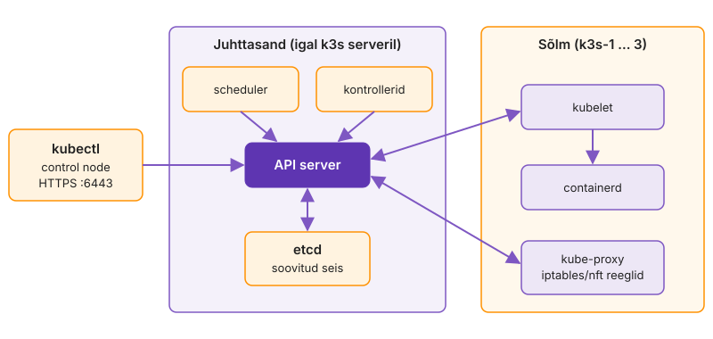
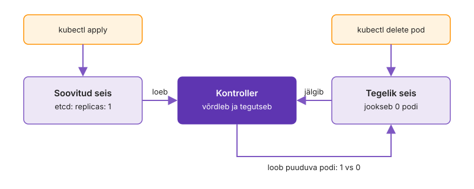
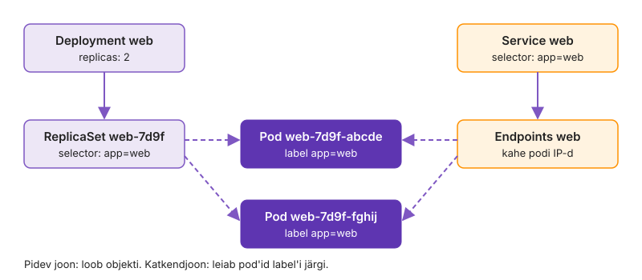
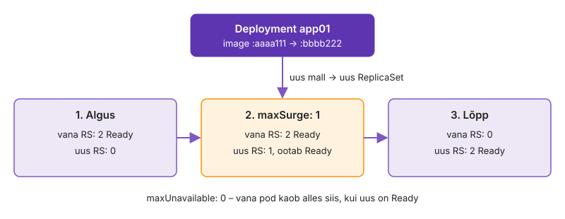
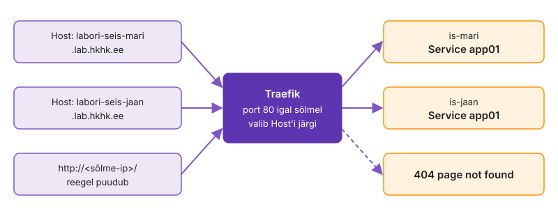

---
tags:
  - Kubernetes
  - k3s
  - Helm
  - Argo CD
  - GitOps
  - SRE
---

# 7. kohtumine · Orkestreerimine, GitOps ja töökindlus: loeng

**Eeldus:** 6. kohtumisel ehitasid Jenkinsi, SonarQube'i ja Nexusega tarneahela, mille lõpus on testitud image registry's.

Kubernetes hoiab soovitud seisu: kontrollerid võrdlevad kirjeldust pidevalt tegelikkusega. Sama mudel kandub klastri haldusse, GitOps'i ja töökindlusse: SLO ütleb, milline on soovitud seis kasutaja vaates, ja automaatika tohib vahet kõrvaldada ainult kokkulepitud piirides.

## 🎯 Õpiväljundid

- Selgitad control loop'i abil, miks Kubernetes taastab kustutatud pod'i ilma eraldi self-healing funktsioonita.
- Eristad requests'e ja limits'e ning startup-, readiness- ja liveness-probe'i ülesandeid ja tood näite, kuidas vale liveness tekitab katkestuse.
- Võrdled push- ja pull-tüüpi deploy'd ning valid GitOps'i sync policy olukorra järgi.
- Kavandad klastri versiooniuuenduse node'i kaupa ja põhjendad, mida hallatud klaster sinu eest teeb ja mida mitte.
- Sõnastad teenusele SLI ja SLO, arvutad error budget'i ja otsustad selle järgi, kas deploy'd jätkata.
- Kirjeldad, kuidas alert muutub automaatseks tegevuseks, ja hindad selle riske.
- Põhjendad, millised õigused, piirid ja audit peavad olema AI-agendil, enne kui ta tohib klastris midagi muuta.


[Orkestreerimine ja automatiseerimine](../teemad/orkestreerimine.md) · [Kubernetese klastrihaldus](../teemad/kubernetes-klastrihaldus.md) · [Site Reliability Engineering](../teemad/sre.md) · [Sündmuspõhine automaatika](../teemad/sundmuspohine-automaatika.md) · [Jälgitavusest AIOps'ini](../teemad/jalgitavus-ja-aiops.md) · [RBAC ja ligipääsu kontroll](../teemad/rbac.md) · [AI ja automatiseerimine: juhtimine enne](../teemad/ai-ja-automatiseerimine.md)

## 1. Soovitud seis ja control loop

Compose'iga töötas Labori seis ühel Docker-hostil. Compose taaskäivitab seiskunud konteineri, aga kui host läheb rikki, ei tõsta keegi teenuseid teise masinasse. VM-ide maailmas teeb seda VMware HA või Pacemaker terve masina tasemel, Kubernetes teeb seda üksiku workload'i tasemel. Seda nimetatakse orkestreerimiseks: paljude masinate ja workload'ide koordineerimine. Orkestreerija otsustab, kuhu workload läheb, mis järjekorras vanad koopiad asendatakse ja mis rikke korral juhtub.

Kubernetese klastris on mitu node'i ja control plane: API server, etcd, scheduler ja kontrollerid. Sa salvestad API serverisse kirjelduse, näiteks "app01-st peab töötama kaks koopiat", ja masina valib scheduler.

<figure markdown="span">
  
  <figcaption>Joonis 7.1. Kõik osapooled räägivad ainult API serveriga.</figcaption>
</figure>

API server on ainus komponent, kes kirjutab etcd-sse. Teised ei räägi omavahel, vaid jälgivad API serverit ja kirjutavad sinna oma tulemuse. Deployment'i kontroller loob ReplicaSet'i, ReplicaSet'i kontroller loob Pod-objektid, scheduler kirjutab pod'ile node'i nime ja selle node'i kubelet käsib containerd'l konteineri käivitada. Ükski samm ei tea järgmisest. Muutused jõuavad komponentideni watch-päringutega `resourceVersion`'i järjekorras.

Iga [kontroller](https://kubernetes.io/docs/concepts/architecture/controller/) on tsükkel, mis loeb soovitud seisu, vaatab tegelikku ja teeb väikese sammu, et vahe kaoks. Kontroller ei mäleta, mida ta eelmisel korral tegi, vaid arvutab vahe iga kord uuesti (level-triggered, mitte edge-triggered). Kui pod kustub, näeb ReplicaSet'i kontroller "peaks olema 2, on 1" ja loob uue. Kui node kaob, pannakse uus pod teisele node'ile.

<figure markdown="span">
  
  <figcaption>Joonis 7.2. Kontroller võrdleb soovitud ja tegelikku seisu ning kõrvaldab vahe.</figcaption>
</figure>

Ansible'i playbook on samuti deklaratiivne, vahe on ajas. Ansible viib hosti soovitud seisu siis, kui playbook'i käivitad, ja käsitsi muudatus elab järgmise käivituseni. Kubernetese kontrollerid töötavad pidevalt: käsitsi muudetud pod'i kirjutab kontroller sekunditega üle, muudatus tuleb teha kirjeldusse.

### Kui control plane ise on kitsaskoht

Kontrollerid ei küsi API serverilt iga kord kõike uuesti. Nad hoiavad mälus objektide koopiat (informer'i cache), mida watch-päring jooksvalt uuendab, ja panevad muutunud objektide võtmed tööjärjekorda. Kui watch katkeb, teeb kontroller uue `list`-päringu ja jätkab. Kaks kirjutajat ei saa teineteise muudatust märkamatult üle kirjutada: iga uuendus kannab `resourceVersion`'it ja kui objekt on vahepeal muutunud, vastab API server 409 Conflict ning kontroller loeb objekti uuesti. See on optimistlik lukustus, sama mõte nagu Giti push'i tagasilükkamine, kui keegi jõudis ette.

Selle mudeli hind tuleb välja suures klastris. Iga node'i kubelet, iga DaemonSet'i agent ja iga kontroller hoiab API serveriga avatud watch'e ning restart tähendab uut `list`-päringut kõigile korraga. etcd hoiab kogu klastri seisu ühes andmebaasis, mille vaikimisi kvoot on 2 GB ([etcd limits](https://etcd.io/docs/v3.5/dev-guide/limit/)), ja üks objekt ei tohi olla suurem kui umbes 1,5 MiB. OpenAI katkestus 2024. aasta detsembris algas just siit: uus telemeetriateenus käivitus kõigil node'idel ja tegi API serverile kulukaid päringuid, mis koormasid control plane'i üle tuhandetes node'ides. Workload'id ise töötasid edasi, aga DNS-põhine teenuste leidmine sõltus control plane'ist ja lagunes, kui DNS-i cache aegus ([OpenAI incident report](https://status.openai.com/incidents/ctrsv3lwd797)). Adminile tähendab see, et control plane on samasugune jagatud ressurss nagu andmebaasiserver: igal agendil, mis API-t jälgib, on hind, ja uus DaemonSet tuleb tuua lainetena, mitte kõigile node'idele korraga.

Iseseisvaks lugemiseks: [Orkestreerimine ja automatiseerimine](../teemad/orkestreerimine.md).

## 2. Objektid, label'id ja ressursid

VM-idel oli db01 kindel masin kindla IP-ga. Klastris on pod surelik: iga uus pod saab uue nime ja uue IP.

Kubernetes lahendab selle objektidega, mis on seotud ainult label'ite kaudu. **Deployment** kirjeldab, mitu koopiat millisest pod'i template'ist peab töötama, ja loob iga template'i muudatuse jaoks uue ReplicaSet'i. **ReplicaSet** hoiab koopiate arvu. **Service** annab pod'ide hulgale püsiva nime ja IP ning selektor korjab kõik sobiva label'iga Ready pod'id lõpp-punktide nimekirja. Kui selektoris on `app: web` ja pod'il `app: web01`, ei anna kumbki objekt viga, Service on lihtsalt tühi.

<figure markdown="span">
  
  <figcaption>Joonis 7.3. Deployment, ReplicaSet, Pod ja Service on seotud ainult label'ite kaudu.</figcaption>
</figure>

Seadistus tuleb ConfigMap'ist, saladused Secret'ist ja andmed PersistentVolumeClaim'iga küsitud kettalt. Secret on base64-kodeeritud ja etcd-s vaikimisi lihttekstina. RBAC-is annab juba `list secrets` kõigi namespace'i Secret'ite väärtused, mitte ainult nimed.

Node'i jagavad kümned pod'id eri meeskondadelt, nii et keegi peab otsustama, kuhu uus pod mahub. [`requests`](https://kubernetes.io/docs/concepts/configuration/manage-resources-containers/) on reserveering: scheduler paneb pod'i ainult node'ile, kuhu requests'ide summa veel mahub, tegelik kasutus ei loe. `limits` on lagi, mille jõustab kernel cgroup'i kaudu.

```yaml
resources:
  requests:
    cpu: 250m
    memory: 256Mi
  limits:
    memory: 512Mi
```

Lae juures käituvad mälu ja CPU erinevalt. Mälulimiidi ületanud protsessi tapab OOM killer ja konteiner lõpeb koodiga 137 (`OOMKilled`). CPU limiit on CFS-i kvoot 100 ms perioodi kohta: `cpu: 500m` lubab 50 ms protsessoriaega iga 100 ms jooksul. Mitme lõimega JVM kulutab selle perioodi alguses ära ja ootab, mis paistab p99 latentsusena, mitte veana. Seepärast jätavad paljud meeskonnad CPU-le ainult requests'i. Probleemi teravdas veel kerneli CFS-i viga, mille tõttu said pod'id throttling'ut ka siis, kui kasutus jäi limiidist allapoole. See parandati Linux 5.4-s ja tagasiporditi stabiilsetesse tuumadesse ([kubernetes#67577](https://github.com/kubernetes/kubernetes/issues/67577)). Vanemate node'i image'ite puhul tasub kerneli versioon üle vaadata, enne kui hakkad latentsust rakendusest otsima. Throttling'u hulka näitab konteineri cgroup'i `cpu.stat` väli `nr_throttled`, mida cAdvisor ekspordib meetrikana `container_cpu_cfs_throttled_periods_total`.

Requests'ide valik on sama kompromiss, mida VMware'i administraator teeb ülebroneerimisega. Liiga väikesed requests'id pakivad node'id täis ja mälupuuduse korral tõstab kubelet pod'e välja. Liiga suured requests'id jätavad node'id pooltühjaks, kuigi scheduler peab neid täis olevaks. Mõistlik algus on mõõdetud p95 kasutus väikese varuga ja hiljem korrigeerimine meetrika järgi, sest käsitsi hinnatud väärtus jääb sageli tegelikust kasutusest mitu korda suuremaks.

Meeskonna tasandil paneb [ResourceQuota](https://kubernetes.io/docs/concepts/policy/resource-quotas/) namespace'i requests'idele ülempiiri juba pod'i loomisel ja LimitRange annab vaikeväärtused. Requests ja limits määravad ka [QoS klassi](https://kubernetes.io/docs/concepts/workloads/pods/pod-qos/): mälupuuduse korral tõstetakse esimesena välja BestEffort pod'id, viimasena Guaranteed (requests võrdub limits'iga). Andmebaasile tasub anda võrdsed väärtused.

Iseseisvaks lugemiseks: [RBAC ja ligipääsu kontroll](../teemad/rbac.md).

## 3. Probe'id ja võrk: kes saab liiklust

Töötav protsess ei tähenda töötavat teenust: Tomcat pakib rakendust veel lahti või lõim on lukus. Seepärast küsib kubelet [probe'idega](https://kubernetes.io/docs/concepts/configuration/liveness-readiness-startup-probes/) kolme eri küsimust.

| Probe | Küsimus | Kui ei vasta |
|---|---|---|
| startup | kas käivitus on läbi? | teisi probe'e veel ei tehta |
| readiness | kas pod võtab praegu liiklust? | pod eemaldatakse Endpoints'ist |
| liveness | kas protsess on kinni jäänud? | kubelet taaskäivitab konteineri |

*Tabel 7.1. Kolm probe'i ja nende tagajärg.*

Levinud viga on panna liveness kontrollima andmebaasi. Kui andmebaas läheb hetkeks maha, ebaõnnestub kõigi pod'ide liveness korraga. Vaikeväärtustega (`periodSeconds: 10`, `failureThreshold: 3`) taaskäivitab kubelet konteineri umbes 30 sekundiga ja CrashLoopBackOff'i ooteaeg kasvab 10 sekundist 5 minutini. Kui andmebaas tuleb tagasi, ootavad pod'id veel backoff'i lõppu. Andmebaasi kättesaadavus kuulub readiness'i alla: pod jääb ellu, aga liiklust ei saa.

Readiness'ile toetub rolling update. Uus ReplicaSet kasvab ühe pod'i kaupa ja vana kahaneb alles siis, kui uus pod on Ready (`maxSurge` ja `maxUnavailable` vaikimisi 25%). Kui uus versioon Ready'ks ei saa, jääb rollout pooleli ja vana teenindab edasi. `progressDeadlineSeconds` (vaikimisi 600) järel märgib kontroller rollout'i `ProgressDeadlineExceeded`, aga midagi tagasi ei keera: automaatse rollback'i peab tegema pipeline või GitOps'i tööriist.

### Pod'i lõpetamine ja kaotatud päringud

Rolling update võib anda 502 vastuseid ka siis, kui kõik probe'id on õiged. Põhjus on pod'i lõpetamise järjekorras ([Pod termination](https://kubernetes.io/docs/concepts/workloads/pods/pod-lifecycle/#pod-termination)). Kui pod märgitakse kustutamiseks, toimub kaks asja paralleelselt: kubelet saadab konteinerile SIGTERM'i ja EndpointSlice'i kontroller eemaldab pod'i lõpp-punktidest. Eemaldus peab jõudma kube-proxy ja Ingress-kontrollerini igal node'il, mis võtab aega. Kui rakendus sulgub SIGTERM'i peale kohe, saavad need päringud, mis selle aja jooksul veel vanale aadressile suunatakse, ühenduse vea. Levinud lahendus on `preStop` hook, mis ootab mõned sekundid enne, kui rakendus SIGTERM'i saab, ja rakendus, mis lõpetab pooleliolevad päringud ära. Kogu lõpetamise aeg mahub `terminationGracePeriodSeconds`'i sisse (vaikimisi 30 sekundit), pärast mida kubelet saadab SIGKILL'i.

Load balancer'i taga töötanud admin tunneb seda mustrit: enne hoolduskatkestust võetakse server HAProxy's või F5-s `drain`-olekusse ja oodatakse, kuni ühendused lõpevad. Kubernetes teeb sama automaatselt, aga ainult siis, kui rakendus ja `preStop` annavad selleks aega.

<figure markdown="span">
  
  <figcaption>Joonis 7.4. Rolling update kahe ReplicaSet'i vahel. Vana pod läheb ära alles pärast seda, kui uus on Ready.</figcaption>
</figure>

Väljast jõuab liiklus klastrisse Ingress'i kaudu. Ingress-kontroller ([k3s](https://docs.k3s.io/)-is Traefik) valib Service'i HTTP `Host`-päise järgi. Tundmatu host saab 404, rakendus ilma Ready pod'ita 503.

<figure markdown="span">
  
  <figcaption>Joonis 7.5. Ingress-kontroller valib Service'i Host-päise järgi.</figcaption>
</figure>

Klastri sisevõrk on vaikimisi lame: iga pod jõuab iga pod'ini. [NetworkPolicy](https://kubernetes.io/docs/concepts/services-networking/network-policies/) lubab ainult nimetatud ühendused, aga jõustab selle CNI (Calico, Cilium, k3s-i sisseehitatud kontroller). Kui CNI seda ei toeta, objekt luuakse ja midagi ei blokeerita. Poliitika usaldab label'eid, seega on ta tugev ainult koos RBAC-iga, mis keelab võõral suvaliste label'itega pod'e luua.

## 4. Helm, Kustomize ja GitOps

Valmis tarkvara, näiteks monitooring või andmebaasi operaator, tähendab kümneid manifeste, CRD-sid ja RBAC-objekte ning iga keskkond vajab veidi erinevaid väärtusi. [Helm](https://helm.sh/docs/) teeb chart'i template'idest sinu values-faili järgi manifestid. Iga paigaldus on release, mille ajalugu hoitakse samas namespace'is Secret'ites `sh.helm.release.v1.<nimi>.v<N>`, ja rollback teeb vanast revisjonist uue. `helm upgrade` ilma `-f`-i ja `--reuse-values`'ita paneb väärtused tagasi chart'i vaikeväärtustele, nii et eelmise paigalduse `--set` kaob vaikselt. Seepärast on väärtused failis ja Gitis ning chart'i versioon lukustatud nagu image'i tag. Oma rakenduse manifestid hoiavad paljud meeskonnad seetõttu [Kustomize](https://kubernetes.io/docs/tasks/manage-kubernetes-objects/kustomization/)'iga, mis lisab tavalistele manifestidele keskkonna paiga ilma template'iteta.

Kui kaks admini teevad samal ajal `kubectl apply` erinevatest kaustadest, on klastris see, mida viimane saatis. Kui keegi parandab `kubectl edit`-iga, on klastris midagi, mida Gitis pole. [GitOps](https://opengitops.dev/) vastab sellele nii: soovitud seis on Gitis ja klastris töötav agent ([Argo CD](https://argo-cd.readthedocs.io/en/stable/) või Flux) tõmbab selle ise ja viib klastri sellega kooskõlla. See on sama control loop ühe taseme võrra kõrgemal.

| | Push: CI deploy'b | Pull: GitOps agent |
|---|---|---|
| Klastri võti | CI runner'il | klastri sees |
| Käsitsi muudatus | jääb märkamata | nähtav drift'ina |
| Rollback | uus pipeline'i käivitus | `git revert` |
| Kes teab, mis töötab | pipeline'i logi | Giti ajalugu |

*Tabel 7.2. Push- ja pull-mudel.*

CI ehitab ja testib image'i ning kirjutab Giti uue tag'i, klastrisse ta ei pääse. Tag peab olema muutumatu, näiteks commit'i SHA: `:latest` ei muutu Gitis kunagi ja agent ei näe põhjust midagi teha. Argo CD sync policy on kolm eraldi otsust:

```yaml
syncPolicy:
  automated:
    prune: true
    selfHeal: true
```

`automated` sync'ib iga uue commit'i ise, `prune` kustutab objektid, mis Gitist kadusid, `selfHeal` keerab drift'i tagasi. Giti loeb Argo vaikimisi umbes iga kolme minuti järel või webhook'i peale, klastrit jälgib watch'iga, seepärast kaob drift sekunditega. Ilma `selfHeal`'ita näeb Argo drift'i ja ootab otsust, mis sobib, kui inimene peab muudatuse üle vaatama. `prune` koos vale `path`'iga kustutab kõik, mida uues kaustas pole.

Sync status ütleb, kas klaster vastab Gitile, health status, kas rakendus töötab. Olematu image'i tag annab oleku Synced ja Degraded: Argo tegi oma töö, viga on Gitis. `kubectl rollout undo` ei aita, sest agent taastab Giti seisu. Rollback käib `git revert`-iga ja igal klastri muudatusel on commit, autor ja põhjus. Saladused jõuavad Giti kas krüpteeritult (Sealed Secrets, SOPS) või viitena, mille väärtuse toob External Secrets Operator näiteks Vaultist.

Eesti asutajatega Wise kirjutas 2025. aastal, et tal on üle 1000 teenuse ja üle 20 Kubernetese klastri. Klastrite seadistust hoiab Argo CD Helmi chart'idega, rakenduste deploy'd käivad Spinnakeri kaudu ([Wise Tech Stack, 2025](https://medium.com/wise-engineering/wise-tech-stack-2025-update-d0e63fe718c7)). Küsimus on, millise taseme soovitud seis Gitis elab ja kes selle klastrisse viib.

### GitOps'i hind

Pull-mudel viib klastri võtme CI-st välja, aga koondab õigused GitOps'i agenti. Argo CD-l on tavaliselt cluster-admin'i tasemel õigused kõigis klastrites, mida ta haldab, ja ligipääs kõigile repodele. Seega on ta ründaja jaoks sama väärtuslik sihtmärk nagu 6. kohtumise Jenkins. 2022. aasta haavatavus [CVE-2022-24348](https://nvd.nist.gov/vuln/detail/CVE-2022-24348) lubas pahatahtliku Helmi chart'iga lugeda teiste rakenduste faile repo-serverist, sh saladusi. Argo CD versioon ja ligipääsud vajavad seega sama patch'imise ja RBAC-i distsipliini nagu iga teine haldustööriist: AppProject piirab, millistest repodest millistesse namespace'idesse tohib deploy'da.

Teine hind on Giti struktuur. Kümne meeskonna ja kolme keskkonnaga tekib küsimus, kas keskkonnad on harud või kaustad. Harupõhine mudel (`dev`, `prod`) tundub tuttav, aga merge'id keskkondade vahel lähevad aja jooksul lahku ja keegi ei tea, mis on prod'is erinevat. Enamik meeskondi kasutab ühte haru ja keskkonnakaustu Kustomize'i overlay'dega, kus vahe on nähtav ühe `diff`-iga. Ansible'i inventory `group_vars` kaustadega järgis sama mõtet: üks kood, keskkonna erinevus eraldi failis.

## 5. Klastri elutsükkel ja CloudOps

Kubernetes annab välja umbes kolm minor-versiooni aastas ja iga versioon saab parandusi umbes 14 kuud ([Releases](https://kubernetes.io/releases/)). Klaster, mida ei uuendata, on aasta pärast ilma turvaparandusteta. Klastri uuendus on seetõttu sama korrapärane töö nagu OS-i patch'imine.

Järjekorra määrab [version skew policy](https://kubernetes.io/releases/version-skew-policy/). Kõigepealt uuendatakse control plane, ühe minor-versiooni kaupa, sest API server ei tohi versioone vahele jätta. Kubelet ei tohi olla API serverist uuem, aga võib olla kuni kolm minor-versiooni vanem, nii et node'id jõuavad järele hiljem. Node'i uuendus käib lainetena nagu patch'imine: `kubectl cordon` keelab uued pod'id, `kubectl drain` tõstab olemasolevad välja. Drain kasutab Eviction API-t, mis austab [PodDisruptionBudget'it](https://kubernetes.io/docs/tasks/run-application/configure-pdb/): kui `minAvailable: 2` ja Ready on kaks koopiat, saab drain vastuse 429 ja ootab. k3s-is teeb sama automaatselt system-upgrade-controller, mis loeb `Plan` objektist sihtversiooni ja uuendab node'id ükshaaval. Enne uuendust kontrolli, kas mõni manifest kasutab eemaldatud API-versioone (API serveri meetrika `apiserver_requested_deprecated_apis`), ja tee etcd snapshot. k3s-i embedded etcd teeb seda vaikimisi iga 12 tunni järel ja hoiab viit viimast.

Reddit uuendas 2023. aasta märtsis klastri 1.23 pealt 1.24 peale ja oli 314 minutit maas ([You Broke Reddit](https://www.reddit.com/r/RedditEng/comments/11xx5o0/you_broke_reddit_the_piday_outage/)). 1.24 eemaldas node'idelt label'i `node-role.kubernetes.io/master`, millele toetus aastaid tagasi käsitsi tehtud Calico route reflector'ite seadistus. Seda polnud koodis ja selle autoreid polnud enam majas. Uuendus ise oli korrektne, aga koodist mööda tehtud seadistus muutis selle riskantseks. Taastamine võttis kaua: meeskond taastas control plane'i varukoopiast, aga pod'ide võrk jäi katki, sest põhjus ei olnud klastri seisus, vaid label'is, millele käsitsi tehtud seadistus toetus.

Uuendamata klastris aeguvad ka sertifikaadid. kubeadm'i loodud klientide ja komponentide sertifikaadid kehtivad aasta ning kubeadm uuendab need control plane'i uuenduse käigus ([Certificate Management with kubeadm](https://kubernetes.io/docs/tasks/administer-cluster/kubeadm/kubeadm-certs/)). k3s uuendab aeguvad sertifikaadid käivitusel. Klaster, mis töötab aasta ilma uuenduse ja restardita, lakkab ühel päeval vastamast kubectl'ile ja kubelet'ide ühendused API serveriga katkevad. Adminile on see tuttav TLS-sertifikaatide aegumise intsident, ainult et sertifikaate on kümneid ja need on peidus `/etc/kubernetes/pki` või `/var/lib/rancher/k3s/server/tls` kaustas. Monitooringus tasub aegumist jälgida samamoodi nagu veebiserveri sertifikaati.

Hallatud klaster (EKS, AKS, GKE) võtab sinult control plane'i, etcd ja nende varunduse. Node'ide uuendus, lisad (CNI, Ingress, CSI), RBAC ja kulu jäävad sinule ning uuenduste tempo määrab pakkuja: vana versioon läheb laiendatud toele, mille eest küsitakse lisatasu, ja hiljem uuendatakse sundkorras. Seda püsivat pilveressursside käitamist nimetatakse CloudOps'iks: mahtu lisab [Cluster Autoscaler](https://github.com/kubernetes/autoscaler/tree/master/cluster-autoscaler) või Karpenter siis, kui pod jääb requests'ide tõttu `Pending`-uks, ja kulu arvutub requests'ide järgi, mitte kasutuse järgi. Paisutatud requests on pilves otsene arve.

Iseseisvaks lugemiseks: [Kubernetese klastrihaldus](../teemad/kubernetes-klastrihaldus.md).

## 6. SRE: mõõdetud töökindlus

Öine alert ütleb, et node'i CPU on 90%. Valvaja ei tea, kas kasutaja kannatab, ja hommikul selgub, et ei kannatanud. Teisel ööl on kõik rohelisel ja klient helistab, sest pool päringutest annab 502.

[SRE](https://sre.google/sre-book/service-level-objectives/) mõõdab töökindlust kasutaja vaatest. **SLI** on suhe: edukate sündmuste arv kõigi sündmuste arvust, näiteks HTTP vastused alla 500 ja kiiremad kui 300 ms kõigist päringutest. Mõõta tuleb sealt, kust teenust kasutatakse, näiteks Ingress-kontrolleri meetrikast või välisest probe'ist, mitte pod'i seest. **SLO** on sihtväärtus aknas: 99,9% 30 päeva jooksul. **Error budget** on lubatud viga, 1 − SLO. 99,9% puhul on see 0,1% päringutest ehk ühtlase liikluse korral umbes 43 minutit kuus. Eelarve muudab vaidluse "kas deploy'me reedel" arvuks: kui eelarvet on alles, võib riskida, kui see on otsas, külmutatakse muudatused ja tööaeg läheb töökindlusse. Selle otsuse peab juhtkond enne kokku leppima, muidu jääb eelarve graafikuks.

SLO valik on kompromiss. Iga lisa üheksa maksab mitu korda rohkem: 99,99% jätab kuus umbes 4 minutit, mis on vähem kui ühe käsitsi rollback'i aeg, nii et see eeldab automaatset rollback'i ja mitut tsooni. Sõltuvused korrutuvad: kui teenus vajab sünkroonselt kolme teist teenust, millest igaühe SLO on 99,9%, ei saa tema enda kättesaadavus olla parem kui umbes 99,7%. SLO ei pea olema kõrgem, kui kasutaja vajab. Sisemine aruandlusteenus, mida kasutatakse tööajal, ei vaja sama sihti nagu makseliides. ITIL-i maailmast tulnud admin võib error budget'it vaadata kui muudatuste nõukogu (CAB) automatiseeritud kriteeriumi: eelarve asendab arvamuse, kas muudatus on piisavalt ohutu, mõõdetud tulemusega.

Alert ei käi lävendi, vaid burn rate'i peale. Burn rate 1 kulutab eelarve täpselt akna lõpuks, 14,4 kulutab tunniga 2% kuu eelarvest. SRE workbook soovitab kutsuda valvaja siis, kui seda näitavad nii pikk kui ka lühike aken ([Alerting on SLOs](https://sre.google/workbook/alerting-on-slos/)): 1 tund ja 5 minutit kiirusel 14,4 ning 6 tundi ja 30 minutit kiirusel 6.

```promql
# 99,9% SLO, kiirus 14,4: nii pikk kui ka lühike aken üle piiri
(sum(rate(traefik_service_requests_total{code=~"5.."}[1h]))
  / sum(rate(traefik_service_requests_total[1h])) > 14.4 * 0.001)
and
(sum(rate(traefik_service_requests_total{code=~"5.."}[5m]))
  / sum(rate(traefik_service_requests_total[5m])) > 14.4 * 0.001)
```

**Toil** on SRE mõistes käsitsi tehtav, korduv ja automatiseeritav töö, mis ei jäta püsivat väärtust ja kasvab koos teenusega: sertifikaadi käsitsi uuendamine, öine pod'i restart, kettaruumi koristamine. Google seab SRE-meeskonnale piiri, et toil ei võtaks üle poole tööajast ([Eliminating Toil](https://sre.google/sre-book/eliminating-toil/)). Kui toil'i mõõdad, tead, mida automatiseerida esimesena: sagedus, risk ja kulunud aeg tulevad otse valvelogist.

Kui eelarve sai rikke tõttu kulutatud, järgneb postmortem: ajajoon, mõju SLO-le, soodustanud tegurid ja tegevused koos omanikuga. Postmortem on süüdistusteta (blameless), sest küsimus on, miks süsteem lubas vea teha, mitte kes vajutas. Kubernetes teeb tõendite kogumise raskeks: API server hoiab Events'e vaikimisi tund aega (`--event-ttl`), nii et öise rikke kohta on hommikul alles ainult konteineri `Last State`. Events tuleb jooksvalt logisüsteemi saata, muidu pole postmortem'i ajajoont.

Iseseisvaks lugemiseks: [Site Reliability Engineering](../teemad/sre.md).

## 7. Signaalist tegevuseni: sündmuspõhine automaatika ja AI

Kell 3 öösel täitub node'i ketas image'itest. Runbook ütleb: koristada kasutamata image'id, kui ruumi ei vabane, panna node cordon'i ja kutsuda valvaja. Iga samm on teada.

Kubernetes parandab ise kõike, mis on tema mudelis: taaskäivitab konteineri, asendab pod'i, tõstab pod'id kadunud node'ilt mujale. Ketas, sertifikaat või väline teenus jäävad sellest välja. Seal töötab sündmuspõhine automaatika, mida tutvustati 1. kohtumisel kolme režiimi juures. Signaalid (meetrikad, logid, trace'id, Events) jõuavad Prometheuse ja Alertmanager'ini, mis rühmitab ja dedublikeerib alerdid ning saadab need webhook'iga edasi. Reeglimootor valib tingimuse järgi heakskiidetud tegevuse: [ansible-rulebook](https://ansible.readthedocs.io/projects/rulebook/en/latest/) `ansible.eda.alertmanager` allikaga käivitab playbook'i või AWX-i job template'i, Kubernetese-sisene variant on Argo Events koos Argo Workflows'iga. Otsuse tegi reegli autor ette ja eskalatsioon inimesele on reeglis kirjas.

Riskid on tootmises tuttavad. Automaatne restart võib peita põhjust, kuni see kasvab suuremaks. Kahe reegli vastandlikud tegevused tekitavad tsükli. Hilinenud alert käivitab tegevuse olukorras, mis on juba muutunud. Seepärast on tegevus idempotentne, kontrollib enne seisu uuesti, sel on rate limit (näiteks kaks korda tunnis node'i kohta) ja iga käivitus läheb ticket'isse.

Piirid peavad olema tööriistas, mitte ainult runbook'is. AWS-i S3 katkestus 2017. aasta veebruaris algas sellest, et insener käivitas heakskiidetud playbook'i järgi käsu, mis pidi eemaldama väikese arvu servereid, aga vale sisendi tõttu eemaldas neid palju rohkem. S3 index- ja placement-alamsüsteemid tuli täielikult taaskäivitada ja us-east-1 S3 oli tunde häiritud. Pärast intsidenti muutis AWS tööriista nii, et see eemaldab mahtu aeglaselt ega luba minna alla alamsüsteemi miinimummahu ([Summary of the Amazon S3 Service Disruption](https://aws.amazon.com/message/41926/)). Sama kehtib alerti peale käivituvale playbook'ile: kui see tohib drain'ida node'e, peab tööriist ise keelduma, kui samal ajal on juba üks node drain'is või kui klastris jääks alla miinimummahu.

**AIOps** on järgmine tase: tööriist korreleerib signaale, nii et 200 alerti muutuvad üheks intsidendiks, ja leiab anomaaliad, millele keegi lävendit ei pannud. Uuemad AI-agendid lähevad edasi: loevad logisid, pakuvad juurpõhjust ja tahavad parandust ka teha. 1. kohtumisel nimetatud AI-toega režiim on mõeldud tundmatute probleemide jaoks. Teada probleemi lahendab odavamalt ja ennustatavamalt tavaline playbook ning AI tokenite kulutamine sellele on raiskamine.

Põhimõte on: AI soovitab, inimene otsustab, automaatika täidab. Enne kui agent tohib klastris midagi muuta, peab paigas olema kolm asja. Esiteks tegevuste raamatukogu: agent ei koosta käske ise, vaid valib testitud ja heakskiidetud playbook'ide või job template'ite seast. Teiseks piirid, mis on seatud enne tegevust: agendil on oma identiteet (ServiceAccount, mitte kellegi kubeconfig), Role ainult vajalike verb'idega ühes namespace'is ja ohtlik tegevus ootab inimese kinnitust, näiteks AWX-i workflow approval. Mida agent tohib, näitab `kubectl auth can-i --list --as=system:serviceaccount:ops:agent`. Kolmandaks audit: API serveri [audit log](https://kubernetes.io/docs/tasks/debug/debug-cluster/audit/) (`--audit-policy-file`) näitab, milline identiteet mida ja millal muutis, ticket ütleb, miks. k3s-is pole audit vaikimisi sees. Lisarisk on sisend: agent, kes loeb logisid, loeb ka teksti, mille ründaja sinna kirjutas, nii et logist tulnud "juhist" ei tohi kunagi täita.

Iseseisvaks lugemiseks: [Sündmuspõhine automaatika](../teemad/sundmuspohine-automaatika.md) · [Jälgitavusest AIOps'ini](../teemad/jalgitavus-ja-aiops.md) · [AI ja automatiseerimine: juhtimine enne](../teemad/ai-ja-automatiseerimine.md).

## Kokkuvõte

<div class="grid cards kokkuvote" markdown>

-   **Soovitud seis**

    Muuda kirjeldust, mitte töötavat pod'i: kontroller arvutab vahe iga tsükliga uuesti ja kirjutab käsitsi muudatuse üle. Self-healing ja paigutus tulevad samast tsüklist.

-   **Label'id ja ressursid**

    Kontrolli, et Service'i selektor vastab pod'i label'ile, sest vale selektor annab vaikselt tühja Service'i. Sea requests mõõdetud kasutuse järgi: scheduler paigutab nende järgi, kernel jõustab limits'i.

-   **Probe'id**

    Pane andmebaasi kontroll readiness'i, mitte liveness'i alla. Readiness otsustab liikluse, liveness taaskäivituse, ja vale liveness taaskäivitab kõik pod'id korraga.

-   **Helm ja GitOps**

    Hoia chart'i versioon ja väärtused Gitis ning tee rollback `git revert`-iga. Synced tähendab ainult, et klaster vastab Gitile, mitte et rakendus töötab.

-   **Klastri elutsükkel**

    Uuenda control plane'i ühe minor-versiooni kaupa ja node'e drain'iga PodDisruptionBudget'i piires. Hallatud klastris jäävad node'id, lisad ja kulu ikkagi sinu hooleks.

-   **SLO ja error budget**

    Mõõda SLI-d sealt, kust kasutaja teenust kasutab, ja alerdi burn rate'i peale kahe aknaga. Lepi enne kokku, mis juhtub, kui eelarve on otsas.

-   **Toil ja postmortem**

    Mõõda toil'i valvelogist ja automatiseeri esimesena see, mis võtab kõige rohkem aega. Saada Events logisüsteemi, sest API server hoiab neid vaikimisi tund aega.

-   **Sündmus ja AI**

    Lase alertil käivitada ainult heakskiidetud ja piiratud tegevust. Anna AI-agendile oma ServiceAccount, kitsas Role, inimese kinnitus ohtlikule tegevusele ja audit log.

</div>

<div class="kontrollkysimus" markdown>
**Kontrollküsimus:** Pod on `Running`, aga Service ei saada talle ühtegi päringut. Millised kaks tingimust peavad täituma, et EndpointSlice'i kontroller lisaks pod'i lõpp-punktide hulka, ja kuidas kumbagi kontrollid?
</div>

## Kontrolli ennast

??? question "Kolleeg parandas tootmises vea `kubectl edit deploy/app` abil ja kõik töötas. Tund hiljem oli viga tagasi. Mis võis juhtuda?"
    Soovitud seisu hoiab keegi teine: GitOps agent `selfHeal`-iga, järgmine pipeline'i deploy või Helmi upgrade. Kõik kirjutavad käsitsi muudatuse üle. Parandus läheb sinna, kust soovitud seis tuleb, tavaliselt Giti.

??? question "Rakenduse liveness-probe kontrollib `/health`, mis teeb päringu andmebaasi. Andmebaasi hoolduse ajal (2 minutit) taaskäivitati kõik rakenduse pod'id mitu korda. Mida muudad?"
    Liveness kontrollib ainult protsessi ennast. Andmebaasi kontroll läheb readiness'i alla: pod läheb liiklusest välja, aga jääb ellu ja naaseb kohe, kui andmebaas on tagasi.

??? question "Argo CD näitab rakendust olekus Synced ja Degraded. Kas Argo tegi vea?"
    Ei. Klaster vastab Gitile, aga rakendus ei tööta, näiteks Gitis on olematu image'i tag. Parandus on `git revert` või uus commit.

??? question "Teenuse SLO on 99,9% 30 päeva aknas, liiklus on ühtlane. Eilne vigane deploy andis 20 minutit ainult 5xx vastuseid. Kas reedene deploy võib minna?"
    Kuu eelarve on umbes 43 minutit, eilne rike kulutas sellest ligi poole. Kui eelarve poliitika lubab deploy'd ainult siis, kui eelarvet on üle poole alles, ootab reedene muudatus. Otsus tuleb poliitikast, mitte tundest.

??? question "AI-agent pakub öise rikke korral ise `kubectl delete pvc` ja tal on selleks õigus olemas. Mis on valesti?"
    Tegevus ei ole heakskiidetud raamatukogus ja õigused on liiga laiad. Agendi Role peab lubama ainult raamatukogu tegevusteks vajalikke verb'e, pöördumatu tegevus vajab inimese kinnitust ja audit log peab näitama agendi identiteeti.
