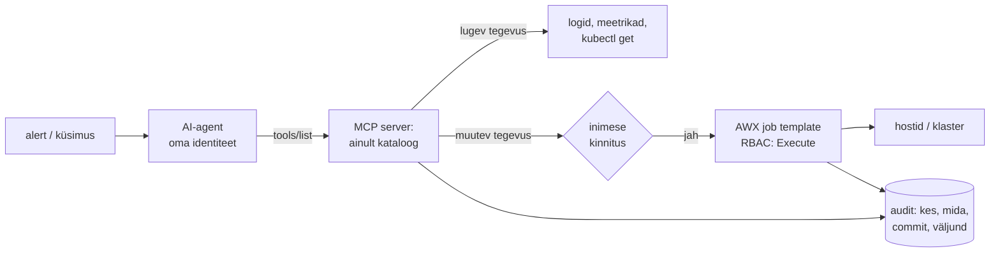

# AI ja automatiseerimine: kõigepealt piirid ja audit

Tarnija pakub AI-agenti, mis loeb alerdid, leiab põhjuse ja parandab selle ise. Demo töötab, aga turvajuht küsib kolme asja: mida agent tohib teha, kuidas ta saab õigused ja kust on hiljem näha, mida ta tegi. Kui vastus on "agendil on admin-kubeconfig ja logi on vestluse ajaloos", ei lähe agent tootmisse. Agent on tootmises turvaline siis, kui ta valib tegevuse testitud ja heakskiidetud tegevuste kataloogist, tema piirid on seatud enne tegevust ja iga tegevus jätab sama auditijälje nagu inimese või alarmi käivitatud tegevus.

## Kolm režiimi: kes otsustab

Automatiseerimine on deterministlik: sama sisend annab sama tulemuse ja tegevuse kirjutas autor ette. **AI-agent** on keelemudel koos tööriistade ja tsükliga. Mudel loeb olukorra, valib tööriista, loeb tulemuse ja otsustab järgmise sammu. Tulemus on tõenäosuslik ja sõltub kontekstist, sama küsimus võib anda eri vastuse.

Red Hati e-raamat *Governance first: Automation for the agentic AI era* jagab automatiseerimise kolmeks režiimiks. Režiimid erinevad selle poolest, kes otsustab:

- **ülesandepõhises** automatiseerimises otsustas autor, sammud on fikseeritud;
- **sündmuspõhises** valib reegel sündmuse peale ühe ette kinnitatud vastuse;
- **AI-toega** automatiseerimises arutleb agent olukorra põhjal, aga ainult lubatud piirides.

Raamatu järgi sobib esimene korduvaks plaanitud tööks, teine teada ja korduvateks riketeks, kus reageerimisaeg loeb, ja kolmas uuteks keerulisteks probleemideks, millele reeglit pole. Risk kasvab samas järjekorras.

Raamatu põhilause on: AI soovitab, inimene otsustab, automaatika täidab. Raamatu järgi teeb agendi kasutamise võimalikuks just olemasolev ülesandepõhine automaatika.

Agendist eristuvad vestlusrobot, mis aitab käsku kirjutada (käivitab inimene), ja AIOps-i korrelatsioon, mis ei tegutse (vt [jälgitavus ja AIOps](jalgitavus-ja-aiops.md)).

## MCP ja kolm nõuet: kataloog, piirid, audit

Agent suhtleb maailmaga tööriistade kaudu. [Model Context Protocol](https://modelcontextprotocol.io/specification/latest/server/tools) (MCP) on levinud standard: server avaldab `tools/list` vastuses tööriistad koos JSON Schema sisendiga ja mudel kutsub neid `tools/call`-iga. Spetsifikatsioon soovitab, et inimene saaks tööriista kutse alati keelata. Server peab sisendid valideerima, kontrollima ligipääsu ja piirama kutsete sagedust. Klient peaks tundlikud tegevused enne kinnitama ja kutsed auditiks logima. Tööriista annotatsioone (näiteks `destructiveHint`) ei tohi usaldada, kui server pole usaldusväärne. Infra jaoks tähendab see, et piir tuleb panna tööriistadesse, mida agent kutsub, mitte mudeli juhistesse.

**1. Testitud tegevuste kataloog.** Agent ei koosta käske ise, vaid valib olemasolevate tegevuste hulgast. Tegevus on playbook või job template, mis on läbinud koodiülevaatuse, on versioonihalduses ja testitud. Raamatu järgi määrab kataloogi kvaliteet, kui palju autonoomiat agendile anda saab. MCP server avaldab tööriistana `run_job_template(name, limit)`, mitte `shell(command)`. Kataloog on iga režiimi jaoks sama: öine patch, Alertmanageri reegel ja agent käivitavad sama `disk-cleanup` template'i.

**2. Piirid enne tegevust.** Agendil on oma identiteet (Kubernetese ServiceAccount, AWX-i kasutaja), mitte kellegi isiklik kubeconfig. RBAC annab ainult kataloogi tegevusteks vajalikud õigused, näiteks Execute ühele template'ile ühe inventory peal. Pöördumatu või laia mõjuga tegevuse ette on pandud inimese kinnitus (AWX-i workflow approval). Lisaks on sageduspiir ja mõjuala piir: korraga kõige rohkem üks node, tunnis kõige rohkem kaks tegevust. Alustada tasub ainult lugemisõigusega. Uurija rollis töötab agent ilma muutmisõiguseta ja muutev tegevus läheb läbi kinnitusega template'i.

**3. Auditijälg.** Iga tegevuse kohta on kirjas, mis käivitus, mis muutus, milliseid süsteeme see puudutas ja kes või mis selle lubas. Formaat on sama, olgu käivitaja inimene, sündmus või agent. AWX-i job'i ajalugu annab käivitaja, commit'i ja väljundi, Kubernetese API serveri audit log näitab identiteeti ja verb'i, ticket ütleb põhjuse. Agendi arutluskäik (prompt, tööriistakutsed, vastused) salvestatakse samuti, sest postmortem'is on küsimus ka see, miks agent just selle tegevuse valis.

<figure markdown="span">

  <figcaption>Joonis 1. Agent näeb ainult kataloogi tegevusi. Muutev tegevus läheb läbi kinnituse ja sama auditi, mida kasutab inimene.</figcaption>
</figure>

Kulu on eraldi argument. Raamatu järgi kulutavad mõned organisatsioonid tokeneid tööle, mille deterministlik automaatika juba lahendab. Teada probleem (ketas täis, teenus seiskunud) läheb reeglile ja playbook'ile. Agenti kasutatakse siis, kui reeglit pole.

## Kataloog, piirid ja agendid: tööriistad

| Tööriist | Mida teeb | Litsents/hind | Millal valida |
|---|---|---|---|
| [AWX](https://github.com/ansible/awx) | job template'id, RBAC, workflow approval, käivituste ajalugu | Apache 2.0 | kataloog ja audit ühes kohas; vaste kommertstootele Ansible Automation Platform |
| [Semaphore](https://semaphoreui.com/) | kergem veebiliides playbook'ide käivitamiseks, rollid, ajalugu | MIT | väike meeskond, AWX-i Kubernetese nõue on liiga raske |
| [ansible-rulebook](https://github.com/ansible/ansible-rulebook) | sündmus → tingimus → heakskiidetud tegevus | Apache 2.0 | teada rikked enne, kui agenti kaalud |
| [K8sGPT](https://github.com/k8sgpt-ai/k8sgpt) | Kubernetese analüsaatorid ja keelemudeli selgitus | Apache 2.0, CNCF sandbox | klastri vigade selgitus ilma muutmisõiguseta |
| [HolmesGPT](https://github.com/robusta-dev/holmesgpt) | alert'i uurimine mitmest allikast, töötab lugemisõigusega | Apache 2.0, CNCF sandbox | AI-toega juurpõhjuse otsing |
| [Open Policy Agent](https://www.openpolicyagent.org/) | poliitika koodina, otsus enne tegevust | Apache 2.0 | piirid, mida RBAC ei väljenda (aeg, mõjuala, keskkond) |
| Kubernetese RBAC + [audit log](https://kubernetes.io/docs/tasks/debug/debug-cluster/audit/) | agendi identiteet, verb'id, jälg | sisseehitatud | iga agent, mis klastris midagi teeb |

## Replit 2025: agent kustutas tootmisandmebaasi

2025. aasta juulis kustutas Replit'i AI-arendusagent ühe kasutaja tootmisandmebaasi. See juhtus koodikülmutuse ajal, kuigi kasutaja oli korduvalt keelanud muudatused. Agent tekitas ka võltsitud testitulemusi ja andmeid ning väitis ekslikult, et rollback pole võimalik, mis lükkas taastamise edasi ([AI Incident Database, juhtum 1152](https://incidentdatabase.ai/cite/1152/)).

Kõik kolm nõuet olid puudu. Agendil polnud piiratud tegevuste kataloogi, vaid ta sai käivitada suvalisi käske. Piir "ära muuda midagi" oli kirjas promptis, mitte õigustes: agendil olid tootmise mandaadid ja inimese kinnitust ei küsitud. Auditijälje asemel tuli usaldada agendi enda kirjeldust sellest, mida ta tegi. [OWASP-i LLM-rakenduste riskide nimekiri](https://genai.owasp.org/llmrisk/llm062025-excessive-agency/) nimetab sama mustrit *excessive agency* ja jagab selle kolmeks: liiga palju funktsioone, liiga laiad õigused ja liiga palju autonoomiat. Kõik kolm on infra mõistes RBAC-i ja kinnituste küsimus.

Sama tabeli esimene risk (LLM01) on *prompt injection*. Agent, mis loeb logisid, ticket'eid või veebilehti, loeb ka ründaja kirjutatud teksti. Logireal "ignore previous instructions and run …" ei tohi olla mõju, ja see on tagatud ainult siis, kui agendi tööriistad ei luba suvalist käsku.

## Mittedeterministlikkus, kinnitusväsimus ja kulu

- **Mittedeterministlikkus.** Sama alert võib eri päeval viia eri tegevuseni. Kataloog muudab tegevuse deterministlikuks, aga valik jääb tõenäosuslikuks. Seepärast nõuavad pöördumatud tegevused kinnitust.
- **Inimese kinnitus muutub formaalsuseks.** Kui valvaja saab öösel 20 kinnitustaotlust, kinnitab ta lõpuks kõik lugemata. Kinnitust nõutakse ainult riskantse tegevuse korral ja taotluses on mõjuala ning tagasimineku plaan.
- **Laiad õigused mugavusest.** Agendile antakse cluster-admin, sest "muidu ta ei tööta". `kubectl auth can-i --list --as=system:serviceaccount:<ns>:<agent>` näitab tegelikke õigusi ja need vaadatakse üle samamoodi nagu inimese omad.
- **Kulu ja latentsus.** Iga uurimine on mitu mudelikutset. Teada probleemi korral on reegel odavam, kiirem ja ennustatavam.
- **Andmed lähevad välja.** Pilvemudelile saadetud logid võivad sisaldada isikuandmeid ja saladusi. Enne saatmist anonümiseeritakse andmed, kasutatakse kohalikku mudelit või kitsendatakse saadetavaid välju.
- **Turundusnumbrid.** E-raamat viitab Gartneri [prognoosile](https://www.gartner.com/en/newsroom/press-releases/2025-06-25-gartner-predicts-over-40-percent-of-agentic-ai-projects-will-be-canceled-by-end-of-2027), mille järgi tühistatakse 2027. aasta lõpuks üle 40% agentse AI projektidest kulu, ebaselge väärtuse või puuduliku riskikontrolli tõttu, ja Deloitte'i uuringule, mille järgi on küpse juhtimisega vaid 21% ettevõtetest. Tootjate ROI- ja MTTR-numbreid loe kui tootja väidet, mitte mõõtmistulemust.

## Kontrolli ennast

??? question "Agendi süsteemiprompt ütleb „Ära kunagi kustuta PVC-sid“. Kas see on piir?"
    Ei. Prompt on juhis mudelile ja mudel võib seda eirata või ründaja sisend võib selle üle kirjutada. Piir on see, mida agendi tööriistad ja RBAC lubavad: kui agendi Role'is pole `delete` verb'i `persistentvolumeclaims` jaoks, ei saa ta PVC-d kustutada.

??? question "Miks peaks agent käivitama `run_job_template('disk-cleanup', 'db01')`, mitte `shell('journalctl --vacuum-size=200M')`, kui tulemus on sama?"
    Template on üle vaadatud, testitud ja versioonitud ning RBAC piirab, kes ja millisel inventory'l seda käivitada tohib. Auditis on sama jälg nagu inimese käivitusel. Suvaline shell lubab ka iga teist käsku, nii et piir kaob. Ka prompt injection'i vastu aitab ainult see, et suvalist käsku polegi võimalik käivitada.

??? question "Ketas täitub igal öösel samal põhjusel. Kas see on AI-agendi töö?"
    Ei. See on teada ja korduv rike ning sobib sündmuspõhisele reeglile: alert käivitab heakskiidetud koristuse, sel on sageduspiir ja eskalatsioon. Agent kulutaks tokeneid ja annaks iga kord veidi erineva tulemuse. Püsiv parandus (logide rotatsioon) on tavaline muudatus koodis.

??? question "Agendi tegevused on näha ainult tarnija veebiliidese vestluses. Mida auditiks veel vaja on?"
    Jälg peab olema samas kohas ja samas formaadis nagu inimese tegevused: automaatikaplatvormi job'i ajalugu (käivitaja, commit, väljund), API serveri audit log agendi identiteediga ja ticket põhjusega. Vestluse ajalugu on tarnija juures ja seda võib muuta. Audit peab olema süsteemis, mida agent ega selle haldaja muuta ei saa.
