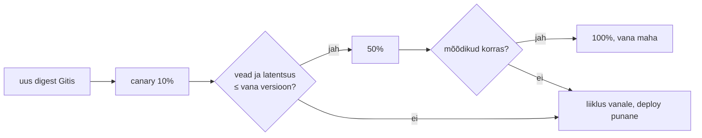

# DevOps automation ja deployment automation

Rakendusel on kaheksa serverit ja uus versioon paigaldatakse käsitsi skriptiga, mida admin käivitab igas serveris eraldi. Seitsmes serveris on uus kood, ühes vana ja monitooring näitab kõigil kaheksal rohelist, sest health check vastab mõlemal versioonil. Deployment automation teab, mis versioon peab kus töötama, kontrollib seda pärast paigaldust ja oskab tagasi minna ilma inimese otsuseta.

## Push ja pull: kes algatab muudatuse

Push-mudelis jõuab pipeline sihtkeskkonda ja paigaldab (GitHub Actions + Ansible/SSH). Pull-mudelis (GitOps) kirjutab pipeline uue versiooni Giti ja keskkonna sees olev agent (Argo CD, Flux) tõmbab selle. Pull-mudelis ei ole pipeline'il tootmise mandaate.

*Feature flag* lahutab release'i deploy'st: kood on tootmises välja lülitatuna ja see lülitatakse sisse eraldi otsusega. *Progressive delivery* on deployment automation, mis otsustab mõõdikute järgi: osa liiklusest läheb uuele versioonile ja tööriist kas jätkab või võtab muudatuse tagasi.

## Üks build, sama digest kõigis keskkondades

Build tehakse üks kord ja sama muutumatu artefakt (image'i digest, WAR-i kontrollsumma) liigub testist staging'usse ja tootmisse. Keskkonnad erinevad ainult seadistuse ja saladuste poolest. Kui iga keskkond ehitab ise, siis tootmises töötab binaar, mida keegi ei testinud. *Promotion* tähendab, et keskkonna kirjeldusse kirjutatakse uus digest. GitOps'i puhul on see commit, push-mudelis pipeline'i parameeter.

## Paigaldusstrateegiad ja nende rollback

Strateegia määrab, kui palju kasutajaid vigane versioon puudutab ja kui kiiresti saab tagasi minna.

| Strateegia | Mehhanism | Rollback | Hind | Andmebaasi piirang |
|---|---|---|---|---|
| Recreate | Vana maha, uus peale | Uus paigaldus, katkestus | Katkestus | Skeemi võib muuta paigalduse ajal |
| Rolling | Instantsid vahetatakse lainetena (Ansible `serial`, Kubernetese `maxSurge`/`maxUnavailable`) | Uus rolling eelmisele versioonile | Vana ja uus töötavad korraga | Skeem peab sobima mõlemale versioonile |
| [Blue-green](https://martinfowler.com/bliki/BlueGreenDeployment.html) | Kaks täiskeskkonda, liiklus lülitatakse ühe korraga | Lüliti tagasi, sekundid | Topelt ressursid | Jagatud andmebaas peab sobima mõlemale |
| [Canary](https://sre.google/workbook/canarying-releases/) | Väike osa liiklusest uuele, võrdlus vanaga | Liiklus tagasi vanale | Vajab liikluse jagamist ja mõõdikuid | Nagu rolling |
| Feature flag | Kood on tootmises, lüliti on konfis | Lüliti välja, ilma deploy'ta | Lülitite haldus ja vanade lülitite eemaldamine | Ei lahenda skeemimuudatust |

Kubernetese Deployment'i rolling update'il on vaikimisi `maxSurge: 25%`, `maxUnavailable: 25%` ja `progressDeadlineSeconds: 600` ([dokumentatsioon](https://kubernetes.io/docs/concepts/workloads/controllers/deployment/)). Kui uued pod'id ei jõua kümne minutiga olekusse Ready, märgib kontroller Deployment'i tingimuse `Progressing=False`. Tagasi ta ise ei lähe. Rollback'i peab tegema pipeline (`kubectl rollout undo`, eelmine digest Giti) või progressive delivery tööriist.

## Kas paigaldus õnnestus: versioon ja mõõdikud

Paigaldus on õnnestunud siis, kui töötab õige versioon ja see teenindab korralikult. Esimese poole kontrollib versiooni võrdlus (`/version` vastus ja pipeline'i commit). Teine pool tähendab mõõdikuid: vigade osakaal, latentsus ja küllastus paigalduse järel võrreldes enne paigaldust olnuga. Canary analüüsis küsib tööriist Prometheuselt päringu tulemust ja võrdleb seda lävendiga. Kui tulemus on halvem, võtab tööriist liikluse tagasi ilma inimeseta.

<figure markdown="span">

  <figcaption>Joonis 1. Progressive delivery: iga samm on otsus mõõdiku järgi. Inimene vaatab tulemust, mitte graafikut keset paigaldust.</figcaption>
</figure>

## DORA viis näitajat pipeline'i andmetest

[DORA](https://dora.dev/guides/dora-metrics/history/) kasutab praegu viit näitajat. Läbilaskevõime kohta on aeg muudatusest tootmiseni, deploy'de sagedus ja taastumisaeg ebaõnnestunud deploy'st. Ebastabiilsuse kohta on ebaõnnestunud muudatuste osakaal ja 2024. aastal lisatud *deployment rework rate*, see tähendab plaaniväliste parandusdeploy'de osakaal. Need tulevad pipeline'i andmetest: commit'i aeg, deploy aeg ja tulemus ning intsidendi või rollback'i kirje. Kui deploy käib käsitsi, puuduvad need andmed või on need kellegi Excelis.

## Tasuta tööriistad ja millal mida

| Tööriist | Mida teeb | Litsents/hind | Millal valida |
|---|---|---|---|
| [GitHub Actions](https://docs.github.com/actions) | Workflow'd, environment'id ja kaitsereeglid | Teenus; avalikus repos standardsetel runner'itel tasuta, privaatses plaani minutid ja edasi minutipõhine | Kood on GitHubis |
| [GitLab CI/CD](https://docs.gitlab.com/ci/) | Pipeline'id, environment'id, oma runner'id | MIT (CE); EE tasuline | Oma server, kõik ühes tööriistas |
| [Jenkins](https://www.jenkins.io/) | CI server, Jenkinsfile, agendid | MIT | Olemasolev Jenkins, palju integratsioone, kinnine võrk |
| [Ansible](https://docs.ansible.com/) | Push-deploy VM-idele (`serial`, `block`/`rescue`) | GPLv3 | VM-id ja füüsilised serverid |
| [Argo CD](https://argo-cd.readthedocs.io/) | GitOps pull Kubernetesesse | Apache 2.0 | Kubernetes, pipeline ilma klastri mandaatideta |
| [Flux](https://fluxcd.io/) | GitOps pull, kontrollerite komplekt | Apache 2.0 | Kubernetes, väiksem kui Argo CD ja ilma UI-ta |
| [Argo Rollouts](https://argo-rollouts.readthedocs.io/) | Canary ja blue-green mõõdikute analüüsiga | Apache 2.0 | Progressive delivery Argo CD kõrval |
| [Flagger](https://flagger.app/) | Canary service mesh'i või Ingress'iga | Apache 2.0 | Fluxi kasutajad |
| [OpenFeature](https://openfeature.dev/) | Feature flag'ide standardne SDK | Apache 2.0 | Lülitid ilma ühe tootjaga sidumata |

Kommertsvõrdluseks pakuvad Harness ja Octopus Deploy sama ahelat valmis UI ja kinnituste ning auditiga. Nende hind on litsents ja lock-in.

## Knight Capital 2012: seitse serverit kaheksast

1. augustil 2012 kaotas USA börsimaakler Knight Capital 45 minutiga üle 460 miljoni dollari. Uus kood tuli paigaldada kaheksale serverile. Tehnik paigaldas selle käsitsi seitsmele ja üks server jäi vahele. Seal käivitas uus lipp 2003. aastast kasutamata koodi, mis saatis turule miljoneid tellimusi. Teist tehnikut, kes paigalduse üle oleks vaadanud, polnud ja kirjalik protseduur ei nõudnud kontrolli, et kõigis serverites töötab sama versioon ([SEC-i otsus 34-70694](https://www.sec.gov/litigation/admin/2013/34-70694.pdf)).

Deployment automation oleks katnud kaks puudust. Sama protseduur oleks käinud kõigis kaheksas serveris ja järelkontroll oleks võrrelnud igas serveris töötavat versiooni oodatuga. Kolmas õppetund puudutab feature flag'e: vana lipu korduvkasutamine ilma vana koodi eemaldamata on tehniline võlg, mida ükski pipeline ei näe.

## Kus automaatika ise riski loob

- **Pipeline on tootmissüsteem.** Push-mudelis on tal tootmise mandaadid ja tema kompromiteerimine on tootmise kompromiteerimine. Pull-mudel vähendab seda riski, aga lisab klastrisse agendi, mida tuleb uuendada ja jälgida.
- **Vigane muudatus levib sama kiiresti.** Automaatika teeb vigase muudatuse samamoodi kõigis kohtades. Lained ja canary piiravad mõjuala, aga ainult siis, kui mõõdik vea tegelikult näeb. Canary väikese liiklusega teenusel ei anna statistiliselt midagi.
- **Andmed ei lähe tagasi.** Rollback vahetab koodi, andmebaasi skeem jääb samaks. Skeemimuudatus käib *expand/contract* kaupa ja selle peab plaanima enne paigaldust.
- **Lülitite võlg.** Iga feature flag on kood kahe harugaga. Ilma aegumise ja eemaldamise reeglita jäävad lülitid koodi aastateks ja keegi ei tea, kumba haru tootmises kasutatakse.
- **Mõõdiku manipuleerimine.** Kui deploy'de sagedus on eesmärk, tekivad tühjad deploy'd. DORA näitajad on meeskonna enda tagasiside ja meeskondade võrdlemiseks neid ei kasutata.
- **Järelkontrolli puudumine.** `docker compose up -d` lõpetab, kui konteiner käivitus, mitte siis, kui rakendus vastab. Ilma versiooni ja mõõdikute kontrollita on see käsitsi deploy, mis lihtsalt käib kiiremini.

## Kontrolli ennast

??? question "Deployment ei jõua kümne minutiga uute pod'idega olekusse Ready. Mis on klastri seis ja kes teeb rollback'i?"
    Kontroller märgib `Progressing=False` põhjusega `ProgressDeadlineExceeded`. Vanad pod'id, mida `maxUnavailable` lubas alles hoida, teenindavad edasi ja osa uusi pod'e võib jääda ootele. Kubernetes ise tagasi ei lähe. Seda teeb pipeline (`kubectl rollout undo` või eelmine digest Giti) või Argo Rollouts'i tüüpi tööriist.

??? question "Millal valiksid blue-green'i ja millal canary?"
    Blue-green sobib siis, kui on vaja kohest ja täielikku tagasiminekut ning topeltressursid on taskukohased, näiteks väike arv VM-e koormusjaoturi taga. Canary sobib suure liiklusega teenusele, kus väike osa kasutajatest annab mõõdikutes statistiliselt tähendusliku tulemuse. Mõlemal juhul peab andmebaasi skeem sobima nii vanale kui ka uuele versioonile.

??? question "Miks ei tohi staging ja tootmine ehitada artefakti eraldi, kui lähtekood on sama commit?"
    Eri build'is võivad olla teised sõltuvuste versioonid, base image või kompilaator ja tootmisse läheks binaar, mida keegi ei testinud. Üks build ja sama digest kõigis keskkondades annab tõendi, et tootmises töötab testitud artefakt. Keskkonnad erinevad ainult seadistuse ja saladuste poolest.

??? question "Kuidas saad DORA ebaõnnestunud muudatuste osakaalu ja taastumisaja pipeline'i andmetest?"
    Iga deploy kirje sisaldab aega, versiooni ja tulemust. Ebaõnnestunuks loetakse deploy, mis lõppes rollback'i, parandusdeploy või intsidendiga. Osakaal on ebaõnnestunud deploy'de arv jagatud kõigi deploy'de arvuga. Taastumisaeg on vahe ebaõnnestunud deploy ja sellele järgnenud terve seisu vahel. Selleks peab rollback ja intsident olema seotud deploy kirjega, näiteks issue või ITSM-i kirje kaudu.
