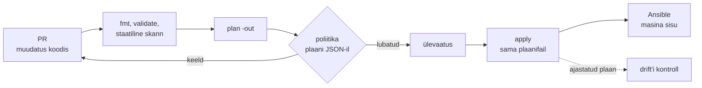

# Taristu koodina ja poliitika koodina

Testkeskkond tehti kaks aastat tagasi sama tiketi järgi nagu tootmine. Nüüd ebaõnnestub deploy ainult tootmises ja võrdlus näitab kümmet erinevust: teine kerneli versioon, puuduv tulemüürireegel, teine DNS-server, käsitsi suurendatud ketas. Keegi ei tea, kumb keskkond on "õige", sest kumbki pole kusagil kirjas. **Taristu koodina tähendab, et tõe allikas on Gitis olev kirjeldus ja iga muudatus läbib enne API-ni jõudmist sama ülevaatuse, plaani ja automaatse poliitikakontrolli.**

## Kus IaC lõpeb ja poliitika algab

Piir käib seal, kus kaob soovitud seis. Bashi skript, mis kutsub `qm create`, on automatiseerimine, aga mitte IaC selles tähenduses: teine käivitus ebaõnnestub ID konflikti peale või loob duplikaadi ning skript ei tea, mis on muutunud. CMDB kirjeldab taristut, aga ei muuda midagi, nii et see vananeb esimesest käsitsi muudatusest. Golden image ise on artefakt, IaC on Packeri mall, millest see ehitatakse.

Kaks asja, mis sageli segi lähevad: OpenTofu ja Terraform haldavad API objekte (VM, ketas, võrk, DNS, IAM), Ansible haldab masina sisu (paketid, failid, teenused, kasutajad). Mõlemad on deklaratiivsed, aga ainult esimesel on state, mis mäletab, mida ta lõi. Sellest tuleb praktiline erinevus: koodist eemaldatud VM kustutatakse OpenTofus, Ansible'is jääb koodist eemaldatud pakett hostile alles.

Poliitika koodina (policy as code) hinnatakse otsuse kohas: PR-is, plaani juures või API sisendis. Näiteks nurjab reegel plaani, kui `db` tag'iga VM-il puudub `backup` tag; wiki-leht sama nõudega jääb dokumentatsiooniks. Mooduli `validation` ja `precondition` on samuti kontrollid koodis, aga need on mooduli autori reeglid. Organisatsiooni poliitika kehtib kõigile moodulitele ja meeskondadele korraga ning on seepärast eraldi repos.

## Plaan, poliitika kolmel tasemel ja inventory üleandmine

PR käivitab vormingu- ja süntaksikontrolli, seejärel `tofu plan -out`, plaani JSON-i poliitikakontrolli ja inimese ülevaatuse. `apply` kasutab sama plaanifaili, mis üle vaadati. Pärast `apply`-d seadistab Ansible masinad ja ajastatud plaan otsib drift'i.

<figure markdown="span">

  <figcaption>Joonis 1. Muudatuse tee: poliitika kontrollib plaani, mitte ainult koodi.</figcaption>
</figure>

Poliitikat hinnatakse kolmel tasemel ja igaüks näeb erinevat osa. Staatiline skann ([Checkov](https://www.checkov.io/), Trivy config) loeb HCL-i ja leiab mustreid: avalik bucket, krüpteerimata ketas. See on kiire, aga ei näe muutujate lõplikke väärtusi ega mooduli sisu. Plaani kontroll ([Open Policy Agent](https://www.openpolicyagent.org/docs/latest/) ja [Conftest](https://www.conftest.dev/) `tofu show -json` väljundi peal) näeb täpselt, mida `apply` teeks, kaasa arvatud kustutused. Väärtused, mis selguvad alles `apply` ajal, on seal `after_unknown` all ja korrektne reegel keelab muudatuse, kui otsustav väärtus on teadmata. Kolmas tase on sihtsüsteemi enda kontroll: Kubernetese admission (Kyverno, OPA Gatekeeper), AWS-i SCP või Proxmoxi õigused tokenil. See kehtib ka siis, kui keegi läheb pipeline'ist mööda, ja kontrollib muudatust viimasena.

Ansible'i ja OpenTofu koostöös on üleandmise koht inventory. Seda saab teha kolmel viisil. Esimene: Tofu kirjutab `templatefile`-iga inventory faili oma väljunditest. See on lihtne ja kursusel kasutatav variant, aga fail on hetkeseis ja vananeb, kui keegi lisab hosti käsitsi. Teine: dünaamiline inventory loeb hüperviisori API-t (`community.general.proxmox`, `amazon.aws.aws_ec2`) ja grupeerib hostid tag'ide järgi. Siis on tõe allikas API ja tag'id peavad olema koodis. Kolmas: Terraformi `ansible/ansible` provider kirjeldab `ansible_host` ressursse ja kollektsiooni `cloud.terraform` inventory plugin `cloud.terraform.terraform_provider` loeb need otse state'ist ([Red Hati kirjeldus](https://redhat.com/en/blog/providing-terraform-with-that-ansible-magic)). Sama kollektsioon sisaldab ka moodulit `cloud.terraform.terraform`, millega Ansible käivitab Terraformi, kui orkestreerija rolli tahetakse anda Ansible'ile.

Halb variant on `local-exec` provisioner, mis käivitab `ansible-playbook`-i ressursi loomisel. See käivitub ainult üks kord, ebaõnnestumine märgib ressursi asendamiseks (tainted) ja hilisemat seadistuse muudatust Tofu ei näe.

## OpenTofu, Ansible, OPA ja nende litsentsid

| Tööriist | Mida teeb | Litsents / hind | Millal valida |
|---|---|---|---|
| [OpenTofu](https://opentofu.org/docs/) | API objektid deklaratiivselt, state, plaan | MPL 2.0, tasuta | vaikimisi valik taristu jaoks, ka on-prem Proxmoxile |
| [Terraform](https://developer.hashicorp.com/terraform/docs) | sama keel ja töövoog | BSL 1.1 alates 1.6 | kui organisatsioon on juba HCP Terraformi peal |
| [Ansible](https://docs.ansible.com/) | masina sisu, järjestatud muudatused hostide kaupa | GPLv3, tasuta | OS-i ja rakenduse seadistus, patch'imine |
| [Pulumi](https://www.pulumi.com/docs/) | IaC programmeerimiskeeles | Apache 2.0, Pulumi Cloud tasuline | meeskond kirjutab niikuinii Pythonit või TypeScripti |
| [Packer](https://developer.hashicorp.com/packer/docs) | golden image'i ehitus koodist | BSL 1.1 | VM-i mallid on-prem ja pilves |
| OPA + Conftest | Rego reeglid suvalise JSON-i peal, ka plaani peal | Apache 2.0 | organisatsiooni reeglid üle kõigi moodulite |
| Checkov | staatiline skann IaC failidele | Apache 2.0 | kiire esimene filter PR-is |
| [AWX](https://github.com/ansible/awx) | Ansible'i ja töövoogude käivitus, õigused, logi | Apache 2.0 | mitu meeskonda jagab samu playbook'e |
| HCP Terraform + Sentinel | hallatud state, plaanid, poliitika | kommerts | võrdluseks: sama mudel teenusena |

*Tabel 1. IaC ja poliitika tööriistad. Red Hati Ansible Automation Platformi avatud vaste on AWX.*

## Knight Capital 2012: üks server kaheksast

2012. aasta juuli lõpus paigaldas Knight Capital uue kauplemiskoodi oma kaheksale SMARS-serverile. [SEC-i otsuse](https://www.sec.gov/litigation/admin/2013/34-70694.pdf) järgi tegi seda tehnik käsitsi ja uus kood jäi ühest serverist puudu. Teist inimest, kes paigalduse üle oleks kontrollinud, ei olnud. Uus kood kasutas lippu, mis varem käivitas 2003. aastast kasutamata funktsiooni Power Peg. 1. augustil käivitas sama lipp kaheksandas serveris vana koodi, mis saatis 45 minuti jooksul turule miljoneid tellimusi. Kahjum oli üle 460 miljoni dollari.

IaC ei oleks vigast disaini parandanud, aga see oleks muutnud nähtavaks, et kaheksast serverist üks ei vasta kirjeldusele. Sama tööriist oleks teinud sama muudatuse kõigil kaheksal. Kontroll "kõigil hostidel on sama versioon" on üherealine poliitika, mida saab käivitada enne kauplemise algust. SEC-i otsuses on puudusena eraldi välja toodud ka see, et paigaldusel polnud kirjalikku protseduuri.

Eesti avalikus sektoris on poliitika koodina seotud [E-ITS-iga](https://eits.ria.ee/). Kui asutus peab E-ITS-i täitma, saab osa tehnilistest meetmetest kirjutada plaani või konfiguratsiooni reegliks: haldusliides pole avalik, ketas on krüpteeritud, logid lähevad kesksesse logihaldusse. Auditis on siis tõendiks reegel, selle test ja pipeline'i logi, mitte käsitsi täidetud tabel. Millised meetmed on nii kontrollitavad, sõltub asutuse kaitsetarbest ja süsteemist.

## Vigane moodul, haavatav state ja liiga range poliitika

IaC teeb muudatuse kiireks ja korratavaks, ka vigase. Käsitsi tehtud viga mõjutab üht masinat, moodulis tehtud viga kõiki keskkondi, mis seda tag'i kasutavad. Seepärast on moodulitel versioonid ja uus versioon jõuab tootmisse alles pärast testkeskkonda.

State on tundlik ja haavatav. Selles on saladused lihttekstina ja selle kaotus tähendab importi. Kahe tõe allika probleem tekib siis, kui sama objekti muudab nii kood kui ka keegi UI-s või teine tööriist. Plaan näitab seda drift'ina, aga ainult nende objektide kohta, mida state teab.

Poliitika annab vale kindlustunde, kui see ei arvesta teadmata väärtusi, kui erandite kord puudub või kui reegel kontrollib ainult koodi, mitte plaani. Liiga range poliitika ilma erandite korrata viib selleni, et samm lülitatakse pipeline'ist välja. Erand peaks olema samuti kood: allowlist koos põhjuse ja aegumiskuupäevaga.

Õppida on palju. HCL, state'i operatsioonid (`moved`, `import`, `state rm`), provider'ite versioonid ja `.terraform.lock.hcl` lisanduvad sellele, mida admin juba teab. Väikese ja harva muutuva keskkonna puhul võib hästi hoitud runbook olla odavam. IaC tasub end ära siis, kui keskkondi on mitu, muudatusi on sageli või audit küsib muudatuste jälge.

## Kus see kursusel tuleb

[4. kohtumise loeng](../k04/loeng.md) käsitleb state'i, plaani ja poliitikat ([ptk 3](../k04/loeng.md#3-plaan-ja-poliitika-enne-muudatust)) ning Ansible't ja OpenTofut koos ([ptk 6](../k04/loeng.md#6-orkestreerimine-ansible-ja-opentofu-koos)). Laborites teed [Üks VM koodist](../k04/lab-1-uks-vm.md), [Moodul, moved ja state](../k04/lab-3-moodul-state.md), [Üks käsk](../k04/lab-4-uks-kask.md) (inventory Tofu väljundist) ja [Import, drift ja keskkonnad](../k04/lab-6-import-drift.md); lisaülesanded on [12. Poliitika plaanile Conftestiga](../k04/lisa.md#12-poliitika-plaanile-conftestiga), [6. Provisioner võrdluseks](../k04/lisa.md#6-provisioner-vordluseks) ja [7. Sama kood Terraformiga](../k04/lisa.md#7-sama-kood-terraformiga). Pilves kordab sama struktuuri `aws` provideriga [4. kohtumise kodutöö](../kodutood/k04-aws.md).

## Kontrolli ennast

??? question "Kolleeg ütleb, et tema Bashi skript `create-vms.sh` on Gitis, nii et see on IaC. Mida sa küsid?"
    Küsid, mis juhtub teisel käivitusel ja mis juhtub, kui üks VM koodist eemaldatakse. Kui skript loob duplikaadi või ebaõnnestub ja eemaldatud VM jääb alles, on see versioonitud automatiseerimine, aga soovitud seisu ega plaani pole. IaC tööriist arvutaks erinevuse ja näitaks selle enne muudatust.

??? question "Miks kontrollitakse organisatsiooni poliitikat plaani JSON-i peal, mitte ainult HCL-faili peal?"
    HCL-is ei ole muutujate lõplikke väärtusi, mooduli sisu ega seda, kas muudatus on `~` või `-/+`. Plaan näitab täpselt, mida `apply` teeks, ka kustutusi. Väärtused, mis selguvad alles `apply` ajal, on `after_unknown` all ja reegel peab need keelama, muidu laseb ta muudatuse läbi.

??? question "Tofu loob viis VM-i ja `local-exec` käivitab kohe `ansible-playbook`-i. Mis selle lahendusega kolme kuu pärast juhtub?"
    Provisioner käivitub ainult loomisel. Kui playbook muutub, ei käivita Tofu seda olemasolevatel masinatel ja keegi peab Ansible'i eraldi käivitama. Kui playbook loomisel ebaõnnestub, märgitakse VM asendamiseks ja järgmine `apply` kustutab ning loob selle uuesti. Parem on, kui Tofu annab inventory ja sama pipeline käivitab Ansible'i eraldi sammuna.

??? question "Poliitika on pipeline'is, aga keegi kustutab andmebaasi VM-i Proxmoxi UI-st. Mis oleks selle peatanud?"
    Ainult sihtsüsteemi kontroll: Proxmoxi `protection` lipp ja tokenite ning kasutajate õigused pool'i kaupa. Pipeline'i poliitika näeb ainult koodi kaudu tehtud muudatusi. Seepärast pannakse kriitilistele objektidele nii koodi reegel kui ka platvormi kaitse.
